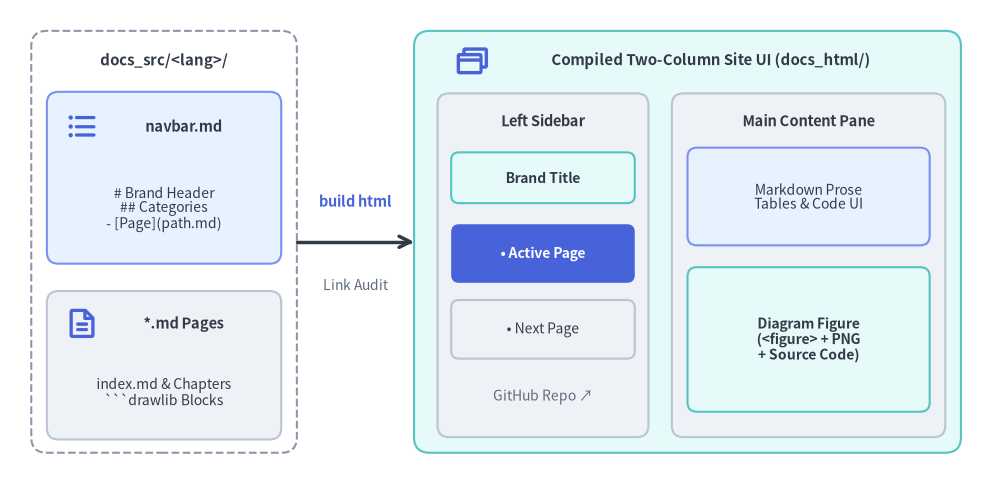
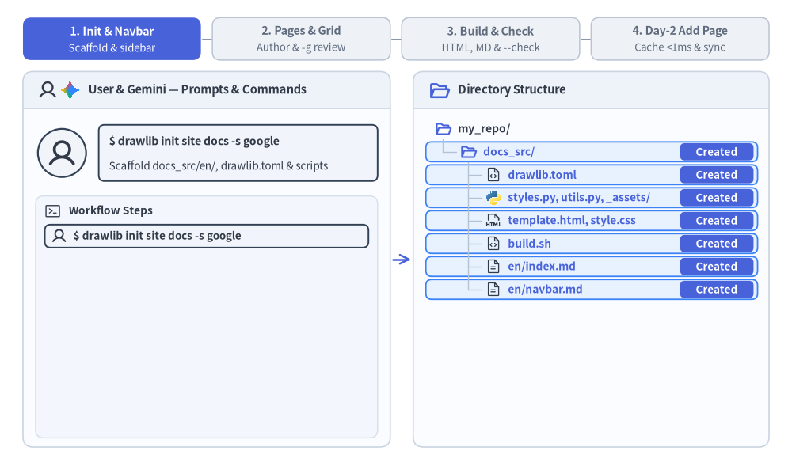

# Site Project Guide (`drawlib init project site`)

The `site` starter template builds a responsive multi-page technical documentation website with hierarchical sidebar navigation, mobile-responsive layout, syntax highlighting, and dual publishing to static HTML and GitHub-ready Markdown.

Drawlib compiles `docs_src/<lang>/navbar.md` and your Markdown pages into a two-column documentation portal with strict build-time link validation:


<figure class="drawlib-image" style="text-align: center;">
  
  <figcaption class="drawlib-caption">How navbar.md and Markdown Pages Compile into the Two-Column Documentation Site UI</figcaption>
</figure>

<details class="drawlib-code-details">
<summary>Source Code</summary>

```python
from drawlib.canvas import save, setup
from drawlib.icons import phosphor
from drawlib.lines import line
from drawlib.shapes import rectangle
from drawlib.styles import Styles
from drawlib.text import text

setup(width=128, height=62)

# Left: Source directory container
rectangle((21, 31), width=34, height=54, style=Styles.MutedDashed.patch(shape_r=2.0))
text((21, 54.2), "docs_src/<lang>/", style=Styles.DarkBold.patch(text_size=10.8))

rectangle((21, 39.2), width=30, height=22, style=Styles.PrimaryNeutral.patch(shape_r=1.5))
phosphor.list_bullets((10.5, 45.8), width=4.4, style=Styles.PrimaryBold)
text((23.5, 45.8), "navbar.md", style=Styles.DarkBold.patch(text_size=10.5))
text((21, 35.2), "# Brand Header\n## Categories\n- [Page](path.md)", style=Styles.Dark.patch(text_size=10.0))

rectangle((21, 15.2), width=30, height=19, style=Styles.Neutral.patch(shape_r=1.5))
phosphor.file_text((10.5, 20.5), width=4.4, style=Styles.PrimaryBold)
text((23.5, 20.5), "*.md Pages", style=Styles.DarkBold.patch(text_size=10.5))
text((21, 11.8), "index.md & Chapters\n```drawlib Blocks", style=Styles.Dark.patch(text_size=10.0))

# Middle: Compiler step
line((38, 31), (53, 31), arrow_head="->", style=Styles.DarkBold)
text((45.5, 36.2), "build html", style=Styles.PrimaryBold.patch(text_size=10.5))
text((45.5, 25.5), "Link Audit", style=Styles.Muted.patch(text_size=10.0))

# Right: Compiled Two-Column Site UI (docs_html/<lang>/)
rectangle((88, 31), width=70, height=54, style=Styles.SecondaryNeutral.patch(shape_r=2.0))
phosphor.browsers((60.5, 54.2), width=4.6, style=Styles.PrimaryBold)
text((91.0, 54.2), "Compiled Two-Column Site UI (docs_html/<lang>/)", style=Styles.DarkBold.patch(text_size=10.8))

# Left Sticky Sidebar
rectangle((69.5, 28.0), width=27, height=44, style=Styles.Neutral.patch(shape_r=1.5))
text((69.5, 46.5), "Left Sidebar", style=Styles.DarkBold.patch(text_size=10.5))
rectangle(
    (69.5, 39.2),
    width=23.5,
    height=6.5,
    style=Styles.SecondaryNeutral.patch(shape_r=1.0),
    text="Brand Title",
    text_style=Styles.DarkBold.patch(text_size=10.0),
)
rectangle(
    (69.5, 29.5),
    width=23.5,
    height=7.5,
    style=Styles.PrimaryFlat.patch(shape_r=1.0),
    text="• Active Page",
    text_style=Styles.WhiteBold.patch(text_size=10.0),
)
rectangle(
    (69.5, 19.8),
    width=23.5,
    height=7.5,
    style=Styles.Neutral.patch(shape_r=1.0),
    text="• Next Page",
    text_style=Styles.Dark.patch(text_size=10.0),
)
text((69.5, 11.2), "GitHub Repo ↗", style=Styles.Muted.patch(text_size=10.0))

# Right Main Content Pane
rectangle((103.5, 28.0), width=35, height=44, style=Styles.Neutral.patch(shape_r=1.5))
text((103.5, 46.5), "Main Content Pane", style=Styles.DarkBold.patch(text_size=10.5))
rectangle(
    (103.5, 36.8),
    width=31,
    height=12.5,
    style=Styles.PrimaryNeutral.patch(shape_r=1.2),
    text="Markdown Prose\nTables & Code UI",
    text_style=Styles.Dark.patch(text_size=10.0),
)
rectangle(
    (103.5, 18.5),
    width=31,
    height=18.5,
    style=Styles.SecondaryNeutral.patch(shape_r=1.2),
    text="Diagram Figure\n(<figure> + PNG\n+ Source Code)",
    text_style=Styles.DarkBold.patch(text_size=10.0),
)

save()
```

</details>


---

## 1. End-to-End Project Workflow

From initial `drawlib init project site` scaffolding and `navbar.md` sidebar setup to `-g` grid inspection, headless link validation (`drawlib serve --check`), and Day-2 incremental page additions backed by `.drawlib/cache.db`:


<figure class="drawlib-image" style="text-align: center;">
  
  <figcaption class="drawlib-caption">Multi-Page Website Project Lifecycle: Scaffolding, Navbar & Pages, Link Audit, and Day-2 Page Addition (APNG Animation)</figcaption>
</figure>


<div class="drawlib-source-link">
  <a href="https://github.com/yuichi110/drawlib/blob/main/docs/docs_src/en/09_doc_builder_and_cli/project_site.md" target="_blank" rel="noopener noreferrer">View animation source code on GitHub &rarr;</a>
</div>

---

## 2. Project Initialization

Scaffold a documentation website using `drawlib init project` (every `site` project uses the unified `<src_dir>/<lang>/` locale layout, even for a single language):

```bash
# Scaffold default 'docs_src/en/' in the current directory:
drawlib init project site

# Or specify a custom target prefix and single or multiple locales (creates 'my_docs_src/<lang>/'):
drawlib init project site my_docs --style google --lang en
drawlib init project site my_docs --style google --lang en,ja
```

---

## 3. Directory Layout & Architecture

A `site` project strictly separates editable source files (`docs_src/`) from generated publishing artifacts:

- **`docs_src/` (Single Source of Truth)**:
  - **`drawlib.toml`**: Project manifest declaring `type = "site"`, `style`, and the required `[i18n]` section (`default_lang`, `langs` with `len >= 1`, and optional `[i18n.labels]`; `lang` under `[project]` is disallowed).
  - **`<lang>/index.md`**: Per-locale site landing page rendered as `<lang>/index.html` (with `docs_html/index.html` redirecting to `default_lang`).
  - **`<lang>/navbar.md`**: Per-locale declarative sidebar navigation manifest defining brand title, collapsible sections, and page links.
  - **Nested Section Sub-Folders (`<lang>/guide/`, `<lang>/api/`, `<lang>/01_architecture/`, etc.)**: Hierarchical Markdown pages with embedded ```` ```drawlib ```` diagram blocks.
  - **`_assets/`**: Static media files (logos, screenshots, data files) recursively mirrored into output portals (referenced from `<lang>/` Markdown prose via `../_assets/...`).
  - **`styles.py` & `utils.py`**: Project-wide theme palette, language typography defaults (plus optional per-locale `<lang>/styles.py` overrides), and shared Python drawing helpers.
  - **`template.html` & `style.css`**: Responsive two-column HTML layout shell and 3-layer CSS stylesheet.
  - **`build.sh`, `build_html.sh`, `build_markdown.sh`, `build_image.sh`, `serve.sh`**: Modular build and local preview scripts.
- **Generated Outputs (Do Not Edit Directly)**:
  - **`docs_html/`**: Responsive static HTML documentation portal (`docs_html/<lang>/`, root `docs_html/index.html` redirect, and shared `docs_html/images/`) ready for web hosting and `drawlib serve`.
  - **`docs_markdown/`**: GitHub-ready Markdown portal (`docs_markdown/<lang>/` and shared `docs_markdown/images/`) with compiled PNG/WebP figure links.
  - **`docs_images/`**: Standalone extracted illustrations when running `build_image.sh`.

---

## 4. Sidebar Navigation (`<lang>/navbar.md`)

The sidebar navigation structure for each locale is governed entirely by `docs_src/<lang>/navbar.md`:

```markdown
# Drawlib Documentation

- [Home](index.md)

## Core Infrastructure
- [VPC Architecture](01_architecture/vpc.md)
- [Storage Tier](01_architecture/storage.md)

## Microservices
- [Authentication Gateway](02_services/auth.md)
- [Payment Service](02_services/payments.md)

## External Resources
- [GitHub Repository](https://github.com/example/repo)
```

### Authoring Rules:
1. **Brand Header (`# Title`)**: The top level `# Heading 1` sets the brand title in the sidebar header.
2. **Category Groupings (`## Category`)**: Each `## Heading 2` defines a collapsible navigation category section.
3. **Internal Document Links**: Relative paths are resolved within that locale directory (`docs_src/<lang>/`) and must point to existing Markdown files.
4. **External Links**: URLs beginning with `http://` or `https://` automatically open in a new tab (`target="_blank"`) with an external link indicator.
5. **Strict Build-Time Validation**: If any linked document does not exist, the build immediately aborts with an error indicating the file and line number.
6. **Active Page Tracking**: The currently viewed page is automatically highlighted (`.nav-item.active`) with dynamic relative path resolution.

---

## 5. Static Asset Synchronization

Any static assets placed in `docs_src/` (such as custom logos, sample data files, or images in `_assets/`) are recursively mirrored to `docs_html/` and `docs/` (`docs_markdown/`), preserving folder hierarchies.

---

## 6. Building & Local Preview

### Compile Site
```bash
./docs_src/build_html.sh       # Compile HTML site (docs_html/)
./docs_src/build_markdown.sh   # Compile Markdown site (docs_markdown/ or docs/)
./docs_src/build_image.sh      # Extract standalone images (docs_images/)
./docs_src/build.sh            # Run all builds sequentially
```

### Local Preview Server & Link Audit
Start the local development server to preview pages:

```bash
uv run drawlib serve docs_html/
```

Before deploying to production, run a headless pre-flight audit:

```bash
uv run drawlib serve docs_html/ --check
```

---

## 7. Parallel Multi-Agent Site Authoring

Multi-page `site` projects (`docs_src/<lang>/**/*.md`) scale naturally across parallel AI subagents:
1. **Phase 1 (Parent Setup)**: Scaffold `docs_src/` (`drawlib init project site`) and finalize shared files (`drawlib.toml`, `styles.py`, `utils.py`, `_assets/`, `<lang>/index.md`, and the complete `<lang>/navbar.md` sidebar tree) before launching subagents.
2. **Phase 2 (Parallel Subagents)**: Assign each subagent a disjoint page or section directory (e.g., `<lang>/01_architecture/*.md` vs. `<lang>/02_services/*.md`). Each subagent treats `drawlib.toml`, `styles.py`, `utils.py`, and `<lang>/navbar.md` as read-only, authors its assigned pages, and runs `-g` grid previews using unique scratch filenames (`-o .drawlib/scratch/<page>_<block>_grid.png`).
3. **Phase 3 (Unified Build & Link Audit)**: Once all subagents finish, the parent agent runs `./docs_src/build.sh` once and verifies site-wide link integrity with `uv run drawlib serve docs_html/ --check`.

---

## 8. Unified `i18n` & Multi-Language Websites (`drawlib.toml`)

Every `docs_src/` project is `i18n`-native out of the box (`langs = ["en"]` by default). Expanding a single-language portal into a multi-language site later requires zero `git mv` restructuring—pass comma-separated language codes to `drawlib init project site` or add a locale directory (`docs_src/ja/`) and update `[i18n]` in `docs_src/drawlib.toml`:

```bash
uv run drawlib init project site docs -l en,ja -s default
```

```toml
[project]
name = "docs"
type = "site"
style = "default"

[i18n]
default_lang = "en"
langs = ["en", "ja"]

[i18n.labels]
en = "English"
ja = "日本語"
```

- **Symmetric Locale Subtrees (`docs_src/<lang>/`)**: Each configured locale (`en/`, `ja/`, ...) maintains its own `navbar.md`, `index.md`, and mirrored section subdirectories.
- **Shared Diagram Deduplication & Per-Locale `styles.py`**: Identical diagrams (`file=vpc_arch.png`) are compiled once into the root `docs_html/images/` directory and shared across all locales. If a locale requires CJK fonts or localized figure text, add `docs_src/<lang>/styles.py` and use a locale-suffixed filename (`file=vpc_arch_ja.png`).
- **Automatic Locale Switcher & Root Redirect**: When `len(langs) > 1`, compiled HTML pages render a header language dropdown linking directly to the corresponding page in every other locale, while `docs_html/index.html` redirects visitors to their preferred locale (`default_lang` fallback).
- **Pre-Flight Parity Enforcement**: Every build automatically verifies file-set parity, `navbar.md` structure parity, Markdown structural skeleton parity, and internal link targets across all configured locales before rendering.
- **Unified Link Verification**: Running `uv run drawlib serve docs_html/ --check` validates internal navigation, shared image references, and cross-locale switcher links across all locales in one pass.

---

## 9. Project-Managed SEO, Open Graph & `llms.txt` (`drawlib.toml`)

> **Note (Upcoming in v0.3.5):** Project-level `[seo]` and `[i18n.descriptions]` manifest support is scheduled for the upcoming **v0.3.5** release and is not yet included in the `v0.3.4` package on PyPI.

Web-facing Drawlib projects (`site`, `doc`, and `slide`) can declaratively manage search engine metadata, SNS Open Graph / X (Twitter) preview cards, `sitemap.xml`, `robots.txt`, and AI crawler indexes (`llms.txt`) directly in `drawlib.toml` without custom post-processing scripts:

```toml
[project]
name = "docs"
type = "site"
title = "Drawlib Documentation"
description = "Pure-Python Illustration as Code and Illustrated Documentation as Code library."
style = "default"

[i18n]
default_lang = "en"
langs = ["en", "ja"]

[i18n.labels]
en = "English"
ja = "日本語"

[i18n.descriptions]
en = "Pure-Python Illustration as Code and Illustrated Documentation as Code library for AI agents."
ja = "AI エージェント時代の Illustration as Code・図解ドキュメント生成 Python ライブラリ。"

[seo]
site_url = "https://www.drawlib.com"
og_image = "_assets/ogp.png"
twitter_card = "summary_large_image"
twitter_site = "@handle"             # Optional X (Twitter) account handle
sitemap = true                       # Emit sitemap.xml when site_url is configured
robots = true                        # Emit robots.txt with Sitemap directive
llms_txt = true                      # Emit llmstxt.org Markdown index (llms.txt)
```

- **Per-Page `<head>` SEO & Open Graph Injection**: Automatically extracts each page's opening Markdown summary paragraph (falling back to `[i18n.descriptions]` and `[project].description`), emits `<meta name="description">`, `<link rel="canonical">`, `og:*` (`og:title`, `og:description`, `og:url`, `og:image`, `og:locale`, `og:locale:alternate`), and `twitter:*` tags, and copies local `og_image` assets into `<out_dir>/`.
- **Canonical `hreflang` Upgrade**: When `site_url` is set, `<link rel="alternate" hreflang="...">` tags in `<head>` automatically upgrade to full canonical `https://...` URLs while interactive UI language switcher links remain relative for offline `drawlib serve` previews.
- **`sitemap.xml` & `robots.txt`**: Emits Sitemap 0.9 XML with `xhtml:link` multilingual alternate clusters and a matching `robots.txt` pointing crawlers to `<site_url>/sitemap.xml`.
- **AI-Ready `llms.txt` (`llmstxt.org`)**: Generates a clean Markdown index (`docs_html/llms.txt`) organized by `navbar.md` categories (or `doc` chapters / `slide` sections) with 1-sentence page summaries and multi-locale entry points for LLM agents.

