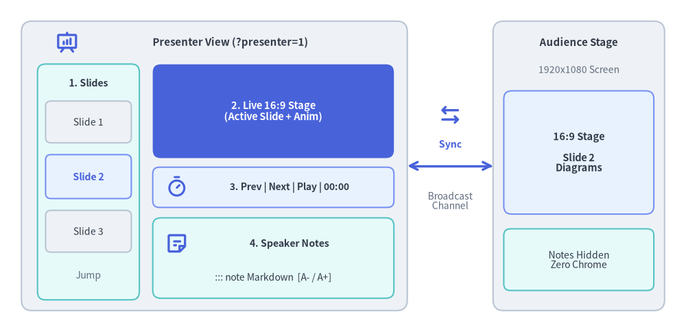
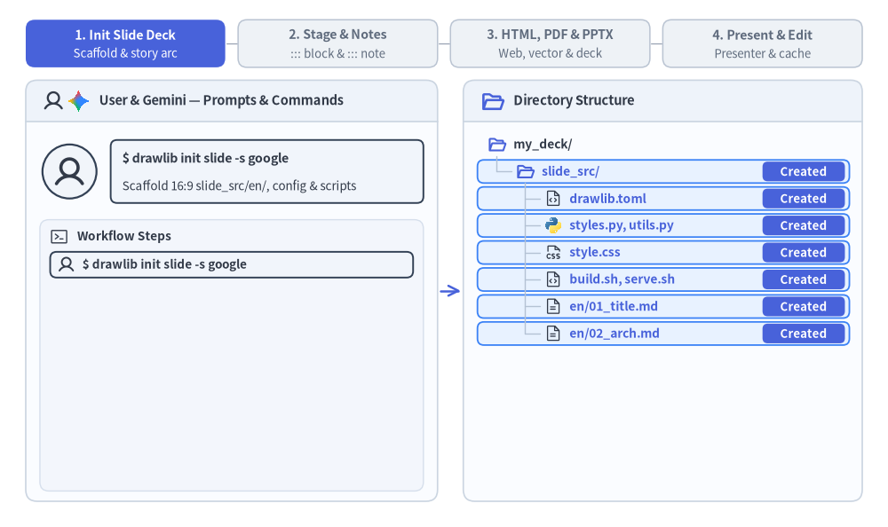

# Slide Deck Project Guide (`drawlib init slide`)

The `slide` starter template creates 16:9 presentation slide decks with rich architectural diagrams, metrics cards, badges, and structured layouts.

Drawlib compiles your slide deck into an **interactive HTML web presentation**, a **1-slide-per-page vector PDF**, and a **native editable 16:9 MS PowerPoint (`.pptx`) deck**, perfectly sized for conferences, client briefings, and team reviews.


<figure class="drawlib-image" style="text-align: center;">
  
  <figcaption class="drawlib-caption">Presenter View (?presenter=1) 4-Pane Workspace and BroadcastChannel Synchronization</figcaption>
</figure>

<details class="drawlib-code-details">
<summary>Source Code</summary>

```python
from drawlib.canvas import save, setup
from drawlib.icons import phosphor
from drawlib.lines import line
from drawlib.shapes import rectangle
from drawlib.styles import Styles
from drawlib.text import text

setup(width=128, height=62)

# Left Container: Presenter View Window (?presenter=1)
rectangle((40, 31), width=72, height=54, style=Styles.Neutral.patch(shape_r=2.0))
phosphor.presentation_chart((12.5, 54.0), width=4.4, style=Styles.PrimaryBold)
text((43.0, 54.0), "Presenter View (?presenter=1)", style=Styles.DarkBold.patch(text_size=10.8))

# Pane 1: Left Column (Slide Thumbnails Strip)
rectangle((16.5, 28.0), width=19, height=44, style=Styles.SecondaryNeutral.patch(shape_r=1.5))
text((16.5, 46.5), "1. Slides", style=Styles.DarkBold.patch(text_size=10.2))
rectangle((16.5, 39.2), width=16, height=7.8, style=Styles.Neutral.patch(shape_r=1.0), text="Slide 1", text_style=Styles.Dark.patch(text_size=10.0))
rectangle(
    (16.5, 29.0),
    width=16,
    height=8.2,
    style=Styles.PrimaryNeutral.patch(shape_r=1.0),
    text="Slide 2",
    text_style=Styles.PrimaryBold.patch(text_size=10.2),
)
rectangle((16.5, 18.8), width=16, height=7.8, style=Styles.Neutral.patch(shape_r=1.0), text="Slide 3", text_style=Styles.Dark.patch(text_size=10.0))
text((16.5, 10.5), "Jump", style=Styles.Muted.patch(text_size=10.0))

# Pane 2: Top-Right (Live 16:9 Current Slide Preview)
rectangle(
    (51.0, 41.2),
    width=45,
    height=17.5,
    style=Styles.PrimaryFlat.patch(shape_r=1.5),
    text="2. Live 16:9 Stage\n(Active Slide + Anim)",
    text_style=Styles.WhiteBold.patch(text_size=10.5),
)

# Pane 3: Middle-Right (Control & Timer Bar)
rectangle((51.0, 27.0), width=45, height=7.5, style=Styles.PrimaryNeutral.patch(shape_r=1.2))
phosphor.timer((33.0, 27.0), width=4.2, style=Styles.PrimaryBold)
text((54.0, 27.0), "3. Prev | Next | Play | 00:00", style=Styles.DarkBold.patch(text_size=10.0))

# Pane 4: Bottom-Right (Speaker Notes Pane)
rectangle((51.0, 13.8), width=45, height=15.0, style=Styles.SecondaryNeutral.patch(shape_r=1.5))
phosphor.note((33.0, 16.5), width=4.4, style=Styles.PrimaryBold)
text((54.0, 16.5), "4. Speaker Notes", style=Styles.DarkBold.patch(text_size=10.2))
text((51.0, 10.2), "::: note Markdown  [A- / A+]", style=Styles.Dark.patch(text_size=10.0))

# Bidirectional BroadcastChannel Sync Connector
phosphor.arrows_left_right((84.0, 40.5), width=4.6, style=Styles.PrimaryBold)
line((76, 31), (92, 31), arrow_head="<->", style=Styles.PrimaryBold)
text((84.0, 35.0), "Sync", style=Styles.PrimaryBold.patch(text_size=10.2))
text((84.0, 24.5), "Broadcast\nChannel", style=Styles.Muted.patch(text_size=10.0))

# Right Container: Audience Main Stage Window
rectangle((108, 31), width=32, height=54, style=Styles.Neutral.patch(shape_r=2.0))
text((108, 54.0), "Audience Stage", style=Styles.DarkBold.patch(text_size=10.8))
text((108, 49.0), "1920x1080 Screen", style=Styles.Muted.patch(text_size=10.0))

rectangle(
    (108, 33.5),
    width=28,
    height=23,
    style=Styles.PrimaryNeutral.patch(shape_r=1.5),
    text="16:9 Stage\n\nSlide 2\nDiagrams",
    text_style=Styles.DarkBold.patch(text_size=10.5),
)
rectangle(
    (108, 13.5),
    width=28,
    height=11.5,
    style=Styles.SecondaryNeutral.patch(shape_r=1.2),
    text="Notes Hidden\nZero Chrome",
    text_style=Styles.Dark.patch(text_size=10.0),
)

save()
```

</details>


---

## 1. End-to-End Project Workflow

From initial `drawlib init slide` scaffolding and story-arc planning to dual-layer authoring (`::: block` stage + `::: note` speaker scripts), HTML/PDF/`.pptx` compilation, live Presenter View (`?presenter=1`), and Day-2 cached edits:


<figure class="drawlib-image" style="text-align: center;">
  
  <figcaption class="drawlib-caption">16:9 Slide Deck Lifecycle: Scaffolding, Dual-Layer Authoring, HTML/PDF/PPTX Export, and Presenter View (APNG Animation)</figcaption>
</figure>


<div class="drawlib-source-link">
  <a href="https://github.com/yuichi110/drawlib/blob/main/docs/docs_src/en/09_doc_builder_and_cli/project_slide.md" target="_blank" rel="noopener noreferrer">View animation source code on GitHub &rarr;</a>
</div>

---

## 2. Project Initialization

Scaffold a presentation project using `drawlib init`:

```bash
# Scaffold standard slide project in current directory (creates 'slide_src/'):
drawlib init slide

# With custom target name, theme, and language (creates 'my_deck_src/'):
drawlib init slide my_deck -s google -l en
```

---

## 3. Directory Layout & Anatomy

A `slide` project keeps all authoring source files inside `slide_src/` and compiles presentation deliverables alongside it:

- **`slide_src/` (Single Source of Truth)**:
  - **`01_title.md`, `02_agenda.md`, `03_arch.md` (and section sub-folders)**: Individual `1920x1080` 16:9 slides compiled in sorted path order, combining `::: block` stage containers, ```` ```drawlib ```` diagrams (`.svg`, `.png`, `.webp`), and `::: note` speaker notes.
  - **`_`-Prefixed Files & `README.md`**: Planning outlines, draft slides (`_planning.md`, `_drafts/`), and `README.md` are automatically excluded from deck compilation.
  - **`_assets/`**: Static logos, fonts, and reference media synchronized into output folders.
  - **`styles.py` & `utils.py`**: Shared presentation color tokens, typography defaults, slide header/footer helpers, and KPI/card utilities.
  - **`style.css` & `slide.js`**: 16:9 viewport scaling stylesheet, keyboard navigation controller, and `BroadcastChannel` Presenter View runtime.
  - **`build.sh`, `build_html.sh`, `build_pdf.sh`, `build_image.sh`, `serve.sh`**: Modular build scripts and local presentation preview launcher.
- **Generated Outputs (Do Not Edit Directly)**:
  - **`slide_html/`**: Interactive browser slide deck (`index.html`) supporting full-screen mode, overview grid, and `?presenter=1` Presenter View.
  - **`slide.pdf`**: Multi-page vector-sharp 16:9 PDF (`1920px × 1080px` per page) rendered via headless Chromium.
  - **`slide.pptx`**: Native editable 16:9 (`960×540 pt`) MS PowerPoint deck exported on demand via `drawlib build pptx`, preserving stage cards, text runs, diagrams, and speaker notes.
  - **`slide_images/`**: Standalone extracted illustrations when running `build_image.sh`.

---

## 4. Multiple Presentation Outputs

A `slide` project produces presentation artifacts tailored for every scenario:

| Output | Audience & Environment | Key Features | Build Script / Command |
| :--- | :--- | :--- | :--- |
| **`slide_html/index.html`** | Interactive Presenting | 1920x1080 fixed stage, auto-scaling viewport, keyboard navigation (`Space`, `Arrows`, `F`), Presenter View (`?presenter=1`), overview grid | `build_html.sh` (`drawlib build slide`) |
| **`slide.pdf`** | Print & Read-Only Distribution | 1 slide per page, vector-sharp graphics, exact 16:9 aspect ratio (`@page { size: 1920px 1080px; margin: 0; }`) | `build_pdf.sh` (`drawlib build pdf`) |
| **`slide.pptx`** | Collaborative Editing & Executive Decks | Native editable 16:9 (`960×540 pt`) MS PowerPoint deck (`::: block` cards with `rgba` alpha, text boxes, lists, tables, `::: note` speaker notes, high-DPI diagram PNGs) | `drawlib build pptx` |
| **`slide_images/`** | Slides & Social Media | Extracted standalone slide illustrations for external decks and sharing | `build_image.sh` (`drawlib build image`) |

---

## 5. Authoring Slides & Stage Blocks

Each Markdown file in `slide_src/` (and any nested chapter subdirectories such as `01_intro/01_cover.md`) represents a single 16:9 slide (`1920x1080` stage), compiled in sorted relative-path order.
- **Excluding Non-Slide Files (`_` Prefix)**: Prefix any planning notes, outlines, or draft files/folders with an underscore `_` (e.g., `_planning.md`, `_drafts/`) to exclude them from slide compilation.
- **Special Excluded Files**: `README.md` and `navbar.md` are also automatically excluded from the slide deck.

Use `::: block xy=(x, y) width=W height=H` containers alongside standard Markdown and helper components from `utils.py` (see [Slide Stage Layout & API](./slide_layout_and_api.md) for the complete stage coordinate reference, layout templates, and `drawlib.slide` API):

````markdown
::: block xy=(80, 40) width=1760 height=60
# Architecture Overview
:::

::: block xy=(80, 140) width=1760 height=840
```drawlib file=arch_flow.svg
from drawlib.canvas import clear, save, setup
from drawlib.shapes import rectangle
from drawlib.lines import line
from drawlib.styles import Styles

clear()
setup(width=176, height=84)
rectangle((35, 42), width=38, height=22, style=Styles.Neutral, text="Producer")
rectangle((88, 42), width=38, height=22, style=Styles.PrimaryFlat, text="Kafka", text_style=Styles.WhiteBold)
rectangle((141, 42), width=38, height=22, style=Styles.SecondaryNeutral, text="Consumer")
line((54, 42), (69, 42), arrow_head="->", style=Styles.DarkBold)
line((107, 42), (122, 42), arrow_head="->", style=Styles.DarkBold)
save()
```
:::
````

---

## 6. Modular Build Scripts & MS PowerPoint (`.pptx`) Export

- **`build_html.sh`**:
  Compiles slides into the web presentation deck in `slide_html/index.html` (`drawlib build slide`).
- **`build_pdf.sh`**:
  Uses headless Chromium to capture each slide into a multi-page vector PDF (`slide.pdf`).
- **`build_image.sh`**:
  Extracts embedded ````drawlib```` blocks into standalone diagram images in `slide_images/`.
- **`build.sh` (Master Script)**:
  Runs HTML, PDF, and Image builds in sequence.
- **Editable MS PowerPoint Export (`drawlib build pptx`)**:
  Measures the `1920x1080` slide DOM and computed CSS styles via headless Chromium and exports a native editable 16:9 (`960x540 pt`) `.pptx` file:
  ```bash
  uv run drawlib build pptx slide_src/ -o slide.pptx --dpi 240 --anim-frame last
  ```

---

## 7. Local Preview & Presenting

Launch the local development preview server:

```bash
./slide_src/serve.sh
```

Or run directly:

```bash
uv run drawlib serve slide_html/
```

### Keyboard Shortcuts & URL Deep-Linking:
- **`→` / `Space` / `PageDown`**: Next slide
- **`←` / `PageUp`**: Previous slide
- **`F`**: Toggle full screen
- **`O` / `Esc`**: Toggle slide overview grid
- **`P` / `S`**: Open **Presenter View** in a synchronized companion window
- **`A`**: Play / pause / resume animation on the current slide
- **URL Hash Deep-Linking (`#1`, `#2`, ...)**: Navigating to `index.html#4` jumps directly to Slide 4, and advancing slides updates the URL hash in real time for bookmarking and sharing.
- **Direct Presenter URL (`?presenter=1`)**: Appending `?presenter=1#1` launches the window directly in Presenter View mode, synchronizing slide changes and animation playback across windows via `BroadcastChannel` / `localStorage`.

### Speaker Notes (`::: note`) & Presenter View:
Add speaker notes to any slide using `::: note` blocks. If a slide contains multiple `::: note` blocks, they are automatically joined with a blank line (`\n\n`), rendered as Markdown in **Presenter View**, and exported into **native PowerPoint speaker notes** during `drawlib build pptx` (while remaining completely hidden on the main presentation screen and in PDF exports):

```markdown
::: note
**Key Talking Points**:
- Emphasize single source of truth in Git.
- Click **Play Animation** (or press `A`) to step through the pipeline.
:::
```

Pressing **`P`** or **`S`** (or clicking the `🗒` button in the bottom-right control bar) opens **Presenter View** (`?presenter=1`), featuring:
- **Left Column**: Vertical scrollable list of live slide thumbnails for instant jumping.
- **Right Top**: Live 16:9 preview of the current slide.
- **Right Middle (Control Bar)**: `◀ Prev` / `Next ▶` navigation, **`▶ Play Animation` button** (synchronized with the main window; automatically disabled/grayed out on slides without animations), and an elapsed presentation timer (`00:00`).
- **Right Bottom (Speaker Notes)**: Compiled speaker notes with `A-` / `A+` font-size controls.

### Interactive Animation Playback (`anim_trigger`, `anim_loop`, `anim_pause`):
When embedding APNG (`.png` / `.apng`) or Animated WebP (`.webp`) diagrams inside slides, you can attach playback control attributes to the ````drawlib```` code fence:

````markdown
```drawlib file=workflow.webp anim_trigger=click anim_loop=once anim_pause=(2, 4)
```
````

- **`anim_trigger=click`** (`auto` | `click`): Holds on Frame 0 until clicked by the presenter.
- **`anim_loop=once`** (`once` | `infinite`): Stops on the final frame (`ENDED`); clicking again replays from Frame 0.
- **`anim_pause=(2, 4)`**: Pauses at 0-based frame indices `2` and `4` (`PAUSED`); clicking resumes to the next step.
- **Vector PDF Export (`build_pdf.sh`)**: Automatically renders Frame 0 onto the slide without the interactive play badge.
- **MS PowerPoint Export (`drawlib build pptx`)**: Extracts a crisp static PNG at `--dpi 240` using the final frame by default (`--anim-frame last`), or the initial frame when `--anim-frame first` is specified.

---

## 8. Parallel Multi-Agent Slide Deck Authoring

Because each slide in `slide_src/` is an isolated Markdown file (`01_title.md`, `02_agenda.md`, `03_arch.md`, or organized in section folders), AI coding agents can construct or overhaul multi-slide presentations in parallel:
1. **Phase 1 (Parent Setup)**: Scaffold `slide_src/` (`drawlib init slide`), configure `styles.py` and `utils.py`, and define the slide deck story arc and numbered filenames first.
2. **Phase 2 (Parallel Subagents)**: Delegate disjoint slide files (or section directories) to parallel subagents. Each subagent authors its assigned slides (`::: block` stage layout + `::: note` speaker script) and runs `-g` grid previews using unique scratch paths (`-o .drawlib/scratch/<slide>_<block>_grid.png`).
3. **Phase 3 (Unified Deck Build & Review)**: After all subagents complete their slides, the parent agent runs `./slide_src/build.sh` (and `drawlib build pptx` if needed) once and inspects the compiled `slide.pdf` and `slide_html/index.html`.

