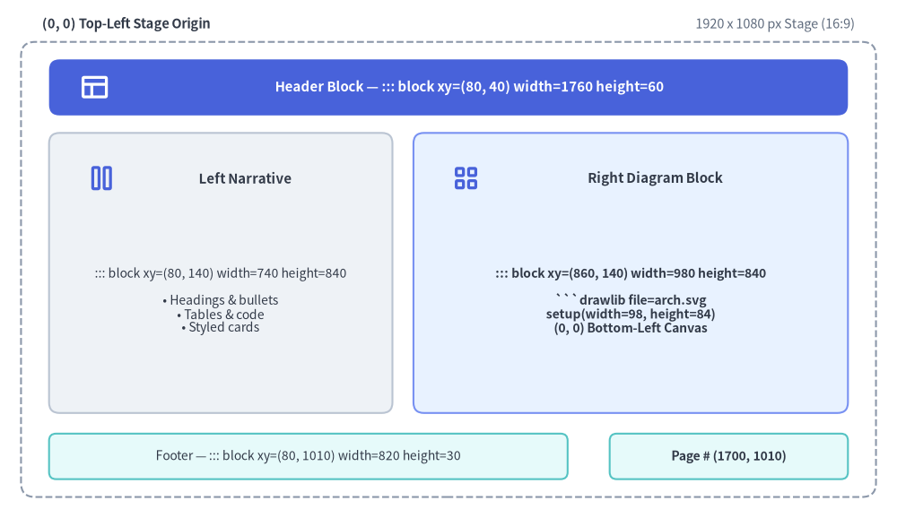
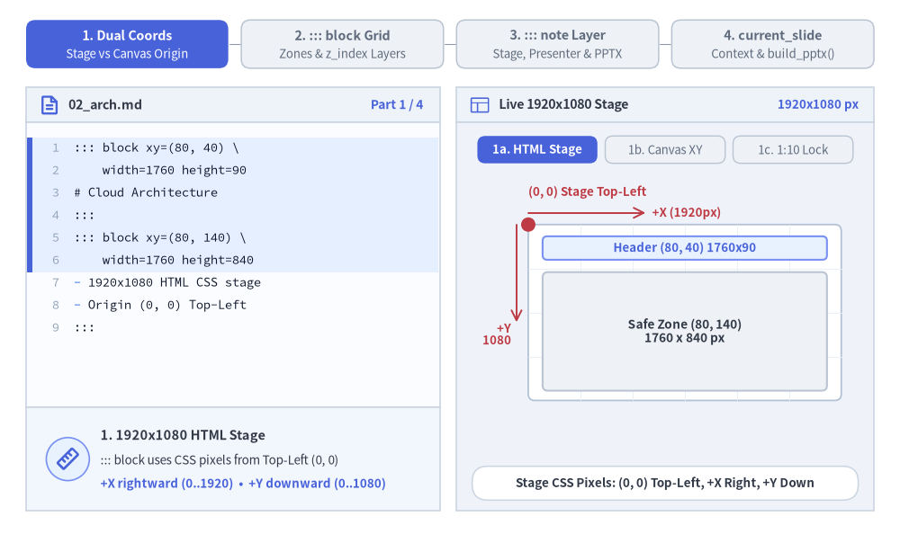
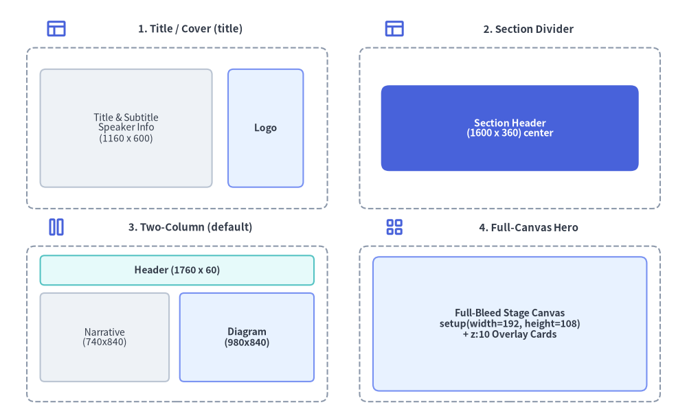

# Slide Stage Layout & API

When authoring 16:9 widescreen presentation decks (`drawlib init slide`), Drawlib provides a precision **1920 × 1080 pixel virtual stage** (`::: block`, `::: note`), built-in layout patterns, inline vector SVG font bundling, and the programmatic [`drawlib.slide`](../10_ai_agents_and_advanced/programmatic_api.md) Python runtime API (`current_slide`, `SlideContext`, `BoundingBox`, `build_slide`, `build_pptx`). *(For initializing and building a slide deck project, see [Slide Deck Project Guide](./project_slide.md).)*


<figure class="drawlib-image" style="text-align: center;">
  
  <figcaption class="drawlib-caption">1920x1080 Virtual Slide Stage Zones and ::: block xy=(x, y) width=W height=H Layout Grid</figcaption>
</figure>

<details class="drawlib-code-details">
<summary>Source Code</summary>

```python
from drawlib.canvas import save, setup
from drawlib.icons import phosphor
from drawlib.shapes import rectangle
from drawlib.styles import Styles
from drawlib.text import text

setup(width=128, height=74)

# Outer 1920x1080 Stage Frame
rectangle((64, 35.5), width=122, height=65, style=Styles.MutedDashed.patch(shape_r=2.0))
text((6, 70.5), "(0, 0) Top-Left Stage Origin", style=Styles.DarkBold.patch(text_size=10.5, halign="left"))
text((122, 70.5), "1920 x 1080 px Stage (16:9)", style=Styles.Muted.patch(text_size=10.5, halign="right"))

# Header Zone: ::: block xy=(80, 40) width=1760 height=60
rectangle((64, 61.5), width=114, height=8.0, style=Styles.PrimaryFlat.patch(shape_r=1.5))
phosphor.layout((13.5, 61.5), width=4.4, style=Styles.WhiteBold)
text((67.0, 61.5), "Header Block — ::: block xy=(80, 40) width=1760 height=60", style=Styles.WhiteBold.patch(text_size=10.8))

# Left Narrative Column: ::: block xy=(80, 140) width=740 height=840
rectangle((31.5, 35.0), width=49, height=40, style=Styles.Neutral.patch(shape_r=1.5))
phosphor.columns((14.5, 48.5), width=4.4, style=Styles.PrimaryBold)
text((35.0, 48.5), "Left Narrative", style=Styles.DarkBold.patch(text_size=10.8))
text(
    (31.5, 31.0),
    "::: block xy=(80, 140) width=740 height=840\n\n• Headings & bullets\n• Tables & code\n• Styled cards",
    style=Styles.Dark.patch(text_size=10.0),
)

# Right Diagram Column: ::: block xy=(860, 140) width=980 height=840
rectangle((90.0, 35.0), width=62, height=40, style=Styles.PrimaryNeutral.patch(shape_r=1.5))
phosphor.squares_four((66.5, 48.5), width=4.4, style=Styles.PrimaryBold)
text((93.5, 48.5), "Right Diagram Block", style=Styles.DarkBold.patch(text_size=10.8))
text(
    (90.0, 31.0),
    "::: block xy=(860, 140) width=980 height=840\n\n```drawlib file=arch.svg\nsetup(width=98, height=84)\n(0, 0) Bottom-Left Canvas",
    style=Styles.DarkBold.patch(text_size=10.0),
)

# Footer & Page Counter Blocks
rectangle(
    (44, 8.8),
    width=74,
    height=6.5,
    style=Styles.SecondaryNeutral.patch(shape_r=1.0),
    text="Footer — ::: block xy=(80, 1010) width=820 height=30",
    text_style=Styles.Dark.patch(text_size=10.0),
)
rectangle(
    (104, 8.8),
    width=34,
    height=6.5,
    style=Styles.SecondaryNeutral.patch(shape_r=1.0),
    text="Page # (1700, 1010)",
    text_style=Styles.DarkBold.patch(text_size=10.0),
)

save()
```

</details>


---

## 1. Interactive Stage Geometry & API Tour

Every slide combines a **Top-Left `1920 × 1080` HTML stage** (`::: block xy=(x, y) width=W height=H` and `z_index` layers) with **Bottom-Left Cartesian ````drawlib```` canvases**, hidden **`::: note` presenter scripts** (rendered in `?presenter=1` and native PowerPoint `.pptx` speaker notes), and the **`drawlib.slide` Python runtime** (`current_slide`, `BoundingBox`, `build_slide`, `build_pptx`):


<figure class="drawlib-image" style="text-align: center;">
  
  <figcaption class="drawlib-caption">16:9 Slide Stage & API Tour: Dual Coordinate Spaces, ::: block Grid Positioning, ::: note Presenter Layer, and current_slide Context (APNG Animation)</figcaption>
</figure>

<details class="drawlib-code-details">
<summary>Source Code</summary>

```python
from __future__ import annotations

from drawlib.anim import Animation
from drawlib.canvas import save, setup
from drawlib.icons import code as code_icons
from drawlib.icons import phosphor, workspace
from drawlib.lines import line
from drawlib.shapes import circle, rectangle
from drawlib.smartarts import SourceCode, SourceCodeStyles
from drawlib.styles import Styles
from drawlib.text import text

W, H = 138.0, 82.0
setup(width=W, height=H)
anim = Animation(fps=10.0, loop=0)

CODE_TEXT_SIZE = 10.0
PT_TO_CANVAS = W / 720.0
FONT_CANVAS = CODE_TEXT_SIZE * PT_TO_CANVAS
LINE_H = FONT_CANVAS * 1.8
PAD_Y = FONT_CANVAS * 1.2

CODE_STYLES = SourceCodeStyles.get("default", font_lang="en", text_size=CODE_TEXT_SIZE).patch(
    box_style=Styles.Neutral.patch(shape_fill_color=(0, 0, 0, 0), shape_line_width=0),
)

PANE_HEADER = Styles.Neutral.patch(
    shape_fill_color=(238, 243, 250),
    shape_line_color=(203, 213, 225),
    shape_line_width=1.2,
    shape_r=0.0,
)
EDITOR_BODY = Styles.Neutral.patch(
    shape_fill_color=(250, 252, 255),
    shape_line_color=(203, 213, 225),
    shape_line_width=1.2,
    shape_r=0.0,
)
TAKEAWAY_BODY = Styles.Neutral.patch(
    shape_fill_color=(242, 246, 253),
    shape_line_color=(203, 213, 225),
    shape_line_width=1.2,
    shape_r=0.0,
)
STUDIO_BODY = Styles.Neutral.patch(
    shape_fill_color=(239, 243, 249),
    shape_line_color=(203, 213, 225),
    shape_line_width=1.2,
    shape_r=0.0,
)
STAGE_CARD = Styles.Neutral.patch(
    shape_fill_color=(255, 255, 255),
    shape_line_color=(180, 194, 214),
    shape_line_width=1.3,
    shape_r=1.0,
)

PART_ITEMS = [
    ("1. Dual Coords", "Stage vs Canvas Origin"),
    ("2. ::: block Grid", "Zones & z_index Layers"),
    ("3. ::: note Layer", "Stage, Presenter & PPTX"),
    ("4. current_slide", "Context & build_pptx()"),
]


def draw_step_bar(active_part: int) -> None:
    """Draw top 4-part progress bar (active_part is 1..4)."""
    pill_w = 31.0
    pill_h = 7.4
    gap = 2.0
    start_x = 4.0 + pill_w / 2.0
    cy = 75.2

    for idx, (label, sublabel) in enumerate(PART_ITEMS, start=1):
        cx = start_x + (idx - 1) * (pill_w + gap)
        if idx > 1:
            prev_cx = cx - (pill_w + gap)
            line(
                (prev_cx + pill_w / 2.0 + 0.2, cy),
                (cx - pill_w / 2.0 - 0.2, cy),
                style=Styles.PrimaryBold if idx <= active_part else Styles.MutedThin,
            )

        if idx == active_part:
            st = Styles.PrimaryFlat.patch(shape_r=1.4)
            tst = Styles.WhiteBold.patch(text_size=10.3)
            sub_tst = Styles.White.patch(text_size=9.5)
        elif idx < active_part:
            st = Styles.PrimaryNeutral.patch(shape_r=1.4, shape_line_width=1.1)
            tst = Styles.PrimaryBold.patch(text_size=10.3)
            sub_tst = Styles.Primary.patch(text_size=9.5)
        else:
            st = Styles.Neutral.patch(shape_r=1.4, shape_line_width=1.1)
            tst = Styles.MutedBold.patch(text_size=10.3)
            sub_tst = Styles.Muted.patch(text_size=9.5)

        rectangle((cx, cy), width=pill_w, height=pill_h, style=st)
        text((cx, cy + 1.35), label, style=tst)
        text((cx, cy - 1.55), sublabel, style=sub_tst)


def draw_left_pane(
    active_part: int,
    file_label: str,
    code_lang: str,
    code_lines: list[str],
    hl_range: tuple[int, int],
    icon_fn: object,
    summary_title: str,
    summary_line1: str,
    summary_line2: str,
) -> None:
    """Draw left Markdown/Python editor + bottom concept takeaway card."""
    x0, w = 4.0, 63.5
    cx = x0 + w / 2.0
    top_y = 63.2
    header_h = 5.4
    editor_h = 43.8
    takeaway_h = 15.8

    rectangle((cx, top_y + header_h / 2.0), width=w, height=header_h, style=PANE_HEADER)
    if code_lang == "python":
        code_icons.python((x0 + 3.6, top_y + header_h / 2.0), width=3.4, style=Styles.Neutral)
    elif code_lang == "bash":
        code_icons.bash((x0 + 3.6, top_y + header_h / 2.0), width=3.4, style=Styles.Neutral)
    else:
        phosphor.file_text((x0 + 3.6, top_y + header_h / 2.0), width=3.4, style=Styles.PrimaryBold)
    text(
        (x0 + 6.5, top_y + header_h / 2.0),
        file_label,
        style=Styles.DarkBold.patch(text_size=10.2, halign="left"),
    )
    text(
        (x0 + w - 2.6, top_y + header_h / 2.0),
        f"Part {active_part} / 4",
        style=Styles.PrimaryBold.patch(text_size=9.8, halign="right"),
    )

    rectangle((cx, top_y - editor_h / 2.0), width=w, height=editor_h, style=EDITOR_BODY)

    hl_start, hl_end = hl_range
    hl_top = top_y - PAD_Y - hl_start * LINE_H
    hl_bot = top_y - PAD_Y - (hl_end + 1) * LINE_H
    hl_cy = (hl_top + hl_bot) / 2.0
    hl_h = hl_top - hl_bot
    rectangle(
        (cx, hl_cy),
        width=w - 0.6,
        height=hl_h,
        style=Styles.Neutral.patch(shape_fill_color=(229, 239, 255), shape_line_width=0),
    )
    rectangle(
        (x0 + 0.55, hl_cy),
        width=0.9,
        height=hl_h,
        style=Styles.PrimaryFlat.patch(shape_line_width=0),
    )

    SourceCode.draw(
        xy=(x0, top_y),
        width=w,
        code="\n".join(code_lines),
        styles=CODE_STYLES,
        code_lang=code_lang,
        show_linenum=True,
        align="top_left",
    )

    take_cy = 3.6 + takeaway_h / 2.0
    rectangle((cx, take_cy), width=w, height=takeaway_h, style=TAKEAWAY_BODY)
    circle(
        (x0 + 6.4, take_cy),
        radius=3.3,
        style=Styles.PrimaryNeutral.patch(shape_line_width=1.2),
    )
    icon_fn((x0 + 6.4, take_cy), width=3.8, style=Styles.PrimaryBold)  # type: ignore[operator]
    text(
        (x0 + 11.4, take_cy + 3.6),
        summary_title,
        style=Styles.DarkBold.patch(text_size=10.4, halign="left"),
    )
    text(
        (x0 + 11.4, take_cy - 0.2),
        summary_line1,
        style=Styles.Dark.patch(text_size=9.7, halign="left"),
    )
    text(
        (x0 + 11.4, take_cy - 3.8),
        summary_line2,
        style=Styles.PrimaryBold.patch(text_size=9.6, halign="left"),
    )


def draw_stage_studio(param_badge: str, footer_caption: str) -> float:
    """Draw right 1920x1080 stage preview shell and footer."""
    x0, w = 70.0, 64.0
    cx = x0 + w / 2.0
    top_y = 63.2
    header_h = 5.4
    body_h = 59.6

    rectangle((cx, top_y + header_h / 2.0), width=w, height=header_h, style=PANE_HEADER)
    phosphor.layout((x0 + 3.6, top_y + header_h / 2.0), width=3.4, style=Styles.Primary)
    text(
        (x0 + 6.5, top_y + header_h / 2.0),
        "Live 1920x1080 Stage",
        style=Styles.DarkBold.patch(text_size=10.2, halign="left"),
    )
    text(
        (x0 + w - 2.4, top_y + header_h / 2.0),
        param_badge,
        style=Styles.PrimaryBold.patch(text_size=9.6, halign="right"),
    )

    rectangle((cx, 3.6 + body_h / 2.0), width=w, height=body_h, style=STUDIO_BODY)

    rectangle(
        (cx, 7.8),
        width=59.2,
        height=5.2,
        style=Styles.Neutral.patch(
            shape_fill_color=(255, 255, 255),
            shape_line_color=(203, 213, 225),
            shape_line_width=1.1,
            shape_r=2.4,
        ),
        text=footer_caption,
        text_style=Styles.DarkBold.patch(text_size=9.7),
    )
    return cx


def draw_sub_pills(scx: float, labels: list[str], active_idx: int) -> None:
    """Draw 3-step tracker pills near the top of the right studio pane."""
    pw, ph, pgap = 18.4, 4.2, 1.2
    p_start = scx - (3 * pw + 2 * pgap) / 2.0 + pw / 2.0
    for idx, lbl in enumerate(labels):
        px = p_start + idx * (pw + pgap)
        if idx == active_idx:
            pst = Styles.PrimaryFlat.patch(shape_r=1.2)
            ptst = Styles.WhiteBold.patch(text_size=9.5)
        elif idx < active_idx:
            pst = Styles.PrimaryNeutral.patch(shape_r=1.2, shape_line_width=1.0)
            ptst = Styles.PrimaryBold.patch(text_size=9.5)
        else:
            pst = Styles.Neutral.patch(shape_r=1.2, shape_line_width=1.0)
            ptst = Styles.Muted.patch(text_size=9.5)
        rectangle((px, 59.0), width=pw, height=ph, style=pst, text=lbl, text_style=ptst)


def draw_grid_sheet(cx: float, cy: float, sw: float, sh: float) -> tuple[float, float]:
    """Draw a crisp 16:9 stage card with subtle alignment grid; returns (sx0, sy0)."""
    sx0, sy0 = cx - sw / 2.0, cy - sh / 2.0
    rectangle((cx, cy), width=sw, height=sh, style=STAGE_CARD)
    g_st = Styles.MutedThin.patch(line_color=(234, 240, 248), line_width=0.7)
    for gx in range(1, 6):
        vx = sx0 + gx * (sw / 6.0)
        line((vx, sy0), (vx, sy0 + sh), style=g_st)
    for gy in range(1, 4):
        vy = sy0 + gy * (sh / 4.0)
        line((sx0, vy), (sx0 + sw, vy), style=g_st)
    return sx0, sy0


FENCE = "`" * 3

# =========================================================================
# Part 1: Dual Coords — HTML Stage Top-Left vs. Drawlib Canvas Bottom-Left
# =========================================================================
PART1_STATES = [
    (
        "1a",
        3.3,
        "02_arch.md",
        "markdown",
        [
            "::: block xy=(80, 40) \\",
            "    width=1760 height=90",
            "# Cloud Architecture",
            ":::",
            "::: block xy=(80, 140) \\",
            "    width=1760 height=840",
            "- 1920x1080 HTML CSS stage",
            "- Origin (0, 0) Top-Left",
            ":::",
        ],
        (0, 5),
        "1920x1080 px",
        "Stage CSS Pixels: (0, 0) Top-Left, +X Right, +Y Down",
        "1. 1920x1080 HTML Stage",
        "::: block uses CSS pixels from Top-Left (0, 0)",
        "+X rightward (0..1920)  •  +Y downward (0..1080)",
    ),
    (
        "1b",
        3.3,
        "02_arch.md",
        "python",
        [
            f"# Inside {FENCE}drawlib block:",
            "from drawlib.canvas import (",
            "    save, setup,",
            ")",
            "setup(width=98, height=84)",
            "# (0, 0) at Bottom-Left!",
            "# +X right (0..98)",
            "# +Y up    (0..84)",
            "rectangle((49, 42), 60, 40)",
            "save()",
        ],
        (4, 7),
        "Canvas (0, 0)",
        "Inner Drawlib Canvas: (0, 0) Bottom-Left (+Y Up)",
        "2. Cartesian Drawlib Canvas",
        "setup(width, height) puts (0, 0) at Bottom-Left",
        "+X rightward (0..W)  •  +Y upward (0..H)",
    ),
    (
        "1c",
        3.5,
        "02_arch.md",
        "markdown",
        [
            "::: block xy=(860, 140) \\",
            "    width=980 height=840",
            f"{FENCE}drawlib file=arch.svg",
            "# 980:840 == 98:84 (1:10!)",
            "setup(width=98, height=84)",
            "# Fills block 100% cleanly",
            "save()",
            FENCE,
            ":::",
        ],
        (0, 4),
        "1:10 Lock",
        "Divide Block px by 10: 980x840 -> setup(98, 84)",
        "3. 1:10 Aspect-Ratio Lock",
        "Match setup(W, H) ratio to block width & height",
        "980x840 block + setup(98, 84) = zero letterbox",
    ),
]

for p1_idx, (m1, dur, flbl, clang, code_1, hl_rng, badge, foot, st_t, s_1, s_2) in enumerate(PART1_STATES):
    with anim.frame(duration=dur):
        draw_step_bar(1)
        draw_left_pane(1, flbl, clang, code_1, hl_rng, phosphor.ruler, st_t, s_1, s_2)
        scx = draw_stage_studio(badge, foot)
        draw_sub_pills(scx, ["1a. HTML Stage", "1b. Canvas XY", "1c. 1:10 Lock"], p1_idx)

        if m1 == "1a":
            sw, sh = 48.0, 27.0
            sx0, sy0 = draw_grid_sheet(105.0, 34.0, sw, sh)
            sy1 = sy0 + sh

            # Top-Left (0, 0) stage axes
            line((sx0, sy1 + 1.8), (sx0 + 18.0, sy1 + 1.8), arrow_head="->", style=Styles.DangerBold.patch(line_width=1.4))
            text((sx0 + 19.0, sy1 + 1.8), "+X (1920px)", style=Styles.DangerBold.patch(text_size=9.5, halign="left"))
            line((sx0 - 1.8, sy1), (sx0 - 1.8, sy1 - 15.0), arrow_head="->", style=Styles.DangerBold.patch(line_width=1.4))
            text((sx0 - 2.6, sy1 - 16.8), "+Y\n1080", style=Styles.DangerBold.patch(text_size=9.5, halign="right"))
            circle((sx0, sy1), radius=1.1, style=Styles.DangerFlat)
            text((sx0, sy1 + 5.0), "(0, 0) Stage Top-Left", style=Styles.DangerBold.patch(text_size=9.6, halign="left"))

            # Safe content zones inside stage
            rectangle(
                (105.0, sy1 - 3.6),
                width=43.6,
                height=3.6,
                style=Styles.PrimaryNeutral.patch(shape_r=0.7),
                text="Header (80, 40) 1760x90",
                text_style=Styles.PrimaryBold.patch(text_size=9.5),
            )
            rectangle(
                (105.0, sy0 + 10.6),
                width=43.6,
                height=18.2,
                style=Styles.Neutral.patch(shape_r=0.8),
                text="Safe Zone (80, 140)\n1760 x 840 px",
                text_style=Styles.DarkBold.patch(text_size=9.8),
            )
        elif m1 == "1b":
            sw, sh = 50.0, 28.0
            sx0, sy0 = draw_grid_sheet(103.5, 35.2, sw, sh)
            text((sx0 + 1.5, sy0 + sh - 2.0), "Stage (0,0)", style=Styles.Muted.patch(text_size=9.5, halign="left"))
            rectangle(
                (sx0 + 11.2, sy0 + 13.0),
                width=18.0,
                height=20.0,
                style=Styles.Neutral.patch(shape_r=0.8),
                text="Markdown\n740x840",
                text_style=Styles.Muted.patch(text_size=9.5),
            )
            # Highlighted inner Drawlib Canvas block
            cx_in, cy_in, cw, ch = sx0 + 35.0, sy0 + 13.0, 25.0, 20.0
            ix0, iy0 = cx_in - cw / 2.0, cy_in - ch / 2.0
            rectangle(
                (cx_in, cy_in),
                width=cw,
                height=ch,
                style=Styles.PrimaryNeutral.patch(shape_r=0.8, shape_line_width=1.5),
            )
            rectangle((cx_in + 1.6, cy_in - 0.6), width=16.8, height=6.6, style=Styles.White.patch(shape_r=0.8), text="98 x 84 Canvas", text_style=Styles.DarkBold.patch(text_size=9.5))
            line((ix0, iy0), (ix0, iy0 + 14.2), arrow_head="->", style=Styles.PrimaryBold.patch(line_width=1.5))
            text((ix0 + 1.0, iy0 + 16.0), "+Y (84)", style=Styles.PrimaryBold.patch(text_size=9.5, halign="left"))
            line((ix0, iy0), (ix0 + 15.5, iy0), arrow_head="->", style=Styles.PrimaryBold.patch(line_width=1.5))
            text((ix0 + 16.2, iy0 + 1.6), "+X", style=Styles.PrimaryBold.patch(text_size=9.5, halign="left"))
            circle((ix0, iy0), radius=1.1, style=Styles.PrimaryFlat)
            text((scx, 15.4), "(0, 0) Bottom-Left Cartesian Origin (+Y Up)", style=Styles.PrimaryBold.patch(text_size=9.6))
        else:
            # 1c: Side-by-side Mismatch vs 1:10 Lock
            lx, rx, cy_card = 86.2, 117.6, 35.5
            # Left card: Mismatched aspect ratio (letterbox bars)
            rectangle((lx, cy_card), width=26.5, height=25.0, style=Styles.Neutral.patch(shape_r=1.0))
            text((lx, cy_card + 9.6), "Mismatch 100x40", style=Styles.MutedBold.patch(text_size=9.5))
            rectangle((lx, cy_card + 4.8), width=23.5, height=3.2, style=Styles.SecondaryNeutral.patch(shape_line_width=0))
            rectangle((lx, cy_card - 0.5), width=23.5, height=7.4, style=Styles.White.patch(shape_r=0.6), text="Shrunk SVG", text_style=Styles.Dark.patch(text_size=9.5))
            rectangle((lx, cy_card - 5.8), width=23.5, height=3.2, style=Styles.SecondaryNeutral.patch(shape_line_width=0))
            text((lx, cy_card - 9.8), "Letterbox Gap", style=Styles.MutedBold.patch(text_size=9.5))

            # Right card: 1:10 Lock (zero letterbox!)
            rectangle((rx, cy_card), width=26.5, height=25.0, style=Styles.PrimaryNeutral.patch(shape_r=1.0, shape_line_width=1.5))
            text((rx, cy_card + 9.6), "Lock 98x84 (1:10)", style=Styles.PrimaryBold.patch(text_size=9.5))
            rectangle(
                (rx, cy_card - 0.5),
                width=23.5,
                height=13.8,
                style=Styles.White.patch(shape_r=0.8, shape_line_color=(59, 130, 246), shape_line_width=1.3),
                text="980x840 px\n==\nsetup(98, 84)",
                text_style=Styles.DarkBold.patch(text_size=9.6),
            )
            phosphor.check_circle((rx - 8.2, cy_card - 9.8), width=3.2, style=Styles.PrimaryBold)
            text((rx + 1.4, cy_card - 9.8), "100% Fit!", style=Styles.PrimaryBold.patch(text_size=9.6))
            text((scx, 16.0), "Golden Rule: setup(block_w / 10, block_h / 10)", style=Styles.DarkBold.patch(text_size=9.6))

# =========================================================================
# Part 2: ::: block Grid — Header/Left Card, Right Hero & z_index Layers
# =========================================================================
PART2_STATES = [
    (
        "2a",
        3.3,
        "02_arch.md",
        "markdown",
        [
            "::: block xy=(80, 40) \\",
            "    width=1760 height=90",
            "# Service Mesh Topology",
            ":::",
            "::: block xy=(80, 140) \\",
            "    width=740 height=840 \\",
            '    class="card panel"',
            "## Key Decisions",
            "- mTLS east-west zero trust",
            ":::",
        ],
        (4, 9),
        "Header + Card",
        "Header (80, 40) + Left Card (80, 140) 740x840",
        "1. Header & Narrative Card",
        "Header spans (80, 40) width=1760 height=90",
        'class="card panel" styles Left 740x840 prose box',
    ),
    (
        "2b",
        3.3,
        "02_arch.md",
        "markdown",
        [
            "# 80 + 740 + 40 gutter = 860",
            "::: block xy=(860, 140) \\",
            "    width=980 height=840",
            f"{FENCE}drawlib file=mesh.svg",
            "setup(width=98, height=84)",
            "# Right Hero vector canvas",
            "d.draw(xy=(6, 8))",
            "save()",
            FENCE,
            ":::",
        ],
        (0, 4),
        "40px Gutter",
        "80px Margin + 740px + 40px Gutter + 980px + 80px = 1920",
        "2. Two-Column Precision Grid",
        "80px outer stage margin + 40px center gutter",
        "Right Hero (860, 140) 980x840 holds SVG diagram",
    ),
    (
        "2c",
        3.5,
        "02_arch.md",
        "markdown",
        [
            "::: block xy=(0, 0) z_index=0 \\",
            "    width=1920 height=1080",
            f"{FENCE}drawlib file=hero_bg.svg",
            "setup(width=192, height=108)",
            FENCE,
            ":::",
            "::: block xy=(1180, 160) \\",
            "    width=640 height=320 \\",
            '    z_index=10 class="card"',
            "**99.99% SLA** Overlay Card",
            ":::",
        ],
        (6, 10),
        "z_index=0..10",
        "Stack Overlapping Stage Blocks Cleanly via z_index",
        "3. Multi-Layer z_index Stacking",
        "z_index=0 renders full-bleed 1920x1080 backdrop",
        "z_index=10 floats KPI callout card above canvas",
    ),
]

for p2_idx, (m2, dur, flbl, clang, code_2, hl_rng, badge, foot, st_t, s_1, s_2) in enumerate(PART2_STATES):
    with anim.frame(duration=dur):
        draw_step_bar(2)
        draw_left_pane(2, flbl, clang, code_2, hl_rng, phosphor.columns, st_t, s_1, s_2)
        scx = draw_stage_studio(badge, foot)
        draw_sub_pills(scx, ["2a. Header+Card", "2b. Right Hero", "2c. z_index"], p2_idx)

        sw, sh = 52.0, 29.25
        sx0, sy0 = draw_grid_sheet(scx, 35.8, sw, sh)
        sy1 = sy0 + sh

        if m2 == "2a":
            rectangle(
                (scx, sy1 - 3.6),
                width=47.6,
                height=4.0,
                style=Styles.PrimaryFlat.patch(shape_r=0.8),
                text="Header (80, 40) 1760x90",
                text_style=Styles.WhiteBold.patch(text_size=9.5),
            )
            rectangle(
                (sx0 + 12.2, sy0 + 11.2),
                width=20.0,
                height=19.8,
                style=Styles.PrimaryNeutral.patch(shape_r=1.0, shape_line_width=1.4),
                text='Left Narrative\n(80, 140)\n740 x 840\nclass="card"',
                text_style=Styles.DarkBold.patch(text_size=9.5),
            )
            rectangle(
                (sx0 + 36.8, sy0 + 11.2),
                width=26.8,
                height=19.8,
                style=Styles.MutedDashed.patch(shape_r=1.0),
                text="(Right Slot)",
                text_style=Styles.Muted.patch(text_size=9.5),
            )
            text((scx, 15.6), 'Styled Markdown containers via class="card panel"', style=Styles.DarkBold.patch(text_size=9.6))
        elif m2 == "2b":
            rectangle(
                (scx, sy1 - 3.6),
                width=47.6,
                height=4.0,
                style=Styles.SecondaryNeutral.patch(shape_r=0.8),
                text="Header (80, 40) 1760x90",
                text_style=Styles.DarkBold.patch(text_size=9.5),
            )
            rectangle(
                (sx0 + 11.8, sy0 + 11.2),
                width=19.2,
                height=19.8,
                style=Styles.Neutral.patch(shape_r=1.0),
                text="Left Card\n740 x 840",
                text_style=Styles.Dark.patch(text_size=9.5),
            )
            rectangle(
                (sx0 + 36.8, sy0 + 11.2),
                width=26.8,
                height=19.8,
                style=Styles.PrimaryNeutral.patch(shape_r=1.0, shape_line_width=1.6),
            )
            text((sx0 + 36.8, sy0 + 17.6), "Right Hero (860, 140)", style=Styles.PrimaryBold.patch(text_size=9.6))
            rectangle((sx0 + 30.0, sy0 + 9.8), width=9.2, height=7.2, style=Styles.White.patch(shape_r=0.8), text="Mesh", text_style=Styles.DarkBold.patch(text_size=9.5))
            rectangle((sx0 + 43.6, sy0 + 9.8), width=9.2, height=7.2, style=Styles.PrimaryFlat.patch(shape_r=0.8), text="Envoy", text_style=Styles.WhiteBold.patch(text_size=9.5))
            line((sx0 + 34.7, sy0 + 9.8), (sx0 + 38.9, sy0 + 9.8), arrow_head="->", style=Styles.PrimaryBold)
            text((sx0 + 36.8, sy0 + 3.4), "980 x 840 px", style=Styles.DarkBold.patch(text_size=9.5))
            text((scx, 15.6), "80px Margin  |  740px  |  40px Gutter  |  980px  |  80px", style=Styles.PrimaryBold.patch(text_size=9.5))
        else:
            # 2c: Full-bleed z_index=0 + floating z_index=10 card
            rectangle(
                (scx, 35.8),
                width=sw,
                height=sh,
                style=Styles.SecondaryNeutral.patch(shape_r=1.0, shape_line_width=1.3),
            )
            text((sx0 + 2.2, sy1 - 2.8), "z_index=0  Full-Bleed (0, 0) 1920x1080", style=Styles.DarkBold.patch(text_size=9.5, halign="left"))
            # Background topology nodes
            rectangle((sx0 + 12.0, sy0 + 11.0), width=14.0, height=8.5, style=Styles.White.patch(shape_r=0.8), text="Edge", text_style=Styles.DarkBold.patch(text_size=9.5))
            rectangle((sx0 + 30.0, sy0 + 11.0), width=14.0, height=8.5, style=Styles.Neutral.patch(shape_r=0.8), text="Core", text_style=Styles.DarkBold.patch(text_size=9.5))
            line((sx0 + 19.0, sy0 + 11.0), (sx0 + 23.0, sy0 + 11.0), arrow_head="->", style=Styles.DarkBold)

            # Floating z_index=10 card with subtle offset shadow
            ocx, ocy = sx0 + 37.8, sy0 + 18.2
            rectangle((ocx + 0.8, ocy - 0.8), width=22.4, height=11.6, style=Styles.Neutral.patch(shape_fill_color=(185, 198, 218), shape_line_width=0, shape_r=1.2))
            rectangle(
                (ocx, ocy),
                width=22.4,
                height=11.6,
                style=Styles.PrimaryFlat.patch(shape_r=1.2),
                text="z_index=10 Card\n99.99% SLA",
                text_style=Styles.WhiteBold.patch(text_size=9.7),
            )
            text((scx, 15.6), "z_index=10 floats KPI callout cleanly over z_index=0", style=Styles.PrimaryBold.patch(text_size=9.5))

# =========================================================================
# Part 3: ::: note Layer — Audience Stage, Presenter View & Native PPTX
# =========================================================================
PART3_STATES = [
    (
        "3a",
        3.3,
        "02_arch.md",
        "markdown",
        [
            "::: block xy=(80, 140) \\",
            "    width=1760 height=840",
            "## Zero-Downtime Failover",
            ":::",
            "::: note",
            "- Explain Raft quorum (2/3)",
            "- Mention <1ms SQLite cache",
            "- Pause for Q&A before Demo",
            ":::",
        ],
        (4, 8),
        "Audience View",
        "Audience Stage Stays Visual — ::: note Hidden From Screen",
        "1. Dual-Layer Audience Stage",
        "::: block renders clean visuals for the audience",
        "::: note compiles to hidden <aside> (never clutters)",
    ),
    (
        "3b",
        3.3,
        "serve_deck.sh",
        "bash",
        [
            "# Launch Live Slide Server:",
            "drawlib serve slide_html",
            "# Open ?presenter=1 (or 'P'):",
            "#  - Synced Audience window",
            "#  - Current & Next preview",
            "#  - Elapsed timer (04:18)",
            "#  - Rendered ::: note HTML!",
            "# Zero notes shown on stage",
        ],
        (2, 6),
        "?presenter=1",
        "Presenter View (?presenter=1): Live Notes, Timer & Next",
        "2. Synchronized Presenter View",
        "Press P or open ?presenter=1 for speaker cockpit",
        "Shows formatted ::: note script, timer & next slide",
    ),
    (
        "3c",
        3.5,
        "export_pptx.sh",
        "bash",
        [
            "# Export native 16:9 .pptx:",
            "drawlib build pptx slide_src \\",
            "    -o deck.pptx --dpi 240",
            "",
            "# Native PowerPoint output:",
            "#  - Editable ::: block boxes",
            "#  - 240 DPI crisp PNGs",
            "#  - ::: note -> PPTX Notes!",
        ],
        (1, 7),
        "build pptx",
        "drawlib build pptx Maps ::: note to Native PPTX Notes",
        "3. Native PowerPoint Speaker Notes",
        "drawlib build pptx exports editable 16:9 .pptx",
        "::: note Markdown maps into PowerPoint Notes pane",
    ),
]

for p3_idx, (m3, dur, flbl, clang, code_3, hl_rng, badge, foot, st_t, s_1, s_2) in enumerate(PART3_STATES):
    with anim.frame(duration=dur):
        draw_step_bar(3)
        draw_left_pane(3, flbl, clang, code_3, hl_rng, phosphor.clipboard_text, st_t, s_1, s_2)
        scx = draw_stage_studio(badge, foot)
        draw_sub_pills(scx, ["3a. Audience", "3b. Presenter", "3c. Native PPTX"], p3_idx)

        if m3 == "3a":
            sw, sh = 52.0, 27.5
            sx0, sy0 = draw_grid_sheet(scx, 37.5, sw, sh)
            text((scx, sy0 + sh - 3.6), "Zero-Downtime Failover", style=Styles.DarkBold.patch(text_size=10.2))
            rectangle((sx0 + 9.4, sy0 + 11.2), width=11.8, height=9.5, style=Styles.PrimaryFlat.patch(shape_r=1.0), text="Leader", text_style=Styles.WhiteBold.patch(text_size=9.6))
            rectangle((sx0 + 26.0, sy0 + 11.2), width=11.8, height=9.5, style=Styles.PrimaryNeutral.patch(shape_r=1.0), text="Quorum", text_style=Styles.DarkBold.patch(text_size=9.6))
            rectangle((sx0 + 42.6, sy0 + 11.2), width=11.8, height=9.5, style=Styles.Neutral.patch(shape_r=1.0), text="Replica", text_style=Styles.DarkBold.patch(text_size=9.6))
            line((sx0 + 15.4, sy0 + 11.2), (sx0 + 20.0, sy0 + 11.2), arrow_head="->", style=Styles.DarkBold)
            line((sx0 + 32.0, sy0 + 11.2), (sx0 + 36.6, sy0 + 11.2), arrow_head="->", style=Styles.DarkBold)

            rectangle((scx, 17.6), width=52.0, height=6.4, style=Styles.SecondaryNeutral.patch(shape_r=1.2))
            phosphor.eye_slash((scx - 21.5, 17.6), width=3.4, style=Styles.PrimaryBold)
            text((scx + 2.2, 17.6), "::: note hidden from audience projector", style=Styles.DarkBold.patch(text_size=9.5))
        elif m3 == "3b":
            # Presenter View split cockpit
            rectangle((scx, 34.8), width=55.0, height=35.5, style=STAGE_CARD)
            rectangle(
                (scx, 50.2),
                width=55.0,
                height=4.6,
                style=Styles.SecondaryNeutral.patch(shape_r=0.6),
            )
            text((77.2, 50.2), "Presenter View (?presenter=1)", style=Styles.DarkBold.patch(text_size=9.6, halign="left"))
            text((127.4, 50.2), "04:18", style=Styles.PrimaryBold.patch(text_size=9.6, halign="right"))

            # Left column: Current + Next slide previews
            rectangle((86.2, 40.4), width=20.6, height=11.4, style=Styles.Neutral.patch(shape_r=0.8), text="Current Slide\n(2 / 8)", text_style=Styles.DarkBold.patch(text_size=9.5))
            rectangle((86.2, 25.8), width=20.6, height=11.4, style=Styles.SecondaryNeutral.patch(shape_r=0.8), text="Next Slide\n(3 / 8)", text_style=Styles.MutedBold.patch(text_size=9.5))

            # Right column: Highlighted ::: note Speaker Script
            rectangle((113.8, 33.1), width=29.8, height=26.0, style=Styles.PrimaryNeutral.patch(shape_r=1.0, shape_line_width=1.4))
            rectangle((113.8, 43.4), width=29.8, height=5.2, style=Styles.PrimaryFlat.patch(shape_r=0.8), text="Speaker Notes (::: note)", text_style=Styles.WhiteBold.patch(text_size=9.5))
            text(
                (100.8, 30.8),
                "• Raft quorum (2/3)\n• <1ms SQLite cache\n• Pause for Q&A",
                style=Styles.DarkBold.patch(text_size=9.5, halign="left"),
            )
        else:
            # 3c: Native PowerPoint .pptx export with workspace.powerpoint icon
            rectangle((scx, 34.8), width=55.0, height=35.5, style=STAGE_CARD)
            rectangle((scx, 50.2), width=55.0, height=4.8, style=Styles.SecondaryNeutral.patch(shape_r=0.6))
            workspace.powerpoint((78.2, 50.2), width=3.6, style=Styles.Primary)
            text((81.4, 50.2), "deck.pptx — Native 16:9 PowerPoint", style=Styles.DarkBold.patch(text_size=9.6, halign="left"))

            # Upper editable slide region
            rectangle(
                (scx, 39.2),
                width=50.6,
                height=14.0,
                style=Styles.Neutral.patch(shape_r=0.8),
                text="Editable PPTX Shapes + 240 DPI Diagram",
                text_style=Styles.DarkBold.patch(text_size=9.6),
            )
            # Lower PowerPoint Speaker Notes pane
            rectangle(
                (scx, 24.4),
                width=50.6,
                height=11.6,
                style=Styles.PrimaryNeutral.patch(shape_r=0.8, shape_line_width=1.5),
            )
            text((79.0, 27.6), "PPTX Speaker Notes (from ::: note):", style=Styles.PrimaryBold.patch(text_size=9.5, halign="left"))
            text((79.0, 22.2), "• Raft quorum (2/3)  • <1ms SQLite cache", style=Styles.Dark.patch(text_size=9.5, halign="left"))

# =========================================================================
# Part 4: current_slide — Live Counter, BoundingBox & Headless Compiler API
# =========================================================================
PART4_STATES = [
    (
        "4a",
        3.3,
        "drawlib.slide",
        "python",
        [
            "from drawlib.slide import (",
            "    current_slide,",
            "    draw_page_number,",
            ")",
            "# Bound per slide (1..N):",
            "i = current_slide.index  # 2",
            "n = current_slide.total  # 8",
            "s = current_slide.text",
            "# Bottom-right (1700, 1010):",
            'draw_page_number()  # "2 / 8"',
        ],
        (5, 9),
        "current_slide",
        "current_slide (.index, .total, .text) Auto-Updates Badge",
        "1. Dynamic current_slide Proxy",
        "contextvars binds SlideContext(index, total) per slide",
        'draw_page_number() renders "2 / 8" automatically',
    ),
    (
        "4b",
        3.3,
        "drawlib.slide",
        "python",
        [
            "from drawlib.slide import (",
            "    BoundingBox,",
            "    draw_section_header,",
            ")",
            "box = BoundingBox(",
            "    x=860, y=140,",
            "    width=980, height=840,",
            ")",
            "ar = box.width / box.height",
            "setup(box.width / 10, 84)",
        ],
        (4, 9),
        "BoundingBox",
        "BoundingBox(x, y, width, height) Models Stage Geometry",
        "2. Stage BoundingBox & Helpers",
        "BoundingBox models (x, y, width, height) stage px",
        "Computes exact aspect ratio & canvas dimensions",
    ),
    (
        "4c",
        3.5,
        "drawlib.slide",
        "python",
        [
            "from drawlib.slide import (",
            "    build_pptx, build_slide,",
            ")",
            "build_slide(",
            '    input_dir="slide_src",',
            '    output_dir="slide_html",',
            ")",
            "build_pptx(",
            '    input_dir="slide_src",',
            '    output_file="deck.pptx",',
            ")",
        ],
        (3, 10),
        "build_slide/pptx",
        "Headless Python API Compiles Both HTML & Native .pptx",
        "3. Programmatic Deck Compilation",
        "build_slide() compiles standalone SVG HTML deck",
        "build_pptx() exports editable 16:9 MS PowerPoint",
    ),
]

for p4_idx, (m4, dur, flbl, clang, code_4, hl_rng, badge, foot, st_t, s_1, s_2) in enumerate(PART4_STATES):
    with anim.frame(duration=dur):
        draw_step_bar(4)
        draw_left_pane(4, flbl, clang, code_4, hl_rng, phosphor.gear_six, st_t, s_1, s_2)
        scx = draw_stage_studio(badge, foot)
        draw_sub_pills(scx, ["4a. Slide Badge", "4b. BoundingBox", "4c. Compiler API"], p4_idx)

        if m4 == "4a":
            sw, sh = 50.0, 26.0
            sx0, sy0 = draw_grid_sheet(scx, 39.2, sw, sh)
            text((sx0 + 3.0, sy0 + sh - 4.0), "Slide 2: Cloud Topology", style=Styles.DarkBold.patch(text_size=9.8, halign="left"))
            rectangle((sx0 + 18.0, sy0 + 11.5), width=26.0, height=10.5, style=Styles.Neutral.patch(shape_r=0.8), text="Diagram Canvas", text_style=Styles.Dark.patch(text_size=9.5))

            # Highlighted bottom-right page badge + zoom callout
            rectangle(
                (sx0 + sw - 7.8, sy0 + 4.4),
                width=12.4,
                height=5.4,
                style=Styles.PrimaryFlat.patch(shape_r=1.2),
                text="2 / 8",
                text_style=Styles.WhiteBold.patch(text_size=10.2),
            )
            # Deck strip below showing auto-increment across slides
            for idx_s, lbl_s in enumerate(["1 / 8", "2 / 8", "3 / 8"]):
                tx = scx + (idx_s - 1) * 17.5
                is_cur = idx_s == 1
                rectangle(
                    (tx, 18.5),
                    width=15.0,
                    height=6.8,
                    style=Styles.PrimaryFlat.patch(shape_r=1.0) if is_cur else Styles.Neutral.patch(shape_r=1.0),
                    text=lbl_s,
                    text_style=Styles.WhiteBold.patch(text_size=9.6) if is_cur else Styles.MutedBold.patch(text_size=9.5),
                )
        elif m4 == "4b":
            sw, sh = 52.0, 28.5
            sx0, sy0 = draw_grid_sheet(scx, 36.2, sw, sh)
            # Enclosing ::: block BoundingBox inspector
            bx_c, by_c, bw, bh = sx0 + 34.0, sy0 + 13.5, 29.0, 21.0
            bx0, by1 = bx_c - bw / 2.0, by_c + bh / 2.0
            rectangle(
                (bx_c, by_c),
                width=bw,
                height=bh,
                style=Styles.PrimaryNeutral.patch(shape_r=1.0, shape_line_width=1.6),
            )
            circle((bx0, by1), radius=1.1, style=Styles.PrimaryFlat)
            text((bx0 - 1.5, by1), "(860, 140)", style=Styles.PrimaryBold.patch(text_size=9.5, halign="right"))
            text((bx_c, by_c + 4.5), "BoundingBox", style=Styles.DarkBold.patch(text_size=10.0))
            text((bx_c, by_c - 0.5), "w=980, h=840", style=Styles.Dark.patch(text_size=9.6))
            text((bx_c, by_c - 5.5), "ratio = 1.17", style=Styles.PrimaryBold.patch(text_size=9.6))
            text((scx, 15.6), "Inspects x, y, width, height & aspect ratio cleanly", style=Styles.DarkBold.patch(text_size=9.5))
        else:
            # 4c: Headless Python compilation pipeline
            rectangle((scx, 35.0), width=55.0, height=34.5, style=STAGE_CARD)
            # Left input
            rectangle((83.5, 35.0), width=15.6, height=15.0, style=Styles.Neutral.patch(shape_r=1.2))
            phosphor.folder_open((83.5, 39.2), width=4.0, style=Styles.PrimaryBold)
            text((83.5, 31.8), "slide_src/\n*.md", style=Styles.DarkBold.patch(text_size=9.5))

            # Center compiler
            rectangle((102.5, 35.0), width=15.6, height=16.5, style=Styles.PrimaryFlat.patch(shape_r=1.4))
            code_icons.python((102.5, 39.6), width=4.0, style=Styles.Neutral)
            text((102.5, 31.6), "Python\nAPI", style=Styles.WhiteBold.patch(text_size=9.6))

            # Right outputs (HTML + PPTX)
            rectangle((121.2, 42.6), width=15.8, height=11.5, style=Styles.PrimaryNeutral.patch(shape_r=1.2))
            phosphor.globe((116.2, 42.6), width=3.4, style=Styles.PrimaryBold)
            text((123.2, 42.6), "HTML\nDeck", style=Styles.DarkBold.patch(text_size=9.5))

            rectangle((121.2, 27.4), width=15.8, height=11.5, style=Styles.SecondaryNeutral.patch(shape_r=1.2))
            workspace.powerpoint((116.2, 27.4), width=3.4, style=Styles.Primary)
            text((123.2, 27.4), "Native\n.pptx", style=Styles.DarkBold.patch(text_size=9.5))

            line((91.3, 35.0), (94.7, 35.0), arrow_head="->", style=Styles.DarkBold)
            line((110.3, 38.5), (113.3, 42.6), arrow_head="->", style=Styles.PrimaryBold)
            line((110.3, 31.5), (113.3, 27.4), arrow_head="->", style=Styles.PrimaryBold)

save()
```

</details>


---

## 2. Dual Coordinate Systems: 1920×1080 Stage vs. Drawlib Canvas

Two coordinate systems work together on every slide:

1. **Slide Stage (`::: block xy=(x, y) width=W height=H`) — Top-Left Origin `(0, 0)`**:
   - Every slide renders on a fixed **1920 × 1080 pixel** widescreen stage (16:9 aspect ratio) that automatically scales to fit the browser viewport or PDF page.
   - Container blocks (`::: block`) are positioned in CSS stage pixels where **`(0, 0)` is the top-left corner**:
     - `x` increases rightward (`0` → `1920`).
     - `y` increases downward (`0` → `1080`).
   - **Standard Safe Content Zone**: Keep primary text and diagrams inside `x: 80..1840` (`width=1760`) and `y: 140..980` (`height=840`), reserving `y: 40..100` for the slide header and `y: 1010..1040` for the footer and page counter.
2. **Drawlib Canvas (````drawlib```` Python block) — Bottom-Left Origin `(0, 0)`**:
   - Inside any ````drawlib```` code block, `setup(width=W, height=H)` defines a mathematical Cartesian canvas where **`(0, 0)` is the bottom-left corner**:
     - `x` increases rightward (`0` → `W`).
     - `y` increases upward (`0` → `H`).

### 2.1. Golden Rule: Match `setup(width, height)` Aspect Ratio to Block `width` & `height`
Always set `setup(width=W, height=H)` proportional to the enclosing `::: block xy=(x, y) width=W height=H` pixel dimensions (typically dividing pixel width and height by `10` or `20`):

| Enclosing `::: block` Dimensions | Recommended `setup(width, height)` | Aspect Ratio |
| :--- | :--- | :--- |
| `width=980 height=840` *(Right diagram column)* | `setup(width=98, height=84)` | `98 : 84` |
| `width=1020 height=840` *(Wide right column)* | `setup(width=102, height=84)` | `102 : 84` |
| `width=1760 height=840` *(Full-width content area)* | `setup(width=176, height=84)` | `176 : 84` |
| `width=980 height=1080` *(Right half full-bleed)* | `setup(width=98, height=108)` | `98 : 108` |
| `width=1920 height=1080` *(Full-canvas hero slide)* | `setup(width=192, height=108)` | `16 : 9` |

---

## 3. Stage Container Block Syntax (`::: block` & `::: note`)

Slide Markdown files use pure Markdown without YAML frontmatter (`---`). Every visual element on a slide is placed inside one or more `::: block` containers using Python keyword-argument style (`key=value`):

````markdown
::: block xy=(x, y) width=W height=H [options...]
<Markdown content or ```drawlib code fence>
:::
````

If a slide file contains no `::: block` tags at all, Drawlib automatically wraps the slide content in the default content zone `::: block xy=(80, 140) width=1760 height=840`. Similarly, if `xy`, `width`, or `height` are omitted on a `::: block` header, they default to `xy=(80, 140)`, `width=1760`, and `height=840`.

### 3.1. Complete `::: block` Options Reference

| Option Key | Syntax Examples | Compiled CSS / Behavior |
| :--- | :--- | :--- |
| **Position (`xy`)** | `xy=(80, 140)`, `xy=(0, 0)` | `position: absolute; left: 80px; top: 140px;` |
| **Dimensions (`width`, `height`)** | `width=740 height=840`, `width=1920 height=1080` | `width: 740px; height: 840px;` |
| **Font Size (`font_size`)** | `font_size=22px`, `font_size=1.2rem`, `font_size=18` | `font-size: 22px;` (bare numbers automatically append `px`). |
| **Compact Density (`compact`)** | `compact=true` | Adds `.compact` class to `<div class="slide-block slide-text-box compact">` for tighter line-height and list spacing. |
| **Text Alignment (`align`)** | `align=left`, `align=center`, `align=right` | `text-align: center;` |
| **Layer Depth (`z_index`)** | `z_index=5`, `z_index=10` | `z-index: 5;` — controls foreground/background stacking when blocks overlap. |
| **Custom CSS Classes (`class`)** | `class="card panel accent border shadow"`, `class=card` | Appends custom utility or theme classes (`card`, `panel`, `accent`, `transparent`, `border`, `shadow`, `middle`, etc.) to the container `<div>`. |
| **Inline CSS Styles (`style`)** | `style="padding: 24px; background: #f8fafc; border-radius: 12px"` | Appends custom inline CSS rules (`padding`, `background`, `border`, etc.) to the container `<div>`. |

### 3.2. Speaker Notes (`::: note`)

Add presenter notes anywhere inside a slide Markdown file using `::: note`. Speaker notes are stripped from the visible slide stage, compiled into `<aside class="slide-notes" hidden>` for the synchronized dual-window **Presenter View** (`P` or `S` key), and exported into **native PowerPoint speaker notes** during `drawlib build pptx` / `build_pptx()`:

````markdown
::: note
- Emphasize that **SQLite hash caching** restores unchanged diagrams in **< 1ms**.
- Press `A` or click **Play Animation** to step through the pipeline animation.
:::
````

---

## 4. Built-In Slide Layout Patterns & Templates


<figure class="drawlib-image" style="text-align: center;">
  
  <figcaption class="drawlib-caption">Visual Comparison of the Four Built-In 16:9 Slide Layout Templates</figcaption>
</figure>

<details class="drawlib-code-details">
<summary>Source Code</summary>

```python
from drawlib.canvas import save, setup
from drawlib.icons import phosphor
from drawlib.shapes import rectangle
from drawlib.styles import Styles
from drawlib.text import text

setup(width=128, height=76)

# 1. Top-Left: Title / Cover Slide (title)
phosphor.layout((10.5, 70.5), width=4.0, style=Styles.PrimaryBold)
text((35.5, 70.5), "1. Title / Cover (title)", style=Styles.DarkBold.patch(text_size=10.8))
rectangle((33, 52), width=56, height=30, style=Styles.MutedDashed.patch(shape_r=1.5))
rectangle(
    (23.5, 52),
    width=32,
    height=22,
    style=Styles.Neutral.patch(shape_r=1.0),
    text="Title & Subtitle\nSpeaker Info\n(1160 x 600)",
    text_style=Styles.Dark.patch(text_size=10.0),
)
rectangle(
    (49.5, 52),
    width=14,
    height=22,
    style=Styles.PrimaryNeutral.patch(shape_r=1.0),
    text="Logo",
    text_style=Styles.DarkBold.patch(text_size=10.0),
)

# 2. Top-Right: Section Divider / Closing (section)
phosphor.layout((73.5, 70.5), width=4.0, style=Styles.PrimaryBold)
text((98.5, 70.5), "2. Section Divider", style=Styles.DarkBold.patch(text_size=10.8))
rectangle((95, 52), width=56, height=30, style=Styles.MutedDashed.patch(shape_r=1.5))
rectangle(
    (95, 52),
    width=48,
    height=16,
    style=Styles.PrimaryFlat.patch(shape_r=1.5),
    text="Section Header\n(1600 x 360) center",
    text_style=Styles.WhiteBold.patch(text_size=10.2),
)

# 3. Bottom-Left: Two-Column Split (default)
phosphor.columns((10.5, 33.5), width=4.0, style=Styles.PrimaryBold)
text((35.5, 33.5), "3. Two-Column (default)", style=Styles.DarkBold.patch(text_size=10.8))
rectangle((33, 15.5), width=56, height=29, style=Styles.MutedDashed.patch(shape_r=1.5))
rectangle(
    (33, 25.5),
    width=51,
    height=5.5,
    style=Styles.SecondaryNeutral.patch(shape_r=0.8),
    text="Header (1760 x 60)",
    text_style=Styles.DarkBold.patch(text_size=10.0),
)
rectangle(
    (19.5, 13.0),
    width=24,
    height=16.5,
    style=Styles.Neutral.patch(shape_r=0.8),
    text="Narrative\n(740x840)",
    text_style=Styles.Dark.patch(text_size=10.0),
)
rectangle(
    (46.0, 13.0),
    width=25,
    height=16.5,
    style=Styles.PrimaryNeutral.patch(shape_r=0.8),
    text="Diagram\n(980x840)",
    text_style=Styles.DarkBold.patch(text_size=10.0),
)

# 4. Bottom-Right: Full-Canvas Hero ((0,0)-(1920,1080))
phosphor.squares_four((73.5, 33.5), width=4.0, style=Styles.PrimaryBold)
text((98.5, 33.5), "4. Full-Canvas Hero", style=Styles.DarkBold.patch(text_size=10.8))
rectangle((95, 15.5), width=56, height=29, style=Styles.MutedDashed.patch(shape_r=1.5))
rectangle(
    (95, 15.5),
    width=51,
    height=25,
    style=Styles.PrimaryNeutral.patch(shape_r=1.2),
    text="Full-Bleed Stage Canvas\nsetup(width=192, height=108)\n+ z:10 Overlay Cards",
    text_style=Styles.DarkBold.patch(text_size=10.0),
)

save()
```

</details>


### 4.1. Title / Cover Slide (`title`)
Places the main title, subtitle, and speaker metadata on the left and a hero illustration or logo on the right:

````markdown
::: block xy=(160, 240) width=1160 height=600
# Presentation Title
## Subtitle or Core Value Proposition

Brief one-line summary of the presentation topic

---

**Speaker Name** | Role / Organization  
*October 2026*
:::

::: block xy=(1360, 260) width=400 height=480

:::
````

### 4.2. Section Header / Chapter Divider Slide (`draw_section_header`)
Use `from drawlib.slide import draw_section_header` inside a full-bleed `::: block xy=(0, 0) width=1920 height=1080` block (`01_section.md`) with one of four layout patterns (`variant="split"`, `"centered"`, `"banner"`, or `"minimal"`):

````markdown
::: block xy=(0, 0) width=1920 height=1080
```drawlib file=section_cover.svg
from drawlib.slide import draw_section_header

draw_section_header(
    2,
    "Distributed Storage Engine",
    "Consensus, Replication & Recovery Workflows",
    [
        "Raft Consensus & Leader Election",
        "Quorum Write Path & WAL Durability",
        "Automated Shard Rebalancing",
    ],
    total_sections=4,
    variant="split",
)
```
:::
````

### 4.3. Default Content & Two-Column Split (`default`)
Combines a standard header (`(80, 40) (1760, 60)`), footer (`(80, 1010) (820, 30)`), page counter (`(1700, 1010) (140, 30)`), left narrative column (`(80, 140) (740, 840)`), and right diagram column (`(860, 140) (980, 840)`):

````markdown
::: block xy=(1700, 1010) width=140 height=30
```drawlib file=page.svg
from drawlib.slide import draw_page_number

draw_page_number()
```
:::

::: block xy=(80, 40) width=1760 height=60
# Cloud Microservices Topology
:::

::: block xy=(80, 140) width=740 height=840
## Key Architectural Decisions

- **API Gateway**: Centralized TLS termination and rate limiting
- **Service Mesh**: mTLS zero-trust east-west communication
- **Event Streaming**: Asynchronous decoupling via Pub/Sub
:::

::: block xy=(860, 140) width=980 height=840
```drawlib file=arch_topology.svg
from drawlib.canvas import clear, save, setup
from drawlib.shapes import rectangle
from drawlib.styles import Styles

clear()
setup(width=98, height=84)
rectangle((49, 42), width=80, height=60, style=Styles.Neutral, text="Architecture Diagram")
save()
```
:::

::: block xy=(80, 1010) width=820 height=30 font_size=14px
*Deck Footer / Presentation Title*
:::
````

### 4.4. Full-Canvas Hero Slide (`xy=(0, 0) width=1920 height=1080`)
Use a single `xy=(0, 0) width=1920 height=1080` block with `setup(width=192, height=108)` and `z_index=10` overlays when you want to draw the entire 16:9 slide as a unified vector canvas.

---

## 5. Inline Vector `.svg` vs. Animated `.png` / `.webp` in Slides

| Output Format | Fence Syntax | How It Renders in `slide_html/`, `slide.pdf`, and `slide.pptx` |
| :--- | :--- | :--- |
| **Inline Vector SVG** *(default for static diagrams)* | ```` ```drawlib file=diagram.svg ```` | Inlined directly as `<div class="slide-svg-container"><svg>...</svg></div>` in HTML and PDF (with bundled `.ttf`/`.otf` `@font-face` rules for infinite sharpness and `Ctrl+F` searchability). In `drawlib build pptx`, rendered as a crisp high-DPI static PNG (`--dpi 240` default). |
| **Interactive `<canvas>` Animation** *(default when `Animation()` is used)* | ```` ```drawlib file=flow.png anim_trigger=click anim_loop=once anim_pause=(2, 4) ```` | Encodes the APNG (`.png`) or Animated WebP (`.webp`) payload as Base64 inside an interactive `<canvas class="drawlib-anim-canvas">` player over both `http://` servers and local HTML files. In PDF export (`build_pdf.sh`), Frame 0 is rendered as a static poster image; in PowerPoint export (`drawlib build pptx`), `--anim-frame last` (default) or `first` is embedded at `--dpi 240`. |

---

## 6. Programmatic `drawlib.slide` Python API

All slide runtime helpers, stage/page helpers, geometry models, and compilation functions are exported by `drawlib.slide`:

```python
from drawlib.slide import (
    BoundingBox,
    SlideContext,
    build_pptx,
    build_slide,
    current_slide,
    draw_page_number,
    draw_section_header,
)
```

| Symbol | Category | Description |
| :--- | :--- | :--- |
| **`current_slide`** | Runtime Proxy | Dynamic `contextvars`-backed proxy exposing the active slide's 1-based `index`, `total` slide count, `.text` (`"{index} / {total}"`), and `.format(template)` during deck compilation. |
| **`draw_page_number`** | Stage Helper | Renders a standardized slide page counter badge (`14×3`, `alpha=0.0`) using `current_slide.text` or a custom `template`. |
| **`draw_section_header`** | Stage Helper | Renders a full-bleed 16:9 section header slide (`192×108`) with 4 selectable layout variants (`"split"`, `"centered"`, `"banner"`, `"minimal"`). |
| **`SlideContext`** | Frozen Dataclass | Immutable context model (`index: int = 1`, `total: int = 1`, `.text`, `.format()`) holding slide numbering state. |
| **`BoundingBox`** | Frozen Dataclass | Immutable stage geometry model (`x: float`, `y: float`, `width: float`, `height: float`) in 1920×1080 stage pixels. |
| **`build_slide`** | Compiler Function | Programmatically compiles a `slide_src/` Markdown directory into a standalone HTML presentation deck (`index.html`). |
| **`build_pptx`** | Compiler Function | Programmatically compiles a `slide_src/` Markdown directory into a native editable 16:9 (`960×540 pt`) MS PowerPoint (`.pptx`) deck via headless Chromium CSS layout measurement. |

### 6.1. `current_slide`, `SlideContext`, and `BoundingBox` Reference

| Object | Attribute / Method | Type | Description |
| :--- | :--- | :--- | :--- |
| **`current_slide`** / **`SlideContext`** | `.index` | `int` | 1-based index of the current slide in sorted deck order (defaults to `1` outside slide builds). |
| **`current_slide`** / **`SlideContext`** | `.total` | `int` | Total number of slides in the presentation deck (defaults to `1` outside slide builds). |
| **`current_slide`** / **`SlideContext`** | `.text` | `str` | Standard formatted slide counter string `f"{index} / {total}"` (e.g. `"4 / 9"`). |
| **`current_slide`** / **`SlideContext`** | `.format(template="{index} / {total}")` | `str` | Custom formatted counter string using `{index}` and `{total}` placeholders (e.g. `current_slide.format("Slide {index} of {total}")`). |
| **`BoundingBox`** | `.x`, `.y`, `.width`, `.height` | `float` | Top-left stage coordinates (`x`, `y`) and dimensions (`width`, `height`) in 1920×1080 stage pixels. |

During `build_slide()` and `build_pptx()`, Drawlib binds `SlideContext(index=idx, total=N)` before executing each slide's ````drawlib```` blocks (defaulting safely to `1 / 1` when run standalone):

```python
from drawlib.slide import draw_page_number, draw_section_header

# 1. Bottom-right page counter badge (::: block xy=(1700, 1010) width=140 height=30)
draw_page_number()

# 2. Full-bleed 16:9 section header slide (::: block xy=(0, 0) width=1920 height=1080)
draw_section_header(
    1,
    "Architecture Overview",
    "Core Engine, SmartArts & Auto-Layout Graphs",
    ["Coordinate Geometry", "Semantic Design Tokens", "High-Level Components"],
    total_sections=4,
    variant="split",  # "split" | "centered" | "banner" | "minimal"
)
```

### 6.2. Compiling Slides Programmatically (`build_slide` & `build_pptx`)

```python
from drawlib.slide import build_pptx, build_slide

index_html_path = build_slide(
    input_dir="slide_src",
    output_dir="slide_html",
    title="System Architecture Deck",
    theme="google",
    image_format="svg",
    styles_path="slide_src/styles.py",
    utils_path="slide_src/utils.py",
    no_cache=False,
)

pptx_path = build_pptx(
    input_dir="slide_src",
    output_file="slide.pptx",
    title="System Architecture Deck",
    theme="google",
    dpi=240,
    anim_frame="last",
    styles_path="slide_src/styles.py",
    utils_path="slide_src/utils.py",
    no_cache=False,
)
```
