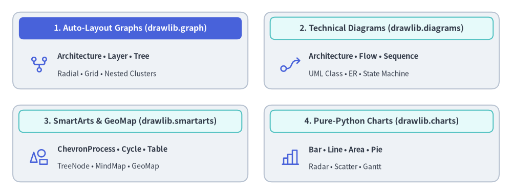

# Drawlib Documentation

Drawlib is a pure-Python drawing library and documentation compiler crafted for **"Illustration as Code"** and **"Illustrated Documentation as Code"**.


<figure class="drawlib-image" style="text-align: center;">
  
  <figcaption class="drawlib-caption">Autonomous AI Documentation Workflow with Drawlib (APNG Animation Generated by Drawlib)</figcaption>
</figure>


<div style="text-align: center; margin-top: -1.25rem; margin-bottom: 2rem; font-size: 0.88rem;">
  <a href="https://github.com/yuichi110/drawlib/blob/main/docs/docs_src/index.md" target="_blank" rel="noopener noreferrer">View animation source code on GitHub &rarr;</a>
</div>

Designed from the ground up for modern software engineering and **autonomous AI coding agents**, Drawlib eliminates manual GUI drawing tools and brittle image files. Developers and LLM agents can create, version-control, and publish publication-grade architectural diagrams, flowcharts, data charts, and complete multi-page documentation sites entirely from declarative Python code.

> **Note — Built Autonomously with Drawlib & Gemini:**
> Every page of prose and every illustration in this documentation was authored directly inside this Git repository using **Drawlib** and the **Gemini Coding Agent** (running in the **Antigravity IDE**). Human involvement was limited to high-level prompts—all document structure, technical explanations, and diagram designs were planned, coded, and visually verified autonomously by Gemini.

---

## Core Pillars

### 1. AI-Driven Documentation Pipeline
Drawlib is built to empower AI coding agents (such as Claude Code, Cursor, Gemini) to author and maintain technical documentation autonomously.
- **Rules & Context Injection**: Query targeted syntax rules on demand via `drawlib rules show <topic>`.
- **Multimodal Visual Verification Loop**: Agents export drawings with coordinate grids (`-g`), visually verify label boundaries and line routing, and self-correct layout issues automatically.

### 2. Rich High-Level Visualizations
Avoid assembling hundreds of primitive shapes by hand. Drawlib provides production-ready, declarative components:
- **Auto-Layout Graphs (`drawlib.graph`)**: Declarative graph layout solvers (`ArchitectureGraph`, `LayerGraph`, `TreeGraph`, `RadialGraph`, `GridGraph`) that compute overlap-free coordinates (`get_layout()`), nested cluster bounds, and `offset()` fine-tuning for rendering with `drawlib.diagrams` and `drawlib.shapes`.
- **SmartArts**: Process pipelines (`ChevronProcess`), cyclical loops (`Cycle`), data tables (`Table`), and trees (`Tree`).
- **Data Charts**: Pure-Python bar, line, area, pie, radar, scatter, and Gantt charts without external graphing dependencies.
- **Technical Diagrams**: Cloud architectures (`ArchitectureDiagram`), flowcharts (`FlowDiagram`), API sequences (`SequenceDiagram`), UML class diagrams (`ClassDiagram`), ER diagrams (`ERDiagram`), and state machines (`StateDiagram`).


<figure class="drawlib-image" style="text-align: center;">
  
  <figcaption class="drawlib-caption">Drawlib High-Level Visualization Ecosystem</figcaption>
</figure>

<details class="drawlib-code-details">
<summary>Source Code</summary>

```python
from drawlib.canvas import save, setup
from drawlib.icons import phosphor
from drawlib.shapes import rectangle
from drawlib.styles import Styles
from drawlib.text import text

setup(width=126, height=48)

hdr_white = Styles.WhiteBold.patch(text_size=11.5)
hdr_dark = Styles.DarkBold.patch(text_size=11.5)
body_bold = Styles.DarkBold.patch(text_size=10.5, halign="left")
body_sub = Styles.Dark.patch(text_size=10.0, halign="left")

# 1. Top-Left: Auto-Layout Graphs (Hero primary header)
rectangle((32.0, 35.5), width=58.0, height=19.0, style=Styles.Neutral.patch(shape_r=2.0))
rectangle((32.0, 41.0), width=55.0, height=5.5, style=Styles.PrimaryFlat.patch(shape_r=1.2), text="1. Auto-Layout Graphs (drawlib.graph)", text_style=hdr_white)
phosphor.git_fork((9.5, 32.0), width=5.2, style=Styles.Primary)
text((14.0, 34.0), "Architecture • Layer • Tree", style=body_bold)
text((14.0, 29.8), "Radial • Grid • Nested Clusters", style=body_sub)

# 2. Top-Right: Technical Diagrams
rectangle((94.0, 35.5), width=58.0, height=19.0, style=Styles.Neutral.patch(shape_r=2.0))
rectangle((94.0, 41.0), width=55.0, height=5.5, style=Styles.SecondaryNeutral.patch(shape_r=1.2), text="2. Technical Diagrams (drawlib.diagrams)", text_style=hdr_dark)
phosphor.flow_arrow((71.5, 32.0), width=5.2, style=Styles.Primary)
text((76.0, 34.0), "Architecture • Flow • Sequence", style=body_bold)
text((76.0, 29.8), "UML Class • ER • State Machine", style=body_sub)

# 3. Bottom-Left: SmartArts & GeoMap
rectangle((32.0, 12.5), width=58.0, height=19.0, style=Styles.Neutral.patch(shape_r=2.0))
rectangle((32.0, 18.0), width=55.0, height=5.5, style=Styles.SecondaryNeutral.patch(shape_r=1.2), text="3. SmartArts & GeoMap (drawlib.smartarts)", text_style=hdr_dark)
phosphor.shapes((9.5, 9.0), width=5.2, style=Styles.Primary)
text((14.0, 11.0), "ChevronProcess • Cycle • Table", style=body_bold)
text((14.0, 6.8), "TreeNode • MindMap • GeoMap", style=body_sub)

# 4. Bottom-Right: Pure-Python Charts
rectangle((94.0, 12.5), width=58.0, height=19.0, style=Styles.Neutral.patch(shape_r=2.0))
rectangle((94.0, 18.0), width=55.0, height=5.5, style=Styles.SecondaryNeutral.patch(shape_r=1.2), text="4. Pure-Python Charts (drawlib.charts)", text_style=hdr_dark)
phosphor.chart_bar((71.5, 9.0), width=5.2, style=Styles.Primary)
text((76.0, 11.0), "Bar • Line • Area • Pie", style=body_bold)
text((76.0, 6.8), "Radar • Scatter • Gantt", style=body_sub)

save()
```

</details>


### 3. Integrated Documentation Compiler
Write your technical spec or system architecture in standard Markdown with embedded ````drawlib```` blocks. A single command (`drawlib build`) compiles everything into:
- **Responsive HTML Site (`docs_html/`)**: Complete static site with sidebar navigation and instant search.
- **GitHub Markdown (`docs/`)**: Clean Markdown with syntax-highlighted code and embedded relative images.
- **Headless PDF (`docs.pdf`)**: Publication-ready vector PDF generated via Chromium.

---

## Documentation Roadmap

Explore the comprehensive guides below:

1. [**Getting Started**](./01_getting_started/overview.md)
   - Core philosophy, installation, quickstart, coordinate principles, project scaffolding, and AI agent configuration.
2. [**Drawing Primitives & Styles**](./02_drawing_primitives/canvas.md)
   - Low-level vector shapes, polygons, domain primitives, block arrows, lines, typography, fonts, image processing, preset themes, and color palettes.
3. [**Icons & Brand Suites**](./03_icons/overview.md)
   - 34 icon modules (4,538 canonical icons): Phosphor vector icons, GCP, AWS, and Azure cloud icons, 15 official domain brand suites, and 15 vendor-neutral Original 2D pastel icon suites.
4. [**SmartArts**](./04_smartarts/overview.md)
   - High-level infographics: process pipelines, cyclical loops, data tables, hierarchical trees, mindmaps, grids, pyramids, lists, source code blocks, and geographic maps.
5. [**Charts**](./05_charts/overview.md)
   - Declarative data plotting: axes & legends, bar, line, area, pie, radar, scatter, and project Gantt charts.
6. [**Technical Diagrams**](./06_diagrams/overview.md)
   - Coordinate-controlled engineering diagrams: cloud architectures, flowcharts, sequence diagrams, UML class diagrams, ER diagrams, and state machines.
7. [**Auto-Layout Graphs**](./07_graph/overview.md)
   - Declarative graph layout solvers (`ArchitectureGraph`, `LayerGraph`, `TreeGraph`, `RadialGraph`, `GridGraph`), nested clusters, `offset()` fine-tuning, and code export.
8. [**Animations (APNG & WebP)**](./08_animations/overview.md)
   - Multi-frame animations, smooth color transitions, progressive component reveals, arrow growth (`draw_ratio`), and camera pan/zoom across all Drawlib modules.
9. [**Document Builder & CLI**](./09_doc_builder_and_cli/overview.md)
   - Illustrated Documentation as Code: Markdown block syntax, CLI reference, project templates (`doc`, `site`, `slide`, `images`), 1920×1080 slide stage layout, customization, and two-tier caching & CI/CD.
10. [**AI Agents & Advanced Integration**](./10_ai_agents_and_advanced/ai_agent_instructions.md)
   - Autonomous agent instructions, visual self-correction feedback loop, programmatic Python APIs, math utilities, and troubleshooting.
