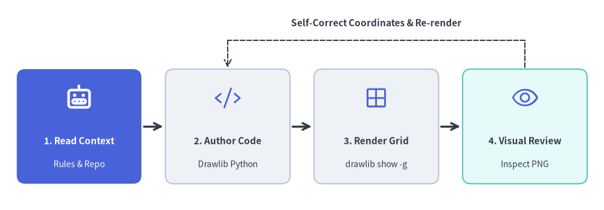

# AI 駆動ワークフローとエージェント設定

Drawlib v0.3 は、Claude Code、Cursor、Gemini、GitHub Copilot などの **自律型 AI コーディングエージェント** のために一から設計されています。人間のエンジニアが手作業で技術仕様書を執筆したりアーキテクチャ図を描いたりする代わりに、**ドキュメントのライフサイクル全体** を AI エージェントへ委譲できます。


<figure class="drawlib-image" style="text-align: center;">
  
  <figcaption class="drawlib-caption">自律型 AI ドキュメントライフサイクル: リポジトリ・ルール参照、Markdown 執筆、内側・外側ループ（APNG アニメーション）</figcaption>
</figure>


<div class="drawlib-source-link">
  <a href="https://github.com/yuichi110/drawlib/blob/main/docs/docs_src/ja/01_getting_started/agent_quicklook.md" target="_blank" rel="noopener noreferrer">GitHub でアニメーションのソースコードを見る &rarr;</a>
</div>

---

## AI ネイティブな協業モデル

Drawlib は相補的な 2 つのループを組み合わせて機能します。1 つは **AI 内側ループ（AI Inner Loop）** であり、コーディングエージェントが実際のリポジトリコードを読み取り、必要に応じて `drawlib rules` を参照し、単一の Markdown ファイル内に本文と Drawlib Python コードブロックを記述したうえで、`drawlib show -g` を用いてレイアウトの重なりを視覚的に自己修正します。もう 1 つは **人間の外側ループ（Human Outer Loop）** であり、開発者は大局的な指示プロンプトやベンチマークチャートの追加といった反復的なレビュー依頼、そして最終承認だけに集中できます。

### AI エージェントに Drawlib が最適な理由

技術図解の生成を任せる際、従来の生の SVG 生成や GUI デザインツールには AI エージェントにとって大きな壁がありました。
- **生の SVG は壊れやすい**: LLM は座標境界の計算を誤りやすく、テキストの欠けや矢印の位置ずれが頻発します。
- **低水準な Matplotlib はボイラープレートが多い**: Matplotlib は統計プロット向けに設計されており、クリーンなソフトウェアアーキテクチャ図には不向きです。
- **GUI ツールはエージェントから操作できない**: AI エージェントは Visio や Figma 上で図形をドラッグ＆ドロップできません。
- **高水準で宣言的な抽象コンポーネント**: 四角形や線を 1 つずつ描く代わりに、`ArchitectureDiagram`、`ERDiagram`、`FlowDiagram` を記述するだけで、直交ルーティングや余白、マーカースタイルが自動的に処理されます。
- **組み込みの視覚的調和**: 定義済みのセマンティックスタイル（`Styles.PrimaryFlat`, `Styles.AccentFlat` など）により、カラーコードを細かく調整しなくてもそのまま公開品質の図解が得られます。

### エージェントが Drawlib のコードをハルシネーションしない理由
古い API を捏造したり非推奨オプションで躓いたりしがちな一般的なライブラリとは異なり、Drawlib は **CLI による能動的なガイダンス** によってハルシネーションを排除しています。
1. **オンデマンドのルール注入**: 何千トークンもの API ドキュメントを常時プロンプトに詰め込むのではなく、正確な関数シグネチャが必要になった時点で `drawlib rules show <topic>` を実行して取得します。
2. **決定論的なジオメトリ検証**: 描画結果を推測に頼るのではなく、`drawlib show -g` で絶対座標グリッド付きの画像を出力し、視覚的に結果を検証できます。

AI エージェントに Drawlib で図解やドキュメントを作成させるには、ワークスペースに Drawlib の基本ガイドラインを設定してください。

### 1. ワークスペースルールの設定（`drawlib init agent`）
`drawlib init agent`（`antigravity`, `claude`, `cursor`, `copilot`, `windsurf`, `cline`, `roo`, `codex`, `gemini`, または `all`）を実行し、Drawlib 公式の AI エージェント用ルールファイルをワークスペースへ直接生成します。

- **Antigravity**: `.agents/rules/drawlib.md` を生成します。
- **Claude Code / Cursor / GitHub Copilot**: `.claude/rules/drawlib.md`、`.cursor/rules/drawlib.mdc`、または `.github/instructions/drawlib.instructions.md` を生成します。
- **Codex / Gemini（`AGENTS.md` / `GEMINI.md`）**: `AGENTS.md` または `GEMINI.md` に Drawlib ルールセクションを非破壊マージします。

```bash
# List supported AI coding agents and target rule paths
$ uv run drawlib init agent list

# Auto-detect configured AI agents in your repository (or specify targets explicitly)
$ uv run drawlib init agent --detect
$ uv run drawlib init agent antigravity
$ uv run drawlib init agent claude cursor copilot

# Display the bootstrap agent manual directly in stdout
$ uv run drawlib rules show agent-instruction
```

### 2. プロジェクトファーストの原則（`drawlib init project`）
エージェントに対して、**未初期化のディレクトリに裸の `.py` ファイルを作成したり、プロジェクトフォルダを手動で組み立てたりしない** よう徹底させます。`drawlib.toml`、テーマ・言語フォント設定（`styles.py`）、`utils.py`、`_assets/`、`build.sh` が適切に構成されるよう、必ず最初に Drawlib プロジェクトをスキャフォールディングさせてください。

```bash
# Standalone diagram image(s) only -> images_src/*.py -> images/*.png
$ uv run drawlib init project images [-l <lang>] [-s <style>]

# Linear technical document / RFC / PDF / Word -> doc_src/<lang>/*.md
$ uv run drawlib init project doc [target] [-l <langs>] [-s <style>]

# Multi-page documentation website -> docs_src/<lang>/**/*.md
$ uv run drawlib init project site [target] [-l <langs>] [-s <style>]

# 16:9 presentation slide deck / PowerPoint -> slide_src/<lang>/*.md
$ uv run drawlib init project slide [target] [-l <langs>] [-s <style>]
```

### 3. 基本コマンドとオンデマンドルールカタログ
オンデマンドのルールトピックの参照方法と、座標グリッド付きプレビューの出力方法をエージェントに把握させます。

| 目的 | コマンド |
| :--- | :--- |
| **利用可能なルールトピック一覧の表示** | `uv run drawlib rules list` |
| **キャンバスとライフサイクルの概要** | `uv run drawlib rules show overview` |
| **スタイルガイドと 50%+ ニュートラル原則** | `uv run drawlib rules show style-guide` |
| **アニメーションループと定石パターン** | `uv run drawlib rules show anim-guide` |
| **自律 3 段階レビューとフォントサイズ計算** | `uv run drawlib rules show review-guide` |
| **プロジェクト概要（4 つのアーキタイプ）** | `uv run drawlib rules show project-overview` |
| **各プロジェクトガイド（`images`, `doc`, `site`, `slide`）** | `uv run drawlib rules show project-<images\|doc\|site\|slide>` |
| **CLI リファレンス（`build`, `init`, `show`, `cache`）** | `uv run drawlib rules show cli` |
| **統合 API チートシート** | `uv run drawlib rules show api` |
| **自動レイアウトグラフ（`drawlib.graph`）** | `uv run drawlib rules show lib-graph-overview` |
| **ドメインダイアグラム（`drawlib.diagrams`）** | `uv run drawlib rules show lib-diagrams-overview` |
| **SmartArts と GeoMap（`drawlib.smartarts`）** | `uv run drawlib rules show lib-smartarts-overview` |
| **定量チャート（`drawlib.charts`）** | `uv run drawlib rules show lib-charts-overview` |
| **Markdown 内コードブロックのグリッドプレビュー出力** | `uv run drawlib show <md_path> <diagram.png> -g -o .drawlib/scratch/preview.png` |
| **スタンドアロンスクリプトのグリッドプレビュー出力** | `uv run drawlib show <script.py> -g -o .drawlib/scratch/preview.png` |
| **プロジェクト全体のビルド** | `./<target>_src/build.sh` または `uv run drawlib build html docs_src/ -o docs_html/` |

---

## 自律検証フィードバックループ

図解を作成する際は、Drawlib の自律的な自己修正ループに従うようエージェントに指示します。


<figure class="drawlib-image" style="text-align: center;">
  
  <figcaption class="drawlib-caption">AI による自律的な視覚的自己修正ループ</figcaption>
</figure>

<details class="drawlib-code-details">
<summary>Source Code</summary>

```python
from drawlib.canvas import save, setup
from drawlib.icons import phosphor
from drawlib.lines import line
from drawlib.shapes import rectangle
from drawlib.styles import Styles
from drawlib.text import text

setup(width=126, height=44)

# 1. Read Context (Hero node)
rectangle((16.5, 17.5), width=26.0, height=24.0, style=Styles.PrimaryFlat.patch(shape_r=1.8))
phosphor.robot((16.5, 23.5), width=5.6, style=Styles.WhiteBold)
text((16.5, 14.5), "1. Read Context", style=Styles.WhiteBold.patch(text_size=11.0))
text((16.5, 9.5), "Rules & Repo", style=Styles.White.patch(text_size=10.0))

# 2. Author Code
rectangle((47.5, 17.5), width=26.0, height=24.0, style=Styles.Neutral.patch(shape_r=1.8))
phosphor.code((47.5, 23.5), width=5.6, style=Styles.Primary)
text((47.5, 14.5), "2. Author Code", style=Styles.DarkBold.patch(text_size=11.0))
text((47.5, 9.5), "Drawlib Python", style=Styles.Dark.patch(text_size=10.0))

# 3. Render Grid
rectangle((78.5, 17.5), width=26.0, height=24.0, style=Styles.Neutral.patch(shape_r=1.8))
phosphor.grid_four((78.5, 23.5), width=5.6, style=Styles.Primary)
text((78.5, 14.5), "3. Render Grid", style=Styles.DarkBold.patch(text_size=11.0))
text((78.5, 9.5), "drawlib show -g", style=Styles.Dark.patch(text_size=10.0))

# 4. Visual Review
rectangle((109.5, 17.5), width=26.0, height=24.0, style=Styles.SecondaryNeutral.patch(shape_r=1.8))
phosphor.eye((109.5, 23.5), width=5.6, style=Styles.Primary)
text((109.5, 14.5), "4. Visual Review", style=Styles.DarkBold.patch(text_size=11.0))
text((109.5, 9.5), "Inspect PNG", style=Styles.Dark.patch(text_size=10.0))

# Forward arrows
line((30.0, 17.5), (34.0, 17.5), arrow_head="->", style=Styles.DarkBold)
line((61.0, 17.5), (65.0, 17.5), arrow_head="->", style=Styles.DarkBold)
line((92.0, 17.5), (96.0, 17.5), arrow_head="->", style=Styles.DarkBold)

# Feedback loop
line((109.5, 29.8), (109.5, 35.5), style=Styles.DarkDashed)
line((109.5, 35.5), (47.5, 35.5), style=Styles.DarkDashed)
line((47.5, 35.5), (47.5, 29.8), arrow_head="->", style=Styles.DarkDashed)
text((78.5, 39.2), "Self-Correct Coordinates & Re-render", style=Styles.DarkBold.patch(text_size=11.0))
save()
```

</details>


1. **コンテキストの調査**: エージェントはリポジトリ内の実際のファイル（モデル、API ルーター、データベーススキーマなど）を調査し、アーキテクチャを正確に把握します。
2. **図解コードの作成**: エージェントは（未作成の場合は）`drawlib init project` でプロジェクトをスキャフォールディングし、`images_src/<name>.py` または `file=<diagram.png>` を指定した埋め込み ````drawlib```` Markdown ブロック内に描画コードを記述します。
3. **グリッド付き画像のレンダリング（`-g`）**:  
   `uv run drawlib show <md_path> <diagram.png> -g -o .drawlib/scratch/preview.png`（または `uv run drawlib show images_src/<name>.py -g -o .drawlib/scratch/preview.png`）を実行します。
4. **マルチモーダル自己レビュー**: エージェントはレンダリングされた PNG 画像を視覚ツール（ファイル閲覧ツール）で確認し、以下の項目をチェックします。
   - ボックス外へのラベルのはみ出しやテキストの欠けがないか。
   - 矢印線の重なりや不自然な折れ線ルーティングがないか。
   - キャンバス外周のマージンが不足していないか。
5. **自動調整と最終ビルド**: 問題があれば座標を修正してクリーンになるまで再レンダリングし、最終的なプロジェクト成果物をビルドします。

---

> [!TIP]
> システムプロンプトの全文、ルールトピック一覧、および高度な CI/CD 自動化連携については、**[第 10 章: AI エージェントと高度な統合](../10_ai_agents_and_advanced/ai_agent_instructions.md)** に進んでください。
