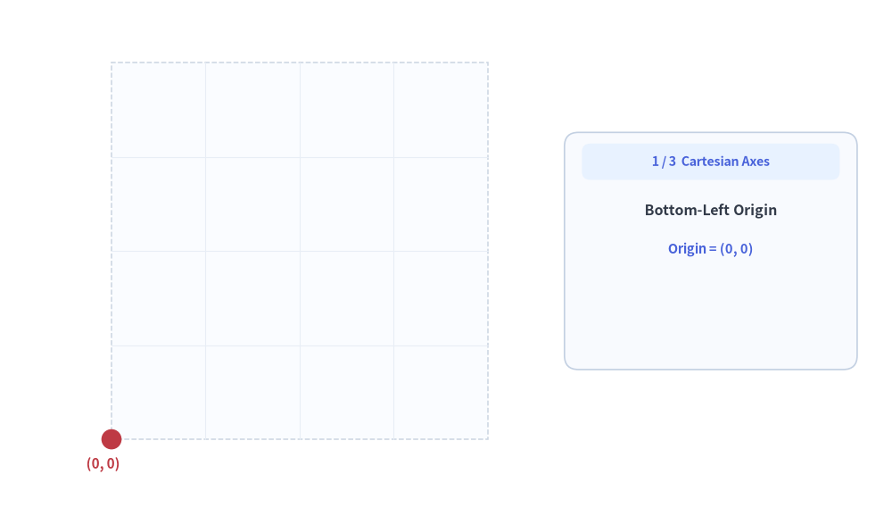
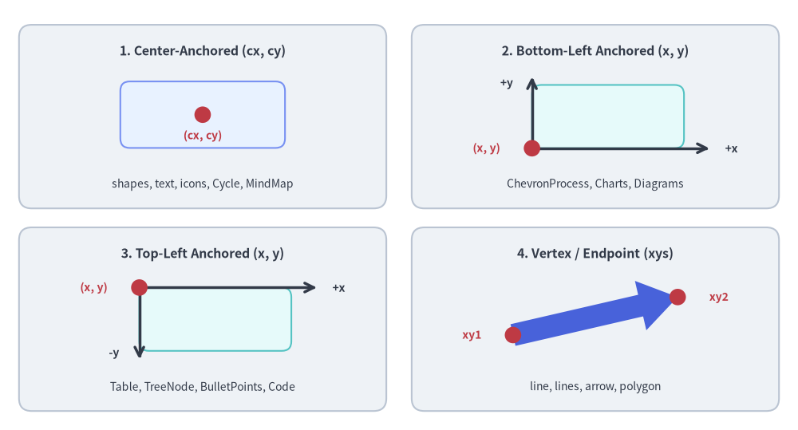
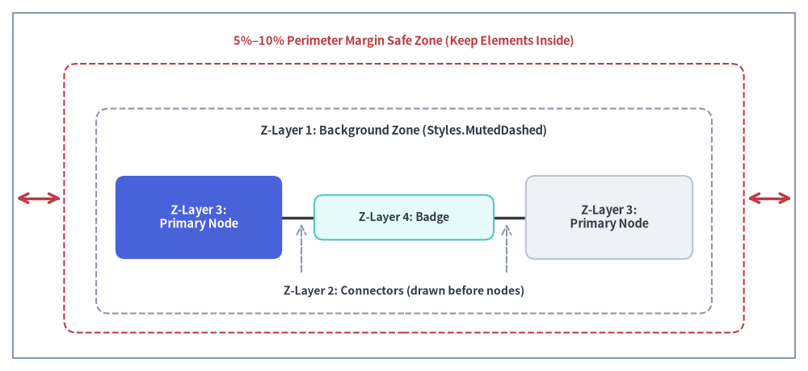
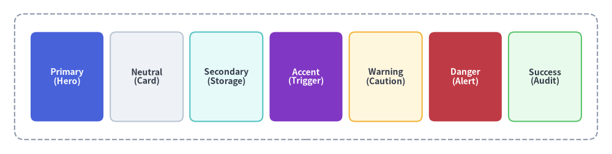

# 基本ビジュアル概念

Drawlib で洗練されたプロフェッショナルな図解を作成するには、基盤となる **デカルト座標系（直交座標系）**、**アンカー配置（基準点揃え）**、および **2 点間コネクタ** の仕組みを理解しておくことが重要です。


<figure class="drawlib-image" style="text-align: center;">
  
  <figcaption class="drawlib-caption">座標幾何の基本: 座標軸・アンカー配置・2 点間コネクタ（APNG アニメーション）</figcaption>
</figure>

<details class="drawlib-code-details">
<summary>Source Code</summary>

```python
from __future__ import annotations

from drawlib.anim import Animation
from drawlib.canvas import save, setup
from drawlib.lines import line
from drawlib.shapes import circle, rectangle
from drawlib.styles import Styles
from drawlib.text import text

setup(width=128, height=74)
anim = Animation(fps=10.0, loop=0)

# Map a true 1:1 square (0..100 x 0..100) coordinate space onto canvas
PLANE_X0, PLANE_Y0 = 16.0, 11.0
PLANE_SIZE = 54.0
SCALE = PLANE_SIZE / 100.0


def pt(vx: float, vy: float) -> tuple[float, float]:
    """Map virtual (0..100, 0..100) coordinates to canvas coordinates."""
    return (PLANE_X0 + vx * SCALE, PLANE_Y0 + vy * SCALE)


def draw_plane_and_axes(axis_progress: float = 1.0, show_endpoints: bool = True) -> None:
    """Draw 100x100 canvas frame, subtle grid, origin (0,0), and X/Y axes."""
    # Subtle 100x100 canvas sheet
    cx, cy = pt(50.0, 50.0)
    rectangle(
        (cx, cy),
        width=PLANE_SIZE,
        height=PLANE_SIZE,
        style=Styles.Neutral.patch(
            shape_fill_color=(250, 252, 255),
            shape_line_color=(203, 213, 225),
            shape_line_width=1.1,
            shape_line_style="dashed",
        ),
    )

    # Subtle internal 25/50/75 grid lines
    grid_st = Styles.MutedThin.patch(line_color=(232, 238, 246), line_width=0.8)
    for g in (25.0, 50.0, 75.0):
        line(pt(g, 0.0), pt(g, 100.0), style=grid_st)
        line(pt(0.0, g), pt(100.0, g), style=grid_st)

    # Growing X and Y axes from (0, 0)
    if axis_progress > 0.0:
        end_v = 100.0 * axis_progress
        line(pt(0.0, 0.0), pt(end_v, 0.0), arrow_head="->", style=Styles.DarkBold.patch(line_width=1.8))
        line(pt(0.0, 0.0), pt(0.0, end_v), arrow_head="->", style=Styles.DarkBold.patch(line_width=1.8))

    # Origin (0, 0) dot & label
    ox, oy = pt(0.0, 0.0)
    circle((ox, oy), radius=1.45, style=Styles.DangerFlat)
    text((ox - 1.2, oy - 3.6), "(0, 0)", style=Styles.DangerBold.patch(text_size=11.0, halign="center"))

    # Endpoint labels (100, 0) and (0, 100)
    if show_endpoints:
        x_tip = pt(100.0, 0.0)
        y_tip = pt(0.0, 100.0)
        text((x_tip[0], x_tip[1] - 3.8), "(100, 0)", style=Styles.DarkBold.patch(text_size=10.8, halign="center"))
        text((y_tip[0], y_tip[1] + 3.6), "(0, 100)", style=Styles.DarkBold.patch(text_size=10.8, halign="center"))


def draw_info_card(step_badge: str, title: str, lines_info: list[tuple[str, bool]]) -> None:
    """Draw right-side status card explaining the active coordinate concept."""
    cx, cy = 102.0, 38.0
    w, h = 42.0, 34.0
    rectangle(
        (cx, cy),
        width=w,
        height=h,
        style=Styles.Neutral.patch(
            shape_fill_color=(248, 250, 254),
            shape_line_color=(195, 208, 226),
            shape_line_width=1.2,
            shape_r=2.0,
        ),
    )
    rectangle(
        (cx, cy + h / 2.0 - 4.2),
        width=w - 5.0,
        height=5.2,
        style=Styles.PrimaryNeutral.patch(shape_r=1.2, shape_line_width=0),
        text=step_badge,
        text_style=Styles.PrimaryBold.patch(text_size=10.2),
    )
    text((cx, cy + 5.8), title, style=Styles.DarkBold.patch(text_size=11.5))

    start_y = cy + 0.2
    for idx, (txt, is_accent) in enumerate(lines_info):
        st = (
            Styles.PrimaryBold.patch(text_size=10.5)
            if is_accent
            else Styles.Dark.patch(text_size=10.2)
        )
        text((cx, start_y - idx * 4.4), txt, style=st)


def draw_circle_alignment_scene(halign: str, valign: str, *, show_ghost_center: bool = False) -> None:
    """Draw circle anchored at (50, 50) with specified halign and valign."""
    draw_plane_and_axes(axis_progress=1.0, show_endpoints=True)

    c50 = pt(50.0, 50.0)
    rad = 20.0 * SCALE
    is_shifted = (halign, valign) != ("center", "center")

    if show_ghost_center:
        circle(
            c50,
            radius=rad,
            style=Styles.MutedDashed.patch(
                shape_fill_color=(0, 0, 0, 0),
                shape_line_color=(190, 200, 215),
                shape_line_width=1.0,
            ),
        )

    # Subtle bounding box on shifted states so corner-to-(50, 50) anchor is crystal clear
    if is_shifted:
        rectangle(
            c50,
            width=rad * 2.0,
            height=rad * 2.0,
            style=Styles.PrimaryDashed.patch(
                shape_fill_color=(0, 0, 0, 0),
                shape_line_color=(135, 162, 228),
                shape_line_width=1.0,
                halign=halign,
                valign=valign,
            ),
        )

    # Shifted or centered circle using Drawlib's native halign / valign
    circle(
        c50,
        radius=rad,
        style=Styles.PrimaryNeutral.patch(
            shape_fill_color=(59, 102, 212, 0.22),
            shape_line_color=(59, 102, 212),
            shape_line_width=1.8,
            halign=halign,
            valign=valign,
        ),
    )

    # Fixed (50, 50) anchor pin drawn on top so shift relative to (50, 50) is unmistakable
    circle(c50, radius=1.45, style=Styles.DangerFlat)
    label_y = c50[1] - 3.6 if valign != "top" else c50[1] + 3.6
    text((c50[0], label_y), "(50, 50)", style=Styles.DangerBold.patch(text_size=10.5))

    draw_info_card(
        "2 / 3  Anchor & Align",
        "circle((50, 50), ...)",
        [
            (f'halign = "{halign}"', is_shifted),
            (f'valign = "{valign}"', is_shifted),
            ("Default: center" if not is_shifted else "Shifted around (50, 50)", False),
        ],
    )


def draw_line_ab_scene(line_progress: float) -> None:
    """Draw point-to-point connector from A to B after clearing the circle."""
    import math

    draw_plane_and_axes(axis_progress=1.0, show_endpoints=True)

    ax, ay = pt(25.0, 25.0)
    bx, by = pt(75.0, 75.0)
    dot_r = 1.55

    dx, dy = bx - ax, by - ay
    dist = math.hypot(dx, dy)
    ux, uy = dx / dist, dy / dist

    if line_progress > 0.0:
        start_pt = (ax + ux * (dot_r + 0.2), ay + uy * (dot_r + 0.2))
        end_full = (bx - ux * (dot_r + 0.3), by - uy * (dot_r + 0.3))
        cur_pt = (
            start_pt[0] + (end_full[0] - start_pt[0]) * line_progress,
            start_pt[1] + (end_full[1] - start_pt[1]) * line_progress,
        )
        line(
            start_pt,
            cur_pt,
            arrow_head="->" if line_progress >= 0.99 else "",
            style=Styles.PrimaryBold.patch(line_width=2.2),
        )

    circle((ax, ay), radius=dot_r, style=Styles.DarkFlat)
    text((ax + 2.2, ay - 3.4), "A (25, 25)", style=Styles.DarkBold.patch(text_size=10.5, halign="left"))

    circle((bx, by), radius=dot_r, style=Styles.PrimaryFlat)
    text((bx - 2.2, by + 3.4), "B (75, 75)", style=Styles.PrimaryBold.patch(text_size=10.5, halign="right"))

    draw_info_card(
        "3 / 3  Point-to-Point",
        "line(A, B)",
        [
            ("A = (25, 25)", False),
            ("B = (75, 75)", False),
            ('arrow_head = "->"', line_progress >= 0.99),
        ],
    )


# -------------------------------------------------------------------------
# Act 1: Origin (0, 0) -> Extend X & Y axes -> Show (100, 0) & (0, 100)
# -------------------------------------------------------------------------
with anim.frame(duration=1.50):
    draw_plane_and_axes(axis_progress=0.0, show_endpoints=False)
    draw_info_card(
        "1 / 3  Cartesian Axes",
        "Bottom-Left Origin",
        [("Origin = (0, 0)", True), ("", False), ("", False)],
    )

with anim.frame(duration=0.90):
    draw_plane_and_axes(axis_progress=0.55, show_endpoints=False)
    draw_info_card(
        "1 / 3  Cartesian Axes",
        "Extending +X & +Y",
        [("Origin = (0, 0)", False), ("+X Right / +Y Up", True), ("", False)],
    )

with anim.frame(duration=2.70):
    draw_plane_and_axes(axis_progress=1.0, show_endpoints=True)
    draw_info_card(
        "1 / 3  Cartesian Axes",
        "setup(100, 100)",
        [("Origin = (0, 0)", False), ("X-end = (100, 0)", True), ("Y-end = (0, 100)", True)],
    )

# -------------------------------------------------------------------------
# Act 2: Circle at (50, 50) -> Shift halign / valign around (50, 50)
# -------------------------------------------------------------------------
with anim.frame(duration=2.70):
    draw_circle_alignment_scene("center", "center", show_ghost_center=False)

with anim.frame(duration=2.70):
    draw_circle_alignment_scene("left", "bottom", show_ghost_center=True)

with anim.frame(duration=2.70):
    draw_circle_alignment_scene("right", "top", show_ghost_center=True)

# -------------------------------------------------------------------------
# Act 3: Clear circle -> Draw line from A to B
# -------------------------------------------------------------------------
with anim.frame(duration=1.30):
    draw_line_ab_scene(0.0)

with anim.frame(duration=0.80):
    draw_line_ab_scene(0.55)

with anim.frame(duration=4.40):
    draw_line_ab_scene(1.0)

save()
```

</details>


---

## 1. デカルト座標系（直交座標系）

Drawlib は、キャンバスの左下隅を原点 `(0, 0)` とする標準的な **数学のデカルト座標系** を採用しています。

- **原点 `(0, 0)` は左下（Bottom-Left）**:
  - `x` は水平方向の右に向かって増加します。
  - `y` は垂直方向の上に向かって増加します。
  *（左上を `(0, 0)` とする一般的なコンピュータグラフィックスや HTML Canvas とは異なります。）*

### 4 つの座標アンカー方式

Drawlib の各コンポーネントでは、それぞれの自然なレイアウト特性に応じて一貫した 4 つの座標アンカーモデルが使われます。

1. **中央基準（Center-Anchored: `(x, y)` = 中心）**:  
   大半の閉じた図形（`rectangle`, `circle`, `ellipse`, `triangle`, `regularpolygon`, `star`, `gear`, `math_symbol`, `cylinder`, `cloud`, `brace`, `face`, `shield`, `pin`, `clock` など）、アイコン、テキスト、`Cycle`、`MindMapNode` が該当します。*（図形・アイコン・テキストでは `style.halign` と `style.valign` でアンカー位置を変更できます。）*
2. **左下基準（Bottom-Left Anchored: `(x, y)` = 左下）**:  
   `bubblespeech`、`ChevronProcess`、`GridLayout`、`Pyramid`、`BoxList`、`GeoMap`、すべての `Charts`、`ArchitectureDiagram` 内の `NodeGroup`、および各種 `Diagrams` の `d.draw(xy=...)`（さらに `drawlib.graph` レイアウトの `.bottom_left` / `.local_bottom_left`）が該当します。
3. **左上基準（Top-Left Anchored: `(x, y)` = 左上）**:  
   `Table`、`TreeNode`、`BulletPoints`、`SourceCode` など、行や要素の追加に伴って下方向へ伸びるコンポーネントが該当します。
4. **頂点・端点指定（Vertex / Endpoint Coordinates）**:  
   `polygon(xys)`、`arrow(xy1, xy2)`、`arrow_polyline(xys)`、`line(xy1, xy2)`、`lines(xys)` が該当します。


<figure class="drawlib-image" style="text-align: center;">
  
  <figcaption class="drawlib-caption">Drawlib における 4 つの座標アンカー規則</figcaption>
</figure>

<details class="drawlib-code-details">
<summary>Source Code</summary>

```python
from drawlib.canvas import save, setup
from drawlib.lines import line
from drawlib.shapes import arrow, circle, rectangle
from drawlib.styles import Styles
from drawlib.text import text

setup(width=126, height=68)

hdr_ts = Styles.DarkBold.patch(text_size=11.5)
coord_ts = Styles.DangerBold.patch(text_size=10.0)
axis_ts = Styles.DarkBold.patch(text_size=10.0)
sub_ts = Styles.Dark.patch(text_size=10.0)

# Panel 1 (Top-Left): Center-Anchored (cx, cy)
rectangle((32.0, 49.5), width=58.0, height=29.0, style=Styles.Neutral.patch(shape_r=2.0))
text((32.0, 59.8), "1. Center-Anchored (cx, cy)", style=hdr_ts)
rectangle((32.0, 49.8), width=26.0, height=10.5, style=Styles.PrimaryNeutral.patch(shape_r=1.5))
circle((32.0, 49.8), radius=1.3, style=Styles.DangerFlat)
text((32.0, 46.5), "(cx, cy)", style=coord_ts)
text((32.0, 38.8), "shapes, text, icons, Cycle, MindMap", style=sub_ts)

# Panel 2 (Top-Right): Bottom-Left Anchored (x, y)
rectangle((94.0, 49.5), width=58.0, height=29.0, style=Styles.Neutral.patch(shape_r=2.0))
text((94.0, 59.8), "2. Bottom-Left Anchored (x, y)", style=hdr_ts)
rectangle((96.0, 49.5), width=24.0, height=10.0, style=Styles.SecondaryNeutral.patch(shape_r=1.5))
line((84.0, 44.5), (112.0, 44.5), arrow_head="->", style=Styles.DarkBold)
text((115.5, 44.5), "+x", style=axis_ts)
line((84.0, 44.5), (84.0, 55.8), arrow_head="->", style=Styles.DarkBold)
text((80.0, 54.8), "+y", style=axis_ts)
circle((84.0, 44.5), radius=1.3, style=Styles.DangerFlat)
text((76.8, 44.5), "(x, y)", style=coord_ts)
text((94.0, 38.8), "ChevronProcess, Charts, Diagrams", style=sub_ts)

# Panel 3 (Bottom-Left): Top-Left Anchored (x, y)
rectangle((32.0, 17.5), width=58.0, height=29.0, style=Styles.Neutral.patch(shape_r=2.0))
text((32.0, 27.8), "3. Top-Left Anchored (x, y)", style=hdr_ts)
rectangle((34.0, 17.5), width=24.0, height=10.0, style=Styles.SecondaryNeutral.patch(shape_r=1.5))
line((22.0, 22.5), (50.0, 22.5), arrow_head="->", style=Styles.DarkBold)
text((53.5, 22.5), "+x", style=axis_ts)
line((22.0, 22.5), (22.0, 11.2), arrow_head="->", style=Styles.DarkBold)
text((18.0, 12.2), "-y", style=axis_ts)
circle((22.0, 22.5), radius=1.3, style=Styles.DangerFlat)
text((14.8, 22.5), "(x, y)", style=coord_ts)
text((32.0, 6.8), "Table, TreeNode, BulletPoints, Code", style=sub_ts)

# Panel 4 (Bottom-Right): Vertex / Endpoint (xys)
rectangle((94.0, 17.5), width=58.0, height=29.0, style=Styles.Neutral.patch(shape_r=2.0))
text((94.0, 27.8), "4. Vertex / Endpoint (xys)", style=hdr_ts)
arrow((81.0, 15.0), (107.0, 21.0), tail_width=3.5, head_width=8.0, head_length=6.0, style=Styles.PrimaryFlat)
circle((81.0, 15.0), radius=1.3, style=Styles.DangerFlat)
text((74.5, 15.0), "xy1", style=coord_ts)
circle((107.0, 21.0), radius=1.3, style=Styles.DangerFlat)
text((113.5, 21.0), "xy2", style=coord_ts)
text((94.0, 6.8), "line, lines, arrow, polygon", style=sub_ts)

save()
```

</details>


---

## 2. キャンバスサイズと仮想単位

`setup(width=..., height=...)` で指定するキャンバスの寸法は、物理ピクセルではなく **任意の仮想座標単位** を表します。
Drawlib はこれらの仮想座標単位を高解像度の表示ピクセルへと自動的にマッピングします。

### 推奨キャンバスサイズ
図の自然なアスペクト比に合わせてキャンバス寸法を選択してください。
- **横長スキーマ（16:9 / ランドスケープ）**: `width=120`, `height=50` または `width=140`, `height=60`
- **標準バランス型（4:3）**: `width=100`, `height=75`
- **正方形・対称レイアウト**: `width=100`, `height=100`

---

## 3. 外周マージン・Z オーダー階層・幾何ヘルパー

図解を生成する際によくある失敗は、キャンバスの端ギリギリに要素を配置してしまうことや、重なり順（Z オーダー）を考慮せずに描画してしまうことです。

- **5%〜10% の外周マージンを確保する**: 上下左右すべての端に十分な余白を残します。たとえば `width=100`, `height=60` のキャンバスでは、テキストや図形の境界が `x=5` 未満、`x=95` 超、`y=5` 未満、`y=55` 超の領域にはみ出さないようにします。
- **画家アルゴリズムによる 4 層 Z オーダー**: Drawlib は関数を呼び出した順序どおり（奥から手前へ）に要素を描画します。接続線がノードのラベルを横切ったり、背景枠が手前のノードを覆い隠したりしないよう、以下の 4 層順序で描画してください。
  1. **レイヤー 1 — 背景ゾーン**: VPC、サブネット、境界コンテナ（例: `rectangle(..., style=Styles.MutedDashed)`）。
  2. **レイヤー 2 — コネクタ・線**: サービス間の矢印や通信リンク（`line`, `line_curved`, `lines`）。
  3. **レイヤー 3 — 主要ノード・図形**: サービスカード、データベース、アイコン、アクター（`rectangle`, `circle`, `cylinder`）。
  4. **レイヤー 4 — コールアウト・バッジ**: フローティングのプロトコルバッジ、ステータス表示、吹き出し（`bubblespeech`, `text`）。
- **`drawlib.math.get_center_and_size()` による動的バウンディングボックス計算**: 複数ノードを囲むコンテナの中心座標やサイズを手計算する代わりに、座標リストを `get_center_and_size(points)` に渡すことで `((center_x, center_y), (width, height))` を自動算出できます。


<figure class="drawlib-image" style="text-align: center;">
  
  <figcaption class="drawlib-caption">外周 5%〜10% のセーフマージン領域と奥から手前への 4 層 Z オーダー</figcaption>
</figure>

<details class="drawlib-code-details">
<summary>Source Code</summary>

```python
from drawlib.canvas import save, setup
from drawlib.lines import line
from drawlib.shapes import rectangle
from drawlib.styles import Styles
from drawlib.text import text

setup(width=126, height=58)

# Outer canvas boundary frame & inner 5%-10% Safe Margin Zone
rectangle((63.0, 29.0), width=122.0, height=54.0, style=Styles.MutedOutline)
rectangle((63.0, 27.0), width=106.0, height=42.0, style=Styles.DangerDashed.patch(shape_r=2.0))
text((63.0, 51.5), "5%–10% Perimeter Margin Safe Zone (Keep Elements Inside)", style=Styles.DangerBold.patch(text_size=10.5))
line((2.5, 27.0), (9.5, 27.0), arrow_head="<->", style=Styles.DangerBold)
line((116.5, 27.0), (123.5, 27.0), arrow_head="<->", style=Styles.DangerBold)

# Z-Layer 1: Background Zone
rectangle((63.0, 25.0), width=96.0, height=32.0, style=Styles.MutedDashed.patch(shape_r=2.0))
text((63.0, 37.5), "Z-Layer 1: Background Zone (Styles.MutedDashed)", style=Styles.DarkBold.patch(text_size=10.5))

# Z-Layer 2: Connectors (drawn before or between nodes)
line((31.0, 24.0), (95.0, 24.0), arrow_head="->", style=Styles.DarkBold.patch(line_width=2.5))
text((63.0, 12.5), "Z-Layer 2: Connectors (drawn before nodes)", style=Styles.DarkBold.patch(text_size=10.0))
line((47.0, 15.5), (47.0, 23.0), arrow_head="->", style=Styles.MutedDashed)
line((79.0, 15.5), (79.0, 23.0), arrow_head="->", style=Styles.MutedDashed)

# Z-Layer 3: Primary Nodes
rectangle(
    (31.0, 24.0),
    width=26.0,
    height=13.0,
    style=Styles.PrimaryFlat.patch(shape_r=1.5),
    text="Z-Layer 3:\nPrimary Node",
    text_style=Styles.WhiteBold.patch(text_size=10.5),
)
rectangle(
    (95.0, 24.0),
    width=26.0,
    height=13.0,
    style=Styles.Neutral.patch(shape_r=1.5),
    text="Z-Layer 3:\nPrimary Node",
    text_style=Styles.DarkBold.patch(text_size=10.5),
)

# Z-Layer 4: Badges & Callouts (drawn last on top of connectors)
rectangle(
    (63.0, 24.0),
    width=28.0,
    height=7.0,
    style=Styles.SecondaryNeutral.patch(shape_r=1.5),
    text="Z-Layer 4: Badge",
    text_style=Styles.DarkBold.patch(text_size=10.0),
)

save()
```

</details>


---

## 4. セマンティックデザインシステムと配色の規律

プロフェッショナルな図解では、Drawlib のセマンティック（意味論的）な配色ロールに基づき、**50% 以上をニュートラル基調にする（50%+ Neutral-Grounded Architecture）** という規律を守ることで視覚的な明快さを保ちます。

> [!IMPORTANT]
> **レインボー配色の回避（50% 以上のニュートラル基調）**:
> すべてのボックスを高彩度の塗りつぶし（`PrimaryFlat`, `AccentFlat`, `SuccessFlat`, `WarningFlat`）で色分けしないでください。過剰にカラフルな図は雑然とした印象を与え、視覚的な疲労を招きます。
> - **ノードの 50% 以上は落ち着いたニュートラルまたは淡色ニュートラルのカードにする**: `Styles.Neutral`, `Styles.NeutralFlat`, `Styles.PrimaryNeutral`, `Styles.SecondaryNeutral` を使用します。
> - **高彩度のヒーロー塗りつぶし（`Styles.PrimaryFlat`, `Styles.AccentFlat` ＋ `text_style=Styles.WhiteBold`）は、最も注目させたい 1〜2 個の主役要素だけに限定する**。
> - **境界コンテナ、VPC、クラスタ枠には `Styles.MutedDashed` または `Styles.Muted` を使用する**。
> - **すっきりとした落ち着いた接続線には `Styles.DarkBold` または `Styles.DarkFlat` を使用する**。


<figure class="drawlib-image" style="text-align: center;">
  
  <figcaption class="drawlib-caption">セマンティックカラーシステム</figcaption>
</figure>

<details class="drawlib-code-details">
<summary>Source Code</summary>

```python
from drawlib.canvas import save, setup
from drawlib.shapes import rectangle
from drawlib.styles import Styles

setup(width=126, height=32)

ts_white = Styles.WhiteBold.patch(text_size=10.0)
ts_dark = Styles.DarkBold.patch(text_size=10.0)

# Neutral Foundation / Subnet Boundary (Muted)
rectangle((63.0, 16.0), width=120.0, height=26.0, style=Styles.MutedDashed.patch(shape_r=2.0))

# 7 Semantic Roles
roles = [
    (13.8, "Primary\n(Hero)", Styles.PrimaryFlat, ts_white),
    (30.2, "Neutral\n(Card)", Styles.Neutral, ts_dark),
    (46.6, "Secondary\n(Storage)", Styles.SecondaryNeutral, ts_dark),
    (63.0, "Accent\n(Trigger)", Styles.AccentFlat, ts_white),
    (79.4, "Warning\n(Caution)", Styles.WarningNeutral, ts_dark),
    (95.8, "Danger\n(Alert)", Styles.DangerFlat, ts_white),
    (112.2, "Success\n(Audit)", Styles.SuccessNeutral, ts_dark),
]
for cx, label, box_style, txt_style in roles:
    rectangle((cx, 16.0), width=15.0, height=18.5, style=box_style.patch(shape_r=1.2), text=label, text_style=txt_style)

save()
```

</details>


1. **プライマリアンカー（`Styles.PrimaryFlat`）**:
   中心となるワークフローの軸、コアマイクロサービス、主要な対象要素に使用します（1〜2 個の主役要素に限定）。
2. **ニュートラル基調（`Styles.Neutral`, `Styles.PrimaryNeutral`, `Styles.SecondaryNeutral`）**:
   一般的なワーカーノード、補助サービス、視線にゆとりを与える落ち着いたカード面に使用します。
3. **機能的セマンティクス（`Styles.Accent`, `Styles.Warning`, `Styles.Danger`, `Styles.Success`）**:
   補助イベント、警告、アラート、検証済み成果物など、機能的な意味が当てはまる箇所に目的を持って使用します。
4. **構造ベース（`Styles.Muted`）**:
   ニュートラルなコンテナ、グループ境界、サブネット、グルーピング枠（`Styles.MutedFlat`, `Styles.MutedDashed`）に使用します。

---

## 5. 開発用オーバーレイ: 座標グリッド

プロトタイピング中は、座標グリッドを有効にして配置や整列を確認できます。

```python
# In code:
setup(width=100, height=60, grid=True)
```

また、コードを変更せずに CLI フラグから有効化することもできます。

```bash
$ uv run drawlib show my_diagram.py -g -o test_grid.png
```
