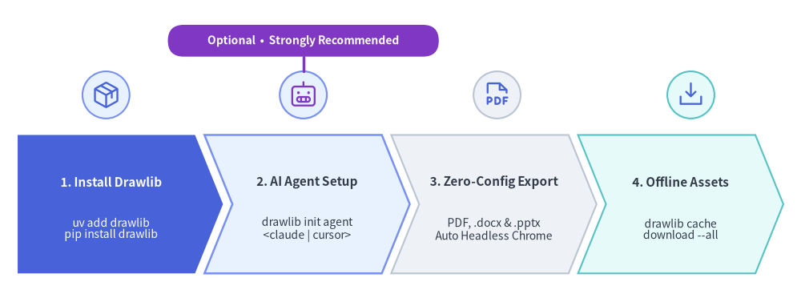
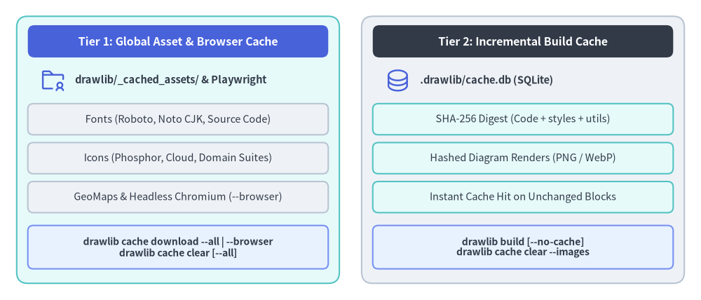

# インストールガイド

Drawlib は PyPI で公開されており、`uv`（推奨）または標準の `pip` を使用してインストールできます。
単一の `drawlib` パッケージをインストールするだけで、AI エージェント用ルールのワンコマンド生成（`drawlib init agent`）、HTML・Markdown・ベクター PDF・MS Word（`.docx`）・MS PowerPoint（`.pptx`）の出力機能、ヘッドレス Chromium の自動セットアップ、およびオフラインアセットキャッシュがすべて標準で利用できます。


<figure class="drawlib-image" style="text-align: center;">
  
  <figcaption class="drawlib-caption">Drawlib 環境・AI エージェントのセットアップワークフロー</figcaption>
</figure>

<details class="drawlib-code-details">
<summary>Source Code</summary>

```python
from drawlib.canvas import save, setup
from drawlib.icons import phosphor
from drawlib.lines import line
from drawlib.shapes import circle, rectangle
from drawlib.smartarts import ChevronProcess
from drawlib.styles import Styles

setup(width=136, height=50)

workflow = ChevronProcess(
    style=Styles.Neutral,
    text_style=Styles.DarkBold.patch(text_size=11.0),
    description_style=Styles.Dark.patch(text_size=10.0),
    corner_angle=68.0,
    spacing=1.6,
    flat_left_end=True,
)
workflow.add(
    "1. Install Drawlib",
    description="uv add drawlib\npip install drawlib",
    style=Styles.PrimaryFlat,
    text_style=Styles.WhiteBold.patch(text_size=11.0),
    description_style=Styles.White.patch(text_size=10.0),
)
workflow.add(
    "2. AI Agent Setup",
    description="drawlib init agent\n<claude | cursor>",
    style=Styles.PrimaryNeutral.patch(shape_line_width=1.8),
)
workflow.add(
    "3. Zero-Config Export",
    description="PDF, .docx & .pptx\nAuto Headless Chrome",
    style=Styles.Neutral,
)
workflow.add(
    "4. Offline Assets",
    description="drawlib cache\ndownload --all",
    style=Styles.SecondaryNeutral,
)
workflow.draw(xy=(3.0, 3.5), width=130.0, height=23.5)

# Step icons above each chevron stage
circle((18.0, 33.8), radius=4.0, style=Styles.PrimaryNeutral)
phosphor.package((18.0, 33.8), width=5.0, style=Styles.Primary)

circle((51.5, 33.8), radius=4.0, style=Styles.PrimaryNeutral.patch(shape_line_width=1.6))
phosphor.robot((51.5, 33.8), width=5.0, style=Styles.Accent)

# Optional / Strongly Recommended callout badge above Step 2
line((51.5, 37.8), (51.5, 40.3), style=Styles.AccentBold)
rectangle(
    (51.5, 43.0),
    width=46.0,
    height=5.4,
    style=Styles.AccentFlat.patch(shape_r=2.7),
    text="Optional  •  Strongly Recommended",
    text_style=Styles.WhiteBold.patch(text_size=10.0),
)

circle((84.4, 33.8), radius=4.0, style=Styles.Neutral)
phosphor.file_pdf((84.4, 33.8), width=5.0, style=Styles.Primary)

circle((117.3, 33.8), radius=4.0, style=Styles.SecondaryNeutral)
phosphor.download_simple((117.3, 33.8), width=5.0, style=Styles.Primary)

save()
```

</details>


---

## 動作要件

- **Python**: バージョン 3.11 以上。
- **OS**: Linux、macOS、または Windows。

---

## 1. `uv` を使用する場合（推奨）

現在のプロジェクトの依存関係に Drawlib を追加します。

```bash
# Add to active project (includes PDF, .docx, and .pptx export out of the box)
$ uv add drawlib

# Verify installation and CLI version
$ uv run drawlib --version
```

### スタンドアロン CLI 実行（`uvx`）
プロジェクトに追加せず、Drawlib CLI ツールを直接実行したい場合は以下のように実行します。

```bash
$ uvx drawlib --version
$ uvx drawlib init project site
```

---

## 2. `pip` を使用する場合

仮想環境に Drawlib をインストールします。

```bash
$ pip install drawlib

# Verify installation
$ drawlib --version
```

---

## 3. AI エージェント設定の初期化 *（任意・強く推奨）*

Drawlib は AI エージェントを使わない通常の Python ライブラリおよび CLI としてもそのまま動作しますが、**Claude Code**・**Cursor**・**Antigravity**・**GitHub Copilot**・**Windsurf**・**Cline**・**Roo Code**・**OpenAI Codex**・**Gemini CLI** などの AI コーディングエージェントを利用する場合は、インストール直後にワークスペース用のエージェントルールを初期化しておくことを **強く推奨** します。

`drawlib init agent` を実行すると、各 IDE / CLI エージェント固有のルールファイルが自動生成され、左下原点 `(0, 0)` の座標系・`50%+` ニュートラル配色ルール・`drawlib init project` によるプロジェクト初期化・3 ステージ視覚自己検証ループを AI が自律的に遵守するようになります。

```bash
# 対応している AI エージェントと出力先パスの一覧を表示
$ uv run drawlib init agent list

# 使用している AI エージェント向けのルールファイルを生成
$ uv run drawlib init agent claude        # -> .claude/rules/drawlib.md
$ uv run drawlib init agent cursor        # -> .cursor/rules/drawlib.mdc
$ uv run drawlib init agent antigravity   # -> .agents/rules/drawlib.md

# 複数のエージェントを一括で初期化（全 9 種を一括生成する場合は 'all'）
$ uv run drawlib init agent claude cursor copilot

# 任意: フロントマター対応エージェントの読込モードを標準の 'auto' から常時読込 'always' に変更
$ uv run drawlib init agent antigravity --mode always
```

対応エージェント一覧やトリガーモードの詳細は、[AI エージェント クイックルック](./agent_quicklook.md) および [AI エージェント向け指示書](../10_ai_agents_and_advanced/ai_agent_instructions.md) を参照してください。

---

## 4. 標準組み込みの PDF・Word（`.docx`）・PowerPoint（`.pptx`）出力

Drawlib は `playwright`、`python-docx`、`python-pptx` を標準の依存パッケージとして含んでいるため、追加のオプションパッケージ指定や手動でのブラウザ導入手順は不要です。

- **MS Word (`drawlib build docx`)**: ブラウザ依存なしのピュア Python で動作します。
- **ベクター PDF (`drawlib build pdf`) & MS PowerPoint (`drawlib build pptx`)**: 初回実行時に Playwright の軽量な `chromium-headless-shell` を自動的にダウンロードします（`drawlib cache download --browser` で事前に取得しておくことも可能です）。

> [!NOTE]
> **最小構成の Linux コンテナおよびスリム CI ランナー**: 標準的なデスクトップ環境（macOS、Windows、Ubuntu/Debian）では追加設定なしでそのまま動作します。GUI 関連のシステム共有ライブラリ（`libnss3`、`libgbm1`、`libasound2`）が省かれた最小構成の Linux コンテナイメージ（`python:3.12-slim` など）では、OS レベルの共有ライブラリを初回に一度だけインストールしてください。
> ```bash
> $ uv run playwright install-deps chromium
> ```

---

## 5. アセット・ビルドキャッシュ管理（`drawlib cache`）

PyPI パッケージのサイズを最小限に抑えるため、高解像度アイコンセット（Phosphor、FontAwesome、各種公式クラウド／ドメインアイコン）、多言語フォント、地理マップデータセット、およびヘッドレス Chromium は初回利用時にオンデマンドでダウンロードされます（`drawlib cache download` による事前取得も可能）。一方、プロジェクト単位の図版差分ビルド結果は `.drawlib/cache.db` に個別にキャッシュされます。


<figure class="drawlib-image" style="text-align: center;">
  
  <figcaption class="drawlib-caption">2 層アセットキャッシュと差分ビルドキャッシュのアーキテクチャ</figcaption>
</figure>

<details class="drawlib-code-details">
<summary>Source Code</summary>

```python
from drawlib.canvas import save, setup
from drawlib.icons import phosphor
from drawlib.shapes import rectangle
from drawlib.styles import Styles
from drawlib.text import text

setup(width=126, height=54)

hdr_ts = Styles.WhiteBold.patch(text_size=11.5)
path_ts = Styles.DarkBold.patch(text_size=10.5, halign="left")
row_ts = Styles.Dark.patch(text_size=10.5)
cmd_ts = Styles.DarkBold.patch(text_size=10.0)

# Left container: Tier 1 Global Asset Cache
rectangle((32.0, 27.0), width=58.0, height=48.0, style=Styles.SecondaryNeutral.patch(shape_r=2.0))
rectangle((32.0, 46.5), width=54.0, height=5.8, style=Styles.PrimaryFlat.patch(shape_r=1.2), text="Tier 1: Global Asset & Browser Cache", text_style=hdr_ts)

phosphor.folder_user((9.5, 39.5), width=4.8, style=Styles.Primary)
text((13.5, 39.5), "drawlib/_cached_assets/ & Playwright", style=path_ts)

rectangle((32.0, 32.5), width=54.0, height=5.6, style=Styles.Neutral.patch(shape_r=1.0), text="Fonts (Roboto, Noto CJK, Source Code)", text_style=row_ts)
rectangle((32.0, 25.5), width=54.0, height=5.6, style=Styles.Neutral.patch(shape_r=1.0), text="Icons (Phosphor, Cloud, Domain Suites)", text_style=row_ts)
rectangle((32.0, 18.5), width=54.0, height=5.6, style=Styles.Neutral.patch(shape_r=1.0), text="GeoMaps & Headless Chromium (--browser)", text_style=row_ts)
rectangle((32.0, 9.5), width=54.0, height=7.8, style=Styles.PrimaryNeutral.patch(shape_r=1.0), text="drawlib cache download --all | --browser\ndrawlib cache clear [--all]", text_style=cmd_ts)

# Right container: Tier 2 Project Incremental Build Cache
rectangle((94.0, 27.0), width=58.0, height=48.0, style=Styles.Neutral.patch(shape_r=2.0))
rectangle((94.0, 46.5), width=54.0, height=5.8, style=Styles.DarkFlat.patch(shape_r=1.2), text="Tier 2: Incremental Build Cache", text_style=hdr_ts)

phosphor.database((71.5, 39.5), width=4.8, style=Styles.Primary)
text((75.5, 39.5), ".drawlib/cache.db (SQLite)", style=path_ts)

rectangle((94.0, 32.5), width=54.0, height=5.6, style=Styles.SecondaryNeutral.patch(shape_r=1.0), text="SHA-256 Digest (Code + styles + utils)", text_style=row_ts)
rectangle((94.0, 25.5), width=54.0, height=5.6, style=Styles.SecondaryNeutral.patch(shape_r=1.0), text="Hashed Diagram Renders (PNG / WebP)", text_style=row_ts)
rectangle((94.0, 18.5), width=54.0, height=5.6, style=Styles.SecondaryNeutral.patch(shape_r=1.0), text="Instant Cache Hit on Unchanged Blocks", text_style=row_ts)
rectangle((94.0, 9.5), width=54.0, height=7.8, style=Styles.PrimaryNeutral.patch(shape_r=1.0), text="drawlib build [--no-cache]\ndrawlib cache clear --images", text_style=cmd_ts)

save()
```

</details>


オフラインビルドや Docker イメージ、CI/CD パイプライン向けの事前取得、キャッシュ状態の確認、および両キャッシュのクリアは `drawlib cache` コマンドで行えます。

```bash
# Inspect cached font, icon, and map packages
$ uv run drawlib cache list

# Pre-download all font, icon, map, and headless Chromium assets
$ uv run drawlib cache download --all

# Or pre-download specific asset categories selectively
$ uv run drawlib cache download --fonts
$ uv run drawlib cache download --icons
$ uv run drawlib cache download --maps
$ uv run drawlib cache download --browser

# Clear project-local incremental diagram build cache (.drawlib/cache.db)
$ uv run drawlib cache clear --images

# Clear all caches (downloaded font/icon/map assets + SQLite image build cache)
$ uv run drawlib cache clear --all
```

---

## 6. インストールの確認

Drawlib の CLI コマンド、テンプレート一覧、およびルールガイドが正常に利用できることを確認します。

```bash
$ uv run drawlib --help
$ uv run drawlib init project list
$ uv run drawlib init agent list
$ uv run drawlib rules list
```
