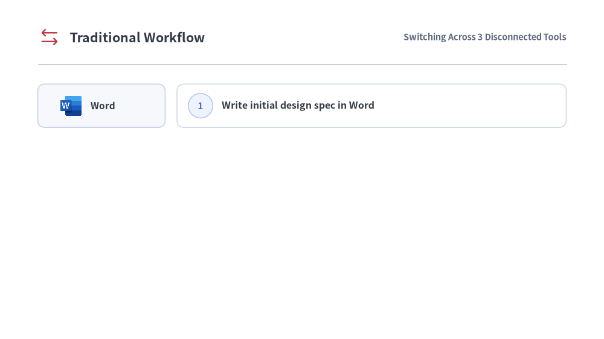
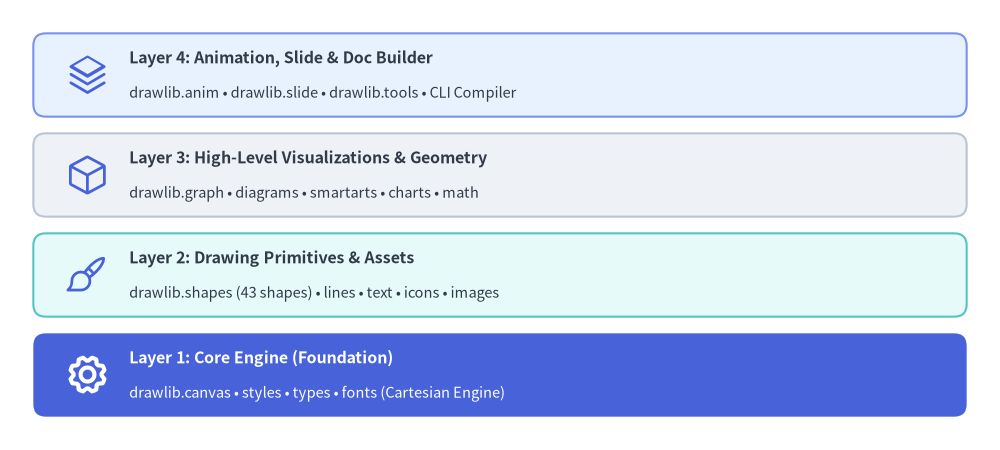

# Drawlib とは

従来の技術ドキュメント作成では、**ソースコード**（Git）、**図版**（外部の GUI 作図ツール）、**文章**（外部の Wiki 等）がそれぞれ分断されており、コードの進化に伴ってアーキテクチャ図が必然的に陳腐化してしまいます。

Drawlib は **「Illustration as Code（コードとしての図解）」** と **「Illustrated Documentation as Code（コードとしての図解ドキュメント）」** によってこの分断を解消し、Python コード・図版・マルチフォーマットのドキュメント出力を単一の Git リポジトリ内で常に同期させます。


<figure class="drawlib-image" style="text-align: center;">
  
  <figcaption class="drawlib-caption">従来のワークフローと Drawlib ワークフローの比較（APNG アニメーション）</figcaption>
</figure>


<div class="drawlib-source-link">
  <a href="https://github.com/yuichi110/drawlib/blob/main/docs/docs_src/ja/01_getting_started/overview.md" target="_blank" rel="noopener noreferrer">GitHub でアニメーションのソースコードを見る &rarr;</a>
</div>

---

## パラダイムシフト: なぜ「Illustration as Code」なのか？

AI コーディングアシスタントによって加速する現代のソフトウェア開発では、コードのリファクタリングや機能追加がかつてないスピードで進みます。しかしその一方で、システムアーキテクチャ設計書、データベーススキーマ、ワークフロー図などの更新は置き去りにされがちであり、**ドキュメントの形骸化（Documentation Rot）** やオンボーディングのボトルネックを引き起こしています。

### 現代のワークフローにおける GUI ツールの限界

従来の技術作図は、ドラッグ＆ドロップ操作の GUI ツール（Draw.io、Visio、Lucidchart、Figma など）に依存してきました。ホワイトボード代わりの素早いラフスケッチには便利ですが、書き出したバイナリ画像（PNG、JPEG）を別管理の Wiki に貼り付けて運用する手法には、看過できない構造的欠陥があります。

- **深刻なツールの分断**: マイクロサービスの経路を 1 つ変更するだけでも、Git 上でコードを編集し、外部の GUI ツールを手動で開いて箱を描き直し、PNG を書き出して外部ドキュメントや Wiki に再アップロードする手間が発生します。
- **意味のあるバージョン管理の欠如**: バイナリ画像はプルリクエスト上で意味のある Git diff を生成できません。レビュアーはどのアーキテクチャ要素が変更されたのかを正確に把握できません。
- **AI エージェントがバイナリアセットを編集できない**: AI コーディングエージェントはコードベースの読み書きをシームレスに行えますが、GUI ソフトウェア上のピクセル操作やドラッグ＆ドロップ編集を行うことはできません。
- **デザインとブランドの一貫性の崩れ**: 色使い、線の太さ、余白、フォントサイズが担当者ごとにばらつき、組織としてのデザイン基準が徐々に損なわれていきます。

### 生の SVG 生成や Matplotlib 直接記述の落とし穴

作図をコードで自動化しようと試みる際、エンジニアは AI エージェントに生の SVG XML や低レベルな Matplotlib スクリプトを直接生成させがちです。しかし実務においては、どちらのアプローチもすぐに限界に突き当たります。

- **生の SVG 生成**:
  - LLM はブラウザのレイアウトエンジンなしではフォントのグリフ幅や動的な複数行折り返しを正確に計算できないため、テキストが枠線からはみ出す問題が頻発します。
  - 正確な接続ベクトル、直交ルーティング、矢印の向きを手計算で求めるには複雑な三角関数の計算が必要となり、わずかなズレが簡単に発生します。
  - 何百もの生の `<path>` や `<polygon>` 要素を羅列した XML は保守不能な塊となり、人間がレビューや監査を行うことが困難です。
- **Matplotlib の直接スクリプティング**:
  - Matplotlib は本来、学術・科学計算向けのデータ可視化（散布図、ヒストグラム、折れ線グラフ）のために設計されており、ソフトウェアシステム設計向けではありません。
  - アーキテクチャ要素（ノード、境界コンテナ、シーケンスのライフライン、分岐ゲート、標準クラウドアイコンなど）を表すネイティブな抽象化が存在しません。
  - アイコン付きのラベルボックスを 1 つ描画してスタイリングするだけでも、何十行もの低レベルなボイラープレートコードを記述する必要があります。

### Drawlib の解決策: 「Illustration as Code」

Drawlib は、アーキテクチャ図や技術ドキュメントを、標準的なソフトウェアエンジニアリング手法で管理されるファーストクラスの成果物として扱います。

1. **Git 内の単一の情報源（Single Source of Truth）**: ソースコード、Markdown の本文、そして宣言的な Python 作図コードが同じリポジトリ内に共存し、1 つのコミットでアトミックに更新できます。
2. **決定論的かつ再現可能**: 幾何配置、間隔、カラーパレットの階調、タイポグラフィがすべてコード上で数学的に定義されるため、再ビルドしてもビット単位で完全に同一の視覚出力が保証されます。
3. **高水準なドメインプリミティブ**: 宣言的な抽象コンポーネント（`ArchitectureDiagram`、`ChevronProcess`、`Table`、`ArchitectureGraph`）により、ピクセル単位の精密な制御を維持しつつレイアウトのボイラープレートを排除します。
4. **マルチフォーマットへの一括コンパイル**: 単一の Markdown ソースから、静的 HTML サイト、GitHub 用 Markdown、鮮明なベクター PDF、MS Word（`.docx`）文書、さらに 16:9 の HTML / PDF / PowerPoint（`.pptx`）スライドデッキへとコンパイルできます。
5. **一元化されたスタイルガバナンス**: テーマトークン（`DefaultStyles`、`GoogleStyles`、`MonochromeStyles`）により、図形・コネクタ・テキスト・アイコンのすべてが統一された視覚的階層に従います。

---

## AI ネイティブ設計

Drawlib は、**AI 支援ソフトウェア開発** の時代を見据えて意図的に設計されています。

大規模言語モデル（LLM）や AI コーディングエージェント（Claude Code、Cursor、Gemini など）は宣言的なコードを書くことに長けている一方、手作業の GUI ツールを扱うことは苦手です。Drawlib の図版はすべてクリーンな Python コードまたは Markdown 埋め込みブロック（` ```drawlib `）として記述されるため、AI エージェントは以下の作業を自在に遂行できます。

- **既存図版の理解とリファクタリング**: Python ソースコードを読むだけで、既存の図版の構造を正確に解析・改修できます。
- **複雑な図版の自動生成**: リポジトリのコード解析に基づき、本格的なクラウド構成図、シーケンス図、フローチャートを自律的に作成できます。
- **構文ルールのオンデマンド参照**: CLI（`drawlib rules show <topic>`）を通じて、組み込みのリファレンスマニュアルをいつでも直接照会できます。
- **自律的な視覚的自己修正**: 座標グリッドを重ねた画像（`drawlib show -g`）を出力し、マルチモーダル視覚ツールで自ら確認することで、ラベルの見切れや線の重なりを自律的に修正できます。

---

## レイヤードアーキテクチャ

Drawlib は密接に連携する 4 つのレイヤーで構成されており、低レベルの柔軟性と高レベルの生産性を両立しています。


<figure class="drawlib-image" style="text-align: center;">
  
  <figcaption class="drawlib-caption">Drawlib のレイヤードアーキテクチャ</figcaption>
</figure>

<details class="drawlib-code-details">
<summary>Source Code</summary>

```python
from drawlib.canvas import save, setup
from drawlib.icons import phosphor
from drawlib.shapes import rectangle
from drawlib.styles import Styles
from drawlib.text import text

setup(width=120, height=54)

title_dark = Styles.DarkBold.patch(text_size=11.5, halign="left")
sub_dark = Styles.Dark.patch(text_size=10.5, halign="left")
title_white = Styles.WhiteBold.patch(text_size=11.5, halign="left")
sub_white = Styles.White.patch(text_size=10.5, halign="left")

# Layer 4: Animation, Slide & Doc Builder
rectangle((60.0, 45.0), width=112.0, height=10.0, style=Styles.PrimaryNeutral.patch(shape_r=1.5))
phosphor.stack((10.5, 45.0), width=5.2, style=Styles.Primary)
text((15.5, 47.0), "Layer 4: Animation, Slide & Doc Builder", style=title_dark)
text((15.5, 42.8), "drawlib.anim • drawlib.slide • drawlib.tools • CLI Compiler", style=sub_dark)

# Layer 3: High-Level Visualizations
rectangle((60.0, 33.0), width=112.0, height=10.0, style=Styles.Neutral.patch(shape_r=1.5))
phosphor.cube((10.5, 33.0), width=5.2, style=Styles.Primary)
text((15.5, 35.0), "Layer 3: High-Level Visualizations & Geometry", style=title_dark)
text((15.5, 30.8), "drawlib.graph • diagrams • smartarts • charts • math", style=sub_dark)

# Layer 2: Drawing Primitives
rectangle((60.0, 21.0), width=112.0, height=10.0, style=Styles.SecondaryNeutral.patch(shape_r=1.5))
phosphor.paint_brush((10.5, 21.0), width=5.2, style=Styles.Primary)
text((15.5, 23.0), "Layer 2: Drawing Primitives & Assets", style=title_dark)
text((15.5, 18.8), "drawlib.shapes (43 shapes) • lines • text • icons • images", style=sub_dark)

# Layer 1: Core Engine (Hero anchor)
rectangle((60.0, 9.0), width=112.0, height=10.0, style=Styles.PrimaryFlat.patch(shape_r=1.5))
phosphor.gear((10.5, 9.0), width=5.2, style=Styles.WhiteBold)
text((15.5, 11.0), "Layer 1: Core Engine (Foundation)", style=title_white)
text((15.5, 6.8), "drawlib.canvas • styles • types • fonts (Cartesian Engine)", style=sub_white)

save()
```

</details>


1. **Layer 1: コアエンジン (`drawlib.canvas`, `drawlib.styles`, `drawlib.types`, `drawlib.fonts`)**  
   キャンバスのライフサイクル、デカルト座標系、ローカル座標変換、テーマ解決、および多言語対応フォントのタイポグラフィを管理します。
2. **Layer 2: 描画プリミティブ (`drawlib.shapes`, `drawlib.lines`, `drawlib.text`, `drawlib.icons`, `drawlib.images`)**  
   **43 種** のベクター図形（`cylinder`、`cube`、`document`、`cloud`、`brace`、`gear`、`math_symbol`、`face`、`bubblespeech` など）、ルーティングや矢印を備えた柔軟なコネクタ線、タイポグラフィ、および合計 **4,538 個のアイコン** を収録する **34 の標準アイコンモジュール**（`phosphor` ベクターアイコン、`gcp` / `aws` / `azure` クラウドアイコン、15 種の公式ドメインブランドパック、15 種の Drawlib Original 2D パステルパック）を提供します。
3. **Layer 3: 高水準ビジュアライゼーションと幾何計算 (`drawlib.graph`, `drawlib.smartarts`, `drawlib.charts`, `drawlib.diagrams`, `drawlib.math`)**  
   すぐに使えるドメイン別コンポーネント群です。自動レイアウトグラフ（`LayerGraph`、`ArchitectureGraph`、`TreeGraph`、`RadialGraph`、`GridGraph`）、クラウドアーキテクチャ図、フロー図、シーケンス図、UML クラス図・ステートマシン図、ER 図、データチャート、プロセスフロー、地理マップ（`drawlib.smartarts.GeoMap`）、および幾何計算・パス／カラー補間ユーティリティ（`drawlib.math`）を備えています。
4. **Layer 4: アニメーション・プレゼンテーション・ドキュメントビルダ (`drawlib.anim`, `drawlib.slide`, `drawlib.tools`)**  
   マルチフレームアニメーション（APNG および Animated WebP 対応の `drawlib.anim`）、16:9 ワイドスクリーンのスライドステージ＆コンパイラ（`drawlib.slide`）、および `drawlib` ブロックを埋め込んだ Markdown ファイルをレスポンシブな静的 HTML サイト・GitHub 対応 Markdown・スタンドアロンの PDF／MS Word（`.docx`）文書・16:9 の HTML／PDF／PowerPoint（`.pptx`）スライドデッキへとコンパイルするプログラマティックなビルド・プレビューサーバー・キャッシュ API（`drawlib.tools`）を提供します。
