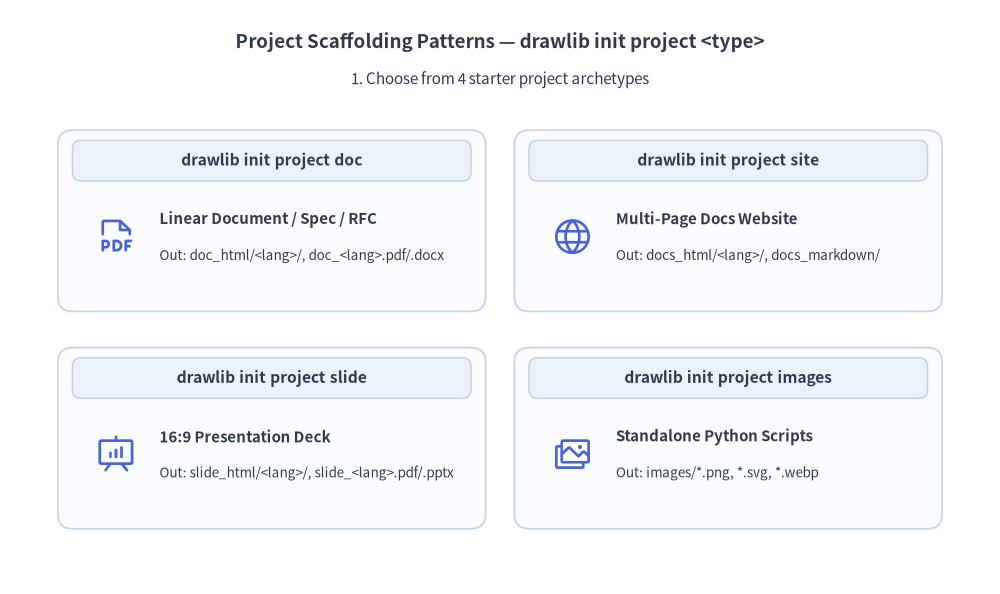
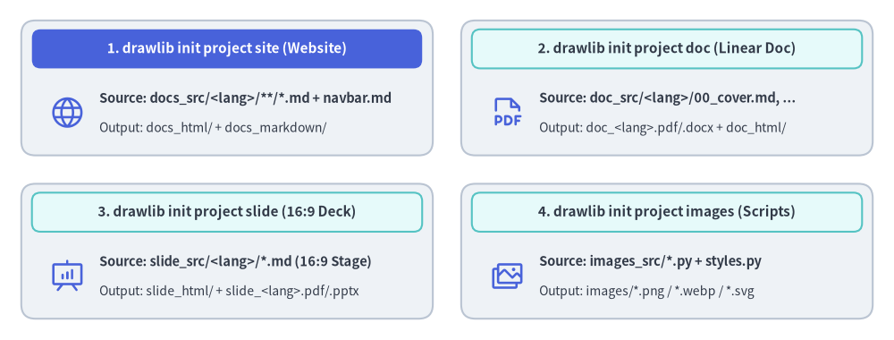

# プロジェクト構成とビルド

Drawlib は単なる描画ライブラリではなく、実行可能な Python による図解とバージョン管理された技術ドキュメントを統合する **包括的なドキュメントコンパイラ** です。


<figure class="drawlib-image" style="text-align: center;">
  
  <figcaption class="drawlib-caption">Drawlib プロジェクトのライフサイクル: スキャフォールディング・初回ビルド・差分更新（APNG アニメーション）</figcaption>
</figure>


<div class="drawlib-source-link">
  <a href="https://github.com/yuichi110/drawlib/blob/main/docs/docs_src/ja/01_getting_started/project_quicklook.md" target="_blank" rel="noopener noreferrer">GitHub でアニメーションのソースコードを見る &rarr;</a>
</div>

---

## コードとしてのドキュメント（Documentation-as-Code）ワークフロー

静的な Wiki に文章を書き、PNG のスクリーンショットを手作業でコピー＆ペーストする従来の運用に代わり、Drawlib は AI コーディングエージェントを活用したクリーンで再現性の高い Human-in-the-Loop ワークフローを実現します。

1. **Day 1 — 初期化・執筆・コミット**: AI エージェントに初期プロジェクトの作成（`drawlib init project doc` による `drawlib.toml`、`styles.py`、`utils.py`、および任意の `template.html` / `style.css` の設定）を依頼し、続けて仕様書の執筆とビルド（```` ```drawlib ```` ブロックを含む `doc_src/<lang>/*.md` から `doc_markdown/`、`doc_html/`、`doc_<lang>.pdf`、`doc_<lang>.docx` を生成）を指示したうえで、成果物をレビューして Git にコミットします。
2. **Day 2 以降 — 日々の差分アップデート**: アプリケーションコードが進化したら、AI エージェントにドキュメントの更新（`.md` 章ファイルの編集と `.drawlib/cache.db` キャッシュを活用した `./doc_src/build.sh` の実行）を依頼し、更新された成果物をコードと一緒にコミットするだけで常に同期を維持できます。

### 鉄則: `<name>_src/` が唯一の信頼できる情報源（Single Source of Truth）
- Markdown ファイルや Python コードの編集は、必ずソースディレクトリ（例: `docs_src/`）内で行ってください。
- 出力ディレクトリや生成ファイル（`docs_markdown/`、`docs_html/`、`*_<lang>.pdf`、`*_<lang>.docx`、`*_<lang>.pptx`）を直接編集しないでください。これらはビルド時に完全に上書きされる成果物です。

---

## 1. プロジェクトのスキャフォールディング（`drawlib init project`）

コマンド 1 つでプロジェクトの完全なテンプレートを生成できます。

```bash
# List available starter project templates
$ uv run drawlib init project list

# Initialize a multi-page documentation website (creates docs_src/)
$ uv run drawlib init project site

# Or scaffold into a custom target name (positional argument, e.g., mybook_src/ -> mybook_html/):
$ uv run drawlib init project site mybook

# Optional flags: --style (-s) for theme and --lang (-l) for single or multi-locale (e.g. en,ja)
$ uv run drawlib init project doc rbac -s google -l en,ja
```

Drawlib は 4 種類のスタータープロジェクトタイプをサポートしています（`doc`・`site`・`slide` は標準で `<src_dir>/<lang>/` と `drawlib.toml` の `[i18n]` を使用します）。
- **`doc`**: HTML（`doc_html/`）、PDF（`doc_<lang>.pdf`）、編集可能な MS Word（`doc_<lang>.docx`）、Markdown（`doc_markdown/`）、および図解画像（`doc_images/`）へコンパイルされる単一構成の技術文書・仕様書・RFC・レポート。
- **`site`**: マルチページのドキュメントサイト（`docs_html/`）、Markdown サイト（`docs_markdown/`）、および図解画像（`docs_images/`）。
- **`slide`**: Web スライドデッキ（`slide_html/`）、ベクター PDF（`slide_<lang>.pdf`）、編集可能な MS PowerPoint（`slide_<lang>.pptx`）、および図解画像（`slide_images/`）へコンパイルされる 16:9 プレゼンテーションスライド。
- **`images`**: 画像ファイル（`images/*.png` など）へ一括コンパイルされるスタンドアロンの Python 図解スクリプト群（`images_src/*.py`）。


<figure class="drawlib-image" style="text-align: center;">
  
  <figcaption class="drawlib-caption">Drawlib の 4 つのプロジェクトアーキタイプ（drawlib init project）</figcaption>
</figure>

<details class="drawlib-code-details">
<summary>Source Code</summary>

```python
from drawlib.canvas import save, setup
from drawlib.icons import phosphor
from drawlib.shapes import rectangle
from drawlib.styles import Styles
from drawlib.text import text

setup(width=126, height=48)

hdr_white = Styles.WhiteBold.patch(text_size=11.0)
hdr_dark = Styles.DarkBold.patch(text_size=11.0)
body_bold = Styles.DarkBold.patch(text_size=10.5, halign="left")
body_sub = Styles.Dark.patch(text_size=10.0, halign="left")

# 1. Top-Left: drawlib init project site (Hero header)
rectangle((32.0, 35.5), width=58.0, height=19.0, style=Styles.Neutral.patch(shape_r=2.0))
rectangle((32.0, 41.0), width=55.0, height=5.5, style=Styles.PrimaryFlat.patch(shape_r=1.2), text="1. drawlib init project site (Website)", text_style=hdr_white)
phosphor.globe((9.5, 32.0), width=5.2, style=Styles.Primary)
text((14.0, 34.0), "Source: docs_src/<lang>/**/*.md + navbar.md", style=body_bold)
text((14.0, 29.8), "Output: docs_html/ + docs_markdown/", style=body_sub)

# 2. Top-Right: drawlib init project doc
rectangle((94.0, 35.5), width=58.0, height=19.0, style=Styles.Neutral.patch(shape_r=2.0))
rectangle((94.0, 41.0), width=55.0, height=5.5, style=Styles.SecondaryNeutral.patch(shape_r=1.2), text="2. drawlib init project doc (Linear Doc)", text_style=hdr_dark)
phosphor.file_pdf((71.5, 32.0), width=5.2, style=Styles.Primary)
text((76.0, 34.0), "Source: doc_src/<lang>/00_cover.md, ...", style=body_bold)
text((76.0, 29.8), "Output: doc_<lang>.pdf/.docx + doc_html/", style=body_sub)

# 3. Bottom-Left: drawlib init project slide
rectangle((32.0, 12.5), width=58.0, height=19.0, style=Styles.Neutral.patch(shape_r=2.0))
rectangle((32.0, 18.0), width=55.0, height=5.5, style=Styles.SecondaryNeutral.patch(shape_r=1.2), text="3. drawlib init project slide (16:9 Deck)", text_style=hdr_dark)
phosphor.presentation_chart((9.5, 9.0), width=5.2, style=Styles.Primary)
text((14.0, 11.0), "Source: slide_src/<lang>/*.md (16:9 Stage)", style=body_bold)
text((14.0, 6.8), "Output: slide_html/ + slide_<lang>.pdf/.pptx", style=body_sub)

# 4. Bottom-Right: drawlib init project images
rectangle((94.0, 12.5), width=58.0, height=19.0, style=Styles.Neutral.patch(shape_r=2.0))
rectangle((94.0, 18.0), width=55.0, height=5.5, style=Styles.SecondaryNeutral.patch(shape_r=1.2), text="4. drawlib init project images (Scripts)", text_style=hdr_dark)
phosphor.images((71.5, 9.0), width=5.2, style=Styles.Primary)
text((76.0, 11.0), "Source: images_src/*.py + styles.py", style=body_bold)
text((76.0, 6.8), "Output: images/*.png / *.webp / *.svg", style=body_sub)

save()
```

</details>


---

## 2. ワンコマンドによるビルド（`drawlib build`）

プロジェクトの初期化後は、生成された `build.sh` スクリプトまたは `drawlib build` CLI を使ってドキュメントをコンパイルします。

```bash
# Run the project master build script
$ ./docs_src/build.sh

# Or compile using the CLI subcommands directly:
$ uv run drawlib build html docs_src/ -o docs_html/
$ uv run drawlib build markdown docs_src/ -o docs_markdown/
$ uv run drawlib build pdf doc_src/ -o doc.pdf --toc              # -> doc_<lang>.pdf
$ uv run drawlib build docx doc_src/ -o doc.docx --generate-index # -> doc_<lang>.docx
$ uv run drawlib build slide slide_src/ -o slide_html/
$ uv run drawlib build pptx slide_src/ -o slide.pptx              # -> slide_<lang>.pptx
$ uv run drawlib build image images_src/ -o images/

# Force a clean re-render bypassing the SQLite build cache (.drawlib/cache.db):
$ uv run drawlib build html docs_src/ -o docs_html/ --no-cache
```

ビルドプロセスでは以下の処理が順番に実行されます。
1. Markdown ドキュメント内のすべての ````drawlib```` コードブロック（または `images_src/` 内の `.py` スクリプト）を検出します。
2. 各コードブロックを独立したメモリ空間で実行し、ベクター／ラスター図解をレンダリングします。
3. レンダリングされた画像を `.drawlib/cache.db` に決定論的にキャッシュします（変更されたコードブロックやスタイルのみが再描画されます。強制的に再レンダリングする場合は `--no-cache` を渡すか `uv run drawlib cache clear --images` を実行します）。
4. 画像リンクが検証された状態で、最終的な HTML サイト、スライドデッキ、ベクター PDF、編集可能な MS Word（`.docx`）、MS PowerPoint（`.pptx`）、またはレンダリング済み Markdown ドキュメントを生成します。

---

## 3. ローカルプレビューとリンク検証（`drawlib serve`）

リンク切れやアセット欠損の自動事前チェック機能を備えたローカルサーバーで、コンパイル済みの HTML サイトをプレビューできます。

```bash
# Start local HTTP preview server on http://localhost:8000
$ uv run drawlib serve docs_html/

# Run headless broken-link and missing-asset verification only (ideal for CI/CD)
$ uv run drawlib serve docs_html/ --check
```

ブラウザで `http://localhost:8000` を開くと、ドキュメントサイト全体、ナビゲーションサイドバー、レスポンシブデザインを確認できます。

---

> [!NOTE]
> コードブロック属性（`code=show`, `code=fold`, `caption="..."`）、カスタム HTML テンプレート、CSS テーマ設定、キャッシュ機構、および PDF / MS Word（`.docx`）/ MS PowerPoint（`.pptx`）出力の詳細については、**[第 9 章: ドキュメントビルダと CLI](../09_doc_builder_and_cli/overview.md)** を参照してください。
