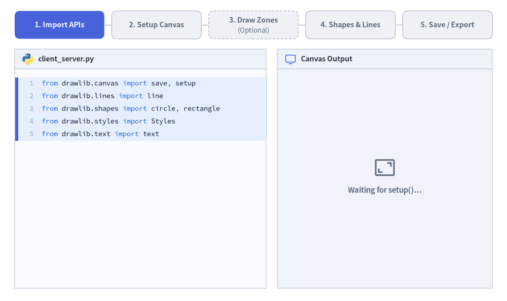
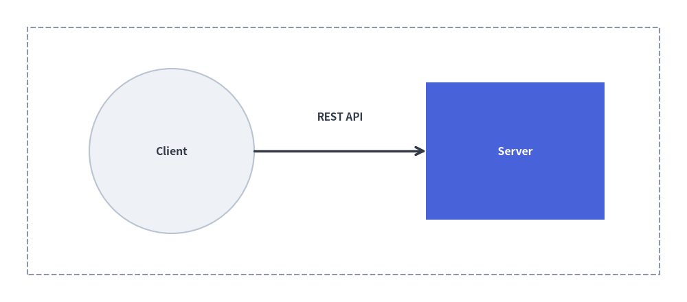

# クイックスタートガイド

Drawlib を使えば、**スタンドアロンの Python スクリプト**（`.py`）としても、**Markdown 埋め込みブロック**（` ```drawlib `）としても、直感的かつ再現性の高い高品質な技術図版を作成できます。すべての図解は一貫した **5 ステップのライフサイクル** に従います。


<figure class="drawlib-image" style="text-align: center;">
  
  <figcaption class="drawlib-caption">標準的な Drawlib 5 ステップ描画ワークフロー: コードからキャンバスへ（APNG アニメーション）</figcaption>
</figure>


<div class="drawlib-source-link">
  <a href="https://github.com/yuichi110/drawlib/blob/main/docs/docs_src/ja/01_getting_started/quick_start.md" target="_blank" rel="noopener noreferrer">GitHub でアニメーションのソースコードを見る &rarr;</a>
</div>

1. **API のインポート**: キャンバス管理、描画プリミティブ、スタイルプリセットをインポートします。
2. **キャンバスのセットアップ**: `setup()` でキャンバスのサイズ（`width`、`height`）を初期化します。
3. **構造ゾーンの描画 *（任意）***: 必要に応じて境界ボックス、クラウドリージョン、グルーピング用コンテナを描画します。
4. **エンティティとコネクタの描画**: セマンティックスタイルとラベルを指定して、図形・アイコン・接続線を配置します。
5. **保存・エクスポート**: `save()` で画像ファイルとして保存するか、ドキュメントビルダにインラインで自動レンダリングさせます。

---

## 1. スタンドアロン Python スクリプト（`images` プロジェクト）

> [!IMPORTANT]
> **プロジェクトファースト原則（`drawlib init project`）**:  
> 未初期化のディレクトリに単体の `.py` ファイルを直接作成するのではなく、`styles.py`（テーマ・多言語フォント設定）、`utils.py`、`_assets/`、`build.sh` が適切に構成されるよう、必ず最初に Drawlib プロジェクトをスキャフォールドしてください。
> ```bash
> # Scaffold a standalone illustration project (creates images_src/ -> images/)
> $ uv run drawlib init project images
> ```

`images_src/client_server.py` という名前の Python スクリプトを作成します。

```python
from drawlib.canvas import save, setup
from drawlib.lines import line
from drawlib.shapes import circle, rectangle
from drawlib.styles import Styles
from drawlib.text import text

# Step 2: Setup canvas dimensions (Cartesian space: 100 wide x 44 high)
setup(width=100, height=44)

# Step 3 (Optional): Draw background boundary container
rectangle((50, 22), width=92, height=36, style=Styles.MutedDashed)

# Step 4: Draw main entities and connectors (50%+ Neutral-Grounded)
circle((25, 22), radius=12, style=Styles.Neutral, text="Client", text_style=Styles.DarkBold.patch(text_size=11.5))
rectangle((75, 22), width=26, height=20, style=Styles.PrimaryFlat, text="Server", text_style=Styles.WhiteBold.patch(text_size=11.5))

# Connection line with arrowhead
line((37, 22), (62, 22), arrow_head="->", style=Styles.DarkBold)
text((49.5, 27), "REST API", style=Styles.DarkBold.patch(text_size=11.0))

# Step 5: Save image (defaults to client_server.png)
save()
```

### 実行とプレビュー

生成されたビルドスクリプトを使って `images_src/` 内の全スクリプトを一括ビルドするか、個別のスクリプトを直接実行します。

```bash
# Batch-compile all scripts in images_src/ to images/
$ ./images_src/build.sh

# Or run a single script directly with Python
$ uv run python images_src/client_server.py
```

統合 CLI コマンド `drawlib show` を使用すると、ヘッドレスでのプレビュー出力や座標グリッドの重ね合わせ確認が行えます。

```bash
# Export directly to a specified output file
$ uv run drawlib show images_src/client_server.py -o .drawlib/scratch/output.png

# Overlay a visual coordinate grid (-g) to check element spacing
$ uv run drawlib show images_src/client_server.py -g -o .drawlib/scratch/output_grid.png
```

---

## 2. Markdown ドキュメントへの埋め込み

任意の Markdown ドキュメント（`doc` や `site` プロジェクト内の `doc.md` など）の中に、````drawlib```` で囲んだコードブロックをそのまま埋め込みます。

````markdown
# Architecture Overview

Here is our primary service flow:

```drawlib align=center file=client_server_communication.png caption="Client-Server REST Communication"
from drawlib.canvas import save, setup
from drawlib.shapes import rectangle, circle
from drawlib.lines import line
from drawlib.text import text
from drawlib.styles import Styles

setup(width=100, height=44)

rectangle((50, 22), width=92, height=36, style=Styles.MutedDashed)
circle((25, 22), radius=12, style=Styles.Neutral, text="Client", text_style=Styles.DarkBold.patch(text_size=11.5))
rectangle((75, 22), width=26, height=20, style=Styles.PrimaryFlat, text="Server", text_style=Styles.WhiteBold.patch(text_size=11.5))
line((37, 22), (62, 22), arrow_head="->", style=Styles.DarkBold)
text((49.5, 27), "REST API", style=Styles.DarkBold.patch(text_size=11.0))
save()
```
````

サイト全体をビルドする前に、Markdown ファイル内の特定の名前付きブロックに座標グリッドを表示してプレビューできます。

```bash
# Preview a specific named diagram block with a coordinate grid (-g)
$ uv run drawlib show doc.md client_server_communication.png -g -o .drawlib/scratch/preview.png
```

`drawlib build html` や `drawlib build markdown` でコンパイルすると、コードブロックが実行されてレンダリング済みの画像に置き換わります。


<figure class="drawlib-image" style="text-align: center;">
  
  <figcaption class="drawlib-caption">クライアント・サーバー間の REST 通信</figcaption>
</figure>

<details class="drawlib-code-details">
<summary>Source Code</summary>

```python
from drawlib.canvas import save, setup
from drawlib.shapes import rectangle, circle
from drawlib.lines import line
from drawlib.text import text
from drawlib.styles import Styles

setup(width=100, height=44)

rectangle((50, 22), width=92, height=36, style=Styles.MutedDashed)
circle((25, 22), radius=12, style=Styles.Neutral, text="Client", text_style=Styles.DarkBold.patch(text_size=11.5))
rectangle((75, 22), width=26, height=20, style=Styles.PrimaryFlat, text="Server", text_style=Styles.WhiteBold.patch(text_size=11.5))
line((37, 22), (62, 22), arrow_head="->", style=Styles.DarkBold)
text((49.5, 27), "REST API", style=Styles.DarkBold.patch(text_size=11.0))
save()
```

</details>


---

## 3. スムーズに作図するための重要ルール

1. **`setup()` は必須**: 描画ブロックの冒頭で必ず `setup(width=..., height=...)` を呼び出してください。
2. **Markdown ブロック内での `save()` の扱い**: Markdown の埋め込みブロック内では Drawlib が自動的にキャンバスをキャプチャする（`save()` の呼び出しは安全に no-op として処理される）ため、`save()` は省略可能です。ただし、スタンドアロンの `.py` スクリプトへそのままコピー＆ペーストして 100% 互換動作させるため、完全なコード例では引数なしの `save()` を記述しておくことを推奨します。
3. **配色の規律（50% 以上ニュートラル基調の設計）**: 虹色のような雑多な色使いは避けてください。ノードの 50% 以上を落ち着いたニュートラルカード（`Styles.Neutral`、`Styles.PrimaryNeutral`、`Styles.SecondaryNeutral`）で構成し、彩度の高いヒーロースタイル（`Styles.PrimaryFlat`）は特に注目させたい 1〜2 個の主役要素だけに限定し、コネクタには `Styles.DarkBold` を使用します。
