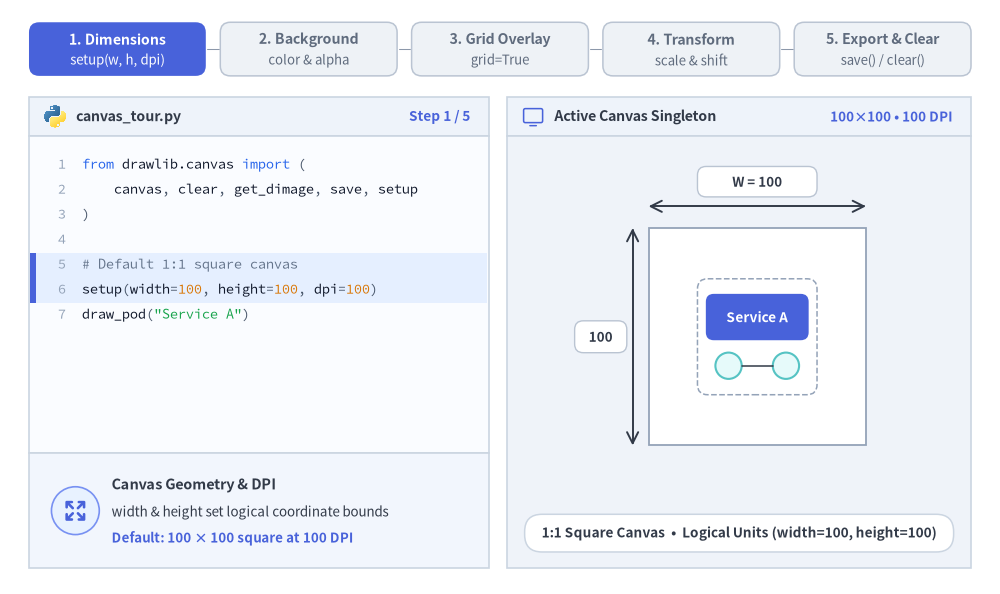
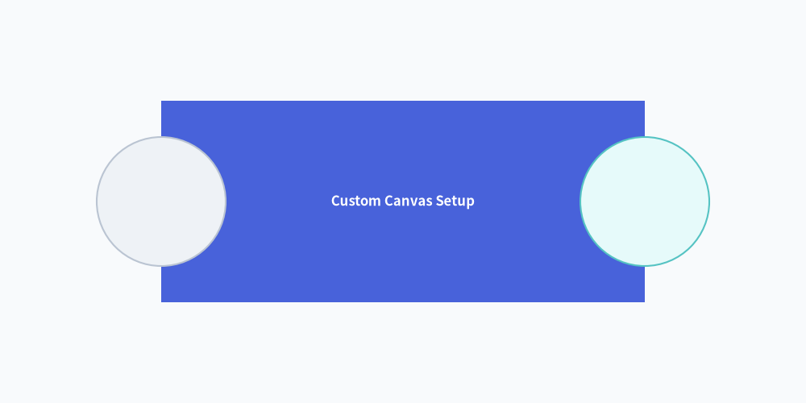
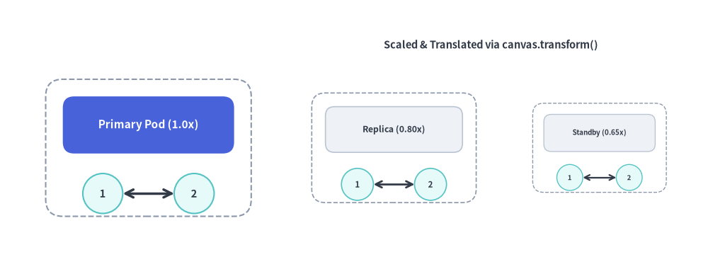

# キャンバスと座標系

`canvas`（キャンバス）は、Drawlib におけるすべての描画の基盤となる描画領域です。  
「Illustration as Code（コードとしての図解）」のパラダイムのもと、キャンバスのサイズ、解像度、背景色、座標グリッド、および出力フォーマットはすべて宣言的な Python 関数呼び出しによって管理されます。
Drawlib はアクティブな `canvas` シングルトンを保持しており、宣言的な API 呼び出しを通じてサイズ設定、背景色と透過度、位置合わせグリッド、ローカル座標変換、マルチフォーマット出力、そして状態リセットを行います。


<figure class="drawlib-image" style="text-align: center;">
  
  <figcaption class="drawlib-caption">Drawlib キャンバスツアー: サイズ・背景色と透過・グリッド・座標変換・出力とリセット（APNG アニメーション）</figcaption>
</figure>


<div class="drawlib-source-link">
  <a href="https://github.com/yuichi110/drawlib/blob/main/docs/docs_src/ja/02_drawing_primitives/canvas.md" target="_blank" rel="noopener noreferrer">GitHub でアニメーションのソースコードを見る &rarr;</a>
</div>

---

## 1. インポートと基本ライフサイクル

キャンバスのライフサイクル関数およびシングルトンの `canvas` インスタンスは、`drawlib.canvas` からインポートします。

```python
from drawlib.canvas import (
    canvas,       # Active singleton Canvas instance (provides canvas.transform())
    clear,        # Reset canvas state and configuration between drawings
    get_dimage,   # Render canvas in-memory and return a Dimage object
    save,         # Save drawing to disk (PNG, WebP, JPG, SVG, PDF)
    setup,        # Configure dimensions, grid, background color, and DPI
    show,         # Display canvas in an interactive GUI window
)
```

> [!IMPORTANT]
> **連続スクリプト実行と複数画像の生成**:  
> 1 つの Python スクリプト内で複数の図解を連続生成する場合は、各画像の間に必ず `clear()` を呼び出してください。呼び出さない場合、前の図解で描画した要素が後続のキャンバスにそのまま残ってしまいます。

---

## 2. デカルト座標空間

Drawlib は数学的なデカルト座標系（直交座標系）を採用しています。

- **原点 `(0, 0)`**: キャンバスの**左下隅**に固定されています。
- **X 軸**: 右方向に向かって水平に増加します（`0` 〜 `width`）。
- **Y 軸**: 上方向に向かって垂直に増加します（`0` 〜 `height`）。
- **中心基準の配置（センターアンカー）**: 図形、テキスト、アイコンに指定する座標 `(x, y)` は、デフォルトで要素の**幾何学的な中心**を表します。


```python
from drawlib.canvas import save, setup
from drawlib.shapes import circle, rectangle
from drawlib.styles import Colors, Styles

# Custom background color (Muted tone 1) and coordinate grid
setup(width=100, height=50, background_color=Colors.Muted1, grid=True)

rectangle((50, 25), width=60, height=25, style=Styles.PrimaryFlat, text="Custom Canvas Setup", text_style=Styles.WhiteBold.patch(text_size=12.0))
circle((20, 25), radius=8, style=Styles.Neutral)
circle((80, 25), radius=8, style=Styles.SecondaryNeutral)
save()
```

<figure class="drawlib-image" style="text-align: center;">
  
  <figcaption class="drawlib-caption">グリッド付きカスタムキャンバス設定</figcaption>
</figure>


---

## 3. 関数・メソッドリファレンス

### 3.1. `setup()`
キャンバスのサイズ、解像度、座標グリッド、および背景の外観を設定します。図形要素を描画する前に呼び出す必要があります。

```python
setup(
    width: int | None = None,
    height: int | None = None,
    dpi: int | None = None,
    color: Color | tuple[int, int, int] | tuple[int, int, int, float] | str | None = None,
    alpha: float | None = None,
    background_color: Color | tuple[int, int, int] | tuple[int, int, int, float] | str | None = None,
    background_alpha: float | None = None,
    grid: bool | None = None,
    grid_only: bool | None = None,
    grid_style: Style | None = None,
    grid_centerstyle: Style | None = None,
    grid_xpitch: int | None = None,
    grid_ypitch: int | None = None,
)
```

#### パラメータリファレンス:
| パラメータ | 型 | デフォルト | 説明 |
| :--- | :--- | :--- | :--- |
| `width` | `int` | `100` | 仮想座標単位でのキャンバスの幅（`> 0`）。 |
| `height` | `int` | `100` | 仮想座標単位でのキャンバスの高さ（`> 0`）。 |
| `dpi` | `int` | `100` | 1 インチあたりのドット数（解像度およびラスター画像の鮮明さ）。 |
| `background_color` / `color` | `Color \| tuple \| str` | `(255, 255, 255)` | キャンバスの背景色。`Color` インスタンス、RGB/RGBA タプル、16 進カラーコード文字列（`"#f8fafc"`）、または CSS 色名を指定できます（`color` は `background_color` の短縮エイリアスです）。 |
| `background_alpha` / `alpha` | `float` | `1.0` | `[0.0, 1.0]` の範囲で指定する背景の不透明度（`0.0` = 完全透明、`1.0` = 不透明。`alpha` は `background_alpha` の短縮エイリアスです）。 |
| `grid` | `bool` | `False` | レイアウト位置合わせ用の座標グリッド線を重ねて描画します。 |
| `grid_only` | `bool` | `False` | グリッドなしの通常画像を別途保存せず、座標グリッドを重ねた画像のみを出力します。 |
| `grid_style` | `Style` | 灰色の破線 | 通常のグリッド線のカスタム線スタイル（指定すると自動的に `grid=True` が有効になります）。 |
| `grid_centerstyle`| `Style` | 太い灰色の破線 | 中心軸（`x = width / 2`, `y = height / 2`）のカスタム線スタイル。 |
| `grid_xpitch` | `int` | `width / 10` | 垂直グリッド線の間隔。 |
| `grid_ypitch` | `int` | `height / 10` | 水平グリッド線の間隔。 |

---

### 3.2. `save()`
アクティブなキャンバスをディスク上の画像ファイルとして書き出します。

```python
save(
    file: str | None = None,
    format: Literal["png", "webp", "jpg", "pdf", "svg"] | None = None,
)
```

- **`file`**: 出力先のファイルパス。省略した場合は、実行中スクリプトと同じディレクトリ内の `<script_name>.png` がデフォルトになります。
- **`format`**: 出力画像フォーマット（`"png"`, `"webp"`, `"jpg"`/`"jpeg"`, `"svg"`, `"pdf"`）。省略した場合はファイル名の拡張子から推論され、拡張子もない場合は `"png"` になります。
- **グリッド有効時の出力動作 (`setup(..., grid=True)`)**:
  - `grid=True` かつ `grid_only=False`（デフォルト）の場合、`save("out.png")` を呼び出すと、グリッドなしのクリーンな図解（`out.png`）とグリッド重ね合わせ画像（`out_grid.png`）の **2 つのファイル**が出力されます。
  - `grid_only=True` の場合、`save("out.png")` を呼び出すと、座標グリッドが直接重ねられた **1 つのファイル**（`out.png`）のみが出力されます。

> [!NOTE]
> **Markdown コードブロック内での `save()` の扱い**:
> Markdown 埋め込みコードブロック（` ```drawlib `）では、ドキュメントビルダが自動的にキャンバスをキャプチャするため、`save()` の呼び出しは任意です。埋め込みブロック内で `save()` が呼び出された場合でも、エンジンは重複書き込みや競合を防ぐため安全に no-op（何もしない処理）として扱います。ただし、スタンドアロンの `.py` スクリプトへそのままコピー＆ペーストして動作させられるよう、完全なサンプルコードでは引数なしの `save()` を明記することを推奨します。

---

### 3.3. `show()`
ローカルの対話型デスクトップウィンドウを開き、図解を表示します。ヘッドレス環境（CI/CD、Docker、リモートサーバーなど）では、代わりに `save()` または CLI の `drawlib show -o <path>` を使用してください。

### 3.4. `clear()`
キャンバスのジオメトリをリセットし、登録済みの描画要素（アーティスト）を消去して、デフォルトのスタイルと設定パラメータを復元します。

### 3.5. `get_dimage()`
キャンバスをメモリ上でレンダリングして `Dimage` オブジェクトを返します。ディスクに一時ファイルを書き出すことなく、プログラム上で画像の変換・トリミング・合成処理をつなげることができます。

---

### 3.6. ローカル座標のスケーリングと平行移動 (`canvas.transform()`)

`canvas.transform()` コンテキストマネージャは、`with` ブロック内で描画されるすべての図形・線・アイコン・テキストに対して相似変換（基準点 `origin` を中心とした比例スケーリングと `(dx, dy)` の平行移動オフセット）を適用します。変換ブロックはネストさせることも可能です。

```python
with canvas.transform(
    origin: tuple[float, float] = (0.0, 0.0),
    scale: float = 1.0,
    translate: tuple[float, float] = (0.0, 0.0),
):
    ...
```

- **`origin`**: スケーリングの中心となる基準座標 `(ox, oy)`（デフォルトは `(0.0, 0.0)`）。
- **`scale`**: 正の比例スケール係数（`> 0`、デフォルトは `1.0`）。図形サイズ、線幅、矢印ヘッド、フォントサイズを一括でスケーリングします。
- **`translate`**: キャンバス単位で適用される追加の平行移動オフセット `(dx, dy)`（デフォルトは `(0.0, 0.0)`）。


```python
from drawlib.canvas import canvas, save, setup
from drawlib.lines import line
from drawlib.shapes import circle, rectangle
from drawlib.styles import Styles
from drawlib.text import text

setup(width=124, height=46, grid=True, grid_xpitch=25, grid_ypitch=12)

def draw_service_pod(title: str, is_hero: bool = False) -> None:
    """Reusable pod component authored in local coordinates around (26, 20)."""
    card_style = Styles.PrimaryFlat if is_hero else Styles.Neutral
    label_style = (Styles.WhiteBold if is_hero else Styles.DarkBold).patch(text_size=11.0)
    rectangle((26, 20), width=36, height=24, style=Styles.MutedDashed.patch(shape_r=3))
    rectangle((26, 24), width=30, height=10, style=card_style.patch(shape_r=2), text=title, text_style=label_style)
    circle((18, 12), radius=3.5, style=Styles.SecondaryNeutral, text="1", text_style=Styles.DarkBold.patch(text_size=10.5))
    circle((34, 12), radius=3.5, style=Styles.SecondaryNeutral, text="2", text_style=Styles.DarkBold.patch(text_size=10.5))
    line((21.5, 12), (30.5, 12), arrow_head="<->", style=Styles.DarkBold)

# 1. Original 1.0x pod at (26, 20)
draw_service_pod("Primary Pod (1.0x)", is_hero=True)

# 2. Scaled (0.80x) and translated (+43, 0) replica pod
with canvas.transform(origin=(26, 20), scale=0.80, translate=(43, 0)):
    draw_service_pod("Replica (0.80x)")

# 3. Scaled (0.65x) and translated (+79, 0) standby pod
with canvas.transform(origin=(26, 20), scale=0.65, translate=(79, 0)):
    draw_service_pod("Standby (0.65x)")

text((86, 38), "Scaled & Translated via canvas.transform()", style=Styles.DarkBold.patch(text_size=10.5))
save()
```

<figure class="drawlib-image" style="text-align: center;">
  
  <figcaption class="drawlib-caption">canvas.transform() によるローカル座標のスケーリングと平行移動</figcaption>
</figure>


