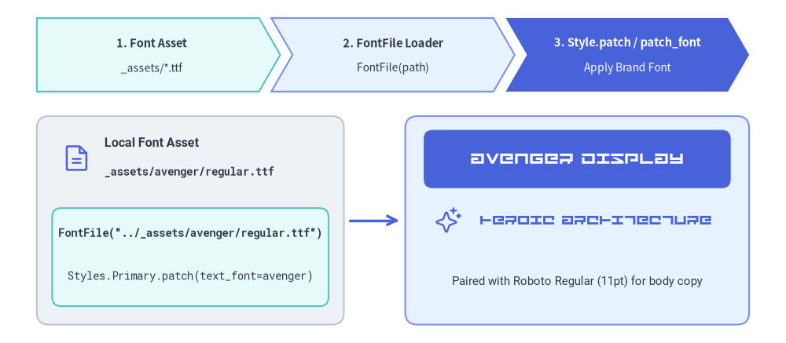
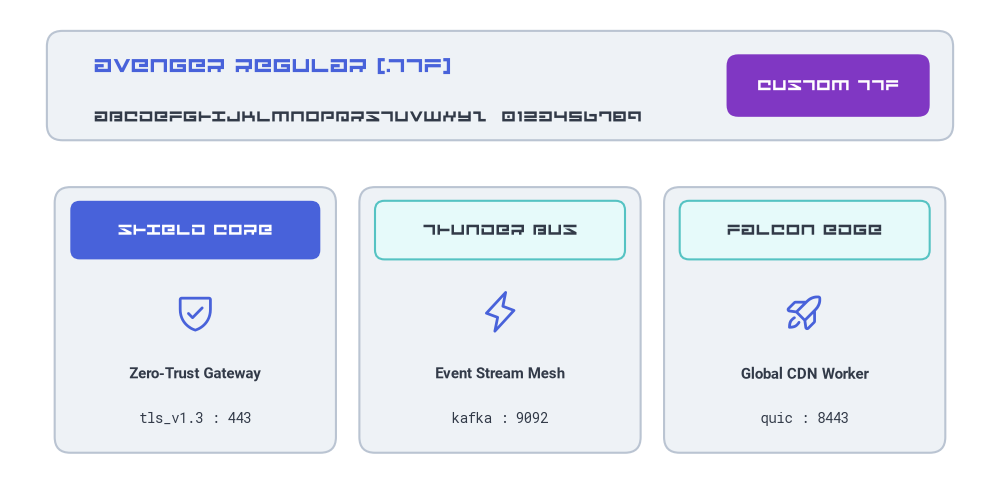
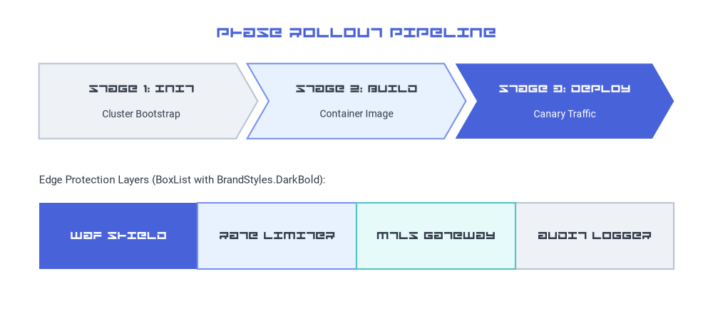

# カスタムフォントファイル (`FontFile`)

Drawlib には厳選された 13 種類のクロスプラットフォーム組み込みフォントファミリー（`Font`、`FontRoboto`、`FontJapanese` など）が用意されていますが、企業やデザインチームでは**コーポレートブランド書体、ディスプレイフォント、あるいはローカルの `.ttf`／`.otf` アセット**を使って図解を描画したいケースが多々あります。`FontFile` を使うと、プロジェクトの `_assets/` ディレクトリから任意の TrueType／OpenType フォントファイルを直接読み込み、個別のラベルや図形、さらにはプロジェクト全体のテーマに適用できます。


<figure class="drawlib-image" style="text-align: center;">
  
  <figcaption class="drawlib-caption">FontFile を用いたカスタム TrueType フォント (_assets/avenger/regular.ttf) の読み込み</figcaption>
</figure>

<details class="drawlib-code-details">
<summary>Source Code</summary>

```python
from drawlib.canvas import save, setup
from drawlib.fonts import FontFile, FontMonoSpace, FontRoboto
from drawlib.icons import phosphor
from drawlib.lines import line
from drawlib.shapes import rectangle
from drawlib.smartarts import ChevronProcess
from drawlib.styles import Styles
from drawlib.text import text

setup(width=128, height=56)

avenger = FontFile("../_assets/avenger/regular.ttf")

# Top pipeline banner using ChevronProcess
pipeline = ChevronProcess(
    style=Styles.SecondaryNeutral,
    text_style=Styles.DarkBold.patch(text_size=10.5),
    description_style=Styles.Dark.patch(text_size=10.0),
    corner_angle=60.0,
    spacing=2.0,
    flat_left_end=True,
)
pipeline.add("1. Font Asset", description="_assets/*.ttf")
pipeline.add("2. FontFile Loader", description="FontFile(path)", style=Styles.PrimaryNeutral)
pipeline.add(
    "3. Style.patch / patch_font",
    description="Apply Brand Font",
    style=Styles.PrimaryFlat,
    text_style=Styles.WhiteBold.patch(text_size=10.5),
    description_style=Styles.White.patch(text_size=10.0),
)
pipeline.draw(xy=(6.0, 41.0), width=116.0, height=12.0)

# Left Card: Local Font File Asset & Code
rectangle((31, 20.0), width=50, height=34, style=Styles.Neutral.patch(shape_r=2.0))
phosphor.file_text((12.5, 30.2), width=5.0, style=Styles.Primary)
text(
    (17.0, 32.5),
    "Local Font Asset",
    style=Styles.DarkBold.patch(text_font=FontRoboto.ROBOTO_BOLD, text_size=11.5, halign="left"),
)
text(
    (17.0, 28.0),
    "_assets/avenger/regular.ttf",
    style=Styles.Dark.patch(text_font=FontMonoSpace.ROBOTO_MONO_BOLD, text_size=10.0, halign="left"),
)

rectangle((31, 14.0), width=45, height=16.0, style=Styles.SecondaryNeutral.patch(shape_r=1.5))
text(
    (31, 18.0),
    'FontFile("../_assets/avenger/regular.ttf")',
    style=Styles.Dark.patch(text_font=FontMonoSpace.ROBOTO_MONO_BOLD, text_size=10.0),
)
text(
    (31, 11.0),
    "Styles.Primary.patch(text_font=avenger)",
    style=Styles.Dark.patch(text_font=FontMonoSpace.ROBOTO_MONO_REGULAR, text_size=10.0),
)

# Connector arrow
line((57, 20.0), (65, 20.0), arrow_head="->", style=Styles.PrimaryBold)

# Right Card: Live Avenger Font Specimen (Hero Showcase)
rectangle((94, 20.0), width=56, height=34, style=Styles.PrimaryNeutral.patch(shape_r=2.0))
rectangle(
    (94, 30.0),
    width=50,
    height=9.5,
    style=Styles.PrimaryFlat.patch(shape_r=1.5),
    text="AVENGER DISPLAY",
    text_style=Styles.White.patch(text_font=avenger, text_size=15.0),
)
phosphor.sparkle((73.0, 20.0), width=4.5, style=Styles.Primary)
text(
    (97, 20.0),
    "HEROIC ARCHITECTURE",
    style=Styles.Primary.patch(text_font=avenger, text_size=13.0),
)
text(
    (94, 10.0),
    "Paired with Roboto Regular (11pt) for body copy",
    style=Styles.Dark.patch(text_font=FontRoboto.ROBOTO_REGULAR, text_size=10.5),
)

save()
```

</details>


---

## 1. `FontFile` API とパス解決

`drawlib.fonts` から `FontFile` をインポートし、フォントファイルへのパスを渡します。

```python
from drawlib.fonts import FontFile

avenger_font = FontFile("../_assets/avenger/regular.ttf")
```

| パラメータ | 型 | 必須 | 説明 |
| :--- | :--- | :--- | :--- |
| `file` | `str \| Path` | はい | ローカルの `.ttf`、`.otf`、`.woff`、または `.woff2` フォントファイルへのパス。インスタンス生成時に即座に存在確認が行われます（ファイルが存在しない場合は `FileNotFoundError` が送出されます）。 |

### 相対パスの解決ルール
`FontFile(file=...)` に相対パスを渡すと、Drawlib は以下の順序で自動的にパスを解決します。
1. **呼び出し元の `.py` スクリプトまたは `.md` ファイルがあるディレクトリからの相対パス**: たとえば `docs_src/02_drawing_primitives/font_file.md` 内で `"../_assets/avenger/regular.ttf"` を指定すると、`docs_src/_assets/avenger/regular.ttf` が参照されます。
2. **親ディレクトリの自動探索**: Markdown／Python ファイルの直下ディレクトリに該当パスが見つからない場合、Drawlib は最大 3 階層上の親ディレクトリまで遡ってプロジェクトルートのアセットを探索します。そのため、章ごとのサブディレクトリからでも `FontFile("_assets/avenger/regular.ttf")` と `FontFile("../_assets/avenger/regular.ttf")` のどちらもシームレスに動作します。

---

## 2. テキストや図形への `FontFile` の適用

任意の `text()` 呼び出し、幾何図形（`rectangle`、`circle` など）、またはバッジにおいて、`style.patch(text_font=...)` に `FontFile` インスタンスを渡します。

次の例では、`_assets/avenger/regular.ttf` をディスプレイ書体として読み込み、本文用の `FontRoboto` や `FontMonoSpace` と組み合わせています。


```python
from drawlib.canvas import save, setup
from drawlib.fonts import FontFile, FontMonoSpace, FontRoboto
from drawlib.icons import phosphor
from drawlib.shapes import rectangle
from drawlib.styles import Styles
from drawlib.text import text

setup(width=128, height=62)

# Load custom TrueType font from _assets/avenger/regular.ttf
avenger = FontFile("../_assets/avenger/regular.ttf")

# 1. Top Display Specimen Banner
rectangle((64, 51), width=116, height=14, style=Styles.Neutral.patch(shape_r=2.0))
text(
    (12, 53.5),
    "AVENGER REGULAR (.TTF)",
    style=Styles.Primary.patch(text_font=avenger, text_size=15.0, halign="left"),
)
text(
    (12, 47.0),
    "ABCDEFGHIJKLMNOPQRSTUVWXYZ  0123456789",
    style=Styles.Dark.patch(text_font=avenger, text_size=11.5, halign="left"),
)
rectangle(
    (106, 51),
    width=26,
    height=8,
    style=Styles.AccentFlat.patch(shape_r=1.5),
    text="CUSTOM TTF",
    text_style=Styles.White.patch(text_font=avenger, text_size=11.5),
)

# 2. Three Feature Cards Mixing Custom Display Headers with Clean Body Copy
cards = [
    (25, Styles.PrimaryFlat, Styles.White, phosphor.shield_check, "SHIELD CORE", "Zero-Trust Gateway", "tls_v1.3 : 443"),
    (64, Styles.SecondaryNeutral, Styles.Dark, phosphor.lightning, "THUNDER BUS", "Event Stream Mesh", "kafka : 9092"),
    (103, Styles.SecondaryNeutral, Styles.Dark, phosphor.rocket_launch, "FALCON EDGE", "Global CDN Worker", "quic : 8443"),
]

for cx, hdr_style, hdr_text_style, icon_fn, banner_label, subtitle, endpoint in cards:
    # Outer neutral card
    rectangle((cx, 21), width=36, height=34, style=Styles.Neutral.patch(shape_r=2.0))
    # Header bar rendered with custom Avenger font
    rectangle(
        (cx, 32.5),
        width=32,
        height=7.5,
        style=hdr_style.patch(shape_r=1.2),
        text=banner_label,
        text_style=hdr_text_style.patch(text_font=avenger, text_size=11.5),
    )
    # Icon + standard Roboto & Monospace metadata
    icon_fn((cx, 22.0), width=5.5, style=Styles.Primary)
    text((cx, 14.0), subtitle, style=Styles.DarkBold.patch(text_font=FontRoboto.ROBOTO_BOLD, text_size=10.5))
    text((cx, 8.5), endpoint, style=Styles.Dark.patch(text_font=FontMonoSpace.ROBOTO_MONO_REGULAR, text_size=10.0))

save()
```

<figure class="drawlib-image" style="text-align: center;">
  
  <figcaption class="drawlib-caption">テキストバナーおよび図形カードへの FontFile (_assets/avenger/regular.ttf) の適用</figcaption>
</figure>


---

## 3. `Styles.patch_font()` によるプロジェクト全体へのカスタムフォント適用

図形ごとに毎回 `text_font` をパッチする代わりに、`Styles.patch_font()` を呼び出してカスタム `Styles` カタログを生成すれば、`SmartArts`、`Diagrams`、`Shapes` などの高レベルコンポーネント全体にわたって `FontFile` を一括適用できます。

- **ディスプレイ見出し + 標準本文**: `regular=FontRoboto.ROBOTO_REGULAR` を維持したまま `bold=avenger` を渡すと、コンポーネントの見出し（`*Bold` スタイル）にカスタムディスプレイ書体が使われ、説明文はすっきり読みやすい標準フォントに保たれます。
- **完全カスタムのブランド書体ファミリー**: `styles.py` 内で `regular=FontFile("..."), bold=FontFile("..."), thin=FontFile("...")` を渡すことで、プロジェクト全体の全プリセットスタイルトークンをブランド書体へ切り替えられます。


```python
from drawlib.canvas import save, setup
from drawlib.fonts import FontFile, FontRoboto
from drawlib.smartarts import BoxList, ChevronProcess
from drawlib.styles import Styles
from drawlib.text import text

setup(width=128, height=56)

avenger = FontFile("../_assets/avenger/regular.ttf")

# Create a themed Styles catalog where Bold tokens use Avenger and Regular tokens use Roboto
BrandStyles = Styles.patch_font(
    regular=FontRoboto.ROBOTO_REGULAR,
    bold=avenger,
)

text(
    (64, 50.0),
    "PHASE ROLLOUT PIPELINE",
    style=BrandStyles.PrimaryBold.patch(text_size=15.0),
)

# 1. ChevronProcess using BrandStyles.DarkBold (Avenger) for stage headers and Roboto for descriptions
proc = ChevronProcess(
    style=BrandStyles.Neutral,
    text_style=BrandStyles.DarkBold.patch(text_size=11.0),
    description_style=BrandStyles.Dark.patch(text_size=10.0),
    corner_angle=60.0,
    spacing=2.0,
    flat_left_end=True,
)
proc.add("STAGE 1: INIT", description="Cluster Bootstrap")
proc.add("STAGE 2: BUILD", description="Container Image", style=BrandStyles.PrimaryNeutral)
proc.add(
    "STAGE 3: DEPLOY",
    description="Canary Traffic",
    style=BrandStyles.PrimaryFlat,
    text_style=BrandStyles.WhiteBold.patch(text_size=11.0),
    description_style=BrandStyles.White.patch(text_size=10.0),
)
proc.draw(xy=(7.0, 31.0), width=114.0, height=13.5)

# 2. Contiguous BoxList using BrandStyles
text(
    (7.0, 23.5),
    "Edge Protection Layers (BoxList with BrandStyles.DarkBold):",
    style=BrandStyles.Dark.patch(text_size=10.5, halign="left"),
)
boxes = BoxList(
    style=BrandStyles.Neutral,
    text_style=BrandStyles.DarkBold.patch(text_size=11.0),
)
boxes.add("WAF SHIELD", style=BrandStyles.PrimaryFlat, text_style=BrandStyles.WhiteBold.patch(text_size=11.0))
boxes.add("RATE LIMITER", style=BrandStyles.PrimaryNeutral)
boxes.add("MTLS GATEWAY", style=BrandStyles.SecondaryNeutral)
boxes.add("AUDIT LOGGER", style=BrandStyles.Neutral)
boxes.draw(xy=(7.0, 7.5), box_width=28.5, box_height=12.0, align="bottom_left")

save()
```

<figure class="drawlib-image" style="text-align: center;">
  
  <figcaption class="drawlib-caption">SmartArt コンポーネント全体への FontFile と Styles.patch_font() の適用</figcaption>
</figure>


### プロジェクト全体の `styles.py` 設定
各ファイルで毎回 `FontFile` をインポートすることなく、`doc`・`site`・`slide`・`images` プロジェクト内のすべての図解にコーポレートフォントを適用するには、フォントファイルを `_assets/fonts/` 等に配置して `styles.py` を更新します。

```python
# styles.py
from drawlib.fonts import FontFile, FontSourceCode
from drawlib.styles import Styles

Styles = Styles.patch_font(
    regular=FontFile("_assets/avenger/regular.ttf"),
    bold=FontFile("_assets/avenger/regular.ttf"),
    thin=FontFile("_assets/avenger/regular.ttf"),
    sourcecode=FontSourceCode.SOURCECODEPRO,
)
```

---

## 4. アセット管理とビルドキャッシュ

1. **フォントは `_assets/` 配下に保管する**:
   カスタムの `.ttf`／`.otf` ファイルはプロジェクトの `_assets/` ディレクトリ内（例: `docs_src/_assets/avenger/regular.ttf`）に配置してください。`drawlib build html` および `drawlib build markdown` の実行時に、`_assets/` は出力ディレクトリへ自動的にコピーされます。
2. **差分ビルドキャッシュの自動追跡 (`.drawlib/cache.db`)**:
   Drawlib のビルドキャッシュは `_assets/` 配下で参照されるローカルファイルのハッシュを計算・追跡します。`_assets/avenger/regular.ttf` を差し替えたり更新したりすると、`drawlib build` がチェックサムの変化を検知し、影響を受ける図解を自動的に再レンダリングします。
3. **関連項目**:
   - [フォントと多言語カタログ](./fonts.md) — 組み込みの `Font`、`FontRoboto`、`FontJapanese`、および 10 種類以上の地域別フォントクラス。
   - [テキストとタイポグラフィ](./text.md) — `text()` による位置指定、配置揃え、回転、背景ボックス。
   - [スタイルとテーマ設定](./styles.md) — プリセットスタイルトークンと `Styles.patch_font()`。
