# 線とコネクタ

コネクタは、図中の要素間の通信経路、データフローの向き、および構造的な関係性を表現します。
`drawlib.lines` モジュールは、直線、滑らかな円弧、2 次および 3 次ベジェ曲線、多点の直交（マンハッタン）折れ線、角丸（フィレット）付き折れ線、複合パス、楕円弧コネクタを網羅する **8 つのベクターコネクタ関数**を提供します。


<figure class="drawlib-image" style="text-align: center;">
  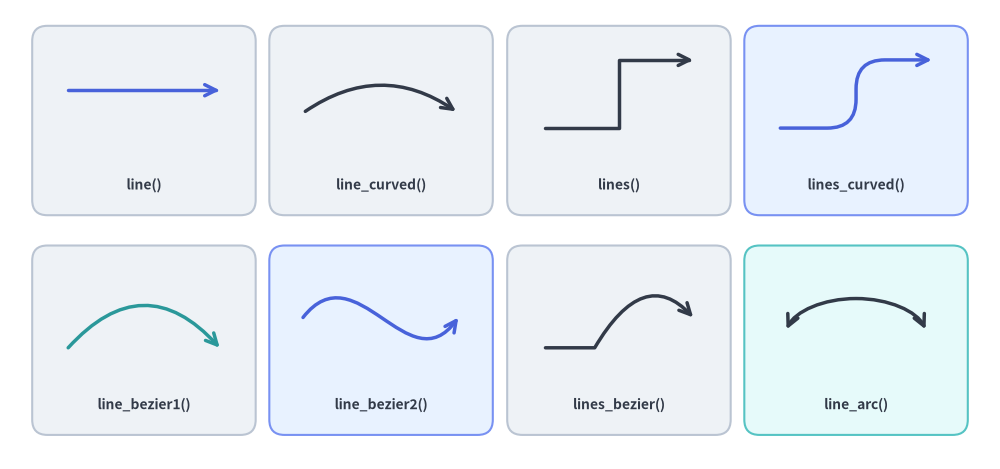
  <figcaption class="drawlib-caption">Drawlib の全 8 種類の線・曲線コネクタの概要</figcaption>
</figure>

<details class="drawlib-code-details">
<summary>Source Code</summary>

```python
from drawlib.canvas import save, setup
from drawlib.lines import (
    line,
    line_arc,
    line_bezier1,
    line_bezier2,
    line_curved,
    lines,
    lines_bezier,
    lines_curved,
)
from drawlib.shapes import rectangle
from drawlib.styles import Styles
from drawlib.text import text

setup(width=132, height=62)

# Background cards for the 4x2 showcase grid
cols = [19, 50.3, 81.7, 113]
for c_idx, cx in enumerate(cols):
    r1_st = Styles.PrimaryNeutral if c_idx == 3 else Styles.Neutral
    r2_st = Styles.PrimaryNeutral if c_idx == 1 else (Styles.SecondaryNeutral if c_idx == 3 else Styles.Neutral)
    rectangle((cx, 46), width=29.5, height=25, style=r1_st.patch(shape_r=2))
    rectangle((cx, 17), width=29.5, height=25, style=r2_st.patch(shape_r=2))

lbl = Styles.DarkBold.patch(text_size=10.0)

# Row 1: Straight line, circular arc spline, polyline, and filleted polyline
line((9, 50), (29, 50), arrow_head="->", style=Styles.PrimaryBold)
text((19, 37.5), "line()", style=lbl)

line_curved((40, 47), (60.5, 47), bend=-0.35, arrow_head="->", style=Styles.DarkBold)
text((50.3, 37.5), "line_curved()", style=lbl)

lines([(72, 45), (81.7, 45), (81.7, 54), (91.5, 54)], arrow_head="->", style=Styles.DarkBold)
text((81.7, 37.5), "lines()", style=lbl)

lines_curved([(103, 45), (113, 45), (113, 54), (123, 54)], r=3.8, arrow_head="->", style=Styles.PrimaryBold)
text((113, 37.5), "lines_curved()", style=lbl)

# Row 2: Quadratic Bézier, cubic Bézier, compound Bézier path, and elliptical arc
line_bezier1((9, 16), (29, 16), cp=(19, 27), arrow_head="->", style=Styles.SecondaryBold)
text((19, 8.5), "line_bezier1()", style=lbl)

line_bezier2((40, 20), (60.5, 20), cp1=(47, 29), cp2=(54, 11), arrow_head="->", style=Styles.PrimaryBold)
text((50.3, 8.5), "line_bezier2()", style=lbl)

lines_bezier((72, 16), [(78.5, 16), ((85, 27), (91.5, 20))], arrow_head="->", style=Styles.DarkBold)
text((81.7, 8.5), "lines_bezier()", style=lbl)

line_arc((113, 17), width=19, height=11, angle_start=15, angle_end=165, ccw=True, arrow_head="<->", style=Styles.DarkBold)
text((113, 8.5), "line_arc()", style=lbl)

save()
```

</details>


---

## 1. インポートと概要

すべての直線・曲線関数は `drawlib.lines` からインポートします。

```python
from drawlib.lines import (
    line,          # Straight line segment between xy1 and xy2
    line_curved,   # Circular arc spline between xy1 and xy2 with scalar bend
    line_bezier1,  # Quadratic Bézier curve with 1 control point (cp)
    line_bezier2,  # Cubic Bézier curve with 2 control points (cp1, cp2)
    lines,         # Multi-point polyline through a sequence of coordinates
    lines_curved,  # Multi-point polyline with automatic corner fillet radius r
    lines_bezier,  # Multi-segment path mixing straight, quadratic, and cubic Béziers
    line_arc,      # Open circular or elliptical arc connector
)
```

---

## 2. 先端の矢印と線のスタイル設定 (`Style`)

### 2.1. `arrow_head` パラメータ

`drawlib.lines` の全 8 関数は、キーワード引数 **`arrow_head`** を受け取ります。

| `arrow_head` の値 | 端点マーカーの挙動 | 説明 |
| :---: | :--- | :--- |
| `""` または `"-"` | 矢印なし（通常の線） | 端点マーカーを持たない無向の線 *（デフォルト）*。 |
| `"->"` | 終点に順方向の矢印 | 終点側（`xy2` または最終頂点）に順方向の矢印を描画します。 |
| `"<-"` | 始点に逆方向の矢印 | 始点側（`xy1` または最初の頂点）に逆方向の矢印を描画します。 |
| `"<->"` | 両端に双方向の矢印 | 始点と終点の両方に双方向の矢印を描画します。 |

### 2.2. `Style` の矢印・破線パターン属性

線のストローク外観や矢印の形状は、`Style` の各属性（`.patch()` でカスタマイズ可能）によって制御します。

| `Style` 属性 | 型 | デフォルト | 説明 |
| :--- | :--- | :--- | :--- |
| `line_color` | `Color \| tuple \| str` | テーマ色 | 線のストローク色（および矢印の色）。例: `Colors.Dark`、`Colors.Primary`。 |
| `line_width` | `float` | `1.5`（Bold は `2.5`、Thin は `0.75`） | ポイント単位の線の太さ。 |
| `line_style` | `"solid" \| "dashed" \| "dotted" \| "dashdot"` | `"solid"` | 線の破線パターン。 |
| `line_arrow_head_fill` | `bool` | `False` | `False` は開いた V 字型の線矢印（`->`）、`True` は塗りつぶされた三角形の矢印（`-\|>`）を描画します。 |
| `line_arrow_head_scale` | `float` | `20.0` | 端点の矢印に対する物理サイズの倍率。 |
| `alpha` | `float` | `1.0` | 線と矢印全体の不透明度（`0.0` の完全透明から `1.0` の完全不透明まで）。 |


```python
from drawlib.canvas import save, setup
from drawlib.lines import line
from drawlib.shapes import rectangle
from drawlib.styles import Colors, Styles
from drawlib.text import text

setup(width=128, height=62)

# Left Panel: 4 Stroke Dash Patterns (style.line_style)
rectangle((32, 31), width=56, height=54, style=Styles.Neutral.patch(shape_r=2))
text((32, 51), "Dash Patterns (line_style)", style=Styles.DarkBold.patch(text_size=11.0))

dash_specs = [
    (41, "solid", '"solid"', Colors.Dark),
    (31, "dashed", '"dashed"', Colors.Primary),
    (21, "dotted", '"dotted"', Colors.Secondary),
    (11, "dashdot", '"dashdot"', Colors.Danger),
]
for y, pattern, label, col in dash_specs:
    text((8, y), label, style=Styles.DarkBold.patch(text_size=10.0, halign="left"))
    line(
        (29, y),
        (56, y),
        arrow_head="->",
        style=Styles.DarkBold.patch(line_style=pattern, line_color=col, line_width=2.0),
    )

# Right Panel: Arrowhead Fill & Scale (line_arrow_head_fill / line_arrow_head_scale)
rectangle((94, 31), width=60, height=54, style=Styles.PrimaryNeutral.patch(shape_r=2))
text((94, 51), "Arrowhead Fill & Scale", style=Styles.DarkBold.patch(text_size=11.0))

arrow_specs = [
    (41, "Stick (fill=False)", "->", False, 20.0, 2.0),
    (31, "Filled (fill=True)", "->", True, 20.0, 2.0),
    (21, "Two-Way (<->)", "<->", True, 20.0, 2.0),
    (11, "Large (scale=32)", "->", True, 32.0, 2.5),
]
for y, label, head, fill_flag, scale_val, width_val in arrow_specs:
    text((67, y), label, style=Styles.DarkBold.patch(text_size=10.0, halign="left"))
    line(
        (100, y),
        (120, y),
        arrow_head=head,
        style=Styles.PrimaryBold.patch(
            line_arrow_head_fill=fill_flag,
            line_arrow_head_scale=scale_val,
            line_width=width_val,
        ),
    )

save()
```

<figure class="drawlib-image" style="text-align: center;">
  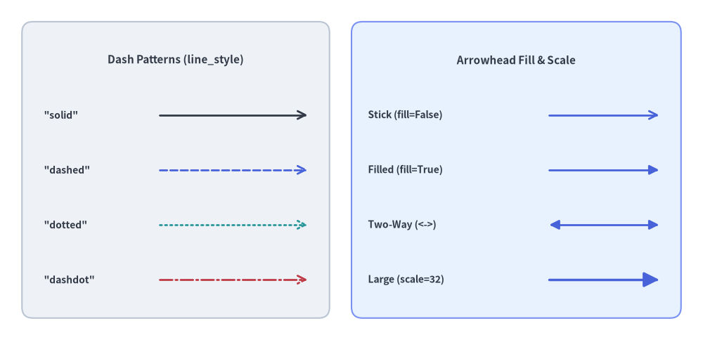
  <figcaption class="drawlib-caption">破線パターン (line_style)、塗りつぶし三角形の矢印 (line_arrow_head_fill)、およびスケール (line_arrow_head_scale)</figcaption>
</figure>


---

## 3. 2 点間の直線と曲線

### 3.1. 直線 (`line`)

2 つの座標 `xy1` と `xy2` を真っ直ぐな線分で結びます。

```python
line(
    xy1: tuple[float, float],
    xy2: tuple[float, float],
    *,
    style: Style,
    arrow_head: Literal["", "-", "->", "<-", "<->"] | str = "",
) -> None
```

| パラメータ | 型 | デフォルト | 説明 |
| :--- | :--- | :--- | :--- |
| `xy1` | `tuple[float, float]` | *必須* | キャンバス座標における始点 `(x1, y1)`。 |
| `xy2` | `tuple[float, float]` | *必須* | キャンバス座標における終点 `(x2, y2)`。 |
| `style` | `Style` | *必須* | 線スタイルトークン（例: `Styles.DarkBold`、`Styles.PrimaryBold`）。 |
| `arrow_head` | `str` | `""` | 任意の矢印マーカー（`""`、`"-"`、`"->"`、`"<-"`、`"<->"`）。 |


```python
from drawlib.canvas import save, setup
from drawlib.lines import line
from drawlib.shapes import rectangle
from drawlib.styles import Styles
from drawlib.text import text

setup(width=120, height=54)

rectangle((60, 27), width=112, height=46, style=Styles.Neutral.patch(shape_r=2))

rows = [
    (42, 'arrow_head="" (Styles.DarkBold)', "", Styles.DarkBold),
    (32, 'arrow_head="->" (Styles.DarkBold)', "->", Styles.DarkBold),
    (22, 'arrow_head="<-" (Styles.PrimaryDashed)', "<-", Styles.PrimaryDashed.patch(line_width=2.0)),
    (12, 'arrow_head="<->" (Styles.DangerDotted)', "<->", Styles.DangerDotted.patch(line_width=2.0)),
]

for y, label, head, st in rows:
    text((8, y), label, style=Styles.DarkBold.patch(text_size=10.5, halign="left"))
    line((76, y), (111, y), arrow_head=head, style=st)

save()
```

<figure class="drawlib-image" style="text-align: center;">
  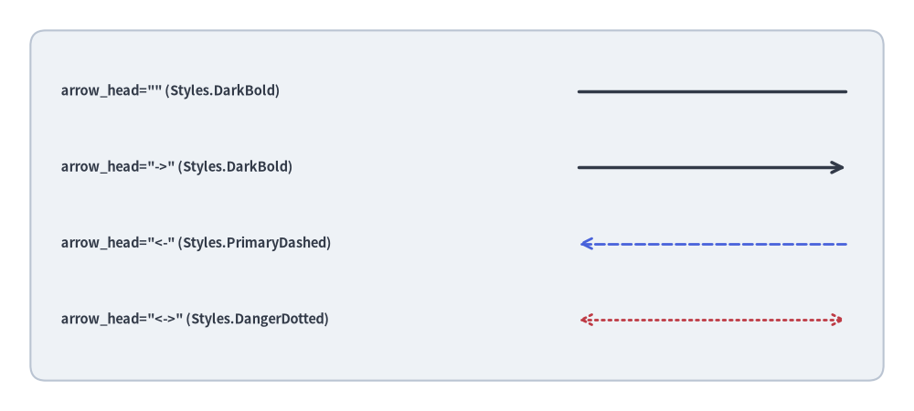
  <figcaption class="drawlib-caption">4 種類の arrow_head モードと線スタイルによる直線</figcaption>
</figure>


### 3.2. 滑らかな円弧スプライン (`line_curved`)

単一の曲率スカラー係数 `bend` で制御される円弧スプラインを `xy1` と `xy2` の間に描画します。

```python
line_curved(
    xy1: tuple[float, float],
    xy2: tuple[float, float],
    *,
    style: Style,
    bend: float = 0,
    arrow_head: Literal["", "-", "->", "<-", "<->"] | str = "",
) -> None
```

| パラメータ | 型 | デフォルト | 説明 |
| :--- | :--- | :--- | :--- |
| `xy1` | `tuple[float, float]` | *必須* | 始点座標 `(x1, y1)`。 |
| `xy2` | `tuple[float, float]` | *必須* | 終点座標 `(x2, y2)`。 |
| `style` | `Style` | *必須* | 線スタイルトークン（必須キーワード引数）。 |
| `bend` | `float` | `0` | 進行方向 `xy1 -> xy2` に対する曲率ラジアン係数（`0` = 直線）。 |
| `arrow_head` | `str` | `""` | 任意の矢印マーカー（`""`、`"-"`、`"->"`、`"<-"`、`"<->"`）。 |

#### 曲率方向のルール（進行方向 `xy1 -> xy2` 基準の `bend`）
内部的に `line_curved()` は `ConnectionStyle.Arc3(rad=bend)` を使用しており、曲率は `xy1` から `xy2` へ向かう観測者の進行方向を基準に決まります。
- **`bend = 0`** *（デフォルト）*: 完全な直線セグメントになります。
- **`bend < 0`**: 進行ベクトル `xy1 -> xy2` に対して**右側**へ膨らむように湾曲します（`(15, 22)` から `(85, 22)` へ左から右に引く場合は**上向き**に弧を描きます）。
- **`bend > 0`**: 進行ベクトル `xy1 -> xy2` に対して**左側**へ膨らむように湾曲します（`(15, 22)` から `(85, 22)` へ左から右に引く場合は**下向き**に弧を描きます）。
- **リクエスト／レスポンス対称化のヒント**: `A -> B` へのリクエストと `B -> A` へのレスポンスに*同じ*符号の `bend` 値を指定すると、進行方向が反転することで 2 本の曲線が自動的に反対側へ膨らみ、美しい往復ループを形成できます。


```python
from drawlib.canvas import save, setup
from drawlib.lines import line_curved
from drawlib.styles import Styles
from drawlib.text import text

setup(width=110, height=44)
# Left-to-right with negative bend curves upward
line_curved((15, 22), (95, 22), bend=-0.32, arrow_head="->", style=Styles.DarkBold)
text((55, 39), "bend=-0.32 (left -> right: upward)", style=Styles.DarkBold.patch(text_size=10.5))

# Left-to-right with positive bend curves downward
line_curved((15, 22), (95, 22), bend=0.32, arrow_head="->", style=Styles.DarkBold)
text((55, 5), "bend=+0.32 (left -> right: downward)", style=Styles.Dark.patch(text_size=10.5))
save()
```

<figure class="drawlib-image" style="text-align: center;">
  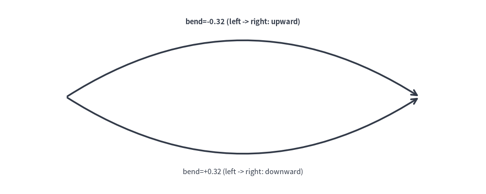
  <figcaption class="drawlib-caption">進行方向 xy1 -> xy2 を基準とした円弧曲線</figcaption>
</figure>


### 3.3. 2 次ベジェ曲線 (`line_bezier1`)

単一の制御点 `cp` に引き寄せられる滑らかな曲線で `xy1` と `xy2` を結びます。

```python
line_bezier1(
    xy1: tuple[float, float],
    xy2: tuple[float, float],
    cp: tuple[float, float],
    *,
    style: Style,
    arrow_head: Literal["", "-", "->", "<-", "<->"] | str = "",
) -> None
```

| パラメータ | 型 | デフォルト | 説明 |
| :--- | :--- | :--- | :--- |
| `xy1` | `tuple[float, float]` | *必須* | 始点 $P_0$。 |
| `xy2` | `tuple[float, float]` | *必須* | 終点 $P_1$。 |
| `cp` | `tuple[float, float]` | *必須* | 出発時および到達時の接線方向を決定する 2 次制御点 $P_c$。 |
| `style` | `Style` | *必須* | 線スタイルトークン。 |
| `arrow_head` | `str` | `""` | 任意の矢印マーカー（`""`、`"-"`、`"->"`、`"<-"`、`"<->"`）。 |


```python
from drawlib.canvas import save, setup
from drawlib.lines import line, line_bezier1
from drawlib.shapes import circle
from drawlib.styles import Styles
from drawlib.text import text

setup(width=106, height=46)
p1, p2 = (14, 12), (92, 12)
cp = (53, 37)

# Control point tangent guides
line(p1, cp, style=Styles.MutedDashed)
line(cp, p2, style=Styles.MutedDashed)
circle(cp, radius=1.8, style=Styles.DangerFlat)
text((53, 42), "Control Point (cp)", style=Styles.DangerBold.patch(text_size=11.0))

# Quadratic Bézier curve
line_bezier1(p1, p2, cp=cp, arrow_head="->", style=Styles.SecondaryBold)
save()
```

<figure class="drawlib-image" style="text-align: center;">
  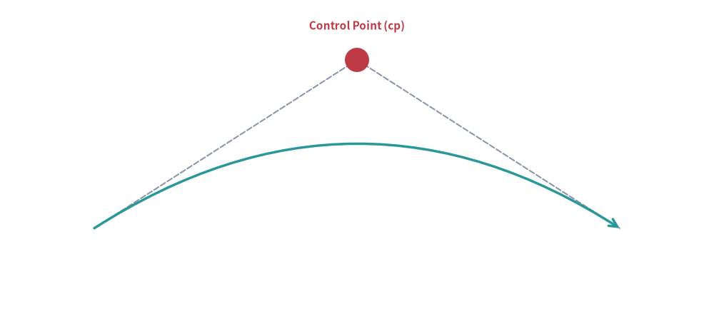
  <figcaption class="drawlib-caption">制御点を用いた 2 次ベジェ曲線</figcaption>
</figure>


### 3.4. 3 次ベジェ曲線 (`line_bezier2`)

2 つの独立した制御点 `cp1` と `cp2` を用いて `xy1` と `xy2` を結び、平行なポート間を繋ぐ滑らかな変曲 S 字カーブを表現できます。

```python
line_bezier2(
    xy1: tuple[float, float],
    xy2: tuple[float, float],
    cp1: tuple[float, float],
    cp2: tuple[float, float],
    *,
    style: Style,
    arrow_head: Literal["", "-", "->", "<-", "<->"] | str = "",
) -> None
```

| パラメータ | 型 | デフォルト | 説明 |
| :--- | :--- | :--- | :--- |
| `xy1` | `tuple[float, float]` | *必須* | 始点 $P_0$。 |
| `xy2` | `tuple[float, float]` | *必須* | 終点 $P_1$。 |
| `cp1` | `tuple[float, float]` | *必須* | `xy1` からの出発接線を制御する第 1 制御点。 |
| `cp2` | `tuple[float, float]` | *必須* | `xy2` への進入接線を制御する第 2 制御点。 |
| `style` | `Style` | *必須* | 線スタイルトークン。 |
| `arrow_head` | `str` | `""` | 任意の矢印マーカー（`""`、`"-"`、`"->"`、`"<-"`、`"<->"`）。 |


```python
from drawlib.canvas import save, setup
from drawlib.lines import line, line_bezier2
from drawlib.shapes import circle
from drawlib.styles import Styles
from drawlib.text import text

setup(width=106, height=48)
p1, p2 = (14, 24), (92, 24)
cp1, cp2 = (37, 40), (69, 8)

# Tangent guides for both control points
line(p1, cp1, style=Styles.MutedDashed)
line(p2, cp2, style=Styles.MutedDashed)
circle(cp1, radius=1.8, style=Styles.DangerFlat)
text((37, 44.5), "cp1", style=Styles.DangerBold.patch(text_size=11.0))
circle(cp2, radius=1.8, style=Styles.DangerFlat)
text((69, 3.5), "cp2", style=Styles.DangerBold.patch(text_size=11.0))

# Cubic Bézier S-curve
line_bezier2(p1, p2, cp1=cp1, cp2=cp2, arrow_head="->", style=Styles.PrimaryBold)
save()
```

<figure class="drawlib-image" style="text-align: center;">
  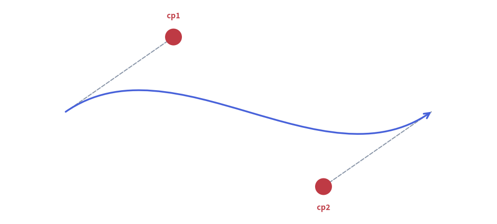
  <figcaption class="drawlib-caption">2 つの制御点を用いた 3 次ベジェ S 字カーブ</figcaption>
</figure>


---

## 4. 多点折れ線と直交ルーティング (`lines`)

`lines()` 関数は、2 点以上の順序付き座標列 `[(x0, y0), (x1, y1), ...]` を直線セグメントで順に結びます（連続する重複座標は自動的に除去されます）。

```python
lines(
    xys: list[tuple[float, float]],
    *,
    style: Style,
    arrow_head: Literal["", "-", "->", "<-", "<->"] | str = "",
) -> None
```

| パラメータ | 型 | デフォルト | 説明 |
| :--- | :--- | :--- | :--- |
| `xys` | `list[tuple[float, float]]` | *必須* | 2 点以上の順序付き頂点リスト `[(x0, y0), (x1, y1), ...]`。 |
| `style` | `Style` | *必須* | 線スタイルトークン。 |
| `arrow_head` | `str` | `""` | 折れ線の始点／終点に配置する矢印マーカー。 |

ソフトウェアアーキテクチャ図や回路図では、重なりのない整然としたバス配線を実現するために**直交（マンハッタン）ルーティング**が標準的に用いられます。

### 4.1. L 字ルーティング（90° 折れ 1 回）
まず水平方向に伸ばし、次に垂直方向に折れて 2 つの要素を接続します。


```python
from drawlib.canvas import save, setup
from drawlib.lines import lines
from drawlib.shapes import rectangle
from drawlib.styles import Styles

setup(width=106, height=42)
rectangle((22, 29), width=26, height=14, style=Styles.Neutral, text="Client", text_style=Styles.DarkBold.patch(text_size=11.0))
rectangle((84, 13), width=26, height=14, style=Styles.PrimaryFlat, text="Worker", text_style=Styles.WhiteBold.patch(text_size=11.0))

# L-shaped connection: horizontal from Client, then downward to Worker
lines([(35, 29), (84, 29), (84, 20)], arrow_head="->", style=Styles.DarkBold)
save()
```

<figure class="drawlib-image" style="text-align: center;">
  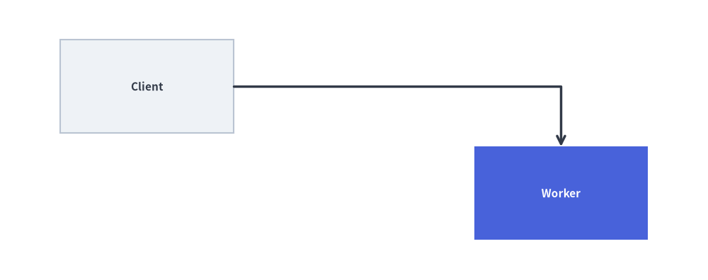
  <figcaption class="drawlib-caption">2 つのサービス間を結ぶ直交 L 字ルーティング</figcaption>
</figure>


### 4.2. Z 字ルーティング／ドッグレッグ（90° 折れ 2 回）
中間チャネル $x_{\text{mid}}$ を経由して、段違いに配置された 2 つのコンポーネントを接続します。


```python
from drawlib.canvas import save, setup
from drawlib.lines import lines
from drawlib.shapes import rectangle
from drawlib.styles import Styles

setup(width=106, height=42)
rectangle((22, 30), width=26, height=14, style=Styles.Neutral, text="Service A", text_style=Styles.DarkBold.patch(text_size=11.0))
rectangle((84, 12), width=26, height=14, style=Styles.PrimaryFlat, text="Service B", text_style=Styles.WhiteBold.patch(text_size=11.0))

# Z-shaped dogleg connection across midpoint x_mid = 53
x_mid = 53
lines([(35, 30), (x_mid, 30), (x_mid, 12), (71, 12)], arrow_head="->", style=Styles.DarkBold)
save()
```

<figure class="drawlib-image" style="text-align: center;">
  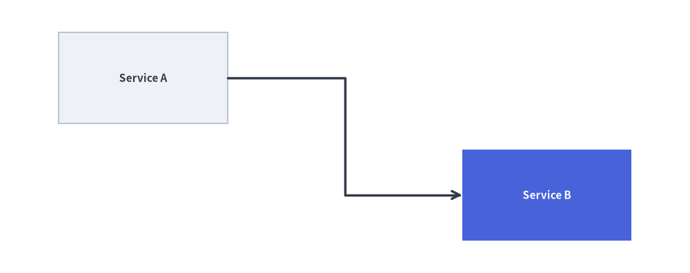
  <figcaption class="drawlib-caption">中間点を経由する直交 Z 字ルーティング（ドッグレッグ）</figcaption>
</figure>


---

## 5. 高度な複合セグメント曲線と円弧コネクタ

### 5.1. 角丸（フィレット）付き多点折れ線 (`lines_curved`)

`lines_curved()` は `lines()` と同じ頂点リスト `xys` に加えて、角丸フィレット半径 `r` を受け取ります。内部の各屈曲頂点 $P_i$ が、半径 `r` の滑らかな 2 次ベジェ曲線ターンに自動的に置き換えられます。

```python
lines_curved(
    xys: list[tuple[float, float]],
    r: float,
    *,
    style: Style,
    arrow_head: Literal["", "-", "->", "<-", "<->"] | str = "",
) -> None
```

| パラメータ | 型 | デフォルト | 説明 |
| :--- | :--- | :--- | :--- |
| `xys` | `list[tuple[float, float]]` | *必須* | 折れ線の頂点列 `[(x0, y0), (x1, y1), ...]`。 |
| `r` | `float` | *必須* | キャンバス単位での角丸フィレット半径（$r > 0$）。 |
| `style` | `Style` | *必須* | 線スタイルトークン。 |
| `arrow_head` | `str` | `""` | 端点の矢印マーカー（`""`、`"-"`、`"->"`、`"<-"`、`"<->"`）。 |

> [!TIP]
> **フィレット半径の制約**: 隣接する角丸同士の間に直線区間が残るよう、フィレット半径は最短セグメント長の半分未満（$r < 0.5 \min_i \|P_{i+1} - P_i\|$）に収めてください（内部的にも Drawlib は各セグメント長の `0.5` 倍までにフィレット比率をクランプします）。


```python
from drawlib.canvas import save, setup
from drawlib.lines import lines_curved
from drawlib.shapes import rectangle
from drawlib.styles import Styles
from drawlib.text import text

setup(width=120, height=52)

rectangle((20, 38), width=26, height=14, style=Styles.Neutral.patch(shape_r=2), text="API Ingress", text_style=Styles.DarkBold.patch(text_size=10.5))
rectangle((60, 26), width=24, height=14, style=Styles.Neutral.patch(shape_r=2), text="Firewall", text_style=Styles.DarkBold.patch(text_size=10.5))
rectangle((100, 14), width=26, height=14, style=Styles.PrimaryFlat.patch(shape_r=2), text="Core DB", text_style=Styles.WhiteBold.patch(text_size=10.5))

# Route around the central Firewall box with r=6.0 rounded corners
waypoints = [(33, 38), (60, 38), (60, 44), (100, 44), (100, 21)]
lines_curved(waypoints, r=6.0, arrow_head="->", style=Styles.PrimaryBold)
text((80, 48), "lines_curved(..., r=6.0)", style=Styles.DarkBold.patch(text_size=10.5))

# Bottom return path with smaller fillet radius r=4.0
return_pts = [(87, 14), (20, 14), (20, 31)]
lines_curved(return_pts, r=4.0, arrow_head="->", style=Styles.MutedDashed)
text((53, 8.5), "Async Audit Trail (r=4.0)", style=Styles.DarkBold.patch(text_size=10.0))

save()
```

<figure class="drawlib-image" style="text-align: center;">
  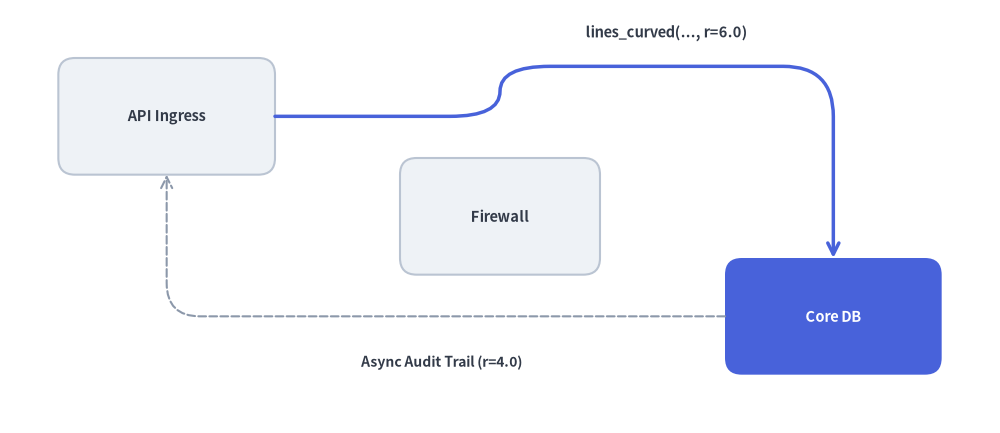
  <figcaption class="drawlib-caption">lines_curved(xys, r) による角丸マンハッタンルーティング</figcaption>
</figure>


### 5.2. 複合マルチセグメント・ベジェパス (`lines_bezier`)

`lines_bezier()` は、始点 `xy` から始まり、`path_points` に定義された直線セグメント、2 次ベジェ曲線、3 次ベジェ曲線の任意の組み合わせを単一の連続ベクターパスとして連結描画します。

```python
lines_bezier(
    xy: tuple[float, float],
    path_points: list[
        tuple[float, float]
        | tuple[tuple[float, float], tuple[float, float]]
        | tuple[tuple[float, float], tuple[float, float], tuple[float, float]]
    ],
    *,
    style: Style,
    arrow_head: Literal["", "-", "->", "<-", "<->"] | str = "",
) -> None
```

| パラメータ／`path_points` の要素 | タプル構造 | パスセグメントの挙動 |
| :--- | :--- | :--- |
| **`xy`** | `(x0, y0)` | パスの開始座標（`Path.MOVETO`）。 |
| **直線セグメント** | `(x, y)` | `(x, y)` までの直線（`Path.LINETO`）。 |
| **2 次ベジェセグメント** | `((cp_x, cp_y), (x, y))` | 制御点 `cp` を経由して `(x, y)` に至る 1 制御点曲線（`Path.CURVE3`）。 |
| **3 次ベジェセグメント** | `((cp1_x, cp1_y), (cp2_x, cp2_y), (x, y))` | `cp1`・`cp2` を経由して `(x, y)` に至る 2 制御点曲線（`Path.CURVE4`）。 |


```python
from drawlib.canvas import save, setup
from drawlib.lines import lines_bezier
from drawlib.shapes import circle, rectangle
from drawlib.styles import Styles
from drawlib.text import text

setup(width=124, height=52)

circle((16, 16), radius=8.5, style=Styles.Neutral, text="Source", text_style=Styles.DarkBold.patch(text_size=10.0))
rectangle((106, 36), width=24, height=14, style=Styles.PrimaryFlat.patch(shape_r=2), text="Sink", text_style=Styles.WhiteBold.patch(text_size=11.0))

# Compound path: straight run -> cubic S-curve -> straight run -> quadratic turn
compound_points = [
    (40, 16),                                  # 1. Straight segment to (40, 16)
    ((53, 16), (53, 36), (66, 36)),            # 2. Cubic S-curve to (66, 36)
    (82, 36),                                  # 3. Straight segment to (82, 36)
    ((88, 44), (94, 36)),                      # 4. Quadratic hop into Sink port
]

lines_bezier(
    xy=(24.5, 16),
    path_points=compound_points,
    arrow_head="->",
    style=Styles.PrimaryBold.patch(line_arrow_head_fill=True),
)

text((33, 10.5), "1. Straight", style=Styles.DarkBold.patch(text_size=10.0))
text((42, 31), "2. Cubic S-Curve", style=Styles.DarkBold.patch(text_size=10.0))
text((74, 30.5), "3. Straight", style=Styles.DarkBold.patch(text_size=10.0))
text((88, 45.5), "4. Quadratic", style=Styles.DarkBold.patch(text_size=10.0))

save()
```

<figure class="drawlib-image" style="text-align: center;">
  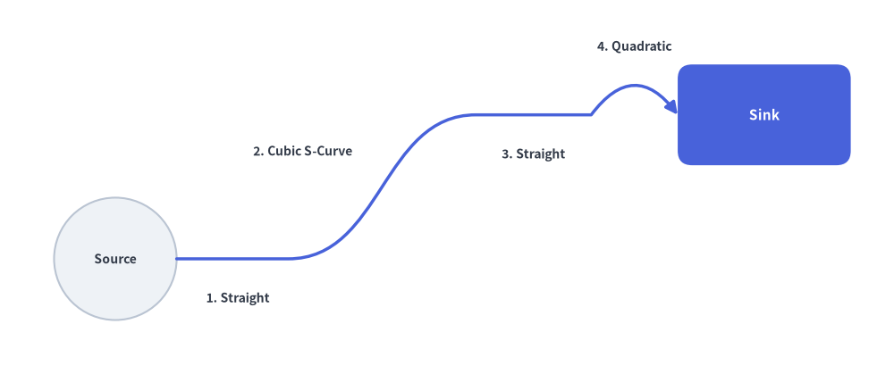
  <figcaption class="drawlib-caption">lines_bezier() による直線・3 次 S 字カーブ・2 次曲線を組み合わせた複合パス</figcaption>
</figure>


### 5.3. 楕円弧・円弧コネクタ (`line_arc`)

`line_arc()` は、`xy` を中心とする楕円または円の外周に沿った開いたベクター円弧ストロークを描画します。ステートマシンの自己遷移（セルフループ）、リトライ表示、循環フィードバック矢印に最適です。

```python
line_arc(
    xy: tuple[float, float],
    width: float,
    height: float,
    *,
    style: Style,
    angle_start: float = 0,
    angle_end: float = 180,
    angle: float = 0,
    arrow_head: Literal["", "-", "->", "<-", "<->"] | str = "",
    ccw: bool = True,
) -> None
```

| パラメータ | 型 | デフォルト | 説明 |
| :--- | :--- | :--- | :--- |
| `xy` | `tuple[float, float]` | *必須* | 仮想楕円の中心座標 `(cx, cy)`。 |
| `width` | `float` | *必須* | 楕円の水平方向の全直径 $2 R_x$（真円の場合は `width == height`）。 |
| `height` | `float` | *必須* | 楕円の垂直方向の全直径 $2 R_y$。 |
| `style` | `Style` | *必須* | 線スタイルトークン。 |
| `angle_start` | `float` | `0` | 度数法による開始角度（$0^\circ$ = 3 時方向、$90^\circ$ = 12 時方向、$180^\circ$ = 9 時方向、$270^\circ$ = 6 時方向）。 |
| `angle_end` | `float` | `180` | 度数法による終了角度。 |
| `angle` | `float` | `0` | `xy` を中心とする楕円フレーム全体の反時計回り回転角（度）。 |
| `arrow_head` | `str` | `""` | 端点の矢印マーカー（`""`、`"-"`、`"->"`、`"<-"`、`"<->"`）。 |
| `ccw` | `bool` | `True` | `angle_start` から `angle_end` への描画回転方向（`True` = 反時計回り、`False` = 時計回り）。 |


```python
from drawlib.canvas import save, setup
from drawlib.lines import line, line_arc
from drawlib.shapes import rectangle
from drawlib.styles import Styles
from drawlib.text import text

setup(width=120, height=58)

# Nodes
rectangle((32, 26), width=28, height=14, style=Styles.PrimaryFlat.patch(shape_r=2), text="Queue Worker", text_style=Styles.WhiteBold.patch(text_size=10.5))
rectangle((88, 26), width=28, height=14, style=Styles.SecondaryNeutral.patch(shape_r=2), text="Payment API", text_style=Styles.DarkBold.patch(text_size=10.5))

# Forward request
line((46, 26), (74, 26), arrow_head="->", style=Styles.DarkBold)

# 1. Clockwise self-loop retry arc above Queue Worker (ccw=False)
line_arc(
    xy=(32, 33),
    width=14,
    height=14,
    angle_start=200,
    angle_end=340,
    ccw=False,
    arrow_head="->",
    style=Styles.DarkBold,
)
text((32, 45.5), "Self-Loop Retry (ccw=False)", style=Styles.DarkBold.patch(text_size=10.5))

# 2. Clockwise elliptical feedback loop underneath (0° -> 180°, ccw=False)
line_arc(
    xy=(60, 20),
    width=56,
    height=18,
    angle_start=0,
    angle_end=180,
    ccw=False,
    arrow_head="->",
    style=Styles.MutedDashed.patch(line_width=1.8),
)
text((60, 5.5), "Backpressure / Rate-Limit Feedback", style=Styles.DarkBold.patch(text_size=10.5))

save()
```

<figure class="drawlib-image" style="text-align: center;">
  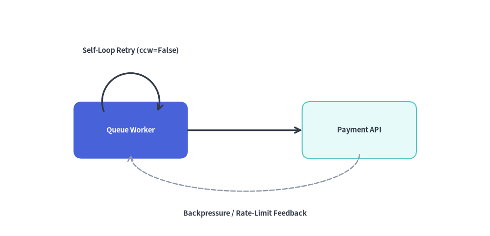
  <figcaption class="drawlib-caption">line_arc() によるセルフループ・リトライと楕円フィードバック円弧</figcaption>
</figure>


> [!NOTE]
> バウンディングボックスでの自動クリッピングやラベル配置を備えた自動直交ルーティングを行いたい場合は、高レベルコンポーネントである **[アーキテクチャ図](../06_diagrams/architecture.md)** または **[フロー図](../06_diagrams/flow.md)** の利用を検討してください。
