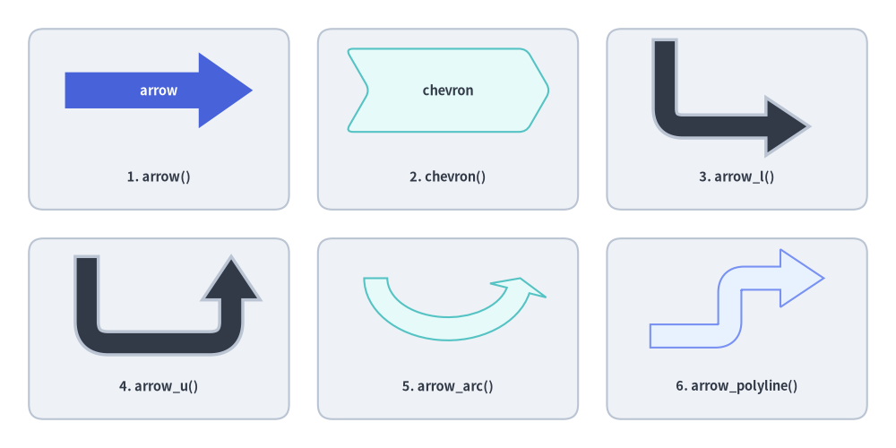
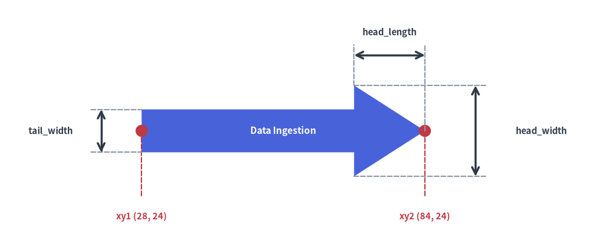
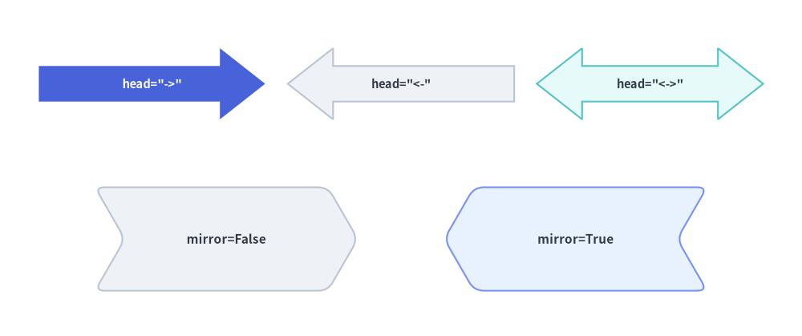
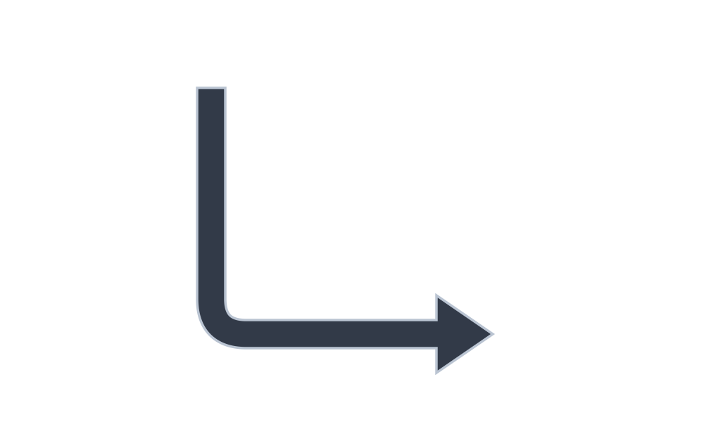
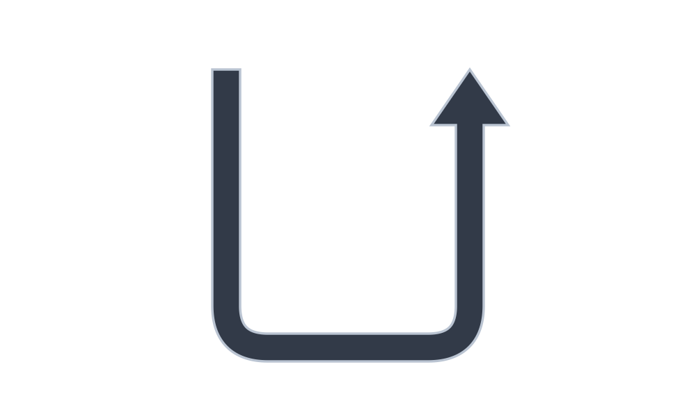
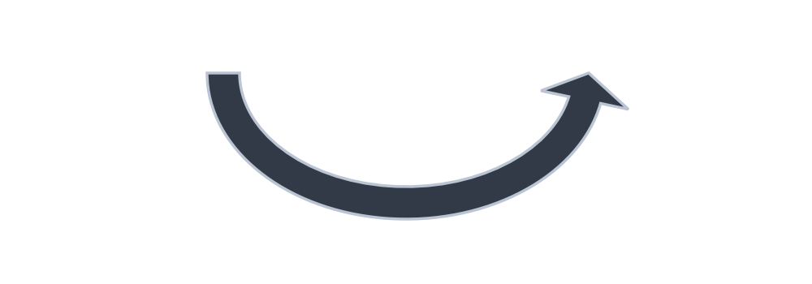
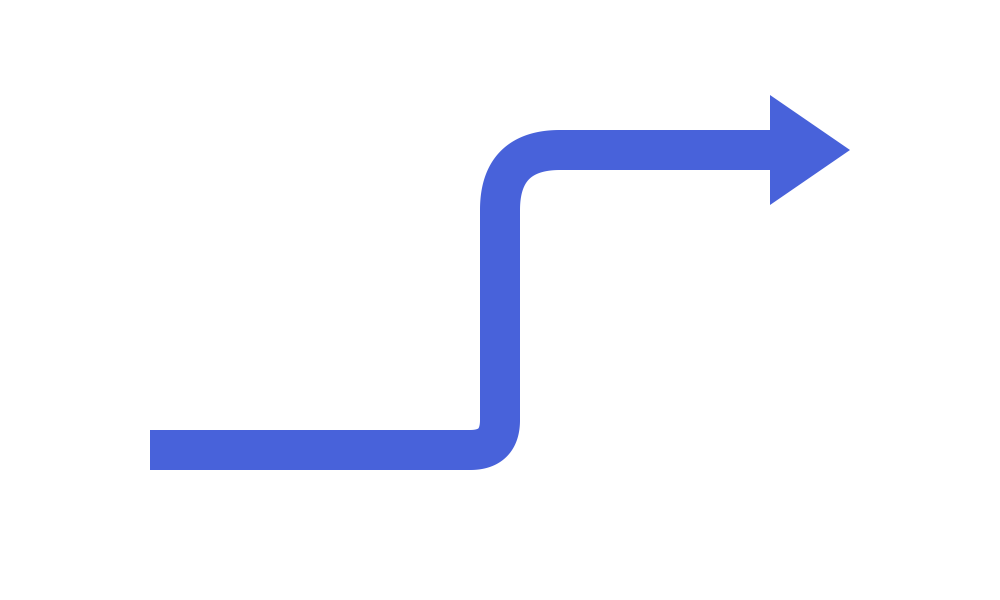

# ブロック矢印・シェブロン

1 次元の線コネクタ（`drawlib.lines`）に加え、`drawlib.shapes` の**ブロック矢印・シェブロン（Block Arrows & Chevrons）**カテゴリは、**6 種類の閉じた 2D 多角形矢印プリミティブ**を提供します。具体的には、2 点間を結ぶ直線ブロック矢印（`arrow`）、連続工程を表すプロセスシェブロン（`chevron`）、`90°` 直角に折れ曲がる L 字矢印（`arrow_l`）、`180°` 折り返す U ターンフィードバック矢印（`arrow_u`）、円弧・楕円弧の循環ブロック矢印（`arrow_arc`）、そして複数の経由点を通る折れ線ブロック矢印（`arrow_polyline`）が含まれます。


<figure class="drawlib-image" style="text-align: center;">
  
  <figcaption class="drawlib-caption">drawlib.shapes における 6 種類のブロック矢印・シェブロンプリミティブの概要</figcaption>
</figure>

<details class="drawlib-code-details">
<summary>Source Code</summary>

```python
from drawlib.canvas import save, setup
from drawlib.shapes import arrow, arrow_arc, arrow_l, arrow_polyline, arrow_u, chevron, rectangle
from drawlib.styles import Styles
from drawlib.text import text

setup(width=124, height=62)

# Subtle background cards for 3x2 grid
for cx in (22, 62, 102):
    for cy in (45.5, 16.5):
        rectangle((cx, cy), width=36, height=25, style=Styles.Neutral.patch(shape_r=2))

lbl = Styles.DarkBold.patch(text_size=10.5)

# 1. Straight Block Arrow (Hero)
arrow(
    (9, 49.5),
    (35, 49.5),
    tail_width=5.0,
    head_width=10.5,
    head_length=7.5,
    style=Styles.PrimaryFlat,
    text="arrow",
    text_style=Styles.WhiteBold.patch(text_size=10.5),
)
text((22, 37.5), "1. arrow()", style=lbl)

# 2. Chevron
chevron(
    (62, 49.5),
    width=25,
    height=11.5,
    corner_angle=60,
    style=Styles.SecondaryNeutral.patch(shape_r=1),
    text="chevron",
    text_style=Styles.DarkBold.patch(text_size=10.5),
)
text((62, 37.5), "2. chevron()", style=lbl)

# 3. L-shaped Arrow
arrow_l(
    (102, 50.5),
    width=20,
    height=12,
    tail_width=3.2,
    head_width=8,
    head_length=6,
    style=Styles.DarkBold.patch(shape_r=2.5),
)
text((102, 37.5), "3. arrow_l()", style=lbl)

# 4. U-turn Arrow
arrow_u(
    (22, 20.5),
    width=20,
    height=12,
    tail_width=3.2,
    head_width=8,
    head_length=6,
    style=Styles.DarkBold.patch(shape_r=3),
)
text((22, 8.5), "4. arrow_u()", style=lbl)

# 5. Arrow Arc (Circular flow)
arrow_arc(
    (62, 23.5),
    width=20,
    height=14,
    angle_start=180,
    angle_end=0,
    tail_width=3.2,
    head_width=8,
    head_angle=14,
    style=Styles.SecondaryNeutral,
)
text((62, 8.5), "5. arrow_arc()", style=lbl)

# 6. Multi-Point Polyline Arrow
arrow_polyline(
    [(90, 15.5), (101, 15.5), (101, 23.5), (114, 23.5)],
    tail_width=3.2,
    head_width=8,
    head_length=6,
    style=Styles.PrimaryNeutral.patch(shape_r=2),
)
text((102, 8.5), "6. arrow_polyline()", style=lbl)

save()
```

</details>


---

## 1. 基本となるジオメトリ概念

1 次元の線ストロークコネクタとは異なり、Drawlib の 6 種類のブロック矢印プリミティブは、明示的なシャフト幅（`tail_width`）と矢羽根の寸法（`head_width`、`head_length`、または `head_angle`）を持つ閉じた 2D 多角形を構築します。これにより、状態遷移やデータフロー自体に鮮やかな塗りつぶしや枠線、埋め込みラベルを持たせることができます。シャフトや矢印ヘッドのサイズ指定、向きの制御（`head`, `mirror`）、角丸フィレット（`shape_r`）、楕円弧の角度スイープ（`angle_start`..`angle_end`）、および多点経由ルーティング（`xys`）によって各プリミティブがどのように変化するかを以下のアニメーションで確認できます。


<figure class="drawlib-image" style="text-align: center;">
  
  <figcaption class="drawlib-caption">パラメータ・ジオメトリツアー: arrow, chevron, arrow_l, arrow_u, arrow_arc, arrow_polyline のライブ変形（APNG アニメーション）</figcaption>
</figure>

<details class="drawlib-code-details">
<summary>Source Code</summary>

```python
from __future__ import annotations

import math
from drawlib.anim import Animation
from drawlib.canvas import save, setup
from drawlib.icons import code as code_icons
from drawlib.icons import phosphor
from drawlib.lines import line
from drawlib.shapes import (
    arc,
    arrow,
    arrow_arc,
    arrow_l,
    arrow_polyline,
    arrow_u,
    chevron,
    circle,
    ellipse,
    rectangle,
)
from drawlib.smartarts import SourceCode, SourceCodeStyles
from drawlib.styles import Styles
from drawlib.text import text

W, H = 138.0, 82.0
setup(width=W, height=H)
anim = Animation(fps=10.0, loop=0)

CODE_TEXT_SIZE = 10.0
PT_TO_CANVAS = W / 720.0
FONT_CANVAS = CODE_TEXT_SIZE * PT_TO_CANVAS
LINE_H = FONT_CANVAS * 1.8
PAD_Y = FONT_CANVAS * 1.2

CODE_STYLES = SourceCodeStyles.get("default", font_lang="en", text_size=CODE_TEXT_SIZE).patch(
    box_style=Styles.Neutral.patch(shape_fill_color=(0, 0, 0, 0), shape_line_width=0),
)

PANE_HEADER = Styles.Neutral.patch(
    shape_fill_color=(238, 243, 250),
    shape_line_color=(203, 213, 225),
    shape_line_width=1.2,
    shape_r=0.0,
)
EDITOR_BODY = Styles.Neutral.patch(
    shape_fill_color=(250, 252, 255),
    shape_line_color=(203, 213, 225),
    shape_line_width=1.2,
    shape_r=0.0,
)
TAKEAWAY_BODY = Styles.Neutral.patch(
    shape_fill_color=(242, 246, 253),
    shape_line_color=(203, 213, 225),
    shape_line_width=1.2,
    shape_r=0.0,
)
STUDIO_BODY = Styles.Neutral.patch(
    shape_fill_color=(239, 243, 249),
    shape_line_color=(203, 213, 225),
    shape_line_width=1.2,
    shape_r=0.0,
)

PART_ITEMS = [
    ("1. arrow()", "shaft, head & dir"),
    ("2. chevron()", "angle, mirror & r"),
    ("3. arrow_l & arrow_u", "90° & 180° turns"),
    ("4. arc & polyline", "sweep & waypoints"),
]


def draw_step_bar(active_part: int) -> None:
    """Draw top 4-part progress bar (active_part is 1..4)."""
    pill_w = 31.0
    pill_h = 7.4
    gap = 2.0
    start_x = 4.0 + pill_w / 2.0
    cy = 75.2

    for idx, (label, sublabel) in enumerate(PART_ITEMS, start=1):
        cx = start_x + (idx - 1) * (pill_w + gap)
        if idx > 1:
            prev_cx = cx - (pill_w + gap)
            line(
                (prev_cx + pill_w / 2.0 + 0.2, cy),
                (cx - pill_w / 2.0 - 0.2, cy),
                style=Styles.PrimaryBold if idx <= active_part else Styles.MutedThin,
            )

        if idx == active_part:
            st = Styles.PrimaryFlat.patch(shape_r=1.4)
            tst = Styles.WhiteBold.patch(text_size=10.3)
            sub_tst = Styles.White.patch(text_size=9.5)
        elif idx < active_part:
            st = Styles.PrimaryNeutral.patch(shape_r=1.4, shape_line_width=1.1)
            tst = Styles.PrimaryBold.patch(text_size=10.3)
            sub_tst = Styles.Primary.patch(text_size=9.5)
        else:
            st = Styles.Neutral.patch(shape_r=1.4, shape_line_width=1.1)
            tst = Styles.MutedBold.patch(text_size=10.3)
            sub_tst = Styles.Muted.patch(text_size=9.5)

        rectangle((cx, cy), width=pill_w, height=pill_h, style=st)
        text((cx, cy + 1.35), label, style=tst)
        text((cx, cy - 1.55), sublabel, style=sub_tst)


def draw_left_pane(
    active_part: int,
    code_lines: list[str],
    hl_range: tuple[int, int],
    icon_fn: object,
    summary_title: str,
    summary_line1: str,
    summary_line2: str,
) -> None:
    """Draw left Python code editor + bottom geometric concept note."""
    x0, w = 4.0, 63.5
    cx = x0 + w / 2.0
    top_y = 63.2
    header_h = 5.4
    editor_h = 43.8
    takeaway_h = 15.8

    rectangle((cx, top_y + header_h / 2.0), width=w, height=header_h, style=PANE_HEADER)
    code_icons.python((x0 + 3.6, top_y + header_h / 2.0), width=3.4, style=Styles.Neutral)
    text(
        (x0 + 6.5, top_y + header_h / 2.0),
        "block_arrows.py",
        style=Styles.DarkBold.patch(text_size=10.2, halign="left"),
    )
    text(
        (x0 + w - 2.6, top_y + header_h / 2.0),
        f"Part {active_part} / 4",
        style=Styles.PrimaryBold.patch(text_size=9.8, halign="right"),
    )

    rectangle((cx, top_y - editor_h / 2.0), width=w, height=editor_h, style=EDITOR_BODY)

    hl_start, hl_end = hl_range
    hl_top = top_y - PAD_Y - hl_start * LINE_H
    hl_bot = top_y - PAD_Y - (hl_end + 1) * LINE_H
    hl_cy = (hl_top + hl_bot) / 2.0
    hl_h = hl_top - hl_bot
    rectangle(
        (cx, hl_cy),
        width=w - 0.6,
        height=hl_h,
        style=Styles.Neutral.patch(shape_fill_color=(229, 239, 255), shape_line_width=0),
    )
    rectangle(
        (x0 + 0.55, hl_cy),
        width=0.9,
        height=hl_h,
        style=Styles.PrimaryFlat.patch(shape_line_width=0),
    )

    SourceCode.draw(
        xy=(x0, top_y),
        width=w,
        code="\n".join(code_lines),
        styles=CODE_STYLES,
        code_lang="python",
        show_linenum=True,
        align="top_left",
    )

    take_cy = 3.6 + takeaway_h / 2.0
    rectangle((cx, take_cy), width=w, height=takeaway_h, style=TAKEAWAY_BODY)
    circle(
        (x0 + 6.4, take_cy),
        radius=3.3,
        style=Styles.PrimaryNeutral.patch(shape_line_width=1.2),
    )
    icon_fn((x0 + 6.4, take_cy), width=3.8, style=Styles.PrimaryBold)  # type: ignore[operator]
    text(
        (x0 + 11.4, take_cy + 3.6),
        summary_title,
        style=Styles.DarkBold.patch(text_size=10.4, halign="left"),
    )
    text(
        (x0 + 11.4, take_cy - 0.2),
        summary_line1,
        style=Styles.Dark.patch(text_size=9.7, halign="left"),
    )
    text(
        (x0 + 11.4, take_cy - 3.8),
        summary_line2,
        style=Styles.PrimaryBold.patch(text_size=9.6, halign="left"),
    )


def draw_geometry_studio(param_badge: str, footer_caption: str) -> tuple[float, float]:
    """Draw right geometry lab shell, inner coordinate sheet with subtle grid, and footer."""
    x0, w = 70.0, 64.0
    cx = x0 + w / 2.0
    top_y = 63.2
    header_h = 5.4
    body_h = 59.6

    rectangle((cx, top_y + header_h / 2.0), width=w, height=header_h, style=PANE_HEADER)
    phosphor.ruler((x0 + 3.6, top_y + header_h / 2.0), width=3.4, style=Styles.Primary)
    text(
        (x0 + 6.5, top_y + header_h / 2.0),
        "Live Geometry & Guides",
        style=Styles.DarkBold.patch(text_size=10.2, halign="left"),
    )
    text(
        (x0 + w - 2.6, top_y + header_h / 2.0),
        param_badge,
        style=Styles.PrimaryBold.patch(text_size=9.6, halign="right"),
    )

    rectangle((cx, 3.6 + body_h / 2.0), width=w, height=body_h, style=STUDIO_BODY)

    sheet_cx, sheet_cy = cx, 36.2
    sheet_w, sheet_h = 54.0, 40.0
    sx0, sy0 = sheet_cx - sheet_w / 2.0, sheet_cy - sheet_h / 2.0
    rectangle(
        (sheet_cx, sheet_cy),
        width=sheet_w,
        height=sheet_h,
        style=Styles.Neutral.patch(
            shape_fill_color=(255, 255, 255),
            shape_line_color=(180, 194, 214),
            shape_line_width=1.2,
        ),
    )
    g_st = Styles.MutedThin.patch(line_color=(232, 238, 246), line_width=0.8)
    for gx in range(1, 6):
        vx = sx0 + gx * (sheet_w / 6.0)
        line((vx, sy0), (vx, sy0 + sheet_h), style=g_st)
    for gy in range(1, 5):
        vy = sy0 + gy * (sheet_h / 5.0)
        line((sx0, vy), (sx0 + sheet_w, vy), style=g_st)

    rectangle(
        (cx, 8.4),
        width=59.2,
        height=5.2,
        style=Styles.Neutral.patch(
            shape_fill_color=(255, 255, 255),
            shape_line_color=(203, 213, 225),
            shape_line_width=1.1,
            shape_r=2.4,
        ),
        text=footer_caption,
        text_style=Styles.DarkBold.patch(text_size=9.8),
    )
    return sheet_cx, sheet_cy


# =========================================================================
# Part 1: arrow() — Shaft/Head Dimensions & Angled Bidirectional Label
# =========================================================================
for tw, hw, st_name, st_obj, dur in (
    (4.0, 9.5, "PrimaryNeutral", Styles.PrimaryNeutral, 3.2),
    (5.5, 11.8, "PrimaryFlat", Styles.PrimaryFlat, 0.50),
    (7.0, 14.0, "PrimaryFlat", Styles.PrimaryFlat, 3.4),
):
    code_a1 = [
        "from drawlib.shapes import arrow",
        "from drawlib.styles import Styles",
        "",
        "arrow(",
        "    (32, 30), (68, 30),",
        f"    tail_width={tw:.1f}, head_width={hw:.1f},",
        '    head_length=8.5, head="->",',
        f"    style=Styles.{st_name},",
        ")",
    ]
    with anim.frame(duration=dur):
        draw_step_bar(1)
        draw_left_pane(
            1,
            code_a1,
            (4, 6),
            phosphor.arrow_fat_lines_right,
            "Straight Block Arrow (arrow)",
            "Spans xy1 → xy2 as a closed 2D polygon",
            "tail_width & head_width size shaft and fin",
        )
        scx, scy = draw_geometry_studio(
            f"tail={tw:.1f}, head={hw:.1f}",
            f"xy1 → xy2  •  tail_width={tw:.1f}, head_width={hw:.1f}",
        )
        cy_a = scy - 0.4
        x1, x2 = scx - 18.0, scx + 11.5
        hl = 8.5

        arrow((x1, cy_a), (x2, cy_a), tail_width=tw, head_width=hw, head_length=hl, head="->", style=st_obj)

        # Endpoint markers for xy1 and xy2
        for px, lbl in ((x1, "xy1"), (x2, "xy2")):
            line((px, cy_a), (px, cy_a - 10.6), style=Styles.DangerDashed.patch(line_width=1.1))
            circle((px, cy_a), radius=1.15, style=Styles.DangerFlat)
            text((px, cy_a - 13.0), lbl, style=Styles.DangerBold.patch(text_size=9.6))

        # Dimension: tail_width on left
        line((x1 - 3.6, cy_a - tw / 2.0), (x1, cy_a - tw / 2.0), style=Styles.MutedDashed.patch(line_width=1.0))
        line((x1 - 3.6, cy_a + tw / 2.0), (x1, cy_a + tw / 2.0), style=Styles.MutedDashed.patch(line_width=1.0))
        line((x1 - 2.6, cy_a - tw / 2.0), (x1 - 2.6, cy_a + tw / 2.0), arrow_head="<->", style=Styles.PrimaryBold.patch(line_width=1.4))
        text((x1 - 1.5, cy_a + hw / 2.0 + 3.2), f"tail={tw:.1f}", style=Styles.PrimaryBold.patch(text_size=9.5))

        # Dimension: head_length above arrowhead
        line((x2 - hl, cy_a + hw / 2.0), (x2 - hl, cy_a + hw / 2.0 + 3.8), style=Styles.MutedDashed.patch(line_width=1.0))
        line((x2, cy_a), (x2, cy_a + hw / 2.0 + 3.8), style=Styles.MutedDashed.patch(line_width=1.0))
        line((x2 - hl, cy_a + hw / 2.0 + 2.8), (x2, cy_a + hw / 2.0 + 2.8), arrow_head="<->", style=Styles.DarkBold.patch(line_width=1.3))
        text((x2 - hl / 2.0, cy_a + hw / 2.0 + 6.0), "head_length=8.5", style=Styles.DarkBold.patch(text_size=9.5))

        # Dimension: head_width on right
        line((x2 - hl, cy_a - hw / 2.0), (x2 + 3.8, cy_a - hw / 2.0), style=Styles.MutedDashed.patch(line_width=1.0))
        line((x2 - hl, cy_a + hw / 2.0), (x2 + 3.8, cy_a + hw / 2.0), style=Styles.MutedDashed.patch(line_width=1.0))
        line((x2 + 2.8, cy_a - hw / 2.0), (x2 + 2.8, cy_a + hw / 2.0), arrow_head="<->", style=Styles.PrimaryBold.patch(line_width=1.4))
        text((x2 + 4.3, cy_a), f"head\n{hw:.1f}", style=Styles.PrimaryBold.patch(text_size=9.5, halign="left"))

# 1C: Angled bidirectional head="<->" with auto-rotated text="Data Bus"
with anim.frame(duration=3.5):
    code_a2 = [
        "from drawlib.shapes import arrow",
        "from drawlib.styles import Styles",
        "",
        "arrow(",
        "    (32, 23), (68, 37),",
        "    tail_width=6.2, head_width=12.5,",
        '    head_length=7.5, head="<->",',
        "    style=Styles.PrimaryFlat,",
        '    text="Data Bus",',
        "    text_style=Styles.WhiteBold,",
        ")",
    ]
    draw_step_bar(1)
    draw_left_pane(
        1,
        code_a2,
        (6, 9),
        phosphor.arrows_left_right,
        "Bidirectional & Rotated Text",
        "head='<->' places symmetric fins on both ends",
        "Inline text auto-rotates along shaft angle",
    )
    scx, scy = draw_geometry_studio('head = "<->"', 'Angled head="<->"  •  Auto-Rotated Label (+21°)')
    p1 = (scx - 18.0, scy - 7.0)
    p2 = (scx + 18.0, scy + 7.0)
    line((p1[0], p1[1]), (p1[0] + 22.0, p1[1]), style=Styles.MutedDashed.patch(line_width=1.1))
    arc((p1[0], p1[1]), width=28.0, height=28.0, angle_start=0, angle_end=21.2, style=Styles.PrimaryNeutral.patch(shape_line_width=1.8))
    text((p1[0] + 17.5, p1[1] + 2.8), "+21°", style=Styles.PrimaryBold.patch(text_size=9.5, halign="left"))

    arrow(
        p1,
        p2,
        tail_width=6.2,
        head_width=12.5,
        head_length=7.5,
        head="<->",
        style=Styles.PrimaryFlat,
        text="Data Bus",
        text_style=Styles.WhiteBold.patch(text_size=10.5),
    )
    circle(p1, radius=1.2, style=Styles.DangerFlat)
    text((p1[0], p1[1] - 4.2), "xy1", style=Styles.DangerBold.patch(text_size=9.6))
    circle(p2, radius=1.2, style=Styles.DangerFlat)
    text((p2[0], p2[1] + 4.4), "xy2", style=Styles.DangerBold.patch(text_size=9.6))


# =========================================================================
# Part 2: chevron() — corner_angle Morphing & mirror=True + shape_r
# =========================================================================
for c_ang, dur in ((78, 3.2), (65, 0.50), (52, 3.4)):
    code_ch1 = [
        "from drawlib.shapes import chevron",
        "from drawlib.styles import Styles",
        "",
        "chevron(",
        "    (50, 30), width=28, height=16,",
        f"    corner_angle={c_ang},",
        "    mirror=False,",
        "    style=Styles.SecondaryNeutral,",
        ")",
    ]
    with anim.frame(duration=dur):
        draw_step_bar(2)
        draw_left_pane(
            2,
            code_ch1,
            (5, 6),
            phosphor.caret_double_right,
            "Process Chevron (corner_angle)",
            "Lower corner_angle deepens V-tip & rear notch",
            "Centered at xy when using preset Styles.*",
        )
        scx, scy = draw_geometry_studio(
            f"corner_angle = {c_ang}°",
            f"chevron(corner_angle={c_ang})  •  V-Tip & Notch Slope",
        )
        cy_c = scy - 0.4
        if c_ang < 78:
            chevron(
                (scx, cy_c),
                width=28.0,
                height=16.0,
                corner_angle=78,
                mirror=False,
                style=Styles.MutedDashed.patch(
                    shape_fill_color=(0, 0, 0, 0),
                    shape_line_color=(182, 196, 216),
                    shape_line_width=1.1,
                ),
            )
        chevron(
            (scx, cy_c),
            width=28.0,
            height=16.0,
            corner_angle=c_ang,
            mirror=False,
            style=Styles.SecondaryNeutral,
        )
        circle((scx, cy_c), radius=1.2, style=Styles.DangerFlat)
        text((scx, cy_c - 3.6), "xy (center)", style=Styles.DangerBold.patch(text_size=9.6))
        text((scx, cy_c + 12.2), f"corner_angle = {c_ang}°  (Flow +X →)", style=Styles.PrimaryBold.patch(text_size=9.8))
        if c_ang == 52:
            text((scx, cy_c - 12.2), "Dashed = Previous 78° Profile", style=Styles.MutedBold.patch(text_size=9.5))

with anim.frame(duration=3.5):
    code_ch2 = [
        "from drawlib.shapes import chevron",
        "from drawlib.styles import Styles",
        "",
        "chevron(",
        "    (50, 30), width=28, height=16,",
        "    corner_angle=56, mirror=True,",
        "    style=Styles.PrimaryNeutral.patch(",
        "        shape_r=2.0,",
        "    ),",
        '    text="Reverse",',
        ")",
    ]
    draw_step_bar(2)
    draw_left_pane(
        2,
        code_ch2,
        (5, 8),
        phosphor.caret_double_right,
        "Rounded & Mirrored Chevron",
        "mirror=True flips direction horizontally (-X)",
        "shape_r rounds all 6 vertices (or 6-tuple)",
    )
    scx, scy = draw_geometry_studio("mirror=True, r=2.0", "mirror=True (Points -X)  •  Rounded shape_r=2.0")
    cy_c = scy - 0.6
    chevron(
        (scx, cy_c),
        width=28.0,
        height=16.0,
        corner_angle=56,
        mirror=True,
        style=Styles.PrimaryNeutral.patch(shape_r=2.0),
        text="Reverse",
        text_style=Styles.DarkBold.patch(text_size=10.5),
    )
    line((scx + 12.0, cy_c + 12.0), (scx - 12.0, cy_c + 12.0), arrow_head="->", style=Styles.PrimaryBold.patch(line_width=1.5))
    text((scx, cy_c + 15.2), "← Flipped Toward -X (mirror=True)", style=Styles.PrimaryBold.patch(text_size=9.6))
    text((scx, cy_c - 12.2), "shape_r = 2.0  (6 Filleted Vertices)", style=Styles.DarkBold.patch(text_size=9.6))


# =========================================================================
# Part 3: arrow_l & arrow_u — 90° Elbow & 180° U-Turn Fillets (shape_r)
# =========================================================================
for r_l, dur in ((0.0, 0.55), (2.5, 0.45), (5.0, 3.5)):
    r_txt = f"{r_l:g}"
    code_l = [
        "from drawlib.shapes import arrow_l",
        "from drawlib.styles import Styles",
        "",
        "arrow_l(",
        "    (50, 30), width=28, height=21,",
        "    tail_width=4.6, head_width=10.5,",
        '    head_length=7.0, head="<->",',
        "    style=Styles.PrimaryNeutral.patch(",
        f"        shape_r={r_txt}, angle=0,",
        "    ),",
        ")",
    ]
    with anim.frame(duration=dur):
        draw_step_bar(3)
        draw_left_pane(
            3,
            code_l,
            (6, 8),
            phosphor.arrow_elbow_right,
            "90° Corner Turn (arrow_l)",
            "Centered in (width, height); angle rotates L",
            "shape_r fillets the 90° elbow smoothly",
        )
        scx, scy = draw_geometry_studio(
            f"shape_r = {r_txt}",
            f'arrow_l(head="<->", shape_r={r_txt})  •  90° Elbow Fillet',
        )
        cy_l = scy + 2.2
        w_l, h_l = 28.0, 21.0
        rectangle(
            (scx, cy_l),
            width=w_l,
            height=h_l,
            style=Styles.MutedDashed.patch(
                shape_fill_color=(0, 0, 0, 0),
                shape_line_color=(188, 200, 218),
                shape_line_width=1.0,
            ),
        )
        arrow_l(
            (scx, cy_l),
            width=w_l,
            height=h_l,
            tail_width=4.6,
            head_width=10.5,
            head_length=7.0,
            head="<->",
            style=Styles.PrimaryNeutral.patch(shape_r=r_l, angle=0),
        )
        circle((scx, cy_l), radius=1.2, style=Styles.DangerFlat)
        text((scx + 2.2, cy_l + 2.4), "xy (center)", style=Styles.DangerBold.patch(text_size=9.6, halign="left"))
        if r_l >= 5.0:
            text(
                (scx - 4.0, cy_l - h_l / 2.0 - 7.8),
                "Filleted 90° Elbow (r = 5)",
                style=Styles.PrimaryBold.patch(text_size=9.6),
            )

for r_u, dur in ((0.0, 0.55), (3.0, 0.45), (6.0, 3.5)):
    r_utxt = f"{r_u:g}"
    code_u = [
        "from drawlib.shapes import arrow_u",
        "from drawlib.styles import Styles",
        "",
        "arrow_u(",
        "    (50, 30), width=24, height=21,",
        "    tail_width=4.6, head_width=10.5,",
        '    head_length=7.0, head="->",',
        "    style=Styles.PrimaryFlat.patch(",
        f"        shape_r={r_utxt},",
        "    ),",
        ")",
    ]
    with anim.frame(duration=dur):
        draw_step_bar(3)
        draw_left_pane(
            3,
            code_u,
            (7, 8),
            phosphor.arrow_u_up_left,
            "180° U-Turn Channel (arrow_u)",
            "Centered at xy for retry & loopback flows",
            "shape_r (float or 2-tuple) rounds U-bends",
        )
        scx, scy = draw_geometry_studio(
            f"shape_r = {r_utxt}",
            f"arrow_u(shape_r={r_utxt})  •  Smooth 180° Loopback Turn",
        )
        cy_u = scy + 1.2
        w_u, h_u = 24.0, 21.0
        rectangle(
            (scx, cy_u),
            width=w_u,
            height=h_u,
            style=Styles.MutedDashed.patch(
                shape_fill_color=(0, 0, 0, 0),
                shape_line_color=(188, 200, 218),
                shape_line_width=1.0,
            ),
        )
        arrow_u(
            (scx, cy_u),
            width=w_u,
            height=h_u,
            tail_width=4.6,
            head_width=10.5,
            head_length=7.0,
            head="->",
            style=Styles.PrimaryFlat.patch(shape_r=r_u),
        )
        circle((scx, cy_u), radius=1.2, style=Styles.DangerFlat)
        text((scx, cy_u + 3.4), "xy (center)", style=Styles.DangerBold.patch(text_size=9.6))
        if r_u >= 6.0:
            text(
                (scx, cy_u - h_u / 2.0 - 5.4),
                "Smooth 180° U-Bend Fillets (shape_r = 6)",
                style=Styles.PrimaryBold.patch(text_size=9.6),
            )


# =========================================================================
# Part 4: arrow_arc & arrow_polyline — Elliptical Sweep & Waypoint Routing
# =========================================================================
for a_end, dur in ((95, 0.55), (55, 0.45), (15, 3.5)):
    code_arc = [
        "from drawlib.shapes import arrow_arc",
        "from drawlib.styles import Styles",
        "",
        "arrow_arc(",
        "    (50, 32), width=34, height=21,",
        "    tail_width=3.8, head_width=8.6,",
        '    head_angle=14, head="->",',
        f"    angle_start=200, angle_end={a_end},",
        "    style=Styles.SecondaryNeutral,",
        ")",
    ]
    with anim.frame(duration=dur):
        draw_step_bar(4)
        draw_left_pane(
            4,
            code_arc,
            (6, 7),
            phosphor.arrows_clockwise,
            "Elliptical Orbit Arc (arrow_arc)",
            "Sweeps CCW from angle_start to angle_end",
            "head_angle sets angular fin span in degrees",
        )
        scx, scy = draw_geometry_studio(
            f"200° → {a_end}°",
            f"Elliptical CCW Sweep: 200° → {a_end}° (head_angle=14°)",
        )
        cy_arc = scy + 1.2
        w_arc, h_arc = 34.0, 21.0
        rx, ry = w_arc / 2.0, h_arc / 2.0

        ellipse(
            (scx, cy_arc),
            width=w_arc,
            height=h_arc,
            style=Styles.MutedDashed.patch(
                shape_fill_color=(0, 0, 0, 0),
                shape_line_color=(185, 198, 218),
                shape_line_width=1.0,
            ),
        )
        # Polar start/end rays from center xy
        for deg, ray_st in ((200, Styles.MutedDashed), (a_end, Styles.PrimaryDashed)):
            rad = math.radians(deg)
            px, py = scx + rx * math.cos(rad), cy_arc + ry * math.sin(rad)
            line((scx, cy_arc), (px, py), style=ray_st.patch(line_width=1.2))

        arrow_arc(
            (scx, cy_arc),
            width=w_arc,
            height=h_arc,
            tail_width=3.8,
            head_width=8.6,
            head_angle=14,
            head="->",
            angle_start=200,
            angle_end=a_end,
            style=Styles.SecondaryNeutral,
        )
        circle((scx, cy_arc), radius=1.2, style=Styles.DangerFlat)
        text((scx + 2.0, cy_arc - 2.6), "xy", style=Styles.DangerBold.patch(text_size=9.6, halign="left"))

        s_rad = math.radians(200)
        circle((scx + rx * math.cos(s_rad), cy_arc + ry * math.sin(s_rad)), radius=1.15, style=Styles.DarkBold)
        text((scx - 16.5, cy_arc + 4.0), "start=200°", style=Styles.DarkBold.patch(text_size=9.5))
        if a_end == 15:
            e_rad = math.radians(15)
            circle((scx + rx * math.cos(e_rad), cy_arc + ry * math.sin(e_rad)), radius=1.15, style=Styles.PrimaryFlat)
            text((scx + 14.5, cy_arc + 8.6), "end=15°", style=Styles.PrimaryBold.patch(text_size=9.6))
            text((scx, cy_arc - 15.8), "CCW Orbit Sweep →", style=Styles.PrimaryBold.patch(text_size=9.6))

for r_poly, dur in ((0.0, 0.55), (3.5, 3.6)):
    r_ptxt = f"{r_poly:g}"
    code_poly = [
        "from drawlib.shapes import arrow_polyline",
        "from drawlib.styles import Styles",
        "xys = [(18, 22), (38, 22),",
        "       (38, 38), (60, 38)]",
        "arrow_polyline(",
        "    xys, tail_width=4.2, head_width=9.8,",
        '    head_length=7.0, head="->",',
        "    style=Styles.PrimaryFlat.patch(",
        f"        shape_r={r_ptxt},",
        "    ),",
        ")",
    ]
    with anim.frame(duration=dur):
        draw_step_bar(4)
        draw_left_pane(
            4,
            code_poly,
            (2, 8),
            phosphor.path,
            "Multi-Waypoint Route (arrow_polyline)",
            "Routes 2D shaft across arbitrary xys list",
            "shape_r fillets each interior bend joint",
        )
        scx, scy = draw_geometry_studio(
            f"4 pts, r = {r_ptxt}",
            f"4 Waypoints xys[0..3]  •  Filleted Bends (r={r_ptxt})",
        )
        pts = [
            (scx - 19.0, scy - 8.0),
            (scx - 1.0, scy - 8.0),
            (scx - 1.0, scy + 8.0),
            (scx + 19.0, scy + 8.0),
        ]
        arrow_polyline(
            pts,
            tail_width=4.2,
            head_width=9.8,
            head_length=7.0,
            head="->",
            style=Styles.PrimaryFlat.patch(shape_r=r_poly),
        )
        # Overlay waypoint skeleton & markers
        for idx_seg in range(len(pts) - 1):
            line(pts[idx_seg], pts[idx_seg + 1], style=Styles.MutedDashed.patch(line_color=(255, 255, 255), line_width=1.1))
        for wp in pts:
            circle(wp, radius=1.2, style=Styles.DangerFlat)

        text((pts[0][0], pts[0][1] - 5.0), "xys[0]", style=Styles.DangerBold.patch(text_size=9.5))
        text((pts[1][0] + 4.0, pts[1][1] - 4.2), f"xys[1] (r={r_ptxt})", style=Styles.PrimaryBold.patch(text_size=9.5, halign="left"))
        text((pts[2][0] - 4.0, pts[2][1] + 4.2), f"xys[2] (r={r_ptxt})", style=Styles.PrimaryBold.patch(text_size=9.5, halign="right"))
        text((pts[3][0], pts[3][1] + 6.4), "xys[3]", style=Styles.DangerBold.patch(text_size=9.5))

save()
```

</details>


- **シャフト・矢羽根・端点ジオメトリ (`arrow`)**: `xy1` → `xy2` 間を結び、`tail_width`、`head_width`、`head_length`、`head`（`"->"`, `"<-"`, `"<->"`）、およびシャフト角度に沿って自動回転する埋め込み `text` を備えています。
- **V 字ノッチ付きステージバナー (`chevron`)**: `corner_angle`（`0°`〜`90°`）で先端および背面ノッチの鋭さを調整でき、`shape_r` で全 6 頂点の角丸化、`mirror=True` で `-X` 方向への反転が可能です。
- **直交 `90°`・`180°` ターン (`arrow_l`, `arrow_u`)**: `(width, height)` 内の中心 `xy` を基準とし、屈曲部・折り返し部の滑らかな角丸（`shape_r`）や象限単位の回転（`style.angle`）に対応します。
- **楕円弧スイープと経由点ルーティング (`arrow_arc`, `arrow_polyline`)**: `arrow_arc` は `+X` 基準で `angle_start` から `angle_end` まで反時計回りに伸び、`arrow_polyline` は任意の `xys` 経由点リストをマイター結合または角丸（`shape_r`）関節で結びます。

---

## 2. ブロック矢印プリミティブの比較早見表

全 6 種類のブロック矢印プリミティブにおける基準座標、向き制御、角丸対応、および埋め込みテキスト対応を以下の表にまとめます。

| 関数 | 基準座標（アンカー） | 向きの制御 | 角丸 (`style.shape_r`) | 埋め込み `text` 対応 |
| :--- | :--- | :--- | :--- | :--- |
| **`arrow`** | `xy1`（始点）→ `xy2`（先端） | `head`: `"->"`, `"<-"`, `"<->"` | — | **対応**（シャフトに沿って自動回転） |
| **`chevron`** | 中心 `xy` (`width`, `height`) | `mirror=False \| True`, `style.angle` | スカラー `float` または 6 要素タプル | **対応**（シェブロン中央に配置） |
| **`arrow_l`** | 中心 `xy` (`width`, `height`) | `head`: `"->"`, `"<-"`, `"<->"`, `style.angle` | スカラー `float` または 1 要素タプル（屈曲部） | **非対応**（スタンドアロンの `text()` を使用） |
| **`arrow_u`** | 中心 `xy` (`width`, `height`) | `head`: `"->"`, `"<-"`, `"<->"`, `style.angle` | スカラー `float` または 2 要素タプル `(r1, r2)` | **非対応**（スタンドアロンの `text()` を使用） |
| **`arrow_arc`** | 中心 `xy` (`width`, `height`) | `angle_start`, `angle_end`, `head`, `style.angle` | —（滑らかな楕円弧） | **非対応**（スタンドアロンの `text()` を使用） |
| **`arrow_polyline`** | 経由点 `xys=[(x1,y1), ...]` | `head`: `"->"`, `"<-"`, `"<->"` | スカラー `float` または `(len(xys)-2)` 要素タプル | **非対応**（スタンドアロンの `text()` を使用） |

> [!TIP]
> **ブロック矢印と `drawlib.lines`・`ChevronProcess` の使い分け**:
> - 遷移そのものを視覚的なコンテナとして強調したい場合（例: `"ETL Stream"` のようなラベルを内包する太いデータバス、目立つステージ間遷移、力強い循環矢印など）には、**ブロック矢印 (`drawlib.shapes`)** を使用します。
> - コンポーネントカード間を結ぶ細いポイントツーポイントのネットワーク/API 接続線には、**[線とコネクタ (`drawlib.lines`)](./lines.md)** を使用します。
> - 自動間隔調整・説明文・テーマカラーの交互配色を備えた多段階の水平パイプラインを構築する場合には、**[`ChevronProcess` (`drawlib.smartarts`)](../04_smartarts/chevron_process.md)** を使用します。

---

## 3. 直線ブロック矢印 (`arrow`)

`arrow` は任意の 2 座標 `xy1` と `xy2` の間に有向 2D ブロック矢印を描画します。シャフトの角度は自動計算され、埋め込まれた `text` もシャフトの向きに合わせて自動的に回転します。

```python
arrow(
    xy1: tuple[float, float],
    xy2: tuple[float, float],
    tail_width: float,
    head_width: float,
    head_length: float,
    head: Literal["->", "<-", "<->"] = "->",
    *,
    style: Style,
    text: str = "",
    text_style: Style | None = None,
) -> None
```

| パラメータ | 型 | デフォルト | 説明 |
| :--- | :--- | :--- | :--- |
| `xy1` | `tuple[float, float]` | *必須* | 矢印始点（テール）端の中心座標 `(x1, y1)`（`head="<-"` または `"<->"` の場合は逆向き矢印ヘッドの先端座標）。 |
| `xy2` | `tuple[float, float]` | *必須* | 順方向矢印ヘッドの先端座標 `(x2, y2)`。 |
| `tail_width` | `float` | *必須* | 矩形シャフトの太さ（横断幅、`> 0`）。 |
| `head_width` | `float` | *必須* | 矢印ヘッド底辺の全幅（`> tail_width`）。 |
| `head_length` | `float` | *必須* | 矢印ヘッドの底辺から先端までの軸方向の長さ（`> 0`）。2 点間の距離 `distance(xy1, xy2)` より短くする必要があります。 |
| `head` | `Literal["->", "<-", "<->"]` | `"->"` | 矢印ヘッドの向き。`xy2` 側の順方向（`"->"`）、`xy1` 側の逆方向（`"<-"`）、または両端の双方向（`"<->"`）。 |
| `style` | `Style` | *必須* | 図形の塗りつぶし（`shape_fill_color`）および枠線（`shape_line_color`, `shape_line_width`, `shape_line_style`）。 |
| `text` / `text_style` | `str` / `Style \| None` | `""` / `None` | `xy1` と `xy2` の中点に配置され、シャフトに沿って自動回転する埋め込みラベル。 |


```python
from drawlib.canvas import save, setup
from drawlib.lines import line
from drawlib.shapes import arrow, circle
from drawlib.styles import Styles
from drawlib.text import text

setup(width=120, height=50)

# Primary straight block arrow from xy1=(28, 24) to xy2=(84, 24)
arrow(
    (28, 24),
    (84, 24),
    tail_width=8.5,
    head_width=18,
    head_length=14,
    head="->",  # "->", "<-", or "<->"
    style=Styles.PrimaryFlat,
    text="Data Ingestion",
    text_style=Styles.WhiteBold.patch(text_size=11.0),
)

# Endpoint markers for xy1 and xy2
circle((28, 24), radius=1.2, style=Styles.DangerFlat)
line((28, 24), (28, 11), style=Styles.DangerDashed)
text((28, 7.0), "xy1 (28, 24)", style=Styles.DangerBold.patch(text_size=10.5))

circle((84, 24), radius=1.2, style=Styles.DangerFlat)
line((84, 24), (84, 11), style=Styles.DangerDashed)
text((84, 7.0), "xy2 (84, 24)", style=Styles.DangerBold.patch(text_size=10.5))

# Dimension: tail_width (shaft y = 19.75..28.25)
line((18, 19.75), (28, 19.75), style=Styles.MutedDashed)
line((18, 28.25), (28, 28.25), style=Styles.MutedDashed)
line((20, 19.75), (20, 28.25), arrow_head="<->", style=Styles.DarkBold)
text((10, 24), "tail_width", style=Styles.DarkBold.patch(text_size=10.5))

# Dimension: head_length (x = 70..84)
line((70, 33), (70, 41), style=Styles.MutedDashed)
line((84, 24), (84, 41), style=Styles.MutedDashed)
line((70, 39), (84, 39), arrow_head="<->", style=Styles.DarkBold)
text((77, 43.5), "head_length", style=Styles.DarkBold.patch(text_size=10.5))

# Dimension: head_width (arrowhead base y = 15..33)
line((70, 15), (96, 15), style=Styles.MutedDashed)
line((70, 33), (96, 33), style=Styles.MutedDashed)
line((94, 15), (94, 33), arrow_head="<->", style=Styles.DarkBold)
text((107, 24), "head_width", style=Styles.DarkBold.patch(text_size=10.5))

save()
```

<figure class="drawlib-image" style="text-align: center;">
  
  <figcaption class="drawlib-caption">直線ブロック矢印の各部寸法構造</figcaption>
</figure>


---

## 4. プロセスシェブロン (`chevron`) と向きの反転 (`head`, `mirror`)

`chevron` は、背面に V 字の切り込みを持ち前後に噛み合う 6 頂点の矢羽根型ブロックを描画します。連続する工程・ステージ図に最適です。

```python
chevron(
    xy: tuple[float, float],
    width: float,
    height: float,
    corner_angle: float,
    mirror: bool = False,
    *,
    style: Style,
    text: str = "",
    text_style: Style | None = None,
) -> None
```

| パラメータ | 型 | デフォルト | 説明 |
| :--- | :--- | :--- | :--- |
| `xy` | `tuple[float, float]` | *必須* | 基準座標 `(x, y)`（プリセットの `Styles.*` 使用時は中心基準）。 |
| `width` / `height` | `float` | *必須* | 本体の水平幅および垂直高さ（`> 0`）。 |
| `corner_angle` | `float` | *必須* | 先端および背面 V 字ノッチの傾斜角度（度数法、`0 < corner_angle < 90`、一般的には `55`〜`70`）。 |
| `mirror` | `bool` | `False` | `True` の場合、シェブロンを水平方向に反転させて左向き（`-X`）にします。 |
| `style` | `Style` | *必須* | 塗りつぶし、枠線、回転角（`style.angle`）、および頂点の角丸（`style.shape_r` にスカラー `float` または頂点ごとの 6 要素タプルを指定）。 |
| `text` / `text_style` | `str` / `Style \| None` | `""` / `None` | 中央配置されるテキストラベルおよび任意のタイポグラフィ上書きスタイル。 |


```python
from drawlib.canvas import save, setup
from drawlib.shapes import chevron
from drawlib.styles import Styles

setup(width=100, height=36)
chevron(
    (50, 18),
    width=42,
    height=20,
    corner_angle=60,  # Tip acute angle
    style=Styles.PrimaryFlat.patch(shape_r=1.5),
    text="Stage 1",
    text_style=Styles.WhiteBold.patch(text_size=12.0),
)
save()
```

<figure class="drawlib-image" style="text-align: center;">
  
  <figcaption class="drawlib-caption">角丸を施したプロセスシェブロン</figcaption>
</figure>


### 矢印ヘッドの向き (`head`) と反転シェブロン (`mirror=True`)

向きを持つ 5 種類のブロック矢印（`arrow`, `arrow_l`, `arrow_u`, `arrow_arc`, `arrow_polyline`）はすべて `head="->"`、`head="<-"`、`head="<->"` をサポートしており、`chevron()` は `mirror=True` による水平方向の反転をサポートしています。


```python
from drawlib.canvas import save, setup
from drawlib.shapes import arrow, chevron
from drawlib.styles import Styles

setup(width=124, height=52)

# Top row: head="->", head="<-", head="<->"
arrow(
    (6, 39),
    (41, 39),
    tail_width=5.5,
    head_width=11,
    head_length=7,
    head="->",
    style=Styles.PrimaryFlat,
    text='head="->"',
    text_style=Styles.WhiteBold.patch(text_size=10.5),
)
arrow(
    (44.5, 39),
    (79.5, 39),
    tail_width=5.5,
    head_width=11,
    head_length=7,
    head="<-",
    style=Styles.Neutral,
    text='head="<-"',
    text_style=Styles.DarkBold.patch(text_size=10.5),
)
arrow(
    (83, 39),
    (118, 39),
    tail_width=5.5,
    head_width=11,
    head_length=7,
    head="<->",
    style=Styles.SecondaryNeutral,
    text='head="<->"',
    text_style=Styles.DarkBold.patch(text_size=10.5),
)

# Bottom row: Standard chevron (mirror=False) vs Mirrored chevron (mirror=True)
chevron(
    (35, 15),
    width=36,
    height=16,
    corner_angle=60,
    mirror=False,
    style=Styles.Neutral.patch(shape_r=1.5),
    text="mirror=False",
    text_style=Styles.DarkBold.patch(text_size=11.0),
)
chevron(
    (89, 15),
    width=36,
    height=16,
    corner_angle=60,
    mirror=True,
    style=Styles.PrimaryNeutral.patch(shape_r=1.5),
    text="mirror=True",
    text_style=Styles.DarkBold.patch(text_size=11.0),
)

save()
```

<figure class="drawlib-image" style="text-align: center;">
  
  <figcaption class="drawlib-caption">矢印ヘッドの向き (head='->', '<-', '<->') と反転シェブロン (mirror=True)</figcaption>
</figure>


---

## 5. 直交折れ曲がりブロック矢印 (`arrow_l`, `arrow_u`)

> [!NOTE]
> `arrow_l()` および `arrow_u()` は `text` や `text_style` を**受け取りません**。屈曲部（エルボー）やシャフト付近にラベルを配置する場合は、スタンドアロンの `drawlib.text.text()` を使用してください。

### 5.1. L 字コーナー矢印 (`arrow_l`)
バウンディングボックス `(width, height)` の中心 `xy` を基準とする `90°` 直角のブロック矢印を描画します。デフォルト（`angle=0`）では、始点（テール）が左上から始まり、左下で右方向へ折れ曲がって右下へ向かいます。任意の象限に向きを変えるには `style.patch(angle=90 | 180 | 270)` を使用します。

```python
arrow_l(
    xy: tuple[float, float],
    width: float,
    height: float,
    tail_width: float,
    head_width: float,
    head_length: float,
    head: Literal["->", "<-", "<->"] = "->",
    *,
    style: Style,
) -> None
```

| パラメータ | 型 | デフォルト | 説明 |
| :--- | :--- | :--- | :--- |
| `xy` | `tuple[float, float]` | *必須* | L 字矢印のバウンディングボックスの中心座標 `(x, y)`。 |
| `width` / `height` | `float` | *必須* | バウンディングボックスの水平幅および垂直高さ（`> 0`）。 |
| `tail_width` | `float` | *必須* | シャフトの幅（`> 0`）。 |
| `head_width` / `head_length` | `float` | *必須* | 矢印ヘッド底辺の幅および軸方向の長さ（`> 0`）。 |
| `head` | `Literal["->", "<-", "<->"]` | `"->"` | 矢印ヘッドの向き（`"->"`, `"<-"`, `"<->"`）。 |
| `style` | `Style` | *必須* | 塗りつぶし、枠線、回転角（`style.angle`）、および屈曲部の角丸半径（`style.shape_r` にスカラー `float` または 1 要素タプルを指定）。 |


```python
from drawlib.canvas import save, setup
from drawlib.shapes import arrow_l
from drawlib.styles import Styles

setup(width=100, height=60)
arrow_l(
    (50, 30),
    width=40,
    height=35,
    tail_width=4,
    head_width=11,
    head_length=8,
    # Corner rounding radius
    style=Styles.DarkBold.patch(shape_r=5),
)
save()
```

<figure class="drawlib-image" style="text-align: center;">
  
  <figcaption class="drawlib-caption">屈曲部を角丸にした直角コーナーブロック矢印 (arrow_l)</figcaption>
</figure>


### 5.2. U ターンフィードバック矢印 (`arrow_u`)
中心 `xy` を基準とする `180°` 折り返しブロック矢印を描画します。リトライループ、ロールバック、リクエスト・レスポンスの折り返し経路などに最適です。

```python
arrow_u(
    xy: tuple[float, float],
    width: float,
    height: float,
    tail_width: float,
    head_width: float,
    head_length: float,
    head: Literal["->", "<-", "<->"] = "->",
    *,
    style: Style,
) -> None
```

| パラメータ | 型 | デフォルト | 説明 |
| :--- | :--- | :--- | :--- |
| `xy` | `tuple[float, float]` | *必須* | U 字矢印のバウンディングボックスの中心座標 `(x, y)`。 |
| `width` / `height` | `float` | *必須* | バウンディングボックスの水平幅および垂直高さ（`> 0`）。 |
| `tail_width` | `float` | *必須* | シャフトの幅（`> 0`）。 |
| `head_width` / `head_length` | `float` | *必須* | 矢印ヘッドの幅および軸方向の長さ（`> 0`）。 |
| `head` | `Literal["->", "<-", "<->"]` | `"->"` | 矢印ヘッドの向き（`"->"`, `"<-"`, `"<->"`）。 |
| `style` | `Style` | *必須* | 塗りつぶし、枠線、回転角（`style.angle`）、および折り返しコーナーの角丸半径（`style.shape_r` にスカラー `float` または 2 つのコーナーに対応する 2 要素タプル `(r1, r2)` を指定）。 |


```python
from drawlib.canvas import save, setup
from drawlib.shapes import arrow_u
from drawlib.styles import Styles

setup(width=100, height=60)
arrow_u(
    (50, 30),
    width=35,
    height=40,
    tail_width=4,
    head_width=11,
    head_length=8,
    # Corner rounding radius (scalar or 2-tuple)
    style=Styles.DarkBold.patch(shape_r=6),
)
save()
```

<figure class="drawlib-image" style="text-align: center;">
  
  <figcaption class="drawlib-caption">折り返し角を丸めた 180 度 U ターンブロック矢印 (arrow_u)</figcaption>
</figure>


---

## 6. 円弧・多点折れ線ブロック矢印 (`arrow_arc`, `arrow_polyline`)

> [!NOTE]
> `arrow_arc()` および `arrow_polyline()` は `text` や `text_style` を**受け取りません**。円弧の内側や経路の横にラベルを添える場合は、スタンドアロンの `drawlib.text.text()` を使用してください。

### 6.1. 円弧・楕円弧ブロック矢印 (`arrow_arc`)
楕円の外周に沿って `angle_start` から `angle_end` まで反時計回りに伸びる曲線 2D ブロック矢印を描画します（角度は `+X` 方向を基準とした度数法で、`angle_start > angle_end` の場合は `0°` を跨いで周回します。時計回りに向ける場合は `head="<-"` を使用します）。

```python
arrow_arc(
    xy: tuple[float, float],
    width: float,
    height: float,
    tail_width: float,
    head_width: float,
    head_angle: float = 10,
    head: Literal["->", "<-", "<->"] = "->",
    angle_start: float = 0,
    angle_end: float = 180,
    *,
    style: Style,
) -> None
```

| パラメータ | 型 | デフォルト | 説明 |
| :--- | :--- | :--- | :--- |
| `xy` | `tuple[float, float]` | *必須* | 基準となる楕円の中心座標 `(x, y)`。 |
| `width` / `height` | `float` | *必須* | 円弧楕円の水平直径および垂直直径（`> 0`）。 |
| `tail_width` / `head_width` | `float` | *必須* | 曲線シャフトの幅および矢印ヘッド底辺の幅（`> 0`）。 |
| `head_angle` | `float` | `10` | 矢印ヘッドが占める角度幅（度数法、`> 0`）。 |
| `head` | `Literal["->", "<-", "<->"]` | `"->"` | 矢印ヘッドの向き（`"->"`, `"<-"`, `"<->"`）。 |
| `angle_start` / `angle_end` | `float` | `0` / `180` | 反時計回り（CCW）の開始角度および終了角度（度数法）。 |
| `style` | `Style` | *必須* | 塗りつぶし、枠線、および円弧全体の回転角（`style.angle`）。 |


```python
from drawlib.canvas import save, setup
from drawlib.shapes import arrow_arc
from drawlib.styles import Styles

setup(width=100, height=35)
arrow_arc(
    (50, 26),
    width=45,
    height=32,
    tail_width=4,
    head_width=11,
    head_angle=12,
    head="->",
    angle_start=180,
    angle_end=0,
    style=Styles.DarkBold,
)
save()
```

<figure class="drawlib-image" style="text-align: center;">
  
  <figcaption class="drawlib-caption">円弧ブロック矢印 (arrow_arc)</figcaption>
</figure>


### 6.2. 多点折れ線ブロック矢印 (`arrow_polyline`)
任意の経由点（ウェイポイント）座標リスト `xys=[(x1, y1), (x2, y2), ...]` を通過する複雑な折れ線 2D ブロック矢印を描画します。各中間コーナーは自動的にマイター結合または角丸フィレットで接続されます。

```python
arrow_polyline(
    xys: list[tuple[float, float]],
    tail_width: float,
    head_width: float,
    head_length: float,
    head: Literal["->", "<-", "<->"] = "->",
    *,
    style: Style,
) -> None
```

| パラメータ | 型 | デフォルト | 説明 |
| :--- | :--- | :--- | :--- |
| `xys` | `list[tuple[float, float]]` | *必須* | 2 点以上の経由点座標のシーケンス `[(x1, y1), (x2, y2), ...]`。 |
| `tail_width` | `float` | *必須* | 折れ線シャフトの幅（`> 0`）。 |
| `head_width` / `head_length` | `float` | *必須* | 矢印ヘッドの幅および軸方向の長さ（`> 0`）。 |
| `head` | `Literal["->", "<-", "<->"]` | `"->"` | 矢印ヘッドの向き（`"->"`, `"<-"`, `"<->"`）。 |
| `style` | `Style` | *必須* | 塗りつぶし、枠線、および中間関節の角丸半径（`style.shape_r` にスカラー `float` または中間関節ごとの `(len(xys) - 2)` 要素タプルを指定）。 |


```python
from drawlib.canvas import save, setup
from drawlib.shapes import arrow_polyline
from drawlib.styles import Styles

setup(width=100, height=60)
arrow_polyline(
    [(15, 15), (50, 15), (50, 45), (85, 45)],
    tail_width=4,
    head_width=11,
    head_length=8,
    head="->",
    # Uniform scalar radius or (len(xys) - 2)-tuple per intermediate joint
    style=Styles.PrimaryFlat.patch(shape_r=(3, 6)),
)
save()
```

<figure class="drawlib-image" style="text-align: center;">
  
  <figcaption class="drawlib-caption">関節ごとに角丸を指定した多点折れ線ブロック矢印 (arrow_polyline)</figcaption>
</figure>


