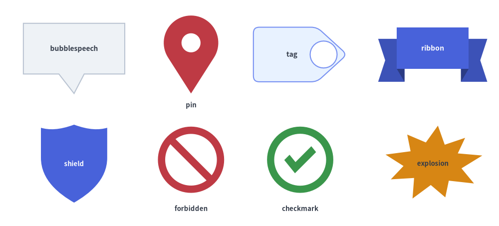
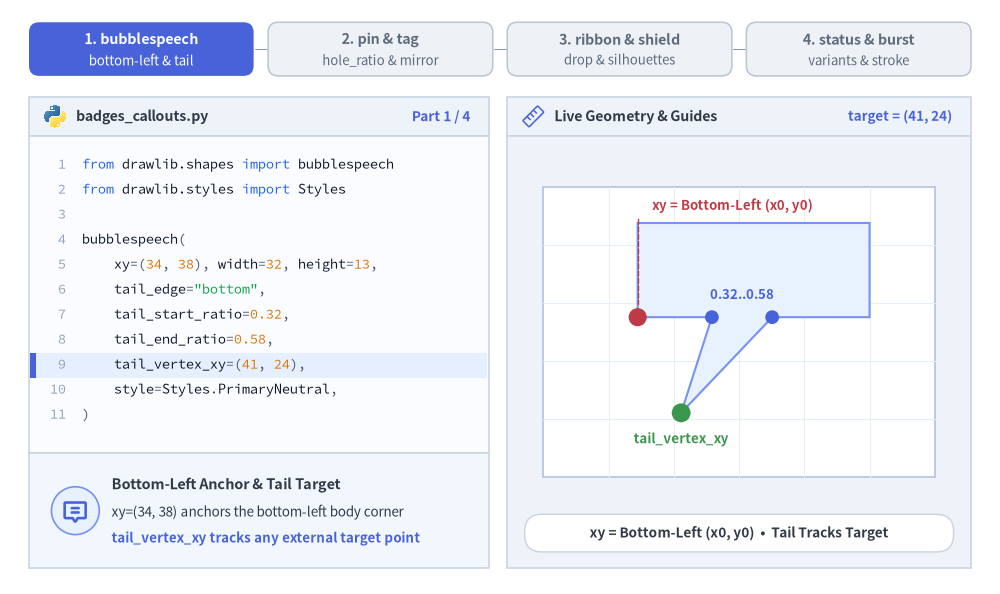
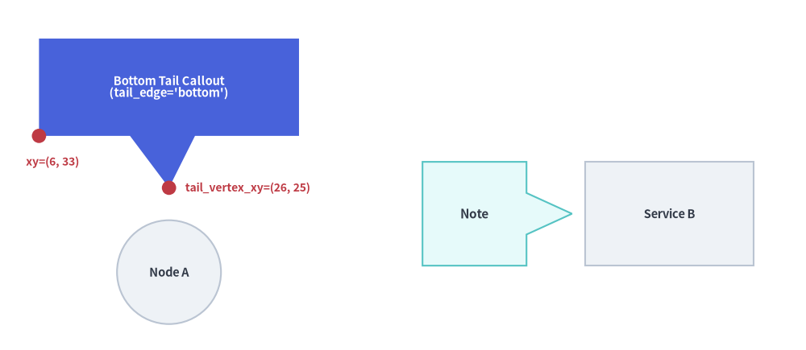
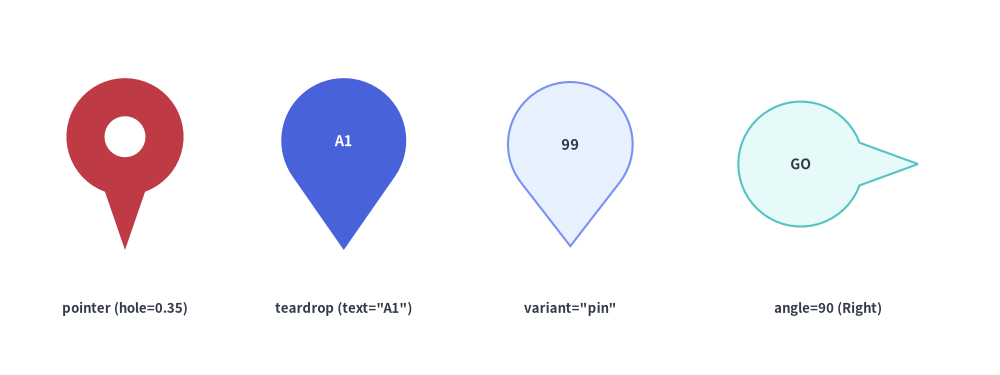
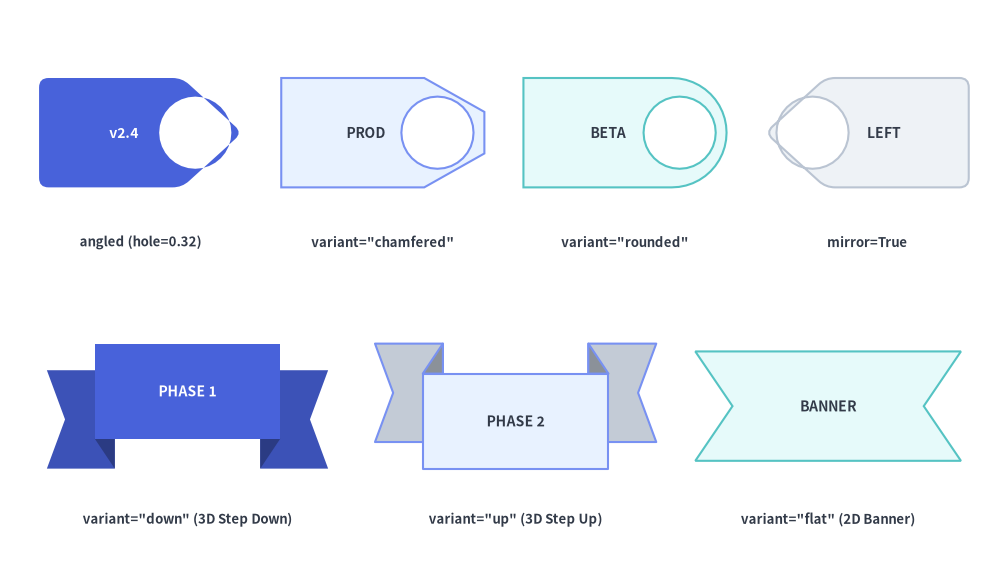
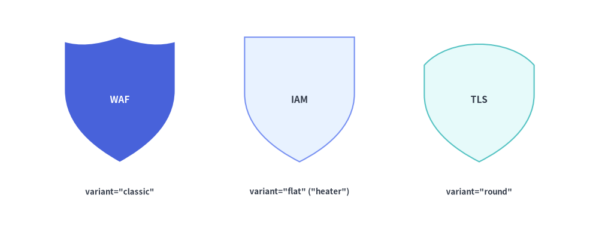
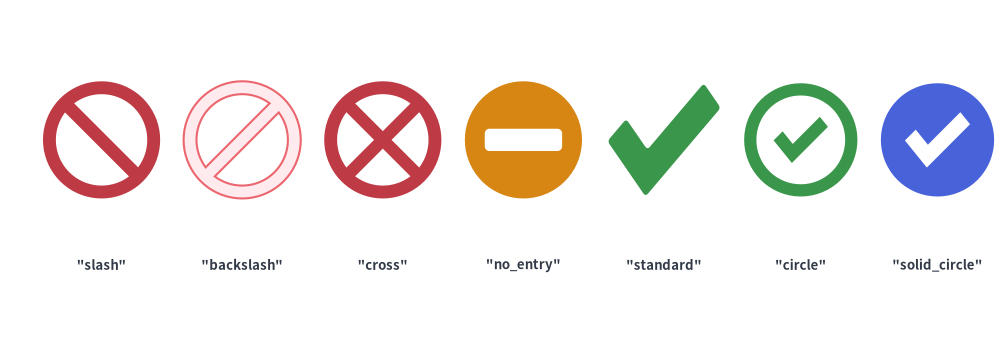
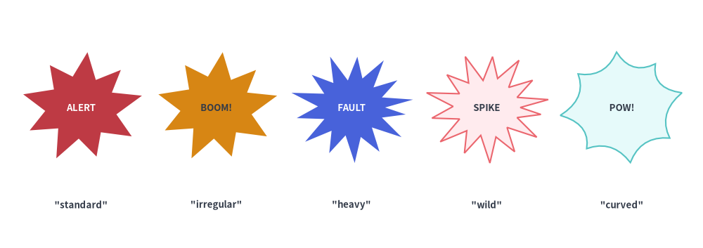

# 吹き出し・バッジ・ステータス

`drawlib.shapes` の **吹き出し・バッジ・ステータス** カテゴリは、**8 種類の注釈・セキュリティ・検証向けプリミティブ** を提供します。方向付き吹き出しコールアウト（`bubblespeech`）、ロケーション／ポインタピン（`pin`）、リリース・分類タグ（`tag`）、3D 段付きマイルストーンリボン（`ribbon`）、セキュリティ／ガバナンスシールド（`shield`）、アクセス禁止バッジ（`forbidden`）、検証チェックマーク（`checkmark`）、およびコミック／インシデントバースト（`explosion`）を利用できます。


<figure class="drawlib-image" style="text-align: center;">
  
  <figcaption class="drawlib-caption">drawlib.shapes における吹き出し・バッジ・セキュリティ・ステータス全 8 プリミティブの概要</figcaption>
</figure>

<details class="drawlib-code-details">
<summary>Source Code</summary>

```python
from drawlib.canvas import save, setup
from drawlib.shapes import (
    bubblespeech,
    checkmark,
    explosion,
    forbidden,
    pin,
    ribbon,
    shield,
    tag,
)
from drawlib.styles import Styles
from drawlib.text import text

setup(width=128, height=58)

lbl_dark = Styles.DarkBold.patch(text_size=10.0)
lbl_white = Styles.WhiteBold.patch(text_size=10.0)
cap_st = Styles.DarkBold.patch(text_size=9.5)

# Row 1: bubblespeech, pin, tag, ribbon
bubblespeech(
    xy=(6, 39),
    width=26,
    height=13,
    tail_edge="bottom",
    tail_start_ratio=0.35,
    tail_end_ratio=0.60,
    tail_vertex_xy=(19, 34),
    style=Styles.Neutral,
    text="bubblespeech",
    text_style=lbl_dark,
)
pin(
    (49, 44),
    width=14,
    height=20,
    variant="teardrop",
    hole_ratio=0.35,
    style=Styles.DangerFlat,
)
text((49, 31), "pin", style=cap_st)

tag(
    (77, 44),
    width=24,
    height=14,
    variant="angled",
    style=Styles.PrimaryNeutral.patch(shape_r=1.5),
    text="tag",
    text_style=lbl_dark,
)
ribbon(
    (111, 44),
    width=28,
    height=14,
    variant="down",
    style=Styles.PrimaryFlat,
    text="ribbon",
    text_style=lbl_white,
)

# Row 2: shield, forbidden, checkmark, explosion
shield(
    (19, 16),
    width=17,
    height=20,
    variant="classic",
    style=Styles.PrimaryFlat,
    text="shield",
    text_style=Styles.WhiteBold.patch(text_size=9.5),
)
forbidden((49, 17), radius=8.5, variant="slash", style=Styles.DangerFlat)
text((49, 4.5), "forbidden", style=cap_st)

checkmark((77, 17), width=17, variant="circle", style=Styles.SuccessFlat)
text((77, 4.5), "checkmark", style=cap_st)

explosion(
    (111, 16),
    width=26,
    height=20,
    variant="irregular",
    style=Styles.WarningFlat,
    text="explosion",
    text_style=Styles.DarkBold.patch(text_size=9.5),
)

save()
```

</details>


---

## 1. 基本の幾何構造とコンセプト

`pin`, `tag`, `ribbon`, `shield`, `forbidden`, `checkmark`, `explosion` が Drawlib 標準の中心アンカー規約（`xy`）に従う一方、`bubblespeech` はポインタテールが任意のターゲット座標（`tail_vertex_xy`）を正確に追従できるよう、矩形ボディの左下角 `(x0, y0)` をアンカーとします。辺上の接続比率（`tail_start_ratio`〜`tail_end_ratio`）、ヘッドやカラーの穴あき（`hole_ratio`）と水平反転（`mirror`）、3D リボンの段差オフセット（`drop_ratio`）、複合パスのステータス記号やバースト形状（`variant`・`thickness_ratio`）によって各プリミティブがどのように変化するかを確認してみましょう。


<figure class="drawlib-image" style="text-align: center;">
  
  <figcaption class="drawlib-caption">パラメータ＆ジオメトリツアー: bubblespeech・pin・tag・ribbon・shield・forbidden・checkmark・explosion のライブ変形（APNG アニメーション）</figcaption>
</figure>


<div class="drawlib-source-link">
  <a href="https://github.com/yuichi110/drawlib/blob/main/docs/docs_src/ja/02_drawing_primitives/shapes_badge.md" target="_blank" rel="noopener noreferrer">GitHub でアニメーションのソースコードを見る &rarr;</a>
</div>

- **吹き出しのアンカー基準とポインタ比率（`bubblespeech`）**: 矩形ボディを左下角 `xy = (x0, y0)` に固定し、`tail_edge` 辺上の `tail_start_ratio`〜`tail_end_ratio` からターゲット座標 `tail_vertex_xy` へ向かうポインタテールを接続します。
- **ヘッドの穴あきとカラーの水平反転（`pin`, `tag`）**: `hole_ratio` でピンヘッドやタグの先端に透明な円形リング穴をくり抜き、`mirror=True` で `tag` の向きを `+X` から `-X` へ水平反転します。
- **3D リボンの段差とシールドのクレスト形状（`ribbon`, `shield`）**: `drop_ratio` で `"down"`／`"up"` リボンの垂直 3D 段差量を制御し、`shield` は `"classic"`, `"flat"`, `"round"` の 3 種類の紋章クレストを切り替えられます。
- **複合パスのステータス記号とバースト形状（`forbidden`, `checkmark`, `explosion`）**: `thickness_ratio` でリングやチェック線の太さを調整し、`"no_entry"` や `"solid_circle"` で中実バッジのくり抜きを表現、`explosion` では鋭いスパイクから `"curved"` ベジェバーストまで自在に切り替えられます。

---

## 2. 吹き出し・バッジ・ステータスプリミティブの早見表

全 8 関数のデフォルト座標アンカー、シルエットのバリエーション、主要な形状引数、代表的なユースケースを以下のマトリクスで比較できます。

| 関数 | デフォルトアンカー | バリエーション | 主要な形状引数 | 主なダイアグラム用途 |
| :--- | :--- | :--- | :--- | :--- |
| **`bubblespeech`** | **左下 `(x0, y0)`** | 4 辺の `tail_edge`（`"left"`, `"top"`, `"right"`, `"bottom"`） | `tail_start_ratio`, `tail_end_ratio`, `tail_vertex_xy` | コード注釈、アーキテクチャレビューコメント、シーケンス／アクターの吹き出し解説。 |
| **`pin`** | 中央 `(cx, cy)` | `"pointer"`（`"standard"`）, `"teardrop"`（`"drop"`）, `"pin"`（`"badge"`） | `hole_ratio`（`0.0`〜`0.8`）, `style.angle` | GeoMap のロケーションマーカー、タイムラインポインタ、番号付き点検ピン。 |
| **`tag`** | 中央 `(cx, cy)` | `"angled"`（`"standard"`）, `"chamfered"`（`"beveled"`）, `"rounded"` | `mirror=False`, `hole_ratio`（`0.0`〜`0.7`）, `style.shape_r` | Git リリースタグ（`v2.4.0`）、リソースラベル、Key-Value メタデータバッジ。 |
| **`ribbon`** | 中央 `(cx, cy)` | `"down"`（`"standard"`）, `"up"`, `"flat"`（`"banner"`） | `tail_width_ratio`, `drop_ratio` | セクションヘッダ、マイルストーンバナー、表彰タイトル、認定見出し。 |
| **`shield`** | 中央 `(cx, cy)` | `"classic"`（`"standard"`）, `"flat"`（`"heater"`）, `"round"` | `width`, `height` | WAF ファイアウォール、IAM 認証ゲート、TLS 暗号化、セキュリティ信頼境界。 |
| **`forbidden`** | 中央 `(cx, cy)` | `"slash"`（`"standard"`）, `"backslash"`, `"cross"`, `"no_entry"`（`"minus"`） | `radius`, `thickness_ratio`（デフォルト `0.22`） | 遮断ポート、ファイアウォール拒否ルール、非推奨パス、アンチパターン表示。 |
| **`checkmark`** | 中央 `(cx, cy)` | `"standard"`（`"check"`）, `"circle"`, `"solid_circle"` | `width`, `height`, `thickness_ratio`（デフォルト `0.24`）, `style.shape_r` | CI/CD 合格ゲート、SLA 準拠チェック、検証済みセキュリティ統制。 |
| **`explosion`** | 中央 `(cx, cy)` | `"standard"`, `"irregular"`, `"heavy"`, `"wild"`, `"curved"`, `"comic"` | `width`, `height`, `style.shape_r` | インシデント／障害バースト、フォールト注入ポイント、異常検知コールアウト。 |

---

## 3. 吹き出しコールアウト (`bubblespeech`)

`bubblespeech` は、4 辺（`"left"`, `"top"`, `"right"`, `"bottom"`）のいずれかから三角形のポインタテールが伸び、指定したターゲット座標 `tail_vertex_xy` を正確に指し示す矩形吹き出しボックスを描画します。

```python
bubblespeech(
    xy: tuple[float, float],
    width: float,
    height: float,
    tail_edge: Literal["left", "top", "right", "bottom"],
    tail_start_ratio: float,
    tail_vertex_xy: tuple[float, float],
    tail_end_ratio: float,
    *,
    style: Style,
    text: str = "",
    text_style: Style | None = None,
) -> None
```

### パラメータリファレンス

| パラメータ | 型 | 説明 |
| :--- | :--- | :--- |
| `xy` | `tuple[float, float]` | 矩形吹き出しボディの **左下角** `(x0, y0)`（`style.halign`／`valign` の設定に関わらず常に左下アンカー固定です）。 |
| `width` / `height` | `float` | 矩形吹き出しボディの水平幅と垂直高さ（`> 0`）。 |
| `tail_edge` | `"left" \| "top" \| "right" \| "bottom"` | 吹き出しボディのどの辺からポインタテールを伸ばすかを指定します。 |
| `tail_start_ratio` | `float` | `tail_edge` 辺に沿ったテール根元の開始位置を `[0.0, 1.0]` で指定します（`"left"`／`"right"` では下から上、`"top"`／`"bottom"` では左から右へ計測）。`tail_end_ratio` より小さい値である必要があります。 |
| `tail_vertex_xy` | `tuple[float, float]` | ポインタテールの先端が指し示すキャンバス絶対座標 `(x, y)`（吹き出しボディの外側に位置する必要があります）。 |
| `tail_end_ratio` | `float` | `tail_edge` 辺に沿ったテール根元の終了位置を `[0.0, 1.0]` で指定します。`tail_start_ratio` より大きい値である必要があります。 |
| `style` / `text` / `text_style` | `Style` / `str` / `Style \| None` | 吹き出しの塗りつぶし・枠線スタイルと中央配置される注釈テキスト。注意: `bubblespeech` では `style.shape_r`, `style.angle`, `style.halign`／`valign` は無視されます。 |


```python
from drawlib.canvas import save, setup
from drawlib.shapes import bubblespeech, circle, rectangle
from drawlib.styles import Styles
from drawlib.text import text

setup(width=124, height=54)

# Target nodes
circle((26, 12), radius=8.0, style=Styles.Neutral, text="Node A", text_style=Styles.DarkBold.patch(text_size=10.5))
rectangle((103, 21), width=26, height=16, style=Styles.Neutral, text="Service B", text_style=Styles.DarkBold.patch(text_size=10.5))

# 1. Callout with bottom tail pointing down to Node A
bubblespeech(
    xy=(6, 33),
    width=40,
    height=15,
    tail_edge="bottom",
    tail_start_ratio=0.35,
    tail_end_ratio=0.60,
    tail_vertex_xy=(26, 25),
    style=Styles.PrimaryFlat,
    text="Bottom Tail Callout\n(tail_edge='bottom')",
    text_style=Styles.WhiteBold.patch(text_size=10.5),
)

# Coordinate indicators for bottom-left anchor xy and tail_vertex_xy
circle((6, 33), radius=1.1, style=Styles.DangerFlat)
text((4, 29.0), "xy=(6, 33)", style=Styles.DangerBold.patch(text_size=10.0, halign="left"))

circle((26, 25), radius=1.1, style=Styles.DangerFlat)
text((28.5, 25.0), "tail_vertex_xy=(26, 25)", style=Styles.DangerBold.patch(text_size=10.0, halign="left"))

# 2. Callout with right tail pointing to Service B
bubblespeech(
    xy=(65, 13),
    width=16,
    height=16,
    tail_edge="right",
    tail_start_ratio=0.30,
    tail_end_ratio=0.70,
    tail_vertex_xy=(88, 21),
    style=Styles.SecondaryNeutral,
    text="Note",
    text_style=Styles.DarkBold.patch(text_size=11.0),
)

save()
```

<figure class="drawlib-image" style="text-align: center;">
  
  <figcaption class="drawlib-caption">左下アンカー xy とポインタ先端 tail_vertex_xy を用いた吹き出しコールアウト</figcaption>
</figure>


---

## 4. ロケーションピンと方向マーカー (`pin`)

`pin` は、中央の円形くり抜き穴（`hole_ratio`）と上部円形ヘッド内への視覚的なテキスト中央配置を備えたマップマーカーまたは方向ポインタバッジを描画します。

```python
pin(
    xy: tuple[float, float],
    width: float,
    height: float,
    *,
    variant: Literal[
        "pointer", "standard",
        "teardrop", "drop",
        "pin", "badge",
    ] = "pointer",
    hole_ratio: float | None = None,
    style: Style,
    text: str = "",
    text_style: Style | None = None,
) -> None
```

| パラメータ | 型 | デフォルト | 説明 |
| :--- | :--- | :--- | :--- |
| `xy` | `tuple[float, float]` | *必須* | ピンのバウンディングボックス中心座標 `(x, y)`（下端の尖端を `xy` に合わせる場合は `style.patch(valign="bottom")` を使用します）。 |
| `width` / `height` | `float` | *必須* | 外接水平幅（`> 0`）と垂直高さ（`> 0`）。 |
| `variant` | `PinVariant` | `"pointer"` | ピンのシルエット:<br>• **`"pointer"`**（または `"standard"`）: 円形ヘッドから直線の接線コーン側面が下端の鋭い尖端へ繋がる形状。<br>• **`"teardrop"`**（または `"drop"`）: 滑らかな 3 次ベジェ曲線によるティアドロップ（雫）形状。<br>• **`"pin"`**（または `"badge"`）: 大きな円形バッジヘッドの下部に短い三角形ポインタを備えた形状。 |
| `hole_ratio` | `float \| None` | `None` | ヘッド半径に対する中央の穴の半径比率を `(0.0, 0.8)` で指定します（例: 定番のマップピンリングには `hole_ratio=0.35`）。ヘッド内に `text` を配置する場合は `hole_ratio` を省略してください。 |
| `style.angle` | `float` | `0.0` | ピンを反時計回りに回転します（例: `angle=90` で右向き、`angle=180` で上向き）。 |
| `text` / `text_style` | `str` / `Style \| None` | `""` / `None` | 外接ボックス全体の中心ではなく、上部の円形ヘッド中央に自動配置されるテキストラベル。 |


```python
from drawlib.canvas import save, setup
from drawlib.shapes import pin
from drawlib.styles import Styles
from drawlib.text import text

setup(width=128, height=48)

lbl = Styles.DarkBold.patch(text_size=9.5)

# 1. Pointer with hole_ratio=0.35
pin((16, 27), width=15, height=22, variant="pointer", hole_ratio=0.35, style=Styles.DangerFlat)
text((16, 8.5), 'pointer (hole=0.35)', style=lbl)

# 2. Teardrop with embedded text (auto-centered in head)
pin(
    (44, 27),
    width=16,
    height=22,
    variant="teardrop",
    style=Styles.PrimaryFlat,
    text="A1",
    text_style=Styles.WhiteBold.patch(text_size=10.5),
)
text((44, 8.5), 'teardrop (text="A1")', style=lbl)

# 3. Badge / Pin variant (large circular head + short pointer tip)
pin(
    (73, 27),
    width=17,
    height=21,
    variant="pin",
    style=Styles.PrimaryNeutral,
    text="99",
    text_style=Styles.DarkBold.patch(text_size=10.5),
)
text((73, 8.5), 'variant="pin"', style=lbl)

# 4. Rotated pointer pin (angle=90 points right, text kept horizontal with angle=0)
pin(
    (106, 27),
    width=16,
    height=23,
    variant="pointer",
    style=Styles.SecondaryNeutral.patch(angle=90),
    text="GO",
    text_style=Styles.DarkBold.patch(text_size=10.0, angle=0),
)
text((106, 8.5), "angle=90 (Right)", style=lbl)

save()
```

<figure class="drawlib-image" style="text-align: center;">
  
  <figcaption class="drawlib-caption">ピンの variant（pointer・teardrop・pin）、中央の穴あき（hole_ratio）、方向回転</figcaption>
</figure>


---

## 5. リリースタグとリボンバナー (`tag`, `ribbon`)

### 5.1. リリース・メタデータタグ (`tag`)
`tag` は、尖った襟（カラー）や面取りされた先端、任意のパンチ穴（`hole_ratio`）、および矩形ボディ内への視覚的なテキスト中央補正を備えたラベル／バージョンタグを描画します。

```python
tag(
    xy: tuple[float, float],
    width: float,
    height: float,
    *,
    variant: Literal[
        "angled", "standard",
        "chamfered", "beveled",
        "rounded",
    ] = "angled",
    mirror: bool = False,
    hole_ratio: float | None = None,
    style: Style,
    text: str = "",
    text_style: Style | None = None,
) -> None
```

| パラメータ | 型 | デフォルト | 説明 |
| :--- | :--- | :--- | :--- |
| `xy` | `tuple[float, float]` | *必須* | タグバウンディングボックスの中心座標 `(x, y)`。 |
| `width` / `height` | `float` | *必須* | 外接水平幅（`> 0`）と垂直高さ（`> 0`）。 |
| `variant` | `TagVariant` | `"angled"` | 先端カラー部分のシルエット:<br>• **`"angled"`**（または `"standard"`）: 右側（`+X`）に三角形の尖った先端を持つ 5 頂点タグ。<br>• **`"chamfered"`**（または `"beveled"`）: `45°` の面取り角と平らな先端辺を持つ 6 頂点タグ。<br>• **`"rounded"`**: 右側に滑らかな 3 次ベジェ曲線の丸みのある先端、左側に角丸のボディ角を持つタグ。 |
| `mirror` | `bool` | `False` | `True` にするとタグを水平反転し、先端およびパンチ穴を左向き（`-X`）にします。 |
| `hole_ratio` | `float \| None` | `None` | 先端カラー内部に配置される円形パンチ穴の半径比率を `(0.0, 0.7)` で指定します（任意）。 |
| `style` | `Style` | *必須* | `style.angle` による回転および `style.shape_r` による頂点の角丸め（`"angled"` と `"chamfered"` で有効）に対応します。 |
| `text` / `text_style` | `str` / `Style \| None` | `""` / `None` | メインの矩形ボディ中央に美しく収まるよう、尖った先端側から反対方向へ自動補正して配置されるテキストラベル。 |

### 5.2. 段付き 3D・スワローテイルリボンバナー (`ribbon`)
`ribbon` は、両端に V 字の切れ込み（スワローテイル）を持つ装飾バナーや構造見出しリボンを描画します。

```python
ribbon(
    xy: tuple[float, float],
    width: float,
    height: float,
    *,
    variant: Literal[
        "down", "standard",
        "up",
        "flat", "banner",
    ] = "down",
    tail_width_ratio: float | None = None,
    drop_ratio: float | None = None,
    style: Style,
    text: str = "",
    text_style: Style | None = None,
) -> None
```

| パラメータ | 型 | デフォルト | 説明 |
| :--- | :--- | :--- | :--- |
| `xy` | `tuple[float, float]` | *必須* | 外接リボンバウンディングボックスの中心座標 `(x, y)`。 |
| `width` / `height` | `float` | *必須* | 水平全幅（`> 0`）と垂直全高（`> 0`）。 |
| `variant` | `RibbonVariant` | `"down"` | リボンの構造:<br>• **`"down"`**（または `"standard"`）: 中央バナーが上段に位置し、左右のスワローテイル端が暗色の 3D 折り返し三角形の背後を通って **下段へ段落ち** する 3D 段付きリボン。<br>• **`"up"`**: 中央バナーが下段に位置し、左右のスワローテイル端が **上段へ段上がり** する 3D 段付きリボン。<br>• **`"flat"`**（または `"banner"`）: 3D 段差を持たない 1 枚構成の 2D スワローテイルバナー。 |
| `tail_width_ratio` | `float \| None` | `None` | 左右それぞれのテール部が占める `width` に対する水平幅比率を `[0.10, 0.35]` で指定します（デフォルト `0.22`）。 |
| `drop_ratio` | `float \| None` | `None` | `"down"` および `"up"` における `height` に対する垂直段差オフセット比率を `[0.10, 0.45]` で指定します（デフォルト `0.25`）。 |
| `text` / `text_style` | `str` / `Style \| None` | `""` / `None` | **前面の中央バナー** の中心に配置されるラベル（`"down"` では上方向、`"up"` では下方向へ自動補正されます）。 |


```python
from drawlib.canvas import save, setup
from drawlib.shapes import ribbon, tag
from drawlib.styles import Styles
from drawlib.text import text

setup(width=128, height=74)

lbl = Styles.DarkBold.patch(text_size=9.5)

# Row 1: Tag variants (angled, chamfered, rounded, mirrored + hole_ratio)
tag(
    (18, 57),
    width=26,
    height=14,
    variant="angled",
    hole_ratio=0.32,
    style=Styles.PrimaryFlat.patch(shape_r=1.2),
    text="v2.4",
    text_style=Styles.WhiteBold.patch(text_size=10.0),
)
text((18, 43), 'angled (hole=0.32)', style=lbl)

tag(
    (49, 57),
    width=26,
    height=14,
    variant="chamfered",
    hole_ratio=0.32,
    style=Styles.PrimaryNeutral,
    text="PROD",
    text_style=Styles.DarkBold.patch(text_size=10.0),
)
text((49, 43), 'variant="chamfered"', style=lbl)

tag(
    (80, 57),
    width=26,
    height=14,
    variant="rounded",
    hole_ratio=0.32,
    style=Styles.SecondaryNeutral,
    text="BETA",
    text_style=Styles.DarkBold.patch(text_size=10.0),
)
text((80, 43), 'variant="rounded"', style=lbl)

tag(
    (111, 57),
    width=26,
    height=14,
    variant="angled",
    mirror=True,
    hole_ratio=0.32,
    style=Styles.Neutral.patch(shape_r=1.2),
    text="LEFT",
    text_style=Styles.DarkBold.patch(text_size=10.0),
)
text((111, 43), "mirror=True", style=lbl)

# Row 2: Ribbon variants ("down", "up", "flat")
ribbon(
    (24, 22),
    width=36,
    height=16,
    variant="down",
    style=Styles.PrimaryFlat,
    text="PHASE 1",
    text_style=Styles.WhiteBold.patch(text_size=10.0),
)
text((24, 7.5), 'variant="down" (3D Step Down)', style=lbl)

ribbon(
    (66, 22),
    width=36,
    height=16,
    variant="up",
    style=Styles.PrimaryNeutral,
    text="PHASE 2",
    text_style=Styles.DarkBold.patch(text_size=10.0),
)
text((66, 7.5), 'variant="up" (3D Step Up)', style=lbl)

ribbon(
    (106, 22),
    width=34,
    height=14,
    variant="flat",
    style=Styles.SecondaryNeutral,
    text="BANNER",
    text_style=Styles.DarkBold.patch(text_size=10.0),
)
text((106, 7.5), 'variant="flat" (2D Banner)', style=lbl)

save()
```

<figure class="drawlib-image" style="text-align: center;">
  
  <figcaption class="drawlib-caption">リリースタグの各 variant（上段）と 3D 段付き／スワローテイルリボンバナー（下段）</figcaption>
</figure>


---

## 6. セキュリティ・ガバナンスシールド (`shield`)

Web Application Firewall（WAF）、IAM ポリシーゲート、ゼロトラスト境界、暗号化バッジ向けに、`shield` は伝統的な紋章学に基づく 3 種類の盾シルエットを提供します。

```python
shield(
    xy: tuple[float, float],
    width: float,
    height: float,
    *,
    variant: Literal[
        "classic", "standard",
        "flat", "heater",
        "round",
    ] = "classic",
    style: Style,
    text: str = "",
    text_style: Style | None = None,
) -> None
```

| パラメータ | 型 | デフォルト | 説明 |
| :--- | :--- | :--- | :--- |
| `xy` | `tuple[float, float]` | *必須* | シールドバウンディングボックスの中心座標 `(x, y)`。 |
| `width` / `height` | `float` | *必須* | 外接水平幅（`> 0`）と垂直高さ（`> 0`）。 |
| `variant` | `ShieldVariant` | `"classic"` | シールド上端（クレスト）と底部のシルエット:<br>• **`"classic"`**（または `"standard"`）: 中央ピークを持つ 3 セグメントの波型クレストから曲線側面を経て下端の尖端へ絞られる盾。<br>• **`"flat"`**（または `"heater"`）: 水平な上辺と滑らかな 3 次ベジェ側面が下端の尖端で交わるヒーターシールド。<br>• **`"round"`**: アーチ状に膨らんだ上辺と幅広で丸みのある U 字型の底部を持つ盾。 |
| `style` | `Style` | *必須* | 塗りつぶし、枠線、および回転（`angle`）を制御するスタイル。 |
| `text` / `text_style` | `str` / `Style \| None` | `""` / `None` | シールド上部の広い領域へ視覚的に自然になじむよう、わずかに上方向（`+0.04 * height`）へ自動補正して配置されるラベル。 |


```python
from drawlib.canvas import save, setup
from drawlib.shapes import shield
from drawlib.styles import Styles
from drawlib.text import text

setup(width=120, height=46)

lbl = Styles.DarkBold.patch(text_size=9.5)

# 1. Classic scalloped crest shield
shield(
    (24, 26),
    width=22,
    height=25,
    variant="classic",
    style=Styles.PrimaryFlat,
    text="WAF",
    text_style=Styles.WhiteBold.patch(text_size=11.0),
)
text((24, 7.5), 'variant="classic"', style=lbl)

# 2. Flat-top heater shield
shield(
    (60, 26),
    width=22,
    height=25,
    variant="flat",
    style=Styles.PrimaryNeutral,
    text="IAM",
    text_style=Styles.DarkBold.patch(text_size=11.0),
)
text((60, 7.5), 'variant="flat" ("heater")', style=lbl)

# 3. Round-bottom shield
shield(
    (96, 26),
    width=22,
    height=25,
    variant="round",
    style=Styles.SecondaryNeutral,
    text="TLS",
    text_style=Styles.DarkBold.patch(text_size=11.0),
)
text((96, 7.5), 'variant="round"', style=lbl)

save()
```

<figure class="drawlib-image" style="text-align: center;">
  
  <figcaption class="drawlib-caption">3 種類のセキュリティシールド variant: classic・flat（heater）・round</figcaption>
</figure>


---

## 7. アクセス制御・検証バッジ (`forbidden`, `checkmark`)

ファイアウォールルール、アクセス制御マトリクス、CI/CD 検証ゲート、監査チェックリスト向けに、`forbidden` と `checkmark` はシャープな複合パス（Compound Path）によるベクターステータス記号を描画します。

```python
forbidden(
    xy: tuple[float, float],
    radius: float,
    *,
    variant: Literal[
        "slash", "standard",
        "backslash",
        "cross",
        "no_entry", "minus",
    ] = "slash",
    thickness_ratio: float | None = None,
    style: Style,
    text: str = "",
    text_style: Style | None = None,
) -> None

checkmark(
    xy: tuple[float, float],
    width: float,
    height: float | None = None,
    *,
    variant: Literal[
        "standard", "check",
        "circle",
        "solid_circle",
    ] = "standard",
    thickness_ratio: float | None = None,
    style: Style,
    text: str = "",
    text_style: Style | None = None,
) -> None
```

| 関数 | パラメータ | 型 | デフォルト | 説明 |
| :--- | :--- | :--- | :--- | :--- |
| **`forbidden`** | `xy` / `radius` | `tuple` / `float` | *必須* | 中心座標 `(cx, cy)` と外円の半径（`> 0`）。 |
| | `variant` | `ForbiddenVariant` | `"slash"` | • **`"slash"`**（`"standard"`）: 円環リング＋左上から右下への斜めバー（2 つの D 字型くり抜き）。<br>• **`"backslash"`**: 円環リング＋左下から右上への斜めバー。<br>• **`"cross"`**: 円環リング＋ `'X'` 字の交差バー（4 つの扇形くり抜き）。<br>• **`"no_entry"`**（`"minus"`）: 中実の円＋中央の水平矩形くり抜きバー（進入禁止標識）。 |
| | `thickness_ratio` | `float \| None` | `None` | `radius` に対するリングおよびバーの太さ比率を `(0.0, 0.5)` で指定します（デフォルト `0.22`）。 |
| **`checkmark`** | `xy` / `width` | `tuple` / `float` | *必須* | 中心座標 `(x, y)` と水平幅（`> 0`）。`height` が `None` の場合は `width` と同じ値になります。 |
| | `variant` | `CheckmarkVariant` | `"standard"` | • **`"standard"`**（`"check"`）: 単独の 6 頂点 L 字チェックポリゴン（`style.shape_r` に対応）。<br>• **`"circle"`**: 外周の円環リングと内側のチェックマークポリゴンの組み合わせ。<br>• **`"solid_circle"`**: 中実の円形バッジから透明なチェックマークをくり抜いた形状。 |
| | `thickness_ratio` | `float \| None` | `None` | `min(width, height)` に対するストローク太さ比率を `(0.0, 0.5)` で指定します（デフォルト `0.24`）。 |


```python
from drawlib.canvas import save, setup
from drawlib.shapes import checkmark, forbidden
from drawlib.styles import Styles
from drawlib.text import text

setup(width=128, height=44)

lbl = Styles.DarkBold.patch(text_size=9.5)

# Forbidden variants
for i, (var, st) in enumerate([
    ("slash", Styles.DangerFlat),
    ("backslash", Styles.DangerNeutral),
    ("cross", Styles.DangerFlat),
    ("no_entry", Styles.WarningFlat),
]):
    cx = 13 + i * 18
    forbidden((cx, 26), radius=7.5, variant=var, style=st)
    text((cx, 10), f'"{var}"', style=lbl)

# Checkmark variants
for i, (var, st) in enumerate([
    ("standard", Styles.SuccessFlat.patch(shape_r=0.5)),
    ("circle", Styles.SuccessFlat),
    ("solid_circle", Styles.PrimaryFlat),
]):
    cx = 85 + i * 17.5
    checkmark((cx, 26), width=14.5, variant=var, style=st)
    text((cx, 10), f'"{var}"', style=lbl)

save()
```

<figure class="drawlib-image" style="text-align: center;">
  
  <figcaption class="drawlib-caption">セキュリティゲートおよび検証チェック用の forbidden と checkmark の各 variant</figcaption>
</figure>


---

## 8. インパクト・インシデントバースト (`explosion`)

カオスエンジニアリングの障害注入箇所、システム障害コールアウト、異常検知アラート、インパクトの強い強調バッジ向けに、`explosion` は `(width, height)` に収まる 6 種類のスターバーストシルエットを提供します。

```python
explosion(
    xy: tuple[float, float],
    width: float,
    height: float,
    *,
    variant: Literal[
        "standard",
        "irregular",
        "heavy",
        "wild",
        "curved", "comic",
    ] = "standard",
    style: Style,
    text: str = "",
    text_style: Style | None = None,
) -> None
```

| `variant` | スパイク数と幾何構造 | `style.shape_r` 対応 | 主なユースケース |
| :--- | :--- | :---: | :--- |
| **`"standard"`** *(デフォルト)* | 長短のスパイク深さが規則的に交互する 12 スパイクのバースト | 対応（`float` または 24 要素タプル） | 標準的なアラートバースト、「NEW!」バッジ、インパクト強調コールアウト。 |
| **`"irregular"`** | 有機的な角度間隔を持つ非対称な 11 スパイクのバースト | 対応（`float` または 22 要素タプル） | クラッシュ／衝突インジケータ、カオス障害注入マーカー。 |
| **`"heavy"`** | 幅広で重厚感のある 8 スパイクのバースト | 対応（`float` または 16 要素タプル） | 内部にテキストラベル用の広いスペースを確保できるコンパクトな障害バッジ。 |
| **`"wild"`** | 深い谷を持つ高密度・高エネルギーな 16 スパイクのバースト | 対応（`float` または 32 要素タプル） | 重大インシデントのコールアウト、DDoS／トラフィックスパイクの強調表示。 |
| **`"curved"`** / **`"comic"`** | 内向きに湾曲した 2 次ベジェ曲線の谷を持つ 10 スパイクのバースト | —（曲線ベジェアーク） | コミック風の爆発コールアウト、表現力豊かなプレゼンテーション強調。 |


```python
from drawlib.canvas import save, setup
from drawlib.shapes import explosion
from drawlib.styles import Styles
from drawlib.text import text

setup(width=130, height=46)

lbl = Styles.DarkBold.patch(text_size=9.5)
txt_w = Styles.WhiteBold.patch(text_size=9.5)
txt_d = Styles.DarkBold.patch(text_size=9.5)

specs = [
    ("standard", 15, Styles.DangerFlat, "ALERT", txt_w),
    ("irregular", 40, Styles.WarningFlat, "BOOM!", txt_d),
    ("heavy", 65, Styles.PrimaryFlat, "FAULT", txt_w),
    ("wild", 90, Styles.DangerNeutral, "SPIKE", txt_d),
    ("curved", 115, Styles.SecondaryNeutral, "POW!", txt_d),
]

for var, cx, st, inner, tst in specs:
    explosion((cx, 26), width=23, height=21, variant=var, style=st, text=inner, text_style=tst)
    text((cx, 8), f'"{var}"', style=lbl)

save()
```

<figure class="drawlib-image" style="text-align: center;">
  
  <figcaption class="drawlib-caption">5 種類の爆発バースト variant: standard・irregular・heavy・wild・curved（comic）</figcaption>
</figure>


