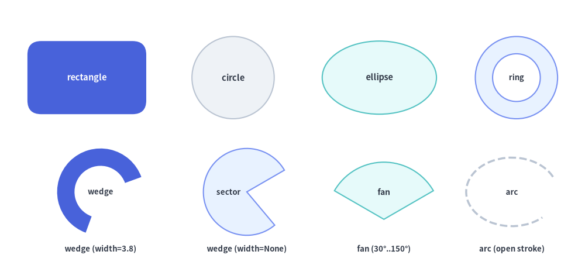
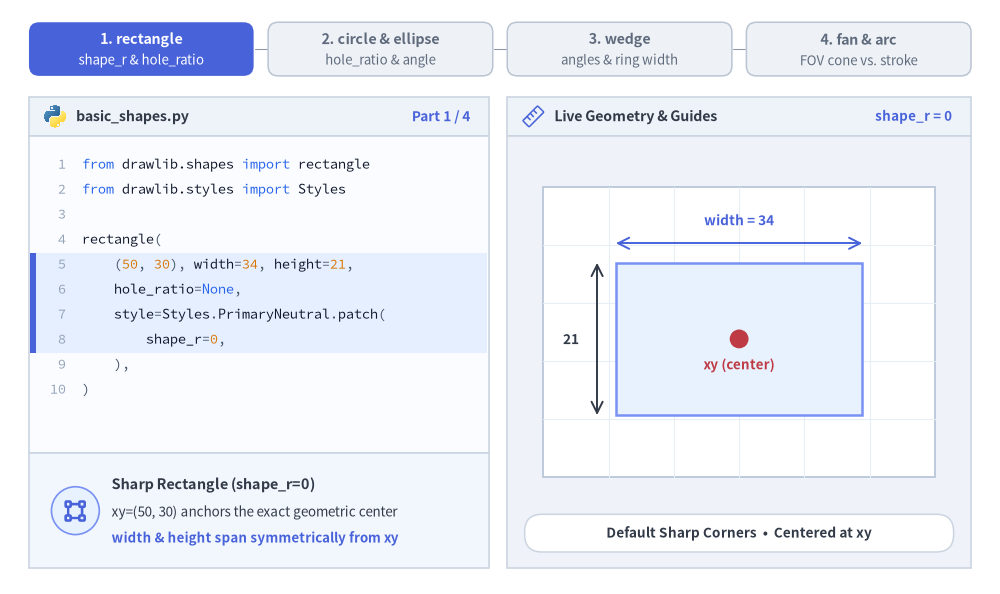
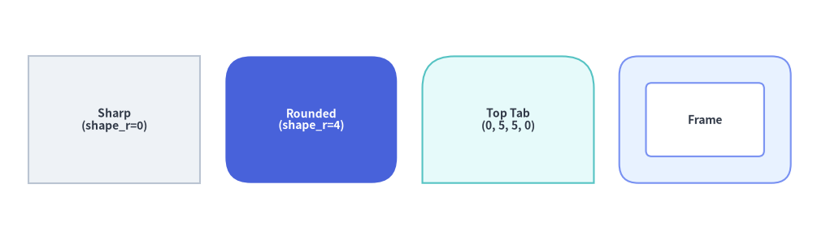
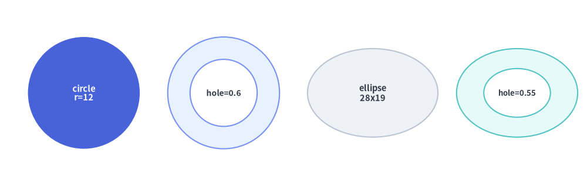
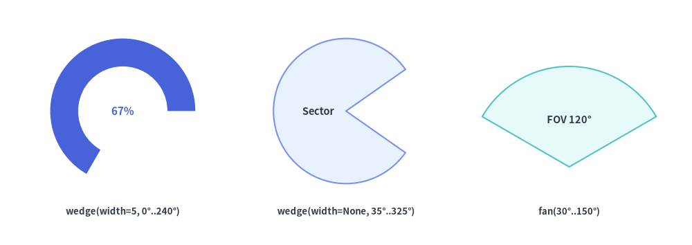
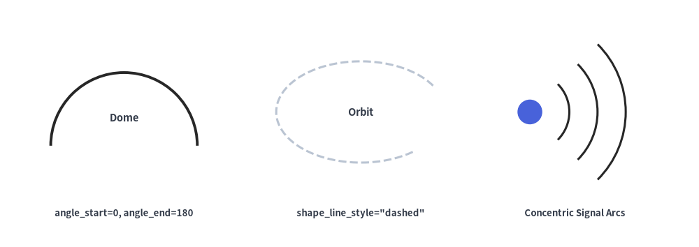

# 基本図形・放射状図形

`drawlib.shapes` の**基本図形・放射状図形（Basic & Radial）**カテゴリは、ほぼすべての技術図解で基盤となる 6 種類の幾何プリミティブを提供します。具体的には、矩形カードおよびフレーム（`rectangle`）、真円および中抜きリング（`circle`）、楕円（`ellipse`）、ドーナツリング断面および扇形ウェッジ（`wedge`）、円形パイセクター（`fan`）、そして開いた楕円弧ストローク（`arc`）が含まれます。


<figure class="drawlib-image" style="text-align: center;">
  
  <figcaption class="drawlib-caption">drawlib.shapes における 6 種類の基本矩形・放射状プリミティブの概要</figcaption>
</figure>

<details class="drawlib-code-details">
<summary>Source Code</summary>

```python
from drawlib.canvas import save, setup
from drawlib.shapes import arc, circle, ellipse, fan, rectangle, wedge
from drawlib.styles import Styles
from drawlib.text import text

setup(width=128, height=58)

lbl_dark = Styles.DarkBold.patch(text_size=10.5)
lbl_white = Styles.WhiteBold.patch(text_size=10.5)
cap_st = Styles.DarkBold.patch(text_size=9.5)

# Row 1: rectangle, circle, ellipse, and hollow ring (hole_ratio)
rectangle(
    (19, 41),
    width=26,
    height=16,
    style=Styles.PrimaryFlat.patch(shape_r=3.0),
    text="rectangle",
    text_style=lbl_white,
)
circle((51, 41), radius=9.0, style=Styles.Neutral, text="circle", text_style=lbl_dark)
ellipse((83, 41), width=25, height=16, style=Styles.SecondaryNeutral, text="ellipse", text_style=lbl_dark)
circle(
    (113, 41),
    radius=9.0,
    hole_ratio=0.58,
    style=Styles.PrimaryNeutral,
    text="ring",
    text_style=cap_st,
)

# Row 2: wedge (donut slice), wedge (full sector), fan (FOV pie), arc (open stroke)
wedge(
    (22, 16),
    radius=9.5,
    width=3.8,
    angle_start=20,
    angle_end=250,
    style=Styles.PrimaryFlat,
    text="wedge",
    text_style=cap_st,
)
text((22, 3.5), "wedge (width=3.8)", style=cap_st)

wedge(
    (54, 16),
    radius=9.5,
    width=None,
    angle_start=30,
    angle_end=310,
    style=Styles.PrimaryNeutral,
    text="sector",
    text_style=cap_st.patch(xy_shift=(-4.0, 0)),
)
text((54, 3.5), "wedge (width=None)", style=cap_st)

fan(
    (84, 10),
    radius=12.5,
    angle_start=30,
    angle_end=150,
    style=Styles.SecondaryNeutral,
    text="fan",
    text_style=Styles.DarkBold.patch(text_size=10.0, xy_shift=(0, 6.0)),
)
text((84, 3.5), "fan (30°..150°)", style=cap_st)

arc(
    (112, 16),
    width=20,
    height=15,
    angle_start=20,
    angle_end=320,
    style=Styles.DarkBold.patch(shape_line_style="dashed"),
    text="arc",
    text_style=cap_st,
)
text((112, 3.5), "arc (open stroke)", style=cap_st)

save()
```

</details>


---

## 1. 基本となるジオメトリ概念

全 6 種類のプリミティブは、Drawlib のデカルト座標空間と中心基準配置の規約（`xy`、ただし `fan` はコーンの頂点基準）を共有しつつ、手動の三角関数計算なしで各図形を直感的に変形できるパラメータを備えています。角丸（`shape_r`）、同心の中抜き（`hole_ratio`）、軸回転（`angle`）、反時計回りの角度スイープ（`angle_start`..`angle_end`）、およびリングの肉厚（`width`）によって各プリミティブがどのように変化するかを以下のアニメーションで確認できます。


<figure class="drawlib-image" style="text-align: center;">
  
  <figcaption class="drawlib-caption">パラメータ・ジオメトリツアー: rectangle, circle, ellipse, wedge, fan, arc のライブ変形（APNG アニメーション）</figcaption>
</figure>


<div class="drawlib-source-link">
  <a href="https://github.com/yuichi110/drawlib/blob/main/docs/docs_src/ja/02_drawing_primitives/shapes_basic.md" target="_blank" rel="noopener noreferrer">GitHub でアニメーションのソースコードを見る &rarr;</a>
</div>

- **中心基準と頂点基準の配置 (`xy`)**: `rectangle`, `circle`, `ellipse`, `wedge`, `arc` は `xy` を中心として配置されるのに対し、`fan` はコーンの頂点（要）を `xy` に固定します。
- **角丸フィレット (`style.shape_r`)**: `rectangle` の四隅をスカラー `float` で均等に丸めるほか、4 要素タプル `(bl, tl, tr, br)` で特定の角のみを選択的に丸められます。
- **中抜きカットアウト (`hole_ratio` と `width`)**: `hole_ratio` は同心の透明な穴をくり抜き（`rectangle`, `circle`, `ellipse`）、`wedge` の `width` はドーナツリングの肉厚を指定します。
- **反時計回りの角度指定 (`angle_start`, `angle_end`, `style.angle`)**: `+X` 軸（右方向 `0°`、上方向 `90°`）から反時計回りの度数法で円弧範囲や回転角を指定します。

---

## 2. 基本図形・放射状図形の比較早見表

全 6 関数のジオメトリ引数、中抜き動作、角丸対応、および代表的な図解用途を以下の表にまとめます。

| 関数 | 必須ジオメトリ引数 | 任意ジオメトリ引数 | `hole_ratio` 対応 | `shape_r` 対応 | 主な図解用途 |
| :--- | :--- | :--- | :---: | :---: | :--- |
| **`rectangle`** | `xy`, `width`, `height` | `hole_ratio=None` | 対応 `(0.0, 1.0)` | スカラー `float` または 4 要素タプル `(bl, tl, tr, br)` | サービスカード、コンテナ、スイムレーン、UI パネル、タブ、中抜きフレーム。 |
| **`circle`** | `xy`, `radius` | `hole_ratio=None` | 対応 `(0.0, 1.0)` | — | ステートノード、エンドポイント、番号バッジ、中抜きリング。 |
| **`ellipse`** | `xy`, `width`, `height` | `hole_ratio=None` | 対応 `(0.0, 1.0)` | — | ユースケース楕円、ベン図、軌道リング、横長ピル型ノード。 |
| **`wedge`** | `xy`, `radius` | `width=None`, `angle_start=0`, `angle_end=360` | `width` で制御 | — | ゲージメーター、ドーナツスライス（`width` 指定時）、円形セクター（`width=None`）。 |
| **`fan`** | `xy`, `radius` | `angle_start=0`, `angle_end=180` | — | — | カメラ/レーダーの視野角（FOV）コーン、無線カバレッジエリア、パイ型ウェッジ。 |
| **`arc`** | `xy`, `width`, `height` | `angle_start=0.0`, `angle_end=360.0` | —（塗りなし） | — | 開いた円弧・楕円弧の軌跡線、部分枠線、信号波面。 |

---

## 3. 矩形・角別フィレット・中抜きフレーム (`rectangle`)

`rectangle` は、`xy` を中心とする直角、角丸、または中抜きフレーム状の矩形カードを描画します（プリセットの `Styles.*` 使用時）。

```python
rectangle(
    xy: tuple[float, float],
    width: float,
    height: float,
    *,
    hole_ratio: float | None = None,
    style: Style,
    text: str = "",
    text_style: Style | None = None,
) -> None
```

### パラメータ・スタイルリファレンス

| パラメータ / スタイル属性 | 型 | デフォルト | 説明 |
| :--- | :--- | :--- | :--- |
| `xy` | `tuple[float, float]` | *必須* | 基準座標 `(x, y)`（デフォルトは中心、`style.halign` / `style.valign` で変更可能）。 |
| `width` | `float` | *必須* | キャンバス単位での水平幅（`> 0`）。 |
| `height` | `float` | *必須* | キャンバス単位での垂直高さ（`> 0`）。 |
| `hole_ratio` | `float \| None` | `None` | `(0.0, 1.0)` の範囲で指定する同心矩形の中抜き比率（任意）。両軸方向に比率 `(1 - hole_ratio) / 2` の枠厚を持つ中抜きフレームを生成します。 |
| `style.shape_r` | `float \| tuple[float, float, float, float] \| None` | `None` | 角丸フィレット半径。スカラー `float` を渡すと四隅すべてを均等に丸め、4 要素タプル `(bottom_left, top_left, top_right, bottom_right)` を渡すと特定の角のみを選択的に丸めます。上限は `min(width, height) / 2` に自動クランプされます。 |
| `style.angle` | `float` | `0.0` | 矩形の中心を軸とする反時計回りの回転角（度数法）。 |
| `text` / `text_style` | `str` / `Style \| None` | `""` / `None` | 矩形の中央に埋め込まれるテキストラベルおよび任意のタイポグラフィ上書きスタイル。 |

### 角丸と中抜きフレームのルール
- **4 要素タプルの指定順序 (`(bl, tl, tr, br)`)**: `style.patch(shape_r=...)` に 4 要素タプルを渡す場合、各半径は `(bottom_left, top_left, top_right, bottom_right)`（左下、左上、右上、右下）に対応します。
  - **上部ヘッダータブ**: `shape_r=(0, 4, 4, 0)` で左上と右上の角のみを丸めます。
  - **下部フッターバー**: `shape_r=(4, 0, 0, 4)` で左下と右下の角のみを丸めます。
  - **左サイドバータブ**: `shape_r=(4, 4, 0, 0)` で左側の 2 つの角のみを丸めます。
- **中抜きフレーム + `shape_r`**: `hole_ratio` と `style.shape_r` の両方を指定した場合、内側の中抜き矩形の角丸半径も `hole_ratio` に応じて自動的にスケーリングされ、滑らかな同心曲率が保たれます。


```python
from drawlib.canvas import save, setup
from drawlib.shapes import rectangle
from drawlib.styles import Styles

setup(width=128, height=38)

# 1. Sharp-cornered neutral card
rectangle(
    (18, 19),
    width=27,
    height=20,
    style=Styles.Neutral,
    text="Sharp\n(shape_r=0)",
    text_style=Styles.DarkBold.patch(text_size=10.0),
)

# 2. Uniform rounded hero card
rectangle(
    (49, 19),
    width=27,
    height=20,
    style=Styles.PrimaryFlat.patch(shape_r=4),
    text="Rounded\n(shape_r=4)",
    text_style=Styles.WhiteBold.patch(text_size=10.0),
)

# 3. Per-corner rounded tab (top-left and top-right rounded)
rectangle(
    (80, 19),
    width=27,
    height=20,
    style=Styles.SecondaryNeutral.patch(shape_r=(0, 5, 5, 0)),
    text="Top Tab\n(0, 5, 5, 0)",
    text_style=Styles.DarkBold.patch(text_size=10.0),
)

# 4. Hollow rectangular frame (hole_ratio=0.58)
rectangle(
    (111, 19),
    width=27,
    height=20,
    hole_ratio=0.58,
    style=Styles.PrimaryNeutral.patch(shape_r=3),
    text="Frame",
    text_style=Styles.DarkBold.patch(text_size=10.0),
)

save()
```

<figure class="drawlib-image" style="text-align: center;">
  
  <figcaption class="drawlib-caption">直角・均等角丸・角別丸めタブ・中抜きフレームの矩形バリエーション</figcaption>
</figure>


---

## 4. 円・楕円・中抜きリング (`circle`, `ellipse`)

`circle` と `ellipse` は滑らかな円および楕円プリミティブを描画し、`hole_ratio` による同心リングの中抜きカットアウトをネイティブにサポートしています。

```python
circle(
    xy: tuple[float, float],
    radius: float,
    *,
    hole_ratio: float | None = None,
    style: Style,
    text: str = "",
    text_style: Style | None = None,
) -> None

ellipse(
    xy: tuple[float, float],
    width: float,
    height: float,
    *,
    hole_ratio: float | None = None,
    style: Style,
    text: str = "",
    text_style: Style | None = None,
) -> None
```

| 関数 | パラメータ | 型 | デフォルト | 説明 |
| :--- | :--- | :--- | :--- | :--- |
| **`circle`** | `xy` | `tuple[float, float]` | *必須* | 円の正確な中心座標 `(cx, cy)`（`circle` は常に中心基準で配置されます）。 |
| | `radius` | `float` | *必須* | 円の外周半径（`> 0`、全体の直径は `2 * radius`）。 |
| | `hole_ratio` | `float \| None` | `None` | `(0.0, 1.0)` の範囲で指定する同心円の中抜き比率。内周半径は `radius * hole_ratio` になります。 |
| **`ellipse`** | `xy` | `tuple[float, float]` | *必須* | 基準座標 `(x, y)`（デフォルトは中心、`style.halign` / `style.valign` に対応）。 |
| | `width` / `height` | `float` | *必須* | 水平方向の全直径（`width > 0`）および垂直方向の全直径（`height > 0`）。 |
| | `hole_ratio` | `float \| None` | `None` | `(0.0, 1.0)` の範囲で指定する同心楕円の中抜き比率。内周軸径は `(width * hole_ratio, height * hole_ratio)` になります。 |
| | `style.angle` | `float` | `0.0` | 楕円軸の反時計回りの回転角度（度数法）。 |


```python
from drawlib.canvas import save, setup
from drawlib.shapes import circle, ellipse
from drawlib.styles import Styles

setup(width=126, height=40)

# 1. Solid focal circle
circle(
    (18, 20),
    radius=12,
    style=Styles.PrimaryFlat,
    text="circle\nr=12",
    text_style=Styles.WhiteBold.patch(text_size=10.5),
)

# 2. Hollow circular ring (hole_ratio=0.6)
circle(
    (48, 20),
    radius=12,
    hole_ratio=0.6,
    style=Styles.PrimaryNeutral,
    text="hole=0.6",
    text_style=Styles.DarkBold.patch(text_size=10.0),
)

# 3. Solid ellipse
ellipse(
    (80, 20),
    width=28,
    height=19,
    style=Styles.Neutral,
    text="ellipse\n28x19",
    text_style=Styles.DarkBold.patch(text_size=10.5),
)

# 4. Hollow elliptical ring (hole_ratio=0.55)
ellipse(
    (111, 20),
    width=26,
    height=19,
    hole_ratio=0.55,
    style=Styles.SecondaryNeutral,
    text="hole=0.55",
    text_style=Styles.DarkBold.patch(text_size=9.5),
)

save()
```

<figure class="drawlib-image" style="text-align: center;">
  
  <figcaption class="drawlib-caption">円・楕円・回転楕円・hole_ratio による中抜きリング</figcaption>
</figure>


---

## 5. 扇形セクター・ドーナツスライス・パイファン (`wedge`, `fan`)

`wedge` と `fan` は、`angle_start` から `angle_end` まで反時計回りに広がる円形の扇形（セクター）を描画します（角度は度数法で、`0°` が右方向 `+X`、`90°` が上方向 `+Y`、`180°` が左方向 `-X`、`270°` が下方向 `-Y` を指します）。

```python
wedge(
    xy: tuple[float, float],
    radius: float,
    *,
    style: Style,
    width: float | None = None,
    angle_start: float = 0,
    angle_end: float = 360,
    text: str = "",
    text_style: Style | None = None,
) -> None

fan(
    xy: tuple[float, float],
    radius: float,
    *,
    style: Style,
    angle_start: float = 0,
    angle_end: float = 180,
    text: str = "",
    text_style: Style | None = None,
) -> None
```

| パラメータ | 型 | デフォルト | 説明 |
| :--- | :--- | :--- | :--- |
| `xy` | `tuple[float, float]` | *必須* | 基準となる円の中心座標 `(cx, cy)`（扇形の要・頂点）。 |
| `radius` | `float` | *必須* | 外周円弧の半径（`> 0`）。 |
| `width` *(`wedge` のみ)* | `float \| None` | `None` | ドーナツリング断面の半径方向の肉厚（`0 < width <= radius`）。内周半径は `radius - width` になります。`None` の場合、`wedge` は中心 `xy` まで塗りつぶされた扇形を描画します。 |
| `angle_start` | `float` | `0` | `+X` 方向から反時計回りの開始角度（度数法）。 |
| `angle_end` | `float` | `360` (`wedge`) / `180` (`fan`) | `+X` 方向から反時計回りの終了角度（度数法）。 |
| `style.angle` | `float` | `0.0` | `angle_start` と `angle_end` の両方に加算される追加の回転オフセット角（度数法）。 |
| `text` / `text_style` | `str` / `Style \| None` | `""` / `None` | デフォルトで `xy` に配置されるラベル。幅の狭い `fan` コーン内にラベルを収めるには、`text_style.patch(xy_shift=(dx, dy))` を使用して扇形内部へシフトさせます。 |


```python
from drawlib.canvas import save, setup
from drawlib.shapes import fan, wedge
from drawlib.styles import Styles
from drawlib.text import text

setup(width=124, height=44)

lbl = Styles.DarkBold.patch(text_size=9.5)

# 1. Angular donut slice (wedge with wall thickness width=5)
wedge(
    (22, 24),
    radius=13,
    width=5,
    angle_start=0,
    angle_end=240,
    style=Styles.PrimaryFlat,
    text="67%",
    text_style=Styles.PrimaryBold.patch(text_size=11.0),
)
text((22, 6), "wedge(width=5, 0°..240°)", style=lbl)

# 2. Solid circular sector (wedge with width=None)
wedge(
    (62, 24),
    radius=13,
    width=None,
    angle_start=35,
    angle_end=325,
    style=Styles.PrimaryNeutral,
    text="Sector",
    text_style=Styles.DarkBold.patch(text_size=10.5, xy_shift=(-5.0, 0)),
)
text((62, 6), "wedge(width=None, 35°..325°)", style=lbl)

# 3. Circular pie sector (fan from 30° to 150°)
fan(
    (102, 14),
    radius=18,
    angle_start=30,
    angle_end=150,
    style=Styles.SecondaryNeutral,
    text="FOV 120°",
    text_style=Styles.DarkBold.patch(text_size=10.5, xy_shift=(0, 8.5)),
)
text((102, 6), "fan(30°..150°)", style=lbl)

save()
```

<figure class="drawlib-image" style="text-align: center;">
  
  <figcaption class="drawlib-caption">ドーナツウェッジ (width=5)・塗りつぶし扇形セクター (width=None)・レーダー視野角 (FOV) ファン</figcaption>
</figure>


---

## 6. 開いた楕円弧・円弧 (`arc`)

`arc` は、楕円または円の外周に沿って `angle_start` から `angle_end` までの範囲に**塗りつぶしなしの開いたベクター線**を描画します。

```python
arc(
    xy: tuple[float, float],
    width: float,
    height: float,
    *,
    style: Style,
    angle_start: float = 0.0,
    angle_end: float = 360.0,
    text: str = "",
    text_style: Style | None = None,
) -> None
```

| パラメータ | 型 | デフォルト | 説明 |
| :--- | :--- | :--- | :--- |
| `xy` | `tuple[float, float]` | *必須* | 基準となる楕円の中心座標 `(x, y)`（`style.halign` / `style.valign` に対応）。 |
| `width` | `float` | *必須* | 楕円の水平方向の全直径（`> 0`）。真円の円弧にする場合は `width == height` に設定します。 |
| `height` | `float` | *必須* | 楕円の垂直方向の全直径（`> 0`）。 |
| `angle_start` / `angle_end` | `float` | `0.0` / `360.0` | 反時計回りの開始角度および終了角度（度数法）。 |
| `style` | `Style` | *必須* | 線の外観は `shape_line_color`（または `line_color`）、`shape_line_width`（または `line_width`）、`shape_line_style`（`"solid"`, `"dashed"`, `"dotted"`, `"dashdot"`）、および `angle`（楕円フレーム全体の回転角）で制御します。 |
| `text` / `text_style` | `str` / `Style \| None` | `""` / `None` | `xy` の中央に配置される任意のテキストラベル。 |


```python
from drawlib.canvas import save, setup
from drawlib.shapes import arc, circle
from drawlib.styles import Styles
from drawlib.text import text

setup(width=124, height=44)

lbl = Styles.DarkBold.patch(text_size=9.5)

# 1. Upper semicircle dome arc (0° to 180°)
arc(
    (22, 18),
    width=26,
    height=26,
    angle_start=0,
    angle_end=180,
    style=Styles.PrimaryBold.patch(shape_line_width=2.8),
    text="Dome",
    text_style=Styles.DarkBold.patch(text_size=10.5, xy_shift=(0, 5)),
)
text((22, 6), "angle_start=0, angle_end=180", style=lbl)

# 2. Dashed elliptical orbit (20° to 325°)
arc(
    (64, 24),
    width=30,
    height=18,
    angle_start=20,
    angle_end=325,
    style=Styles.DarkBold.patch(shape_line_style="dashed", shape_line_width=2.2),
    text="Orbit",
    text_style=Styles.DarkBold.patch(text_size=10.5),
)
text((64, 6), 'shape_line_style="dashed"', style=lbl)

# 3. Concentric wireless signal wave fronts (-45° to 45°)
circle((94, 24), radius=2.2, style=Styles.PrimaryFlat)
for r_diam in (14, 24, 34):
    arc(
        (94, 24),
        width=r_diam,
        height=r_diam,
        angle_start=-45,
        angle_end=45,
        style=Styles.PrimaryBold.patch(shape_line_width=2.2),
    )
text((102, 6), "Concentric Signal Arcs", style=lbl)

save()
```

<figure class="drawlib-image" style="text-align: center;">
  
  <figcaption class="drawlib-caption">半円アーク・破線の楕円軌道・同心円状の信号波面</figcaption>
</figure>


> [!TIP]
> - **終端の矢印ヘッド**（`arrow_head="->"`）を持つ曲線・円弧コネクタを描画するには、**[線とコネクタ](./lines.md)** の `line_arc()` / `line_curved()`、または **[ブロック矢印・シェブロン](./shapes_arrow.md)** の 2D 塗りつぶしブロック矢印 `arrow_arc()` を使用してください。
> - 多角形（`triangle`, `parallelogram`, `trapezoid`, `rhombus`, `regularpolygon`, `star`, `plaque`）やカスタムベジェパス（`polygon`, `shape`）については、**[多角形とカスタムパス](./shapes_polygon.md)** を参照してください。
