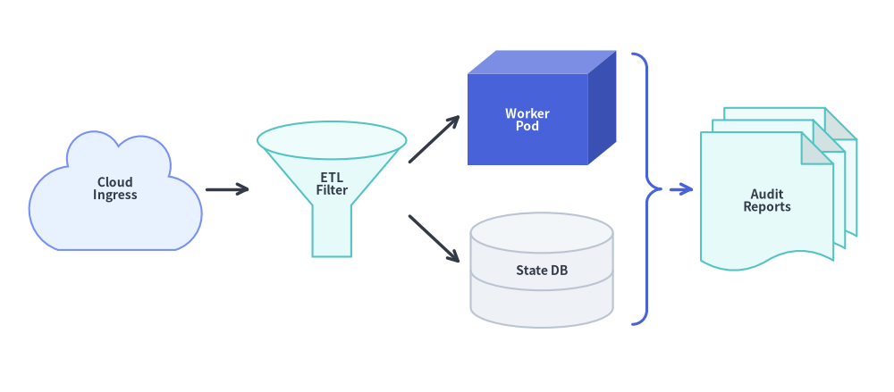
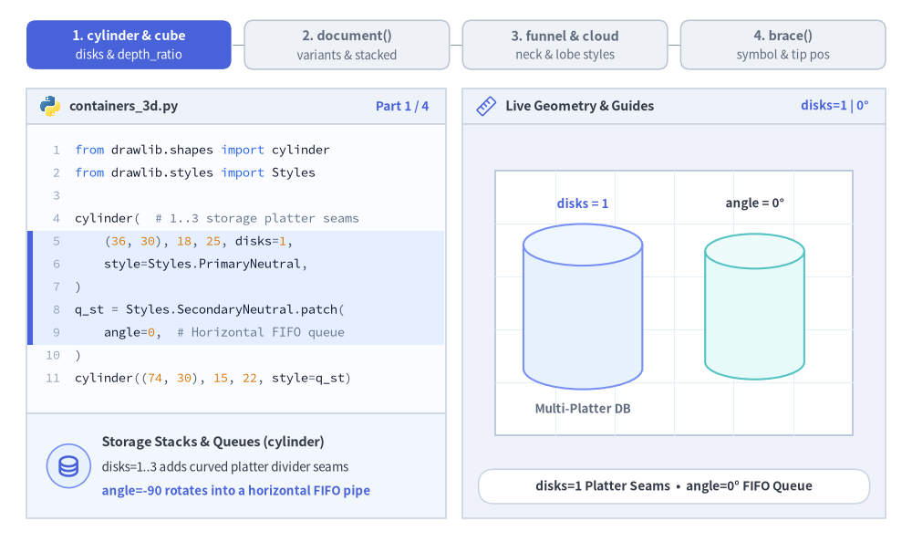
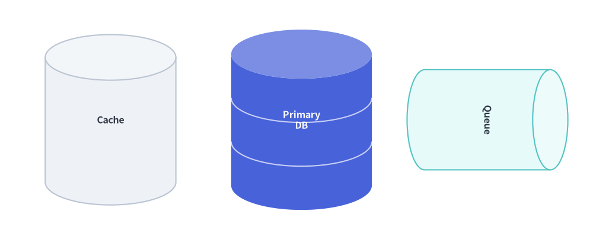
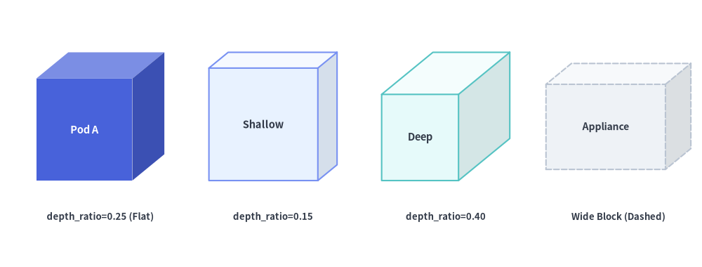
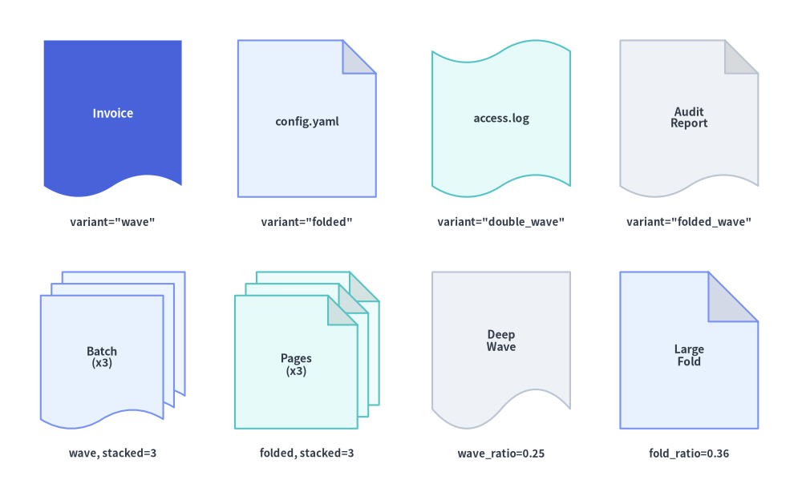
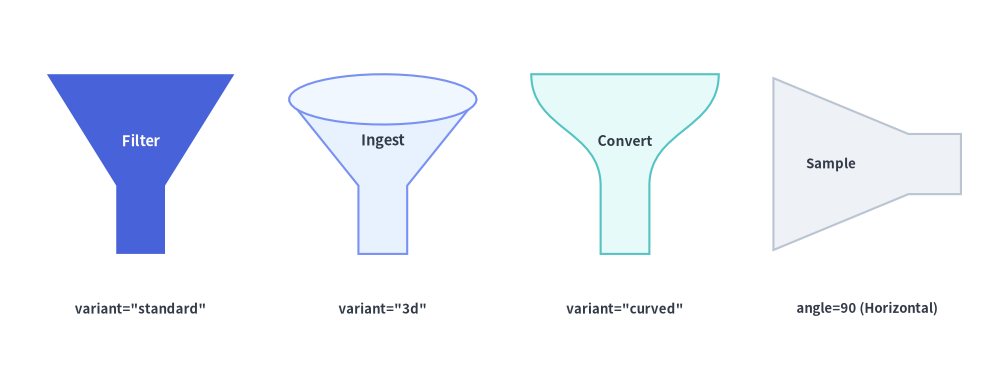
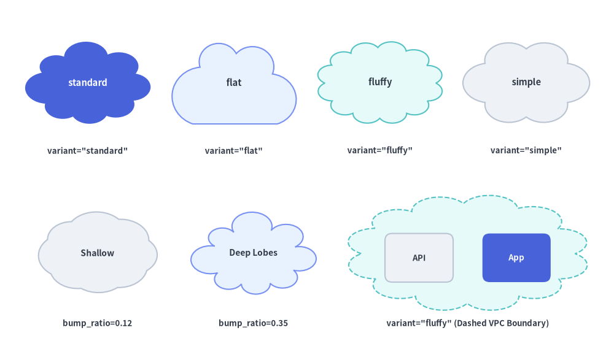
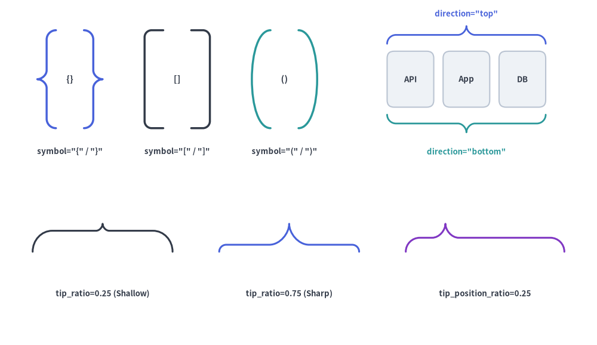

# 3D コンテナ・フロー・グルーピング

`drawlib.shapes` の **3D コンテナ・フロー・グルーピング** カテゴリは、**6 種類のアーキテクチャ・パイプライン向けプリミティブ** を提供します。マルチディスク対応の 3D ストレージシリンダー（`cylinder`）、3 面シェーディング付きの 3D キューブ（`cube`）、単枚または積層ドキュメント／ファイルカード（`document`）、データフィルタリングおよびコンバージョンファネル（`funnel`）、3 次ベジェ曲線によるクラウドノード・VPC 境界（`cloud`）、そして波括弧・角括弧・丸括弧のグルーピング括弧（`brace`）を利用できます。


<figure class="drawlib-image" style="text-align: center;">
  
  <figcaption class="drawlib-caption">クラウド Ingress・3D フィルタリングファネル・キューブ・DB シリンダー・ブレース・積層ドキュメントの組み合わせ</figcaption>
</figure>

<details class="drawlib-code-details">
<summary>Source Code</summary>

```python
from drawlib.canvas import save, setup
from drawlib.lines import line
from drawlib.shapes import brace, cloud, cube, cylinder, document, funnel
from drawlib.styles import Styles
from drawlib.text import text

setup(width=132, height=58)

lbl_dark = Styles.DarkBold.patch(text_size=10.0)
lbl_white = Styles.WhiteBold.patch(text_size=10.0)

# 1. Cloud Ingress
cloud(
    (17, 30),
    width=26,
    height=18,
    variant="flat",
    style=Styles.PrimaryNeutral,
    text="Cloud\nIngress",
    text_style=lbl_dark,
)

# 2. 3D Filtering Funnel
funnel(
    (49, 30),
    width=22,
    height=20,
    variant="3d",
    style=Styles.SecondaryNeutral,
    text="ETL\nFilter",
    text_style=lbl_dark.patch(xy_shift=(0, -1.8)),
)

# 3. 3D Worker Cube & 2-Disk State DB Cylinder
cube(
    (80, 42),
    width=22,
    height=17,
    depth_ratio=0.25,
    style=Styles.PrimaryFlat,
    text="Worker\nPod",
    text_style=lbl_white,
)
cylinder(
    (80, 18),
    width=21,
    height=17,
    disks=2,
    style=Styles.Neutral,
    text="State DB",
    text_style=lbl_dark,
)

# 4. Curly Brace + Stacked Audit Documents
brace(
    (95.5, 30),
    width=4.2,
    height=40,
    symbol="}",
    style=Styles.PrimaryBold.patch(line_width=2.2),
)
document(
    (115, 30),
    width=23,
    height=24,
    variant="folded_wave",
    stacked=3,
    style=Styles.SecondaryNeutral,
    text="Audit\nReports",
    text_style=lbl_dark,
)

line((30.5, 30), (37, 30), arrow_head="->", style=Styles.DarkBold)
line((60.5, 34), (68, 41), arrow_head="->", style=Styles.DarkBold)
line((60.5, 26), (68, 19), arrow_head="->", style=Styles.DarkBold)
line((99, 30), (102.5, 30), arrow_head="->", style=Styles.PrimaryBold)

save()
```

</details>


---

## 1. 基本の幾何構造とコンセプト

このカテゴリの全 6 プリミティブは、外接バウンディングボックスの中心座標 `xy` を基準（アンカー）とし、3D 投影・波形・クラウドのローブ・括弧のスパインをすべて厳密に `(width, height)` の内側へ正規化します。マルチプラッタの `disks` や `angle=-90` 回転、3 面自動陰影の `depth_ratio`、`document` の各バリエーションとシート積層、`funnel` のネック比率、正規化された `cloud` ローブ、そして先端位置をスライドできる `brace` が各コンポーネントをどのように変形させるかを確認してみましょう。


<figure class="drawlib-image" style="text-align: center;">
  
  <figcaption class="drawlib-caption">パラメータ＆ジオメトリツアー: cylinder・cube・document・funnel・cloud・brace のライブ変形（APNG アニメーション）</figcaption>
</figure>


<div class="drawlib-source-link">
  <a href="https://github.com/yuichi110/drawlib/blob/main/docs/docs_src/ja/02_drawing_primitives/shapes_container.md" target="_blank" rel="noopener noreferrer">GitHub でアニメーションのソースコードを見る &rarr;</a>
</div>

- **3D の奥行きとプラッタ段数（`cylinder`, `cube`）**: `cylinder` は `disks` によって円弧状のディスク継ぎ目線を追加し（`angle=-90` で水平キューに回転可能）、`cube` は `depth_ratio` に応じて 3 面の陰影を自動付与します。
- **ドキュメント形状とシート積層（`document`）**: 波状の底辺や暗色化された右上の角折れフラップ（`"wave"`, `"folded"`, `"folded_wave"`）を組み合わせ、`stacked > 1` では明度を上げた背面シートをカスケード積層します。
- **注ぎ口比率と正規化されたクラウドローブ（`funnel`, `cloud`）**: `funnel` は `neck_width_ratio` と `neck_height_ratio` で下部スパウトの寸法を調整し、`cloud` の全 variant は 3 次ベジェ曲線のローブを厳密に `(width, height)` の内側へ正規化します。
- **グルーピング括弧とスライド可能な先端（`brace`）**: 波括弧（`"{}"`）、角括弧（`"[]"`、`shape_r` で `90°` 角を丸め可能）、丸括弧（`"()"`）に対応し、`tip_position_ratio`（`0.0`〜`1.0`）によって波括弧の先端突起を狙ったターゲットノードへ合わせられます。

---

## 2. 3D コンテナ・フロー・グルーピングプリミティブの早見表

全 6 関数のアンカー基準、主なアーキテクチャ上の役割、形状引数、自動シェーディング・テキスト配置を以下のマトリクスで比較できます。

| 関数 | デフォルトアンカー | 主なアーキテクチャ上の役割 | バリエーションと主要な形状引数 | シェーディングとテキスト配置 |
| :--- | :--- | :--- | :--- | :--- |
| **`cylinder`** | 中央 `(cx, cy)` | リレーショナル DB、ディスクアレイ、オブジェクトストレージ、FIFO キュー | `disks: int = 1`, `style.patch(angle=-90)` | 上部の楕円キャップを自動で明度アップ。テキストはボディ中央に配置。 |
| **`cube`** | 中央 `(cx, cy)` | 3D コンピュートノード、コンテナ、ハードウェアアプライアンス | `depth_ratio: float \| None = None`（デフォルト `0.25`） | 3 面の自動シェーディング（正面・明度アップ上面・暗色化右側面）。テキストは正面中央に配置。 |
| **`document`** | 中央 `(cx, cy)` | 帳票出力、設定ファイル、ログ断片、レポート束 | `variant`（`"wave"`, `"folded"`, `"double_wave"`, `"folded_wave"`）, `stacked: int = 1`, `wave_ratio`, `fold_ratio` | 暗色化された角折れフラップと明度アップした背面スタックシート。テキストは最前面シートの中央に配置。 |
| **`funnel`** | 中央 `(cx, cy)` | データフィルタリング段、イベント絞り込み、コンバージョンファネル | `variant`（`"standard"`, `"3d"`, `"curved"`）, `neck_width_ratio`, `neck_height_ratio` | `"3d"` は陰影付きの楕円上部リムを描画。テキストは上部コーン中央に配置。 |
| **`cloud`** | 中央 `(cx, cy)` | 外部クラウド／SaaS ノード、VPC／WAN の破線境界領域 | `variant`（`"standard"`, `"flat"`, `"fluffy"`, `"simple"`）, `bump_ratio` | `(width, height)` に厳密に正規化された滑らかな 3 次ベジェローブ。 |
| **`brace`** | 中央 `(cx, cy)` | 波括弧・角括弧・丸括弧によるグルーピング装飾 | `symbol`（`"{}"`, `"[]"`, `"()"`）, `direction`（`"left"`, `"right"`, `"top"`, `"bottom"`）, `tip_ratio`, `tip_position_ratio` | `style.line_width` と `style.line_color` で制御される開いたベクターストローク。 |

---

## 3. 3D シリンダーとデータベーススタック (`cylinder`)

リレーショナルデータベース、オブジェクトストレージバケット、ディスクアレイ、メッセージキュー向けに、`cylinder` は自動的に明るくシェーディングされた楕円形の上面キャップを持つ 3D 円筒コンテナを描画します。

```python
cylinder(
    xy: tuple[float, float],
    width: float,
    height: float,
    *,
    style: Style,
    disks: int = 1,
    text: str = "",
    text_style: Style | None = None,
) -> None
```

### パラメータリファレンス

| パラメータ | 型 | デフォルト | 説明 |
| :--- | :--- | :--- | :--- |
| `xy` | `tuple[float, float]` | *必須* | シリンダー外接バウンディングボックスの中心座標 `(x, y)`。 |
| `width` | `float` | *必須* | シリンダーの水平全幅（`> 0`）。 |
| `height` | `float` | *必須* | 上下の楕円キャップを含むシリンダーの垂直全高（`> 0`）。 |
| `disks` | `int` | `1` | 積層されるストレージディスクの段数（`>= 1`）。`disks >= 2` を指定すると、マルチプラッタのデータベースストレージを表す円弧状の水平分割線がボディに描画されます。 |
| `style` | `Style` | *必須* | 塗りつぶしと枠線のスタイル。上部の楕円キャップは `style.shape_fill_color` から自動的に明度アップされます。FIFO メッセージキューやパイプライン向けに水平横向きへ回転させるには `style.patch(angle=-90)` を指定します。 |
| `text` / `text_style` | `str` / `Style \| None` | `""` / `None` | 中央配置されるテキストラベルと任意のタイポグラフィ上書き設定。 |


```python
from drawlib.canvas import save, setup
from drawlib.shapes import cylinder
from drawlib.styles import Styles

setup(width=118, height=48)

# 1. Single-tier cache cylinder
cylinder(
    (22, 24),
    width=26,
    height=34,
    style=Styles.Neutral,
    text="Cache",
    text_style=Styles.DarkBold.patch(text_size=11.5),
)

# 2. 3-disk database stack (disks=3)
cylinder(
    (60, 24),
    width=28,
    height=36,
    disks=3,
    style=Styles.PrimaryFlat,
    text="Primary\nDB",
    text_style=Styles.WhiteBold.patch(text_size=11.5),
)

# 3. Horizontal rotated cylinder (angle=-90 for message queue)
cylinder(
    (97, 24),
    width=20,
    height=32,
    style=Styles.SecondaryNeutral.patch(angle=-90),
    text="Queue",
    text_style=Styles.DarkBold.patch(text_size=11.5),
)

save()
```

<figure class="drawlib-image" style="text-align: center;">
  
  <figcaption class="drawlib-caption">単一シリンダー、3 ディスクのデータベーススタック、水平回転させたメッセージキュー</figcaption>
</figure>


---

## 4. 3D キューブと直方体ブロック (`cube`)

`cylinder` を補完するプリミティブとして、`cube` は中心座標 `xy` のバウンディングボックス `(width, height)` に厳密に収まる斜投影（オブリーク）の 3D キューブまたは直方体ボックスを描画します。

```python
cube(
    xy: tuple[float, float],
    width: float,
    height: float,
    *,
    depth_ratio: float | None = None,
    style: Style,
    text: str = "",
    text_style: Style | None = None,
) -> None
```

### パラメータリファレンス

| パラメータ | 型 | デフォルト | 説明 |
| :--- | :--- | :--- | :--- |
| `xy` | `tuple[float, float]` | *必須* | 外接 3D バウンディングボックスの中心座標 `(x, y)`。 |
| `width` | `float` | *必須* | 右側面への斜投影部分を含む 3D ボックスの厳密な外接水平幅（`> 0`）。 |
| `height` | `float` | *必須* | 上面への斜投影部分を含む 3D ボックスの厳密な外接垂直高さ（`> 0`）。 |
| `depth_ratio` | `float \| None` | `None` | `min(width, height)` に対する 3D 斜投影の奥行き比率を `(0.0, 1.0)` で指定します。`None` の場合はデフォルトの `0.25` になります。小さい値（`0.15`）では薄い 3D カードになり、大きい値（`0.40`）では奥行きのある立体ブロックになります。 |
| `style` | `Style` | *必須* | 塗りつぶし、枠線（`shape_line_color`, `shape_line_width`, `shape_line_style`）、および回転（`angle`）を制御するスタイル。 |
| `text` / `text_style` | `str` / `Style \| None` | `""` / `None` | 外接ボックス全体ではなく **正面（フロントフェイス）** の中央に自動配置されるラベル。3D の稜線とテキストが干渉しません。 |

### 3 面の自動シェーディングとストロークの仕組み
- **3 面の自動陰影付け**: `style.shape_fill_color` を基に、Drawlib が 3 つの面の明度を自動計算します。
  1. **正面（Front Face）**: 基準となる `style.shape_fill_color`。
  2. **上面（Top Face）**: 上方からのライティングを再現するよう白方向へ明度アップ（標準塗りで `+28%`、高輝度なニュートラル塗りで `+55%`）。
  3. **右側面（Right Side Face）**: 自然な立体影を生むよう暗色化（標準塗りで `×0.82`、ニュートラル塗りで `×0.92`）。
- **単一統合ストロークパス**: 外周の輪郭線と内部の 3 本の Y 字稜線は単一の統合 `PathPatch` として描画されるため、`Dashed` や `Dotted` の破線・点線スタイルでも共有辺で線が二重に重なることはありません。


```python
from drawlib.canvas import save, setup
from drawlib.shapes import cube
from drawlib.styles import Styles
from drawlib.text import text

setup(width=126, height=48)

# 1. Standard Flat Cube (depth_ratio=0.25 default)
cube(
    (18, 27),
    width=23,
    height=23,
    style=Styles.PrimaryFlat,
    text="Pod A",
    text_style=Styles.WhiteBold.patch(text_size=10.5),
)
text((18, 9), "depth_ratio=0.25 (Flat)", style=Styles.DarkBold.patch(text_size=9.5))

# 2. Shallow 3D Block (depth_ratio=0.15)
cube(
    (49, 27),
    width=23,
    height=23,
    depth_ratio=0.15,
    style=Styles.PrimaryNeutral,
    text="Shallow",
    text_style=Styles.DarkBold.patch(text_size=10.5),
)
text((49, 9), "depth_ratio=0.15", style=Styles.DarkBold.patch(text_size=9.5))

# 3. Deep 3D Cube (depth_ratio=0.40)
cube(
    (80, 27),
    width=23,
    height=23,
    depth_ratio=0.40,
    style=Styles.SecondaryNeutral,
    text="Deep",
    text_style=Styles.DarkBold.patch(text_size=10.5),
)
text((80, 9), "depth_ratio=0.40", style=Styles.DarkBold.patch(text_size=9.5))

# 4. Wide Hardware Appliance Block (26x19, dashed)
cube(
    (111, 27),
    width=26,
    height=19,
    depth_ratio=0.24,
    style=Styles.Neutral.patch(shape_line_style="dashed"),
    text="Appliance",
    text_style=Styles.DarkBold.patch(text_size=10.0),
)
text((111, 9), "Wide Block (Dashed)", style=Styles.DarkBold.patch(text_size=9.5))

save()
```

<figure class="drawlib-image" style="text-align: center;">
  
  <figcaption class="drawlib-caption">多様なスタイルと depth_ratio による 3D キューブおよび直方体ブロック</figcaption>
</figure>


---

## 5. ドキュメント・ファイル・複数枚スタック (`document`)

フローチャートの出力工程、設定／ソースファイル、ログストリームの断片、複数ページのレポート束向けに、`document` は 4 種類の `variant` シルエットと複数シートのカスケード積層（`stacked >= 1`）を提供します。

```python
document(
    xy: tuple[float, float],
    width: float,
    height: float,
    *,
    variant: Literal[
        "wave", "standard",
        "folded", "page", "note",
        "double_wave", "snippet",
        "folded_wave", "report",
    ] = "wave",
    stacked: int = 1,
    wave_ratio: float | None = None,
    fold_ratio: float | None = None,
    style: Style,
    text: str = "",
    text_style: Style | None = None,
) -> None
```

### パラメータリファレンス

| パラメータ | 型 | デフォルト | 説明 |
| :--- | :--- | :--- | :--- |
| `xy` | `tuple[float, float]` | *必須* | 外接ドキュメントバウンディングボックス（積層された全シートを含む）の中心座標 `(x, y)`。 |
| `width` | `float` | *必須* | ドキュメントバウンディングボックスの水平全幅（`> 0`）。 |
| `height` | `float` | *必須* | ドキュメントバウンディングボックスの垂直全高（`> 0`）。 |
| `variant` | `DocumentVariant` | `"wave"` | ドキュメントシートのシルエットスタイル（下記の **Document の `variant` リファレンス** を参照）。 |
| `stacked` | `int` | `1` | 重ねて表示するドキュメントシートの枚数（`>= 1`）。`stacked > 1`（例: `2` や `3`）を指定すると、`(width, height)` の内側に収まるよう奥の右上から手前の左下へ向かってシートがカスケード配置され、背面シートは自動的に明るくシェーディングされます。 |
| `wave_ratio` | `float \| None` | `None` | シート高さに対する波形の上下振幅比率を `(0.0, 1.0)` で指定します。デフォルトは `0.14`。`"wave"`, `"double_wave"`, `"folded_wave"` で有効です。 |
| `fold_ratio` | `float \| None` | `None` | `min(sheet_w, sheet_h)` に対する右上の角折れ（ドッグイヤー）サイズ比率を `(0.0, 1.0)` で指定します。デフォルトは `0.24`。`"folded"` および `"folded_wave"` で有効です。 |
| `style` | `Style` | *必須* | 塗りつぶし、枠線、および回転（`angle`）を制御するスタイル。角折れ付きの variant では、立体的なコントラストを生むよう三角形の折り返しフラップが自動的に暗色化されます。 |
| `text` / `text_style` | `str` / `Style \| None` | `""` / `None` | **最前面のシート** 上で視覚的に中央配置されるテキストラベル（下端の波や右上の角折れと干渉しないよう自動オフセット補正されます）。 |

### Document の `variant` リファレンス

| `variant` | 使用可能なエイリアス | 上辺 | 下辺 | 有効な比率引数 | 主なユースケース |
| :--- | :--- | :--- | :--- | :--- | :--- |
| **`"wave"`** *(デフォルト)* | `"standard"` | 直線 | 3 次ベジェ S 字波形 | `wave_ratio` | 定番の ISO フローチャート帳票／出力シンボル、請求書、生成アーティファクト。 |
| **`"folded"`** | `"page"`, `"note"` | 右上の角折れ（ドッグイヤー） | 直線 | `fold_ratio` | 設定ファイル（`config.yaml`）、ソースコードファイル、Markdown／PDF ページ、UML ノート。 |
| **`"double_wave"`** | `"snippet"` | 3 次ベジェ S 字波形 | 3 次ベジェ S 字波形 | `wave_ratio` | 連続するログストリーム（`access.log`）、抜粋テキスト断片、データストリームチャンク。 |
| **`"folded_wave"`** | `"report"` | 右上の角折れ（ドッグイヤー） | 3 次ベジェ S 字波形 | `wave_ratio`, `fold_ratio` | ファイルらしさと帳票の波形表現を兼ね備えた複数ページの技術レポート、仕様書、監査ログ。 |


```python
from drawlib.canvas import save, setup
from drawlib.shapes import document
from drawlib.styles import Styles
from drawlib.text import text

setup(width=128, height=78)

# Row 1: The 4 Document Variants (stacked=1)
row1 = [
    ("wave", "Invoice", 18, Styles.PrimaryFlat, Styles.WhiteBold.patch(text_size=10.5), 'variant="wave"'),
    ("folded", "config.yaml", 49, Styles.PrimaryNeutral, Styles.DarkBold.patch(text_size=10.0), 'variant="folded"'),
    ("double_wave", "access.log", 80, Styles.SecondaryNeutral, Styles.DarkBold.patch(text_size=10.0), 'variant="double_wave"'),
    ("folded_wave", "Audit\nReport", 110, Styles.Neutral, Styles.DarkBold.patch(text_size=10.0), 'variant="folded_wave"'),
]
for var, lbl, cx, st, tst, cap in row1:
    document((cx, 59), width=22, height=25, variant=var, style=st, text=lbl, text_style=tst)
    text((cx, 42.5), cap, style=Styles.DarkBold.patch(text_size=9.5))

# Row 2: Multi-sheet stacking (stacked=3) and wave_ratio / fold_ratio customization
document(
    (18, 22),
    width=23,
    height=25,
    variant="wave",
    stacked=3,
    style=Styles.PrimaryNeutral,
    text="Batch\n(x3)",
    text_style=Styles.DarkBold.patch(text_size=10.0),
)
text((18, 5.5), "wave, stacked=3", style=Styles.DarkBold.patch(text_size=9.5))

document(
    (49, 22),
    width=23,
    height=25,
    variant="folded",
    stacked=3,
    style=Styles.SecondaryNeutral,
    text="Pages\n(x3)",
    text_style=Styles.DarkBold.patch(text_size=10.0),
)
text((49, 5.5), "folded, stacked=3", style=Styles.DarkBold.patch(text_size=9.5))

document(
    (80, 22),
    width=22,
    height=25,
    variant="wave",
    wave_ratio=0.25,
    style=Styles.Neutral,
    text="Deep\nWave",
    text_style=Styles.DarkBold.patch(text_size=10.0),
)
text((80, 5.5), "wave_ratio=0.25", style=Styles.DarkBold.patch(text_size=9.5))

document(
    (110, 22),
    width=22,
    height=25,
    variant="folded",
    fold_ratio=0.36,
    style=Styles.PrimaryNeutral,
    text="Large\nFold",
    text_style=Styles.DarkBold.patch(text_size=10.0),
)
text((110, 5.5), "fold_ratio=0.36", style=Styles.DarkBold.patch(text_size=9.5))

save()
```

<figure class="drawlib-image" style="text-align: center;">
  
  <figcaption class="drawlib-caption">4 種類のドキュメント variant（上段）と複数枚スタック・比率のカスタマイズ（下段）</figcaption>
</figure>


---

## 6. データフィルタリングとコンバージョンファネル (`funnel`)

ETL データフィルタリングパイプライン、イベント重複排除ステージ、レートリミッタ、コンバージョンファネル向けに、`funnel` は広い上部コーンから細い下部スパウト（注ぎ口）へと絞り込まれる漏斗形状を描画します。

```python
funnel(
    xy: tuple[float, float],
    width: float,
    height: float,
    *,
    variant: Literal[
        "standard", "flat",
        "3d", "cylinder",
        "curved",
    ] = "standard",
    neck_width_ratio: float | None = None,
    neck_height_ratio: float | None = None,
    style: Style,
    text: str = "",
    text_style: Style | None = None,
) -> None
```

### パラメータおよび `variant` リファレンス

| パラメータ | 型 | デフォルト | 説明 |
| :--- | :--- | :--- | :--- |
| `xy` | `tuple[float, float]` | *必須* | ファネルバウンディングボックスの中心座標 `(x, y)`。 |
| `width` / `height` | `float` | *必須* | 上端リムの水平全幅（`> 0`）と垂直全高（`> 0`）。 |
| `variant` | `FunnelVariant` | `"standard"` | ファネルのシルエットおよびシェーディング形式（下記の表を参照）。 |
| `neck_width_ratio` | `float \| None` | `None` | `width` に対する下部ネック幅の比率を `[0.08, 0.85]` で指定します。`None` の場合はデフォルトの `0.28` になります。 |
| `neck_height_ratio` | `float \| None` | `None` | `height` に対する下部ネック高さの比率を `[0.05, 0.75]` で指定します。`None` の場合はデフォルトの `0.36` になります。 |
| `style` | `Style` | *必須* | 塗りつぶし、枠線、および回転（`angle`、例: 左から右への水平フィルタには `angle=90` または `-90`）を制御するスタイル。 |
| `text` / `text_style` | `str` / `Style \| None` | `""` / `None` | 広い上部コーン領域に自動で中央配置されるテキストラベルと任意のスタイル。 |

| `variant` | 使用可能なエイリアス | 幾何構造とシェーディング | 主なユースケース |
| :--- | :--- | :--- | :--- |
| **`"standard"`** *(デフォルト)* | `"flat"` | フラットな 2D 台形の上部コーン＋垂直な矩形スパウト | すっきりした 2D フローチャートのフィルタゲート、SQL `WHERE` フィルタ、水平パイプラインの絞り込み段。 |
| **`"3d"`** | `"cylinder"` | 暗色シェーディングされた楕円形の上部開口リムを持つ 3D ファネル | データレイクのインジェストファネル、テレメトリコレクタ、`cylinder` や `cube` と並べる 3D アーキテクチャ図。 |
| **`"curved"`** | — | ネック部へ滑らかに繋がる 3 次ベジェ S 字カーブの側壁 | マーケティング／分析のコンバージョンファネル、滑らかなストリーム集約ノード。 |


```python
from drawlib.canvas import save, setup
from drawlib.shapes import funnel
from drawlib.styles import Styles
from drawlib.text import text

setup(width=128, height=48)

lbl = Styles.DarkBold.patch(text_size=9.5)

# 1. Standard 2D funnel
funnel(
    (18, 27),
    width=24,
    height=23,
    variant="standard",
    style=Styles.PrimaryFlat,
    text="Filter",
    text_style=Styles.WhiteBold.patch(text_size=10.5),
)
text((18, 8.5), 'variant="standard"', style=lbl)

# 2. 3D shaded elliptical-top funnel
funnel(
    (49, 27),
    width=24,
    height=23,
    variant="3d",
    style=Styles.PrimaryNeutral,
    text="Ingest",
    text_style=Styles.DarkBold.patch(text_size=10.5),
)
text((49, 8.5), 'variant="3d"', style=lbl)

# 3. Smooth cubic-Bézier curved funnel
funnel(
    (80, 27),
    width=24,
    height=23,
    variant="curved",
    style=Styles.SecondaryNeutral,
    text="Convert",
    text_style=Styles.DarkBold.patch(text_size=10.0),
)
text((80, 8.5), 'variant="curved"', style=lbl)

# 4. Horizontal rotated funnel (angle=90 -> left-to-right reducer)
funnel(
    (111, 27),
    width=22,
    height=24,
    variant="standard",
    neck_width_ratio=0.35,
    neck_height_ratio=0.28,
    style=Styles.Neutral.patch(angle=90),
    text="Sample",
    text_style=Styles.DarkBold.patch(text_size=9.5, angle=0, xy_shift=(0, 1.5)),
)
text((111, 8.5), "angle=90 (Horizontal)", style=lbl)

save()
```

<figure class="drawlib-image" style="text-align: center;">
  
  <figcaption class="drawlib-caption">3 種類のファネル variant（standard・3d・curved）、ネック比率の調整、水平回転</figcaption>
</figure>


---

## 7. クラウドノードとネットワーク境界 (`cloud`)

`cloud` は、中心座標 `xy` の外接バウンディングボックス `(width, height)` に厳密に収まるよう正規化された滑らかな 3 次ベジェ曲線のクラウドシルエットを描画します。

```python
cloud(
    xy: tuple[float, float],
    width: float,
    height: float,
    *,
    variant: Literal[
        "standard",
        "flat", "flat_bottom",
        "fluffy", "dense",
        "simple", "minimal",
    ] = "standard",
    bump_ratio: float | None = None,
    style: Style,
    text: str = "",
    text_style: Style | None = None,
) -> None
```

### パラメータリファレンス

| パラメータ | 型 | デフォルト | 説明 |
| :--- | :--- | :--- | :--- |
| `xy` | `tuple[float, float]` | *必須* | クラウドバウンディングボックスの中心座標 `(x, y)`。 |
| `width` | `float` | *必須* | クラウドの厳密な外接水平幅（`> 0`）。 |
| `height` | `float` | *必須* | クラウドの厳密な外接垂直高さ（`> 0`）。 |
| `variant` | `CloudVariant` | `"standard"` | クラウドのシルエットスタイル（下記の **Cloud の `variant` リファレンス** を参照）。 |
| `bump_ratio` | `float \| None` | `None` | 外向きローブ（もこもこした膨らみ）の深さ比率を `(0.0, 1.0)` で指定します。`None` の場合は選択した `variant` に最適なデフォルト値（`0.20`〜`0.24`）が使用されます。小さい値（`0.12`）では控えめで浅いクラウドになり、大きい値（`0.34`）では深く際立ったローブになります。 |
| `style` | `Style` | *必須* | 塗りつぶし、枠線（VPC／サブネット境界には `Dashed` が最適）、および回転（`angle`）を制御するスタイル。 |
| `text` / `text_style` | `str` / `Style \| None` | `""` / `None` | 中央配置されるテキストラベルと任意のタイポグラフィ上書き設定。 |

### Cloud の `variant` リファレンス

| `variant` | 使用可能なエイリアス | ローブ構造 | デフォルト `bump_ratio` | 主なユースケース |
| :--- | :--- | :--- | :---: | :--- |
| **`"standard"`** *(デフォルト)* | — | 全周にわたる 8 個の非対称ローブ | `0.22` | 汎用的な「インターネット」、SaaS、外部ネットワークノード。 |
| **`"flat"`** | `"flat_bottom"` | 平坦な水平底辺＋上部の 4 個のドーム | `0.24` | 内部のテキストやアイコンに高い視覚的安定感を与える独立クラウドサービスカードやゲートウェイノード。 |
| **`"fluffy"`** | `"dense"` | 全周にわたる 12 個の細かいローブ | `0.20` | 大規模な VPC、WAN、マルチノードクラスタの境界領域（特に `shape_line_style="dashed"` との併用が効果的）。 |
| **`"simple"`** | `"minimal"` | 幅広で対称な 6 個のローブ | `0.24` | コンパクトなクラウドバッジ、小型アイコン、思考の吹き出し。 |


```python
from drawlib.canvas import save, setup
from drawlib.shapes import cloud, rectangle
from drawlib.styles import Styles
from drawlib.text import text

setup(width=126, height=74)

# Row 1: The 4 Cloud Variants
variants = [
    ("standard", 18, Styles.PrimaryFlat, Styles.WhiteBold.patch(text_size=10.5)),
    ("flat", 48, Styles.PrimaryNeutral, Styles.DarkBold.patch(text_size=10.5)),
    ("fluffy", 78, Styles.SecondaryNeutral, Styles.DarkBold.patch(text_size=10.5)),
    ("simple", 108, Styles.Neutral, Styles.DarkBold.patch(text_size=10.5)),
]
for v_name, cx, st, tst in variants:
    cloud((cx, 57), width=26, height=17, variant=v_name, style=st, text=v_name, text_style=tst)
    text((cx, 43), f'variant="{v_name}"', style=Styles.DarkBold.patch(text_size=9.5))

# Row 2 Left: Shallow vs Deep bump_ratio
cloud(
    (20, 22),
    width=26,
    height=17,
    variant="standard",
    bump_ratio=0.12,
    style=Styles.Neutral,
    text="Shallow",
    text_style=Styles.DarkBold.patch(text_size=10.0),
)
text((20, 7.5), "bump_ratio=0.12", style=Styles.DarkBold.patch(text_size=9.5))

cloud(
    (52, 22),
    width=26,
    height=17,
    variant="standard",
    bump_ratio=0.35,
    style=Styles.PrimaryNeutral,
    text="Deep Lobes",
    text_style=Styles.DarkBold.patch(text_size=10.0),
)
text((52, 7.5), "bump_ratio=0.35", style=Styles.DarkBold.patch(text_size=9.5))

# Row 2 Right: Large fluffy dashed VPC enclosure containing service cards
cloud((96, 22), width=50, height=24, variant="fluffy", style=Styles.SecondaryNeutral.patch(shape_line_style="dashed"))
rectangle((86, 21), width=14, height=10, style=Styles.Neutral.patch(shape_r=1.5), text="API", text_style=Styles.DarkBold.patch(text_size=9.5))
rectangle((106, 21), width=14, height=10, style=Styles.PrimaryFlat.patch(shape_r=1.5), text="App", text_style=Styles.WhiteBold.patch(text_size=9.5))
text((96, 7.5), 'variant="fluffy" (Dashed VPC Boundary)', style=Styles.DarkBold.patch(text_size=9.5))

save()
```

<figure class="drawlib-image" style="text-align: center;">
  
  <figcaption class="drawlib-caption">4 種類のクラウド variant（上段）と bump_ratio の比較・破線 VPC 境界での利用例（下段）</figcaption>
</figure>


---

## 8. グルーピング用の波括弧・角括弧・丸括弧 (`brace`)

`brace` は、波括弧（`{`, `}`）・角括弧（`[`, `]`）・丸括弧（`(`, `)`）のグルーピング括弧を上下左右の 4 方向（`"left"`, `"right"`, `"top"`, `"bottom"`）のいずれにも描画します。線の太さは `style.line_width` で制御します。

```python
brace(
    xy: tuple[float, float],
    width: float,
    height: float,
    *,
    symbol: Literal[
        "{", "}", "{}", "curly",
        "[", "]", "[]", "square",
        "(", ")", "()", "round",
    ] = "{",
    direction: Literal["left", "right", "top", "bottom"] | None = None,
    tip_ratio: float | None = None,
    tip_position_ratio: float | None = None,
    style: Style,
    text: str = "",
    text_style: Style | None = None,
) -> None
```

### パラメータリファレンス

| パラメータ | 型 | デフォルト | 説明 |
| :--- | :--- | :--- | :--- |
| `xy` | `tuple[float, float]` | *必須* | ブレースの外接バウンディングボックスの中心座標 `(x, y)`。 |
| `width` | `float` | *必須* | バウンディングボックスの水平幅（`> 0`）。縦向きブレース（`"left"` / `"right"`）では括弧の奥行き、横向きブレース（`"top"` / `"bottom"`）ではスパン長になります。 |
| `height` | `float` | *必須* | バウンディングボックスの垂直高さ（`> 0`）。縦向きブレース（`"left"` / `"right"`）ではスパン長、横向きブレース（`"top"` / `"bottom"`）では括弧の奥行きになります。 |
| `symbol` | `BraceSymbol` | `"{"` | 括弧ファミリーおよびデフォルトの向き（下記の **`symbol` と `direction` のバリエーション** を参照）。 |
| `direction` | `BraceDirection \| None` | `None` | グループ対象領域のどの辺に括弧を配置するか（外側の背／先端が向く方向）を `"left"`, `"right"`, `"top"`, `"bottom"` から指定します（下記の表を参照）。 |
| `tip_ratio` | `float \| None` | `None` | **波括弧（`{}`）専用**: 括弧の奥行きのうち中央の外向き突起（ティップ）が占める割合を `(0.0, 1.0)` で指定します。デフォルトは `0.50`。大きい値（`0.70`）では鋭く突き出た先端になり、小さい値（`0.25`）では控えめな先端になります。 |
| `tip_position_ratio` | `float \| None` | `None` | **波括弧（`{}`）専用**: スパン軸に沿った中央突起の位置を `(0.0, 1.0)` で指定します（`"left"` / `"right"` では下から上、`"top"` / `"bottom"` では左から右へ計測）。デフォルトは `0.50`（対称な中央）。 |
| `style` | `Style` | *必須* | 線の太さは `style.line_width`（または `style.shape_line_width`）、色は `style.line_color`（または `style.shape_line_color`）、線種は `style.line_style`、回転は `style.angle` で制御します。角括弧 `"square"`（`[`, `]`）では、`style.shape_r` により 2 つの `90°` 角を丸められます。 |
| `text` / `text_style` | `str` / `Style \| None` | `""` / `None` | `xy` の中央に配置される任意のテキストラベルとタイポグラフィ上書き設定。 |

### `symbol` と `direction` のバリエーション

| `symbol` の値 | 括弧ファミリー | 自動 `direction`（`direction=None` 時） | 対応する形状モディファイア |
| :--- | :--- | :--- | :--- |
| **`"{"`**, **`"{}"`**, **`"curly"`** | 波括弧 `{` | `"left"`（先端が左を向き、両端が右へカール） | `tip_ratio`, `tip_position_ratio` |
| **`"}"`** | 波括弧 `}` | `"right"`（先端が右を向き、両端が左へカール） | `tip_ratio`, `tip_position_ratio` |
| **`"["`**, **`"[]"`**, **`"square"`** | 角括弧 `[` | `"left"`（背が左側、両端が右向き） | `style.patch(shape_r=...)` による角丸め |
| **`"]"`** | 角括弧 `]` | `"right"`（背が右側、両端が左向き） | `style.patch(shape_r=...)` による角丸め |
| **`"("`**, **`"()"`**, **`"round"`** | 丸括弧 `(` | `"left"`（弧が左へ膨らみ、両端が右向き） | 滑らかな 3 次ベジェ曲線アーチ |
| **`")"`** | 丸括弧 `)` | `"right"`（弧が右へ膨らみ、両端が左向き） | 滑らかな 3 次ベジェ曲線アーチ |

| `direction` の値 | 向き | 背／先端が向く方向 | 開口端が向く方向 |
| :--- | :--- | :--- | :--- |
| **`"left"`** | 縦向き（`span = height`） | 左（`-X`） | 右（`+X`、右側の要素群を囲む） |
| **`"right"`** | 縦向き（`span = height`） | 右（`+X`） | 左（`-X`、左側の要素群を囲む） |
| **`"top"`** | 横向き（`span = width`） | 上（`+Y`） | 下（`-Y`、下側の要素群を囲む） |
| **`"bottom"`** | 横向き（`span = width`） | 下（`-Y`） | 上（`+Y`、上側の要素群を囲む） |


```python
from drawlib.canvas import save, setup
from drawlib.shapes import brace, rectangle
from drawlib.styles import Styles
from drawlib.text import text

setup(width=128, height=74)

# Row 1 Left: Three Bracket Families: { } , [ ] , ( )
families = [
    ("{}", "{", "}", 15, Styles.PrimaryBold.patch(line_width=2.5)),
    ("[]", "[", "]", 38, Styles.DarkBold.patch(line_width=2.5, shape_r=1.5)),
    ("()", "(", ")", 61, Styles.SecondaryBold.patch(line_width=2.5)),
]
for label, sym_l, sym_r, cx, st in families:
    brace((cx - 5, 57), width=4.0, height=21, symbol=sym_l, style=st)
    brace((cx + 5, 57), width=4.0, height=21, symbol=sym_r, style=st)
    text((cx, 57), label, style=Styles.DarkBold.patch(text_size=10.5))
    text((cx, 41.5), f'symbol="{sym_l}" / "{sym_r}"', style=Styles.DarkBold.patch(text_size=9.5))

# Row 1 Right: All 4 Directions (top, bottom, left, right) around a card group
for idx, name in enumerate(("API", "App", "DB")):
    rx = 88 + idx * 12
    rectangle((rx, 57), width=10, height=12, style=Styles.Neutral.patch(shape_r=1.5), text=name, text_style=Styles.DarkBold.patch(text_size=9.5))

brace((100, 66.5), width=34, height=3.8, symbol="{", direction="top", style=Styles.PrimaryBold.patch(line_width=2.0))
text((100, 71.0), 'direction="top"', style=Styles.PrimaryBold.patch(text_size=9.5))

brace((100, 47.5), width=34, height=3.8, symbol="{", direction="bottom", style=Styles.SecondaryBold.patch(line_width=2.0))
text((100, 41.5), 'direction="bottom"', style=Styles.SecondaryBold.patch(text_size=9.5))

# Row 2: Curly brace tip_ratio & tip_position_ratio variations
brace((22, 23), width=30, height=6.0, symbol="{", direction="top", tip_ratio=0.25, style=Styles.DarkBold.patch(line_width=2.2))
text((22, 11), "tip_ratio=0.25 (Shallow)", style=Styles.DarkBold.patch(text_size=9.5))

brace((62, 23), width=30, height=6.0, symbol="{", direction="top", tip_ratio=0.75, style=Styles.PrimaryBold.patch(line_width=2.2))
text((62, 11), "tip_ratio=0.75 (Sharp)", style=Styles.DarkBold.patch(text_size=9.5))

brace((104, 23), width=34, height=6.0, symbol="{", direction="top", tip_position_ratio=0.25, style=Styles.AccentBold.patch(line_width=2.2))
text((104, 11), "tip_position_ratio=0.25", style=Styles.DarkBold.patch(text_size=9.5))

save()
```

<figure class="drawlib-image" style="text-align: center;">
  
  <figcaption class="drawlib-caption">括弧ファミリー（{}, [], ()）、4 方向の配置（left, right, top, bottom）、波括弧の先端比率</figcaption>
</figure>


