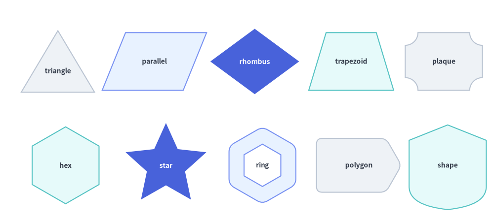
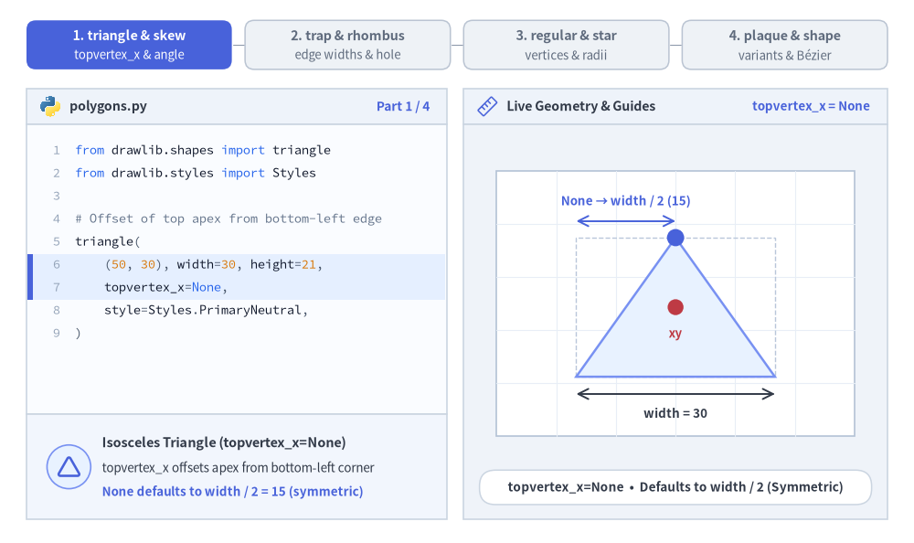
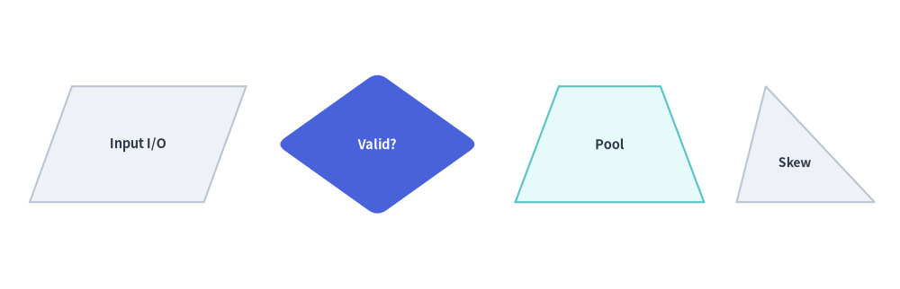
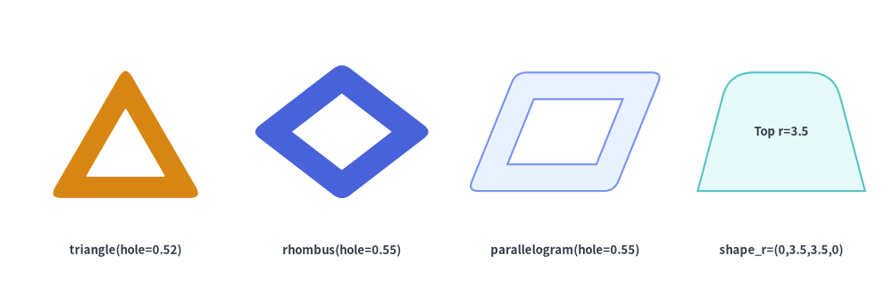
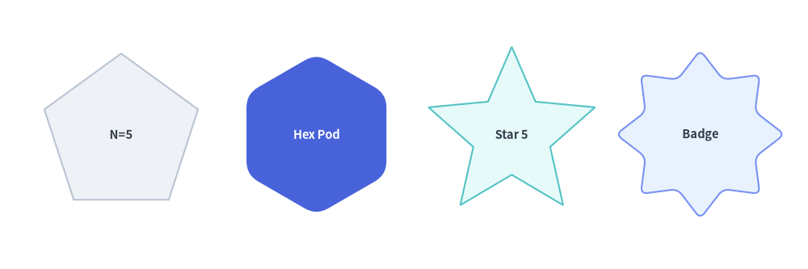
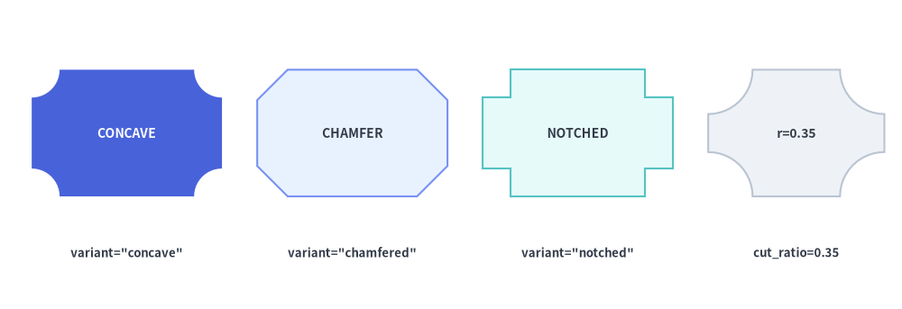
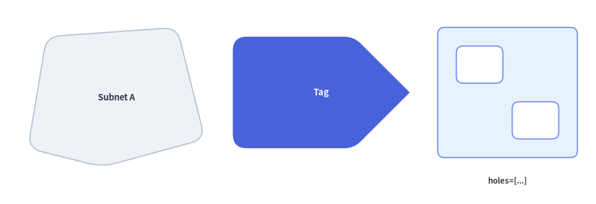
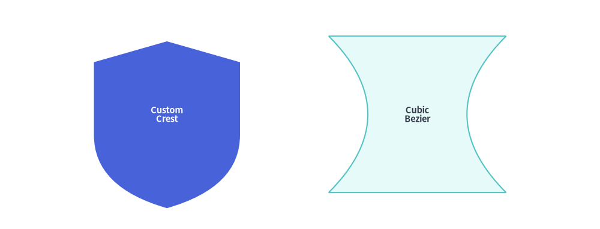

# 多角形とカスタムパス

`drawlib.shapes` の**多角形とカスタムパス（Polygons & Custom Paths）**カテゴリは、**9 種類の幾何図形・パスプリミティブ**を提供します。具体的には、平面の三角形および四角形（`triangle`, `parallelogram`, `trapezoid`, `rhombus`）、回転対称な多角形（`regularpolygon`, `star`）、四隅を切り欠いた装飾フレーム（`plaque`）、任意座標による多角形（`polygon`）、そして低レベルのベジェ曲線ベクターパスビルダ（`shape`）が含まれます。


<figure class="drawlib-image" style="text-align: center;">
  
  <figcaption class="drawlib-caption">drawlib.shapes における 9 種類の多角形・プラーク・カスタムベクターパスプリミティブの概要</figcaption>
</figure>

<details class="drawlib-code-details">
<summary>Source Code</summary>

```python
from drawlib.canvas import save, setup
from drawlib.shapes import (
    parallelogram,
    plaque,
    polygon,
    regularpolygon,
    rhombus,
    shape,
    star,
    trapezoid,
    triangle,
)
from drawlib.styles import Styles

setup(width=128, height=58)

lbl_dark = Styles.DarkBold.patch(text_size=10.0)
lbl_white = Styles.WhiteBold.patch(text_size=10.0)

# Row 1: Planar Triangle, Parallelogram, Rhombus, Trapezoid, Plaque
triangle(
    (15, 42),
    width=19,
    height=16,
    style=Styles.Neutral,
    text="triangle",
    text_style=lbl_dark.patch(xy_shift=(0, -2.5)),
)
parallelogram(
    (40, 42),
    width=21,
    height=15,
    corner_angle=68,
    style=Styles.PrimaryNeutral,
    text="parallel",
    text_style=lbl_dark,
)
rhombus(
    (66, 42),
    width=23,
    height=17,
    style=Styles.PrimaryFlat,
    text="rhombus",
    text_style=lbl_white,
)
trapezoid(
    (91, 42),
    height=15,
    bottomedge_width=22,
    topedge_width=13,
    style=Styles.SecondaryNeutral,
    text="trapezoid",
    text_style=lbl_dark,
)
plaque(
    (115, 42),
    width=20,
    height=15,
    variant="concave",
    style=Styles.Neutral,
    text="plaque",
    text_style=lbl_dark,
)

# Row 2: Regular Polygon, Star, Hollow Hexagon, Arbitrary Polygon, Custom Bézier Shape
regularpolygon(
    (17, 15),
    num_vertex=6,
    radius=10.0,
    style=Styles.SecondaryNeutral,
    text="hex",
    text_style=lbl_dark,
)
star(
    (43, 15),
    num_vertex=5,
    radius_ext=11.0,
    radius_int=5.2,
    style=Styles.PrimaryFlat,
    text="star",
    text_style=lbl_white,
)
regularpolygon(
    (68, 15),
    num_vertex=6,
    radius=10.0,
    hole_ratio=0.55,
    style=Styles.PrimaryNeutral.patch(shape_r=1.5),
    text="ring",
    text_style=Styles.DarkBold.patch(text_size=9.5),
)
polygon(
    [(82, 8), (100, 8), (104, 15), (100, 22), (82, 22)],
    style=Styles.Neutral.patch(shape_r=1.5),
    text="polygon",
    text_style=lbl_dark,
)
shape(
    (116, 15),
    path_points=[(0, 6), (0, 18), (10, 22), (20, 18), (20, 6), ((20, 1), (10, 0)), ((0, 1), (0, 6))],
    style=Styles.SecondaryNeutral,
    text="shape",
    text_style=lbl_dark,
)

save()
```

</details>


---

## 1. 基本となるジオメトリ概念

ほぼすべての多角形プリミティブは、Drawlib のデカルト座標空間と中心基準配置の規約（`xy`、ただし `polygon` は明示的なキャンバス座標リスト `xys` を指定）を共有しつつ、手動の三角関数計算なしで平面・放射状の輪郭を自在に変形できる簡潔なジオメトリパラメータを備えています。頂点オフセット（`topvertex_x`）、せん断角（`corner_angle`）、上下辺の個別幅（`topedge_width` / `bottomedge_width`）、同心の中抜き（`hole_ratio`）、頂点数（`num_vertex`）、星形の内外半径（`radius_ext` / `radius_int`）、プラークのコーナー形状（`variant`）、およびベジェ制御点（`path_points`）によって各プリミティブがどのように変化するかを以下のアニメーションで確認できます。


<figure class="drawlib-image" style="text-align: center;">
  
  <figcaption class="drawlib-caption">パラメータ・ジオメトリツアー: 多角形・星形・プラーク・カスタムベジェパスのライブ変形（APNG アニメーション）</figcaption>
</figure>


<div class="drawlib-source-link">
  <a href="https://github.com/yuichi110/drawlib/blob/main/docs/docs_src/ja/02_drawing_primitives/shapes_polygon.md" target="_blank" rel="noopener noreferrer">GitHub でアニメーションのソースコードを見る &rarr;</a>
</div>

- **頂点オフセットと傾斜角 (`topvertex_x`, `corner_angle`)**: `topvertex_x` は `triangle` の上頂点を左下隅から水平方向にオフセットし（`None` で `width / 2` の二等辺三角形、`0` で `90°` の直角三角形）、`corner_angle`（`0°`..`90°`）は `parallelogram` の内角の傾きを設定します。
- **上下辺の個別幅指定と中抜きカットアウト (`topedge_width`, `hole_ratio`, `shape_r`)**: `trapezoid` は `topedge_width` と `bottomedge_width` を独立して指定でき、平面多角形および正多角形では `hole_ratio` による透明カットアウトと `style.shape_r` による頂点フィレットを併用できます。
- **回転対称と星形の谷 (`num_vertex`, `radius`, `radius_ext`, `radius_int`)**: `regularpolygon` は上端 `90°` から外接円 `radius` 上に `num_vertex` 個の頂点を等間隔で配置し、`star` は `2 * num_vertex` 個の外側先端（`radius_ext`）と内側の谷（`radius_int`）を交互に配置します。
- **装飾プラークとカスタムベジェパス (`variant`, `path_points`)**: `plaque` は四隅を `"concave"`、`"chamfered"`（`45°`）、または `"notched"`（`90°`）で切り欠き、`shape` は直線セグメント `(x, y)` と 2 次ベジェ `((cp), (end))`・3 次ベジェ `((cp1), (cp2), (end))` 曲線を自在に組み合わせます。

---

## 2. 多角形・パスプリミティブの比較早見表

全 9 種類のプリミティブにおける基準座標（アンカー）、頂点数、中抜き対応、角丸対応、および代表的な図解用途を以下の表にまとめます。

| 関数 | 基準座標 | 頂点数 | `hole_ratio` | `style.shape_r` | 主な図解用途 |
| :--- | :--- | :---: | :---: | :--- | :--- |
| **`triangle`** | 中心 `(cx, cy)` | 3 | 対応 `(0, 1)` | `float` または 3 要素タプル `(bl, top, br)` | 警告バッジ、デルタ記号、ピラミッド、直角・斜め三角形。 |
| **`parallelogram`** | 中心 `(cx, cy)` | 4 | 対応 `(0, 1)` | `float` または 4 要素タプル `(bl, tl, tr, br)` | フローチャートのデータ入出力（I/O）ブロック、メッセージストリーム、傾斜レイヤー。 |
| **`trapezoid`** | 中心 `(cx, cy)` | 4 | 対応 `(0, 1)` | `float` または 4 要素タプル `(bl, tl, tr, br)` | マルチプレクサ、ニューラルネットのプーリング層、ステージ縮小ブロック。 |
| **`rhombus`** | 中心 `(cx, cy)` | 4 | 対応 `(0, 1)` | `float` または 4 要素タプル `(left, top, right, bottom)` | フローチャートの条件分岐ゲート、ER 図のリレーションひし形、ルーター。 |
| **`regularpolygon`** | 中心 `(cx, cy)` | `num_vertex >= 3` | 対応 `(0, 1)` | `float` または `N` 要素タプル | 六角形マイクロサービスポッド（`N=6`）、八角形（`N=8`）、五角形（`N=5`）。 |
| **`star`** | 中心 `(cx, cy)` | `2 * num_vertex` | — | `float` または `(2N)` 要素タプル | 評価スター（`N=5`）、認定・表彰バッジ（`N=8, 12`）、注目マーカー。 |
| **`plaque`** | 中心 `(cx, cy)` | 8 / 12 / 曲線 | — | `float` またはタプル（`chamfered`/`notched`） | 証明書フレーム、SLA バッジ、フォーマルラベル、チケットカード。 |
| **`polygon`** | 明示的な `xys` | `len(xys) >= 3` | — | `float` または `N` 要素タプル | カスタムネットワークゾーン、不規則な領域、特注の多頂点カード。 |
| **`shape`** | 中心 `(cx, cy)` | 任意 | — | — | 直線・2 次ベジェ・3 次ベジェ曲線を組み合わせたカスタムシルエット。 |

---

## 3. 平面四角形と三角形 (`triangle`, `parallelogram`, `trapezoid`, `rhombus`)

4 種類の平面多角形関数はすべて、中心基準のバウンディングボックス規約を共有し、角丸フィレット（`style.shape_r`）、中抜きカットアウト（`hole_ratio`）、および回転（`style.angle`）をサポートしています。

```python
triangle(
    xy: tuple[float, float],
    width: float,
    height: float,
    topvertex_x: float | None = None,
    *,
    hole_ratio: float | None = None,
    style: Style,
    text: str = "",
    text_style: Style | None = None,
) -> None

parallelogram(
    xy: tuple[float, float],
    width: float,
    height: float,
    corner_angle: float = 60.0,
    *,
    hole_ratio: float | None = None,
    style: Style,
    text: str = "",
    text_style: Style | None = None,
) -> None

trapezoid(
    xy: tuple[float, float],
    height: float,
    bottomedge_width: float,
    topedge_width: float,
    topedge_x: float | None = None,
    *,
    hole_ratio: float | None = None,
    style: Style,
    text: str = "",
    text_style: Style | None = None,
) -> None

rhombus(
    xy: tuple[float, float],
    width: float,
    height: float,
    *,
    hole_ratio: float | None = None,
    style: Style,
    text: str = "",
    text_style: Style | None = None,
) -> None
```

### パラメータリファレンス

| 関数 | パラメータ | 型 | デフォルト | 説明 |
| :--- | :--- | :--- | :--- | :--- |
| **共通** | `xy` | `tuple[float, float]` | *必須* | 回転前のバウンディングボックスの中心座標 `(x, y)`（プリセットの `Styles.*` 使用時）。 |
| | `hole_ratio` | `float \| None` | `None` | `(0.0, 1.0)` の範囲で指定する同心の中抜き比率（任意）。 |
| | `style` | `Style` | *必須* | 塗りつぶし、枠線、回転角（`angle`）、および頂点の角丸（`shape_r`: スカラー `float` または頂点別タプル）。 |
| | `text` / `text_style` | `str` / `Style \| None` | `""` / `None` | 中央配置されるテキストラベルおよび任意のタイポグラフィ上書きスタイル（非対称な三角形や台形でラベル位置を調整するには `xy_shift` を使用）。 |
| **`triangle`** | `width` / `height` | `float` | *必須* | 底辺の幅（`> 0`）および垂直高さ（`> 0`）。 |
| | `topvertex_x` | `float \| None` | `None` | 左下隅を基準とした上頂点の水平オフセット（`None` はデフォルトの `width / 2` で二等辺三角形、`0` は左寄せの直角三角形、`width` は右寄せの直角三角形になります）。 |
| **`parallelogram`** | `width` / `height` | `float` | *必須* | 底辺の幅（`> 0`）および垂直高さ（`> 0`）。注: 全体の水平バウンディング幅は `width + height / tan(corner_angle)` になります。 |
| | `corner_angle` | `float` | `60.0` | 左下内角の傾斜角度（度数法、`0 < corner_angle < 90`）。 |
| **`trapezoid`** | `height` | `float` | *必須* | 垂直高さ（`> 0`）。注: `trapezoid` では `width` の代わりに `bottomedge_width` と `topedge_width` を指定します。 |
| | `bottomedge_width` | `float` | *必須* | 下底（水平辺）の長さ（`> 0`）。 |
| | `topedge_width` | `float` | *必須* | 上底（水平辺）の長さ（`> 0`）。逆台形（ファネル形状）にするには `topedge_width > bottomedge_width` に設定します。 |
| | `topedge_x` | `float \| None` | `None` | 左下頂点を基準とした左上頂点の水平オフセット（`None` の場合、上底が左右対称になる `(bottomedge_width - topedge_width) / 2` に自動配置されます）。 |
| **`rhombus`** | `width` / `height` | `float` | *必須* | 水平方向の対角線長および垂直方向の対角線長（`> 0`）。 |


```python
from drawlib.canvas import save, setup
from drawlib.shapes import parallelogram, rhombus, trapezoid, triangle
from drawlib.styles import Styles

setup(width=124, height=40)

lbl_dark = Styles.DarkBold.patch(text_size=10.5)

# 1. Parallelogram (I/O Stream)
parallelogram(
    (19, 20),
    width=24,
    height=16,
    corner_angle=70,
    style=Styles.Neutral,
    text="Input I/O",
    text_style=lbl_dark,
)

# 2. Rhombus (Decision Gate with rounded vertices)
rhombus(
    (52, 20),
    width=28,
    height=20,
    style=Styles.PrimaryFlat.patch(shape_r=1.5),
    text="Valid?",
    text_style=Styles.WhiteBold.patch(text_size=10.5),
)

# 3. Symmetric Trapezoid (Pooling / Funnel Layer)
trapezoid(
    (84, 20),
    height=16,
    bottomedge_width=26,
    topedge_width=14,
    style=Styles.SecondaryNeutral,
    text="Pool",
    text_style=lbl_dark,
)

# 4. Asymmetric Triangle (topvertex_x shifts apex horizontally)
triangle(
    (111, 20),
    width=19,
    height=16,
    topvertex_x=4,
    style=Styles.Neutral,
    text="Skew",
    text_style=Styles.DarkBold.patch(text_size=10.0, xy_shift=(-1.5, -2.5)),
)

save()
```

<figure class="drawlib-image" style="text-align: center;">
  
  <figcaption class="drawlib-caption">平行四辺形・ひし形・台形・非対称三角形</figcaption>
</figure>


### 平面多角形における中抜きカットアウト (`hole_ratio`) と頂点別角丸 (`shape_r`)
4 種類の平面多角形はすべて、`(0.0, 1.0)` の範囲で `hole_ratio` を指定して相似形状の内側穴をくり抜くことができ、さらに `style.patch(shape_r=...)` にスカラー `float` または頂点ごとのタプルを指定して角丸化できます。


```python
from drawlib.canvas import save, setup
from drawlib.shapes import parallelogram, rhombus, trapezoid, triangle
from drawlib.styles import Styles
from drawlib.text import text

setup(width=128, height=44)

lbl = Styles.DarkBold.patch(text_size=9.5)

# 1. Hollow rounded triangle (warning frame)
triangle(
    (18, 25),
    width=22,
    height=19,
    hole_ratio=0.52,
    style=Styles.WarningFlat.patch(shape_r=1.8),
)
text((18, 8), "triangle(hole=0.52)", style=lbl)

# 2. Hollow rounded rhombus
rhombus(
    (49, 25),
    width=26,
    height=20,
    hole_ratio=0.55,
    style=Styles.PrimaryFlat.patch(shape_r=1.5),
)
text((49, 8), "rhombus(hole=0.55)", style=lbl)

# 3. Hollow parallelogram
parallelogram(
    (81, 25),
    width=21,
    height=17,
    corner_angle=68,
    hole_ratio=0.55,
    style=Styles.PrimaryNeutral.patch(shape_r=1.5),
)
text((81, 8), "parallelogram(hole=0.55)", style=lbl)

# 4. Trapezoid with top corners rounded only: shape_r=(0, 3.5, 3.5, 0)
trapezoid(
    (112, 25),
    height=17,
    bottomedge_width=24,
    topedge_width=15,
    style=Styles.SecondaryNeutral.patch(shape_r=(0, 3.5, 3.5, 0)),
    text="Top r=3.5",
    text_style=lbl,
)
text((112, 8), "shape_r=(0,3.5,3.5,0)", style=lbl)

save()
```

<figure class="drawlib-image" style="text-align: center;">
  
  <figcaption class="drawlib-caption">平面多角形における中抜きカットアウト (hole_ratio) と頂点別角丸 (shape_r)</figcaption>
</figure>


---

## 4. 正多角形と星形 (`regularpolygon`, `star`)

`regularpolygon` と `star` は、`xy` を中心とする回転対称な図形を構築します。第 1 頂点は上端（`90°`、または `style.angle` で回転した位置）に配置されます。

```python
regularpolygon(
    xy: tuple[float, float],
    num_vertex: int,
    radius: float,
    *,
    hole_ratio: float | None = None,
    style: Style,
    text: str = "",
    text_style: Style | None = None,
) -> None

star(
    xy: tuple[float, float],
    num_vertex: int,
    radius_ext: float,
    radius_int: float,
    *,
    style: Style,
    text: str = "",
    text_style: Style | None = None,
) -> None
```

| 関数 | パラメータ | 型 | デフォルト | 説明 |
| :--- | :--- | :--- | :--- | :--- |
| **`regularpolygon`** | `xy` | `tuple[float, float]` | *必須* | 外接円の中心座標 `(cx, cy)`。 |
| | `num_vertex` | `int` | *必須* | 正多角形の頂点数・辺数（`>= 3`。例: 五角形は `5`、六角形は `6`、八角形は `8`）。 |
| | `radius` | `float` | *必須* | 中心 `xy` から各頂点までの外接円半径（`> 0`）。 |
| | `hole_ratio` | `float \| None` | `None` | `(0.0, 1.0)` の範囲で指定する同心正多角形の中抜き比率（任意）。 |
| | `style` | `Style` | *必須* | `angle` による回転、および `shape_r` による頂点の角丸（スカラー `float` または `num_vertex` 要素タプル）をサポートします。 |
| **`star`** | `xy` | `tuple[float, float]` | *必須* | 星形の中心座標 `(cx, cy)`。 |
| | `num_vertex` | `int` | *必須* | 外側の突起（先端）の数（`>= 3`）。多角形としての総頂点数は `2 * num_vertex` になります。 |
| | `radius_ext` | `float` | *必須* | 外側先端までの半径（`> radius_int`）。 |
| | `radius_int` | `float` | *必須* | 内側の谷（くぼみ）までの半径（`0 < radius_int < radius_ext`）。 |
| | `style` | `Style` | *必須* | `angle` による回転、および `shape_r` による角丸（スカラー `float`、または `(outer_tip, inner_valley)` が交互に並ぶ `(2 * num_vertex)` 要素タプル）をサポートします。 |


```python
from drawlib.canvas import save, setup
from drawlib.shapes import regularpolygon, star
from drawlib.styles import Styles

setup(width=120, height=40)

lbl_dark = Styles.DarkBold.patch(text_size=10.5)

# 1. Pentagon (num_vertex=5)
regularpolygon(
    (18, 20),
    num_vertex=5,
    radius=12,
    style=Styles.Neutral,
    text="N=5",
    text_style=lbl_dark,
)

# 2. Rounded Hexagon Pod (num_vertex=6, shape_r=2)
regularpolygon(
    (47, 20),
    num_vertex=6,
    radius=12,
    style=Styles.PrimaryFlat.patch(shape_r=2),
    text="Hex Pod",
    text_style=Styles.WhiteBold.patch(text_size=10.5),
)

# 3. 5-Point Star (radius_ext=13, radius_int=6.0)
star(
    (76, 20),
    num_vertex=5,
    radius_ext=13,
    radius_int=6.0,
    style=Styles.SecondaryNeutral,
    text="Star 5",
    text_style=lbl_dark,
)

# 4. Rounded 8-Point Badge Star (num_vertex=8, shape_r=1.0)
star(
    (104, 20),
    num_vertex=8,
    radius_ext=12.5,
    radius_int=8.8,
    style=Styles.PrimaryNeutral.patch(shape_r=1.0),
    text="Badge",
    text_style=lbl_dark,
)

save()
```

<figure class="drawlib-image" style="text-align: center;">
  
  <figcaption class="drawlib-caption">頂点数と角丸バリエーションを組み合わせた正多角形と星形</figcaption>
</figure>


---

## 5. 装飾・認定プラーク (`plaque`)

`plaque` は四隅に装飾的なカットアウトを施した矩形フレームを描画します。SLA・コンプライアンス認定バッジ、証明書ヘッダー、チケット半券、フォーマルなアーキテクチャラベルなどに最適です。

```python
plaque(
    xy: tuple[float, float],
    width: float,
    height: float,
    *,
    variant: Literal[
        "concave", "standard",
        "chamfered", "octagon",
        "notched",
    ] = "concave",
    cut_ratio: float | None = None,
    style: Style,
    text: str = "",
    text_style: Style | None = None,
) -> None
```

### パラメータおよび `variant` リファレンス

| パラメータ | 型 | デフォルト | 説明 |
| :--- | :--- | :--- | :--- |
| `xy` | `tuple[float, float]` | *必須* | プラークのバウンディングボックスの中心座標 `(x, y)`（`style.halign` / `style.valign` に対応）。 |
| `width` / `height` | `float` | *必須* | 外側の水平幅（`> 0`）および垂直高さ（`> 0`）。 |
| `variant` | `PlaqueVariant` | `"concave"` | 四隅のカット形状（下の **プラーク `variant` 比較表**を参照）。 |
| `cut_ratio` | `float \| None` | `None` | `min(width, height)` に対する四隅の切り欠きサイズ比率（`[0.02, 0.45]`）。`None` の場合はデフォルトの `0.20` になります。 |
| `style` | `Style` | *必須* | 塗りつぶし、枠線、回転角（`angle`）、および頂点フィレット（`"chamfered"` および `"notched"` バリアントでは `shape_r` をサポート）。 |
| `text` / `text_style` | `str` / `Style \| None` | `""` / `None` | 中央配置されるテキストラベルおよび任意のタイポグラフィ上書きスタイル。 |

| `variant` | 利用可能な別名 | 四隅の形状 | `style.shape_r` 対応 | 主な用途 |
| :--- | :--- | :--- | :---: | :--- |
| **`"concave"`** *(デフォルト)* | `"standard"` | 四隅を内側に滑らかな四分円アークでくり抜いた形状 | —（円弧形状） | クラシックな装飾プラーク、チケット、認定バッジ。 |
| **`"chamfered"`** | `"octagon"` | 四隅を直線的に `45°` で面取りした形状（8 頂点の八角形カード） | 対応（`float` または 8 要素タプル） | インダストリアル/ハードウェアラベル、ゲートカード、面取りフレーム。 |
| **`"notched"`** | — | 四隅を直交する `90°` L 字ステップで内側に切り欠いた形状（12 頂点の段付きカード） | 対応（`float` または 12 要素タプル） | レトロ/ピクセル調フレーム、バスカード、アーキテクチャ銘板ブロック。 |


```python
from drawlib.canvas import save, setup
from drawlib.shapes import plaque
from drawlib.styles import Styles
from drawlib.text import text

setup(width=128, height=44)

lbl = Styles.DarkBold.patch(text_size=9.5)

# 1. Concave (inward circular arc corners)
plaque(
    (18, 25),
    width=27,
    height=18,
    variant="concave",
    cut_ratio=0.22,
    style=Styles.PrimaryFlat,
    text="CONCAVE",
    text_style=Styles.WhiteBold.patch(text_size=10.0),
)
text((18, 8), 'variant="concave"', style=lbl)

# 2. Chamfered / Octagon (45° diagonal cut corners)
plaque(
    (50, 25),
    width=27,
    height=18,
    variant="chamfered",
    cut_ratio=0.24,
    style=Styles.PrimaryNeutral,
    text="CHAMFER",
    text_style=Styles.DarkBold.patch(text_size=10.0),
)
text((50, 8), 'variant="chamfered"', style=lbl)

# 3. Notched (90° inward step corners)
plaque(
    (82, 25),
    width=27,
    height=18,
    variant="notched",
    cut_ratio=0.22,
    style=Styles.SecondaryNeutral,
    text="NOTCHED",
    text_style=Styles.DarkBold.patch(text_size=10.0),
)
text((82, 8), 'variant="notched"', style=lbl)

# 4. Deep concave cut (cut_ratio=0.35)
plaque(
    (113, 25),
    width=25,
    height=18,
    variant="concave",
    cut_ratio=0.35,
    style=Styles.Neutral,
    text="r=0.35",
    text_style=Styles.DarkBold.patch(text_size=10.0),
)
text((113, 8), "cut_ratio=0.35", style=lbl)

save()
```

<figure class="drawlib-image" style="text-align: center;">
  
  <figcaption class="drawlib-caption">3 種類のプラークバリアント (concave, chamfered, notched) と cut_ratio のカスタマイズ</figcaption>
</figure>


---

## 6. 任意座標の多角形 (`polygon`)

`polygon` は、キャンバス上の明示的な頂点座標シーケンス `xys=[(x1, y1), (x2, y2), ...]` から閉じた多角形を直接構築します。オプションで内側の中抜き穴 `holes` も指定できます。

```python
polygon(
    xys: list[tuple[float, float]],
    *,
    holes: list[list[tuple[float, float]]] | None = None,
    style: Style,
    text: str = "",
    text_style: Style | None = None,
) -> None
```

| パラメータ | 型 | デフォルト | 説明 |
| :--- | :--- | :--- | :--- |
| `xys` | `list[tuple[float, float]]` | *必須* | 3 点以上の外周頂点のキャンバス座標リスト `[(x1, y1), (x2, y2), ...]`。 |
| `holes` | `list[list[tuple[float, float]]] \| None` | `None` | 内側の中抜きリング座標リスト `[[(hx1, hy1), ...], ...]`（任意）。頂点の巻き方向は自動的に正規化されます（外周 `xys` は反時計回り、中抜き `holes` は時計回り）。 |
| `style.shape_r` | `float \| tuple[float, ...] \| None` | `None` | スカラー `float` を渡すと外周および穴のすべての頂点を均等に丸めます。`len(xys)` と同じ長さのタプル `(r1, r2, ..., rN)` を渡すと、外周の各頂点を個別に丸めます（`0` は鋭角のまま維持）。 |
| `text` / `text_style` | `str` / `Style \| None` | `""` / `None` | `xys` のバウンディングボックス中心に自動配置される埋め込みラベル。 |


```python
from drawlib.canvas import save, setup
from drawlib.shapes import polygon
from drawlib.styles import Styles
from drawlib.text import text

setup(width=128, height=44)

lbl = Styles.DarkBold.patch(text_size=9.5)

# 1. Irregular network zone with uniform corner rounding
polygon(
    xys=[(6, 12), (10, 36), (38, 38), (44, 14), (22, 8)],
    style=Styles.Neutral.patch(shape_r=3),
    text="Subnet A",
    text_style=Styles.DarkBold.patch(text_size=10.5),
)

# 2. Custom tag card with per-vertex radii (sharp tip on right)
polygon(
    xys=[(50, 12), (50, 36), (76, 36), (88, 24), (76, 12)],
    style=Styles.PrimaryFlat.patch(shape_r=(3, 3, 2, 0, 2)),
    text="Tag",
    text_style=Styles.WhiteBold.patch(text_size=10.5),
)

# 3. Compound polygon frame with two interior cutout holes
polygon(
    xys=[(94, 10), (124, 10), (124, 38), (94, 38)],
    holes=[
        [(98, 26), (108, 26), (108, 34), (98, 34)],
        [(110, 14), (120, 14), (120, 22), (110, 22)],
    ],
    style=Styles.PrimaryNeutral.patch(shape_r=1.5),
)
text((109, 5), "holes=[...]", style=lbl)

save()
```

<figure class="drawlib-image" style="text-align: center;">
  
  <figcaption class="drawlib-caption">均等角丸・頂点別角丸・中抜き穴 (holes) を持つカスタム多角形</figcaption>
</figure>


---

## 7. 低レベルベクター・ベジェパスビルダ (`shape`)

直線、2 次ベジェ曲線、3 次ベジェ曲線を組み合わせたカスタムシルエットを、`xy` 基準の相対配置および回転サポート付きで描画したい場合は、`shape()` を使用します。

```python
shape(
    xy: tuple[float, float],
    path_points: list[
        tuple[float, float]
        | tuple[tuple[float, float], tuple[float, float]]
        | tuple[tuple[float, float], tuple[float, float], tuple[float, float]]
    ],
    *,
    style: Style,
    text: str = "",
    text_style: Style | None = None,
    is_default_center: bool = False,
) -> None
```

| パラメータ / `path_points` 要素 | 型 / タプル形式 | 説明 |
| :--- | :--- | :--- |
| **`xy`** | `tuple[float, float]` | キャンバス上の基準座標 `(x, y)`（プリセットの `Styles.*` 使用時はバウンディングボックスの中心）。 |
| **先頭要素 `path_points[0]`** | `(x0, y0)` | ローカル座標系における開始頂点 `(x0, y0)` の 2 要素タプルである必要があります（`Path.MOVETO`）。 |
| **直線セグメント** | `(x, y)` | `(x, y)` まで直線を描画します（`Path.LINETO`）。 |
| **2 次ベジェ曲線セグメント** | `((cp_x, cp_y), (end_x, end_y))` | 単一の制御点 `cp` に向かって湾曲しながら終点 `end` へ至る曲線を描画します（`Path.CURVE3`）。 |
| **3 次ベジェ曲線セグメント** | `((cp1_x, cp1_y), (cp2_x, cp2_y), (end_x, end_y))` | 2 つの制御点 `cp1`, `cp2` を経由して終点 `end` へ至る滑らかな曲線を描画します（`Path.CURVE4`）。 |
| **`is_default_center`** | `bool` | `style.halign` または `style.valign` が `None` の場合のフォールバック配置モードです。すべてのプリセット `Styles.*` は明示的に `halign="center", valign="center"` を持つため、パスのバウンディングボックス中心が `xy` に配置されます。 |


```python
from drawlib.canvas import save, setup
from drawlib.shapes import shape
from drawlib.styles import Styles

setup(width=115, height=44)

# 1. Custom Crest Silhouette (Quadratic Bézier curved base)
shape(
    xy=(32, 22),
    path_points=[
        (0, 14),
        (0, 28),
        (14, 32),
        (28, 28),
        (28, 14),
        ((28, 4), (14, 0)),
        ((0, 4), (0, 14)),
    ],
    style=Styles.PrimaryFlat,
    text="Custom\nCrest",
    text_style=Styles.WhiteBold.patch(text_size=10.5),
)

# 2. Custom Symmetric Hourglass Silhouette (Cubic Bézier waist)
shape(
    xy=(80, 22),
    path_points=[
        (0, 0),
        ((10, 10), (10, 20), (0, 30)),
        (34, 30),
        ((24, 20), (24, 10), (34, 0)),
    ],
    style=Styles.SecondaryNeutral,
    text="Cubic\nBezier",
    text_style=Styles.DarkBold.patch(text_size=10.5),
)

save()
```

<figure class="drawlib-image" style="text-align: center;">
  
  <figcaption class="drawlib-caption">2 次・3 次ベジェ曲線パスを用いたカスタムベクター図形</figcaption>
</figure>


> [!TIP]
> - `shape()` でカスタムベジェパスをゼロから構築する前に、**[3D コンテナ・フロー・グルーピング](./shapes_container.md)**（`document`, `funnel`, `cloud`, `brace`）、**[吹き出し・バッジ・ステータス](./shapes_badge.md)**（`shield`, `ribbon`, `pin`, `tag`, `explosion`）、および **[フェイス・時計・記号・演算子](./shapes_symbol.md)**（`gear`, `math_symbol`, `heart`, `lightning`, `moon`）を確認してください。よく使われる複雑なシルエットがパラメータ化済みの標準関数として用意されています。
