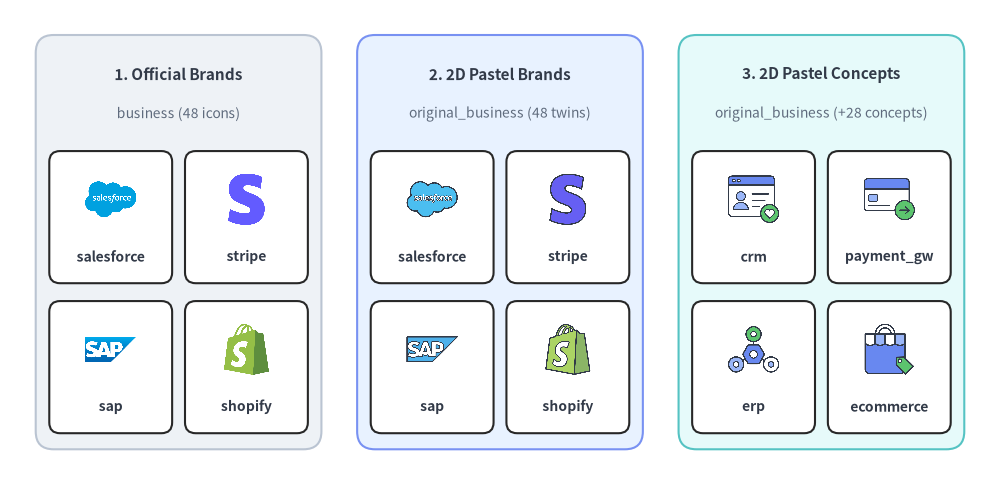
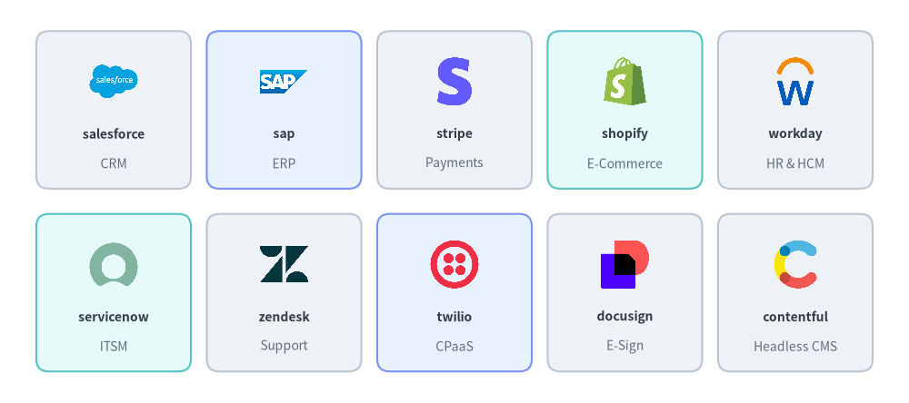
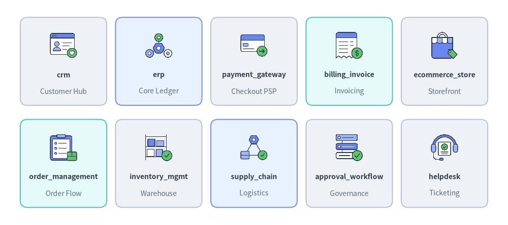
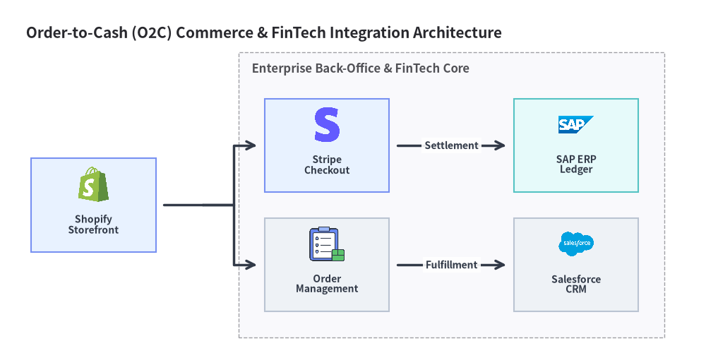

# エンタープライズ・FinTech アイコン (`business` & `original_business`)

Drawlib は、`drawlib.icons.business`（`BusinessIcon`）に **48 種の公式エンタープライズ SaaS・FinTech ブランドアイコン**を、`drawlib.icons.original_business`（`OriginalBusinessIcon`）に **76 種のフラット 2D パステルアイコン**（全 48 種のブランドツイン＋28 種のベンダー中立な業務コンセプトアイコン）を提供しています。ティア間の使い分けについては[アイコン概要](./overview.md)を、自動トポロジ配線については[アーキテクチャ図](../06_diagrams/architecture.md)を参照してください。


<figure class="drawlib-image" style="text-align: center;">
  
  <figcaption class="drawlib-caption">公式ブランドアイコン (business)、2D パステルブランドツイン (original_business)、ベンダー中立業務コンセプト (original_business) の比較</figcaption>
</figure>

<details class="drawlib-code-details">
<summary>Source Code</summary>

```python
from drawlib.canvas import save, setup
from drawlib.icons import business, original_business
from drawlib.shapes import rectangle
from drawlib.styles import Styles
from drawlib.text import text

setup(width=140, height=68)

columns = [
    (
        25.0,
        "1. Official Brands",
        "business (48 icons)",
        Styles.Neutral,
        [
            ("salesforce", business.salesforce),
            ("stripe", business.stripe),
            ("sap", business.sap),
            ("shopify", business.shopify),
        ],
    ),
    (
        70.0,
        "2. 2D Pastel Brands",
        "original_business (48 twins)",
        Styles.PrimaryNeutral,
        [
            ("salesforce", original_business.salesforce),
            ("stripe", original_business.stripe),
            ("sap", original_business.sap),
            ("shopify", original_business.shopify),
        ],
    ),
    (
        115.0,
        "3. 2D Pastel Concepts",
        "original_business (+28 concepts)",
        Styles.SecondaryNeutral,
        [
            ("crm", original_business.crm),
            ("payment_gw", original_business.payment_gateway),
            ("erp", original_business.erp),
            ("ecommerce", original_business.ecommerce_store),
        ],
    ),
]

for cx, title, subtitle, card_style, items in columns:
    rectangle((cx, 34.0), width=40.0, height=58.0, style=card_style.patch(shape_r=2.5))
    text((cx, 57.5), title, style=Styles.DarkBold.patch(text_size=11.0))
    text((cx, 52.0), subtitle, style=Styles.Muted.patch(text_size=10.0))

    offsets = [(-9.5, 37.5), (9.5, 37.5), (-9.5, 16.5), (9.5, 16.5)]
    sub_style = Styles.White.patch(shape_r=1.5, line_width=0.6)
    for (dx, iy), (lbl, fn) in zip(offsets, items, strict=True):
        ix = cx + dx
        rectangle((ix, iy), width=17.2, height=18.5, style=sub_style)
        fn((ix, iy + 2.5), width=8.0, style=Styles.Primary)
        text((ix, iy - 5.5), lbl, style=Styles.DarkBold.patch(text_size=10.0))

save()
```

</details>


---

## 1. API シグネチャとツインモジュール構成

`business` と `original_business` は、エンタープライズ SaaS、ERP、CRM、E コマース、FinTech システムアーキテクチャ向けに設計された**ツインアイコンペア**を構成しています。

| モジュール | ダイアグラム Enum | 正規アイコン数 | アセットアーカイブ | 主な視覚的用途 |
| :--- | :--- | :---: | :--- | :--- |
| `drawlib.icons.business` | `BusinessIcon` | **48** | `icon_business` | 本番スタック構成図向けの公式マルチカラーベンダーロゴ（Salesforce、SAP、Stripe、Shopify、Workday、Twilio など）。 |
| `drawlib.icons.original_business` | `OriginalBusinessIcon` | **76**（ブランドツイン `48` 種 + コンセプト `28` 種） | `icon_original_business` | 全 48 ブランドの統一されたフラット 2D パステル版に加え、28 種のベンダー中立な業務ドメインコンセプト（`erp`、`crm`、`payment_gateway`、`billing_invoice` など）を収録。 |

すべてのアイコン関数は `1:1` の正方形アスペクト比で中心座標 `xy=(cx, cy)` を基準に配置され、`Style` 属性（`alpha`、`angle`、`image_tint_color`、`image_border_*`）を受け取ります。

```python
from drawlib.diagrams.architecture import BusinessIcon, Node, OriginalBusinessIcon
from drawlib.icons import business, original_business
from drawlib.styles import Styles

# 1. Direct canvas rendering (center-anchored at (cx, cy))
business.stripe((30, 25), width=9.0, style=Styles.Primary)
original_business.stripe((60, 25), width=9.0, style=Styles.Primary)
original_business.payment_gateway((90, 25), width=9.0, style=Styles.Primary)

# 2. High-level ArchitectureDiagram nodes via Enum tokens
psp_node = Node("Stripe Billing", width=26, height=18, icon=BusinessIcon.STRIPE, icon_size=7.5)
erp_node = Node("Core ERP", width=26, height=18, icon=OriginalBusinessIcon.ERP, icon_size=7.5)
```

---

## 2. 公式・パステルブランドアイコン一覧とリファレンス (`business` & `original_business`)

以下に示す **48 種の正規ブランド名**は、`drawlib.icons.business.<name>`（`BusinessIcon.<NAME>`）と `drawlib.icons.original_business.<name>`（`OriginalBusinessIcon.<NAME>`）の両方に同一名称で用意されており、インポート先のモジュールを切り替えるだけで公式ロゴと統一された 2D パステルアイコンを自在に切り替えられます。


<figure class="drawlib-image" style="text-align: center;">
  
  <figcaption class="drawlib-caption">代表的なエンタープライズ SaaS・FinTech ブランドアイコン 10 選 (business.*)</figcaption>
</figure>

<details class="drawlib-code-details">
<summary>Source Code</summary>

```python
from drawlib.canvas import save, setup
from drawlib.icons import business
from drawlib.shapes import rectangle
from drawlib.styles import Styles
from drawlib.text import text

setup(width=144, height=64)

row1 = [
    ("salesforce", "CRM", business.salesforce, Styles.Neutral),
    ("sap", "ERP", business.sap, Styles.PrimaryNeutral),
    ("stripe", "Payments", business.stripe, Styles.Neutral),
    ("shopify", "E-Commerce", business.shopify, Styles.SecondaryNeutral),
    ("workday", "HR & HCM", business.workday, Styles.Neutral),
]

row2 = [
    ("servicenow", "ITSM", business.servicenow, Styles.SecondaryNeutral),
    ("zendesk", "Support", business.zendesk, Styles.Neutral),
    ("twilio", "CPaaS", business.twilio, Styles.PrimaryNeutral),
    ("docusign", "E-Sign", business.docusign, Styles.Neutral),
    ("contentful", "Headless CMS", business.contentful, Styles.Neutral),
]

for row_idx, items in enumerate([row1, row2]):
    cy = 46.5 if row_idx == 0 else 17.5
    for col_idx, (name, cat, icon_fn, card_st) in enumerate(items):
        cx = 18.0 + col_idx * 27.0
        rectangle((cx, cy), width=24.5, height=25.0, style=card_st.patch(shape_r=2))
        icon_fn((cx, cy + 4.5), width=8.5, style=Styles.Primary)
        text((cx, cy - 3.8), name, style=Styles.DarkBold.patch(text_size=10.0))
        text((cx, cy - 8.5), cat, style=Styles.Muted.patch(text_size=10.0))

save()
```

</details>


### ブランドアイコン全 48 種一覧 (`business` & `original_business`)

| カテゴリ | 数 | 正規関数名 (`business.*` & `original_business.*`) | Enum メンバー (`BusinessIcon.*` & `OriginalBusinessIcon.*`) |
| :--- | :---: | :--- | :--- |
| **CRM・営業支援・マーケティングオートメーション** | 8 | `braze`, `dynamics_365`, `hubspot`, `marketo`, `pipedrive`, `salesforce`, `sansan`, `zoho` | `BRAZE`, `DYNAMICS_365`, `HUBSPOT`, `MARKETO`, `PIPEDRIVE`, `SALESFORCE`, `SANSAN`, `ZOHO` |
| **ERP・会計・支出管理** | 7 | `concur`, `coupa`, `freee`, `moneyforward`, `netsuite`, `odoo`, `sap` | `CONCUR`, `COUPA`, `FREEE`, `MONEYFORWARD`, `NETSUITE`, `ODOO`, `SAP` |
| **人事・給与・ピープルオペレーション** | 4 | `bamboohr`, `deel`, `smarthr`, `workday` | `BAMBOOHR`, `DEEL`, `SMARTHR`, `WORKDAY` |
| **FinTech・決済・サブスクリプション請求** | 7 | `adyen`, `paypal`, `paypay`, `plaid`, `square`, `stripe`, `zuora` | `ADYEN`, `PAYPAL`, `PAYPAY`, `PLAID`, `SQUARE`, `STRIPE`, `ZUORA` |
| **E コマース・ヘッドレス CMS・サイト内検索** | 9 | `algolia`, `bigcommerce`, `contentful`, `magento`, `sanity`, `shopify`, `strapi`, `woocommerce`, `wordpress` | `ALGOLIA`, `BIGCOMMERCE`, `CONTENTFUL`, `MAGENTO`, `SANITY`, `SHOPIFY`, `STRAPI`, `WOOCOMMERCE`, `WORDPRESS` |
| **カスタマーサポート・ITSM・コンタクトセンター** | 5 | `freshdesk`, `genesys`, `intercom`, `servicenow`, `zendesk` | `FRESHDESK`, `GENESYS`, `INTERCOM`, `SERVICENOW`, `ZENDESK` |
| **コミュニケーション・電子契約・業務ワークフロー** | 8 | `cloudsign`, `docusign`, `kintone`, `line`, `mailgun`, `sendgrid`, `twilio`, `vonage` | `CLOUDSIGN`, `DOCUSIGN`, `KINTONE`, `LINE`, `MAILGUN`, `SENDGRID`, `TWILIO`, `VONAGE` |

---

## 3. ベンダー中立コンセプトアイコン一覧とリファレンス (`original_business`)

上記の 48 種のブランドツインに加え、`drawlib.icons.original_business`（`OriginalBusinessIcon`）には **28 種のベンダー中立なエンタープライズ業務コンセプトアイコン**が収録されており、特定ベンダーのロゴを避けたいリファレンスアーキテクチャ、ドメイン駆動設計（DDD）の境界づけられたコンテキスト図、RFC 仕様書などに活用できます。


<figure class="drawlib-image" style="text-align: center;">
  
  <figcaption class="drawlib-caption">代表的なベンダー中立エンタープライズ業務コンセプトアイコン 10 選 (original_business.*)</figcaption>
</figure>

<details class="drawlib-code-details">
<summary>Source Code</summary>

```python
from drawlib.canvas import save, setup
from drawlib.icons import original_business
from drawlib.shapes import rectangle
from drawlib.styles import Styles
from drawlib.text import text

setup(width=144, height=64)

row1 = [
    ("crm", "Customer Hub", original_business.crm, Styles.Neutral),
    ("erp", "Core Ledger", original_business.erp, Styles.PrimaryNeutral),
    ("payment_gateway", "Checkout PSP", original_business.payment_gateway, Styles.Neutral),
    ("billing_invoice", "Invoicing", original_business.billing_invoice, Styles.SecondaryNeutral),
    ("ecommerce_store", "Storefront", original_business.ecommerce_store, Styles.Neutral),
]

row2 = [
    ("order_management", "Order Flow", original_business.order_management, Styles.SecondaryNeutral),
    ("inventory_mgmt", "Warehouse", original_business.inventory_management, Styles.Neutral),
    ("supply_chain", "Logistics", original_business.supply_chain, Styles.PrimaryNeutral),
    ("approval_workflow", "Governance", original_business.approval_workflow, Styles.Neutral),
    ("helpdesk", "Ticketing", original_business.helpdesk, Styles.Neutral),
]

for row_idx, items in enumerate([row1, row2]):
    cy = 46.5 if row_idx == 0 else 17.5
    for col_idx, (name, cat, icon_fn, card_st) in enumerate(items):
        cx = 18.0 + col_idx * 27.0
        rectangle((cx, cy), width=24.5, height=25.0, style=card_st.patch(shape_r=2))
        icon_fn((cx, cy + 4.5), width=8.5, style=Styles.Primary)
        text((cx, cy - 3.8), name, style=Styles.DarkBold.patch(text_size=10.0))
        text((cx, cy - 8.5), cat, style=Styles.Muted.patch(text_size=10.0))

save()
```

</details>


### ベンダー中立コンセプトアイコン全 28 種一覧 (`original_business`)

| 正規関数名 (`original_business.*`) | Enum メンバー (`OriginalBusinessIcon.*`) | ドメインカテゴリ | 主なアーキテクチャ上の役割 |
| :--- | :--- | :--- | :--- |
| `accounting_ledger` | `ACCOUNTING_LEDGER` | 財務・ERP | 総勘定元帳、複式簿記、会計仕訳サブシステム |
| `approval_workflow` | `APPROVAL_WORKFLOW` | 業務運用・ガバナンス | 多段階承認、購買稟議、コンプライアンスゲート |
| `bank_transfer` | `BANK_TRANSFER` | FinTech・決済 | 全銀・ACH・電信送金・SEPA などの銀行間決済ネットワーク |
| `billing_invoice` | `BILLING_INVOICE` | 財務・請求管理 | 請求書自動発行、売掛金管理、領収書エンジン |
| `call_center` | `CALL_CENTER` | カスタマーサポート | インバウンド／アウトバウンド音声コンタクトセンターおよび IVR ルーティング層 |
| `cms` | `CMS` | コンテンツ・コマース | ヘッドレスまたは編集型コンテンツ管理サービス（CMS） |
| `contract_management` | `CONTRACT_MANAGEMENT` | 法務・購買 | 契約ライフサイクル管理（CLM）および法務ドキュメントリポジトリ |
| `crm` | `CRM` | 営業・マーケティング | 顧客関係管理（CRM）および取引先マスタデータベース |
| `customer_data_platform` | `CUSTOMER_DATA_PLATFORM` | 営業・マーケティング | 統合顧客プロファイル、イベント収集、オーディエンスセグメント基盤（CDP） |
| `e_signature` | `E_SIGNATURE` | 法務・業務運用 | 電子契約署名および改ざん検知付きドキュメント検証 |
| `ecommerce_store` | `ECOMMERCE_STORE` | コマース・小売 | オンラインストアフロント、商品カタログ、ショッピングカートサービス |
| `edi_exchange` | `EDI_EXCHANGE` | B2B 連携 | 企業間取引文書のための電子データ交換（EDI）ゲートウェイ |
| `erp` | `ERP` | 財務・ERP | 基幹業務パッケージ（ERP）およびバックオフィス統合オーケストレーション |
| `helpdesk` | `HELPDESK` | カスタマーサポート | オムニチャネル対応のサポートチケット管理・オペレータワークスペース |
| `hr_portal` | `HR_PORTAL` | 人事・労務 | 従業員セルフサービスポータル、オンボーディング、社員ディレクトリ |
| `inventory_management` | `INVENTORY_MANAGEMENT` | コマース・サプライチェーン | リアルタイム在庫追跡、SKU 引当、倉庫同期システム |
| `itsm` | `ITSM` | IT 運用 | 社内 IT サービスデスク、インシデント管理、変更要求カタログ |
| `logistics_shipping` | `LOGISTICS_SHIPPING` | サプライチェーン | 配送キャリア連携、出荷指示、ラストワンマイル配送追跡 |
| `loyalty_points` | `LOYALTY_POINTS` | コマース・マーケティング | ポイントウォレット、ポイント付与、会員ランク・プロモーションエンジン |
| `marketing_automation` | `MARKETING_AUTOMATION` | 営業・マーケティング | キャンペーン配信、リードナーチャリング、ライフサイクルトリガ（MA） |
| `notification_gateway` | `NOTIFICATION_GATEWAY` | コミュニケーション | トランザクションメール、SMS、プッシュ通知の統合配信ハブ |
| `order_management` | `ORDER_MANAGEMENT` | コマース・小売 | チェックアウトから出荷完了までを統括する受注管理システム（OMS） |
| `partner_portal` | `PARTNER_PORTAL` | B2B 連携 | 販売代理店、サプライヤ、チャネルパートナー向けエクストラネット |
| `payment_gateway` | `PAYMENT_GATEWAY` | FinTech・決済 | 決済代行（PSP）トークナイゼーションおよびカードオーソリゼーション |
| `procurement` | `PROCUREMENT` | 財務・支出管理 | ソーシングから支払までの購買管理、入札、発注書（PO）管理 |
| `subscription_billing` | `SUBSCRIPTION_BILLING` | FinTech・請求管理 | SaaS 従量・定期課金メータリング、プラン変更、督促（ダニング）管理 |
| `supply_chain` | `SUPPLY_CHAIN` | サプライチェーン | エンドツーエンドのサプライヤ網、需要予測、フルフィルメントパイプライン |
| `tax_compliance` | `TAX_COMPLIANCE` | 財務・法務 | 消費税・VAT 自動計算およびインボイス制度対応の電子帳票処理 |

---

## 4. 実践的なアーキテクチャ図 (`ArchitectureDiagram`)

以下の例では、**[`ArchitectureDiagram`](../06_diagrams/architecture.md)** 内で `BusinessIcon` と `OriginalBusinessIcon` を組み合わせ、エンドツーエンドの **受注から入金まで（Order-to-Cash: O2C）のコマース＆ERP 連携パイプライン**をモデル化しています。


```python
from drawlib.canvas import clear, save, setup
from drawlib.diagrams.architecture import (
    ArchitectureDiagram,
    BusinessIcon,
    Node,
    NodeGroup,
    OriginalBusinessIcon,
)
from drawlib.styles import Styles

clear()
setup(width=136, height=68)

d = ArchitectureDiagram(
    node_style=Styles.Primary,
    node_text_style=Styles.DarkBold.patch(text_size=10.0),
    edge_style=Styles.DarkBold,
    edge_text_style=Styles.DarkBold.patch(text_size=10.0),
    node_card_style=Styles.Neutral,
    title="Order-to-Cash (O2C) Commerce & FinTech Integration Architecture",
)

store = d.add(
    Node(
        "Shopify\nStorefront",
        width=24,
        height=18,
        icon=BusinessIcon.SHOPIFY,
        icon_size=7.5,
        card_style=Styles.PrimaryNeutral,
    ),
    xy=(14.0, 24.5),
)

bus = d.add(
    NodeGroup(title="Enterprise Back-Office & FinTech Core", padding=5.0),
    xy=(42.0, 4.0),
)

stripe_gw = bus.add(
    Node(
        "Stripe\nCheckout",
        width=24,
        height=18,
        icon=BusinessIcon.STRIPE,
        icon_size=7.5,
        card_style=Styles.PrimaryNeutral,
    ),
    xy=(17.0, 32.0),
)
oms = bus.add(
    Node(
        "Order\nManagement",
        width=24,
        height=18,
        icon=OriginalBusinessIcon.ORDER_MANAGEMENT,
        icon_size=7.5,
    ),
    xy=(17.0, 9.0),
)
sap_erp = bus.add(
    Node(
        "SAP ERP\nLedger",
        width=24,
        height=18,
        icon=BusinessIcon.SAP,
        icon_size=7.5,
        card_style=Styles.SecondaryNeutral,
    ),
    xy=(65.0, 32.0),
)
crm_hub = bus.add(
    Node(
        "Salesforce\nCRM",
        width=24,
        height=18,
        icon=BusinessIcon.SALESFORCE,
        icon_size=7.5,
    ),
    xy=(65.0, 9.0),
)

store.fork([stripe_gw, oms], at_x=35.0, padding=1.5)
d.connect(stripe_gw, sap_erp, label="Settlement", padding=1.5)
d.connect(oms, crm_hub, label="Fulfillment", padding=1.5)

d.draw(xy=(4.0, 4.0))
save()
```

<figure class="drawlib-image" style="text-align: center;">
  
  <figcaption class="drawlib-caption">BusinessIcon と OriginalBusinessIcon を用いた Order-to-Cash (O2C) エンタープライズ SaaS・FinTech トポロジ</figcaption>
</figure>


