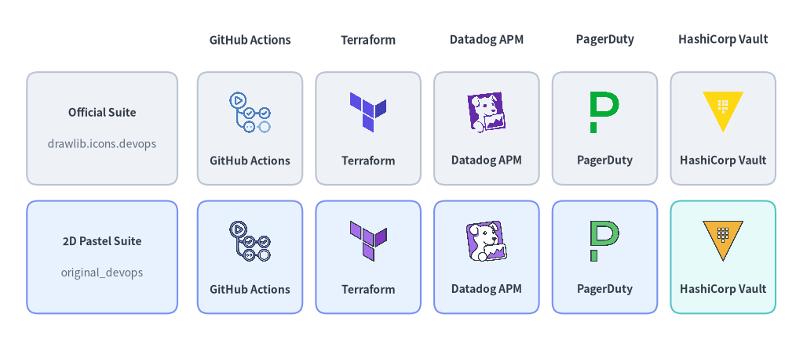
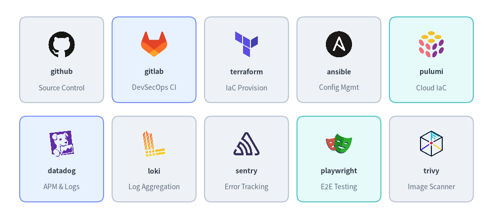
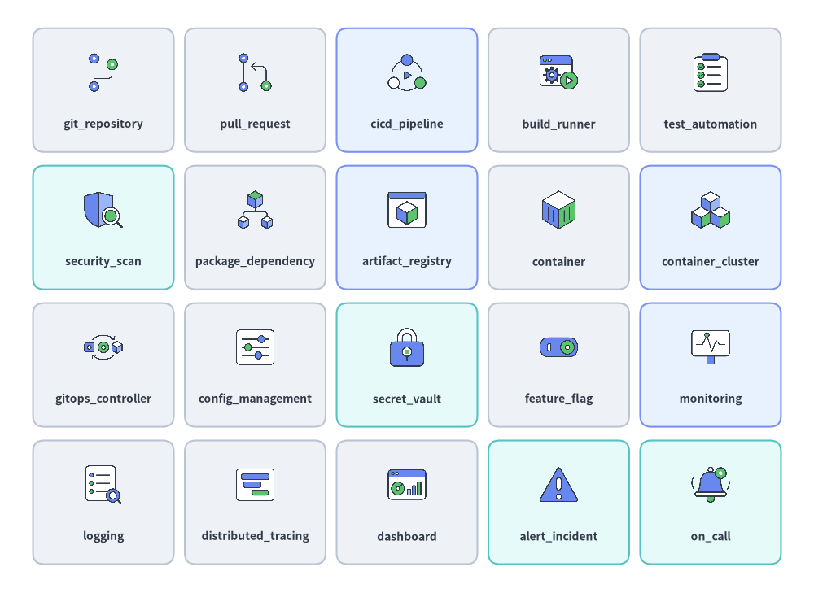
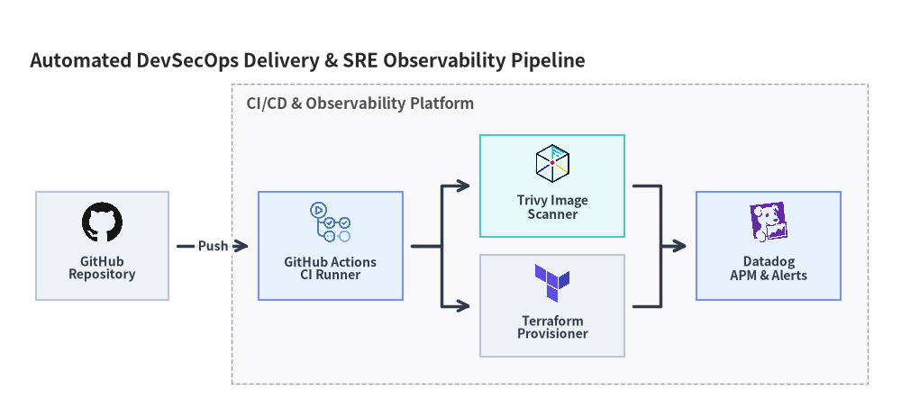

# DevOps・オブザーバビリティアイコン

Drawlib は、`drawlib.icons.devops`（`DevopsIcon`）に **58 個の公式 DevOps・オブザーバビリティブランドアイコン**を、`drawlib.icons.original_devops`（`OriginalDevopsIcon`）に **78 個のフラット 2D パステルアイコン**（58 個の対応するブランドツイン + **20 個のベンダーニュートラルな DevOps 概念アイコン**）を提供します。これらのアイコンはキャンバスへの直接描画はもちろん、**[アーキテクチャ図](../06_diagrams/architecture.md)** のノードとしても利用できます（**[アイコン概要](./overview.md)** も参照）。


<figure class="drawlib-image" style="text-align: center;">
  
  <figcaption class="drawlib-caption">公式 DevOps ブランドアイコン（drawlib.icons.devops）とオリジナル 2D パステルアイコン（drawlib.icons.original_devops）の比較</figcaption>
</figure>

<details class="drawlib-code-details">
<summary>Source Code</summary>

```python
from drawlib.canvas import save, setup
from drawlib.icons import devops, original_devops
from drawlib.shapes import rectangle
from drawlib.styles import Styles
from drawlib.text import text

setup(width=146, height=64)

columns = [
    ("GitHub Actions", devops.github_actions, original_devops.github_actions),
    ("Terraform", devops.terraform, original_devops.terraform),
    ("Datadog APM", devops.datadog, original_devops.datadog),
    ("PagerDuty", devops.pagerduty, original_devops.pagerduty),
    ("HashiCorp Vault", devops.vault, original_devops.vault),
]

rows = [
    (40.0, "Official Suite", "drawlib.icons.devops", Styles.Neutral),
    (16.0, "2D Pastel Suite", "original_devops", Styles.PrimaryNeutral),
]

for col_idx, (col_title, _, _) in enumerate(columns):
    cx = 46.5 + col_idx * 22.0
    text((cx, 56.5), col_title, style=Styles.DarkBold.patch(text_size=10.5))

for row_idx, (cy, row_title, row_sub, card_st) in enumerate(rows):
    rectangle((19.0, cy), width=28.0, height=21.0, style=card_st.patch(shape_r=2))
    text((19.0, cy + 3.0), row_title, style=Styles.DarkBold.patch(text_size=10.0))
    text((19.0, cy - 3.0), row_sub, style=Styles.Muted.patch(text_size=10.0))

    for col_idx, (lbl, fn_off, fn_orig) in enumerate(columns):
        cx = 46.5 + col_idx * 22.0
        cell_st = Styles.SecondaryNeutral if (row_idx == 1 and col_idx == 4) else card_st
        rectangle((cx, cy), width=19.5, height=21.0, style=cell_st.patch(shape_r=2))
        fn = fn_off if row_idx == 0 else fn_orig
        fn((cx, cy + 3.0), width=8.5, style=Styles.Primary)
        text((cx, cy - 6.0), lbl, style=Styles.DarkBold.patch(text_size=10.0))

save()
```

</details>


---

## 1. API シグネチャとツインモジュール構成

`drawlib.icons.devops` の全 58 ブランドアイコンには `drawlib.icons.original_devops` 内に 1 対 1 で対応するツインが存在し、さらに `original_devops` には商標に依存しない図解向けのベンダーニュートラルな DevOps 概念アイコン 20 個（`cicd_pipeline`、`build_runner`、`monitoring`、`alert_incident` など）が追加されています。

```python
from drawlib.diagrams.architecture import DevopsIcon, Node, OriginalDevopsIcon
from drawlib.icons import devops, original_devops
from drawlib.styles import Styles

# 1. Direct canvas rendering (anchored at center xy)
devops.terraform((30, 25), width=10.0, style=Styles.Primary)
original_devops.terraform((60, 25), width=10.0, style=Styles.Primary)
original_devops.cicd_pipeline((90, 25), width=10.0, style=Styles.Primary)

# 2. High-level ArchitectureDiagram Node integration via Enum
iac_node = Node("Terraform IaC", icon=DevopsIcon.TERRAFORM, icon_size=8.0)
pipe_node = Node("CI/CD Pipeline", icon=OriginalDevopsIcon.CICD_PIPELINE, icon_size=8.0)
```

| 項目 | 公式スイート（`devops`） | オリジナル 2D パステルスイート（`original_devops`） |
| :--- | :--- | :--- |
| **モジュールインポート** | `from drawlib.icons import devops` | `from drawlib.icons import original_devops` |
| **関数シグネチャ** | `devops.<name>(xy, width, *, style, variant="default")` | `original_devops.<name>(xy, width, *, style, variant="default")` |
| **アーキテクチャ Enum** | `DevopsIcon.<NAME>` | `OriginalDevopsIcon.<NAME>` |
| **正規アイコン数** | **58**（公式 DevOps・SRE ブランドロゴ `58` 個） | **78**（2D パステルブランドツイン `58` 個 + DevOps 概念アイコン `20` 個） |
| **アセットアーカイブ** | `icon_devops`（`512×512` RGBA PNG） | `icon_original_devops`（`512×512` RGBA PNG） |

---

## 2. DevOps・オブザーバビリティブランドアイコン（58 個）

58 個のブランドアイコンは、Git プラットフォーム、CI/CD ランナー、Infrastructure as Code (IaC)、APM・ログ集約スタック、インシデント通知、DevSecOps スキャナーを幅広くカバーしています。


<figure class="drawlib-image" style="text-align: center;">
  
  <figcaption class="drawlib-caption">代表的な DevOps・IaC・オブザーバビリティブランドアイコン（drawlib.icons.devops）</figcaption>
</figure>

<details class="drawlib-code-details">
<summary>Source Code</summary>

```python
from drawlib.canvas import save, setup
from drawlib.icons import devops
from drawlib.shapes import rectangle
from drawlib.styles import Styles
from drawlib.text import text

setup(width=144, height=64)

row1 = [
    ("github", "Source Control", devops.github, Styles.Neutral),
    ("gitlab", "DevSecOps CI", devops.gitlab, Styles.PrimaryNeutral),
    ("terraform", "IaC Provision", devops.terraform, Styles.Neutral),
    ("ansible", "Config Mgmt", devops.ansible, Styles.Neutral),
    ("pulumi", "Cloud IaC", devops.pulumi, Styles.SecondaryNeutral),
]

row2 = [
    ("datadog", "APM & Logs", devops.datadog, Styles.PrimaryNeutral),
    ("loki", "Log Aggregation", devops.loki, Styles.Neutral),
    ("sentry", "Error Tracking", devops.sentry, Styles.Neutral),
    ("playwright", "E2E Testing", devops.playwright, Styles.SecondaryNeutral),
    ("trivy", "Image Scanner", devops.trivy, Styles.Neutral),
]

for row_idx, items in enumerate([row1, row2]):
    cy = 46.5 if row_idx == 0 else 17.5
    for col_idx, (title, cat, icon_fn, card_st) in enumerate(items):
        cx = 18.0 + col_idx * 27.0
        rectangle((cx, cy), width=24.5, height=25.0, style=card_st.patch(shape_r=2))
        icon_fn((cx, cy + 4.5), width=8.5, style=Styles.Primary)
        text((cx, cy - 3.5), title, style=Styles.DarkBold.patch(text_size=10.0))
        text((cx, cy - 8.2), cat, style=Styles.Muted.patch(text_size=10.0))

save()
```

</details>


### 2.1. DevOps ブランドアイコン リファレンス一覧（全 58 正規名）

以下の 58 個の正規ブランド名はすべて、`devops.<name>`（`DevopsIcon.<NAME>`）および `original_devops.<name>`（`OriginalDevopsIcon.<NAME>`）の両方で利用できます。

| カテゴリ | 個数 | 正規アイコン名（`devops.*` & `original_devops.*`） |
| :--- | :---: | :--- |
| **ソース管理・CI/CD パイプライン・ビルドシステム** | 14 | `bazel`, `bitbucket`, `buildkite`, `circleci`, `dagger`, `git`, `github`, `github_actions`, `gitlab`, `jenkins`, `nx`, `spinnaker`, `tekton`, `turborepo` |
| **Infrastructure as Code (IaC)・構成管理・コンテナ** | 9 | `ansible`, `consul`, `opentofu`, `packer`, `podman`, `pulumi`, `terraform`, `vagrant`, `vault` |
| **オブザーバビリティ・APM・ロギング・メトリクス** | 15 | `datadog`, `dynatrace`, `fluent_bit`, `honeycomb`, `kibana`, `loki`, `mimir`, `new_relic`, `sentry`, `signoz`, `splunk`, `tempo`, `thanos`, `vector`, `victoria_metrics` |
| **インシデント管理・フィーチャーフラグ・ChatOps** | 7 | `incident_io`, `jira`, `launchdarkly`, `opsgenie`, `pagerduty`, `slack`, `unleash` |
| **テスト・API クライアント・アーティファクトレジストリ・DevSecOps** | 13 | `bruno`, `cypress`, `insomnia`, `jfrog`, `k6`, `keycloak`, `nexus`, `playwright`, `postman`, `selenium`, `snyk`, `sonarqube`, `trivy` |

---

## 3. ベンダーニュートラルな DevOps 概念アイコン（`original_devops` — 20 個）

特定のベンダーロゴを使わずにベンダーニュートラルな CI/CD パイプラインや SRE ランブックを設計したい場合、`drawlib.icons.original_devops`（`OriginalDevopsIcon`）に収録された **20 個の汎用 DevOps・SRE 概念アイコン**を利用できます。


<figure class="drawlib-image" style="text-align: center;">
  
  <figcaption class="drawlib-caption">全 20 種類のベンダーニュートラルな DevOps・オブザーバビリティ概念アイコン（drawlib.icons.original_devops）</figcaption>
</figure>

<details class="drawlib-code-details">
<summary>Source Code</summary>

```python
from drawlib.canvas import save, setup
from drawlib.icons import original_devops
from drawlib.shapes import rectangle
from drawlib.styles import Styles
from drawlib.text import text

setup(width=148, height=108)

concept_items = [
    ("git_repository", original_devops.git_repository, Styles.Neutral),
    ("pull_request", original_devops.pull_request, Styles.Neutral),
    ("cicd_pipeline", original_devops.cicd_pipeline, Styles.PrimaryNeutral),
    ("build_runner", original_devops.build_runner, Styles.Neutral),
    ("test_automation", original_devops.test_automation, Styles.Neutral),
    ("security_scan", original_devops.security_scan, Styles.SecondaryNeutral),
    ("package_dependency", original_devops.package_dependency, Styles.Neutral),
    ("artifact_registry", original_devops.artifact_registry, Styles.PrimaryNeutral),
    ("container", original_devops.container, Styles.Neutral),
    ("container_cluster", original_devops.container_cluster, Styles.PrimaryNeutral),
    ("gitops_controller", original_devops.gitops_controller, Styles.Neutral),
    ("config_management", original_devops.config_management, Styles.Neutral),
    ("secret_vault", original_devops.secret_vault, Styles.SecondaryNeutral),
    ("feature_flag", original_devops.feature_flag, Styles.Neutral),
    ("monitoring", original_devops.monitoring, Styles.PrimaryNeutral),
    ("logging", original_devops.logging, Styles.Neutral),
    ("distributed_tracing", original_devops.distributed_tracing, Styles.Neutral),
    ("dashboard", original_devops.dashboard, Styles.Neutral),
    ("alert_incident", original_devops.alert_incident, Styles.SecondaryNeutral),
    ("on_call", original_devops.on_call, Styles.SecondaryNeutral),
]

for idx, (label, icon_fn, card_st) in enumerate(concept_items):
    row = idx // 5
    col = idx % 5
    cx = 18.8 + col * 27.6
    cy = 91.5 - row * 25.0
    rectangle((cx, cy), width=25.6, height=22.5, style=card_st.patch(shape_r=2))
    icon_fn((cx, cy + 3.2), width=7.8, style=Styles.Primary)
    text((cx, cy - 6.2), label, style=Styles.DarkBold.patch(text_size=10.0))

save()
```

</details>


### 3.1. DevOps 概念アイコン リファレンス一覧（`original_devops` 全 20 正規名）

| 正規名 | `original_devops` 呼び出し | `OriginalDevopsIcon` Enum | アーキテクチャ上の役割と概念の説明 |
| :--- | :--- | :--- | :--- |
| `alert_incident` | `original_devops.alert_incident` | `ALERT_INCIDENT` | 重大なしきい値超過または発生中の本番インシデントアラート |
| `artifact_registry` | `original_devops.artifact_registry` | `ARTIFACT_REGISTRY` | コンテナイメージ、Helm チャート、バイナリパッケージのリポジトリ |
| `build_runner` | `original_devops.build_runner` | `BUILD_RUNNER` | エフェメラルな CI コンパイルワーカーまたはビルドエージェント |
| `cicd_pipeline` | `original_devops.cicd_pipeline` | `CICD_PIPELINE` | 自動化された継続的インテグレーション／デリバリーワークフロー |
| `config_management` | `original_devops.config_management` | `CONFIG_MANAGEMENT` | 宣言的なインフラ状態およびホスト構成管理 |
| `container` | `original_devops.container` | `CONTAINER` | 標準化された OCI アプリケーションコンテナイメージ／インスタンス |
| `container_cluster` | `original_devops.container_cluster` | `CONTAINER_CLUSTER` | オーケストレーションされたマルチノードコンテナクラスター |
| `dashboard` | `original_devops.dashboard` | `DASHBOARD` | リアルタイムの SLI/SLO 運用メトリクス可視化ダッシュボード |
| `distributed_tracing` | `original_devops.distributed_tracing` | `DISTRIBUTED_TRACING` | マイクロサービス間のエンドツーエンドリクエストスパンおよびレイテンシトレース |
| `feature_flag` | `original_devops.feature_flag` | `FEATURE_FLAG` | 実行時の段階的デリバリートグルおよびカナリアリリースゲート |
| `git_repository` | `original_devops.git_repository` | `GIT_REPOSITORY` | バージョン管理されたソースコードおよび IaC リポジトリ |
| `gitops_controller` | `original_devops.gitops_controller` | `GITOPS_CONTROLLER` | Git の状態をクラスターへ継続的に同期するリコンシリエーションループ |
| `logging` | `original_devops.logging` | `LOGGING` | 構造化ログの集中収集およびインデックス化 |
| `monitoring` | `original_devops.monitoring` | `MONITORING` | 時系列メトリクスの収集、ヘルスチェック、外形監視 |
| `on_call` | `original_devops.on_call` | `ON_CALL` | SRE のインシデント対応ローテーションおよびページングエスカレーション |
| `package_dependency` | `original_devops.package_dependency` | `PACKAGE_DEPENDENCY` | ソフトウェア部品表（SBOM）およびライブラリ依存関係ツリー |
| `pull_request` | `original_devops.pull_request` | `PULL_REQUEST` | コードレビュー、ブランチマージゲート、自動ステータスチェック |
| `secret_vault` | `original_devops.secret_vault` | `SECRET_VAULT` | 暗号化されたシークレットマネージャー、KMS 鍵ストア、トークンブローカー |
| `security_scan` | `original_devops.security_scan` | `SECURITY_SCAN` | SAST/DAST 脆弱性検査およびコンテナイメージスキャンステージ |
| `test_automation` | `original_devops.test_automation` | `TEST_AUTOMATION` | 自動化された単体・結合・E2E リグレッションテストスイート |

---

## 4. 実践的なアーキテクチャ図（`DevopsIcon` と `OriginalDevopsIcon`）

以下の **[`ArchitectureDiagram`](../06_diagrams/architecture.md)** では、`DevopsIcon` を使用して自動化された DevSecOps デリバリーおよびオブザーバビリティパイプラインを表現しています。


```python
from drawlib.canvas import save, setup
from drawlib.diagrams.architecture import ArchitectureDiagram, DevopsIcon, Node, NodeGroup
from drawlib.styles import Styles

setup(width=150, height=68)

d = ArchitectureDiagram(
    node_style=Styles.Primary,
    node_text_style=Styles.DarkBold.patch(text_size=10.0),
    edge_style=Styles.DarkBold,
    edge_text_style=Styles.DarkBold.patch(text_size=10.0),
    node_card_style=Styles.Neutral,
    title="Automated DevSecOps Delivery & SRE Observability Pipeline",
)

gh = d.add(
    Node(
        "GitHub\nRepository",
        width=22,
        height=18,
        icon=DevopsIcon.GITHUB,
        icon_size=7.5,
    ),
    xy=(13.0, 23.0),
)

pipe = d.add(NodeGroup(title="CI/CD & Observability Platform", padding=4.5), xy=(36.0, 4.0))
actions = pipe.add(
    Node(
        "GitHub Actions\nCI Runner",
        width=24,
        height=18,
        icon=DevopsIcon.GITHUB_ACTIONS,
        icon_size=7.5,
        card_style=Styles.PrimaryNeutral,
    ),
    xy=(15.0, 19.0),
)
trivy = pipe.add(
    Node(
        "Trivy Image\nScanner",
        width=24,
        height=17,
        icon=DevopsIcon.TRIVY,
        icon_size=7.2,
        card_style=Styles.SecondaryNeutral,
    ),
    xy=(52.0, 29.0),
)
tf = pipe.add(
    Node(
        "Terraform\nProvisioner",
        width=24,
        height=17,
        icon=DevopsIcon.TERRAFORM,
        icon_size=7.2,
    ),
    xy=(52.0, 9.0),
)
dd = pipe.add(
    Node(
        "Datadog\nAPM & Alerts",
        width=24,
        height=18,
        icon=DevopsIcon.DATADOG,
        icon_size=7.5,
        card_style=Styles.PrimaryNeutral,
    ),
    xy=(88.0, 19.0),
)

d.connect(gh, actions, label="Push", padding=1.5)
d.connect(actions, trivy, padding=1.5)
d.connect(actions, tf, padding=1.5)
d.connect(trivy, dd, padding=1.5)
d.connect(tf, dd, padding=1.5)

d.draw(xy=(4.0, 4.0))
save()
```

<figure class="drawlib-image" style="text-align: center;">
  
  <figcaption class="drawlib-caption">DevopsIcon を用いた DevSecOps CI/CD＆オブザーバビリティパイプライン構成図</figcaption>
</figure>


> [!TIP]
> Kubernetes クラスタリソース（`k8s_*`）、Helm、Argo CD、および Istio サービスメッシュのアイコンについては、**[クラウドネイティブ (K8s) アイコン](./cnative.md)**を参照してください。アプリケーション言語やフレームワークについては、**[コード・言語・フレームワークアイコン](./code.md)**を参照してください。
