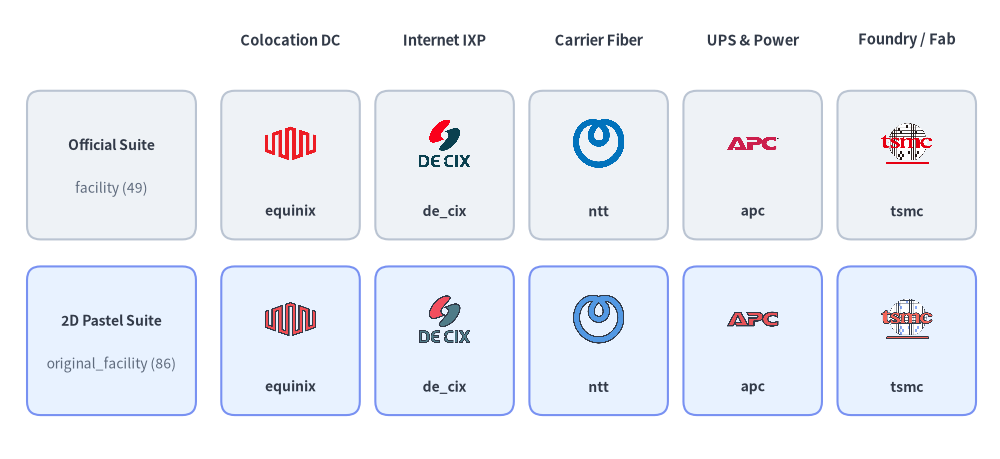
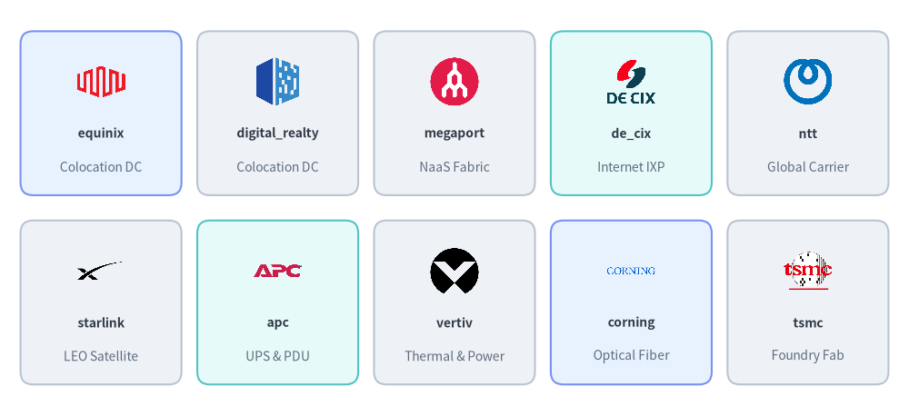
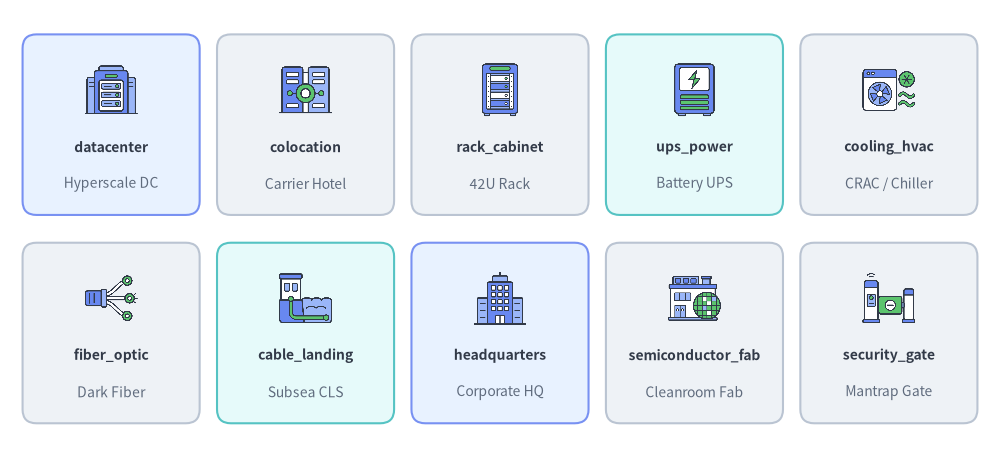
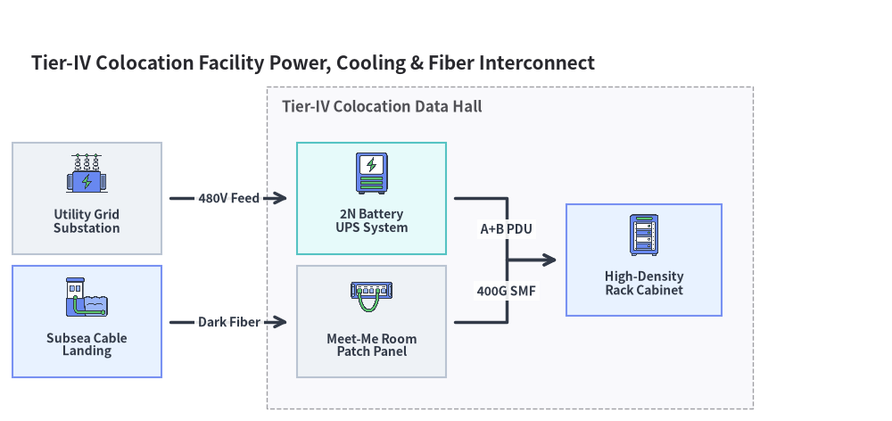

# データセンター・ファシリティアイコン (`facility` & `original_facility`)

Drawlib は、物理データセンター、コロケーション事業者、インターネットエクスチェンジ（IXP）、通信キャリア、電源・空調冷却インフラ、半導体クリーンルーム、および企業拠点向けに 2 つのペアとなるアイコンモジュールを提供しています。コロケーション・通信・IXP・ラック／電源・半導体製造装置の公式ブランドロゴ **49 種**を収録した **`drawlib.icons.facility`**（`FacilityIcon`）と、全 **49 種**のブランドツインに **37 種**のベンダー中立なデータセンター・電源・物流・建物コンセプトアイコンを加えた合計 **86 種**のフラット 2D パステルアイコンを収録した **`drawlib.icons.original_facility`**（`OriginalFacilityIcon`）です。両モジュールとも **[アイコン概要](./overview.md)** に記載された統一座標仕様を共有しており、**[アーキテクチャ図](../06_diagrams/architecture.md)** と直接連携できます。


<figure class="drawlib-image" style="text-align: center;">
  
  <figcaption class="drawlib-caption">公式ファシリティ・通信キャリアブランド (facility) とオリジナル 2D パステルアイコン (original_facility) の比較</figcaption>
</figure>

<details class="drawlib-code-details">
<summary>Source Code</summary>

```python
from drawlib.canvas import save, setup
from drawlib.icons import facility, original_facility
from drawlib.shapes import rectangle
from drawlib.styles import Styles
from drawlib.text import text

setup(width=148, height=68)

columns = [
    ("Colocation DC", "equinix", facility.equinix, original_facility.equinix),
    ("Internet IXP", "de_cix", facility.de_cix, original_facility.de_cix),
    ("Carrier Fiber", "ntt", facility.ntt, original_facility.ntt),
    ("UPS & Power", "apc", facility.apc, original_facility.apc),
    ("Foundry / Fab", "tsmc", facility.tsmc, original_facility.tsmc),
]

for col_idx, (cat_label, _, _, _) in enumerate(columns):
    cx = 43.0 + col_idx * 22.8
    text((cx, 62.0), cat_label, style=Styles.DarkBold.patch(text_size=10.5))

rows = [
    (43.5, "Official Suite", "facility (49)", Styles.Neutral),
    (17.5, "2D Pastel Suite", "original_facility (86)", Styles.PrimaryNeutral),
]

for row_idx, (cy, row_title, row_sub, row_style) in enumerate(rows):
    rectangle((16.5, cy), width=25.0, height=22.0, style=row_style.patch(shape_r=2))
    text((16.5, cy + 3.0), row_title, style=Styles.DarkBold.patch(text_size=10.0))
    text((16.5, cy - 3.5), row_sub, style=Styles.Muted.patch(text_size=10.0))

    for col_idx, (_, fn_name, fn_off, fn_orig) in enumerate(columns):
        cx = 43.0 + col_idx * 22.8
        rectangle((cx, cy), width=20.5, height=22.0, style=row_style.patch(shape_r=2))
        icon_fn = fn_off if row_idx == 0 else fn_orig
        icon_fn((cx, cy + 3.2), width=8.5, style=Styles.Primary)
        text((cx, cy - 6.8), fn_name, style=Styles.DarkBold.patch(text_size=10.0))

save()
```

</details>


---

## 1. API シグネチャとツインモジュール構成

`drawlib.icons.facility` および `drawlib.icons.original_facility` のすべてのアイコンは、中心座標 `xy=(cx, cy)` を基準に `1:1` の正方形アスペクト比で `512×512` RGBA PNG を描画します。

```python
from drawlib.diagrams.architecture import FacilityIcon, Node, OriginalFacilityIcon
from drawlib.icons import (
    facility,
    facility_icon,
    original_facility,
    original_facility_icon,
)
from drawlib.styles import Styles

# 1. Direct module function calls (49 shared brand icons + 37 concept icons in original_facility)
facility.equinix((30, 25), width=10.0, style=Styles.Primary)
original_facility.equinix((55, 25), width=10.0, style=Styles.Primary)
original_facility.datacenter((80, 25), width=10.0, style=Styles.Primary)
original_facility.rack_cabinet((105, 25), width=10.0, style=Styles.Primary)

# 2. Dynamic string lookup helpers
facility_icon((30, 10), width=9.0, name="megaport", style=Styles.Primary)
original_facility_icon((55, 10), width=9.0, name="ups_power", style=Styles.Primary)

# 3. Strongly typed Enums for ArchitectureDiagram & SequenceDiagram
colo_node = Node("Equinix IBX", icon=FacilityIcon.EQUINIX)
rack_node = Node("42U Cabinet", icon=OriginalFacilityIcon.RACK_CABINET)
```

| 機能・項目 | `drawlib.icons.facility` | `drawlib.icons.original_facility` |
| :--- | :--- | :--- |
| **ビジュアルスタイル** | コロケーション・IXP・通信キャリア・電源／ラック・半導体ファウンドリの公式ロゴ | 統一感のある 2D パステルブランドツイン + ベンダー中立のファシリティ／拠点／DC コンセプトアイコン |
| **正規アイコン総数** | 公式ブランドアイコン **49** 種 | **86** 種（ブランドツイン `49` 種 + 物理ファシリティ・インフラコンセプト `37` 種） |
| **ダイアグラム Enum** | `FacilityIcon.<NAME>` | `OriginalFacilityIcon.<NAME>` |
| **動的ディスパッチャ** | `facility_icon(xy, width, name=..., style=...)` | `original_facility_icon(xy, width, name=..., style=...)` |
| **アセットパッケージ** | `icon_facility` | `icon_original_facility` |

---

## 2. ブランド・ベンダーファシリティアイコン (両モジュール共通の 49 種)

`facility` と `original_facility` は、グローバルなコロケーション事業者、インターネットエクスチェンジ（IXP）および NaaS ファブリック、Tier-1 通信キャリア・衛星通信事業者、物理ラック・電源・配線機器メーカー、半導体ファウンドリを網羅する **49 種の正規ブランド名**を提供しています。


<figure class="drawlib-image" style="text-align: center;">
  
  <figcaption class="drawlib-caption">facility と original_facility に収録された代表的なコロケーション・通信・電源・ファウンドリブランドアイコン 10 選</figcaption>
</figure>

<details class="drawlib-code-details">
<summary>Source Code</summary>

```python
from drawlib.canvas import save, setup
from drawlib.icons import facility
from drawlib.shapes import rectangle
from drawlib.styles import Styles
from drawlib.text import text

setup(width=144, height=66)

row1 = [
    ("equinix", "Colocation DC", facility.equinix, Styles.PrimaryNeutral),
    ("digital_realty", "Colocation DC", facility.digital_realty, Styles.Neutral),
    ("megaport", "NaaS Fabric", facility.megaport, Styles.Neutral),
    ("de_cix", "Internet IXP", facility.de_cix, Styles.SecondaryNeutral),
    ("ntt", "Global Carrier", facility.ntt, Styles.Neutral),
]

row2 = [
    ("starlink", "LEO Satellite", facility.starlink, Styles.Neutral),
    ("apc", "UPS & PDU", facility.apc, Styles.SecondaryNeutral),
    ("vertiv", "Thermal & Power", facility.vertiv, Styles.Neutral),
    ("corning", "Optical Fiber", facility.corning, Styles.PrimaryNeutral),
    ("tsmc", "Foundry Fab", facility.tsmc, Styles.Neutral),
]

for row_idx, items in enumerate([row1, row2]):
    cy = 48.0 if row_idx == 0 else 18.0
    for col_idx, (fn_name, cat, icon_fn, card_st) in enumerate(items):
        cx = 16.0 + col_idx * 28.0
        rectangle((cx, cy), width=25.5, height=26.0, style=card_st.patch(shape_r=2))
        icon_fn((cx, cy + 5.0), width=8.5, style=Styles.Primary)
        text((cx, cy - 3.2), fn_name, style=Styles.DarkBold.patch(text_size=10.0))
        text((cx, cy - 8.5), cat, style=Styles.Muted.patch(text_size=10.0))

save()
```

</details>


### 2.1. 共通ブランドアイコン全 49 種一覧

以下のすべての関数名は、`facility.<name>()`（`FacilityIcon.<NAME>`）および `original_facility.<name>()`（`OriginalFacilityIcon.<NAME>`）の両方で同一の名前として利用できます。

| カテゴリ | 数 | 正規関数名 (`facility.*` & `original_facility.*`) |
| :--- | :---: | :--- |
| **コロケーション・データセンター事業者** | 10 | `at_tokyo`, `coresite`, `cyrusone`, `digital_realty`, `equinix`, `iron_mountain`, `ntt_gdc`, `qts`, `switch_dc`, `vantage_dc` |
| **インターネットエクスチェンジ (IXP)・クラウド相互接続** | 8 | `bbix`, `console_connect`, `de_cix`, `jpix`, `jpnap`, `linx`, `megaport`, `packetfabric` |
| **グローバル通信キャリア・光ファイバ・衛星通信** | 12 | `att`, `colt`, `deutsche_telekom`, `iij`, `intelsat`, `kddi`, `lumen`, `ntt`, `orange`, `softbank`, `starlink`, `verizon` |
| **電源・冷却・ラック・配線・入退室管理** | 10 | `apc`, `axis`, `commscope`, `corning`, `eaton`, `hid_global`, `panduit`, `rittal`, `schneider_electric`, `vertiv` |
| **半導体ファウンドリ・製造装置・EMS** | 9 | `applied_materials`, `asml`, `foxconn`, `globalfoundries`, `kyocera`, `murata`, `rapidus`, `tokyo_electron`, `tsmc` |

---

## 3. ベンダー中立のデータセンター・電源・拠点コンセプトアイコン (`original_facility` 収録の 37 種)

特定ベンダーのロゴを使わずに物理データセンターのフロアレイアウト、電源・HVAC 冗長構成、海底光ファイバ陸揚局、企業の支社拠点、産業サプライチェーンを図解する際のために、`drawlib.icons.original_facility`（`OriginalFacilityIcon`）には **37 種のベンダー中立コンセプトアイコン**が用意されています。


<figure class="drawlib-image" style="text-align: center;">
  
  <figcaption class="drawlib-caption">drawlib.icons.original_facility に収録された代表的なデータセンター・電源・通信・拠点コンセプトアイコン 10 選</figcaption>
</figure>

<details class="drawlib-code-details">
<summary>Source Code</summary>

```python
from drawlib.canvas import save, setup
from drawlib.icons import original_facility
from drawlib.shapes import rectangle
from drawlib.styles import Styles
from drawlib.text import text

setup(width=144, height=66)

row1 = [
    ("datacenter", "Hyperscale DC", original_facility.datacenter, Styles.PrimaryNeutral),
    ("colocation", "Carrier Hotel", original_facility.colocation, Styles.Neutral),
    ("rack_cabinet", "42U Rack", original_facility.rack_cabinet, Styles.Neutral),
    ("ups_power", "Battery UPS", original_facility.ups_power, Styles.SecondaryNeutral),
    ("cooling_hvac", "CRAC / Chiller", original_facility.cooling_hvac, Styles.Neutral),
]

row2 = [
    ("fiber_optic", "Dark Fiber", original_facility.fiber_optic, Styles.Neutral),
    ("cable_landing", "Subsea CLS", original_facility.cable_landing, Styles.SecondaryNeutral),
    ("headquarters", "Corporate HQ", original_facility.headquarters, Styles.PrimaryNeutral),
    ("semiconductor_fab", "Cleanroom Fab", original_facility.semiconductor_fab, Styles.Neutral),
    ("security_gate", "Mantrap Gate", original_facility.security_gate, Styles.Neutral),
]

for row_idx, items in enumerate([row1, row2]):
    cy = 48.0 if row_idx == 0 else 18.0
    for col_idx, (fn_name, cat, icon_fn, card_st) in enumerate(items):
        cx = 16.0 + col_idx * 28.0
        rectangle((cx, cy), width=25.5, height=26.0, style=card_st.patch(shape_r=2))
        icon_fn((cx, cy + 5.0), width=8.5, style=Styles.Primary)
        text((cx, cy - 3.2), fn_name, style=Styles.DarkBold.patch(text_size=10.0))
        text((cx, cy - 8.5), cat, style=Styles.Muted.patch(text_size=10.0))

save()
```

</details>


### 3.1. ベンダー中立ファシリティコンセプトアイコン全 37 種一覧

| カテゴリ | 数 | 正規関数名 (`original_facility.*` / `OriginalFacilityIcon.*`) |
| :--- | :---: | :--- |
| **データセンター・ラック・物理セキュリティ** | 8 | `colocation`, `datacenter`, `fire_suppression`, `patch_panel`, `rack_cabinet`, `security_gate`, `server_room`, `surveillance_camera` |
| **発電・送配電グリッド・HVAC 空調冷却** | 7 | `cooling_hvac`, `generator`, `power_plant`, `solar_wind`, `substation`, `transmission_tower`, `ups_power` |
| **通信屋外設備・海底ケーブル・衛星通信** | 6 | `cable_landing`, `cell_tower`, `fiber_optic`, `satellite_station`, `underground_conduit`, `utility_pole` |
| **企業オフィス・公共施設・キャンパス** | 9 | `branch_office`, `campus`, `headquarters`, `home_office`, `hospital`, `public_building`, `retail_store`, `school`, `shared_office` |
| **製造拠点・クリーンルーム・物流フリート** | 7 | `cargo_plane`, `cargo_ship`, `cargo_truck`, `factory`, `semiconductor_fab`, `service_van`, `warehouse` |

---

## 4. 実践的なアーキテクチャ図

以下の図は、**[`ArchitectureDiagram`](../06_diagrams/architecture.md)** と `OriginalFacilityIcon` を用いて、Tier-IV コロケーションデータセンターの電源・空調冷却・光インターコネクト構成をモデル化した例です。


```python
from drawlib.canvas import clear, save, setup
from drawlib.diagrams.architecture import (
    ArchitectureDiagram,
    Node,
    NodeGroup,
    OriginalFacilityIcon,
)
from drawlib.styles import Styles

clear()
setup(width=144, height=68)

d = ArchitectureDiagram(
    node_style=Styles.Primary,
    node_text_style=Styles.DarkBold.patch(text_size=10.0),
    edge_style=Styles.DarkBold,
    edge_text_style=Styles.DarkBold.patch(text_size=10.0),
    node_card_style=Styles.Neutral,
    title="Tier-IV Colocation Facility Power, Cooling & Fiber Interconnect",
)

substation = d.add(
    Node(
        "Utility Grid\nSubstation",
        width=24,
        height=18,
        icon=OriginalFacilityIcon.SUBSTATION,
        icon_size=7.5,
    ),
    xy=(10.0, 32.0),
)
cls = d.add(
    Node(
        "Subsea Cable\nLanding",
        width=24,
        height=18,
        icon=OriginalFacilityIcon.CABLE_LANDING,
        icon_size=7.5,
        card_style=Styles.PrimaryNeutral,
    ),
    xy=(10.0, 12.0),
)

dc = d.add(NodeGroup(title="Tier-IV Colocation Data Hall", padding=5.0), xy=(42.0, 4.0))

ups = dc.add(
    Node(
        "2N Battery\nUPS System",
        width=24,
        height=18,
        icon=OriginalFacilityIcon.UPS_POWER,
        icon_size=7.5,
        card_style=Styles.SecondaryNeutral,
    ),
    xy=(14.0, 28.0),
)
patch = dc.add(
    Node(
        "Meet-Me Room\nPatch Panel",
        width=24,
        height=18,
        icon=OriginalFacilityIcon.PATCH_PANEL,
        icon_size=7.5,
    ),
    xy=(14.0, 8.0),
)
rack = dc.add(
    Node(
        "High-Density\nRack Cabinet",
        width=25,
        height=18,
        icon=OriginalFacilityIcon.RACK_CABINET,
        icon_size=7.5,
        card_style=Styles.PrimaryNeutral,
    ),
    xy=(58.0, 18.0),
)

d.connect(substation, ups, label="480V Feed", padding=1.5)
d.connect(cls, patch, label="Dark Fiber", padding=1.5)
d.connect(ups, rack, label="A+B PDU", padding=1.5)
d.connect(patch, rack, label="400G SMF", padding=1.5)

d.draw(xy=(4.0, 4.0))
save()
```

<figure class="drawlib-image" style="text-align: center;">
  
  <figcaption class="drawlib-caption">ArchitectureDiagram による Tier-IV データセンターの電源・冷却・光インターコネクト構成図</figcaption>
</figure>


> [!TIP]
> `OriginalFacilityIcon` の拠点・ファシリティアイコンを **[ネットワーク・Cisco トポロジアイコン (`network` & `original_network`)](./network.md)** や **[サーバー・OS・仮想化アイコン (`server` & `original_server`)](./server.md)** と組み合わせることで、物理層から仮想化層までを一貫したインフラ構成図としてモデル化できます。
