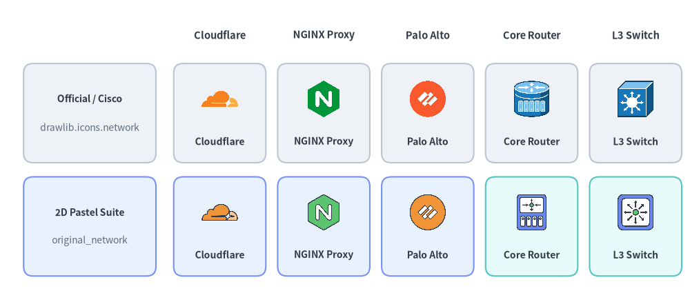
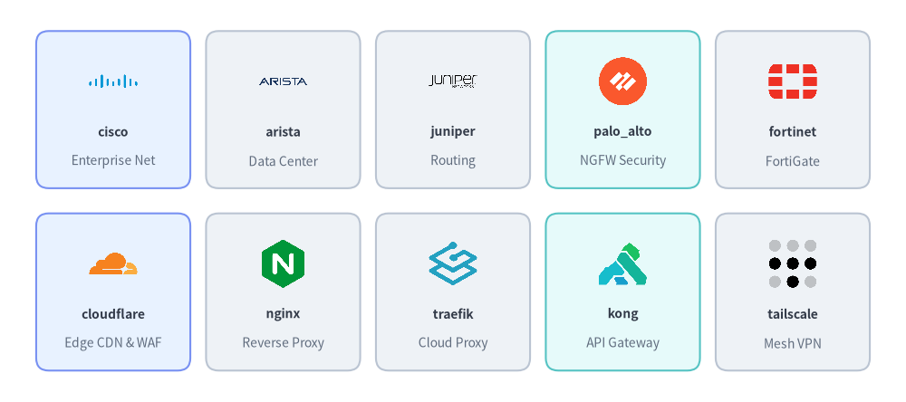
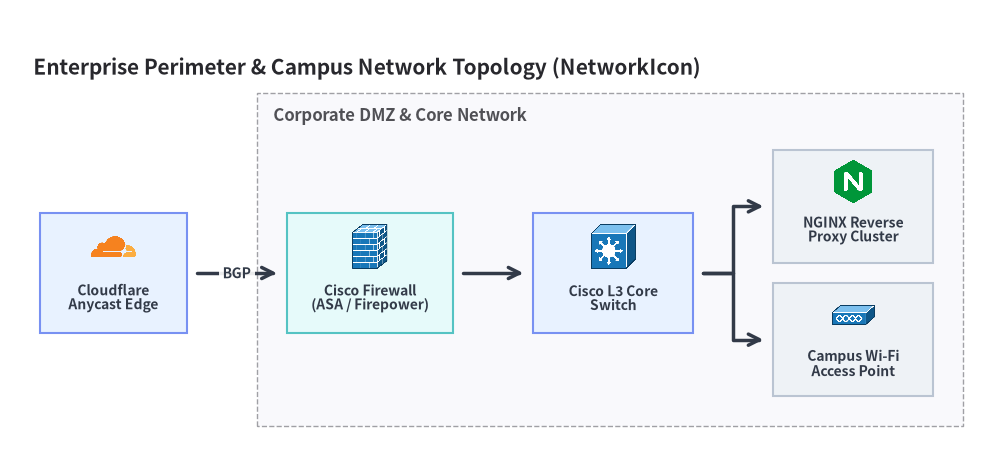

# ネットワーク・Cisco トポロジアイコン

Drawlib は、`drawlib.icons.network`（`NetworkIcon`）に **70 個の公式ネットワーク・Cisco トポロジアイコン**を、`drawlib.icons.original_network`（`OriginalNetworkIcon`）にそれと対になる **70 個の 2D パステルアイコン**を提供します。両スイートとも **48 個のネットワークベンダー／プロジェクトロゴ**と **22 個の L2/L3 ネットワークトポロジアイコン**（`network` では `"classic"` と `"modern"` バリアントを備えた `cisco_*`、`original_network` では対応する 22 個のベンダーニュートラルなトポロジアイコン）を収録しており、単体の図解や **[アーキテクチャ図](../06_diagrams/architecture.md)** で利用できます（**[アイコン概要](./overview.md)** も参照）。


<figure class="drawlib-image" style="text-align: center;">
  
  <figcaption class="drawlib-caption">公式ネットワーク・Cisco アイコン（drawlib.icons.network）とオリジナル 2D パステルツイン（drawlib.icons.original_network）の比較</figcaption>
</figure>

<details class="drawlib-code-details">
<summary>Source Code</summary>

```python
from drawlib.canvas import save, setup
from drawlib.icons import network, original_network
from drawlib.shapes import rectangle
from drawlib.styles import Styles
from drawlib.text import text

setup(width=146, height=64)

columns = [
    ("Cloudflare", network.cloudflare, original_network.cloudflare),
    ("NGINX Proxy", network.nginx, original_network.nginx),
    ("Palo Alto", network.palo_alto, original_network.palo_alto),
    ("Core Router", network.cisco_core_router, original_network.core_router),
    ("L3 Switch", network.cisco_l3_switch, original_network.l3_switch),
]

rows = [
    (40.0, "Official / Cisco", "drawlib.icons.network", Styles.Neutral),
    (16.0, "2D Pastel Suite", "original_network", Styles.PrimaryNeutral),
]

for col_idx, (col_title, _, _) in enumerate(columns):
    cx = 46.5 + col_idx * 22.0
    text((cx, 56.5), col_title, style=Styles.DarkBold.patch(text_size=10.5))

for row_idx, (cy, row_title, row_sub, card_st) in enumerate(rows):
    rectangle((19.0, cy), width=28.0, height=21.0, style=card_st.patch(shape_r=2))
    text((19.0, cy + 3.0), row_title, style=Styles.DarkBold.patch(text_size=10.0))
    text((19.0, cy - 3.0), row_sub, style=Styles.Muted.patch(text_size=10.0))

    for col_idx, (lbl, fn_off, fn_orig) in enumerate(columns):
        cx = 46.5 + col_idx * 22.0
        cell_st = Styles.SecondaryNeutral if (row_idx == 1 and col_idx >= 3) else card_st
        rectangle((cx, cy), width=19.5, height=21.0, style=cell_st.patch(shape_r=2))
        fn = fn_off if row_idx == 0 else fn_orig
        fn((cx, cy + 3.0), width=8.5, style=Styles.Primary)
        text((cx, cy - 6.0), lbl, style=Styles.DarkBold.patch(text_size=10.0))

save()
```

</details>


---

## 1. API シグネチャ・ツインモジュール構成・Cisco の `variant` オプション

48 個のネットワークブランドアイコンはすべて、`drawlib.icons.network` と `drawlib.icons.original_network` の間で同一の関数名を共有しています。さらに、`drawlib.icons.network` に含まれる **22 個の `cisco_*` トポロジ関数**では `variant="default" | "classic" | "modern"` を指定できます。

```python
from drawlib.diagrams.architecture import NetworkIcon, Node, OriginalNetworkIcon
from drawlib.icons import network, original_network
from drawlib.styles import Styles

# 1. Networking brand icons (identical function names in both suites)
network.cloudflare((25, 25), width=10.0, style=Styles.Primary)
original_network.cloudflare((55, 25), width=10.0, style=Styles.Primary)

# 2. Cisco topology icons support variant="default" ("classic") or variant="modern"
network.cisco_core_router((85, 25), width=10.0, style=Styles.Primary, variant="classic")
network.cisco_core_router((115, 25), width=10.0, style=Styles.Primary, variant="modern")

# 3. Vendor-neutral 2D pastel topology twin in original_network
original_network.core_router((145, 25), width=10.0, style=Styles.Primary)

# 4. High-level ArchitectureDiagram Node integration via Enum
fw_node = Node("Perimeter FW", icon=NetworkIcon.CISCO_FIREWALL, icon_size=8.0)
sw_node = Node("Core Switch", icon=OriginalNetworkIcon.CORE_SWITCH, icon_size=8.0)
```

| 項目 | 公式・Cisco スイート（`network`） | オリジナル 2D パステルスイート（`original_network`） |
| :--- | :--- | :--- |
| **モジュールインポート** | `from drawlib.icons import network` | `from drawlib.icons import original_network` |
| **ブランド関数シグネチャ** | `network.<brand>(xy, width, *, style, variant="default")` | `original_network.<brand>(xy, width, *, style, variant="default")` |
| **トポロジ関数シグネチャ** | `network.cisco_<role>(xy, width, *, style, variant="default" \| "classic" \| "modern")` | `original_network.<role>(xy, width, *, style, variant="default")` |
| **アーキテクチャ Enum** | `NetworkIcon.<NAME>` | `OriginalNetworkIcon.<NAME>` |
| **正規アイコン数** | **70**（ベンダー／OSS ブランド `48` 個 + `cisco_*` トポロジアイコン `22` 個） | **70**（2D パステルブランドツイン `48` 個 + トポロジアイコン `22` 個） |

---

## 2. ネットワークベンダー・CDN・プロキシ・VPN ブランドアイコン（48 個）

48 個のブランドアイコンは、エンタープライズ向けスイッチ／ルーター機器、次世代ファイアウォール (NGFW)、ゼロトラストメッシュ VPN、CDN、リバースプロキシ、API ゲートウェイ、DNS 権威サーバーなどを網羅しています。


<figure class="drawlib-image" style="text-align: center;">
  
  <figcaption class="drawlib-caption">代表的なネットワーク機器・CDN・プロキシ・メッシュ VPN ブランドアイコン（drawlib.icons.network）</figcaption>
</figure>

<details class="drawlib-code-details">
<summary>Source Code</summary>

```python
from drawlib.canvas import save, setup
from drawlib.icons import network
from drawlib.shapes import rectangle
from drawlib.styles import Styles
from drawlib.text import text

setup(width=144, height=64)

row1 = [
    ("cisco", "Enterprise Net", network.cisco, Styles.PrimaryNeutral),
    ("arista", "Data Center", network.arista, Styles.Neutral),
    ("juniper", "Routing", network.juniper, Styles.Neutral),
    ("palo_alto", "NGFW Security", network.palo_alto, Styles.SecondaryNeutral),
    ("fortinet", "FortiGate", network.fortinet, Styles.Neutral),
]

row2 = [
    ("cloudflare", "Edge CDN & WAF", network.cloudflare, Styles.PrimaryNeutral),
    ("nginx", "Reverse Proxy", network.nginx, Styles.Neutral),
    ("traefik", "Cloud Proxy", network.traefik, Styles.Neutral),
    ("kong", "API Gateway", network.kong, Styles.SecondaryNeutral),
    ("tailscale", "Mesh VPN", network.tailscale, Styles.Neutral),
]

for row_idx, items in enumerate([row1, row2]):
    cy = 46.5 if row_idx == 0 else 17.5
    for col_idx, (title, cat, icon_fn, card_st) in enumerate(items):
        cx = 18.0 + col_idx * 27.0
        rectangle((cx, cy), width=24.5, height=25.0, style=card_st.patch(shape_r=2))
        icon_fn((cx, cy + 4.5), width=8.5, style=Styles.Primary)
        text((cx, cy - 3.5), title, style=Styles.DarkBold.patch(text_size=10.0))
        text((cx, cy - 8.2), cat, style=Styles.Muted.patch(text_size=10.0))

save()
```

</details>


### 2.1. ネットワークブランドアイコン リファレンス一覧（全 48 正規名）

以下の 48 個の正規ブランド名はすべて、`network.<name>`（`NetworkIcon.<NAME>`）および `original_network.<name>`（`OriginalNetworkIcon.<NAME>`）の両方で利用できます。

| カテゴリ | 個数 | 正規アイコン名（`network.*` & `original_network.*`） |
| :--- | :---: | :--- |
| **エンタープライズ・キャンパスネットワーク機器ベンダー** | 15 | `arista`, `aruba`, `asus`, `cisco`, `d_link`, `frrouting`, `juniper`, `linksys`, `meraki`, `mikrotik`, `netgear`, `openwrt`, `tp_link`, `ubiquiti`, `yamaha` |
| **次世代ファイアウォール (NGFW)・ゼロトラスト VPN・SASE** | 11 | `checkpoint`, `fortinet`, `netbird`, `opnsense`, `openvpn`, `palo_alto`, `pfsense`, `tailscale`, `wireguard`, `zerotier`, `zscaler` |
| **CDN・ロードバランサー・リバースプロキシ・API ゲートウェイ** | 12 | `akamai`, `apisix`, `caddy`, `cloudflare`, `f5`, `fastly`, `haproxy`, `kong`, `nginx`, `squid`, `traefik`, `varnish` |
| **DNS サーバー・広告ブロッカー・TLS 認証局・ドメインレジストラ** | 10 | `adguard`, `bind`, `digicert`, `godaddy`, `lets_encrypt`, `namecheap`, `pi_hole`, `porkbun`, `powerdns`, `unbound` |

---

## 3. Cisco トポロジバリアント（`classic` と `modern`）および 2D パステルツイン（22 個）

標準的な L2/L3 ネットワークトポロジ記号（ルーター、スイッチ、ファイアウォール、無線コントローラー、光伝送装置など）について、Drawlib は次の 3 つのビジュアルスタイルを提供します。
1. **`network.cisco_<role>(..., variant="classic")`** *（または `variant="default"`）*: クラシックな 3D アイソメトリック調の Cisco ティール／ブルートポロジアイコン。
2. **`network.cisco_<role>(..., variant="modern")`**: フラットでモダンな Cisco の円形／角型ブルートポロジバッジ。
3. **`original_network.<role>(...)`**: Drawlib 独自のフラットデザインで制作されたベンダーニュートラルな 2D パステルトポロジアイコン。


```python
from drawlib.canvas import save, setup
from drawlib.icons import network, original_network
from drawlib.shapes import rectangle
from drawlib.styles import Styles
from drawlib.text import text

setup(width=148, height=82)

columns = [
    ("Core Router", network.cisco_core_router, original_network.core_router),
    ("L3 Switch", network.cisco_l3_switch, original_network.l3_switch),
    ("Firewall", network.cisco_firewall, original_network.firewall),
    ("Load Balancer", network.cisco_load_balancer, original_network.load_balancer),
    ("Wireless AP", network.cisco_wireless_ap, original_network.wireless_ap),
]

rows = [
    (59.0, 'variant="classic"', "network.cisco_* (default)", Styles.Neutral),
    (36.5, 'variant="modern"', "network.cisco_*", Styles.PrimaryNeutral),
    (14.0, "2D Pastel Twin", "original_network.*", Styles.SecondaryNeutral),
]

for col_idx, (col_title, _, _) in enumerate(columns):
    cx = 48.0 + col_idx * 21.8
    text((cx, 74.5), col_title, style=Styles.DarkBold.patch(text_size=10.5))

for row_idx, (cy, row_title, row_sub, card_st) in enumerate(rows):
    rectangle((20.0, cy), width=30.0, height=19.5, style=card_st.patch(shape_r=2))
    text((20.0, cy + 2.8), row_title, style=Styles.DarkBold.patch(text_size=10.0))
    text((20.0, cy - 3.2), row_sub, style=Styles.Muted.patch(text_size=10.0))

    for col_idx, (_, fn_cisco, fn_orig) in enumerate(columns):
        cx = 48.0 + col_idx * 21.8
        rectangle((cx, cy), width=19.5, height=19.5, style=card_st.patch(shape_r=2))
        if row_idx == 0:
            fn_cisco((cx, cy), width=9.0, style=Styles.Primary, variant="classic")
        elif row_idx == 1:
            fn_cisco((cx, cy), width=9.0, style=Styles.Primary, variant="modern")
        else:
            fn_orig((cx, cy), width=9.0, style=Styles.Primary)

save()
```

<figure class="drawlib-image" style="text-align: center;">
  
  <figcaption class="drawlib-caption">Cisco クラシック（3D）・Cisco モダン（フラット）・オリジナル 2D パステルネットワークトポロジアイコンの比較</figcaption>
</figure>


### 3.1. 全 22 種類のネットワークトポロジアイコン リファレンス一覧（`network.cisco_*` & `original_network.*`）

| `network.cisco_*` 関数（`classic` / `modern`） | `NetworkIcon` Enum | `original_network.*` 2D パステルツイン | `OriginalNetworkIcon` Enum | ネットワークトポロジ上の役割 |
| :--- | :--- | :--- | :--- | :--- |
| `cisco_client_pc` | `CISCO_CLIENT_PC` | `client_pc` | `CLIENT_PC` | エンドユーザーワークステーションまたはデスクトップクライアント端末 |
| `cisco_core_router` | `CISCO_CORE_ROUTER` | `core_router` | `CORE_ROUTER` | 大容量バックボーン／コア MPLS/BGP ルーター |
| `cisco_core_switch` | `CISCO_CORE_SWITCH` | `core_switch` | `CORE_SWITCH` | キャンパスまたはディストリビューション層のコアシャーシスイッチ |
| `cisco_firewall` | `CISCO_FIREWALL` | `firewall` | `FIREWALL` | 境界 L3/L4/L7 ステートフルセキュリティアプライアンス |
| `cisco_ids_ips` | `CISCO_IDS_IPS` | `ids_ips` | `IDS_IPS` | 侵入検知・防御（IDS/IPS）センサー |
| `cisco_ip_phone` | `CISCO_IP_PHONE` | `ip_phone` | `IP_PHONE` | VoIP デスクフォン端末 |
| `cisco_ise` | `CISCO_ISE` | `nac_server` | `NAC_SERVER` | ネットワークアクセス制御（NAC）／Cisco ISE ポリシーサーバー |
| `cisco_l2_switch` | `CISCO_L2_SWITCH` | `l2_switch` | `L2_SWITCH` | アクセス層 Ethernet VLAN スイッチ |
| `cisco_l3_switch` | `CISCO_L3_SWITCH` | `l3_switch` | `L3_SWITCH` | マルチレイヤ VLAN 間ルーティングスイッチ |
| `cisco_load_balancer` | `CISCO_LOAD_BALANCER` | `load_balancer` | `LOAD_BALANCER` | サーバーロードバランサー／ADC アプライアンス |
| `cisco_nexus_switch` | `CISCO_NEXUS_SWITCH` | `datacenter_switch` | `DATACENTER_SWITCH` | Leaf-Spine 型データセンターファブリックスイッチ（Cisco Nexus） |
| `cisco_optical_transport` | `CISCO_OPTICAL_TRANSPORT` | `optical_transport` | `OPTICAL_TRANSPORT` | DWDM／光ファイバーメトロ伝送ノード |
| `cisco_router` | `CISCO_ROUTER` | `router` | `ROUTER` | 標準的な拠点またはエッジ IP ルーター |
| `cisco_server` | `CISCO_SERVER` | `server` | `SERVER` | ラック型またはタワー型アプリケーションサーバーホスト |
| `cisco_voice_gateway` | `CISCO_VOICE_GATEWAY` | `voice_gateway` | `VOICE_GATEWAY` | SIP / PSTN ユニファイドコミュニケーション音声ゲートウェイ |
| `cisco_vpn_gateway` | `CISCO_VPN_GATEWAY` | `vpn_gateway` | `VPN_GATEWAY` | 拠点間 IPsec / SSL VPN コンセントレーター |
| `cisco_wan_cloud` | `CISCO_WAN_CLOUD` | `wan_cloud` | `WAN_CLOUD` | パブリックインターネット、MPLS キャリア網、または ISP トランジット |
| `cisco_wan_router` | `CISCO_WAN_ROUTER` | `wan_router` | `WAN_ROUTER` | SD-WAN／広域エッジルーター |
| `cisco_web_security` | `CISCO_WEB_SECURITY` | `web_security` | `WEB_SECURITY` | セキュア Web ゲートウェイ（SWG）および URL フィルタリングプロキシ |
| `cisco_wireless_ap` | `CISCO_WIRELESS_AP` | `wireless_ap` | `WIRELESS_AP` | Wi-Fi 無線アクセスポイント（AP） |
| `cisco_wireless_controller` | `CISCO_WIRELESS_CONTROLLER` | `wireless_controller` | `WIRELESS_CONTROLLER` | 集中管理型無線 LAN コントローラー（WLC） |
| `cisco_wireless_router` | `CISCO_WIRELESS_ROUTER` | `wireless_router` | `WIRELESS_ROUTER` | SOHO 向け Wi-Fi 一体型ゲートウェイルーター |

---

## 4. 実践的なアーキテクチャ図（`NetworkIcon` と `OriginalNetworkIcon`）

以下の **[`ArchitectureDiagram`](../06_diagrams/architecture.md)** では、`NetworkIcon` を用いてエンタープライズのキャンパスおよびデータセンター境界ネットワークをモデル化しています。


```python
from drawlib.canvas import save, setup
from drawlib.diagrams.architecture import ArchitectureDiagram, NetworkIcon, Node, NodeGroup
from drawlib.styles import Styles

setup(width=150, height=68)

d = ArchitectureDiagram(
    node_style=Styles.Primary,
    node_text_style=Styles.DarkBold.patch(text_size=10.0),
    edge_style=Styles.DarkBold,
    edge_text_style=Styles.DarkBold.patch(text_size=10.0),
    node_card_style=Styles.Neutral,
    title="Enterprise Perimeter & Campus Network Topology (NetworkIcon)",
)

wan = d.add(
    Node(
        "Cloudflare\nAnycast Edge",
        width=22,
        height=18,
        icon=NetworkIcon.CLOUDFLARE,
        icon_size=7.5,
        card_style=Styles.PrimaryNeutral,
    ),
    xy=(13.0, 23.0),
)

dc = d.add(NodeGroup(title="Corporate DMZ & Core Network", padding=4.5), xy=(36.0, 4.0))
fw = dc.add(
    Node(
        "Cisco Firewall\n(ASA / Firepower)",
        width=25,
        height=18,
        icon=NetworkIcon.CISCO_FIREWALL,
        icon_size=7.5,
        card_style=Styles.SecondaryNeutral,
    ),
    xy=(15.5, 19.0),
)
core_sw = dc.add(
    Node(
        "Cisco L3 Core\nSwitch",
        width=24,
        height=18,
        icon=NetworkIcon.CISCO_L3_SWITCH,
        icon_size=7.5,
        card_style=Styles.PrimaryNeutral,
    ),
    xy=(52.0, 19.0),
)
lb = dc.add(
    Node(
        "NGINX Reverse\nProxy Cluster",
        width=24,
        height=17,
        icon=NetworkIcon.NGINX,
        icon_size=7.2,
    ),
    xy=(88.0, 29.0),
)
wifi = dc.add(
    Node(
        "Campus Wi-Fi\nAccess Point",
        width=24,
        height=17,
        icon=NetworkIcon.CISCO_WIRELESS_AP,
        icon_size=7.2,
    ),
    xy=(88.0, 9.0),
)

d.connect(wan, fw, label="BGP", padding=1.5)
d.connect(fw, core_sw, padding=1.5)
d.connect(core_sw, lb, padding=1.5)
d.connect(core_sw, wifi, padding=1.5)

d.draw(xy=(4.0, 4.0))
save()
```

<figure class="drawlib-image" style="text-align: center;">
  
  <figcaption class="drawlib-caption">NetworkIcon を用いたエンタープライズ境界・キャンパスネットワーク構成図</figcaption>
</figure>


> [!TIP]
> ベアメタルサーバー、ハイパーバイザー、および Linux / Windows オペレーティングシステムについては、**[サーバー・OS・仮想化アイコン](./server.md)**を参照してください。IAM、SIEM、およびエンドポイントセキュリティのアイコンについては、**[セキュリティ・ゼロトラストアイコン](./security.md)**を参照してください。
