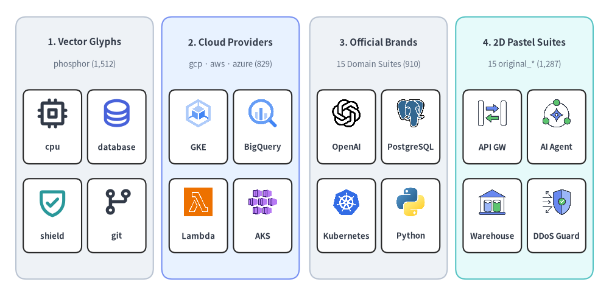
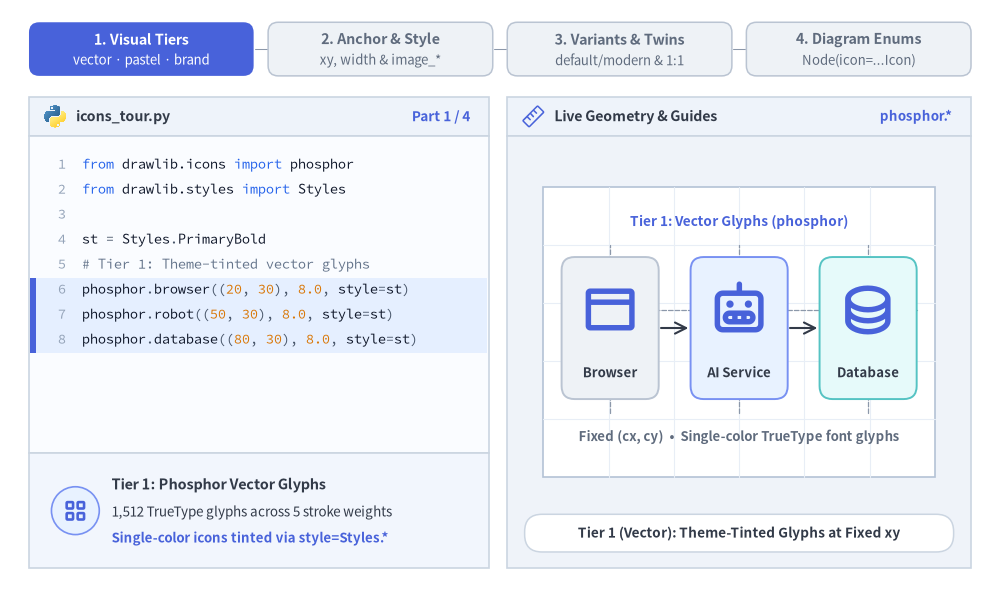
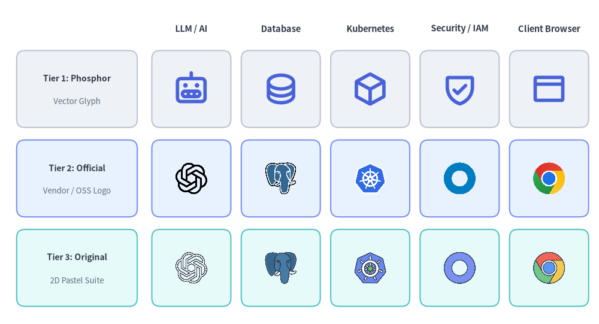
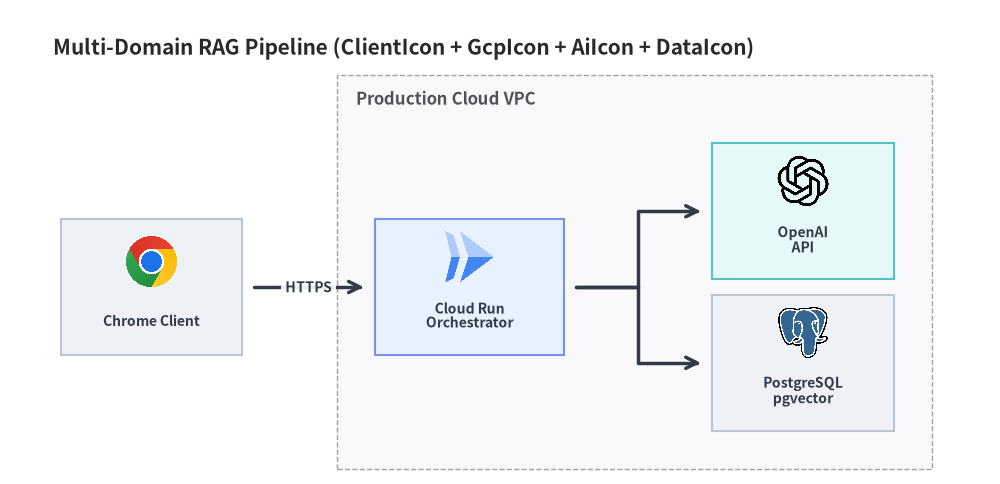

# アイコン概要

Drawlib は、**Phosphor ベクターグリフ**（`phosphor`）、**クラウドプロバイダースイート**（`gcp`、`aws`、`azure`）、**15 種類の公式ブランドスイート**（`ai`、`data`、`code`、`cnative`、`devops` など）、および **15 種類のオリジナル 2D パステルスイート**（`original_*`）という 4 つのビジュアルティアにわたる **34 個のアイコンモジュール**（`drawlib.icons.*`）を通じて、**4,538 個の正規アイコン**を提供します。


<figure class="drawlib-image" style="text-align: center;">
  
  <figcaption class="drawlib-caption">4 つのビジュアルティアにわたる Drawlib の 34 アイコンモジュール（全 4,538 正規アイコン）</figcaption>
</figure>

<details class="drawlib-code-details">
<summary>Source Code</summary>

```python
from drawlib.canvas import save, setup
from drawlib.icons import (
    ai,
    aws,
    azure,
    cnative,
    code,
    data,
    gcp,
    original_ai,
    original_cloud,
    original_data,
    original_security,
    phosphor,
)
from drawlib.shapes import rectangle
from drawlib.styles import Styles
from drawlib.text import text

setup(width=144, height=70)

tiers = [
    (
        20.0,
        "1. Vector Glyphs",
        "phosphor (1,512)",
        Styles.Neutral,
        [
            ("cpu", phosphor.cpu, Styles.DarkBold),
            ("database", phosphor.database, Styles.PrimaryBold),
            ("shield", phosphor.shield_check, Styles.SecondaryBold),
            ("git", phosphor.git_branch, Styles.DarkBold),
        ],
    ),
    (
        54.5,
        "2. Cloud Providers",
        "gcp · aws · azure (829)",
        Styles.PrimaryNeutral,
        [
            ("GKE", gcp.google_kubernetes_engine, Styles.Primary),
            ("BigQuery", gcp.bigquery, Styles.Primary),
            ("Lambda", aws.aws_lambda, Styles.Primary),
            ("AKS", azure.kubernetes_services, Styles.Primary),
        ],
    ),
    (
        89.5,
        "3. Official Brands",
        "15 Domain Suites (910)",
        Styles.Neutral,
        [
            ("OpenAI", ai.openai, Styles.Primary),
            ("PostgreSQL", data.postgresql, Styles.Primary),
            ("Kubernetes", cnative.kubernetes, Styles.Primary),
            ("Python", code.python, Styles.Primary),
        ],
    ),
    (
        124.0,
        "4. 2D Pastel Suites",
        "15 original_* (1,287)",
        Styles.SecondaryNeutral,
        [
            ("API GW", original_cloud.api_gateway, Styles.Primary),
            ("AI Agent", original_ai.ai_agent, Styles.Primary),
            ("Warehouse", original_data.data_warehouse, Styles.Primary),
            ("DDoS Guard", original_security.ddos_protection, Styles.Primary),
        ],
    ),
]

for cx, title, subtitle, card_style, icons_list in tiers:
    # Column card container
    rectangle((cx, 35), width=32.5, height=62, style=card_style.patch(shape_r=2.5))
    text((cx, 60.0), title, style=Styles.DarkBold.patch(text_size=11.0))
    text((cx, 54.8), subtitle, style=Styles.Muted.patch(text_size=9.5))

    # 2x2 grid of representative icons inside each column
    offsets = [(-7.6, 42.0), (7.6, 42.0), (-7.6, 21.0), (7.6, 21.0)]
    sub_card_style = Styles.White.patch(shape_r=1.5, line_width=0.6)
    for (dx, iy), (lbl, fn, st) in zip(offsets, icons_list, strict=True):
        ix = cx + dx
        rectangle((ix, iy - 2.0), width=13.8, height=17.5, style=sub_card_style)
        fn((ix, iy + 1.2), width=7.5, style=st)
        text((ix, iy - 6.8), lbl, style=Styles.DarkBold.patch(text_size=9.5))

save()
```

</details>


---

## 1. アイコンの基本概念とビジュアルツアー

全 **34 個のアイコンモジュール**（`drawlib.icons.*`）は、`1:1` の正方形アスペクト比で自動スケーリングされる共通の中心アンカー `(cx, cy)` API を備えています。そのため、座標を再計算することなく、テーマカラーを適用できるベクターグリフ（`phosphor`）、落ち着いた 2D パステルツイン（`original_*`）、公式クラウド・ベンダーロゴの間を自在に切り替えられます。ビジュアルティア、不透明度や `image_*` による境界フレーム、`variant` パレット、そして強く型付けされたダイアグラム用 `*Icon` Enum がどのように連携するかを以下のアニメーションで確認してください。


<figure class="drawlib-image" style="text-align: center;">
  
  <figcaption class="drawlib-caption">ビジュアルティア＆パラメータツアー: 34 アイコンモジュール・バリアント・境界フレーム・ダイアグラム Enum のライブ切り替え（APNG アニメーション）</figcaption>
</figure>


<div class="drawlib-source-link">
  <a href="https://github.com/yuichi110/drawlib/blob/main/docs/docs_src/ja/03_icons/overview.md" target="_blank" rel="noopener noreferrer">GitHub でアニメーションのソースコードを見る &rarr;</a>
</div>

- **互換性のある 3 つのビジュアルティア**: 同一の `(cx, cy)` 座標のまま、`phosphor` ベクターグリフ、`original_*` 2D パステルツイン、公式クラウド／ベンダー PNG（`gcp`、`aws`、`azure`、`ai`、`data` など）をシームレスに切り替えられます。
- **中心アンカーと `image_*` フレーミング（`xy`、`width`、`style`）**: すべてのアイコンは `xy` を中心に `1:1` のアスペクト比で配置され、`alpha` による不透明度、`image_tint_color` による透過背景の塗りつぶし、`image_border_*` による実線・破線フレームをサポートします。
- **パレットバリアントと `1:1` ツイン命名規則（`variant="default" | "modern"`）**: GCP の主要アイコンを 3 トーンブルーと 4 カラーパレットの間で切り替えたり、`<domain>.<name>` と `original_<domain>.<name>`（さらにベンダーニュートラルな概念アイコン）をそのまま差し替えたりできます。
- **高レベルダイアグラム用 Enum（`<Module>Icon`）**: `PhosphorIcon`、`GcpIcon`、`AiIcon`、`OriginalAiIcon`、`DataIcon` をはじめとする全 34 種類の `*Icon` Enum を、`Node(icon=...)` や `Participant(icon=...)` に直接渡せます。

---

## 2. なぜ 3 つのビジュアルスタイルがあるのか？（適切なアイコンティアの選び方）

技術図解では、用途や対象読者に応じて求められる視覚的な具体性が異なります。Drawlib は 4,538 個の正規アイコンを 4 つのモジュールグループ・3 つの明確なビジュアルスタイルに体系化しており、ドキュメントの目的に最適な表現粒度を選択できます。

| ビジュアルスタイル | モジュールと正規アイコン数 | レンダリングエンジン | 主なユースケース |
| :--- | :--- | :--- | :--- |
| **1. Phosphor ベクターアイコン** | `phosphor`（**1,512** 個） | 5 種類のウェイト（`thin`、`light`、`regular`、`bold`、`fill`）を備えた TrueType ベクターグリフ（`text()` エンジン） | UI ワイヤーフレーム、コールアウト、フローステップ、角のステータスバッジ、テーマカラー（`Styles.PrimaryBold`、`Styles.DarkBold`）で着色する汎用システム概念。 |
| **2. 公式ベンダー・ブランドアイコン** | `gcp`、`aws`、`azure`（クラウド **829** 個）+ 公式ドメイン 15 モジュール（ブランド **910** 個）= 計 **1,739** 個 | 高解像度 `512×512` RGBA PNG（`image()` エンジン） | 特定ベンダーのクラウドアーキテクチャ構成図（GCP、AWS、Azure）や、実際の製品ロゴ（OpenAI、PostgreSQL、Kubernetes、Python、Okta など）を用いた本番技術スタック図。 |
| **3. オリジナル 2D パステルアイコン** | 15 個の `original_*` モジュール（**1,287** 個） | Drawlib 独自のフラット 2D パステル調で制作された高解像度 `512×512` RGBA PNG（`image()` エンジン） | 多様なベンダーロゴを混在させると視覚的な統一感が損なわれるマルチドメイン図解や、商標に依存しない概念・プラットフォーム表現が求められるベンダーニュートラルなリファレンスアーキテクチャ。 |

- **`phosphor` ベクターアイコンを使う場面**: ステップインジケーター、警告バッジ、高レベルな概念フローチャートなど、テーマパレット（`style=Styles.PrimaryBold`、`Styles.WhiteBold`）を継承する軽量な単色アイコンが必要な場合。
- **公式ベンダー・ブランドアイコン（`gcp`、`aws`、`azure`、`ai`、`data`、`code`、`cnative` など）を使う場面**: エンジニアが一目で公式サービスや OSS ロゴを識別できることが期待される、具体的な本番デプロイ構成をドキュメント化する場合。
- **オリジナル 2D パステルアイコン（`original_cloud`、`original_ai`、`original_data` など）を使う場面**: ファシリティ機器、エンタープライズ SaaS、AI エージェント、クラウドゲートウェイなど複数領域の要素を組み合わせつつ、キャンバス上のすべてのアイコンを落ち着いた統一感のある 2D イラストスタイルに揃えたい場合。

---

## 3. 共通アイコン API と座標アンカー

`phosphor` および全 33 個の PNG アイコンモジュールのすべてのアイコン関数は、完全に同一の**中心アンカー `(cx, cy)`** 呼び出しシグネチャを共有しています。

```python
from drawlib.icons import ai, gcp, original_ai, phosphor
from drawlib.styles import Styles

# All icon modules anchor at the center (cx, cy) with a 1:1 square aspect ratio:
phosphor.robot((20, 25), width=10.0, style=Styles.PrimaryBold)
gcp.vertex_ai((50, 25), width=10.0, style=Styles.Primary, variant="default")
ai.openai((80, 25), width=10.0, style=Styles.Primary)
original_ai.ai_agent((110, 25), width=10.0, style=Styles.Primary)
```

| パラメータ / `Style` 属性 | 対象モジュール | 説明 |
| :--- | :--- | :--- |
| `xy: tuple[float, float]` | 全 34 モジュール | アイコンの中心座標 `(cx, cy)`（デフォルトは `halign="center"`、`valign="center"`）。 |
| `width: float` | 全 34 モジュール | キャンバス単位での水平幅。高さは `1:1` の正方形アスペクト比で自動スケーリングされます。 |
| `style: Style` | 全 34 モジュール | `angle`（度数法による回転）、`alpha`（`0.0–1.0` の不透明度）、`halign`、`valign`、`xy_shift` を制御します。 |
| `style.icon_style`、`style.icon_color` | `phosphor`、`font_icon` | ベクターグリフのウェイト（`"thin"`、`"light"`、`"regular"`、`"bold"`、`"fill"`）および線・塗りの色を選択します。 |
| `style.image_tint_color`、`style.image_border_*` | 全 33 PNG モジュール | PNG の透過背景ピクセルを指定色で塗りつぶすか、アイコンのバウンディングボックスを実線・破線の枠線で囲みます。 |
| `variant: str = "default"` | 全 33 PNG モジュール | `"default"` パレット（全モジュール対応）、または対応する `gcp` および `network`（`cisco_*`）アイコンで `"modern"` を選択します。 |
| `<Module>Icon` Enum | `ArchitectureDiagram`、`SequenceDiagram` | `Node(icon=...)` や `Participant(icon=...)` に渡す強く型付けされた `StrEnum` / `Enum` クラス（`PhosphorIcon`、`GcpIcon`、`AwsIcon`、`AiIcon`、`OriginalAiIcon` など）。 |

### 3.1. ビジュアルティア間の並列比較

以下の図では、同じ 5 つのアーキテクチャ上の役割（**LLM / AI**、**Database**、**Kubernetes**、**Security / IAM**、**Client Browser**）を 3 つのビジュアルスタイルすべてで並べて描画しています。


```python
from drawlib.canvas import save, setup
from drawlib.icons import (
    ai,
    client,
    cnative,
    data,
    original_ai,
    original_client,
    original_cnative,
    original_data,
    original_security,
    phosphor,
    security,
)
from drawlib.shapes import rectangle
from drawlib.styles import Styles
from drawlib.text import text

setup(width=144, height=78)

columns = [
    ("LLM / AI", phosphor.robot, ai.openai, original_ai.openai),
    ("Database", phosphor.database, data.postgresql, original_data.postgresql),
    ("Kubernetes", phosphor.cube, cnative.kubernetes, original_cnative.kubernetes),
    ("Security / IAM", phosphor.shield_check, security.okta, original_security.okta),
    ("Client Browser", phosphor.browser, client.chrome, original_client.chrome),
]

rows = [
    (56.5, "Tier 1: Phosphor", "Vector Glyph", Styles.Neutral),
    (35.0, "Tier 2: Official", "Vendor / OSS Logo", Styles.PrimaryNeutral),
    (13.5, "Tier 3: Original", "2D Pastel Suite", Styles.SecondaryNeutral),
]

# Column headers
for col_idx, (col_title, _, _, _) in enumerate(columns):
    cx = 46.0 + col_idx * 21.5
    text((cx, 71.0), col_title, style=Styles.DarkBold.patch(text_size=10.5))

# Row labels and icon cells
for row_idx, (cy, row_title, row_sub, card_st) in enumerate(rows):
    rectangle((18.5, cy), width=29.0, height=18.5, style=card_st.patch(shape_r=2))
    text((18.5, cy + 2.5), row_title, style=Styles.DarkBold.patch(text_size=10.0))
    text((18.5, cy - 3.0), row_sub, style=Styles.Muted.patch(text_size=9.5))

    for col_idx, (_, fn_vec, fn_off, fn_orig) in enumerate(columns):
        cx = 46.0 + col_idx * 21.5
        rectangle((cx, cy), width=19.0, height=18.5, style=card_st.patch(shape_r=2))
        if row_idx == 0:
            fn_vec((cx, cy), width=8.5, style=Styles.PrimaryBold)
        elif row_idx == 1:
            fn_off((cx, cy), width=8.5, style=Styles.Primary)
        else:
            fn_orig((cx, cy), width=8.5, style=Styles.Primary)

save()
```

<figure class="drawlib-image" style="text-align: center;">
  
  <figcaption class="drawlib-caption">Phosphor ベクター・公式ブランド・オリジナル 2D パステルアイコンの比較</figcaption>
</figure>


---

## 4. 全 34 アイコンモジュール一覧ディレクトリ

全 34 個のアイコンモジュールは厳密な **1 対 1 の正規命名規則**（エイリアスなし）に従っており、初回使用時に背後のフォントまたは PNG アーカイブを遅延ロードします。オフライン環境や CI 環境向けにすべてのアイコンパッケージを事前ダウンロードするには、`uv run drawlib cache download --all` を実行してください。

| モジュール（`drawlib.icons.*`） | ダイアグラム Enum（`*Icon`） | ビジュアルティア | 正規アイコン数 | アセットパッケージ | 専用ドキュメントページ |
| :--- | :--- | :--- | :---: | :--- | :--- |
| `phosphor` | `PhosphorIcon` | ベクターフォント（5 ウェイト） | 1,512 | `icon_phosphor` | [Phosphor ベクターアイコン](./phosphor.md) |
| `gcp` | `GcpIcon` | クラウドプロバイダー（公式） | 253 | `icon_gcp` | [Google Cloud (GCP) アイコン](./gcp.md) |
| `aws` | `AwsIcon` | クラウドプロバイダー（公式） | 329 | `icon_aws` | [Amazon Web Services (AWS) アイコン](./aws.md) |
| `azure` | `AzureIcon` | クラウドプロバイダー（公式） | 250 | `icon_azure` | [Microsoft Azure アイコン](./azure.md) |
| `cloud` | `CloudIcon` | 公式ブランド | 45 | `icon_cloud` | [クラウド・オリジナルクラウドアイコン](./cloud.md) |
| `original_cloud` | `OriginalCloudIcon` | オリジナル 2D パステル | 147 | `icon_original_cloud` | [クラウド・オリジナルクラウドアイコン](./cloud.md) |
| `cnative` | `CnativeIcon` | 公式ブランド | 73 | `icon_cnative` | [クラウドネイティブ (K8s) アイコン](./cnative.md) |
| `original_cnative` | `OriginalCnativeIcon` | オリジナル 2D パステル | 73 | `icon_original_cnative` | [クラウドネイティブ (K8s) アイコン](./cnative.md) |
| `devops` | `DevopsIcon` | 公式ブランド | 58 | `icon_devops` | [DevOps・オブザーバビリティアイコン](./devops.md) |
| `original_devops` | `OriginalDevopsIcon` | オリジナル 2D パステル | 78 | `icon_original_devops` | [DevOps・オブザーバビリティアイコン](./devops.md) |
| `network` | `NetworkIcon` | 公式ブランド・Cisco | 70 | `icon_network` | [ネットワーク・Cisco トポロジアイコン](./network.md) |
| `original_network` | `OriginalNetworkIcon` | オリジナル 2D パステル | 70 | `icon_original_network` | [ネットワーク・Cisco トポロジアイコン](./network.md) |
| `server` | `ServerIcon` | 公式ブランド・Dell／VMware | 82 | `icon_server` | [サーバー・OS・仮想化アイコン](./server.md) |
| `original_server` | `OriginalServerIcon` | オリジナル 2D パステル | 80 | `icon_original_server` | [サーバー・OS・仮想化アイコン](./server.md) |
| `security` | `SecurityIcon` | 公式ブランド | 74 | `icon_security` | [セキュリティ・ゼロトラストアイコン](./security.md) |
| `original_security` | `OriginalSecurityIcon` | オリジナル 2D パステル | 103 | `icon_original_security` | [セキュリティ・ゼロトラストアイコン](./security.md) |
| `facility` | `FacilityIcon` | 公式ブランド | 49 | `icon_facility` | [データセンター・ファシリティアイコン](./facility.md) |
| `original_facility` | `OriginalFacilityIcon` | オリジナル 2D パステル | 86 | `icon_original_facility` | [データセンター・ファシリティアイコン](./facility.md) |
| `ai` | `AiIcon` | 公式ブランド | 60 | `icon_ai` | [AI・機械学習アイコン](./ai.md) |
| `original_ai` | `OriginalAiIcon` | オリジナル 2D パステル | 80 | `icon_original_ai` | [AI・機械学習アイコン](./ai.md) |
| `data` | `DataIcon` | 公式ブランド | 70 | `icon_data` | [データ・データベースアイコン](./data.md) |
| `original_data` | `OriginalDataIcon` | オリジナル 2D パステル | 86 | `icon_original_data` | [データ・データベースアイコン](./data.md) |
| `code` | `CodeIcon` | 公式ブランド | 97 | `icon_code` | [コード・言語・フレームワークアイコン](./code.md) |
| `original_code` | `OriginalCodeIcon` | オリジナル 2D パステル | 121 | `icon_original_code` | [コード・言語・フレームワークアイコン](./code.md) |
| `business` | `BusinessIcon` | 公式ブランド | 48 | `icon_business` | [エンタープライズ・FinTech アイコン](./business.md) |
| `original_business` | `OriginalBusinessIcon` | オリジナル 2D パステル | 76 | `icon_original_business` | [エンタープライズ・FinTech アイコン](./business.md) |
| `itservice` | `ItserviceIcon` | 公式ブランド | 44 | `icon_itservice` | [IT サービス・コンサルティングアイコン](./itservice.md) |
| `original_itservice` | `OriginalItserviceIcon` | オリジナル 2D パステル | 64 | `icon_original_itservice` | [IT サービス・コンサルティングアイコン](./itservice.md) |
| `workspace` | `WorkspaceIcon` | 公式ブランド | 40 | `icon_workspace` | [ワークスペース・コラボレーションアイコン](./workspace.md) |
| `original_workspace` | `OriginalWorkspaceIcon` | オリジナル 2D パステル | 57 | `icon_original_workspace` | [ワークスペース・コラボレーションアイコン](./workspace.md) |
| `social` | `SocialIcon` | 公式ブランド | 50 | `icon_social` | [ソーシャル・メディア・コミュニティアイコン](./social.md) |
| `original_social` | `OriginalSocialIcon` | オリジナル 2D パステル | 66 | `icon_original_social` | [ソーシャル・メディア・コミュニティアイコン](./social.md) |
| `client` | `ClientIcon` | 公式ブランド | 60 | `icon_client` | [クライアント端末・エンドポイントアイコン](./client.md) |
| `original_client` | `OriginalClientIcon` | オリジナル 2D パステル | 92 | `icon_original_client` | [クライアント端末・エンドポイントアイコン](./client.md) |

---

## 5. 高レベルダイアグラムでのアイコン活用（`ArchitectureDiagram` と `SequenceDiagram`）

**[`ArchitectureDiagram`](../06_diagrams/architecture.md)**（`Node(..., icon=...)`）と **[`SequenceDiagram`](../06_diagrams/sequence.md)**（`Participant(..., icon=...)`）はどちらも、全 34 種類の `*Icon` Enum（`ClientIcon`、`AiIcon`、`GcpIcon`、`AwsIcon`、`DataIcon`、`OriginalAiIcon` など）をネイティブに受け付けます。これにより、クライアント端末・クラウドインフラ・AI モデル・データベースを単一の接続トポロジ内で自由に組み合わせられます。


```python
from drawlib.canvas import save, setup
from drawlib.diagrams.architecture import (
    AiIcon,
    ArchitectureDiagram,
    ClientIcon,
    DataIcon,
    GcpIcon,
    Node,
    NodeGroup,
)
from drawlib.styles import Styles

setup(width=132, height=64)

d = ArchitectureDiagram(
    node_style=Styles.Primary,
    node_text_style=Styles.DarkBold.patch(text_size=10.0),
    edge_style=Styles.DarkBold,
    edge_text_style=Styles.DarkBold.patch(text_size=10.0),
    node_card_style=Styles.Neutral,
    title="Multi-Domain RAG Pipeline (ClientIcon + GcpIcon + AiIcon + DataIcon)",
)

web = d.add(
    Node("Chrome Client", width=24, height=18, icon=ClientIcon.CHROME, icon_size=7.5),
    xy=(14.0, 22.0),
)

vpc = d.add(NodeGroup(title="Production Cloud VPC", padding=5.0), xy=(40.0, 4.0))
run = vpc.add(
    Node(
        "Cloud Run\nOrchestrator",
        width=25,
        height=18,
        icon=GcpIcon.CLOUD_RUN,
        icon_size=7.5,
        card_style=Styles.PrimaryNeutral,
    ),
    xy=(16.0, 18.0),
)
llm = vpc.add(
    Node(
        "OpenAI\nAPI",
        width=24,
        height=18,
        icon=AiIcon.OPENAI,
        icon_size=7.5,
        card_style=Styles.SecondaryNeutral,
    ),
    xy=(60.0, 28.0),
)
pg = vpc.add(
    Node(
        "PostgreSQL\npgvector",
        width=24,
        height=18,
        icon=DataIcon.POSTGRESQL,
        icon_size=7.5,
    ),
    xy=(60.0, 8.0),
)

d.connect(web, run, label="HTTPS", padding=1.5)
d.connect(run, llm, padding=1.5)
d.connect(run, pg, padding=1.5)

d.draw(xy=(6.0, 4.0))
save()
```

<figure class="drawlib-image" style="text-align: center;">
  
  <figcaption class="drawlib-caption">ArchitectureDiagram 内で複数のアイコンモジュールを組み合わせた構成例</figcaption>
</figure>


