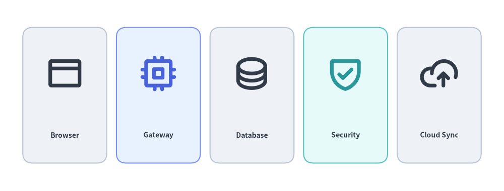
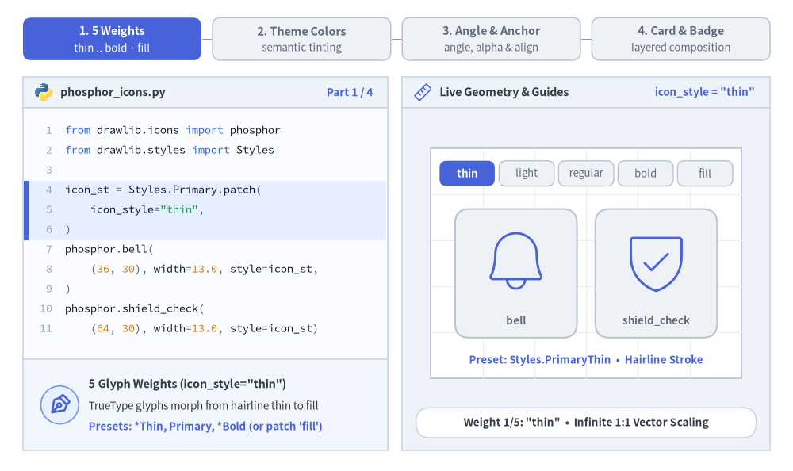
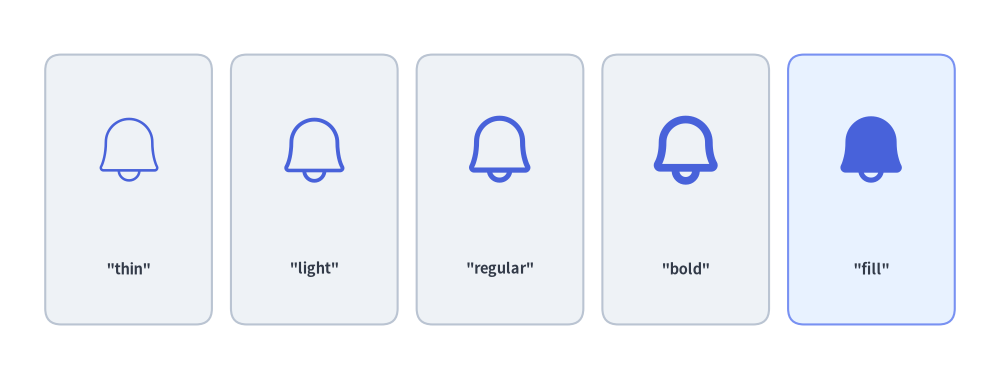
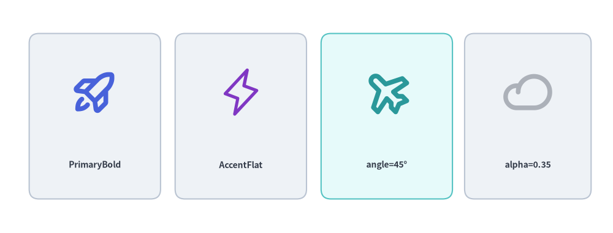
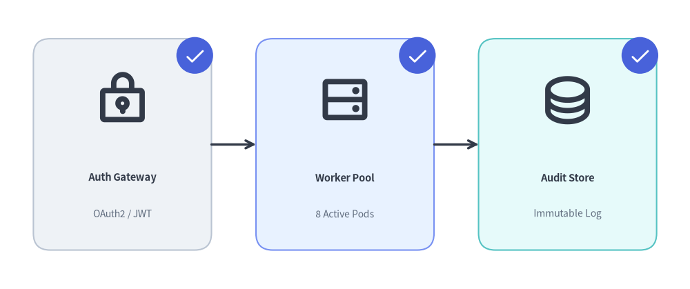

# Phosphor ベクターアイコン

Drawlib は、`drawlib.icons.phosphor` を通じて **Phosphor Icons**（<https://phosphoricons.com>）のベクターグリフファミリー一式（5 種類のタイポグラフィウェイトに対応した 1,500 種類以上の鮮明なベクターアイコン）を標準搭載しているほか、任意のカスタム TrueType アイコンフォントを描画できる低レベル関数 `font_icon()` も提供します。


<figure class="drawlib-image" style="text-align: center;">
  
  <figcaption class="drawlib-caption">落ち着いたニュートラルカードと組み合わせた Phosphor ベクターアイコン</figcaption>
</figure>

<details class="drawlib-code-details">
<summary>Source Code</summary>

```python
from drawlib.canvas import save, setup
from drawlib.icons import phosphor
from drawlib.shapes import rectangle
from drawlib.styles import Styles
from drawlib.text import text

setup(width=126, height=48)

items = [
    ("Browser", phosphor.browser, Styles.Neutral, Styles.DarkBold),
    ("Gateway", phosphor.cpu, Styles.PrimaryNeutral, Styles.PrimaryBold),
    ("Database", phosphor.database, Styles.Neutral, Styles.DarkBold),
    ("Security", phosphor.shield_check, Styles.SecondaryNeutral, Styles.SecondaryBold),
    ("Cloud Sync", phosphor.cloud_arrow_up, Styles.Neutral, Styles.DarkBold),
]

for i, (label, icon_fn, card_st, icon_st) in enumerate(items):
    cx = 16.2 + i * 23.4
    rectangle((cx, 24), width=21, height=34, style=card_st.patch(shape_r=2.5))
    icon_fn((cx, 29.5), width=9.5, style=icon_st)
    text((cx, 14), label, style=Styles.DarkBold.patch(text_size=10.0))

save()
```

</details>


---

## 1. ベクターグリフの基本概念

静的なビットマップアイコンとは異なり、`drawlib.icons.phosphor` のすべての関数は組み込みの TrueType ベクターフォントから直接描画されます。`1:1` のアスペクト比で無限に拡大縮小できると同時に、`Style` を通じて線のウェイト、テーマカラー、回転、不透明度、アンカー位置を動的に制御できます。5 種類のタイポグラフィウェイトにわたる `icon_style` の変化、ニュートラル面や強調面におけるセマンティックテーマプリセットの色付け、`angle` / `alpha` / `halign` / `valign` による `xy` 基準の配置変換、そして落ち着いたコンテナカードと角の確認バッジの組み合わせを以下のアニメーションで確認してください。


<figure class="drawlib-image" style="text-align: center;">
  
  <figcaption class="drawlib-caption">パラメータ＆スタイリングツアー: Phosphor のウェイト・テーマカラー・座標変換・カードバッジのライブ変化（APNG アニメーション）</figcaption>
</figure>


<div class="drawlib-source-link">
  <a href="https://github.com/yuichi110/drawlib/blob/main/docs/docs_src/ja/03_icons/phosphor.md" target="_blank" rel="noopener noreferrer">GitHub でアニメーションのソースコードを見る &rarr;</a>
</div>

- **5 種類のタイポグラフィウェイト（`style.icon_style`）**: `style.patch(icon_style=...)` またはプリセットバリアント（`*Thin`、基本の `Styles.Primary`、`*Bold`）により、あらゆる Phosphor グリフを `"thin"`、`"light"`、`"regular"`、`"bold"`、および塗りつぶしの `"fill"` の間で切り替えられます。
- **セマンティックなベクター色変更（`style.icon_color`）**: テーマプリセット（`Styles.PrimaryBold`、`Styles.SecondaryBold`、`Styles.DangerFlat`）で単色ベクターグリフを着色し、高彩度な `*Flat` バッジの上に `Styles.WhiteBold` を重ねることで鮮明なコントラストを実現します。
- **回転・不透明度・アンカー位置揃え（`angle`、`alpha`、`halign`、`valign`）**: `xy` を中心に反時計回りの度数法で回転させたり、`alpha` でスタンバイ状態のグリフを薄く表示したり、`xy` に対する `width × width` のグリフ枠の基準位置を変更（または `xy_shift` でオフセット）したりできます。
- **カードとバッジのレイヤー構成**: 落ち着いたニュートラルコンテナカード（`Styles.PrimaryNeutral`）の中央にメインアイコン（`Styles.DarkBold`）を配置し、カードの角に円形の確認バッジ（`Styles.PrimaryFlat` + `Styles.WhiteBold`）を重ねられます。

---

## 2. 関数シグネチャとスタイルパラメータ

すべての Phosphor アイコンは、`snake_case` のアイコン名を関数名として公開されています。

```python
from drawlib.icons import phosphor

phosphor.<icon_name>(
    xy: tuple[float, float],
    width: float,
    *,
    style: Style,
) -> None
```

| パラメータ / スタイルフィールド | 型 | デフォルト | 説明 |
| :--- | :--- | :--- | :--- |
| `xy` | `tuple[float, float]` | *必須* | アイコンのアンカー座標 `(x, y)`（デフォルトは中心揃え）。 |
| `width` | `float` | *必須* | キャンバス単位でのアイコン幅（高さは `1:1` のアスペクト比で比例スケーリングされます）。 |
| `style` | `Style` | *必須* | ウェイト、色、位置揃え、オフセット、回転、不透明度を制御するプリセットまたはパッチ適用済みの `Style`。 |
| `style.icon_style` | `"thin" \| "light" \| "regular" \| "bold" \| "fill"` | `"thin"` | Phosphor グリフのタイポグラフィウェイト（線の太さ・塗り）。 |
| `style.icon_color` | `tuple[int, int, int] \| Color` | テーマカラー | グリフの色（`Styles.PrimaryBold`、`Styles.DarkBold`、`Styles.WhiteBold` などのプリセットスタイルで自動マッピングされます）。 |
| `style.halign` | `"left" \| "center" \| "right"` | `"center"` | `xy[0]` に対する水平方向のアンカー位置揃え。 |
| `style.valign` | `"bottom" \| "center" \| "top"` | `"center"` | `xy[1]` に対する垂直方向のアンカー位置揃え。 |
| `style.xy_shift` | `tuple[float, float] \| None` | `None` | `angle` と連動して回転する相対 `(dx, dy)` 座標オフセット。 |
| `style.xy_abs_shift` | `tuple[float, float] \| None` | `None` | `angle` に依存しない絶対 `(dx, dy)` 座標オフセット。 |
| `style.angle` | `float` | `0.0` | `xy` を中心とする反時計回りの回転角度（度数法）。 |
| `style.alpha` | `float` | `1.0` | `0.0`（完全透明）から `1.0`（完全不透明）までの不透明度。 |


---

## 3. タイポグラフィウェイト（`thin`、`light`、`regular`、`bold`、`fill`）

Phosphor ベクターアイコンは、`style.patch(icon_style=...)` またはプリセットスタイルのサフィックス（`*Light` -> `"light"`、`*Bold` -> `"bold"`、`*Flat` -> `"fill"`）で制御できる 5 種類のタイポグラフィウェイトをサポートしています。

- **`"thin"`**: 控えめな背景透かし（ウォーターマーク）に適した極細のストローク。
- **`"light"`**: 情報密度の高い技術スキーマに適した繊細な線幅。
- **`"regular"`**: 一般的なダイアグラムノードに適したバランスの良い標準ストローク。
- **`"bold"`**: 主要なゲートウェイやサービスに適した力強い太線ストローク。
- **`"fill"`**: アクティブ状態、バッジ、アラートに適した塗りつぶしシルエット。


```python
from drawlib.canvas import save, setup
from drawlib.icons import phosphor
from drawlib.shapes import rectangle
from drawlib.styles import Styles
from drawlib.text import text

setup(width=126, height=48)

weights = ["thin", "light", "regular", "bold", "fill"]

for i, w_name in enumerate(weights):
    cx = 16.2 + i * 23.4
    card_st = Styles.PrimaryNeutral if w_name == "fill" else Styles.Neutral
    rectangle((cx, 24), width=21, height=34, style=card_st.patch(shape_r=2))
    phosphor.bell((cx, 29), width=10, style=Styles.Primary.patch(icon_style=w_name))
    text((cx, 14), f'"{w_name}"', style=Styles.DarkBold.patch(text_size=10.5))

save()
```

<figure class="drawlib-image" style="text-align: center;">
  
  <figcaption class="drawlib-caption">Phosphor の 5 種類のタイポグラフィウェイト</figcaption>
</figure>


---

## 4. セマンティックカラー・回転・不透明度

Phosphor アイコンはベクターグリフとして描画されるため、任意のプリセットテーマスタイル（`Styles.PrimaryBold`、`Styles.SecondaryBold`、`Styles.DarkBold`、`Styles.WhiteBold`）で着色したり、`angle` で回転させたり、`alpha` で半透明にしたりできます。


```python
from drawlib.canvas import save, setup
from drawlib.icons import phosphor
from drawlib.shapes import rectangle
from drawlib.styles import Styles
from drawlib.text import text

setup(width=126, height=48)

# 1. Semantic PrimaryBold
rectangle((19.5, 24), width=27, height=34, style=Styles.Neutral.patch(shape_r=2))
phosphor.rocket_launch((19.5, 29), width=10, style=Styles.PrimaryBold)
text((19.5, 14), "PrimaryBold", style=Styles.DarkBold.patch(text_size=10.0))

# 2. Filled Accent Silhouette
rectangle((49.5, 24), width=27, height=34, style=Styles.Neutral.patch(shape_r=2))
phosphor.lightning((49.5, 29), width=10, style=Styles.AccentFlat)
text((49.5, 14), "AccentFlat", style=Styles.DarkBold.patch(text_size=10.0))

# 3. Rotated Icon (angle=45)
rectangle((79.5, 24), width=27, height=34, style=Styles.SecondaryNeutral.patch(shape_r=2))
phosphor.airplane((79.5, 29), width=10, style=Styles.SecondaryBold.patch(angle=45))
text((79.5, 14), "angle=45°", style=Styles.DarkBold.patch(text_size=10.0))

# 4. Semi-Transparent Icon (alpha=0.35)
rectangle((108.5, 24), width=26, height=34, style=Styles.Neutral.patch(shape_r=2))
phosphor.cloud((108.5, 29), width=10, style=Styles.DarkBold.patch(alpha=0.35))
text((108.5, 14), "alpha=0.35", style=Styles.DarkBold.patch(text_size=10.0))

save()
```

<figure class="drawlib-image" style="text-align: center;">
  
  <figcaption class="drawlib-caption">セマンティックカラー・回転（angle）・不透明度（alpha）</figcaption>
</figure>


---

## 5. Phosphor アイコンと図形・バッジの組み合わせ

アーキテクチャ図やパイプライン図では、Phosphor アイコンをニュートラルなコンテナカード（`rectangle`）および角の円形バッジ（`circle`）と組み合わせて構成します。


```python
from drawlib.canvas import save, setup
from drawlib.icons import phosphor
from drawlib.lines import line
from drawlib.shapes import circle, rectangle
from drawlib.styles import Styles
from drawlib.text import text

setup(width=124, height=52)

stages = [
    (22, "Auth Gateway", "OAuth2 / JWT", phosphor.lock_key, Styles.Neutral),
    (62, "Worker Pool", "8 Active Pods", phosphor.hard_drives, Styles.PrimaryNeutral),
    (102, "Audit Store", "Immutable Log", phosphor.database, Styles.SecondaryNeutral),
]

for cx, title, subtitle, icon_fn, card_st in stages:
    # 1. Container card
    rectangle((cx, 26), width=32, height=38, style=card_st.patch(shape_r=3))
    # 2. Main Phosphor icon
    icon_fn((cx, 34), width=10, style=Styles.DarkBold)
    # 3. Title & subtitle labels
    text((cx, 20), title, style=Styles.DarkBold.patch(text_size=10.5))
    text((cx, 13.5), subtitle, style=Styles.Muted.patch(text_size=10.0))
    # 4. Corner check badge
    bx, by = cx + 13, 42
    circle((bx, by), radius=3.3, style=Styles.PrimaryFlat)
    phosphor.check((bx, by), width=3.8, style=Styles.WhiteBold)

line((38, 26), (46, 26), arrow_head="->", style=Styles.DarkBold)
line((78, 26), (86, 26), arrow_head="->", style=Styles.DarkBold)

save()
```

<figure class="drawlib-image" style="text-align: center;">
  
  <figcaption class="drawlib-caption">サービスカードおよび角の確認バッジと組み合わせた Phosphor アイコン</figcaption>
</figure>


---

## 6. カスタムアイコンフォント用の低レベル `font_icon()`

カスタムフォントやサードパーティ製 `.ttf` アイコンフォント（FontAwesome や社内アイコンフォントなど）のグリフを描画するには、`drawlib.icons` の `font_icon()` を使用します。

```python
from drawlib.icons import font_icon
from drawlib.styles import Styles

font_icon(
    xy=(50, 25),
    width=12,
    code="\uf09b",  # Unicode glyph code point
    file="assets/fonts/fa-brands-400.ttf",  # Path to .ttf font file
    style=Styles.DarkBold,
)
```

---

## 7. カテゴリ別の頻出 Phosphor アイコン一覧

| カテゴリ | 代表的な `phosphor.<name>` 関数 |
| :--- | :--- |
| **コンピューティング・システム** | `cpu`, `hard_drive`, `hard_drives`, `desktop`, `laptop`, `device_mobile`, `terminal_window`, `code`, `browser`, `globe` |
| **クラウド・ストレージ** | `cloud`, `cloud_arrow_up`, `cloud_arrow_down`, `cloud_check`, `database`, `folder`, `file_text`, `file_code`, `archive` |
| **ネットワーク・Git** | `broadcast`, `wifi_high`, `arrows_left_right`, `git_branch`, `git_commit`, `git_merge`, `git_pull_request`, `share_network` |
| **セキュリティ・ユーザー** | `lock`, `lock_key`, `shield`, `shield_check`, `shield_warning`, `key`, `fingerprint`, `user`, `users`, `user_circle` |
| **ステータス・分析** | `check`, `check_circle`, `warning`, `warning_circle`, `info`, `gear`, `bell`, `magnifying_glass`, `chart_bar`, `chart_line_up` |

> [!TIP]
> **[Google Cloud (GCP) アイコン](./gcp.md)**、**[Amazon Web Services (AWS) アイコン](./aws.md)**、**[Microsoft Azure アイコン](./azure.md)**、**[クラウド・オリジナルクラウドアイコン](./cloud.md)**、**[AI・機械学習アイコン](./ai.md)**、**[データ・データベースアイコン](./data.md)**、**[コード・言語・フレームワークアイコン](./code.md)**など、全 34 アイコンモジュール（合計 4,538 アイコン）の全体像については、**[アイコン概要](./overview.md)**を参照してください。
