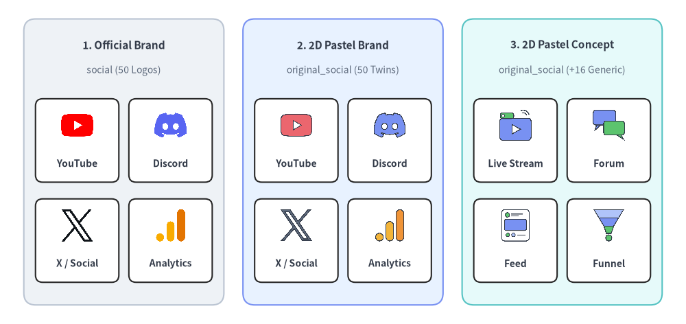
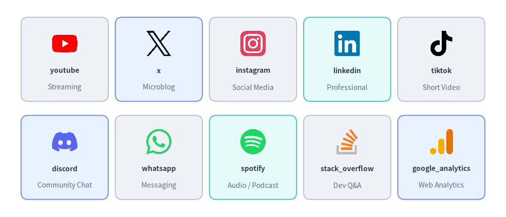
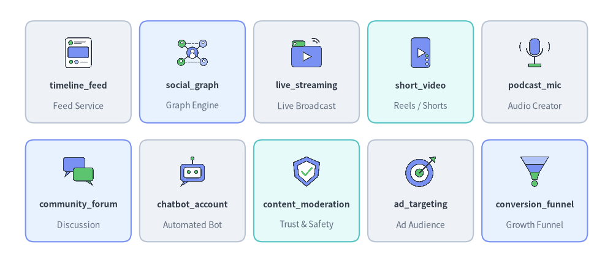
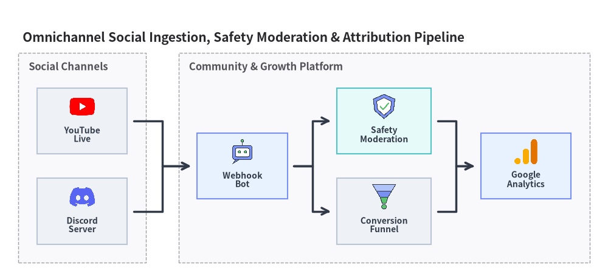

# ソーシャル・メディア・コミュニティアイコン

Drawlib は、`drawlib.icons.social`（`SocialIcon`）に **50 種の公式ブランドアイコン**を、`drawlib.icons.original_social`（`OriginalSocialIcon`）に全 50 種の対応するブランドツインと 16 種のベンダー中立なソーシャル・コンテンツ・マーケティング分析コンセプトアイコンから成る **66 種のフラット 2D パステルアイコン**を提供しています。単体のキャンバスレイアウトや[アーキテクチャ図](../06_diagrams/architecture.md)内で活用できます（全 34 モジュールの全体像は[アイコン概要](./overview.md)を参照してください）。


<figure class="drawlib-image" style="text-align: center;">
  
  <figcaption class="drawlib-caption">ソーシャル・メディア・コミュニティアイコン: 公式ブランド (social) と 2D パステルブランド＆コンセプトツイン (original_social)</figcaption>
</figure>

<details class="drawlib-code-details">
<summary>Source Code</summary>

```python
from drawlib.canvas import save, setup
from drawlib.icons import original_social, social
from drawlib.shapes import rectangle
from drawlib.styles import Styles
from drawlib.text import text

setup(width=144, height=68)

columns = [
    (
        26.0,
        "1. Official Brand",
        "social (50 Logos)",
        Styles.Neutral,
        [
            ("YouTube", social.youtube),
            ("Discord", social.discord),
            ("X / Social", social.x),
            ("Analytics", social.google_analytics),
        ],
    ),
    (
        72.0,
        "2. 2D Pastel Brand",
        "original_social (50 Twins)",
        Styles.PrimaryNeutral,
        [
            ("YouTube", original_social.youtube),
            ("Discord", original_social.discord),
            ("X / Social", original_social.x),
            ("Analytics", original_social.google_analytics),
        ],
    ),
    (
        118.0,
        "3. 2D Pastel Concept",
        "original_social (+16 Generic)",
        Styles.SecondaryNeutral,
        [
            ("Live Stream", original_social.live_streaming),
            ("Forum", original_social.community_forum),
            ("Feed", original_social.timeline_feed),
            ("Funnel", original_social.conversion_funnel),
        ],
    ),
]

for cx, title, subtitle, card_style, icons_list in columns:
    rectangle((cx, 34), width=42.0, height=60, style=card_style.patch(shape_r=2.5))
    text((cx, 58.5), title, style=Styles.DarkBold.patch(text_size=11.0))
    text((cx, 53.2), subtitle, style=Styles.Muted.patch(text_size=10.0))

    offsets = [(-9.8, 40.5), (9.8, 40.5), (-9.8, 19.5), (9.8, 19.5)]
    sub_card_style = Styles.White.patch(shape_r=1.5, line_width=0.6)
    for (dx, iy), (lbl, fn) in zip(offsets, icons_list, strict=True):
        ix = cx + dx
        rectangle((ix, iy - 2.0), width=17.5, height=17.5, style=sub_card_style)
        fn((ix, iy + 1.2), width=7.5, style=Styles.Primary)
        text((ix, iy - 6.8), lbl, style=Styles.DarkBold.patch(text_size=10.0))

save()
```

</details>


---

## 1. API シグネチャとツインモジュール構成

ソーシャルアイコンペアは 2 つの並列モジュールに分かれており、認知度の高いプラットフォーム公式ロゴと、落ち着いた統一感のある 2D パステル表現とを用途に応じて使い分けられます。

| モジュール | ダイアグラム Enum | 正規アイコン数 | アセットパッケージ | 主な用途 |
| :--- | :--- | :---: | :--- | :--- |
| `drawlib.icons.social` | `SocialIcon` | **50** | `icon_social` | SNS、チャットアプリ、動画・音楽ストリーミング、開発者コミュニティ、AdTech ツールの公式プラットフォームロゴ。 |
| `drawlib.icons.original_social` | `OriginalSocialIcon` | **66**（`50 + 16`） | `icon_original_social` | 全 50 ブランドのフラット 2D パステルツインに加え、**16 種のベンダー中立コンセプトアイコン**（`timeline_feed`、`live_streaming`、`conversion_funnel` など）を収録。 |

両モジュールのすべての関数は、`1:1` の正方形アスペクト比で**中心 `(cx, cy)`** を基準に正規化済みの `512×512` RGBA PNG を描画します。

```python
from drawlib.diagrams.architecture import Node, OriginalSocialIcon, SocialIcon
from drawlib.icons import original_social, social
from drawlib.styles import Colors, Styles

# 1. Direct canvas rendering — official brand vs. 2D pastel brand twin
social.youtube((30, 25), width=9.0, style=Styles.Primary)
original_social.youtube((50, 25), width=9.0, style=Styles.Primary)

# 2. Vendor-neutral concept icon with background tint & dashed border
framed = Styles.Primary.patch(
    image_tint_color=Colors.Primary1,
    image_border_color=Colors.Primary,
    image_border_width=1.2,
    image_border_style="dashed",
)
original_social.conversion_funnel((70, 25), width=9.0, style=framed)

# 3. Inside ArchitectureDiagram Node or SequenceDiagram Participant
ch_node = Node("Discord Bot", width=24, height=18, icon=SocialIcon.DISCORD, icon_size=7.5)
mod_node = Node("Moderation", width=24, height=18, icon=OriginalSocialIcon.CONTENT_MODERATION, icon_size=7.5)
```

---

## 2. 公式・パステルブランドアイコン (`social` & `original_social`)

以下に示す **50 種のブランドアイコン**は、`social.<name>()` と `original_social.<name>()` の間で同一の正規関数名を共有しており、`SocialIcon.<NAME>` および `OriginalSocialIcon.<NAME>` でも同一の大文字 Enum メンバーとして定義されています。


<figure class="drawlib-image" style="text-align: center;">
  
  <figcaption class="drawlib-caption">drawlib.icons.social の代表的なブランドアイコン 10 選 (original_social と共通)</figcaption>
</figure>

<details class="drawlib-code-details">
<summary>Source Code</summary>

```python
from drawlib.canvas import save, setup
from drawlib.icons import social
from drawlib.shapes import rectangle
from drawlib.styles import Styles
from drawlib.text import text

setup(width=144, height=62)

row1 = [
    ("youtube", "Streaming", social.youtube, Styles.Neutral),
    ("x", "Microblog", social.x, Styles.PrimaryNeutral),
    ("instagram", "Social Media", social.instagram, Styles.Neutral),
    ("linkedin", "Professional", social.linkedin, Styles.SecondaryNeutral),
    ("tiktok", "Short Video", social.tiktok, Styles.Neutral),
]

row2 = [
    ("discord", "Community Chat", social.discord, Styles.PrimaryNeutral),
    ("whatsapp", "Messaging", social.whatsapp, Styles.Neutral),
    ("spotify", "Audio / Podcast", social.spotify, Styles.SecondaryNeutral),
    ("stack_overflow", "Dev Q&A", social.stack_overflow, Styles.Neutral),
    ("google_analytics", "Web Analytics", social.google_analytics, Styles.PrimaryNeutral),
]

for row_idx, items in enumerate([row1, row2]):
    cy = 45.0 if row_idx == 0 else 17.0
    for col_idx, (name, cat, icon_fn, card_st) in enumerate(items):
        cx = 18.4 + col_idx * 26.8
        rectangle((cx, cy), width=24.8, height=24.0, style=card_st.patch(shape_r=2))
        icon_fn((cx, cy + 4.5), width=8.0, style=Styles.Primary)
        text((cx, cy - 3.2), name, style=Styles.DarkBold.patch(text_size=10.0))
        text((cx, cy - 8.0), cat, style=Styles.Muted.patch(text_size=10.0))

save()
```

</details>


### 2.1. 正規ブランドアイコン全 50 種一覧 (`social` & `original_social`)

| カテゴリ | 数 | 正規関数名 (`social.<name>` / `original_social.<name>`) |
| :--- | :---: | :--- |
| **SNS・マイクロブログ** | 10 | `bluesky`, `facebook`, `instagram`, `linkedin`, `mastodon`, `pinterest`, `reddit`, `snapchat`, `threads`, `x` |
| **メッセージング・コミュニティチャット** | 9 | `discord`, `kakao`, `line`, `messenger`, `signal`, `telegram`, `viber`, `wechat`, `whatsapp` |
| **動画・音声・メディアストリーミング** | 11 | `abema`, `apple_podcasts`, `bilibili`, `nicovideo`, `soundcloud`, `spotify`, `tiktok`, `tver`, `twitch`, `vimeo`, `youtube` |
| **開発者コミュニティ・技術メディア配信** | 13 | `connpass`, `dev_to`, `hacker_news`, `hashnode`, `hatena`, `medium`, `note`, `qiita`, `speaker_deck`, `stack_overflow`, `substack`, `yahoo_japan`, `zenn` |
| **AdTech・アトリビューション・アクセス解析** | 7 | `amplitude`, `appsflyer`, `google_ads`, `google_analytics`, `google_tag_manager`, `meta_ads`, `mixpanel` |

---

## 3. ベンダー中立コンセプトアイコン (`original_social` 専用)

50 種のブランドツインに加え、`drawlib.icons.original_social`（`OriginalSocialIcon`）にはホワイトラベルなアーキテクチャ設計図向けの **16 種のベンダー中立なソーシャル・メディア・コミュニティ・マーケティングファネルコンセプトアイコン**が収録されています。


<figure class="drawlib-image" style="text-align: center;">
  
  <figcaption class="drawlib-caption">drawlib.icons.original_social 専用の代表的なベンダー中立コンセプトアイコン 10 選</figcaption>
</figure>

<details class="drawlib-code-details">
<summary>Source Code</summary>

```python
from drawlib.canvas import save, setup
from drawlib.icons import original_social
from drawlib.shapes import rectangle
from drawlib.styles import Styles
from drawlib.text import text

setup(width=144, height=62)

row1 = [
    ("timeline_feed", "Feed Service", original_social.timeline_feed, Styles.Neutral),
    ("social_graph", "Graph Engine", original_social.social_graph, Styles.PrimaryNeutral),
    ("live_streaming", "Live Broadcast", original_social.live_streaming, Styles.Neutral),
    ("short_video", "Reels / Shorts", original_social.short_video, Styles.SecondaryNeutral),
    ("podcast_mic", "Audio Creator", original_social.podcast_mic, Styles.Neutral),
]

row2 = [
    ("community_forum", "Discussion", original_social.community_forum, Styles.PrimaryNeutral),
    ("chatbot_account", "Automated Bot", original_social.chatbot_account, Styles.Neutral),
    ("content_moderation", "Trust & Safety", original_social.content_moderation, Styles.SecondaryNeutral),
    ("ad_targeting", "Ad Audience", original_social.ad_targeting, Styles.Neutral),
    ("conversion_funnel", "Growth Funnel", original_social.conversion_funnel, Styles.PrimaryNeutral),
]

for row_idx, items in enumerate([row1, row2]):
    cy = 45.0 if row_idx == 0 else 17.0
    for col_idx, (name, role, icon_fn, card_st) in enumerate(items):
        cx = 18.4 + col_idx * 26.8
        rectangle((cx, cy), width=24.8, height=24.0, style=card_st.patch(shape_r=2))
        icon_fn((cx, cy + 4.5), width=8.0, style=Styles.Primary)
        text((cx, cy - 3.2), name, style=Styles.DarkBold.patch(text_size=10.0))
        text((cx, cy - 8.0), role, style=Styles.Muted.patch(text_size=10.0))

save()
```

</details>


### 3.1. 正規コンセプトアイコン全 16 種一覧 (`original_social` 専用)

| 正規関数名 (`original_social.*`) | `OriginalSocialIcon` Enum | ドメインカテゴリ | 主なアーキテクチャ上の役割 |
| :--- | :--- | :--- | :--- |
| `ad_targeting` | `OriginalSocialIcon.AD_TARGETING` | AdTech・グロース | オーディエンスセグメントおよびパーソナライズ広告配信エンジン |
| `chatbot_account` | `OriginalSocialIcon.CHATBOT_ACCOUNT` | メッセージング・Bot | 自動応答 Webhook Bot または対話型コミュニティエージェント |
| `community_forum` | `OriginalSocialIcon.COMMUNITY_FORUM` | コミュニティ | ユーザー掲示板、Q&A ポータル、サポートフォーラム |
| `content_moderation` | `OriginalSocialIcon.CONTENT_MODERATION` | トラスト＆セーフティ | 有害投稿の自動フィルタリング、スパム検知、ポリシー審査 |
| `conversion_funnel` | `OriginalSocialIcon.CONVERSION_FUNNEL` | アナリティクス | ユーザー獲得・アクティベーション・購入に至る多段階コンバージョンファネル |
| `influencer` | `OriginalSocialIcon.INFLUENCER` | クリエイターエコノミー | クリエイターアカウント、ブランドアンバサダー、インフルエンサーノード |
| `live_streaming` | `OriginalSocialIcon.LIVE_STREAMING` | メディア・動画 | リアルタイム RTMP/WebRTC 映像取り込みおよびライブ配信パイプライン |
| `podcast_mic` | `OriginalSocialIcon.PODCAST_MIC` | 音声・メディア | 音声収録、RSS ポッドキャスト配信、音声ルーム |
| `push_campaign` | `OriginalSocialIcon.PUSH_CAMPAIGN` | マーケティング | モバイル／Web プッシュ通知配信およびリエンゲージメント施策 |
| `short_video` | `OriginalSocialIcon.SHORT_VIDEO` | メディア・動画 | 縦型ショート動画のトランスコードおよびレコメンドフィード |
| `social_graph` | `OriginalSocialIcon.SOCIAL_GRAPH` | コアソーシャル | フォロワー／フレンド関係グラフおよびコネクション管理サービス |
| `social_login` | `OriginalSocialIcon.SOCIAL_LOGIN` | ID・認証 | OAuth2 / OIDC ソーシャルログイン連携ゲートウェイ |
| `tech_blog` | `OriginalSocialIcon.TECH_BLOG` | パブリッシング | 技術ブログ、開発者ポータル、CMS 記事配信基盤 |
| `timeline_feed` | `OriginalSocialIcon.TIMELINE_FEED` | コアソーシャル | パーソナライズされたホームタイムラインのファンアウト・ランキングサービス |
| `user_engagement` | `OriginalSocialIcon.USER_ENGAGEMENT` | アナリティクス | いいね・リアクション・コメント・継続率のテレメトリ計測基盤 |
| `viral_share` | `OriginalSocialIcon.VIRAL_SHARE` | グロース | 紹介（リファラル）ループ、SNS シェアカード、バイラル拡散施策 |

---

## 4. 実践的なアーキテクチャ図 (`SocialIcon` & `OriginalSocialIcon`)

**[`ArchitectureDiagram`](../06_diagrams/architecture.md)** 内で `SocialIcon` と `OriginalSocialIcon` を直接組み合わせることで、オムニチャネルのソーシャルデータ取り込み、トラスト＆セーフティによるモデレーション、マーケティング効果測定（アトリビューション）パイプラインを図解できます。


```python
from drawlib.canvas import save, setup
from drawlib.diagrams.architecture import (
    ArchitectureDiagram,
    Node,
    NodeGroup,
    OriginalSocialIcon,
    SocialIcon,
)
from drawlib.styles import Styles

setup(width=148, height=68)

d = ArchitectureDiagram(
    node_style=Styles.Primary,
    node_text_style=Styles.DarkBold.patch(text_size=10.0),
    edge_style=Styles.DarkBold,
    edge_text_style=Styles.DarkBold.patch(text_size=10.0),
    node_card_style=Styles.Neutral,
    title="Omnichannel Social Ingestion, Safety Moderation & Attribution Pipeline",
)

# External Social Channels
channels = d.add(NodeGroup(title="Social Channels", padding=4.5), xy=(0.0, 0.0))
yt = channels.add(
    Node("YouTube\nLive", width=22, height=16, icon=SocialIcon.YOUTUBE, icon_size=6.8),
    xy=(15.5, 34.5),
)
dc = channels.add(
    Node("Discord\nServer", width=22, height=16, icon=SocialIcon.DISCORD, icon_size=6.8),
    xy=(15.5, 12.5),
)

# Core Engagement & Safety Platform
platform = d.add(NodeGroup(title="Community & Growth Platform", padding=4.5), xy=(39.0, 0.0))
bot = platform.add(
    Node(
        "Webhook\nBot",
        width=22,
        height=16,
        icon=OriginalSocialIcon.CHATBOT_ACCOUNT,
        icon_size=6.8,
        card_style=Styles.PrimaryNeutral,
    ),
    xy=(15.5, 23.5),
)
mod = platform.add(
    Node(
        "Safety\nModeration",
        width=23,
        height=16,
        icon=OriginalSocialIcon.CONTENT_MODERATION,
        icon_size=6.8,
        card_style=Styles.SecondaryNeutral,
    ),
    xy=(50.0, 34.5),
)
funnel = platform.add(
    Node(
        "Conversion\nFunnel",
        width=23,
        height=16,
        icon=OriginalSocialIcon.CONVERSION_FUNNEL,
        icon_size=6.8,
    ),
    xy=(50.0, 12.5),
)
ga = platform.add(
    Node(
        "Google\nAnalytics",
        width=22,
        height=16,
        icon=SocialIcon.GOOGLE_ANALYTICS,
        icon_size=6.8,
        card_style=Styles.PrimaryNeutral,
    ),
    xy=(84.5, 23.5),
)

d.connect(yt, bot, padding=1.5)
d.connect(dc, bot, padding=1.5)
d.connect(bot, mod, padding=1.5)
d.connect(bot, funnel, padding=1.5)
d.connect(mod, ga, padding=1.5)
d.connect(funnel, ga, padding=1.5)

d.draw(xy=(4.5, 4.0))
save()
```

<figure class="drawlib-image" style="text-align: center;">
  
  <figcaption class="drawlib-caption">オムニチャネルのコミュニティデータ取り込み・モデレーション・アトリビューションパイプライン</figcaption>
</figure>


> [!TIP]
> Web ブラウザ、モバイル OS プラットフォーム、コンシューマ端末のアイコンについては **[クライアント端末・エンドポイントアイコン (`client` / `original_client`)](./client.md)** を参照するか、**[アイコン概要](./overview.md)** に戻ってください。
