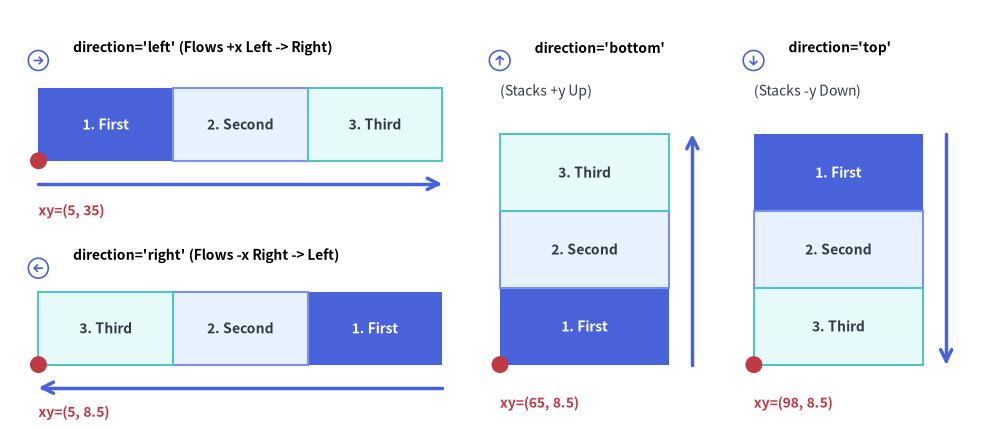
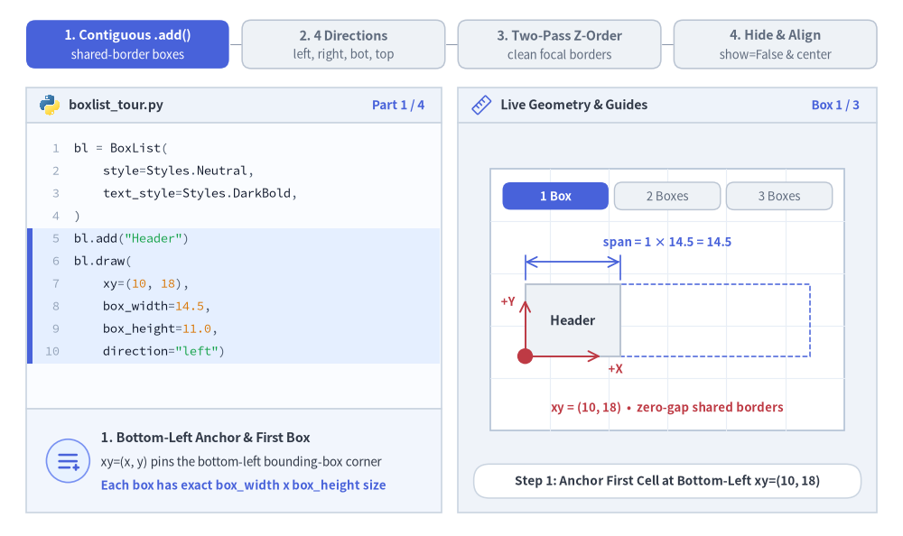
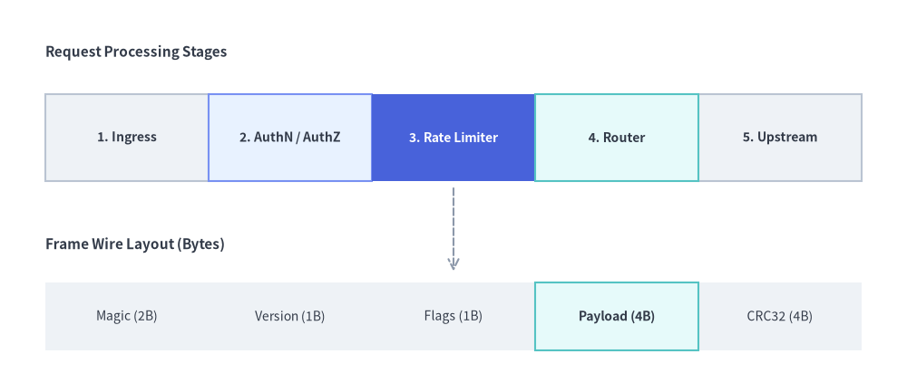
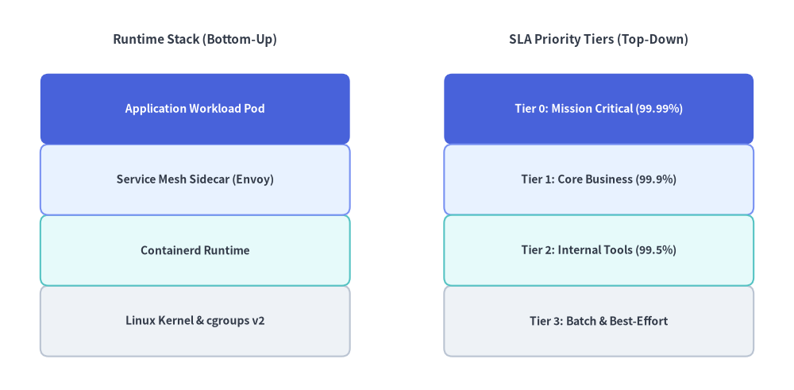

# BoxList（ボックスリスト）

`BoxList` コンポーネントは、水平軸または垂直軸に沿って隙間なく連続する矩形カード列を描画します。
カスタムスタイルを指定した要素は自動的に第 2 パスで描画されるため、隣接するデフォルトボックスの上に枠線がきれいに重なり、メモリ／パケット構造、ステージシーケンス、垂直方向の機能スタックの表現に最適です。


<figure class="drawlib-image" style="text-align: center;">
  
  <figcaption class="drawlib-caption">BoxList のレイアウト方向（left・right・bottom・top）とアンカーポイント</figcaption>
</figure>

<details class="drawlib-code-details">
<summary>Source Code</summary>

```python
from drawlib.canvas import save, setup
from drawlib.icons import phosphor
from drawlib.lines import line
from drawlib.shapes import circle
from drawlib.smartarts import BoxList
from drawlib.styles import Styles
from drawlib.text import text

setup(width=130, height=56)

bl = BoxList(
    style=Styles.Neutral,
    text_style=Styles.DarkBold.patch(text_size=10.0),
)
bl.add("1. First", style=Styles.PrimaryFlat, text_style=Styles.WhiteBold.patch(text_size=10.0))
bl.add("2. Second", style=Styles.PrimaryNeutral)
bl.add("3. Third", style=Styles.SecondaryNeutral)

# 1. Top-Left Panel: direction="left" (flows +x from left to right)
phosphor.arrow_circle_right(xy=(5.0, 48.0), width=3.4, style=Styles.PrimaryFlat)
text((9.5, 49.7), "direction='left' (Flows +x Left -> Right)", style=Styles.BlackBold.patch(text_size=10.0, halign="left"))
bl.draw(xy=(5.0, 35.0), box_width=17.5, box_height=9.5, direction="left")
line((5.0, 32.0), (57.5, 32.0), arrow_head="->", style=Styles.PrimaryBold)
circle((5.0, 35.0), radius=1.1, style=Styles.DangerFlat)
text((5.0, 28.5), "xy=(5, 35)", style=Styles.DangerBold.patch(text_size=10.0, halign="left"))

# 2. Bottom-Left Panel: direction="right" (flows -x from right to left)
phosphor.arrow_circle_left(xy=(5.0, 21.0), width=3.4, style=Styles.PrimaryFlat)
text((9.5, 22.7), "direction='right' (Flows -x Right -> Left)", style=Styles.BlackBold.patch(text_size=10.0, halign="left"))
bl.draw(xy=(5.0, 8.5), box_width=17.5, box_height=9.5, direction="right")
line((57.5, 5.5), (5.0, 5.5), arrow_head="->", style=Styles.PrimaryBold)
circle((5.0, 8.5), radius=1.1, style=Styles.DangerFlat)
text((5.0, 2.3), "xy=(5, 8.5)", style=Styles.DangerBold.patch(text_size=10.0, halign="left"))

# 3. Middle Panel: direction="bottom" (stacks +y upward from bottom)
phosphor.arrow_circle_up(xy=(65.0, 48.0), width=3.4, style=Styles.PrimaryFlat)
text((69.5, 49.7), "direction='bottom'", style=Styles.BlackBold.patch(text_size=10.0, halign="left"))
text((65.0, 44.0), "(Stacks +y Up)", style=Styles.Dark.patch(text_size=10.0, halign="left"))
bl.draw(xy=(65.0, 8.5), box_width=22.0, box_height=10.0, direction="bottom")
line((90.0, 8.5), (90.0, 38.5), arrow_head="->", style=Styles.PrimaryBold)
circle((65.0, 8.5), radius=1.1, style=Styles.DangerFlat)
text((65.0, 3.5), "xy=(65, 8.5)", style=Styles.DangerBold.patch(text_size=10.0, halign="left"))

# 4. Right Panel: direction="top" (stacks -y downward from top)
phosphor.arrow_circle_down(xy=(98.0, 48.0), width=3.4, style=Styles.PrimaryFlat)
text((102.5, 49.7), "direction='top'", style=Styles.BlackBold.patch(text_size=10.0, halign="left"))
text((98.0, 44.0), "(Stacks -y Down)", style=Styles.Dark.patch(text_size=10.0, halign="left"))
bl.draw(xy=(98.0, 8.5), box_width=22.0, box_height=10.0, direction="top")
line((123.0, 38.5), (123.0, 8.5), arrow_head="->", style=Styles.PrimaryBold)
circle((98.0, 8.5), radius=1.1, style=Styles.DangerFlat)
text((98.0, 3.5), "xy=(98, 8.5)", style=Styles.DangerBold.patch(text_size=10.0, halign="left"))

save()
```

</details>


---

## 1. 基本概念と基本的な使い方

`BoxList` は `.add(...)` によって隙間なく連続する矩形セル列を構築し、デフォルトで複数ボックス全体のバウンディングボックスの**左下角 `(x, y)`**（`align="center"` の場合は中央）を基準に配置します。4 つの軸方向（`"left"`, `"right"`, `"bottom"`, `"top"`）への展開、カスタム強調枠が隣接エッジ上にきれいに重なる自動 2 パス Z オーダー描画、および他のスロット位置をずらさない `.items[i]` の非表示化やスケーリングに対応しています。


<figure class="drawlib-image" style="text-align: center;">
  
  <figcaption class="drawlib-caption">基本的な使い方とパラメータツアー: 連続セル構築、4 つの配置方向、2 パス枠線 Z オーダー、スロット維持の非表示化と中央配置（APNG アニメーション）</figcaption>
</figure>


<div class="drawlib-source-link">
  <a href="https://github.com/yuichi110/drawlib/blob/main/docs/docs_src/ja/04_smartarts/box_list.md" target="_blank" rel="noopener noreferrer">GitHub でアニメーションのソースコードを見る &rarr;</a>
</div>

- **隙間なしの連続構築とアンカー（`.add()`, `xy`）**: ボックスを順に追加することで、デフォルトで**左下 `xy`** を基準とする正確な `N * box_width` 幅の隙間なしシーケンスを構築します。
- **4 つの軸方向（`direction`）**: `"left"`（`+X`、デフォルト）または `"right"`（`-X`）による水平フロー、および `"bottom"`（上方向 `+Y`）または `"top"`（下方向 `-Y`）による垂直スタックに対応します。
- **2 パスのハイライト Z オーダー（`style` の個別上書き）**: `BoxList.draw()` はデフォルトスタイルのセルを第 1 パスで、カスタムスタイルの強調セルを第 2 パスで描画するため、太枠や `PrimaryFlat` の境界線が隣接ボックスとの共有エッジ上に重なり、途切れず鮮明に表示されます。
- **スロット位置を維持する `.show`・`scale`・`align="center"`**: `bl.items[i].show = False` で隣接座標をずらさずに特定のボックスを非表示にできるほか、`scale` で `xy` 基準の拡大縮小、`align="center"` で全体領域の `(cx, cy)` 中央配置を行えます。

---

## 2. 注目ステージを強調した水平シーケンス（`direction="left"`）

`direction="left"`（デフォルト）の場合、ボックスは `xy=(x, y)` を起点として右方向（`+x`）へ水平に並びます。複数の `BoxList` インスタンスを矢印やラベルと組み合わせることで、処理パイプラインやパケット構造をわかりやすく図解できます。


```python
from drawlib.canvas import save, setup
from drawlib.lines import line
from drawlib.smartarts import BoxList
from drawlib.styles import Styles
from drawlib.text import text

setup(width=120, height=52)

# 1. Top: Data Processing Pipeline Sequence
text((6, 45), "Request Processing Stages", style=Styles.DarkBold.patch(text_size=11.0, halign="left"))

pipeline = BoxList(
    style=Styles.Neutral,
    text_style=Styles.DarkBold.patch(text_size=10.0),
)
pipeline.add("1. Ingress")
pipeline.add("2. AuthN / AuthZ", style=Styles.PrimaryNeutral)
pipeline.add(
    "3. Rate Limiter",
    style=Styles.PrimaryFlat,
    text_style=Styles.WhiteBold.patch(text_size=10.0),
)
pipeline.add("4. Router", style=Styles.SecondaryNeutral)
pipeline.add("5. Upstream")
pipeline.draw(xy=(6, 28), box_width=21.6, box_height=11.5, direction="left")

# 2. Bottom: Contiguous Binary Frame / Memory Layout
text((6, 19.5), "Frame Wire Layout (Bytes)", style=Styles.DarkBold.patch(text_size=11.0, halign="left"))

packet = BoxList(
    style=Styles.NeutralFlat,
    text_style=Styles.Dark.patch(text_size=10.0),
)
packet.add("Magic (2B)")
packet.add("Version (1B)")
packet.add("Flags (1B)")
packet.add("Payload (4B)", style=Styles.SecondaryNeutral, text_style=Styles.DarkBold.patch(text_size=10.0))
packet.add("CRC32 (4B)")
packet.draw(xy=(6, 5.5), box_width=21.6, box_height=9.0, direction="left")

line((60, 27), (60, 16), arrow_head="->", style=Styles.MutedDashed)
save()
```

<figure class="drawlib-image" style="text-align: center;">
  
  <figcaption class="drawlib-caption">BoxList による水平パイプラインシーケンスとパケットヘッダー構造</figcaption>
</figure>


---

## 3. 垂直方向の機能・レイヤースタック（`direction="bottom"` / `direction="top"`）

`direction="bottom"` を指定するとバウンディングボックスの下端から上方向（`+y`）へボックスが積み上がり、`direction="top"` を指定するとバウンディングボックスの上端から下方向（`-y`）へボックスが積み下がります。ボックスのスタイルに `shape_r` をパッチ適用すると、角丸のレイヤーカードとして表現できます。


```python
from drawlib.canvas import save, setup
from drawlib.smartarts import BoxList
from drawlib.styles import Styles
from drawlib.text import text

setup(width=118, height=58)

# Left Stack: Bottom-up OS / Runtime Stack (direction="bottom")
text((29, 52), "Runtime Stack (Bottom-Up)", style=Styles.DarkBold.patch(text_size=11.0))

runtime_stack = BoxList(
    style=Styles.Neutral.patch(shape_r=1.2),
    text_style=Styles.DarkBold.patch(text_size=10.0),
)
runtime_stack.add("Linux Kernel & cgroups v2", style=Styles.Neutral.patch(shape_r=1.2))
runtime_stack.add("Containerd Runtime", style=Styles.SecondaryNeutral.patch(shape_r=1.2))
runtime_stack.add("Service Mesh Sidecar (Envoy)", style=Styles.PrimaryNeutral.patch(shape_r=1.2))
runtime_stack.add(
    "Application Workload Pod",
    style=Styles.PrimaryFlat.patch(shape_r=1.2),
    text_style=Styles.WhiteBold.patch(text_size=10.0),
)
runtime_stack.draw(xy=(6, 5), box_width=46.0, box_height=10.5, direction="bottom")

# Right Stack: Top-down Priority Tiers (direction="top")
text((89, 52), "SLA Priority Tiers (Top-Down)", style=Styles.DarkBold.patch(text_size=11.0))

sla_tiers = BoxList(
    style=Styles.Neutral.patch(shape_r=1.2),
    text_style=Styles.DarkBold.patch(text_size=10.0),
)
sla_tiers.add(
    "Tier 0: Mission Critical (99.99%)",
    style=Styles.PrimaryFlat.patch(shape_r=1.2),
    text_style=Styles.WhiteBold.patch(text_size=10.0),
)
sla_tiers.add("Tier 1: Core Business (99.9%)", style=Styles.PrimaryNeutral.patch(shape_r=1.2))
sla_tiers.add("Tier 2: Internal Tools (99.5%)", style=Styles.SecondaryNeutral.patch(shape_r=1.2))
sla_tiers.add("Tier 3: Batch & Best-Effort", style=Styles.Neutral.patch(shape_r=1.2))
sla_tiers.draw(xy=(66, 5), box_width=46.0, box_height=10.5, direction="top")
save()
```

<figure class="drawlib-image" style="text-align: center;">
  
  <figcaption class="drawlib-caption">BoxList による垂直方向のプラットフォームレイヤースタック</figcaption>
</figure>


---

## 4. レイアウト方向・アンカー位置・2 パス Z オーダー

ページ冒頭の図解に示されているとおり、配置方向と描画順は以下の規則に従います。

- **レイアウト方向（`direction`）**:
  - `"left"` *（デフォルト）*: バウンディングボックスの左端から右方向（`+x`）へボックスを並べます。
  - `"right"`: バウンディングボックスの右端から左方向（`-x`）へボックスを並べます。
  - `"bottom"`: バウンディングボックスの下端から上方向（`+y`）へボックスを積み上げます。
  - `"top"`: バウンディングボックスの上端から下方向（`-y`）へボックスを積み下げます。
- **アンカー基準位置（`align`）**:
  - `"bottom_left"` *（デフォルト）*: `xy` は `BoxList` 全体のバウンディングボックスの左下角を指定します。
  - `"center"`: `xy` は `BoxList` 全体のバウンディングボックスの中央を指定します。
- **2 パス強調 Z オーダー**: `BoxList.draw()` はデフォルトスタイルのボックスを第 1 パスで描画し、カスタムスタイルを持つボックスを第 2 パスで描画するため、強調表示した枠線が隣接するニュートラルなボックスに隠れてしまうことはありません。

---

## 5. API リファレンス

### コンストラクタ
```python
BoxList(
    *,
    style: Style,
    text_style: Style,
)
```

### メソッドとプロパティ
- **`add(text: str, *, style: Style | None = None, text_style: Style | None = None, show: bool = True) -> BoxListItem`**:
  シーケンスの末尾にボックス要素を追加し、変更可能な `BoxListItem`（`text`, `style`, `text_style`, `show`）を返します。`show=False` を設定すると、後続のすべてのボックスの位置を変えずに該当ボックスのみを非表示にします。
- **`boxlist.items -> list[BoxListItem]`**:
  登録済みのすべての `BoxListItem` インスタンスのリスト（`text: str`, `style: Style`, `text_style: Style`, `show: bool`）を返します。`draw()` の呼び出し前や複数回の呼び出し間でプロパティを事後変更できます。
- **`draw(xy: tuple[float, float], box_width: float, box_height: float, direction: Literal["left", "right", "bottom", "top"] = "left", align: Literal["bottom_left", "center"] = "bottom_left", scale: float = 1.0) -> None`**:
  `xy`（左下角または中央）を基準にボックス列を描画します。`scale` による比例スケーリングも指定できます。


