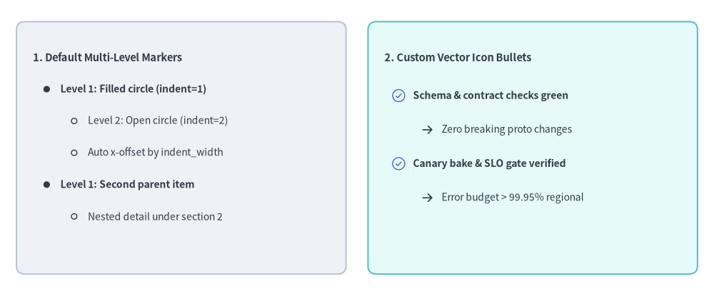
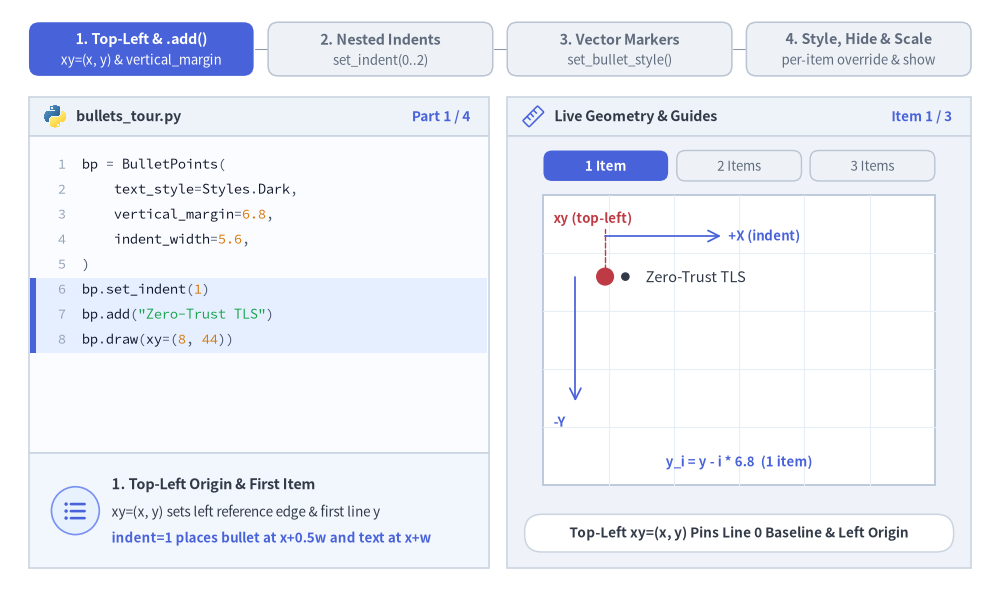
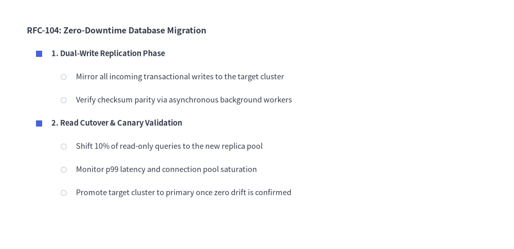
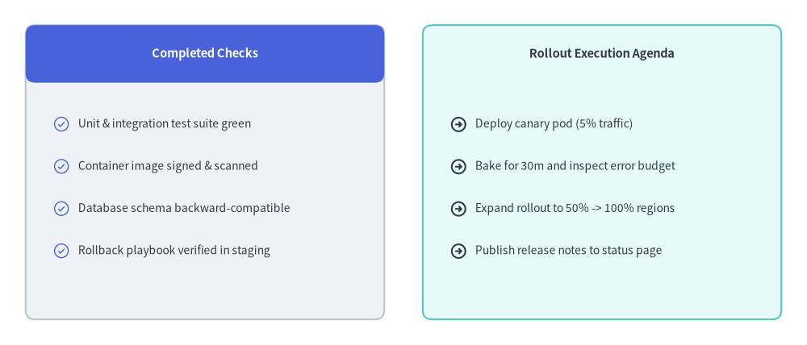

# BulletPoints（箇条書きボード）

`BulletPoints` コンポーネントは、左上のアンカー座標 `(x, y)` を起点として多段階にネストされた箇条書きリストを描画します。
インデント幅や行間隔のカスタマイズ、階層レベルごとの図形・アイコン記号の指定、さらにレイアウト座標を維持したままの表示・非表示の切り替えに対応しています。


<figure class="drawlib-image" style="text-align: center;">
  
  <figcaption class="drawlib-caption">BulletPoints の概要: デフォルトの多段階マーカーとカスタムアイコンによるチェックリスト</figcaption>
</figure>

<details class="drawlib-code-details">
<summary>Source Code</summary>

```python
from drawlib.canvas import save, setup
from drawlib.icons import phosphor
from drawlib.shapes import rectangle
from drawlib.smartarts import BulletPoints
from drawlib.styles import Styles
from drawlib.text import text

setup(width=130, height=54)

# 1. Left Card: Built-in Default Multi-Level Bullet Markers (indent=0, 1, 2)
rectangle((33, 27), width=60, height=46, style=Styles.Neutral.patch(shape_r=1.5))

bp_default = BulletPoints(
    text_style=Styles.Dark.patch(text_size=10.0),
    vertical_margin=5.8,
    indent_width=5.0,
)
bp_default.set_indent(0)
bp_default.add("1. Default Multi-Level Markers", text_style=Styles.DarkBold.patch(text_size=10.5))
bp_default.set_indent(1)
bp_default.add("Level 1: Filled circle (indent=1)", text_style=Styles.DarkBold.patch(text_size=10.0))
bp_default.set_indent(2)
bp_default.add("Level 2: Open circle (indent=2)")
bp_default.add("Auto x-offset by indent_width")
bp_default.set_indent(1)
bp_default.add("Level 1: Second parent item", text_style=Styles.DarkBold.patch(text_size=10.0))
bp_default.set_indent(2)
bp_default.add("Nested detail under section 2")
bp_default.draw(xy=(6, 43.5))

# 2. Right Card: Custom Vector Icon Bullets (set_bullet_style with Phosphor Icons)
rectangle((97, 27), width=60, height=46, style=Styles.SecondaryNeutral.patch(shape_r=1.5))
text((70, 43.5), "2. Custom Vector Icon Bullets", style=Styles.DarkBold.patch(text_size=10.5, halign="left"))

bp_icons = BulletPoints(
    text_style=Styles.Dark.patch(text_size=10.0),
    vertical_margin=6.2,
    indent_width=5.2,
)
bp_icons.set_bullet_style(
    indent_level=1,
    function=phosphor.check_circle,
    style=Styles.PrimaryFlat,
    args={"width": 2.8},
)
bp_icons.set_bullet_style(
    indent_level=2,
    function=phosphor.arrow_right,
    style=Styles.DarkBold,
    args={"width": 2.4},
)
bp_icons.set_indent(1)
bp_icons.add("Schema & contract checks green", text_style=Styles.DarkBold.patch(text_size=10.0))
bp_icons.set_indent(2)
bp_icons.add("Zero breaking proto changes")
bp_icons.set_indent(1)
bp_icons.add("Canary bake & SLO gate verified", text_style=Styles.DarkBold.patch(text_size=10.0))
bp_icons.set_indent(2)
bp_icons.add("Error budget > 99.95% regional")
bp_icons.draw(xy=(70, 36.5))

save()
```

</details>


---

## 1. 基本概念と基本的な使い方

`BulletPoints` は、**左上 `xy=(x, y)`** を起点として多段階の箇条書きリストを構築し、後続の行を下方向 `-Y` へ `vertical_margin` ずつ送り、ネストした階層を右方向 `+X` へ `indent_width * indent` 分だけインデントします。`set_indent(0..2)` による階層深さの切り替え、`set_bullet_style(...)` による幾何学記号からベクターアイコンへの置き換え、さらに `draw(...)` を呼び出す前の個別 `BulletPointItem` のスタイル変更やレイアウトを崩さない非表示化（`show=False`）に対応しています。


<figure class="drawlib-image" style="text-align: center;">
  
  <figcaption class="drawlib-caption">基本的な使い方とパラメータツアー: 左上アンカー・ネストインデント・ベクターアイコン記号・項目別の動的変更（APNG アニメーション）</figcaption>
</figure>


<div class="drawlib-source-link">
  <a href="https://github.com/yuichi110/drawlib/blob/main/docs/docs_src/ja/04_smartarts/bullet_points.md" target="_blank" rel="noopener noreferrer">GitHub でアニメーションのソースコードを見る &rarr;</a>
</div>

- **左上原点と行送り間隔（`xy`, `vertical_margin`）**: 1 行目の垂直ベースラインとレベル `0` の左端を `xy=(x, y)` に固定し、後続の項目を下方向 `-Y` へ `vertical_margin` ずつ配置します。
- **多段階インデント（`set_indent`, `indent_width`）**: 項目のテキストを右方向 `x + indent_width * indent` へシフトし、組み込み記号（`0` = 記号なし見出し、`1` = 塗りつぶし円、`2` = 白抜き円）を描画します。
- **カスタムベクター記号（`set_bullet_style`）**: 任意の正の `indent_level` におけるデフォルトの幾何学図形を、`x + indent_width * (indent - 0.5)` を中心とする `phosphor.*` アイコンや図形プリミティブに置き換えます。
- **項目別スタイル上書き・スロット維持型非表示・スケーリング（`items`, `show`, `scale`）**: 項目ごとの `text_style` の変更や、下方の項目をずらさずに非表示化する `bp.items[i].show = False` の切り替えに加え、`draw(xy, scale=...)` による `xy` 基準の等倍スケーリングをサポートします。

---

## 2. 多段階にネストした箇条書き階層

デフォルトでは、`indent=0` は記号なしのセクションタイトル、`indent=1` は塗りつぶし円の箇条書き記号、`indent=2` は白抜き円の箇条書き記号を描画します。また、`set_bullet_style(...)` を使用して任意のインデントレベルの記号をカスタマイズできます。


```python
from drawlib.canvas import save, setup
from drawlib.shapes import circle, rectangle
from drawlib.smartarts import BulletPoints
from drawlib.styles import Colors, Styles

setup(width=115, height=56)

bp = BulletPoints(
    text_style=Styles.Dark.patch(text_size=10.5),
    vertical_margin=5.2,
    indent_width=5.5,
)

# Customize level-1 marker to a Primary square and level-2 to a Muted circle
bp.set_bullet_style(
    indent_level=1,
    function=rectangle,
    style=Styles.PrimaryFlat.patch(shape_line_width=0),
    args={"width": 1.4, "height": 1.4},
)
bp.set_bullet_style(
    indent_level=2,
    function=circle,
    style=Styles.DarkThin.patch(shape_fill_color=Colors.White),
    args={"radius": 0.6},
)

bp.set_indent(0)
bp.add("RFC-104: Zero-Downtime Database Migration", text_style=Styles.DarkBold.patch(text_size=11.5))

bp.set_indent(1)
bp.add("1. Dual-Write Replication Phase", text_style=Styles.DarkBold.patch(text_size=10.5))
bp.set_indent(2)
bp.add("Mirror all incoming transactional writes to the target cluster")
bp.add("Verify checksum parity via asynchronous background workers")

bp.set_indent(1)
bp.add("2. Read Cutover & Canary Validation", text_style=Styles.DarkBold.patch(text_size=10.5))
bp.set_indent(2)
bp.add("Shift 10% of read-only queries to the new replica pool")
bp.add("Monitor p99 latency and connection pool saturation")
bp.add("Promote target cluster to primary once zero drift is confirmed")

bp.draw(xy=(6, 49))
save()
```

<figure class="drawlib-image" style="text-align: center;">
  
  <figcaption class="drawlib-caption">BulletPoints を用いた多段階ネストのアーキテクチャ要件リスト</figcaption>
</figure>


---

## 3. ベクターアイコン記号を使ったチェックリスト・アジェンダカード

`set_bullet_style(...)` に Phosphor アイコン関数（`phosphor.check_circle` や `phosphor.arrow_right` など）を渡し、矩形カードの内部に `BulletPoints` を配置することで、視認性の高いリリースチェックリスト・機能比較カード・スプリントアジェンダを作成できます。


```python
from drawlib.canvas import save, setup
from drawlib.icons import phosphor
from drawlib.shapes import rectangle
from drawlib.smartarts import BulletPoints
from drawlib.styles import Styles
from drawlib.text import text

setup(width=126, height=54)

# Left Card: Completed Pre-Flight Checks (Neutral card + Primary header)
rectangle((32, 27), width=56, height=46, style=Styles.Neutral.patch(shape_r=1.5))
rectangle(
    (32, 45.5),
    width=56,
    height=9,
    style=Styles.PrimaryFlat.patch(shape_r=1.5),
    text="Completed Checks",
    text_style=Styles.WhiteBold.patch(text_size=10.5),
)

done_list = BulletPoints(
    text_style=Styles.Dark.patch(text_size=10.0),
    vertical_margin=6.6,
    indent_width=5.2,
)
done_list.set_bullet_style(
    indent_level=1,
    function=phosphor.check_circle,
    style=Styles.PrimaryFlat,
    args={"width": 2.8},
)
done_list.set_indent(1)
done_list.add("Unit & integration test suite green")
done_list.add("Container image signed & scanned")
done_list.add("Database schema backward-compatible")
done_list.add("Rollback playbook verified in staging")
done_list.draw(xy=(7, 34.5))

# Right Card: Rollout Execution Steps (SecondaryNeutral card)
rectangle((94, 27), width=56, height=46, style=Styles.SecondaryNeutral.patch(shape_r=1.5))
text((94, 45.5), "Rollout Execution Agenda", style=Styles.DarkBold.patch(text_size=10.5))

agenda_list = BulletPoints(
    text_style=Styles.Dark.patch(text_size=10.0),
    vertical_margin=6.6,
    indent_width=5.2,
)
agenda_list.set_bullet_style(
    indent_level=1,
    function=phosphor.arrow_circle_right,
    style=Styles.DarkBold,
    args={"width": 2.8},
)
agenda_list.set_indent(1)
agenda_list.add("Deploy canary pod (5% traffic)")
agenda_list.add("Bake for 30m and inspect error budget")
agenda_list.add("Expand rollout to 50% -> 100% regions")
agenda_list.add("Publish release notes to status page")
agenda_list.draw(xy=(69, 34.5))
save()
```

<figure class="drawlib-image" style="text-align: center;">
  
  <figcaption class="drawlib-caption">BulletPoints と Phosphor アイコンを用いたリリース準備チェックリストカード</figcaption>
</figure>


---

## 4. 座標とインデントの仕組み

- **左上アンカー `(x, y)`**: `bp.draw(xy=...)` に渡す `xy` 座標は、1 行目の**左端および垂直中心**（`y`）を指定します。2 行目以降の項目は `vertical_margin` ずつ下方向へステップします（`y - i * vertical_margin`）。
- **インデントの幾何配置**:
  - インデントレベル `indent` の項目のテキストは `x_text = x + indent_width * indent` から開始します。
  - `indent != 0` かつ `indent` に箇条書き記号スタイルが登録されている場合、記号の中心は `x_marker = x + indent_width * (indent - 0.5)` に配置されます。
- **デフォルトの箇条書き記号**:
  - `indent = 0`: 記号なし（リストのタイトルやセクション見出しに最適）。
  - `indent = 1`: `text_style.text_color` と同色の塗りつぶし円（`radius=0.5`）。
  - `indent = 2`: `text_style.text_color` と同色の白抜き円（`radius=0.5`）。

---

## 5. API リファレンス

### コンストラクタ
```python
BulletPoints(
    *,
    text_style: Style,
    vertical_margin: float,
    indent_width: float,
)
```

### メソッドとプロパティ
- **`set_indent(level: int) -> None`**:
  以降の `add()` 呼び出しに適用される現在のインデントレベル（`0`, `1`, `2`, ...）を設定します。
- **`set_bullet_style(indent_level: int, function: Callable, style: Style, args: dict) -> None`**:
  指定した `indent_level` に対してカスタム描画関数（`rectangle`、`circle`、または任意の `phosphor.*` アイコン関数など）を登録します。描画時には `function(xy=(x_marker, y), style=style, **args)` が呼び出されます。
- **`add(text: str, *, text_style: Style | None = None, show: bool = True) -> BulletPointItem`**:
  現在のインデントレベルで箇条書き項目を追加し、変更可能な `BulletPointItem`（`indent: int`, `text: str`, `text_style: Style`, `show: bool`）を返します。なお、`BulletPointItem.text_style` の変更可能なプロパティエイリアスとして `BulletPointItem.style` も提供されています。`show=False` を設定すると、後続行の垂直スペースを保持したまま記号とテキストを非表示にします。
- **`bp.items -> list[BulletPointItem]`**:
  登録済みのすべての `BulletPointItem` インスタンスのリストを返します。`draw()` 呼び出しの前や呼び出し間で `.text`、`.text_style`（または `.style`）、`.indent`、`.show` を後から変更できます。
- **`draw(xy: tuple[float, float], scale: float = 1.0) -> None`**:
  表示状態のすべての箇条書き項目を `xy` を起点として描画します。`scale` による等倍スケーリングにも対応しています。

