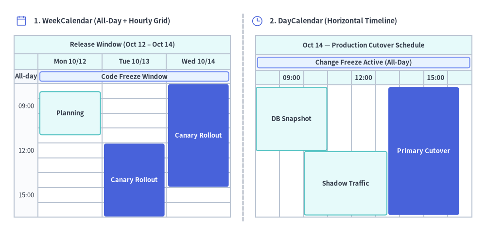
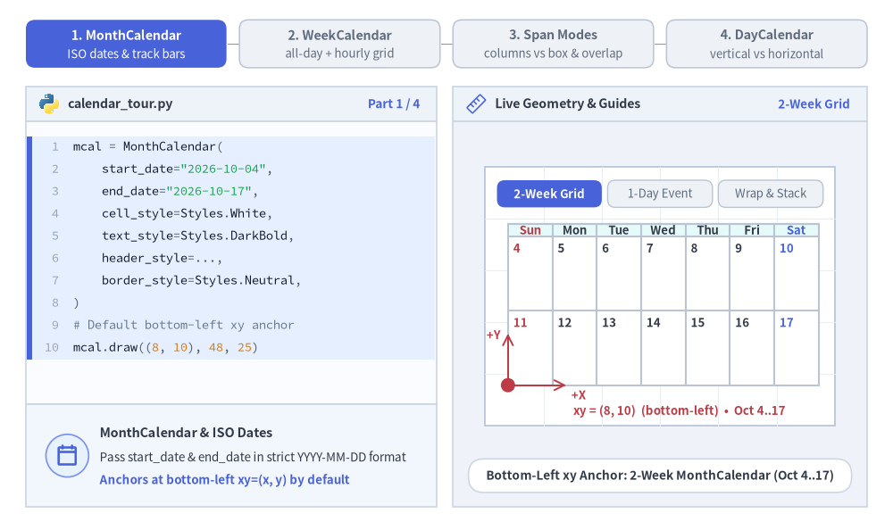
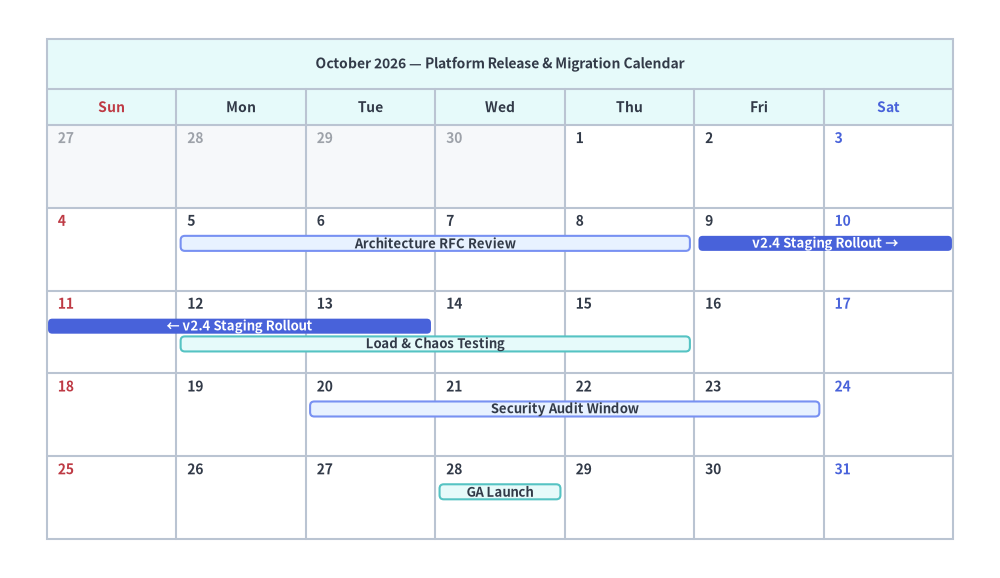
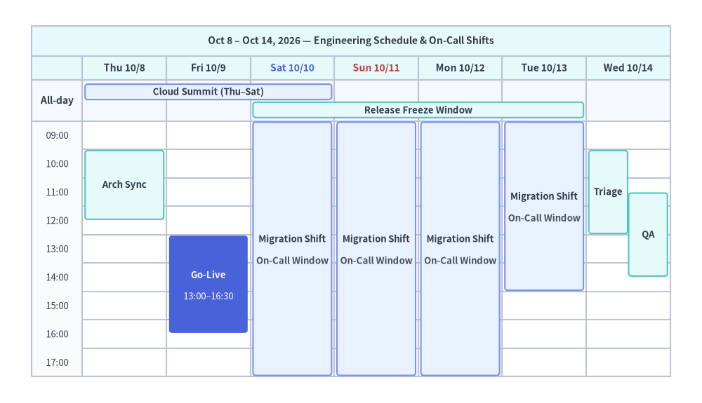
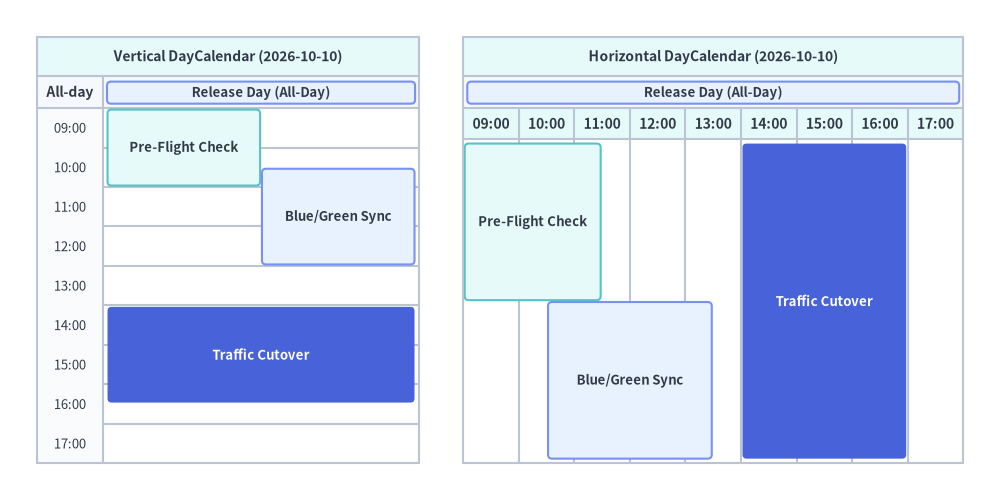

# Calendar（カレンダー：MonthCalendar, WeekCalendar, DayCalendar）

`MonthCalendar`、`WeekCalendar`、`DayCalendar` コンポーネントは、リリース計画・スプリント進捗管理・オンコールシフト・インシデント対応手順書（ランブック）向けに、Outlook や Google カレンダー風のスケジュールグリッドを描画します。
3 つのクラスはすべて、厳格な ISO 8601 日付・日時インターフェース（**`"YYYY-MM-DD"` および `"YYYY-MM-DD HH:MM"` のみを受け付けます**）と共通の `Style` トークン（`cell_style`、`text_style`、`header_style`、`header_text_style`、`border_style`）を共有しています。


<figure class="drawlib-image" style="text-align: center;">
  
  <figcaption class="drawlib-caption">Calendar SmartArts の概要: 上部全日フィールド付きの WeekCalendar と横向き DayCalendar タイムライン</figcaption>
</figure>

<details class="drawlib-code-details">
<summary>Source Code</summary>

```python
from drawlib.canvas import save, setup
from drawlib.icons import phosphor
from drawlib.lines import line
from drawlib.smartarts import DayCalendar, WeekCalendar
from drawlib.styles import Styles
from drawlib.text import text

setup(width=136, height=66)

line((68.0, 4.0), (68.0, 62.0), style=Styles.MutedDashed)

# 1. Left Panel: WeekCalendar (3-Day Release Window with Top All-Day Bar + Timed Slots)
phosphor.calendar_blank(xy=(6.0, 60.0), width=3.4, style=Styles.PrimaryFlat)
text((9.5, 60.0), "1. WeekCalendar (All-Day + Hourly Grid)", style=Styles.DarkBold.patch(text_size=10.5, halign="left"))

wcal = WeekCalendar(
    start_date="2026-10-12",
    end_date="2026-10-14",
    start_hour=9,
    end_hour=18,
    hour_step=3,
    show_all_day=None,
    title="Release Window (Oct 12 – Oct 14)",
    cell_style=Styles.White,
    text_style=Styles.Dark.patch(text_size=9.5),
    header_style=Styles.SecondaryNeutral,
    header_text_style=Styles.DarkBold.patch(text_size=9.5),
    border_style=Styles.Neutral,
    event_style=Styles.SecondaryNeutral,
    event_text_style=Styles.DarkBold.patch(text_size=9.5),
)
wcal.add("2026-10-12", "2026-10-14", text="Code Freeze Window", style=Styles.PrimaryNeutral)
wcal.add("2026-10-12 09:30", "2026-10-12 12:30", text="Planning")
wcal.add(
    "2026-10-13 13:00",
    "2026-10-14 16:00",
    text="Canary Rollout",
    span_mode="columns",
    style=Styles.PrimaryFlat,
    text_style=Styles.WhiteBold.patch(text_size=9.5),
)
wcal.draw(xy=(4.0, 5.0), width=60.5, height=51.0)

# 2. Right Panel: DayCalendar (Horizontal Timeline)
phosphor.clock(xy=(72.0, 60.0), width=3.4, style=Styles.PrimaryFlat)
text((75.5, 60.0), "2. DayCalendar (Horizontal Timeline)", style=Styles.DarkBold.patch(text_size=10.5, halign="left"))

dcal = DayCalendar(
    date="2026-10-14",
    direction="horizontal",
    start_hour=9,
    end_hour=18,
    hour_step=3,
    show_all_day=None,
    title="Oct 14 — Production Cutover Schedule",
    cell_style=Styles.White,
    text_style=Styles.Dark.patch(text_size=9.5),
    header_style=Styles.SecondaryNeutral,
    header_text_style=Styles.DarkBold.patch(text_size=9.5),
    border_style=Styles.Neutral,
    event_style=Styles.SecondaryNeutral,
    event_text_style=Styles.DarkBold.patch(text_size=9.5),
)
dcal.add("2026-10-14", text="Change Freeze Active (All-Day)", style=Styles.PrimaryNeutral)
dcal.add("2026-10-14 09:00", "2026-10-14 12:00", text="DB Snapshot")
dcal.add("2026-10-14 11:00", "2026-10-14 14:30", text="Shadow Traffic")
dcal.add(
    "2026-10-14 14:30",
    "2026-10-14 17:30",
    text="Primary Cutover",
    style=Styles.PrimaryFlat,
    text_style=Styles.WhiteBold.patch(text_size=9.5),
)
dcal.draw(xy=(71.5, 5.0), width=60.5, height=51.0)

save()
```

</details>


---

## 1. 基本概念と基本的な使い方

`MonthCalendar`、`WeekCalendar`、`DayCalendar` は、厳格な ISO 8601 文字列（全日スパンには `"YYYY-MM-DD"`、時間指定スロットには `"YYYY-MM-DD HH:MM"`）からスケジュールグリッドを構築し、デフォルトでカレンダーフレームの**左下 `(x, y)`** をアンカーとして配置します（`align="center"` / `"top_left"` も指定可能）。`.add(...)` で追加されたイベントは、週をまたぐ自動折り返し、上部全日帯と時間割グリッドへの自動振り分け、重複する時間帯スロットの並列レーン分割を行い、変更可能な `.items[i]` エントリとして公開されます。


<figure class="drawlib-image" style="text-align: center;">
  
  <figcaption class="drawlib-caption">基本的な使い方とパラメータツアー: MonthCalendar・WeekCalendar・複数日スパンモード・DayCalendar の向き（APNG アニメーション）</figcaption>
</figure>


<div class="drawlib-source-link">
  <a href="https://github.com/yuichi110/drawlib/blob/main/docs/docs_src/ja/04_smartarts/calendar.md" target="_blank" rel="noopener noreferrer">GitHub でアニメーションのソースコードを見る &rarr;</a>
</div>

- **厳格な ISO 日付とアンカー（`MonthCalendar`, `xy`, `align`）**: `MonthCalendar`（デフォルトは**左下 `xy`** アンカー、`align="center"` / `"top_left"` も指定可）に `"YYYY-MM-DD"` 形式の日付を渡すことで、週をまたぐ複数日スパンの自動折り返しや重複予定のトラック積み上げを行えます。
- **全日フィールドと時間割グリッドの自動振り分け（`WeekCalendar`）**: 日付のみの文字列（`"YYYY-MM-DD"`）は上部の全日（All-Day）帯を自動的に開いて配置され、日時文字列（`"YYYY-MM-DD HH:MM"`）は時間割グリッド上に描画されます。
- **複数日スパンモードとレーン分割（`span_mode`）**: 各日ごとのカラム帯として描画する `span_mode="columns"` と、複数日を単一ブロックとして描画する `span_mode="box"` を選択できます。重複する時間指定スロットは自動的に並列レーンへ分割されます。
- **表示方向とスロット維持型の表示切り替え（`DayCalendar`, `.items[i].show`）**: `DayCalendar` では `direction="vertical"` と `"horizontal"` のタイムラインを切り替えられます。また、`.items[i].show = False` を切り替えることで、他の予定レーンの位置をずらさずに特定のイベントを非表示にできます。

---

## 2. 厳格な ISO 8601 日付・日時フォーマット

複数日にまたがる予定やうるう年（`2024-02-29`）での曖昧さを排除するため、すべての Calendar クラスは**厳格な 2 種類の ISO 8601 フォーマットのみ**を受け付けます（スラッシュ区切りの `"2026/10/10"` や時刻のみの `"09:00"` は `ValueError` になります）。

1. **`"YYYY-MM-DD"`**（例: `"2026-10-10"`）: **全日（`全日`）**の日付または複数日の日付スパンとして自動的に扱われます。
2. **`"YYYY-MM-DD HH:MM"`**（例: `"2026-10-10 09:00"`）: **時間指定**のスロットまたは複数日に連続する日時スパンとして自動的に扱われます。

---

## 3. MonthCalendar（月間および複数週・月またぎグリッド）

`MonthCalendar` は 7 列のカレンダーグリッド（`first_weekday="sun" | "mon"`）を描画します。`end_date=None`（デフォルト）の場合は `start_date` が属する暦月全体を表示し、明示的に `end_date="YYYY-MM-DD"` を渡すと月や年の境界をまたぐ複数週のグリッドを構築します。複数日にわたるイベントは週の行をまたいで自動的に折り返され（`←` / `→`）、重ならない垂直トラックへと積み上げられます。


```python
from drawlib.canvas import save, setup
from drawlib.smartarts import MonthCalendar
from drawlib.styles import Styles

setup(width=128, height=74)

mcal = MonthCalendar(
    start_date="2026-10-01",
    first_weekday="sun",
    lang="en",
    title="October 2026 — Platform Release & Migration Calendar",
    cell_style=Styles.White,
    text_style=Styles.DarkBold.patch(text_size=10.0),
    header_style=Styles.SecondaryNeutral,
    header_text_style=Styles.DarkBold.patch(text_size=10.0),
    border_style=Styles.Neutral,
    event_style=Styles.SecondaryNeutral,
    event_text_style=Styles.DarkBold.patch(text_size=9.5),
    sunday_text_style=Styles.DangerBold.patch(text_size=10.0),
    saturday_text_style=Styles.PrimaryBold.patch(text_size=10.0),
)

mcal.add("2026-10-05", "2026-10-08", text="Architecture RFC Review", style=Styles.PrimaryNeutral)
# Crosses Fri Oct 9 – Sat Oct 10 into the next week row (Sun Oct 11 – Tue Oct 13)
mcal.add(
    "2026-10-09",
    "2026-10-13",
    text="v2.4 Staging Rollout",
    style=Styles.PrimaryFlat,
    text_style=Styles.WhiteBold.patch(text_size=9.5),
)
# Overlapping dates automatically stack on the next track
mcal.add("2026-10-12", "2026-10-15", text="Load & Chaos Testing")
mcal.add("2026-10-20", "2026-10-23", text="Security Audit Window", style=Styles.PrimaryNeutral)
mcal.add("2026-10-28", text="GA Launch")

mcal.draw(xy=(6.0, 5.0), width=116.0, height=64.0)

save()
```

<figure class="drawlib-image" style="text-align: center;">
  
  <figcaption class="drawlib-caption">週またぎの複数日バーと重複トラックの自動スタッキングを備えた MonthCalendar</figcaption>
</figure>


---

## 4. WeekCalendar（上部全日フィールド＋時間割グリッド）

`WeekCalendar` は、7 日間の週（または `end_date` や `num_days` による任意の N 日間範囲）を縦軸の時間割（`start_hour=9, end_hour=18, hour_step=1`）とともに表示します。
- **上部の全日（`全日`）フィールド（`show_all_day=None | True | False`）**: `show_all_day=None`（デフォルト）の場合、全日アイテムが 0 件であれば全日行は非表示となり、1 件以上の全日アイテム（`"YYYY-MM-DD"`）が追加されると自動的に表示されます（`drawlib.anim` の各フレームでレイアウト座標が固定されるよう、`item.show=False` のアイテムも件数にカウントされます）。
- **複数日の時間指定スパン（`span_mode="columns" | "box" | "all_day"`）**: `"2026-10-10 09:00"` から `"2026-10-13 15:00"` までの予定は、`"columns"` モードでは 10 日（`09:00..end_hour`）・11〜12 日（`start_hour..end_hour`）・13 日（`start_hour..15:00`）の各日カラムを埋め、`"box"` モードでは複数カラムを横断する単一の矩形として描画されます。


```python
from drawlib.canvas import save, setup
from drawlib.smartarts import WeekCalendar
from drawlib.styles import Styles

setup(width=132, height=76)

wcal = WeekCalendar(
    start_date="2026-10-08",
    end_date="2026-10-14",
    start_hour=9,
    end_hour=18,
    hour_step=1,
    show_all_day=None,
    title="Oct 8 – Oct 14, 2026 — Engineering Schedule & On-Call Shifts",
    cell_style=Styles.White,
    text_style=Styles.Dark.patch(text_size=9.5),
    header_style=Styles.SecondaryNeutral,
    header_text_style=Styles.DarkBold.patch(text_size=10.0),
    border_style=Styles.Neutral,
    event_style=Styles.SecondaryNeutral,
    event_text_style=Styles.DarkBold.patch(text_size=9.5),
    sunday_text_style=Styles.DangerBold.patch(text_size=10.0),
    saturday_text_style=Styles.PrimaryBold.patch(text_size=10.0),
)

# 1. All-Day X-axis spanning bars in the top field
wcal.add("2026-10-08", "2026-10-10", text="Cloud Summit (Thu–Sat)", style=Styles.PrimaryNeutral)
wcal.add("2026-10-10", "2026-10-13", text="Release Freeze Window")

# 2. Multi-day timed span ("2026-10-10 09:00" to "2026-10-13 15:00")
wcal.add(
    "2026-10-10 09:00",
    "2026-10-13 15:00",
    text="Migration Shift",
    description="On-Call Window",
    span_mode="columns",
    style=Styles.PrimaryNeutral,
)

# 3. Single-day and overlapping timed events
wcal.add("2026-10-08 10:00", "2026-10-08 12:30", text="Arch Sync")
wcal.add(
    "2026-10-09 13:00",
    "2026-10-09 16:30",
    text="Go-Live",
    description="13:00–16:30",
    style=Styles.PrimaryFlat,
    text_style=Styles.WhiteBold.patch(text_size=9.5),
    description_style=Styles.White.patch(text_size=9.5),
)
wcal.add("2026-10-14 10:00", "2026-10-14 13:00", text="Triage")
wcal.add("2026-10-14 11:30", "2026-10-14 14:30", text="QA")

wcal.draw(xy=(6.0, 5.0), width=120.0, height=66.0)

save()
```

<figure class="drawlib-image" style="text-align: center;">
  
  <figcaption class="drawlib-caption">上部全日 X 軸バーと複数日の時間指定イベントを表示する WeekCalendar</figcaption>
</figure>


---

## 5. DayCalendar（縦向き・横向きレイアウト）

`DayCalendar` は、単一日のスケジュールを以下のいずれかの向きで描画します。
- **`direction="vertical"`（デフォルト）**: 時間軸が**上から下**へ流れ、時間帯が重なる予定は左右の並列カラムへと水平分割されます。
- **`direction="horizontal"`**: 時間軸が**左から右**へ流れ、時間帯が重なる予定は上下の並列レーンへと垂直スタックされます。横長バナーや 16:9 プレゼンテーションスライドに最適です。


```python
from drawlib.canvas import save, setup
from drawlib.smartarts import DayCalendar
from drawlib.styles import Styles

setup(width=136, height=68)

# 1. Left: Vertical DayCalendar (direction="vertical")
d_vert = DayCalendar(
    date="2026-10-10",
    direction="vertical",
    start_hour=9,
    end_hour=18,
    hour_step=1,
    title="Vertical DayCalendar (2026-10-10)",
    cell_style=Styles.White,
    text_style=Styles.Dark.patch(text_size=9.5),
    header_style=Styles.SecondaryNeutral,
    header_text_style=Styles.DarkBold.patch(text_size=10.0),
    border_style=Styles.Neutral,
    event_style=Styles.SecondaryNeutral,
    event_text_style=Styles.DarkBold.patch(text_size=9.5),
)
d_vert.add("2026-10-10", text="Release Day (All-Day)", style=Styles.PrimaryNeutral)
d_vert.add("2026-10-10 09:00", "2026-10-10 11:00", text="Pre-Flight Check")
d_vert.add("2026-10-10 10:30", "2026-10-10 13:00", text="Blue/Green Sync", style=Styles.PrimaryNeutral)
d_vert.add(
    "2026-10-10 14:00",
    "2026-10-10 16:30",
    text="Traffic Cutover",
    style=Styles.PrimaryFlat,
    text_style=Styles.WhiteBold.patch(text_size=9.5),
)
d_vert.draw(xy=(5.0, 5.0), width=52.0, height=58.0)

# 2. Right: Horizontal DayCalendar (direction="horizontal")
d_horiz = DayCalendar(
    date="2026-10-10",
    direction="horizontal",
    start_hour=9,
    end_hour=18,
    hour_step=1,
    title="Horizontal DayCalendar (2026-10-10)",
    cell_style=Styles.White,
    text_style=Styles.Dark.patch(text_size=9.5),
    header_style=Styles.SecondaryNeutral,
    header_text_style=Styles.DarkBold.patch(text_size=10.0),
    border_style=Styles.Neutral,
    event_style=Styles.SecondaryNeutral,
    event_text_style=Styles.DarkBold.patch(text_size=9.5),
)
d_horiz.add("2026-10-10", text="Release Day (All-Day)", style=Styles.PrimaryNeutral)
d_horiz.add("2026-10-10 09:00", "2026-10-10 11:30", text="Pre-Flight Check")
d_horiz.add("2026-10-10 10:30", "2026-10-10 13:30", text="Blue/Green Sync", style=Styles.PrimaryNeutral)
d_horiz.add(
    "2026-10-10 14:00",
    "2026-10-10 17:00",
    text="Traffic Cutover",
    style=Styles.PrimaryFlat,
    text_style=Styles.WhiteBold.patch(text_size=9.5),
)
d_horiz.draw(xy=(63.0, 5.0), width=68.0, height=58.0)

save()
```

<figure class="drawlib-image" style="text-align: center;">
  
  <figcaption class="drawlib-caption">縦向きモード（左）と横向きモード（右）の DayCalendar</figcaption>
</figure>


