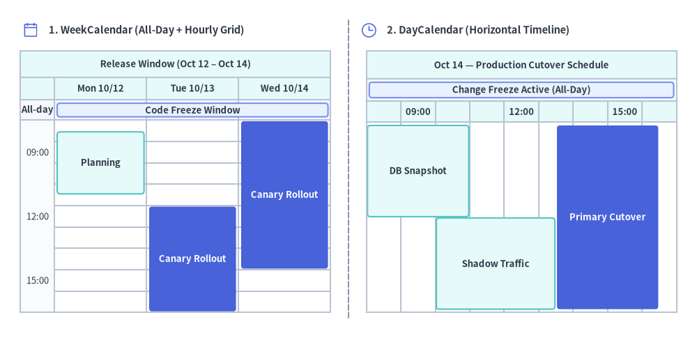
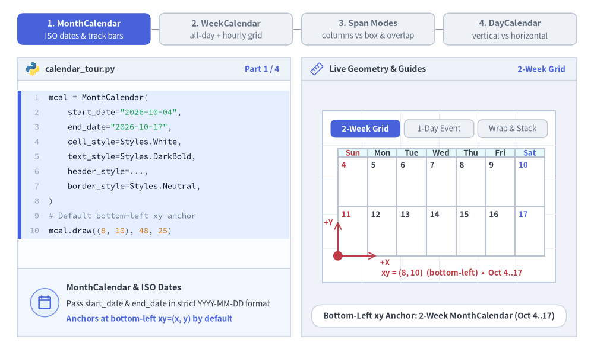
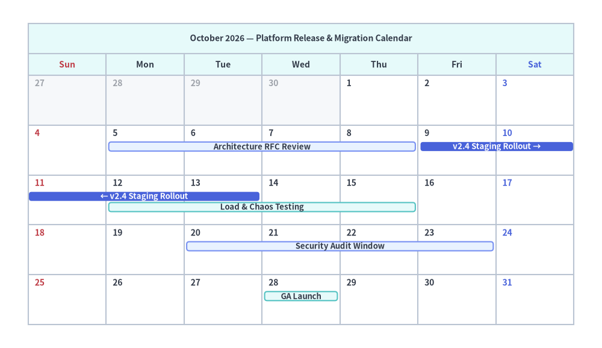
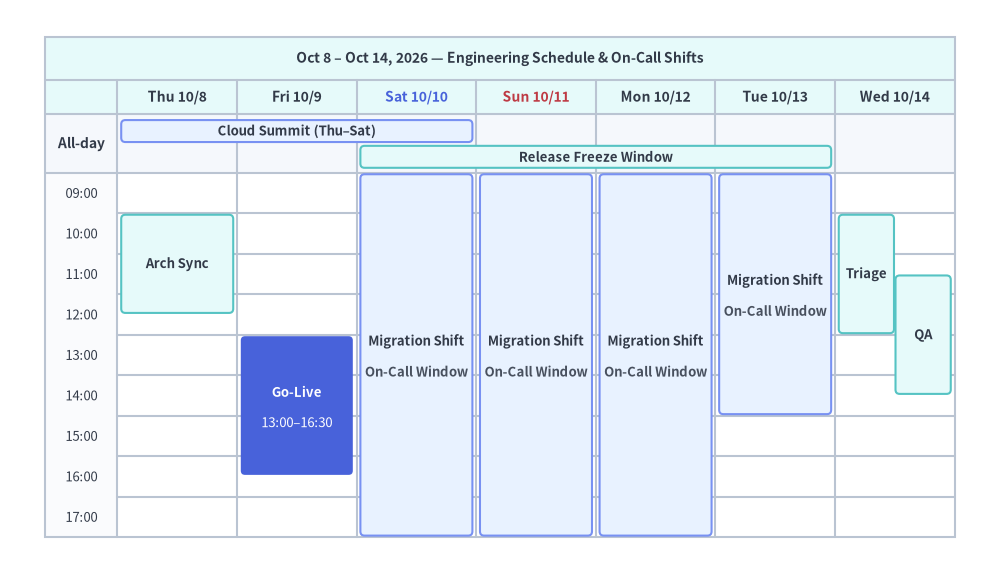
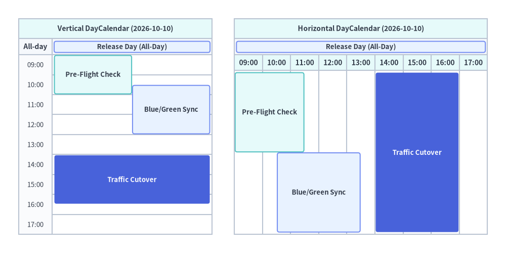

# Calendar（カレンダー：MonthCalendar, WeekCalendar, DayCalendar）

`MonthCalendar`、`WeekCalendar`、`DayCalendar` コンポーネントは、リリース計画・スプリント進捗管理・オンコールシフト・インシデント対応手順書（ランブック）向けに、Outlook や Google カレンダー風のスケジュールグリッドを描画します。
3 つのクラスはすべて、厳格な ISO 8601 日付・日時インターフェース（**`"YYYY-MM-DD"` および `"YYYY-MM-DD HH:MM"` のみを受け付けます**）と共通の `Style` トークン（`cell_style`、`text_style`、`header_style`、`header_text_style`、`border_style`）を共有しています。


<figure class="drawlib-image" style="text-align: center;">
  
  <figcaption class="drawlib-caption">Calendar SmartArts の概要: 上部全日フィールド付きの WeekCalendar と横向き DayCalendar タイムライン</figcaption>
</figure>

<details class="drawlib-code-details">
<summary>Source Code</summary>

```python
from drawlib.canvas import save, setup
from drawlib.icons import phosphor
from drawlib.lines import line
from drawlib.smartarts import DayCalendar, WeekCalendar
from drawlib.styles import Styles
from drawlib.text import text

setup(width=136, height=66)

line((68.0, 4.0), (68.0, 62.0), style=Styles.MutedDashed)

# 1. Left Panel: WeekCalendar (3-Day Release Window with Top All-Day Bar + Timed Slots)
phosphor.calendar_blank(xy=(6.0, 60.0), width=3.4, style=Styles.PrimaryFlat)
text((9.5, 60.0), "1. WeekCalendar (All-Day + Hourly Grid)", style=Styles.DarkBold.patch(text_size=10.5, halign="left"))

wcal = WeekCalendar(
    start_date="2026-10-12",
    end_date="2026-10-14",
    start_hour=9,
    end_hour=18,
    hour_step=3,
    show_all_day=None,
    title="Release Window (Oct 12 – Oct 14)",
    cell_style=Styles.White,
    text_style=Styles.Dark.patch(text_size=9.5),
    header_style=Styles.SecondaryNeutral,
    header_text_style=Styles.DarkBold.patch(text_size=9.5),
    border_style=Styles.Neutral,
    event_style=Styles.SecondaryNeutral,
    event_text_style=Styles.DarkBold.patch(text_size=9.5),
)
wcal.add("2026-10-12", "2026-10-14", text="Code Freeze Window", style=Styles.PrimaryNeutral)
wcal.add("2026-10-12 09:30", "2026-10-12 12:30", text="Planning")
wcal.add(
    "2026-10-13 13:00",
    "2026-10-14 16:00",
    text="Canary Rollout",
    span_mode="columns",
    style=Styles.PrimaryFlat,
    text_style=Styles.WhiteBold.patch(text_size=9.5),
)
wcal.draw(xy=(4.0, 5.0), width=60.5, height=51.0)

# 2. Right Panel: DayCalendar (Horizontal Timeline)
phosphor.clock(xy=(72.0, 60.0), width=3.4, style=Styles.PrimaryFlat)
text((75.5, 60.0), "2. DayCalendar (Horizontal Timeline)", style=Styles.DarkBold.patch(text_size=10.5, halign="left"))

dcal = DayCalendar(
    date="2026-10-14",
    direction="horizontal",
    start_hour=9,
    end_hour=18,
    hour_step=3,
    show_all_day=None,
    title="Oct 14 — Production Cutover Schedule",
    cell_style=Styles.White,
    text_style=Styles.Dark.patch(text_size=9.5),
    header_style=Styles.SecondaryNeutral,
    header_text_style=Styles.DarkBold.patch(text_size=9.5),
    border_style=Styles.Neutral,
    event_style=Styles.SecondaryNeutral,
    event_text_style=Styles.DarkBold.patch(text_size=9.5),
)
dcal.add("2026-10-14", text="Change Freeze Active (All-Day)", style=Styles.PrimaryNeutral)
dcal.add("2026-10-14 09:00", "2026-10-14 12:00", text="DB Snapshot")
dcal.add("2026-10-14 11:00", "2026-10-14 14:30", text="Shadow Traffic")
dcal.add(
    "2026-10-14 14:30",
    "2026-10-14 17:30",
    text="Primary Cutover",
    style=Styles.PrimaryFlat,
    text_style=Styles.WhiteBold.patch(text_size=9.5),
)
dcal.draw(xy=(71.5, 5.0), width=60.5, height=51.0)

save()
```

</details>


---

## 1. 基本概念と基本的な使い方

`MonthCalendar`、`WeekCalendar`、`DayCalendar` は、厳格な ISO 8601 文字列（全日スパンには `"YYYY-MM-DD"`、時間指定スロットには `"YYYY-MM-DD HH:MM"`）からスケジュールグリッドを構築し、デフォルトでカレンダーフレームの**左下 `(x, y)`** をアンカーとして配置します（`align="center"` / `"top_left"` も指定可能）。`.add(...)` で追加されたイベントは、週をまたぐ自動折り返し、上部全日帯と時間割グリッドへの自動振り分け、重複する時間帯スロットの並列レーン分割を行い、変更可能な `.items[i]` エントリとして公開されます。


<figure class="drawlib-image" style="text-align: center;">
  
  <figcaption class="drawlib-caption">基本的な使い方とパラメータツアー: MonthCalendar・WeekCalendar・複数日スパンモード・DayCalendar の向き（APNG アニメーション）</figcaption>
</figure>

<details class="drawlib-code-details">
<summary>Source Code</summary>

```python
from __future__ import annotations

from drawlib.anim import Animation
from drawlib.canvas import save, setup
from drawlib.icons import code as code_icons
from drawlib.icons import phosphor
from drawlib.lines import line
from drawlib.shapes import circle, rectangle
from drawlib.smartarts import (
    DayCalendar,
    MonthCalendar,
    SourceCode,
    SourceCodeStyles,
    WeekCalendar,
)
from drawlib.styles import Styles
from drawlib.text import text

W, H = 138.0, 82.0
setup(width=W, height=H)
anim = Animation(fps=10.0, loop=0)

CODE_TEXT_SIZE = 10.0
PT_TO_CANVAS = W / 720.0
FONT_CANVAS = CODE_TEXT_SIZE * PT_TO_CANVAS
LINE_H = FONT_CANVAS * 1.8
PAD_Y = FONT_CANVAS * 1.2

CODE_STYLES = SourceCodeStyles.get("default", font_lang="en", text_size=CODE_TEXT_SIZE).patch(
    box_style=Styles.Neutral.patch(shape_fill_color=(0, 0, 0, 0), shape_line_width=0),
)

PANE_HEADER = Styles.Neutral.patch(
    shape_fill_color=(238, 243, 250),
    shape_line_color=(203, 213, 225),
    shape_line_width=1.2,
    shape_r=0.0,
)
EDITOR_BODY = Styles.Neutral.patch(
    shape_fill_color=(250, 252, 255),
    shape_line_color=(203, 213, 225),
    shape_line_width=1.2,
    shape_r=0.0,
)
TAKEAWAY_BODY = Styles.Neutral.patch(
    shape_fill_color=(242, 246, 253),
    shape_line_color=(203, 213, 225),
    shape_line_width=1.2,
    shape_r=0.0,
)
STUDIO_BODY = Styles.Neutral.patch(
    shape_fill_color=(239, 243, 249),
    shape_line_color=(203, 213, 225),
    shape_line_width=1.2,
    shape_r=0.0,
)

PART_ITEMS = [
    ("1. MonthCalendar", "ISO dates & track bars"),
    ("2. WeekCalendar", "all-day + hourly grid"),
    ("3. Span Modes", "columns vs box & overlap"),
    ("4. DayCalendar", "vertical vs horizontal"),
]


def draw_step_bar(active_part: int) -> None:
    """Draw top 4-part progress bar (active_part is 1..4)."""
    pill_w = 31.0
    pill_h = 7.4
    gap = 2.0
    start_x = 4.0 + pill_w / 2.0
    cy = 75.2

    for idx, (label, sublabel) in enumerate(PART_ITEMS, start=1):
        cx = start_x + (idx - 1) * (pill_w + gap)
        if idx > 1:
            prev_cx = cx - (pill_w + gap)
            line(
                (prev_cx + pill_w / 2.0 + 0.2, cy),
                (cx - pill_w / 2.0 - 0.2, cy),
                style=Styles.PrimaryBold if idx <= active_part else Styles.MutedThin,
            )

        if idx == active_part:
            st = Styles.PrimaryFlat.patch(shape_r=1.4)
            tst = Styles.WhiteBold.patch(text_size=10.3)
            sub_tst = Styles.White.patch(text_size=9.5)
        elif idx < active_part:
            st = Styles.PrimaryNeutral.patch(shape_r=1.4, shape_line_width=1.1)
            tst = Styles.PrimaryBold.patch(text_size=10.3)
            sub_tst = Styles.Primary.patch(text_size=9.5)
        else:
            st = Styles.Neutral.patch(shape_r=1.4, shape_line_width=1.1)
            tst = Styles.MutedBold.patch(text_size=10.3)
            sub_tst = Styles.Muted.patch(text_size=9.5)

        rectangle((cx, cy), width=pill_w, height=pill_h, style=st)
        text((cx, cy + 1.35), label, style=tst)
        text((cx, cy - 1.55), sublabel, style=sub_tst)


def draw_left_pane(
    active_part: int,
    code_lines: list[str],
    hl_range: tuple[int, int],
    icon_fn: object,
    summary_title: str,
    summary_line1: str,
    summary_line2: str,
) -> None:
    """Draw left Python code editor + bottom concept takeaway card."""
    x0, w = 4.0, 63.5
    cx = x0 + w / 2.0
    top_y = 63.2
    header_h = 5.4
    editor_h = 43.8
    takeaway_h = 15.8

    rectangle((cx, top_y + header_h / 2.0), width=w, height=header_h, style=PANE_HEADER)
    code_icons.python((x0 + 3.6, top_y + header_h / 2.0), width=3.4, style=Styles.Neutral)
    text(
        (x0 + 6.5, top_y + header_h / 2.0),
        "calendar_tour.py",
        style=Styles.DarkBold.patch(text_size=10.2, halign="left"),
    )
    text(
        (x0 + w - 2.6, top_y + header_h / 2.0),
        f"Part {active_part} / 4",
        style=Styles.PrimaryBold.patch(text_size=9.8, halign="right"),
    )

    rectangle((cx, top_y - editor_h / 2.0), width=w, height=editor_h, style=EDITOR_BODY)

    hl_start, hl_end = hl_range
    hl_top = top_y - PAD_Y - hl_start * LINE_H
    hl_bot = top_y - PAD_Y - (hl_end + 1) * LINE_H
    hl_cy = (hl_top + hl_bot) / 2.0
    hl_h = hl_top - hl_bot
    rectangle(
        (cx, hl_cy),
        width=w - 0.6,
        height=hl_h,
        style=Styles.Neutral.patch(shape_fill_color=(229, 239, 255), shape_line_width=0),
    )
    rectangle(
        (x0 + 0.55, hl_cy),
        width=0.9,
        height=hl_h,
        style=Styles.PrimaryFlat.patch(shape_line_width=0),
    )

    SourceCode.draw(
        xy=(x0, top_y),
        width=w,
        code="\n".join(code_lines),
        styles=CODE_STYLES,
        code_lang="python",
        show_linenum=True,
        align="top_left",
    )

    take_cy = 3.6 + takeaway_h / 2.0
    rectangle((cx, take_cy), width=w, height=takeaway_h, style=TAKEAWAY_BODY)
    circle(
        (x0 + 6.4, take_cy),
        radius=3.3,
        style=Styles.PrimaryNeutral.patch(shape_line_width=1.2),
    )
    icon_fn((x0 + 6.4, take_cy), width=3.8, style=Styles.PrimaryBold)  # type: ignore[operator]
    text(
        (x0 + 11.4, take_cy + 3.6),
        summary_title,
        style=Styles.DarkBold.patch(text_size=10.4, halign="left"),
    )
    text(
        (x0 + 11.4, take_cy - 0.2),
        summary_line1,
        style=Styles.Dark.patch(text_size=9.7, halign="left"),
    )
    text(
        (x0 + 11.4, take_cy - 3.8),
        summary_line2,
        style=Styles.PrimaryBold.patch(text_size=9.6, halign="left"),
    )


def draw_geometry_studio(param_badge: str, footer_caption: str) -> tuple[float, float]:
    """Draw right geometry lab shell, inner coordinate sheet with subtle grid, and footer."""
    x0, w = 70.0, 64.0
    cx = x0 + w / 2.0
    top_y = 63.2
    header_h = 5.4
    body_h = 59.6

    rectangle((cx, top_y + header_h / 2.0), width=w, height=header_h, style=PANE_HEADER)
    phosphor.ruler((x0 + 3.6, top_y + header_h / 2.0), width=3.4, style=Styles.Primary)
    text(
        (x0 + 6.5, top_y + header_h / 2.0),
        "Live Geometry & Guides",
        style=Styles.DarkBold.patch(text_size=10.2, halign="left"),
    )
    text(
        (x0 + w - 2.6, top_y + header_h / 2.0),
        param_badge,
        style=Styles.PrimaryBold.patch(text_size=9.6, halign="right"),
    )

    rectangle((cx, 3.6 + body_h / 2.0), width=w, height=body_h, style=STUDIO_BODY)

    sheet_cx, sheet_cy = cx, 36.2
    sheet_w, sheet_h = 54.0, 40.0
    sx0, sy0 = sheet_cx - sheet_w / 2.0, sheet_cy - sheet_h / 2.0
    rectangle(
        (sheet_cx, sheet_cy),
        width=sheet_w,
        height=sheet_h,
        style=Styles.Neutral.patch(
            shape_fill_color=(255, 255, 255),
            shape_line_color=(180, 194, 214),
            shape_line_width=1.2,
        ),
    )
    g_st = Styles.MutedThin.patch(line_color=(232, 238, 246), line_width=0.8)
    for gx in range(1, 6):
        vx = sx0 + gx * (sheet_w / 6.0)
        line((vx, sy0), (vx, sy0 + sheet_h), style=g_st)
    for gy in range(1, 5):
        vy = sy0 + gy * (sheet_h / 5.0)
        line((sx0, vy), (sx0 + sheet_w, vy), style=g_st)

    rectangle(
        (cx, 8.4),
        width=59.2,
        height=5.2,
        style=Styles.Neutral.patch(
            shape_fill_color=(255, 255, 255),
            shape_line_color=(203, 213, 225),
            shape_line_width=1.1,
            shape_r=2.4,
        ),
        text=footer_caption,
        text_style=Styles.DarkBold.patch(text_size=9.8),
    )
    return sheet_cx, sheet_cy


def draw_sub_pills(scx: float, labels: list[str], active_idx: int) -> None:
    """Draw 3-step tracker pills near the top of the studio sheet."""
    pw, ph, pgap = 16.2, 4.2, 0.9
    p_start = scx - (3 * pw + 2 * pgap) / 2.0 + pw / 2.0
    for idx, lbl in enumerate(labels):
        px = p_start + idx * (pw + pgap)
        if idx == active_idx:
            pst = Styles.PrimaryFlat.patch(shape_r=1.2)
            ptst = Styles.WhiteBold.patch(text_size=9.5)
        elif idx < active_idx:
            pst = Styles.PrimaryNeutral.patch(shape_r=1.2, shape_line_width=1.0)
            ptst = Styles.PrimaryBold.patch(text_size=9.5)
        else:
            pst = Styles.Neutral.patch(shape_r=1.2, shape_line_width=1.0)
            ptst = Styles.Muted.patch(text_size=9.5)
        rectangle((px, 52.0), width=pw, height=ph, style=pst, text=lbl, text_style=ptst)


CAL_TEXT = Styles.Dark.patch(text_size=9.5)
CAL_TEXT_BOLD = Styles.DarkBold.patch(text_size=9.5)
CAL_WHITE_BOLD = Styles.WhiteBold.patch(text_size=9.5)

# =========================================================================
# Part 1: MonthCalendar — ISO Dates, Cross-Week Wrap & Track Stacking
# =========================================================================
MONTH_STATES = [
    (
        0,
        3.3,
        [
            "mcal = MonthCalendar(",
            '    start_date="2026-10-04",',
            '    end_date="2026-10-17",',
            "    cell_style=Styles.White,",
            "    text_style=Styles.DarkBold,",
            "    header_style=...,",
            "    border_style=Styles.Neutral,",
            ")",
            "# Default bottom-left xy anchor",
            "mcal.draw((8, 10), 48, 25)",
        ],
        (0, 9),
        "2-Week Grid",
        "Bottom-Left xy Anchor: 2-Week MonthCalendar (Oct 4..17)",
        "MonthCalendar & ISO Dates",
        "Pass start_date & end_date in strict YYYY-MM-DD format",
        "Anchors at bottom-left xy=(x, y) by default",
    ),
    (
        1,
        3.3,
        [
            "mcal = MonthCalendar(",
            '    start_date="2026-10-04",',
            '    end_date="2026-10-17",',
            "    ...,",
            ")",
            "# Single-day ISO date bar",
            "mcal.add(",
            '    "2026-10-06",',
            '    text="Sync",',
            "    style=Styles.PrimaryNeutral)",
            "mcal.draw((8, 10), 48, 25)",
        ],
        (5, 9),
        "1-Day Event",
        'mcal.add("2026-10-06"): Places Event Bar on Target Date Cell',
        "Single-Day Event Bar (.add())",
        "Omit end to create a single-day schedule bar",
        "Renders cleanly below the top-left cell date number",
    ),
    (
        2,
        3.4,
        [
            "mcal = MonthCalendar(...)",
            "mcal.add(",
            '    "2026-10-06", text="Sync")',
            "# Wraps week & stacks track 2!",
            "mcal.add(",
            '    "2026-10-08", "2026-10-13",',
            '    text="Rollout",',
            "    style=Styles.PrimaryFlat)",
            'mcal.add("2026-10-12",',
            '         "2026-10-15", text="QA")',
            "mcal.draw((8, 10), 48, 25)",
        ],
        (3, 9),
        "Wrap & Stack",
        "Cross-Week Spans Wrap (← / →) & Overlaps Stack into Tracks",
        "Automatic Row Wrap & Track Packing",
        "2026-10-08..13 wraps across Sat->Sun with arrows",
        "Overlapping 2026-10-12..15 stacks onto Track 2",
    ),
]

for m_idx, (ev_step, dur, code_m, hl_rng, badge_txt, foot_txt, s_t, s_1, s_2) in enumerate(MONTH_STATES):
    with anim.frame(duration=dur):
        draw_step_bar(1)
        draw_left_pane(1, code_m, hl_rng, phosphor.calendar_blank, s_t, s_1, s_2)
        scx, scy = draw_geometry_studio(badge_txt, foot_txt)
        draw_sub_pills(scx, ["2-Week Grid", "1-Day Event", "Wrap & Stack"], m_idx)

        cx0, cy0, cw, ch = 78.5, 22.4, 48.0, 25.0
        mcal = MonthCalendar(
            start_date="2026-10-04",
            end_date="2026-10-17",
            first_weekday="sun",
            title="",
            max_tracks=2,
            cell_style=Styles.White,
            text_style=CAL_TEXT_BOLD,
            header_style=Styles.SecondaryNeutral,
            header_text_style=CAL_TEXT_BOLD,
            border_style=Styles.Neutral,
            event_style=Styles.SecondaryNeutral,
            event_text_style=CAL_TEXT_BOLD,
            sunday_text_style=Styles.DangerBold.patch(text_size=9.5),
            saturday_text_style=Styles.PrimaryBold.patch(text_size=9.5),
        )
        if ev_step >= 1:
            mcal.add("2026-10-06", text="Sync", style=Styles.PrimaryNeutral)
        if ev_step >= 2:
            mcal.add(
                "2026-10-08",
                "2026-10-13",
                text="Rollout",
                style=Styles.PrimaryFlat,
                text_style=CAL_WHITE_BOLD,
            )
            mcal.add("2026-10-12", "2026-10-15", text="QA")
        mcal.draw(xy=(cx0, cy0), width=cw, height=ch)

        if ev_step == 0:
            line((cx0, cy0), (cx0, cy0 + 8.0), arrow_head="->", style=Styles.DangerBold.patch(line_width=1.4))
            text((cx0 - 1.1, cy0 + 7.8), "+Y", style=Styles.DangerBold.patch(text_size=9.5, halign="right"))
            line((cx0, cy0), (cx0 + 9.0, cy0), arrow_head="->", style=Styles.DangerBold.patch(line_width=1.4))
            text((cx0 + 9.8, cy0 - 1.5), "+X", style=Styles.DangerBold.patch(text_size=9.5, halign="left"))
            circle((cx0, cy0), radius=1.1, style=Styles.DangerFlat)
            text((scx + 3.0, 18.4), "xy = (8, 10)  (bottom-left)  •  Oct 4..17", style=Styles.DangerBold.patch(text_size=9.5))
        elif ev_step == 1:
            text((scx, 18.4), "Single-day ISO date: 2026-10-06 (Tue)", style=Styles.PrimaryBold.patch(text_size=9.5))
        else:
            text((scx, 18.4), "Wraps week row (← / →) & stacks Track 2!", style=Styles.PrimaryBold.patch(text_size=9.5))

# =========================================================================
# Part 2: WeekCalendar — Auto Top All-Day Band + Hourly Time Grid
# =========================================================================
WEEK_STATES = [
    (
        0,
        3.3,
        [
            "wcal = WeekCalendar(",
            '    start_date="2026-10-12",',
            '    end_date="2026-10-14",',
            "    start_hour=9, end_hour=18,",
            "    hour_step=3,",
            "    show_all_day=None,",
            "    cell_style=Styles.White,",
            "    ...,",
            ")",
            "wcal.draw((7, 8), 50, 29)",
        ],
        (0, 9),
        "3-Day Grid",
        "3-Day WeekCalendar (hour_step=3, show_all_day=None)",
        "Custom N-Day Hourly Grid",
        "end_date='2026-10-14' builds a 3-day release window",
        "show_all_day=None hides All-Day band until needed",
    ),
    (
        1,
        3.3,
        [
            "wcal = WeekCalendar(",
            '    start_date="2026-10-12",',
            '    end_date="2026-10-14",',
            "    hour_step=3, ...)",
            "# YYYY-MM-DD -> Top All-Day bar!",
            "wcal.add(",
            '    "2026-10-12", "2026-10-14",',
            '    text="Code Freeze",',
            "    style=Styles.PrimaryNeutral,",
            ")",
            "wcal.draw((7, 8), 50, 29)",
        ],
        (4, 9),
        "Top All-Day",
        "YYYY-MM-DD Dates Automatically Open Top All-Day Band",
        "Automatic All-Day Routing",
        "YYYY-MM-DD dates route to the top All-Day field",
        "Spans horizontally across Mon 10/12 – Wed 10/14",
    ),
    (
        2,
        3.4,
        [
            "wcal = WeekCalendar(",
            '    start_date="2026-10-12",',
            '    end_date="2026-10-14", ...)',
            "wcal.add(",
            '    "2026-10-12", "2026-10-14",',
            '    text="Code Freeze")',
            "# YYYY-MM-DD HH:MM -> Hourly grid",
            "wcal.add(",
            '    "2026-10-12 09:30",',
            '    "2026-10-12 13:30",',
            '    text="Deploy", style=...)',
        ],
        (6, 10),
        "Timed Slot",
        "YYYY-MM-DD HH:MM Places Timed Blocks on Hourly Grid",
        "Exact Minute-Precision Slots",
        "YYYY-MM-DD HH:MM maps vertically to 09:30–13:30",
        "Combines multi-day banners with timed runbooks",
    ),
]

for w_idx, (w_step, dur, code_w, hl_rng, badge_txt, foot_txt, s_t, s_1, s_2) in enumerate(WEEK_STATES):
    with anim.frame(duration=dur):
        draw_step_bar(2)
        draw_left_pane(2, code_w, hl_rng, phosphor.clock, s_t, s_1, s_2)
        scx, scy = draw_geometry_studio(badge_txt, foot_txt)
        draw_sub_pills(scx, ["3-Day Grid", "Top All-Day", "Timed Slot"], w_idx)

        wx0, wy0, ww, wh = 77.0, 20.0, 50.0, 28.8
        wcal = WeekCalendar(
            start_date="2026-10-12",
            end_date="2026-10-14",
            start_hour=9,
            end_hour=18,
            hour_step=3,
            show_all_day=None,
            all_day_label="All",
            title="",
            cell_style=Styles.White,
            text_style=CAL_TEXT,
            header_style=Styles.SecondaryNeutral,
            header_text_style=CAL_TEXT_BOLD,
            border_style=Styles.Neutral,
            event_style=Styles.SecondaryNeutral,
            event_text_style=CAL_TEXT_BOLD,
        )
        if w_step >= 1:
            wcal.add("2026-10-12", "2026-10-14", text="Code Freeze", style=Styles.PrimaryNeutral)
        if w_step >= 2:
            wcal.add(
                "2026-10-12 09:30",
                "2026-10-12 13:30",
                text="Deploy",
                style=Styles.PrimaryFlat,
                text_style=CAL_WHITE_BOLD,
            )
            wcal.add("2026-10-13 13:00", "2026-10-13 17:00", text="Verify")
        wcal.draw(xy=(wx0, wy0), width=ww, height=wh)

        if w_step == 0:
            text((scx, 17.8), "0 all-day items -> All-Day row auto-hidden", style=Styles.DarkBold.patch(text_size=9.5))
        elif w_step == 1:
            text((scx, 17.8), "YYYY-MM-DD -> routed to Top All-Day band!", style=Styles.PrimaryBold.patch(text_size=9.5))
        else:
            text((scx, 17.8), "YYYY-MM-DD HH:MM -> placed in 09:00..18:00 grid!", style=Styles.PrimaryBold.patch(text_size=9.5))

# =========================================================================
# Part 3: Span Modes — span_mode="columns" vs "box" & Overlap Lane Split
# =========================================================================
SPAN_STATES = [
    (
        "columns",
        3.3,
        [
            "wcal = WeekCalendar(",
            '    start_date="2026-10-12",',
            '    end_date="2026-10-14",',
            "    hour_step=3, ...)",
            "# Per-day bars across Mon..Wed",
            "wcal.add(",
            '    "2026-10-12 10:00",',
            '    "2026-10-14 16:00",',
            '    text="Canary",',
            '    span_mode="columns")',
            "wcal.draw((7, 9), 50, 27)",
        ],
        (5, 9),
        'span_mode="columns"',
        'span_mode="columns" (Default): Per-Day Column Segments',
        'Per-Day Column Bars (span_mode="columns")',
        "Fills Mon 10:00..18:00, Tue 09:00..18:00, Wed 09:00..16:00",
        "True continuous chronological coverage across days",
    ),
    (
        "box",
        3.3,
        [
            "wcal = WeekCalendar(",
            '    start_date="2026-10-12",',
            '    end_date="2026-10-14",',
            "    hour_step=3, ...)",
            "# Unified cross-day block!",
            "wcal.add(",
            '    "2026-10-12 10:00",',
            '    "2026-10-14 16:00",',
            '    text="Canary Window",',
            '    span_mode="box")',
            "wcal.draw((7, 9), 50, 27)",
        ],
        (5, 9),
        'span_mode="box"',
        'span_mode="box": Unified Multi-Day Block Across Columns',
        'Unified Cross-Column Box (span_mode="box")',
        "Draws a single 10:00–16:00 rectangle across Mon..Wed",
        "Ideal for daily recurring workshops or shift windows",
    ),
    (
        "overlap",
        3.4,
        [
            "wcal = WeekCalendar(",
            '    start_date="2026-10-12", ...)',
            "# Overlapping hours split lanes!",
            'wcal.add("2026-10-12 10:00",',
            '         "2026-10-12 15:00",',
            '         text="API")',
            'wcal.add("2026-10-12 12:00",',
            '         "2026-10-12 17:00",',
            '         text="QA",',
            "         style=Styles.PrimaryFlat)",
            "wcal.draw((7, 9), 50, 27)",
        ],
        (2, 9),
        "Overlap Split",
        "Overlapping Timed Slots Automatically Split Side-by-Side",
        "Automatic Parallel Lane Splitting",
        "10:00–15:00 & 12:00–17:00 subdivide Mon column in half",
        "Zero manual X-offset math required",
    ),
]

for sp_idx, (sp_mode, dur, code_sp, hl_rng, badge_txt, foot_txt, s_t, s_1, s_2) in enumerate(SPAN_STATES):
    with anim.frame(duration=dur):
        draw_step_bar(3)
        draw_left_pane(3, code_sp, hl_rng, phosphor.columns, s_t, s_1, s_2)
        scx, scy = draw_geometry_studio(badge_txt, foot_txt)
        draw_sub_pills(scx, ['"columns" Mode', '"box" Mode', "Lane Split"], sp_idx)

        wx0, wy0, ww, wh = 77.0, 21.2, 50.0, 27.2
        wcal = WeekCalendar(
            start_date="2026-10-12",
            end_date="2026-10-14",
            start_hour=9,
            end_hour=18,
            hour_step=3,
            show_all_day=False,
            title="",
            cell_style=Styles.White,
            text_style=CAL_TEXT,
            header_style=Styles.SecondaryNeutral,
            header_text_style=CAL_TEXT_BOLD,
            border_style=Styles.Neutral,
            event_style=Styles.SecondaryNeutral,
            event_text_style=CAL_TEXT_BOLD,
        )
        if sp_mode == "columns":
            wcal.add(
                "2026-10-12 10:00",
                "2026-10-14 16:00",
                text="Canary",
                span_mode="columns",
                style=Styles.PrimaryNeutral,
            )
            foot_note = 'span_mode="columns": 3 per-day bars (Mon..Wed)'
        elif sp_mode == "box":
            wcal.add(
                "2026-10-12 10:00",
                "2026-10-14 16:00",
                text="Canary Window (10:00–16:00)",
                span_mode="box",
                style=Styles.PrimaryNeutral,
            )
            foot_note = 'span_mode="box": 1 unified cross-column block'
        else:
            wcal.add("2026-10-12 10:00", "2026-10-12 15:00", text="API", style=Styles.PrimaryNeutral)
            wcal.add(
                "2026-10-12 12:00",
                "2026-10-12 17:00",
                text="QA",
                style=Styles.PrimaryFlat,
                text_style=CAL_WHITE_BOLD,
            )
            wcal.add("2026-10-14 10:30", "2026-10-14 15:30", text="Sync")
            foot_note = "Overlapping API & QA split Mon 10/12 into 2 lanes"

        wcal.draw(xy=(wx0, wy0), width=ww, height=wh)
        text((scx, 18.2), foot_note, style=Styles.PrimaryBold.patch(text_size=9.5))

# =========================================================================
# Part 4: DayCalendar — vertical vs horizontal, .show=False & align="center"
# =========================================================================
DAY_STATES = [
    (
        "vertical",
        3.3,
        [
            "dcal = DayCalendar(",
            '    date="2026-10-14",',
            '    direction="vertical",',
            "    start_hour=9, end_hour=18,",
            "    hour_step=3, ...)",
            'dcal.add("2026-10-14 09:00",',
            '         "2026-10-14 13:00",',
            '         text="Snapshot")',
            'dcal.add(..., text="Shadow")',
            'dcal.add(..., text="Cutover")',
            "dcal.draw((10, 9), 44, 27)",
        ],
        (1, 4),
        'direction="vertical"',
        'direction="vertical": Top-to-Bottom Time Axis',
        'Vertical Day Schedule ("vertical")',
        "Time flows top-to-bottom along left hour gutter",
        "Overlapping slots split horizontally side-by-side",
    ),
    (
        "horizontal",
        3.3,
        [
            "dcal = DayCalendar(",
            '    date="2026-10-14",',
            '    direction="horizontal",',
            "    start_hour=9, end_hour=18,",
            "    hour_step=3, ...)",
            'dcal.add("2026-10-14 09:00",',
            '         "2026-10-14 13:00",',
            '         text="Snapshot")',
            'dcal.add(..., text="Shadow")',
            'dcal.add(..., text="Cutover")',
            "dcal.draw((8, 12), 48, 22)",
        ],
        (2, 2),
        'direction="horizontal"',
        'direction="horizontal": Left-to-Right Timeline Axis',
        'Horizontal Timeline ("horizontal")',
        "Time flows left-to-right across hour columns",
        "Overlapping slots stack vertically into clean lanes",
    ),
    (
        "hide_and_center",
        3.6,
        [
            "dcal = DayCalendar(",
            '    date="2026-10-14",',
            '    direction="horizontal", ...)',
            'dcal.add(..., text="Snapshot")',
            'dcal.add(..., text="Shadow")',
            'dcal.add(..., text="Cutover")',
            "# Hide slot & center on xy!",
            "dcal.items[1].show = False",
            "dcal.draw(",
            "    xy=(31, 23), width=48,",
            '    height=22, align="center")',
        ],
        (6, 10),
        ".show & center",
        'items[1].show=False Keeps Lanes & align="center"',
        "Slot-Preserving .show & Centered Anchor",
        "items[1].show=False hides Shadow without shifting lanes",
        'align="center" centers calendar box on xy=(cx, cy)',
    ),
]

for d_idx, (d_mode, dur, code_d, hl_rng, badge_txt, foot_txt, s_t, s_1, s_2) in enumerate(DAY_STATES):
    with anim.frame(duration=dur):
        draw_step_bar(4)
        draw_left_pane(4, code_d, hl_rng, phosphor.arrows_left_right, s_t, s_1, s_2)
        scx, scy = draw_geometry_studio(badge_txt, foot_txt)
        draw_sub_pills(scx, ['"vertical"', '"horizontal"', ".show & center"], d_idx)

        orient = "vertical" if d_mode == "vertical" else "horizontal"
        dcal = DayCalendar(
            date="2026-10-14",
            direction=orient,
            start_hour=9,
            end_hour=18,
            hour_step=3,
            show_all_day=False,
            title="",
            cell_style=Styles.White,
            text_style=CAL_TEXT,
            header_style=Styles.SecondaryNeutral,
            header_text_style=CAL_TEXT_BOLD,
            border_style=Styles.Neutral,
            event_style=Styles.SecondaryNeutral,
            event_text_style=CAL_TEXT_BOLD,
        )
        dcal.add("2026-10-14 09:00", "2026-10-14 13:00", text="Snapshot")
        dcal.add("2026-10-14 11:00", "2026-10-14 15:00", text="Shadow", style=Styles.PrimaryNeutral)
        dcal.add(
            "2026-10-14 14:00",
            "2026-10-14 18:00",
            text="Cutover",
            style=Styles.PrimaryFlat,
            text_style=CAL_WHITE_BOLD,
        )

        if d_mode == "vertical":
            dcal.draw(xy=(80.0, 21.2), width=44.0, height=27.0)
            text((scx, 18.2), 'direction="vertical"  (09:00 -> 18:00 top-down)', style=Styles.PrimaryBold.patch(text_size=9.5))
        elif d_mode == "horizontal":
            dcal.draw(xy=(78.0, 23.5), width=48.0, height=22.5)
            text((scx, 18.2), 'direction="horizontal"  (09:00 -> 18:00 left-to-right)', style=Styles.PrimaryBold.patch(text_size=9.5))
        else:
            dcal.items[1].show = False
            cx_d, cy_d, dw, dh = scx, 34.8, 48.0, 22.5
            dcal.draw(xy=(cx_d, cy_d), width=dw, height=dh, align="center")

            # Ghost slot showing preserved Lane 2 where items[1] ("Shadow", 11:00..15:00) sits
            dx0, dy0 = cx_d - dw / 2.0, cy_d - dh / 2.0
            hdr_h = min(4.2, dh * 0.12)
            body_top = dy0 + dh - hdr_h
            body_h = body_top - dy0
            lane_h = (body_h - 1.0) / 2.0
            gx_l = dx0 + (2.0 / 9.0) * dw + 0.2
            gx_r = dx0 + (6.0 / 9.0) * dw - 0.2
            g_cy = body_top - 0.5 - 1.5 * lane_h
            rectangle(
                ((gx_l + gx_r) / 2.0, g_cy),
                width=gx_r - gx_l,
                height=lane_h - 0.25,
                style=Styles.MutedDashed.patch(
                    shape_fill_color=(248, 250, 252),
                    shape_line_color=(148, 163, 184),
                    shape_line_width=1.2,
                    shape_r=0.55,
                ),
                text="items[1] hidden",
                text_style=Styles.MutedBold.patch(text_size=9.5),
            )

            # Centered anchor guides
            line((cx_d - 25.6, cy_d), (cx_d - 24.0, cy_d), style=Styles.DangerBold.patch(line_width=1.5))
            line((cx_d + 24.0, cy_d), (cx_d + 25.6, cy_d), style=Styles.DangerBold.patch(line_width=1.5))
            line((cx_d, cy_d + 11.25), (cx_d, cy_d + 13.0), style=Styles.DangerBold.patch(line_width=1.5))
            line((cx_d, cy_d - 13.0), (cx_d, cy_d - 11.25), style=Styles.DangerBold.patch(line_width=1.5))
            circle((cx_d, cy_d), radius=1.1, style=Styles.DangerFlat)
            text(
                (scx, 18.2),
                'items[1].show=False  •  align="center"',
                style=Styles.DangerBold.patch(text_size=9.5),
            )

save()
```

</details>


- **厳格な ISO 日付とアンカー（`MonthCalendar`, `xy`, `align`）**: `MonthCalendar`（デフォルトは**左下 `xy`** アンカー、`align="center"` / `"top_left"` も指定可）に `"YYYY-MM-DD"` 形式の日付を渡すことで、週をまたぐ複数日スパンの自動折り返しや重複予定のトラック積み上げを行えます。
- **全日フィールドと時間割グリッドの自動振り分け（`WeekCalendar`）**: 日付のみの文字列（`"YYYY-MM-DD"`）は上部の全日（All-Day）帯を自動的に開いて配置され、日時文字列（`"YYYY-MM-DD HH:MM"`）は時間割グリッド上に描画されます。
- **複数日スパンモードとレーン分割（`span_mode`）**: 各日ごとのカラム帯として描画する `span_mode="columns"` と、複数日を単一ブロックとして描画する `span_mode="box"` を選択できます。重複する時間指定スロットは自動的に並列レーンへ分割されます。
- **表示方向とスロット維持型の表示切り替え（`DayCalendar`, `.items[i].show`）**: `DayCalendar` では `direction="vertical"` と `"horizontal"` のタイムラインを切り替えられます。また、`.items[i].show = False` を切り替えることで、他の予定レーンの位置をずらさずに特定のイベントを非表示にできます。

---

## 2. 厳格な ISO 8601 日付・日時フォーマット

複数日にまたがる予定やうるう年（`2024-02-29`）での曖昧さを排除するため、すべての Calendar クラスは**厳格な 2 種類の ISO 8601 フォーマットのみ**を受け付けます（スラッシュ区切りの `"2026/10/10"` や時刻のみの `"09:00"` は `ValueError` になります）。

1. **`"YYYY-MM-DD"`**（例: `"2026-10-10"`）: **全日（`全日`）**の日付または複数日の日付スパンとして自動的に扱われます。
2. **`"YYYY-MM-DD HH:MM"`**（例: `"2026-10-10 09:00"`）: **時間指定**のスロットまたは複数日に連続する日時スパンとして自動的に扱われます。

---

## 3. MonthCalendar（月間および複数週・月またぎグリッド）

`MonthCalendar` は 7 列のカレンダーグリッド（`first_weekday="sun" | "mon"`）を描画します。`end_date=None`（デフォルト）の場合は `start_date` が属する暦月全体を表示し、明示的に `end_date="YYYY-MM-DD"` を渡すと月や年の境界をまたぐ複数週のグリッドを構築します。複数日にわたるイベントは週の行をまたいで自動的に折り返され（`←` / `→`）、重ならない垂直トラックへと積み上げられます。


```python
from drawlib.canvas import save, setup
from drawlib.smartarts import MonthCalendar
from drawlib.styles import Styles

setup(width=128, height=74)

mcal = MonthCalendar(
    start_date="2026-10-01",
    first_weekday="sun",
    lang="en",
    title="October 2026 — Platform Release & Migration Calendar",
    cell_style=Styles.White,
    text_style=Styles.DarkBold.patch(text_size=10.0),
    header_style=Styles.SecondaryNeutral,
    header_text_style=Styles.DarkBold.patch(text_size=10.0),
    border_style=Styles.Neutral,
    event_style=Styles.SecondaryNeutral,
    event_text_style=Styles.DarkBold.patch(text_size=9.5),
    sunday_text_style=Styles.DangerBold.patch(text_size=10.0),
    saturday_text_style=Styles.PrimaryBold.patch(text_size=10.0),
)

mcal.add("2026-10-05", "2026-10-08", text="Architecture RFC Review", style=Styles.PrimaryNeutral)
# Crosses Fri Oct 9 – Sat Oct 10 into the next week row (Sun Oct 11 – Tue Oct 13)
mcal.add(
    "2026-10-09",
    "2026-10-13",
    text="v2.4 Staging Rollout",
    style=Styles.PrimaryFlat,
    text_style=Styles.WhiteBold.patch(text_size=9.5),
)
# Overlapping dates automatically stack on the next track
mcal.add("2026-10-12", "2026-10-15", text="Load & Chaos Testing")
mcal.add("2026-10-20", "2026-10-23", text="Security Audit Window", style=Styles.PrimaryNeutral)
mcal.add("2026-10-28", text="GA Launch")

mcal.draw(xy=(6.0, 5.0), width=116.0, height=64.0)

save()
```

<figure class="drawlib-image" style="text-align: center;">
  
  <figcaption class="drawlib-caption">週またぎの複数日バーと重複トラックの自動スタッキングを備えた MonthCalendar</figcaption>
</figure>


---

## 4. WeekCalendar（上部全日フィールド＋時間割グリッド）

`WeekCalendar` は、7 日間の週（または `end_date` や `num_days` による任意の N 日間範囲）を縦軸の時間割（`start_hour=9, end_hour=18, hour_step=1`）とともに表示します。
- **上部の全日（`全日`）フィールド（`show_all_day=None | True | False`）**: `show_all_day=None`（デフォルト）の場合、全日アイテムが 0 件であれば全日行は非表示となり、1 件以上の全日アイテム（`"YYYY-MM-DD"`）が追加されると自動的に表示されます（`drawlib.anim` の各フレームでレイアウト座標が固定されるよう、`item.show=False` のアイテムも件数にカウントされます）。
- **複数日の時間指定スパン（`span_mode="columns" | "box" | "all_day"`）**: `"2026-10-10 09:00"` から `"2026-10-13 15:00"` までの予定は、`"columns"` モードでは 10 日（`09:00..end_hour`）・11〜12 日（`start_hour..end_hour`）・13 日（`start_hour..15:00`）の各日カラムを埋め、`"box"` モードでは複数カラムを横断する単一の矩形として描画されます。


```python
from drawlib.canvas import save, setup
from drawlib.smartarts import WeekCalendar
from drawlib.styles import Styles

setup(width=132, height=76)

wcal = WeekCalendar(
    start_date="2026-10-08",
    end_date="2026-10-14",
    start_hour=9,
    end_hour=18,
    hour_step=1,
    show_all_day=None,
    title="Oct 8 – Oct 14, 2026 — Engineering Schedule & On-Call Shifts",
    cell_style=Styles.White,
    text_style=Styles.Dark.patch(text_size=9.5),
    header_style=Styles.SecondaryNeutral,
    header_text_style=Styles.DarkBold.patch(text_size=10.0),
    border_style=Styles.Neutral,
    event_style=Styles.SecondaryNeutral,
    event_text_style=Styles.DarkBold.patch(text_size=9.5),
    sunday_text_style=Styles.DangerBold.patch(text_size=10.0),
    saturday_text_style=Styles.PrimaryBold.patch(text_size=10.0),
)

# 1. All-Day X-axis spanning bars in the top field
wcal.add("2026-10-08", "2026-10-10", text="Cloud Summit (Thu–Sat)", style=Styles.PrimaryNeutral)
wcal.add("2026-10-10", "2026-10-13", text="Release Freeze Window")

# 2. Multi-day timed span ("2026-10-10 09:00" to "2026-10-13 15:00")
wcal.add(
    "2026-10-10 09:00",
    "2026-10-13 15:00",
    text="Migration Shift",
    description="On-Call Window",
    span_mode="columns",
    style=Styles.PrimaryNeutral,
)

# 3. Single-day and overlapping timed events
wcal.add("2026-10-08 10:00", "2026-10-08 12:30", text="Arch Sync")
wcal.add(
    "2026-10-09 13:00",
    "2026-10-09 16:30",
    text="Go-Live",
    description="13:00–16:30",
    style=Styles.PrimaryFlat,
    text_style=Styles.WhiteBold.patch(text_size=9.5),
    description_style=Styles.White.patch(text_size=9.5),
)
wcal.add("2026-10-14 10:00", "2026-10-14 13:00", text="Triage")
wcal.add("2026-10-14 11:30", "2026-10-14 14:30", text="QA")

wcal.draw(xy=(6.0, 5.0), width=120.0, height=66.0)

save()
```

<figure class="drawlib-image" style="text-align: center;">
  
  <figcaption class="drawlib-caption">上部全日 X 軸バーと複数日の時間指定イベントを表示する WeekCalendar</figcaption>
</figure>


---

## 5. DayCalendar（縦向き・横向きレイアウト）

`DayCalendar` は、単一日のスケジュールを以下のいずれかの向きで描画します。
- **`direction="vertical"`（デフォルト）**: 時間軸が**上から下**へ流れ、時間帯が重なる予定は左右の並列カラムへと水平分割されます。
- **`direction="horizontal"`**: 時間軸が**左から右**へ流れ、時間帯が重なる予定は上下の並列レーンへと垂直スタックされます。横長バナーや 16:9 プレゼンテーションスライドに最適です。


```python
from drawlib.canvas import save, setup
from drawlib.smartarts import DayCalendar
from drawlib.styles import Styles

setup(width=136, height=68)

# 1. Left: Vertical DayCalendar (direction="vertical")
d_vert = DayCalendar(
    date="2026-10-10",
    direction="vertical",
    start_hour=9,
    end_hour=18,
    hour_step=1,
    title="Vertical DayCalendar (2026-10-10)",
    cell_style=Styles.White,
    text_style=Styles.Dark.patch(text_size=9.5),
    header_style=Styles.SecondaryNeutral,
    header_text_style=Styles.DarkBold.patch(text_size=10.0),
    border_style=Styles.Neutral,
    event_style=Styles.SecondaryNeutral,
    event_text_style=Styles.DarkBold.patch(text_size=9.5),
)
d_vert.add("2026-10-10", text="Release Day (All-Day)", style=Styles.PrimaryNeutral)
d_vert.add("2026-10-10 09:00", "2026-10-10 11:00", text="Pre-Flight Check")
d_vert.add("2026-10-10 10:30", "2026-10-10 13:00", text="Blue/Green Sync", style=Styles.PrimaryNeutral)
d_vert.add(
    "2026-10-10 14:00",
    "2026-10-10 16:30",
    text="Traffic Cutover",
    style=Styles.PrimaryFlat,
    text_style=Styles.WhiteBold.patch(text_size=9.5),
)
d_vert.draw(xy=(5.0, 5.0), width=52.0, height=58.0)

# 2. Right: Horizontal DayCalendar (direction="horizontal")
d_horiz = DayCalendar(
    date="2026-10-10",
    direction="horizontal",
    start_hour=9,
    end_hour=18,
    hour_step=1,
    title="Horizontal DayCalendar (2026-10-10)",
    cell_style=Styles.White,
    text_style=Styles.Dark.patch(text_size=9.5),
    header_style=Styles.SecondaryNeutral,
    header_text_style=Styles.DarkBold.patch(text_size=10.0),
    border_style=Styles.Neutral,
    event_style=Styles.SecondaryNeutral,
    event_text_style=Styles.DarkBold.patch(text_size=9.5),
)
d_horiz.add("2026-10-10", text="Release Day (All-Day)", style=Styles.PrimaryNeutral)
d_horiz.add("2026-10-10 09:00", "2026-10-10 11:30", text="Pre-Flight Check")
d_horiz.add("2026-10-10 10:30", "2026-10-10 13:30", text="Blue/Green Sync", style=Styles.PrimaryNeutral)
d_horiz.add(
    "2026-10-10 14:00",
    "2026-10-10 17:00",
    text="Traffic Cutover",
    style=Styles.PrimaryFlat,
    text_style=Styles.WhiteBold.patch(text_size=9.5),
)
d_horiz.draw(xy=(63.0, 5.0), width=68.0, height=58.0)

save()
```

<figure class="drawlib-image" style="text-align: center;">
  
  <figcaption class="drawlib-caption">縦向きモード（左）と横向きモード（右）の DayCalendar</figcaption>
</figure>


