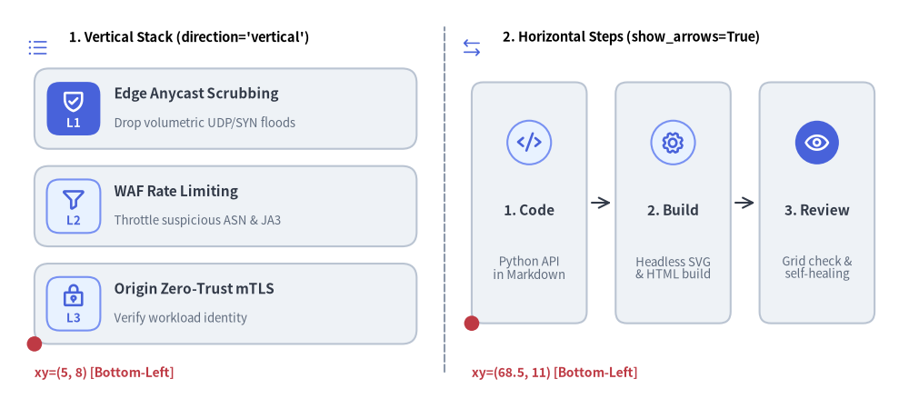
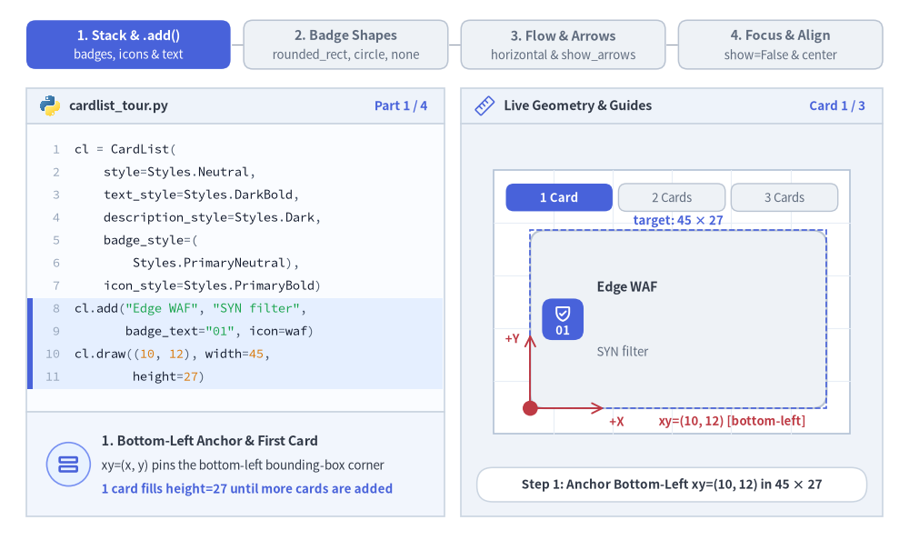
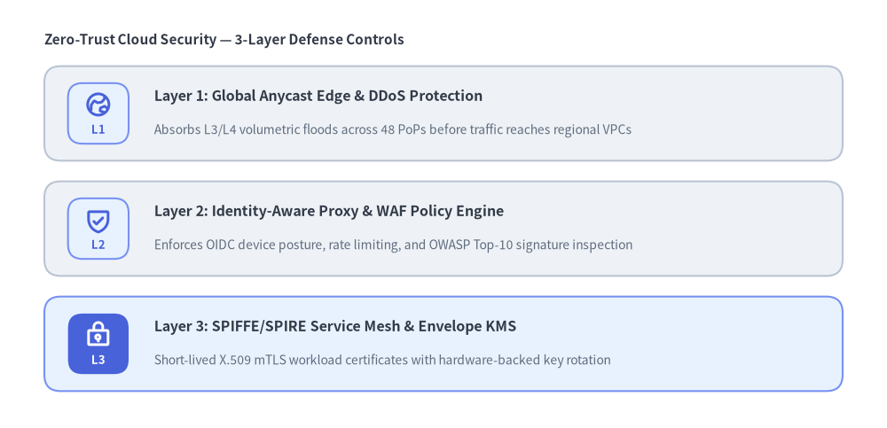
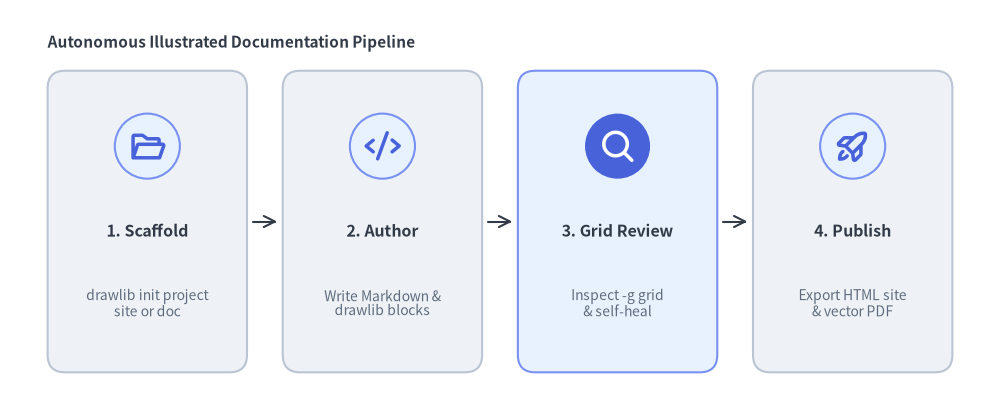

# CardList（カードリスト）

`CardList` コンポーネントは、円形または角丸矩形のバッジ（`badge_shape`）、ベクターアイコン（`icon`）、番号・テキストラベル（`badge_text`）、カードタイトル（`text`）、複数行の説明文（`description`）、およびオプションのカード間接続矢印（`show_arrows=True`）を備えたリッチなカードを、垂直スタック（`direction="vertical"`）または水平ステップシーケンス（`direction="horizontal"`）として描画します。
隙間なく単一ラベルのボックスを並べる [`BoxList`](./box_list.md) や、大きな数値指標を強調する [`KpiCards`](./kpi_cards.md) とは異なり、`CardList` は**機能カタログ、多層防御レイヤーの解説、複数ステップのエンジニアリングワークフロー**に特化して設計されています。


<figure class="drawlib-image" style="text-align: center;">
  
  <figcaption class="drawlib-caption">CardList の配置モード: 垂直機能スタックと矢印付き水平ワークフローシーケンス</figcaption>
</figure>

<details class="drawlib-code-details">
<summary>Source Code</summary>

```python
from drawlib.canvas import save, setup
from drawlib.icons import phosphor
from drawlib.lines import line
from drawlib.shapes import circle
from drawlib.smartarts import CardList
from drawlib.styles import Styles
from drawlib.text import text

setup(width=132, height=58)

# Subtle center divider
line((64.5, 4.0), (64.5, 54.0), style=Styles.MutedDashed)

# 1. Left Panel: Vertical Feature Stack (direction="vertical", badge_shape="rounded_rect")
phosphor.list_bullets(xy=(5.5, 51.0), width=3.4, style=Styles.PrimaryFlat)
text((10.0, 52.5), "1. Vertical Stack (direction='vertical')", style=Styles.BlackBold.patch(text_size=10.5, halign="left"))

cl_v = CardList(
    style=Styles.Neutral,
    text_style=Styles.DarkBold.patch(text_size=11.0),
    description_style=Styles.Muted.patch(text_size=9.5),
    badge_shape="rounded_rect",
    badge_style=Styles.PrimaryNeutral,
    badge_text_style=Styles.PrimaryBold.patch(text_size=9.5),
    icon_style=Styles.PrimaryBold,
    direction="vertical",
    spacing=2.5,
)
cl_v.add(
    "Edge Anycast Scrubbing",
    "Drop volumetric UDP/SYN floods",
    badge_text="L1",
    icon=phosphor.shield_check,
    badge_style=Styles.PrimaryFlat,
    badge_text_style=Styles.WhiteBold.patch(text_size=9.5),
    icon_style=Styles.WhiteBold,
)
cl_v.add("WAF Rate Limiting", "Throttle suspicious ASN & JA3", badge_text="L2", icon=phosphor.funnel)
cl_v.add("Origin Zero-Trust mTLS", "Verify workload identity", badge_text="L3", icon=phosphor.lock_key)
cl_v.draw(xy=(5.0, 8.0), width=55.5, height=40.0)

circle((5.0, 8.0), radius=1.1, style=Styles.DangerFlat)
text((5.0, 3.8), "xy=(5, 8) [Bottom-Left]", style=Styles.DangerBold.patch(text_size=10.0, halign="left"))

# 2. Right Panel: Horizontal Step Sequence (direction="horizontal", show_arrows=True)
phosphor.arrows_left_right(xy=(68.5, 51.0), width=3.4, style=Styles.PrimaryFlat)
text((73.0, 52.5), "2. Horizontal Steps (show_arrows=True)", style=Styles.BlackBold.patch(text_size=10.5, halign="left"))

cl_h = CardList(
    style=Styles.Neutral,
    text_style=Styles.DarkBold.patch(text_size=11.0),
    description_style=Styles.Muted.patch(text_size=9.5),
    badge_shape="circle",
    badge_style=Styles.PrimaryNeutral,
    icon_style=Styles.PrimaryBold,
    direction="horizontal",
    show_arrows=True,
    arrow_style=Styles.Dark,
    spacing=4.2,
)
cl_h.add("1. Code", "Python API\nin Markdown", icon=phosphor.code)
cl_h.add("2. Build", "Headless SVG\n& HTML build", icon=phosphor.gear)
cl_h.add(
    "3. Review",
    "Grid check &\nself-healing",
    icon=phosphor.eye,
    badge_style=Styles.PrimaryFlat,
    icon_style=Styles.WhiteBold,
)
cl_h.draw(xy=(68.5, 11.0), width=58.5, height=35.0)

circle((68.5, 11.0), radius=1.1, style=Styles.DangerFlat)
text((68.5, 3.8), "xy=(68.5, 11) [Bottom-Left]", style=Styles.DangerBold.patch(text_size=10.0, halign="left"))

save()
```

</details>


---

## 1. 基本概念と基本的な使い方

`CardList` は `.add(...)` で段階的に構築した垂直方向の機能スタック（`direction="vertical"`）または水平方向のステップシーケンス（`direction="horizontal"`）を描画し、デフォルトでバウンディングボックスの**左下角 `(x, y)`**（`align="center"` の場合は中央）を基準に配置します。先頭バッジを `"rounded_rect"`・`"circle"`・`"none"` から選択できるほか、カード間のワークフロー矢印（`show_arrows=True`）の有効化や、他のカードのスロット位置を保ったまま `.items[i]` を個別変更・非表示化する操作に対応しています。


<figure class="drawlib-image" style="text-align: center;">
  
  <figcaption class="drawlib-caption">基本的な使い方とパラメータツアー: 垂直・水平カード、バッジ形状、ワークフロー矢印、動的なアイテム制御（APNG アニメーション）</figcaption>
</figure>


<div class="drawlib-source-link">
  <a href="https://github.com/yuichi110/drawlib/blob/main/docs/docs_src/ja/04_smartarts/card_list.md" target="_blank" rel="noopener noreferrer">GitHub でアニメーションのソースコードを見る &rarr;</a>
</div>

- **段階的なカード追加とアンカー（`xy`, `align`）**: `.add(text, description, badge_text=..., icon=...)` でリッチなカードを追加し、デフォルトの**左下** `xy`（`align="bottom_left"`）または中央（`align="center"`）を基準に `(width, height)` 領域内へ描画します。
- **バッジ形状（`badge_shape`）**: 枠付きのアイコン／ラベルバッジには `"rounded_rect"`（デフォルト）または `"circle"` を選び、枠なしのアイコンをカードテキストの横に直接並べる場合は `"none"` を設定します。
- **配置方向とワークフロー矢印（`direction`, `show_arrows`）**: `direction="vertical"`（上から下へのスタック）から `direction="horizontal"`（左から右へのカード列）へ切り替えられるほか、`show_arrows=True` と `arrow_style` を設定して隣接する表示ステップ間を矢印で接続できます。
- **カード単位の強調とスロット維持（`.items[i]`, `.show`）**: `cards.items[i].style` を上書きして特定の注目カードをハイライトしたり、`cards.items[i].show = False` を設定して他のカードの位置をずらさずに該当カード（および隣接する矢印）を非表示にしたりできます。

---

## 2. 垂直方向の機能一覧・多層防御カード（`direction="vertical"`）

`direction="vertical"`（デフォルト）では、`(width, height)` のバウンディングボックス内にカードが**上から下へ**順に配置されます。各カードの左側にはバッジ（`badge_shape="rounded_rect"` または `"circle"`）が表示され、その横に太字のカードタイトル（`text`）と複数行対応の説明文（`description`）が続きます。


```python
from drawlib.canvas import save, setup
from drawlib.icons import phosphor
from drawlib.smartarts import CardList
from drawlib.styles import Styles
from drawlib.text import text

setup(width=120, height=58)

text((6.0, 52.5), "Zero-Trust Cloud Security — 3-Layer Defense Controls", style=Styles.DarkBold.patch(text_size=11.0, halign="left"))

layers = CardList(
    style=Styles.Neutral,
    text_style=Styles.DarkBold.patch(text_size=11.5),
    description_style=Styles.Muted.patch(text_size=10.0),
    badge_shape="rounded_rect",
    badge_style=Styles.PrimaryNeutral,
    badge_text_style=Styles.PrimaryBold.patch(text_size=9.5),
    icon_style=Styles.PrimaryBold,
    direction="vertical",
    spacing=2.8,
)
layers.add(
    "Layer 1: Global Anycast Edge & DDoS Protection",
    "Absorbs L3/L4 volumetric floods across 48 PoPs before traffic reaches regional VPCs",
    badge_text="L1",
    icon=phosphor.globe_hemisphere_east,
)
layers.add(
    "Layer 2: Identity-Aware Proxy & WAF Policy Engine",
    "Enforces OIDC device posture, rate limiting, and OWASP Top-10 signature inspection",
    badge_text="L2",
    icon=phosphor.shield_check,
)
layers.add(
    "Layer 3: SPIFFE/SPIRE Service Mesh & Envelope KMS",
    "Short-lived X.509 mTLS workload certificates with hardware-backed key rotation",
    badge_text="L3",
    icon=phosphor.lock_key,
    style=Styles.PrimaryNeutral,
    badge_style=Styles.PrimaryFlat,
    badge_text_style=Styles.WhiteBold.patch(text_size=9.5),
    icon_style=Styles.WhiteBold,
)
layers.draw(xy=(6.0, 5.0), width=108.0, height=44.0)

save()
```

<figure class="drawlib-image" style="text-align: center;">
  
  <figcaption class="drawlib-caption">垂直方向の CardList によるゼロトラストセキュリティ多層防御アーキテクチャ</figcaption>
</figure>


---

## 3. 接続矢印付きの水平ステップシーケンス（`direction="horizontal"`）

`direction="horizontal"` を設定すると、カードが**左から右へ**並び、各カード上部の中央にバッジ／アイコンが配置され、その下にタイトル（`text`）と説明文（`description`）が縦に積まれます。`show_arrows=True`（および `arrow_style`）を有効にすると、`spacing` の間隔をまたいで隣接するカード間に接続矢印（`->`）が描画されます。


```python
from drawlib.canvas import save, setup
from drawlib.icons import phosphor
from drawlib.smartarts import CardList
from drawlib.styles import Styles
from drawlib.text import text

setup(width=126, height=52)

text((6.0, 46.5), "Autonomous Illustrated Documentation Pipeline", style=Styles.DarkBold.patch(text_size=11.0, halign="left"))

workflow = CardList(
    style=Styles.Neutral,
    text_style=Styles.DarkBold.patch(text_size=11.5),
    description_style=Styles.Muted.patch(text_size=10.0),
    badge_shape="circle",
    badge_style=Styles.PrimaryNeutral,
    icon_style=Styles.PrimaryBold,
    direction="horizontal",
    show_arrows=True,
    arrow_style=Styles.Dark,
    spacing=4.5,
)
workflow.add(
    "1. Scaffold",
    "drawlib init project\nsite or doc",
    icon=phosphor.folder_open,
)
workflow.add(
    "2. Author",
    "Write Markdown &\ndrawlib blocks",
    icon=phosphor.code,
)
workflow.add(
    "3. Grid Review",
    "Inspect -g grid\n& self-heal",
    icon=phosphor.magnifying_glass,
    style=Styles.PrimaryNeutral,
    badge_style=Styles.PrimaryFlat,
    icon_style=Styles.WhiteBold,
)
workflow.add(
    "4. Publish",
    "Export HTML site\n& vector PDF",
    icon=phosphor.rocket_launch,
)
workflow.draw(xy=(6.0, 5.0), width=114.0, height=38.0)

save()
```

<figure class="drawlib-image" style="text-align: center;">
  
  <figcaption class="drawlib-caption">水平方向の CardList による 4 段階 CI/CD ドキュメント構築・検証パイプライン</figcaption>
</figure>


---

## 4. バッジモードと向きのジオメトリ

- **左下アンカーまたは中央アンカー（`xy`, `align`）**: `CardList.draw(xy=(x, y), width=W, height=H, align="bottom_left")` はバウンディングボックスの左下角を `(x, y)` に配置し、右方向（`+x`）に `W` 単位、上方向（`+y`）に `H` 単位の領域へ展開します。`align="center"` の場合はバウンディングボックス全体を `(x, y)` の中央に配置します。
- **バッジ形状（`badge_shape`）**:
  - `"rounded_rect"` *（デフォルト）*: 控えめな角丸を持つ正方形バッジコンテナを描画します（`badge_style` が必須）。
  - `"circle"`: 円形のバッジコンテナを描画します（`badge_style` が必須）。
  - `"none"`: バッジ背景図形を描画せず、`icon` または `badge_text` を直接描画します。
- **バッジ内容の描画ルール**:
  - `icon` を指定した場合、`icon_style` を用いてベクターアイコンを描画します。
  - `badge_text` を指定した場合、`badge_text_style` を用いてバッジラベルを描画します。
  - `icon` と `badge_text` の両方を指定した場合、バッジ内部の上部にアイコンを、その下部に `badge_text` を並べて描画します。

---

## 5. API リファレンス

### コンストラクタ
```python
CardList(
    *,
    style: Style,
    text_style: Style,
    description_style: Style | None = None,
    badge_shape: Literal["circle", "rounded_rect", "none"] = "rounded_rect",
    badge_style: Style | None = None,
    badge_text_style: Style | None = None,
    icon_style: Style | None = None,
    direction: Literal["vertical", "horizontal"] = "vertical",
    spacing: float = 2.5,
    show_arrows: bool = False,
    arrow_style: Style | None = None,
)
```

### メソッドとプロパティ
- **`add(text: str, description: str = "", *, badge_text: str | None = None, icon: Callable | None = None, style: Style | None = None, text_style: Style | None = None, description_style: Style | None = None, badge_style: Style | None = None, badge_text_style: Style | None = None, icon_style: Style | None = None, show: bool = True) -> CardListItem`**:
  カード項目（`text` がカードの主タイトル）を末尾に追加し、変更可能な `CardListItem` を返します。`item.show = False` を設定すると、他のすべてのカードの座標を維持したまま、該当カード（および隣接する矢印）を非表示にします。
- **`cardlist.items -> list[CardListItem]`**:
  事後変更用の登録済み `CardListItem` インスタンスのリストを返します。
- **`draw(xy: tuple[float, float], width: float = 90.0, height: float = 50.0, *, align: Literal["bottom_left", "center"] = "bottom_left", scale: float = 1.0) -> Self`**:
  左下角 `xy`（`align="center"` の場合は中央 `xy`）を基準とする `(width, height)` のバウンディングボックス内にカード列を描画します。

