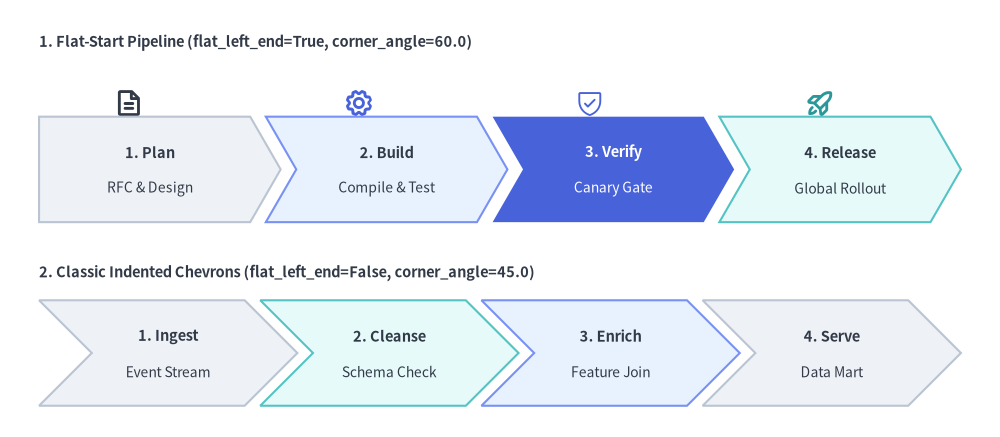
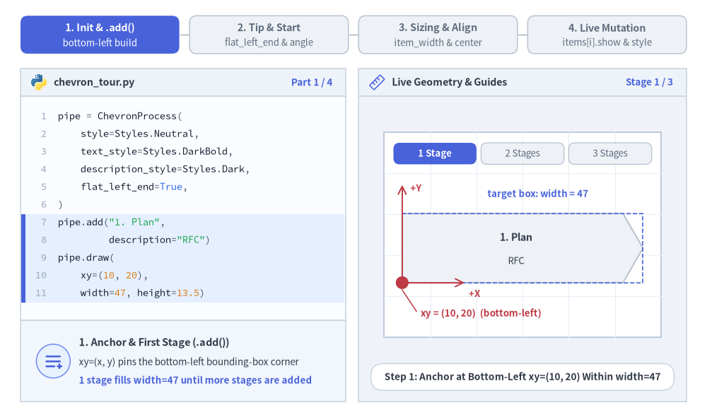
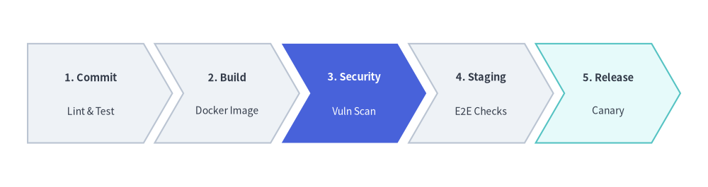
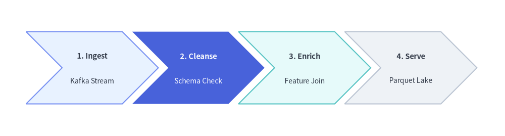

# ChevronProcess（シェブロン工程図）

`ChevronProcess` コンポーネントは、噛み合う矢羽根型ブロック（シェブロン）で構成される水平方向の連続プロセスパイプラインを描画します。
CI/CD デリバリーパイプライン、フェーズ別の開発マイルストーン、フルフィルメントのライフサイクル、マルチステップのワークフローを表現するのに最適なコンポーネントです。


<figure class="drawlib-image" style="text-align: center;">
  
  <figcaption class="drawlib-caption">ChevronProcess の概要: フラット開始型とインデント型のパイプライン比較</figcaption>
</figure>

<details class="drawlib-code-details">
<summary>Source Code</summary>

```python
from drawlib.canvas import save, setup
from drawlib.icons import phosphor
from drawlib.smartarts import ChevronProcess
from drawlib.styles import Styles
from drawlib.text import text

setup(width=128, height=56)

# 1. Top Row: Flat-Start Chevron Pipeline (flat_left_end=True, corner_angle=60.0)
text((5, 50.5), "1. Flat-Start Pipeline (flat_left_end=True, corner_angle=60.0)", style=Styles.DarkBold.patch(text_size=10.5, halign="left"))

# Stage icons above each chevron
phosphor.file_text(xy=(16.5, 42.8), width=3.8, style=Styles.DarkBold)
phosphor.gear(xy=(46.0, 42.8), width=3.8, style=Styles.PrimaryBold)
phosphor.shield_check(xy=(75.5, 42.8), width=3.8, style=Styles.PrimaryFlat)
phosphor.rocket_launch(xy=(105.0, 42.8), width=3.8, style=Styles.SecondaryBold)

flat_pipe = ChevronProcess(
    style=Styles.Neutral,
    text_style=Styles.DarkBold.patch(text_size=10.5),
    description_style=Styles.Dark.patch(text_size=10.0),
    corner_angle=60.0,
    spacing=2.0,
    flat_left_end=True,
)
flat_pipe.add("1. Plan", description="RFC & Design")
flat_pipe.add("2. Build", description="Compile & Test", style=Styles.PrimaryNeutral)
flat_pipe.add(
    "3. Verify",
    description="Canary Gate",
    style=Styles.PrimaryFlat,
    text_style=Styles.WhiteBold.patch(text_size=10.5),
    description_style=Styles.White.patch(text_size=10.0),
)
flat_pipe.add("4. Release", description="Global Rollout", style=Styles.SecondaryNeutral)
flat_pipe.draw(xy=(5, 27.5), width=118.0, height=13.5)

# 2. Bottom Row: Classic Indented Chevrons (flat_left_end=False, corner_angle=45.0)
text((5, 21.0), "2. Classic Indented Chevrons (flat_left_end=False, corner_angle=45.0)", style=Styles.DarkBold.patch(text_size=10.5, halign="left"))

indented_pipe = ChevronProcess(
    style=Styles.Neutral,
    text_style=Styles.DarkBold.patch(text_size=10.5),
    description_style=Styles.Dark.patch(text_size=10.0),
    corner_angle=45.0,
    spacing=2.0,
    flat_left_end=False,
)
indented_pipe.add("1. Ingest", description="Event Stream")
indented_pipe.add("2. Cleanse", description="Schema Check", style=Styles.SecondaryNeutral)
indented_pipe.add("3. Enrich", description="Feature Join", style=Styles.PrimaryNeutral)
indented_pipe.add("4. Serve", description="Data Mart")
indented_pipe.draw(xy=(5, 4.0), width=118.0, height=13.5)

save()
```

</details>


---

## 1. 基本概念と基本的な使い方

`ChevronProcess` は `.add(...)` で噛み合う連続パイプラインを段階的に構築し、デフォルトではプロセス全体の外接バウンディングボックスの**左下 `(x, y)`**（`align="center"` 指定時は中央）を基準に配置します。左端の開始形状や矢印先端の幾何パラメータ（`flat_left_end`, `corner_angle`, `spacing`）の調整、全体幅 `width` の自動等分とステージごとの固定幅 `item_width` の切り替え、さらに兄弟ステージの座標をずらさずに個別の `.items[i]` を変更・非表示化する操作が可能です。


<figure class="drawlib-image" style="text-align: center;">
  
  <figcaption class="drawlib-caption">基本的な使い方とパラメータツアー: 段階的構築、先端形状、サイズ指定、ライブ変更（APNG アニメーション）</figcaption>
</figure>


<div class="drawlib-source-link">
  <a href="https://github.com/yuichi110/drawlib/blob/main/docs/docs_src/ja/04_smartarts/chevron_process.md" target="_blank" rel="noopener noreferrer">GitHub でアニメーションのソースコードを見る &rarr;</a>
</div>

- **段階的な構築とアンカー (`xy`, `align`)**: `.add(text, description=..., style=...)` でステージを順番に追加し、`xy=(x, y)` に描画します。デフォルトではバウンディングボックスの**左下**（`align="bottom_left"`）が基準となり、`align="center"` で中央揃えにできます。
- **左端と先端の幾何形状 (`flat_left_end`, `corner_angle`, `spacing`)**: 第 1 ステージの左端を垂直な直線にするには `flat_left_end=True`（伝統的な切り込み型にする場合は `False`）を指定し、`corner_angle`（`10.0°`〜`80.0°`）と `spacing` で矢印の深さやステージ間隔を調整します。
- **全体幅 `width` の自動等分と固定 `item_width` (`scale`)**: `item_width=None` のままにすると全体幅 `width` が全ステージに自動配分され、`item_width` を明示すると各ステージの本体幅が固定されます。また `scale` で `xy` を基準に比例スケーリングできます。
- **`.items[i]` のライブ変更とスロット保持型 `.show`**: `.draw()` の前に `pipe.items[i].style` や `text_style` を変更して注目マイルストーンを強調したり、`pipe.items[i].show = False` を設定して兄弟ステージの X 座標を一切ずらさずに特定ステージだけを非表示にしたりできます。

---

## 2. クイックサンプル: CI/CD パイプライン


```python
from drawlib.canvas import setup
from drawlib.smartarts import ChevronProcess
from drawlib.styles import Styles

setup(width=128, height=34)

pipeline = ChevronProcess(
    style=Styles.Neutral,
    text_style=Styles.DarkBold.patch(text_size=10.5),
    description_style=Styles.Dark.patch(text_size=10.0),
    corner_angle=60.0,
    spacing=2.0,
    flat_left_end=True,
)
pipeline.add("1. Commit", description="Lint & Test")
pipeline.add("2. Build", description="Docker Image")
pipeline.add(
    "3. Security",
    description="Vuln Scan",
    style=Styles.PrimaryFlat,
    text_style=Styles.WhiteBold.patch(text_size=10.5),
    description_style=Styles.White.patch(text_size=10.0),
)
pipeline.add("4. Staging", description="E2E Checks")
pipeline.add("5. Release", description="Canary", style=Styles.SecondaryNeutral)

pipeline.draw(xy=(5, 8), width=118.0, height=18.0)
```

<figure class="drawlib-image" style="text-align: center;">
  
  <figcaption class="drawlib-caption">ChevronProcess による継続的デリバリー（CD）パイプライン</figcaption>
</figure>


---

## 3. 伝統的な切り込み型シェブロンと明示的な `item_width`・`corner_angle`

`flat_left_end=False`（デフォルト）を設定すると、最初のステージを含むすべてのステージが伝統的な切り込み付きのシェブロンとして描画されます。また、`draw(...)` に明示的な `item_width` を渡すと、全体幅を自動等分する代わりに全ステージの本体幅を固定値に揃えられます。さらに `corner_angle`（有効範囲: `10.0`〜`80.0` 度）で矢印先端の鋭さを調整したり、返却された `ChevronItem` インスタンスを描画前に直接変更したりすることも可能です。


```python
from drawlib.canvas import save, setup
from drawlib.smartarts import ChevronProcess
from drawlib.styles import Styles

setup(width=126, height=34)

etl = ChevronProcess(
    style=Styles.Neutral,
    text_style=Styles.DarkBold.patch(text_size=10.5),
    description_style=Styles.Dark.patch(text_size=10.0),
    corner_angle=45.0,
    spacing=2.5,
    flat_left_end=False,
)

etl.add("1. Ingest", description="Kafka Stream", style=Styles.PrimaryNeutral)
transform_stage = etl.add("2. Cleanse", description="Schema Check")
etl.add("3. Enrich", description="Feature Join", style=Styles.SecondaryNeutral)
etl.add("4. Serve", description="Parquet Lake")

# Mutate a ChevronItem (or access via etl.items[1]) before calling draw()
transform_stage.style = Styles.PrimaryFlat
transform_stage.text_style = Styles.WhiteBold.patch(text_size=10.5)
transform_stage.description_style = Styles.White.patch(text_size=10.0)

etl.draw(xy=(6.5, 8.0), height=18.0, item_width=24.0)
save()
```

<figure class="drawlib-image" style="text-align: center;">
  
  <figcaption class="drawlib-caption">伝統的な切り込み型シェブロン（flat_left_end=False, corner_angle=45.0, 明示的な item_width）</figcaption>
</figure>


---

## 4. 幾何構造と座標アンカー

- **座標アンカー (`xy` と `align`)**: デフォルト（`align="bottom_left"`）では、`draw(xy=...)` はプロセス全体の外接バウンディングボックスの**左下角** `(x, y)` をアンカーとします。`align="center"` を渡すと、バウンディングボックス全体の水平・垂直中央が `xy` に揃えられます。
- **`flat_left_end`**:
  - `False` *（デフォルト）*: 第 1 ステージを含むすべてのステージの左端に、矢印先端と同じ角度の切り込みが入ります。
  - `True`: 最初のシェブロンが、垂直な左辺を持つフラット開始型の五角形として描画されます。
- **`corner_angle`**: 矢印先端の角度を度数法で指定します（**有効範囲: `10.0`〜`80.0`**、デフォルト `60.0`）。角度が小さいほど（例: `45.0`）深く鋭い矢印になり、大きいほど（例: `70.0`）緩やかな先端になります。
- **ステージ幅の自動計算と明示指定 (`width` vs. `item_width`)**:
  - `item_width=None` *（デフォルト）* の場合、`draw()` は全体幅 `width`、ステージ間隔 `spacing`、および矢印切り込み幅（`x_indent = (height / 2) / tan(corner_angle)`）から各ステージの本体幅を自動算出します。
    ```text
    item_width = (width - (N - 1) * spacing - x_indent) / N
    ```
  - `item_width` を明示した場合は `width` は無視され、各ステージに `item_width` がそのまま適用されます（`total_width = N * item_width + (N - 1) * spacing + x_indent`）。

---

## 5. API リファレンス

### コンストラクタ (`ChevronProcess`)
```python
ChevronProcess(
    *,
    style: Style,
    text_style: Style,
    description_style: Style,
    corner_angle: float = 60.0,
    spacing: float = 1.5,
    flat_left_end: bool = False,
)
```

| パラメータ | 型 | デフォルト | 説明 |
| :--- | :--- | :--- | :--- |
| **`style`** | `Style` | *（必須）* | シェブロンブロックに適用されるデフォルトの図形スタイル。 |
| **`text_style`** | `Style` | *（必須）* | ステージのメインタイトルに適用されるデフォルトのテキストスタイル。 |
| **`description_style`** | `Style` | *（必須）* | サブ説明行に適用されるデフォルトのテキストスタイル。 |
| **`corner_angle`** | `float` | `60.0` | 矢印先端の角度（度、`10.0 <= corner_angle <= 80.0`）。 |
| **`spacing`** | `float` | `1.5` | 隣接するシェブロン間の水平ギャップ（`> 0`）。 |
| **`flat_left_end`** | `bool` | `False` | `True` の場合、最初のシェブロンの左端の切り込みを垂直な直線辺に置き換えます。 |

### ステージの追加と参照 (`.add()` / `.items`)
```python
pipeline.add(
    text: str,
    *,
    description: str = "",
    style: Style | None = None,
    text_style: Style | None = None,
    description_style: Style | None = None,
    show: bool = True,
) -> ChevronItem
```

| パラメータ | 型 | デフォルト | 説明 |
| :--- | :--- | :--- | :--- |
| **`text`** | `str` | *（必須）* | シェブロン内に表示するステージのメインタイトル。 |
| **`description`** | `str` | `""` | `text` の下に表示する任意のサブ説明行。 |
| **`style`** | `Style \| None` | `None` | このステージ個別の図形スタイル（未指定時はコンストラクタの `style` を使用）。 |
| **`text_style`** | `Style \| None` | `None` | このステージ個別のタイトル用テキストスタイル（未指定時はコンストラクタの `text_style` を使用）。 |
| **`description_style`** | `Style \| None` | `None` | このステージ個別の説明用テキストスタイル（未指定時はコンストラクタの `description_style` を使用）。 |
| **`show`** | `bool` | `True` | このステージを描画するかどうか。`False` にすると、兄弟ステージの配置スロットを維持したままこのシェブロンだけを非表示にします。 |

- **`pipeline.items -> list[ChevronItem]`**: 登録された `ChevronItem` インスタンスのリストを追加順に返します。
- **`ChevronItem` モデルのフィールド**: 返却される各アイテムは、`draw()` 実行時に評価される以下のミュータブル属性を持ちます。
  - `text: str`
  - `style: Style`
  - `text_style: Style`
  - `description_style: Style`
  - `description: str = ""`
  - `show: bool = True`

### 描画 (`.draw()`)
```python
pipeline.draw(
    xy: tuple[float, float],
    width: float = 90.0,
    height: float = 12.0,
    item_width: float | None = None,
    align: Literal["bottom_left", "center"] = "bottom_left",
    scale: float = 1.0,
) -> Self
```

| パラメータ | 型 | デフォルト | 説明 |
| :--- | :--- | :--- | :--- |
| **`xy`** | `tuple[float, float]` | *（必須）* | プロセスのバウンディングボックスのアンカー座標 `(x, y)`（デフォルトは左下、`align="center"` 指定時は中央）。 |
| **`width`** | `float` | `90.0` | 全ステージに割り当てる全体の外接幅（`item_width=None` の場合に使用）。 |
| **`height`** | `float` | `12.0` | 各シェブロンブロックの垂直方向の高さ（`> 0`）。 |
| **`item_width`** | `float \| None` | `None` | シェブロン 1 個あたりの明示的な本体幅。指定時は `width` の自動等分より優先されます。 |
| **`align`** | `Literal["bottom_left", "center"]` | `"bottom_left"` | プロセス全体のバウンディングボックスに対する `xy` のアンカー位置。 |
| **`scale`** | `float` | `1.0` | アンカー `xy` を基準とした比例スケール倍率（`> 0`）。 |

