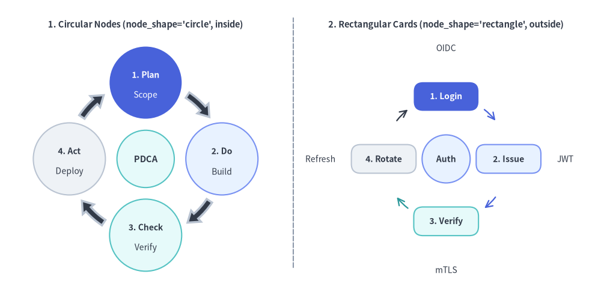
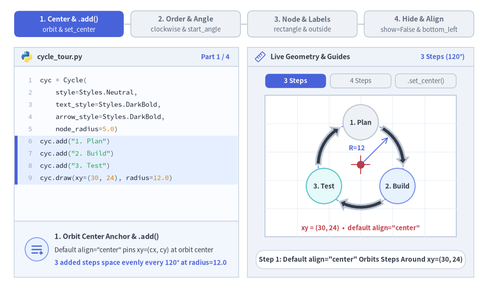
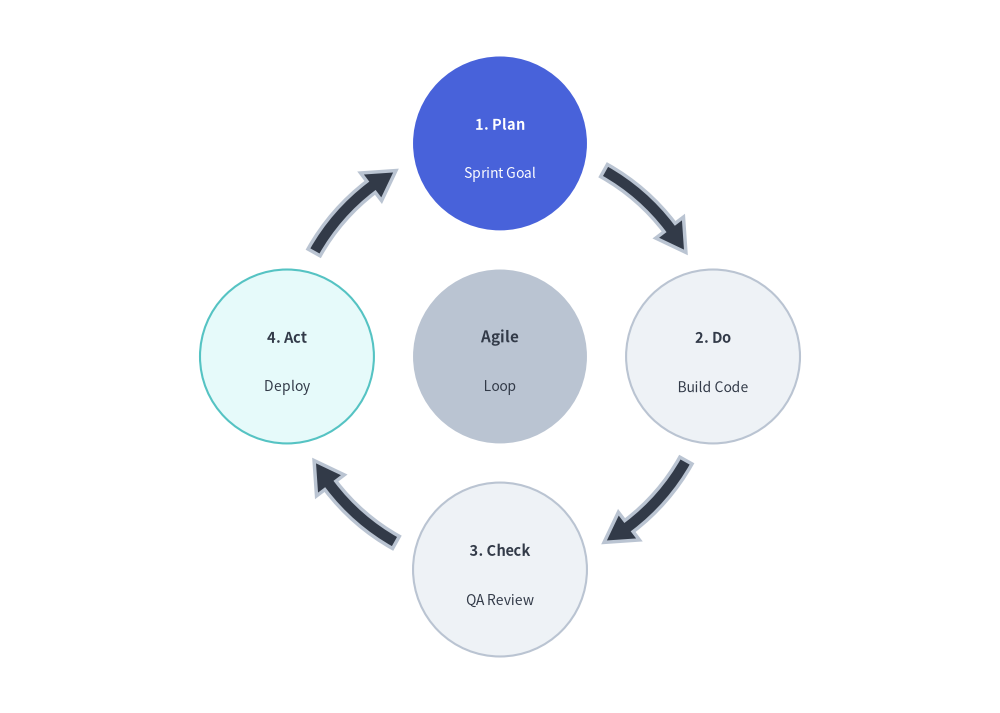
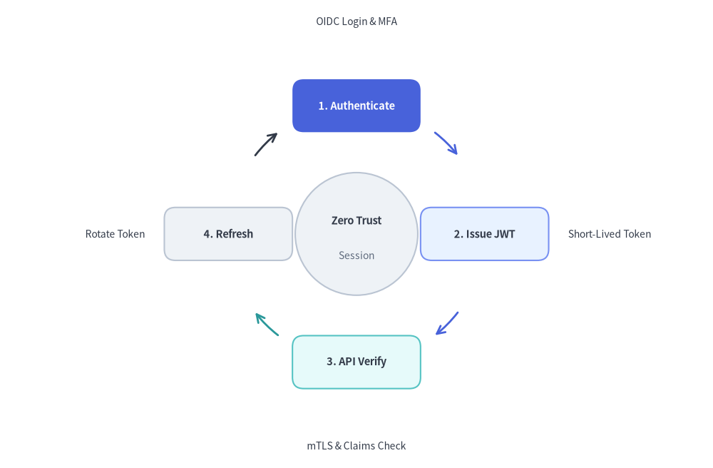

# Cycle（サイクル図）

`Cycle` コンポーネントは、循環・反復するプロセス図や継続的なフィードバックループを描画します。
アジャイル／スクラムのイテレーション、PDCA の DevOps ライフサイクル、インシデント対応ループ、トークンリフレッシュ機構などの表現に最適です。


<figure class="drawlib-image" style="text-align: center;">
  
  <figcaption class="drawlib-caption">Cycle の概要: 円形ノード軌道と長方形カードループ</figcaption>
</figure>

<details class="drawlib-code-details">
<summary>Source Code</summary>

```python
from drawlib.canvas import save, setup
from drawlib.lines import line
from drawlib.smartarts import Cycle
from drawlib.styles import Styles
from drawlib.text import text

setup(width=130, height=62)

# Left Panel: Circular Node Orbit (node_shape="circle", description_placement="inside")
text((31.5, 56.5), "1. Circular Nodes (node_shape='circle', inside)", style=Styles.DarkBold.patch(text_size=10.5))

c_left = Cycle(
    style=Styles.Neutral,
    text_style=Styles.DarkBold.patch(text_size=10.0),
    description_style=Styles.Dark.patch(text_size=10.0),
    arrow_style=Styles.DarkBold,
    node_shape="circle",
    node_radius=7.8,
    description_placement="inside",
    arrow_type="arc",
    arrow_width=1.4,
    arrow_head_width=3.2,
    arrow_color_mode="monochrome",
    arrow_gap=1.8,
)
c_left.add(
    "1. Plan",
    description="Scope",
    style=Styles.PrimaryFlat,
    text_style=Styles.WhiteBold.patch(text_size=10.0),
    description_style=Styles.White.patch(text_size=10.0),
)
c_left.add(
    "2. Do",
    description="Build",
    style=Styles.PrimaryNeutral,
    text_style=Styles.DarkBold.patch(text_size=10.0),
    description_style=Styles.Dark.patch(text_size=10.0),
)
c_left.add(
    "3. Check",
    description="Verify",
    style=Styles.SecondaryNeutral,
    text_style=Styles.DarkBold.patch(text_size=10.0),
    description_style=Styles.Dark.patch(text_size=10.0),
)
c_left.add(
    "4. Act",
    description="Deploy",
    style=Styles.Neutral,
    text_style=Styles.DarkBold.patch(text_size=10.0),
    description_style=Styles.Dark.patch(text_size=10.0),
)
c_left.set_center(
    "PDCA",
    radius=6.2,
    style=Styles.SecondaryNeutral,
    text_style=Styles.DarkBold.patch(text_size=10.5),
)
c_left.draw(xy=(31.5, 27.5), radius=16.5)

# Center Divider
line((63.5, 4), (63.5, 58), style=Styles.MutedDashed)

# Right Panel: Rectangular Card Loop (node_shape="rectangle", description_placement="outside")
text((96.5, 56.5), "2. Rectangular Cards (node_shape='rectangle', outside)", style=Styles.DarkBold.patch(text_size=10.5))

c_right = Cycle(
    style=Styles.Neutral,
    text_style=Styles.DarkBold.patch(text_size=10.0),
    description_style=Styles.Dark.patch(text_size=10.0),
    node_shape="rectangle",
    node_width=14.0,
    node_height=6.2,
    description_placement="outside",
    arrow_type="line",
    arrow_width=1.6,
    arrow_color_mode="match_source",
    arrow_gap=1.8,
)
c_right.add(
    "1. Login",
    description="OIDC",
    style=Styles.PrimaryFlat,
    text_style=Styles.WhiteBold.patch(text_size=10.0),
    description_style=Styles.Dark.patch(text_size=10.0),
)
c_right.add(
    "2. Issue",
    description="JWT",
    style=Styles.PrimaryNeutral,
    text_style=Styles.DarkBold.patch(text_size=10.0),
    description_style=Styles.Dark.patch(text_size=10.0, halign="left"),
    arrow_style=Styles.PrimaryBold,
)
c_right.add(
    "3. Verify",
    description="mTLS",
    style=Styles.SecondaryNeutral,
    text_style=Styles.DarkBold.patch(text_size=10.0),
    description_style=Styles.Dark.patch(text_size=10.0),
    arrow_style=Styles.SecondaryBold,
)
c_right.add(
    "4. Rotate",
    description="Refresh",
    style=Styles.Neutral,
    text_style=Styles.DarkBold.patch(text_size=10.0),
    description_style=Styles.Dark.patch(text_size=10.0, halign="right"),
    arrow_style=Styles.DarkBold,
)
c_right.set_center(
    "Auth",
    radius=5.2,
    style=Styles.PrimaryNeutral,
    text_style=Styles.DarkBold.patch(text_size=10.0),
)
c_right.draw(xy=(96.5, 27.5), radius=13.5)

save()
```

</details>


---

## 1. 基本概念と基本的な使い方

`Cycle` は `.add(...)` で円周上のステップを等間隔に配置し、デフォルトでは**軌道中心 `xy=(cx, cy)`**（`align="center"`、任意の `.set_center(...)` 中央ハブ付き）を基準とし、`align="bottom_left"` 指定時は外接バウンディングボックスの左下角を基準にします。回転方向と開始角度（`clockwise`, `start_angle`）の制御、円形ノードと長方形カードおよび `inside`／`outside` 説明配置の切り替え、矢印の配色カスタマイズ、さらに他のステップの軌道角度を維持したまま `.items[i]` を非表示化する操作が可能です。


<figure class="drawlib-image" style="text-align: center;">
  
  <figcaption class="drawlib-caption">基本的な使い方とパラメータツアー: 軌道中心と中央ハブ、回転方向・角度、ノード形状・ラベル配置、ライブ表示制御（APNG アニメーション）</figcaption>
</figure>


<div class="drawlib-source-link">
  <a href="https://github.com/yuichi110/drawlib/blob/main/docs/docs_src/ja/04_smartarts/cycle.md" target="_blank" rel="noopener noreferrer">GitHub でアニメーションのソースコードを見る &rarr;</a>
</div>

- **軌道中心アンカーと中央ハブ (`xy`, `align="center"`, `.set_center()`)**: `xy=(cx, cy)`（デフォルト `align="center"`）の周囲に `.add(text, description=..., style=...)` で円周ステップを追加し、必要に応じて `.set_center(...)` で中央ハブ円を配置します。
- **回転方向と開始角度 (`clockwise`, `start_angle`)**: デフォルトの `clockwise=True, start_angle=90.0` では第 1 ステップを 12 時方向に配置して時計回りに進みます。`start_angle`（例: `180.0`）の変更や、`clockwise=False` による反時計回りループへの切り替えが可能です。
- **ノード形状・ラベル配置・接続矢印 (`node_shape`, `description_placement`, `arrow_type`)**: `"circle"`（`node_radius`）または `"rectangle"`（`node_width`, `node_height`）を選択し、説明文をノード内部に重ねる `"inside"` または外周へ放射配置する `"outside"` を切り替え、`"arc"` ブロック矢印または `"line"` ストローク矢印で接続できます。
- **矢印配色・表示制御・左下アンカー配置 (`arrow_color_mode`, `.show`, `align="bottom_left"`)**: `"match_source"` と `"monochrome"` の矢印配色を切り替えたり、`cycle.items[i].show = False` で他のステップの角度を保ったまま非表示にしたり、`align="bottom_left"` で外接矩形の左下角を基準に配置したりできます。

---

## 2. クイックサンプル: アジャイル開発サイクル


```python
from drawlib.canvas import setup
from drawlib.smartarts import Cycle
from drawlib.styles import Styles

setup(width=115, height=82)

cycle = Cycle(
    style=Styles.Neutral,
    text_style=Styles.DarkBold.patch(text_size=10.5),
    description_style=Styles.Dark.patch(text_size=10.0),
    arrow_style=Styles.DarkBold,
    clockwise=True,
    start_angle=90.0,
    node_shape="circle",
    node_radius=10.0,
    arrow_type="arc",
    arrow_width=1.6,
    arrow_head_width=4.0,
    arrow_color_mode="monochrome",
    description_placement="inside",
)
cycle.add(
    "1. Plan",
    description="Sprint Goal",
    style=Styles.PrimaryFlat,
    text_style=Styles.WhiteBold.patch(text_size=10.5),
    description_style=Styles.White.patch(text_size=10.0),
)
cycle.add(
    "2. Do",
    description="Build Code",
    text_style=Styles.DarkBold.patch(text_size=10.5),
    description_style=Styles.Dark.patch(text_size=10.0),
)
cycle.add(
    "3. Check",
    description="QA Review",
    text_style=Styles.DarkBold.patch(text_size=10.5),
    description_style=Styles.Dark.patch(text_size=10.0),
)
cycle.add(
    "4. Act",
    description="Deploy",
    style=Styles.SecondaryNeutral,
    text_style=Styles.DarkBold.patch(text_size=10.5),
    description_style=Styles.Dark.patch(text_size=10.0),
)

cycle.set_center(
    text="Agile",
    description="Loop",
    radius=10.0,
    style=Styles.MutedFlat,
    text_style=Styles.DarkBold.patch(text_size=11.0),
    description_style=Styles.Dark.patch(text_size=10.0),
)

cycle.draw(xy=(57.5, 41.0), radius=24.5)
```

<figure class="drawlib-image" style="text-align: center;">
  
  <figcaption class="drawlib-caption">Cycle による継続的アジャイル開発ライフサイクル</figcaption>
</figure>


---

## 3. 長方形ノード・外周説明ラベル・ライン矢印の組み合わせ

`node_shape="rectangle"`（`node_width`, `node_height` 併用）、`description_placement="outside"`、`arrow_type="line"`、`arrow_color_mode="match_source"` を組み合わせると、角丸長方形のカードを始点ステージの色に合わせた細い円弧矢印で結び、説明ラベルを外周へ放射状に配置したアーキテクチャ向けの状態ループ図を構築できます。


```python
from drawlib.canvas import save, setup
from drawlib.smartarts import Cycle
from drawlib.styles import Styles

setup(width=128, height=84)

auth_cycle = Cycle(
    style=Styles.Neutral,
    text_style=Styles.DarkBold.patch(text_size=10.5),
    description_style=Styles.Dark.patch(text_size=10.0),
    clockwise=True,
    start_angle=90.0,
    node_shape="rectangle",
    node_width=23.0,
    node_height=9.5,
    description_placement="outside",
    arrow_type="line",
    arrow_width=2.0,
    arrow_color_mode="match_source",
    arrow_gap=3.0,
)

# Top (90 deg) - Hero focal step
auth_cycle.add(
    "1. Authenticate",
    description="OIDC Login & MFA",
    style=Styles.PrimaryFlat,
    text_style=Styles.WhiteBold.patch(text_size=10.5),
    description_style=Styles.Dark.patch(text_size=10.0),
)
# Right (0 deg) - left-align outside description so it extends cleanly rightward
auth_cycle.add(
    "2. Issue JWT",
    description="Short-Lived Token",
    style=Styles.PrimaryNeutral,
    text_style=Styles.DarkBold.patch(text_size=10.5),
    description_style=Styles.Dark.patch(text_size=10.0, halign="left"),
    arrow_style=Styles.PrimaryBold,
)
# Bottom (270 deg)
auth_cycle.add(
    "3. API Verify",
    description="mTLS & Claims Check",
    style=Styles.SecondaryNeutral,
    text_style=Styles.DarkBold.patch(text_size=10.5),
    description_style=Styles.Dark.patch(text_size=10.0),
    arrow_style=Styles.SecondaryBold,
)
# Left (180 deg) - right-align outside description so it extends cleanly leftward
rotate_step = auth_cycle.add(
    "4. Refresh",
    description="Rotate Token",
    style=Styles.Neutral,
    text_style=Styles.DarkBold.patch(text_size=10.5),
    description_style=Styles.Dark.patch(text_size=10.0, halign="right"),
)
# Customize outgoing arrow style on the neutral step via CycleItem mutation
rotate_step.arrow_style = Styles.DarkBold

auth_cycle.set_center(
    text="Zero Trust",
    description="Session",
    radius=11.0,
    style=Styles.Neutral,
    text_style=Styles.DarkBold.patch(text_size=10.5),
    description_style=Styles.Muted.patch(text_size=10.0),
)

auth_cycle.draw(xy=(64, 42), radius=23.0, align="center")
save()
```

<figure class="drawlib-image" style="text-align: center;">
  
  <figcaption class="drawlib-caption">外周説明ラベル付き長方形 Cycle（node_shape='rectangle', arrow_type='line', arrow_color_mode='match_source'）</figcaption>
</figure>


---

## 4. 幾何構造と座標メカニクス

- **アンカーモード (`align="center"` vs. `align="bottom_left"`)**:
  - `align="center"` *（デフォルト）*: `xy=(cx, cy)` は軌道円の**正確な中心ハブ座標**を指定します。
  - `align="bottom_left"`: `xy=(x, y)` はサイクル全体の外接バウンディングボックスの**左下角**を指定します（軌道中心は `radius + node_half_extent + margin` だけ自動オフセットされます）。
- **等角度配置**: 各ステップは半径 `R` の軌道円周上に等角度で配置されます（`clockwise=True` のときは `-`、`clockwise=False` のときは `+`）。

  ```text
  angle_i = (start_angle -/+ i * (360 / N)) mod 360
  ```

- **ノード形状とサイズ指定 (`node_shape`, `node_radius`, `node_width`, `node_height`)**:
  - `"circle"` *（デフォルト）*: `node_radius`（デフォルト `8.0`）でサイズが決まる円形ステップノード。
  - `"rectangle"`: `node_width` と `node_height`（デフォルトは `18.0` と `10.0`、`style` で上書きしない限りデフォルト角丸半径 `shape_r=2.0`）でサイズが決まる角丸長方形カード。
  - `"none"`: 背景図形を持たないフローティングテキストラベル。
- **説明文の配置 (`description_placement`)**:
  - `"inside"` *（デフォルト）*: タイトルと説明文を上下に並べてノード境界の内側に描画します。
  - `"outside"`: タイトルをノード中央に描画し、説明文を各ノードの軌道角度に沿って外周側へ放射状に配置します。
- **接続矢印の種類と配色 (`arrow_type`, `arrow_color_mode`)**:
  - `arrow_type`: `"arc"` *（デフォルト、曲線ブロック矢印）*、`"line"` *（矢印付きの曲線ストローク）*、または `"none"`。
  - `arrow_color_mode`:
    - `"match_source"` *（デフォルト）*: 各接続矢印は始点ステップの `shape_fill_color` を引き継ぎます（`arrow_style` で個別上書きした場合を除く）。
    - `"match_target"`: 各接続矢印は終点ステップの `shape_fill_color` に合わせます。
    - `"monochrome"`: すべての接続矢印に `arrow_style` を使用します（`Cycle` または各アイテムに `arrow_style` の設定が必要です）。

---

## 5. API リファレンス

### コンストラクタ (`Cycle`)
```python
Cycle(
    *,
    style: Style,
    text_style: Style,
    description_style: Style | None = None,
    arrow_style: Style | None = None,
    clockwise: bool = True,
    start_angle: float = 90.0,
    node_shape: Literal["circle", "rectangle", "none"] = "circle",
    node_radius: float = 8.0,
    node_width: float = 18.0,
    node_height: float = 10.0,
    description_placement: Literal["inside", "outside"] = "inside",
    arrow_type: Literal["arc", "line", "none"] = "arc",
    arrow_width: float = 2.0,
    arrow_head_width: float = 4.5,
    arrow_color_mode: Literal["monochrome", "match_source", "match_target"] = "match_source",
    arrow_gap: float = 2.5,
    center_text: str = "",
    center_description: str = "",
    center_radius: float = 10.0,
    center_style: Style | None = None,
    center_text_style: Style | None = None,
    center_description_style: Style | None = None,
)
```

| パラメータ | 型 | デフォルト | 説明 |
| :--- | :--- | :--- | :--- |
| **`style`** | `Style` | *（必須）* | 円周上の各ステップノードのデフォルト図形スタイル。 |
| **`text_style`** | `Style` | *（必須）* | ステップのメインタイトル用デフォルトテキストスタイル。 |
| **`description_style`** | `Style \| None` | `None` | サブ説明文用のデフォルトテキストスタイル（アイテムに `description` を指定する場合は必須）。 |
| **`arrow_style`** | `Style \| None` | `None` | 接続矢印のデフォルトスタイル（`arrow_color_mode="monochrome"` の場合は必須）。 |
| **`clockwise`** | `bool` | `True` | `True` なら時計回り、`False` なら反時計回りにステップと矢印を配置します。 |
| **`start_angle`** | `float` | `90.0` | 最初のステップの開始角度（度、`90.0` が上、`0.0` が右）。 |
| **`node_shape`** | `Literal["circle", "rectangle", "none"]` | `"circle"` | 円周ステップノードの図形形状。 |
| **`node_radius`** | `float` | `8.0` | `node_shape="circle"` のときの円周ノード半径。 |
| **`node_width`** | `float` | `18.0` | `node_shape="rectangle"` のときの円周ノード幅。 |
| **`node_height`** | `float` | `10.0` | `node_shape="rectangle"` のときの円周ノード高さ。 |
| **`description_placement`** | `Literal["inside", "outside"]` | `"inside"` | 説明文をノード内部に描画するか、外周側へ放射配置するか。 |
| **`arrow_type`** | `Literal["arc", "line", "none"]` | `"arc"` | 接続矢印の種類: 曲線ブロック矢印（`"arc"`）、曲線ストローク（`"line"`）、または `"none"`。 |
| **`arrow_width`** | `float` | `2.0` | 矢印本体の太さ（`"arc"` の帯幅、または `"line"` の線幅）。 |
| **`arrow_head_width`** | `float` | `4.5` | `arrow_type="arc"` のときの矢印ヘッド幅。 |
| **`arrow_color_mode`** | `Literal["monochrome", "match_source", "match_target"]` | `"match_source"` | `arrow_style` が明示されていない場合の自動配色モード。 |
| **`arrow_gap`** | `float` | `2.5` | ノード境界と矢印端点の間に空けるクリアランス余白。 |
| **`center_text`** | `str` | `""` | 中央ハブ円のタイトル文字列（`set_center()` でも設定可能）。 |
| **`center_description`** | `str` | `""` | 中央ハブ円のサブ説明文。 |
| **`center_radius`** | `float` | `10.0` | 中央ハブ円の半径。 |
| **`center_style`** | `Style \| None` | `None` | 中央ハブ円の図形スタイル（`center_text` が空でない場合は必須）。 |
| **`center_text_style`** | `Style \| None` | `None` | 中央ハブのタイトル用テキストスタイル（未指定時は `text_style` を使用）。 |
| **`center_description_style`** | `Style \| None` | `None` | 中央ハブの説明用テキストスタイル（未指定時は `description_style` を使用）。 |

### ステップの追加と中央ハブの設定 (`.add()`, `.set_center()`, `.items`, `.center`)
```python
cycle.add(
    text: str,
    *,
    style: Style | None = None,
    description: str = "",
    text_style: Style | None = None,
    description_style: Style | None = None,
    arrow_style: Style | None = None,
    show: bool = True,
) -> CycleItem
```

| パラメータ | 型 | デフォルト | 説明 |
| :--- | :--- | :--- | :--- |
| **`text`** | `str` | *（必須）* | ステップのメインタイトル文字列。 |
| **`style`** | `Style \| None` | `None` | このノード個別の図形スタイル（未指定時はコンストラクタの `style` を使用）。 |
| **`description`** | `str` | `""` | 任意のサブ説明文字列。 |
| **`text_style`** | `Style \| None` | `None` | このステップ個別のタイトル用テキストスタイル（未指定時はコンストラクタの `text_style` を使用）。 |
| **`description_style`** | `Style \| None` | `None` | このステップ個別の説明用テキストスタイル（未指定時はコンストラクタの `description_style` を使用）。 |
| **`arrow_style`** | `Style \| None` | `None` | このステップから出発する接続矢印の個別スタイル。 |
| **`show`** | `bool` | `True` | このステップおよび隣接する矢印を描画するかどうか。`False` の場合も他ステップの角度位置は維持されます。 |

- **`cycle.set_center(text, *, style=None, description="", radius=None, text_style=None, description_style=None, show=True) -> CycleCenter`**: 中央ハブ円を設定し、ミュータブルな `CycleCenter` モデルを返します。
- **`cycle.items -> list[CycleItem]`**: 登録済みのすべての `CycleItem` インスタンス（`text`, `style`, `description`, `text_style`, `description_style`, `arrow_style`, `show`）を返します。
- **`cycle.center -> CycleCenter`**: ミュータブルな `CycleCenter` モデル（`text`, `description`, `radius`, `style`, `text_style`, `description_style`, `show`）を返します。

### 描画 (`.draw()`)
```python
cycle.draw(
    xy: tuple[float, float],
    radius: float = 35.0,
    align: Literal["center", "bottom_left"] = "center",
    scale: float = 1.0,
) -> None
```

| パラメータ | 型 | デフォルト | 説明 |
| :--- | :--- | :--- | :--- |
| **`xy`** | `tuple[float, float]` | *（必須）* | アンカー座標 `(x, y)`（`align` に応じて軌道中心または外接矩形の左下角）。 |
| **`radius`** | `float` | `35.0` | サイクル中心から各円周ノード中心までの軌道半径（`> 0`）。 |
| **`align`** | `Literal["center", "bottom_left"]` | `"center"` | アンカー配置モード（`"center"` または `"bottom_left"`）。 |
| **`scale`** | `float` | `1.0` | `xy` を基準とした比例スケール倍率（`> 0`）。 |

