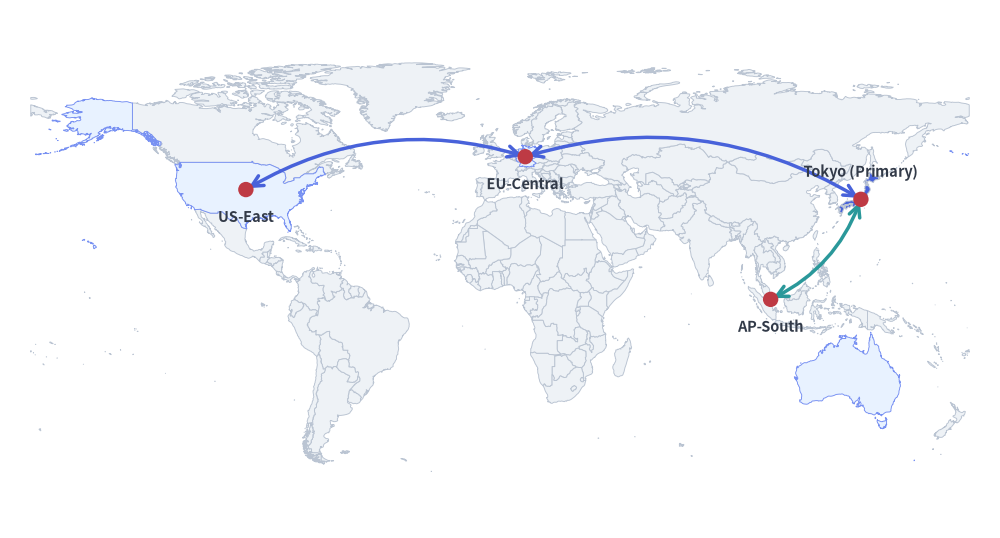
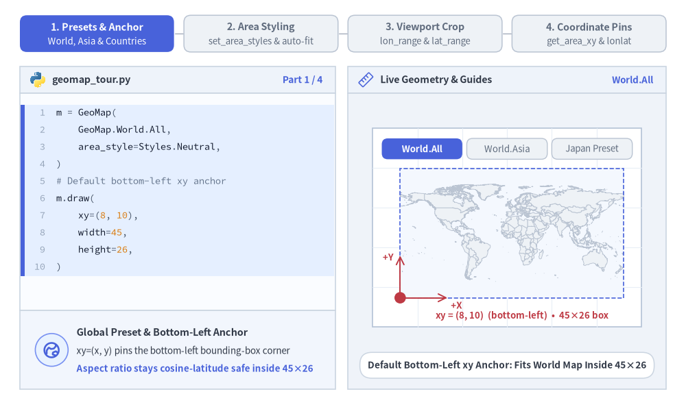
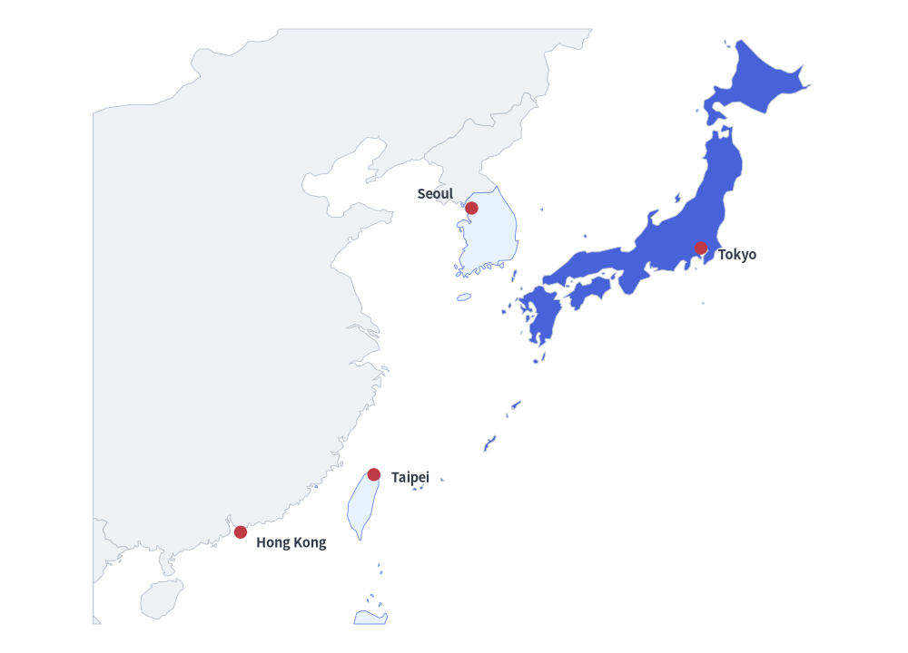
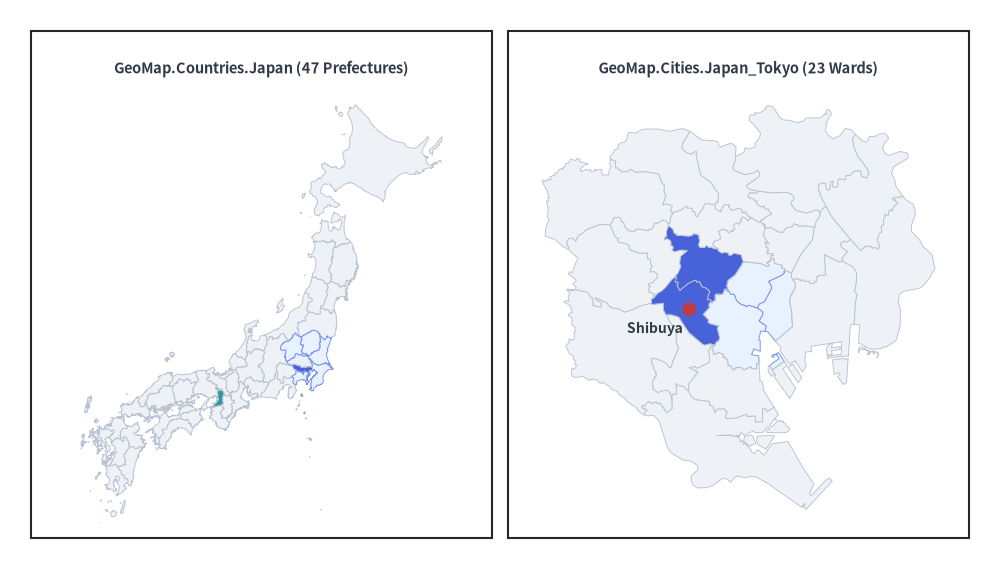
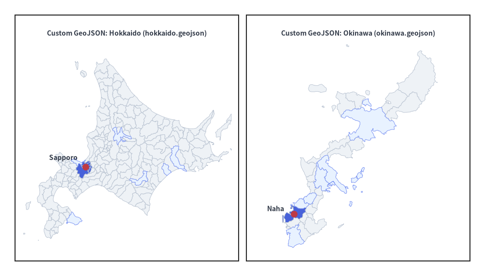

# GeoMap（地理マップ）

`GeoMap` コンポーネントは、外部の重厚な GIS ライブラリに依存することなく、ベクター形式の地理マップ（`GeoMap.World.*`、`GeoMap.Countries.*`、`GeoMap.Cities.*`、またはカスタム GeoJSON ファイル）を Drawlib キャンバス上に直接描画します。

`GeoMap` を `get_area_xy()` や `lonlat_to_xy()` と組み合わせることで、マップ上に標準の Drawlib 図形・アイコン・テキストラベル・曲線矢印を重ねて配置し、マルチリージョンのクラウド構成図・地域展開マップ・拠点ハイライト図を構築できます。


<figure class="drawlib-image" style="text-align: center;">
  
  <figcaption class="drawlib-caption">世界地図を用いたグローバル・マルチリージョン構成図</figcaption>
</figure>

<details class="drawlib-code-details">
<summary>Source Code</summary>

```python
from drawlib.canvas import setup
from drawlib.lines import line_curved
from drawlib.shapes import circle
from drawlib.smartarts import GeoMap
from drawlib.styles import Styles
from drawlib.text import text

setup(width=130, height=70)

world = GeoMap(GeoMap.World.All, area_style=Styles.Neutral)
# Use world.get_areas() to inspect all available country/area names
world.set_area_styles(["United States", "Germany", "Singapore", "Australia"], Styles.PrimaryNeutral)
world.set_area_styles(["Japan"], Styles.PrimaryFlat)
world.draw(xy=(4, 4), width=122, height=62)

jp_xy = world.get_area_xy("Japan")
us_xy = world.get_area_xy("United States")
de_xy = world.get_area_xy("Germany")
sg_xy = world.get_area_xy("Singapore")

line_curved(us_xy, de_xy, bend=-0.22, arrow_head="<->", style=Styles.PrimaryBold)
line_curved(de_xy, jp_xy, bend=-0.22, arrow_head="<->", style=Styles.PrimaryBold)
line_curved(jp_xy, sg_xy, bend=-0.20, arrow_head="<->", style=Styles.SecondaryBold)

for label, pt, dy in [
    ("Tokyo (Primary)", jp_xy, 3.5),
    ("US-East", us_xy, -3.5),
    ("EU-Central", de_xy, -3.5),
    ("AP-South", sg_xy, -3.5),
]:
    circle(pt, radius=1.0, style=Styles.DangerFlat)
    text((pt[0], pt[1] + dy), label, style=Styles.DarkBold.patch(text_size=10.5))
```

</details>


---

## 1. 基本概念と基本的な使い方

`GeoMap` は、世界・大陸・国・都市のベクタープリセット（`GeoMap.World.*`、`GeoMap.Countries.*`、`GeoMap.Cities.*`）またはカスタム GeoJSON ファイルをキャンバス上に直接描画します。デフォルトでは指定ボックスの**左下 `(x, y)`** をアンカーとし、`align="center"` を指定すると中央基準で配置します。`set_area_styles()` による特定地域のハイライトや抽出、`lon_range` と `lat_range` によるビューポートの切り抜きに加え、`.draw()` の実行後に `get_area_xy()` や `lonlat_to_xy()` を使って投影後のキャンバス座標を取得できます。


<figure class="drawlib-image" style="text-align: center;">
  
  <figcaption class="drawlib-caption">基本的な使い方とパラメータツアー: マッププリセット・エリアスタイル・ビューポート切り抜き・座標ピン（APNG アニメーション）</figcaption>
</figure>


<div class="drawlib-source-link">
  <a href="https://github.com/yuichi110/drawlib/blob/main/docs/docs_src/ja/04_smartarts/geomap.md" target="_blank" rel="noopener noreferrer">GitHub でアニメーションのソースコードを見る &rarr;</a>
</div>

- **プリセットとアンカー（`xy`, `align`）**: `GeoMap.World.*`、`GeoMap.Countries.*`、`GeoMap.Cities.*`、または `.geojson` パスを渡し、デフォルトの**左下 `xy`** アンカー（または `align="center"` による中央基準）で `width × height` の領域内に描画します。
- **エリア別スタイルと自動フィット（`set_area_styles`, `Styles.Transparent`）**: 英語名・ISO コード・日本語エイリアスで特定の地域をハイライトできます。`area_style=Styles.Transparent` を渡すと、`.draw()` が未指定エリアを非表示にし、表示対象エリアの境界に合わせて自動フィットします。
- **ビューポートの切り抜き（`lon_range`, `lat_range`）**: `(min_lon, max_lon)` と `(min_lat, max_lat)` を渡すことで、余弦補正された地理的アスペクト比を維持したまま任意の部分領域を切り抜いてズームできます。
- **描画後の座標取得（`get_area_xy`, `lonlat_to_xy`）**: `.draw()` の呼び出し*後*に `get_area_xy(area)` や `lonlat_to_xy(lon, lat)` を呼び出すことで、投影された正確なキャンバス座標に曲線コネクタ・ピン・アイコン・ラベルを配置できます。

---

## 2. グローバル・マルチリージョン構成図（`GeoMap.World.All`）

冒頭のグローバルトポロジマップのように、`GeoMap` に `GeoMap.World.All` を渡すと世界地図全体を描画できます。`get_areas()` で利用可能な全エリア名を確認し、`set_area_styles()` で特定のエリアをハイライト（英語名、`"JP"` / `"USA"` などの ISO コード、または `"日本"` などの日本語名に対応）したうえで、`get_area_xy()` を使ってコネクタやラベルを配置できます。

```python
world = GeoMap(GeoMap.World.All, area_style=Styles.Neutral)
world.set_area_styles(["United States", "Germany", "Singapore", "Australia"], Styles.PrimaryNeutral)
world.set_area_styles(["Japan"], Styles.PrimaryFlat)
world.draw(xy=(4, 4), width=122, height=62)

jp_xy = world.get_area_xy("Japan")
```

---

## 3. 世界地域別プリセットと切り抜き（`GeoMap.World.Asia`, `EastAsia`, `Europe`）

`GeoMap.World` には 11 種類の地域・大陸プリセット（`All`, `Asia`, `Europe`, `NorthAmerica`, `SouthAmerica`, `Africa`, `Oceania`, `EastAsia`, `SoutheastAsia`, `APAC`, `MiddleEast`）が用意されています。

また、`area_style=Styles.Transparent` を指定してマップを初期化することで未指定エリアを非表示にし、`set_area_styles()` で対象国のみにスタイルを適用したうえで、`lon_range` と `lat_range` でビューポートを絞り込むことも可能です。


```python
from drawlib.canvas import setup
from drawlib.shapes import circle
from drawlib.smartarts import GeoMap
from drawlib.styles import Styles
from drawlib.text import text

setup(width=125, height=90)

# Hide all unstyled areas with Styles.Transparent
asia = GeoMap(GeoMap.World.Asia, area_style=Styles.Transparent)

# Style only the areas to display (inspect available names with asia.get_areas())
asia.set_area_styles(["China", "North Korea", "Vietnam"], Styles.Neutral)
asia.set_area_styles(["South Korea", "Taiwan", "Philippines"], Styles.PrimaryNeutral)
asia.set_area_styles(["Japan", "Hong Kong"], Styles.PrimaryFlat)

# Crop to East Asia (from Hong Kong to Japan)
asia.draw(
    xy=(5, 4),
    width=115,
    height=82,
    lon_range=(106, 146),
    lat_range=(18, 46),
)

# Place city pins using exact (longitude, latitude) coordinates
for label, lon, lat, dx, dy in [
    ("Tokyo", 139.69, 35.69, 5.0, -1.0),
    ("Seoul", 126.98, 37.57, -5.0, 2.0),
    ("Taipei", 121.56, 25.03, 5.0, -0.5),
    ("Hong Kong", 114.17, 22.32, 7.0, -1.5),
]:
    px, py = asia.lonlat_to_xy(lon, lat)
    circle((px, py), radius=0.9, style=Styles.DangerFlat)
    text((px + dx, py + dy), label, style=Styles.DarkBold.patch(text_size=10.5))
```

<figure class="drawlib-image" style="text-align: center;">
  
  <figcaption class="drawlib-caption">東アジア地域マップ（GeoMap.World.Asia ＋ 選択的表示）</figcaption>
</figure>


---

## 4. 国別・都市別プリセット（`GeoMap.Countries.*` と `GeoMap.Cities.*`）

215 の国・地域の第一級行政区画（都道府県・州・省など）マップには `GeoMap.Countries.<Country>`（`GeoMap.Countries.Japan`、`GeoMap.Countries.UnitedStates`、`GeoMap.Countries.Germany` など）を使用し、主要都市の区・行政区マップには `GeoMap.Cities.<Country>_<City>`（`GeoMap.Cities.Japan_Tokyo`、`GeoMap.Cities.UnitedStates_NewYork` など）を使用します。

`area_style=Styles.Transparent` を指定し、`set_area_styles()` で一部のエリアのみにスタイルを設定した場合（例：多摩地域や島嶼部を除いた東京 23 区のみなど）、`lon_range` や `lat_range` を指定しなくても `GeoMap.draw()` が表示対象エリアに合わせてビューポートを自動的にズーム・フィットさせます。


```python
from drawlib.canvas import setup
from drawlib.shapes import circle, rectangle
from drawlib.smartarts import GeoMap
from drawlib.styles import Styles
from drawlib.text import text

setup(width=130, height=74)

# Left Panel: Japan (highlight Kanto prefectures, Tokyo, and Osaka)
rectangle((34, 37), width=60, height=66, style=Styles.White)
text((34, 65), "GeoMap.Countries.Japan (47 Prefectures)", style=Styles.DarkBold.patch(text_size=10.5))

jp = GeoMap(GeoMap.Countries.Japan, area_style=Styles.Neutral)
# jp.get_areas() -> ['Hokkaido', 'Aomori', ..., 'Tokyo', ..., 'Okinawa']
jp.set_area_styles(
    ["Ibaraki", "Tochigi", "Gunma", "Saitama", "Chiba", "Kanagawa"],
    Styles.PrimaryNeutral,
)
jp.set_area_styles(["Tokyo"], Styles.PrimaryFlat)
jp.set_area_styles(["Osaka"], Styles.SecondaryFlat)
jp.draw(xy=(6, 6), width=56, height=56, lon_range=(129, 146), lat_range=(30, 46))

# Right Panel: Tokyo 23 Wards (hide Tama & islands via Styles.Transparent)
rectangle((96, 37), width=60, height=66, style=Styles.White)
text((96, 65), "GeoMap.Cities.Japan_Tokyo (23 Wards)", style=Styles.DarkBold.patch(text_size=10.5))

tokyo = GeoMap(GeoMap.Cities.Japan_Tokyo, area_style=Styles.Transparent)
# tokyo.get_areas() -> ['Chiyoda', 'Chuo', 'Minato', ..., 'Hachioji', ...]
wards_23 = [
    "Chiyoda", "Chuo", "Minato", "Shinjuku", "Bunkyo", "Taito",
    "Sumida", "Koto", "Shinagawa", "Meguro", "Ota", "Setagaya",
    "Shibuya", "Nakano", "Suginami", "Toshima", "Kita", "Arakawa",
    "Itabashi", "Nerima", "Adachi", "Katsushika", "Edogawa",
]
tokyo.set_area_styles(wards_23, Styles.Neutral)
tokyo.set_area_styles(["Chiyoda", "Chuo", "Minato"], Styles.PrimaryNeutral)
tokyo.set_area_styles(["Shinjuku", "Shibuya"], Styles.PrimaryFlat)
tokyo.draw(xy=(68, 6), width=56, height=56)

shibuya_xy = tokyo.get_area_xy("Shibuya")
circle(shibuya_xy, radius=0.9, style=Styles.DangerFlat)
text((shibuya_xy[0] - 4.5, shibuya_xy[1] - 2.5), "Shibuya", style=Styles.DarkBold.patch(text_size=10.0))
```

<figure class="drawlib-image" style="text-align: center;">
  
  <figcaption class="drawlib-caption">日本全国（47 都道府県）マップと東京 23 区マップ</figcaption>
</figure>


---

## 5. カスタム GeoJSON ファイル（`_assets/geodata/*.geojson`）

組み込みプリセットに加え、任意の `.geojson` ファイルパス（またはパース済みの GeoJSON 辞書）を `GeoMap` に渡すことができます。以下の例では、`_assets/geodata/hokkaido.geojson` および `_assets/geodata/okinawa.geojson` から市区町村別のカスタム GeoJSON ファイルを読み込んで描画しています。


```python
from drawlib.canvas import setup
from drawlib.shapes import circle, rectangle
from drawlib.smartarts import GeoMap
from drawlib.styles import Styles
from drawlib.text import text

setup(width=130, height=74)

# Left Panel: Hokkaido Municipalities (_assets/geodata/hokkaido.geojson)
rectangle((34, 37), width=60, height=66, style=Styles.White)
text((34, 65), "Custom GeoJSON: Hokkaido (hokkaido.geojson)", style=Styles.DarkBold.patch(text_size=10.0))

hokkaido = GeoMap("_assets/geodata/hokkaido.geojson", area_style=Styles.Neutral)
sapporo_wards = [a for a in hokkaido.get_areas() if a in {
    "Chuo", "Kita", "Higashi", "Shiroishi", "Toyohira",
    "Minami", "Nishi", "Atsubetsu", "Teine", "Kiyota",
}]
hokkaido.set_area_styles(["Asahikawa", "Hakodate", "Obihiro", "Kushiro", "Otaru"], Styles.PrimaryNeutral)
hokkaido.set_area_styles(sapporo_wards, Styles.PrimaryFlat)
hokkaido.draw(xy=(6, 6), width=56, height=56, lon_range=(139.3, 145.9), lat_range=(41.3, 45.6))

sp_xy = hokkaido.get_area_xy("Chuo")
circle(sp_xy, radius=0.9, style=Styles.DangerFlat)
text((sp_xy[0] - 6.0, sp_xy[1] + 2.5), "Sapporo", style=Styles.DarkBold.patch(text_size=10.0))

# Right Panel: Okinawa Main Island (_assets/geodata/okinawa.geojson)
rectangle((96, 37), width=60, height=66, style=Styles.White)
text((96, 65), "Custom GeoJSON: Okinawa (okinawa.geojson)", style=Styles.DarkBold.patch(text_size=10.0))

okinawa = GeoMap("_assets/geodata/okinawa.geojson", area_style=Styles.Neutral)
okinawa.set_area_styles(["Nago", "Uruma", "Okinawa", "Urasoe", "Ginowan", "Itoman"], Styles.PrimaryNeutral)
okinawa.set_area_styles(["Naha"], Styles.PrimaryFlat)
okinawa.draw(xy=(68, 6), width=56, height=56, lon_range=(127.6, 128.35), lat_range=(26.05, 26.9))

naha_xy = okinawa.get_area_xy("Naha")
circle(naha_xy, radius=0.9, style=Styles.DangerFlat)
text((naha_xy[0] - 5.0, naha_xy[1] + 1.5), "Naha", style=Styles.DarkBold.patch(text_size=10.0))
```

<figure class="drawlib-image" style="text-align: center;">
  
  <figcaption class="drawlib-caption">カスタム GeoJSON ファイルの読み込み（北海道・沖縄の市区町村マップ）</figcaption>
</figure>


---

## 6. プリセット対象とエリア名の確認

### 組み込みプリセット
```python
from drawlib.smartarts import GeoMap
```

| カテゴリ | プリセット対象 | 説明 |
| :--- | :--- | :--- |
| **`GeoMap.World`** | `All`, `Asia`, `Europe`, `NorthAmerica`, `SouthAmerica`, `Africa`, `Oceania`, `EastAsia`, `SoutheastAsia`, `APAC`, `MiddleEast` | 世界全体および地域別の国境マップ |
| **`GeoMap.Countries`** | 全 215 の国と地域（`Japan`, `UnitedStates`, `UnitedKingdom`, `Germany`, `France`, `China`, `India`, `Australia`, `Brazil`, `Canada`, ...） | 第一級行政区画（都道府県・州・省など）マップ |
| **`GeoMap.Cities`** | `Australia_Sydney`, `China_HongKong`, `China_Shanghai`, `France_Paris`, `Germany_Berlin`, `Italy_Rome`, `Japan_Kyoto`, `Japan_Osaka`, `Japan_Tokyo`, `Singapore_Singapore`, `SouthKorea_Seoul`, `Taiwan_Taipei`, `UnitedKingdom_London`, `UnitedStates_LosAngeles`, `UnitedStates_NewYork`, `UnitedStates_SanFrancisco` | 主要 16 都市の区・行政区マップ |
| **カスタム GeoJSON** | `"_assets/geodata/okinawa.geojson"`（パスまたは `dict`） | 標準的な任意の GeoJSON `FeatureCollection` |

### 利用可能なエリア名の確認（`get_areas()`）
任意のマップに含まれる正規エリア名の一覧は、プログラムから確認できます。
```python
m = GeoMap(GeoMap.Countries.Japan)
print(m.get_areas())  # ['Hokkaido', 'Aomori', ..., 'Tokyo', ..., 'Okinawa']
```
> **エイリアス解決**: エリア名を受け取るメソッド（`set_area_styles()`、`get_area_xy()`）は大文字・小文字を区別せず、ISO コード（`"JP"`、`"JPN"`、`"US"`）や日本語名（`"日本"`、`"東京都"`、`"東京"`、`"渋谷区"`、`"渋谷"`）もそのまま指定できます。

---

## 7. API リファレンス

### コンストラクタ
```python
GeoMap(
    target: World | type[World] | Countries | Cities | str | Path | dict[str, Any],
    *,
    area_style: Style | None = None,
    background_style: Style | None = None,
    id_key: str | None = None,
    name_key: str | None = None,
)
```
- **`target`**: プリセット（`GeoMap.World.All`、`GeoMap.World.Asia`、`GeoMap.Countries.Japan`、`GeoMap.Cities.Japan_Tokyo`）、`.geojson` ファイルパス、またはパース済み GeoJSON の `dict`。
- **`area_style`**: すべてのエリアに適用されるデフォルトの `Style`（デフォルトは `Styles.Neutral`）。スタイル未指定のエリアを非表示にするには `Styles.Transparent` を渡します。
- **`background_style`**: マップ境界ボックスの背景に適用する任意の `Style`（デフォルトは透明背景の `None`）。
- **`id_key`**: カスタム GeoJSON ファイルや辞書を読み込む際、正規エリア識別子として使用する GeoJSON `properties` キー（任意）。
- **`name_key`**: カスタム GeoJSON ファイルや辞書を読み込む際、エリア表示名として使用する GeoJSON `properties` キー（任意）。

### メソッドとプロパティ
- **`geomap.data -> GeoData`**: パース済みのマップ要素（`elements`）、データセット名（`name`）、デフォルトのビューポート範囲（`default_lon_range`, `default_lat_range`）を保持する正規化済み `GeoData` モデルを返します。
- **`get_areas() -> list[str]`**: このマップに含まれる正規エリア名の順序付きリストを返します。
- **`set_area_styles(areas: list[str], style: Style) -> Self`**: 指定したエリアのリストに `Style` を割り当てます（特定のエリアを非表示にするには `Styles.Transparent` を渡します）。
- **`draw(xy=(0.0, 0.0), width=None, height=None, *, lon_range=None, lat_range=None, scale=1.0) -> Self`**:
  - **左下アンカー `xy`**: キャンバス上のマップボックスの左下座標 `(x, y)`。
  - **アスペクト比を維持したサイズ指定（`width`, `height`）**: `width`、`height`、またはその両方を指定します。余弦緯度補正を伴う自然な地理的アスペクト比を維持し、`width` と `height` の両方を指定した場合はボックス中央に配置します。
  - **ビューポートの切り抜き（`lon_range`, `lat_range`）**: 特定の領域を切り抜いてズームする任意の `(min_lon, max_lon)` および `(min_lat, max_lat)` タプル。省略した場合、`draw()` は表示対象（非透明）のすべてのエリアが収まるようビューポートを自動調整します。
- **`get_area_xy(area: str) -> tuple[float, float]`**: 直近の `draw()` 呼び出しに基づき、指定エリアの最大ポリゴン内部中心のキャンバス座標 `(x, y)` を返します。
- **`lonlat_to_xy(lon: float, lat: float) -> tuple[float, float]`**: 直近の `draw()` 呼び出しに基づき、任意の `(経度, 緯度)` ペアをキャンバス座標 `(x, y)` に変換します。

