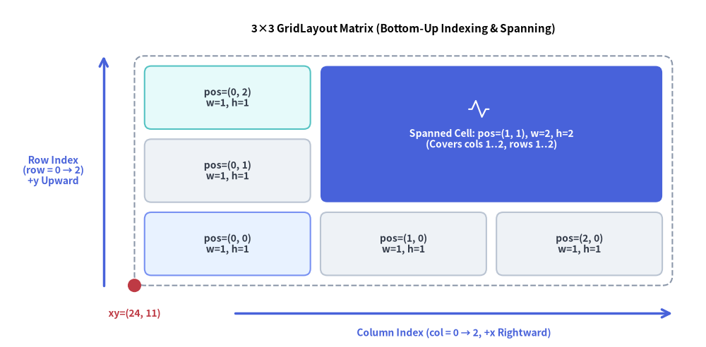
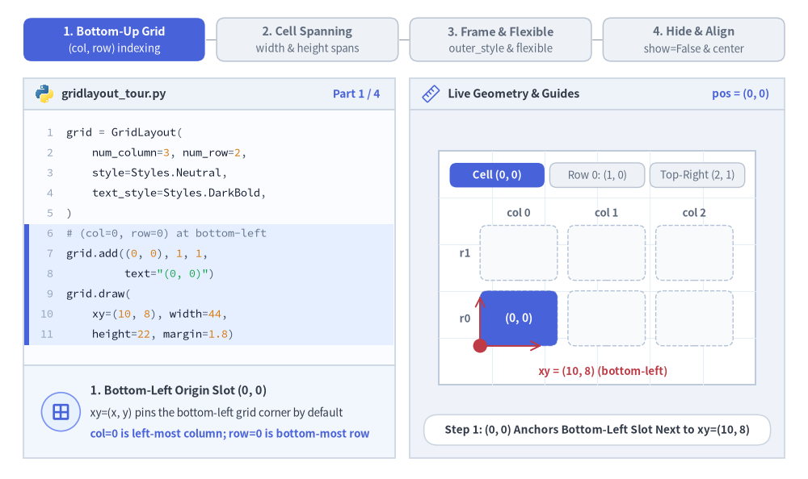
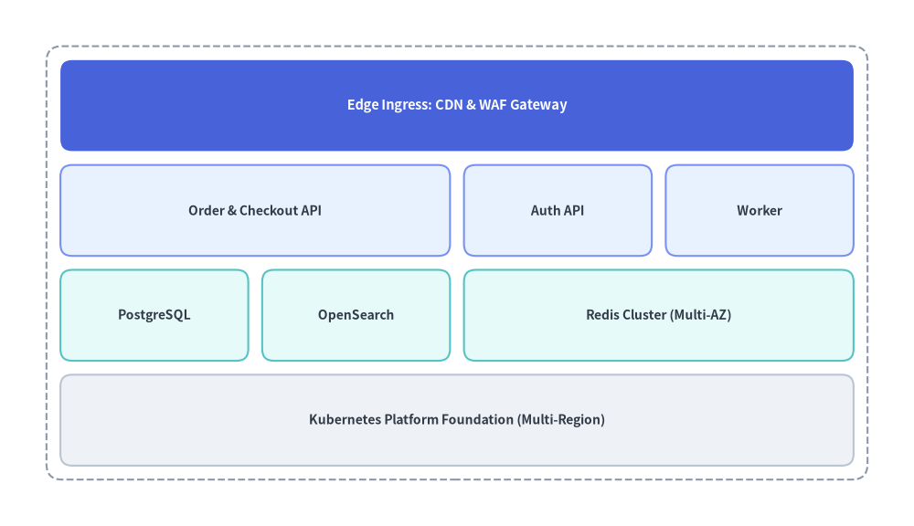
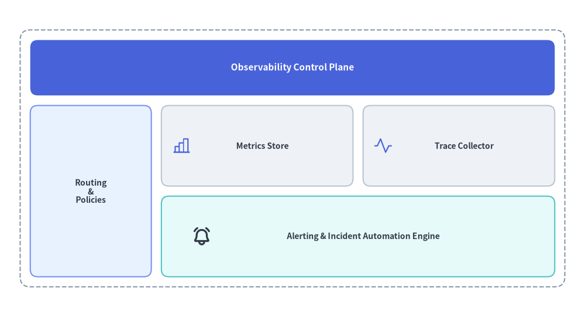

# GridLayout（グリッドレイアウト）

`GridLayout` コンポーネントは、均等または可変サイズの列・行マトリクス上にカードや矩形ブロックを配置します。
複数列・複数行にまたがるセル結合スパン、外枠コンテナ境界線、比例スケーリングを備えており、多層システムアーキテクチャ、サービスマトリクス、エグゼクティブダッシュボードのレイアウトに最適です。


<figure class="drawlib-image" style="text-align: center;">
  
  <figcaption class="drawlib-caption">GridLayout のボトムアップ (col, row) マトリクスインデックスと複数セル結合</figcaption>
</figure>

<details class="drawlib-code-details">
<summary>Source Code</summary>

```python
from drawlib.canvas import save, setup
from drawlib.icons import phosphor
from drawlib.lines import line
from drawlib.shapes import circle
from drawlib.smartarts import GridLayout
from drawlib.styles import Styles
from drawlib.text import text

setup(width=126, height=62)

grid = GridLayout(
    num_column=3,
    num_row=3,
    style=Styles.Neutral.patch(shape_r=1.2),
    text_style=Styles.DarkBold.patch(text_size=10.0),
)

# Row 0 (Bottom Row)
grid.add(position=(0, 0), width=1, height=1, text="pos=(0, 0)\nw=1, h=1", style=Styles.PrimaryNeutral.patch(shape_r=1.2))
grid.add(position=(1, 0), width=1, height=1, text="pos=(1, 0)\nw=1, h=1")
grid.add(position=(2, 0), width=1, height=1, text="pos=(2, 0)\nw=1, h=1")

# Row 1 (Middle Row) & Spanned Cell across Columns 1..2, Rows 1..2
grid.add(position=(0, 1), width=1, height=1, text="pos=(0, 1)\nw=1, h=1")
grid.add(
    position=(1, 1),
    width=2,
    height=2,
    text="\nSpanned Cell: pos=(1, 1), w=2, h=2\n(Covers cols 1..2, rows 1..2)",
    style=Styles.PrimaryFlat.patch(shape_r=1.2),
    text_style=Styles.WhiteBold.patch(text_size=10.0),
)

# Row 2 (Top Row, Column 0)
grid.add(position=(0, 2), width=1, height=1, text="pos=(0, 2)\nw=1, h=1", style=Styles.SecondaryNeutral.patch(shape_r=1.2))

grid.draw(
    xy=(24.0, 11.0),
    width=96.0,
    height=41.0,
    margin=1.8,
    outer_style=Styles.MutedDashed.patch(shape_r=1.8),
)

# Icon inside the spanned hero cell
phosphor.activity(xy=(85.5, 42.5), width=4.2, style=Styles.White)

# Axis arrows and anchor dot at bottom-left xy=(24, 11)
line((42.0, 6.0), (120.0, 6.0), arrow_head="->", style=Styles.PrimaryBold)
text((81.0, 2.5), "Column Index (col = 0 → 2, +x Rightward)", style=Styles.PrimaryBold.patch(text_size=10.0))

line((18.5, 11.0), (18.5, 52.0), arrow_head="->", style=Styles.PrimaryBold)
text((9.5, 31.5), "Row Index\n(row = 0 → 2)\n+y Upward", style=Styles.PrimaryBold.patch(text_size=10.0))

circle((24.0, 11.0), radius=1.2, style=Styles.DangerFlat)
text((24.0, 6.0), "xy=(24, 11)", style=Styles.DangerBold.patch(text_size=10.0))
text((72.0, 56.8), "3×3 GridLayout Matrix (Bottom-Up Indexing & Spanning)", style=Styles.BlackBold.patch(text_size=11.0))

save()
```

</details>


---

## 1. 基本概念と基本的な使い方

`GridLayout` は、デフォルトで**左下角 `(x, y)`**（`align="bottom_left"`）または中央（`align="center"`）を基準とする、0 始まりの**ボトムアップ `(col, row)`** マトリクス上にカードを配置します。`.add((col, row), width, height, ...)` で追加したセルは複数列・複数行への結合スパンが可能で、`outer_style` コンテナ内での均等配置や `draw_flexible(...)` による任意比率配置、さらに他のセルの座標をずらさない `.items[i].show = False` の切り替えに対応しています。


<figure class="drawlib-image" style="text-align: center;">
  
  <figcaption class="drawlib-caption">基本的な使い方とパラメータツアー: ボトムアップのマトリクスインデックス、複数セル結合、可変比率、表示切り替え（APNG アニメーション）</figcaption>
</figure>


<div class="drawlib-source-link">
  <a href="https://github.com/yuichi110/drawlib/blob/main/docs/docs_src/ja/04_smartarts/grid_layout.md" target="_blank" rel="noopener noreferrer">GitHub でアニメーションのソースコードを見る &rarr;</a>
</div>

- **ボトムアップの `(col, row)` マトリクス（`xy`, `num_column`, `num_row`）**: デフォルトで**左下 `xy`** を基準に配置され（`align="bottom_left"`）、`col = 0` が左端から右方向（`+X`）、`row = 0` が下端から上方向（`+Y`）へ進みます。
- **複数セルの結合スパン（`.add((col, row), width, height)`）**: 右方向へ `width` 列、上方向へ `height` 行を内部の余白（ガター）ごとシームレスに結合し、バナーヘッダー、サイドバー、複数スロットにまたがるコア領域を構成できます。
- **外枠コンテナと可変トラック（`outer_style`, `draw_flexible`）**: `outer_style` を渡してマトリクス全体をパディング付きコンテナカードで囲むほか、明示的な `column_widths`・`column_margins`・`row_heights`・`row_margins` を指定した `draw_flexible(...)` による非対称レイアウトに対応します。
- **スロット位置を維持した非表示化と中央配置（`items[i].show`, `align="center"`）**: `grid.items[i].show = False` を設定するとマトリクス座標をずらさずに特定のセルを非表示にでき、`align="center"` を渡すとグリッド全体を `xy` の中央に配置できます。

---

## 2. 複数セル結合によるアーキテクチャ・ダッシュボードレイアウト（`draw`）

標準モード（`grid.draw(...)`）では、全体の `width` と `height` を均一な `margin`（ガター間隔）で `num_column` 列 × `num_row` 行へと均等分割します。`outer_style` を指定した場合は外周コンテナ枠が描画され、四辺の外周にも同じ内側マージンが確保されます。


```python
from drawlib.canvas import save, setup
from drawlib.smartarts import GridLayout
from drawlib.styles import Styles

setup(width=118, height=68)

grid = GridLayout(
    num_column=4,
    num_row=4,
    style=Styles.Neutral.patch(shape_r=1.5),
    text_style=Styles.DarkBold.patch(text_size=10.0),
)

# Row 3 (Top): Edge Ingress spanning all 4 columns (Hero focal layer)
grid.add(
    position=(0, 3),
    width=4,
    height=1,
    text="Edge Ingress: CDN & WAF Gateway",
    style=Styles.PrimaryFlat.patch(shape_r=1.5),
    text_style=Styles.WhiteBold.patch(text_size=10.5),
)

# Row 2: Application Services Layer
grid.add(position=(0, 2), width=2, height=1, text="Order & Checkout API", style=Styles.PrimaryNeutral.patch(shape_r=1.5))
grid.add(position=(2, 2), width=1, height=1, text="Auth API", style=Styles.PrimaryNeutral.patch(shape_r=1.5))
grid.add(position=(3, 2), width=1, height=1, text="Worker", style=Styles.PrimaryNeutral.patch(shape_r=1.5))

# Row 1: Persistence & Caching Tier
grid.add(position=(0, 1), width=1, height=1, text="PostgreSQL", style=Styles.SecondaryNeutral.patch(shape_r=1.5))
grid.add(position=(1, 1), width=1, height=1, text="OpenSearch", style=Styles.SecondaryNeutral.patch(shape_r=1.5))
grid.add(position=(2, 1), width=2, height=1, text="Redis Cluster (Multi-AZ)", style=Styles.SecondaryNeutral.patch(shape_r=1.5))

# Row 0 (Bottom): Shared Infrastructure Foundation
grid.add(
    position=(0, 0),
    width=4,
    height=1,
    text="Kubernetes Platform Foundation (Multi-Region)",
    style=Styles.Neutral.patch(shape_r=1.5),
)

grid.draw(
    xy=(6, 6),
    width=106,
    height=56,
    margin=1.8,
    outer_style=Styles.MutedDashed.patch(shape_r=2.0),
)
save()
```

<figure class="drawlib-image" style="text-align: center;">
  
  <figcaption class="drawlib-caption">GridLayout のセル結合を用いた多層クラウドアーキテクチャ</figcaption>
</figure>


---

## 3. 可変グリッドサイズとカスタム要素のオーバーレイ（`draw_flexible`）

狭いサイドバーと広いメインコンテンツ領域の組み合わせや、コンパクトなヘッダー行など、列や行に非対称な比率が必要な場合は、明示的な `column_widths`・`column_margins`・`row_heights`・`row_margins` を指定して `grid.draw_flexible(...)` を使用します。各セルの位置は `xy` から決定論的に算出できるため、任意のセル内に標準のアイコンや図形を正確に重ねて配置することも可能です。


```python
from drawlib.canvas import save, setup
from drawlib.icons import phosphor
from drawlib.smartarts import GridLayout
from drawlib.styles import Styles

setup(width=116, height=62)

grid = GridLayout(
    num_column=3,
    num_row=3,
    style=Styles.Neutral.patch(shape_r=1.5),
    text_style=Styles.DarkBold.patch(text_size=10.0),
)

# Top Header (Row 2, spanning 3 columns)
grid.add(
    position=(0, 2),
    width=3,
    height=1,
    text="Observability Control Plane",
    style=Styles.PrimaryFlat.patch(shape_r=1.5),
    text_style=Styles.WhiteBold.patch(text_size=11.0),
)

# Left Navigation Sidebar (Column 0, spanning Rows 0..1)
grid.add(
    position=(0, 0),
    width=1,
    height=2,
    text="Routing\n&\nPolicies",
    style=Styles.PrimaryNeutral.patch(shape_r=1.5),
)

# Main Content Cards (Columns 1..2, Rows 0..1)
grid.add(position=(1, 1), width=1, height=1, text="      Metrics Store", style=Styles.Neutral.patch(shape_r=1.5))
grid.add(position=(2, 1), width=1, height=1, text="      Trace Collector", style=Styles.Neutral.patch(shape_r=1.5))
grid.add(
    position=(1, 0),
    width=2,
    height=1,
    text="      Alerting & Incident Automation Engine",
    style=Styles.SecondaryNeutral.patch(shape_r=1.5),
)

# Render with custom column widths [24, 38, 38] and row heights [16, 16, 11]
grid.draw_flexible(
    xy=(4, 5),
    column_widths=[24.0, 38.0, 38.0],
    column_margins=[2.0, 2.0, 2.0, 2.0],
    row_heights=[16.0, 16.0, 11.0],
    row_margins=[2.0, 2.0, 2.0, 2.0],
    outer_style=Styles.MutedDashed.patch(shape_r=2.0),
)

# Overlay Phosphor icons inside the metric/trace/alert cells using deterministic coordinates
phosphor.chart_bar(xy=(36, 33), width=4.0, style=Styles.PrimaryFlat)
phosphor.activity(xy=(76, 33), width=4.0, style=Styles.PrimaryFlat)
phosphor.bell_ringing(xy=(40, 15), width=4.0, style=Styles.DarkBold)
save()
```

<figure class="drawlib-image" style="text-align: center;">
  
  <figcaption class="drawlib-caption">カスタム列・行比率とアイコンのオーバーレイを組み合わせた可変ダッシュボードグリッド</figcaption>
</figure>


---

## 4. 座標系とインデックスの規則

ページ冒頭の図解に示されているとおり、座標とインデックスは以下の規則に従います。

- **左下アンカー `(x, y)`**: `draw()` または `draw_flexible()` に渡す `xy` 座標は、グリッド全体の**左下角**を指定します（デフォルトの `align="bottom_left"` の場合）。
- **0 始まりのボトムアップ行インデックス**:
  - `column_start = 0` は**最左列**を表し、右方向へ増加します（`0` 〜 `num_column - 1`）。
  - `row_start = 0` は**最下行**を表し、上方向へ増加します（`0` 〜 `num_row - 1`）。
- **セルスパン（複数セル結合）**: `grid.add(position=(col, row), width=w, height=h)` は、右方向へ `w` 列（`col` 〜 `col + w - 1`）、上方向へ `h` 行（`row` 〜 `row + h - 1`）にまたがってセルを結合します。

---

## 5. API リファレンス

### コンストラクタ
```python
GridLayout(
    *,
    num_column: int,
    num_row: int,
    style: Style,
    text_style: Style,
)
```

### メソッドとプロパティ
- **`add(position: tuple[int, int], width: int, height: int, *, style: Style | None = None, text: str = "", text_style: Style | None = None, show: bool = True) -> GridItem`**:
  `position=(column_start, row_start)` を起点に `width` 列・`height` 行にまたがるグリッドカードを登録し、変更可能な `GridItem`（`position`, `width`, `height`, `style`, `text`, `text_style`, `show`）を返します。`show=False` を設定すると、マトリクス全体のレイアウトを維持したまま該当セルのみを非表示にします。
- **`grid.items -> list[GridItem]`**:
  登録済みのすべての `GridItem` インスタンスのリスト（`position: tuple[int, int]`, `width: int`, `height: int`, `style: Style`, `text: str`, `text_style: Style`, `show: bool`）を返します。`draw()` の呼び出し前や複数回の呼び出し間でプロパティを事後変更できます。
- **`draw(xy: tuple[float, float], width: float, height: float, margin: float, outer_style: Style | None = None, scale: float = 1.0) -> None`**:
  均等な列幅と行高さを `margin` の間隔で区切ってグリッドを描画します。`outer_style` を指定した場合、外側を囲むコンテナ矩形を描画し、外周にも `margin` 分の内側パディングを追加します。
- **`draw_flexible(xy: tuple[float, float], column_widths: list[float], column_margins: list[float], row_heights: list[float], row_margins: list[float], outer_style: Style | None = None, scale: float = 1.0) -> None`**:
  明示的な列幅（`len == num_column`）、列マージン（`len == num_column + 1`）、行高さ（`len == num_row`）、および行マージン（`len == num_row + 1`）を指定してグリッドを描画します。

