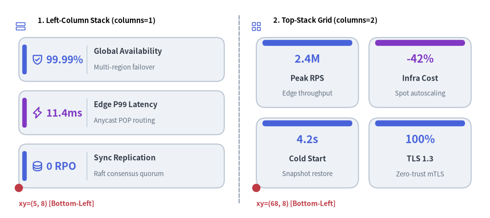
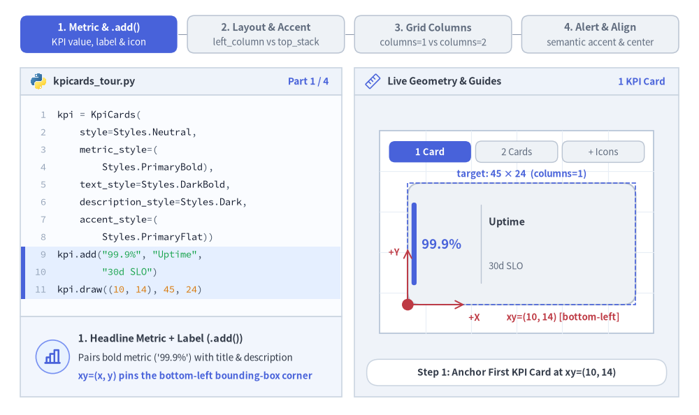
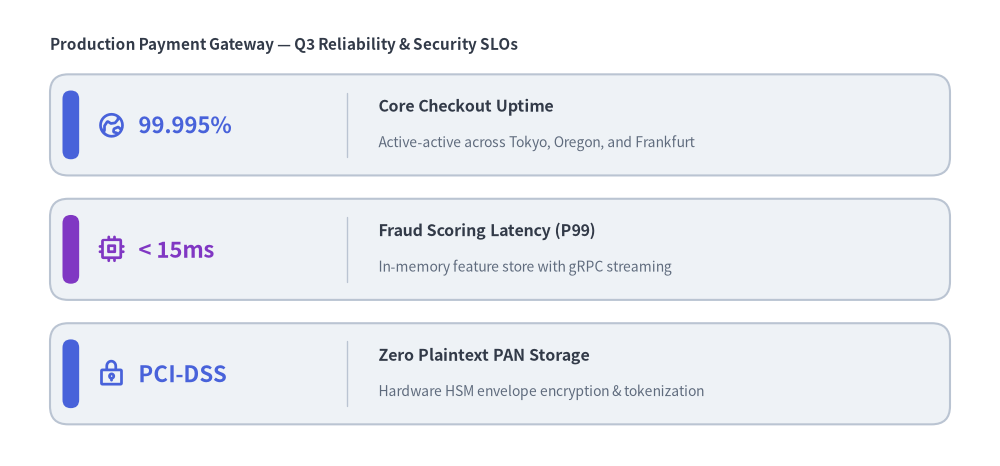
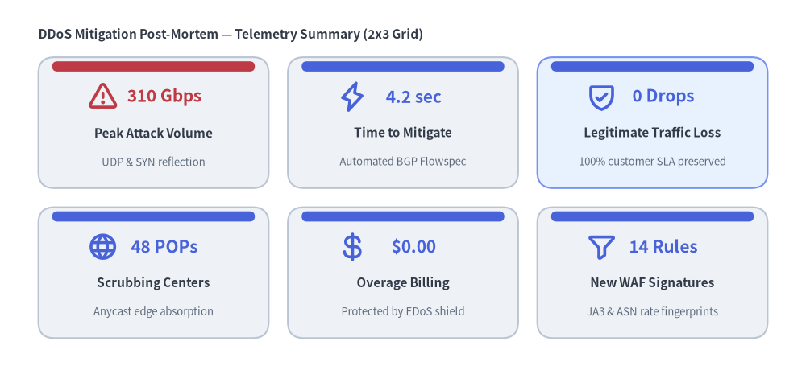

# KpiCards（KPI カード）

`KpiCards` コンポーネント（別名 `KpiCard`）は、視認性の高いヘッドライン数値やステータストークン（`metric`）と、構造化されたカードタイトル（`text`）・補足説明（`description`）・オプションのベクター `icon`・アクセント表示（`"left_pill"`、`"top_bar"`、`"none"`）を組み合わせた指標ハイライトカードを描画します。
垂直スタック（`columns=1`）と複数列ダッシュボードグリッド（`columns=2..N`）の両方に対応しており、SLA 目標、ベンチマーク結果の要約、エグゼクティブ向け KPI サマリーに最適です。


<figure class="drawlib-image" style="text-align: center;">
  
  <figcaption class="drawlib-caption">KpiCards のレイアウトモード: 左列スタック（columns=1）と上段積み 2×2 グリッド（columns=2）</figcaption>
</figure>

<details class="drawlib-code-details">
<summary>Source Code</summary>

```python
from drawlib.canvas import save, setup
from drawlib.icons import phosphor
from drawlib.lines import line
from drawlib.shapes import circle
from drawlib.smartarts import KpiCards
from drawlib.styles import Styles
from drawlib.text import text

setup(width=130, height=58)

# Subtle center divider
line((63.5, 4.0), (63.5, 54.0), style=Styles.MutedDashed)

# 1. Left Panel: Vertical Stack (metric_layout="left_column", accent_position="left_pill")
phosphor.rows(xy=(5.5, 51.0), width=3.4, style=Styles.PrimaryFlat)
text((10.0, 52.5), "1. Left-Column Stack (columns=1)", style=Styles.BlackBold.patch(text_size=10.5, halign="left"))

kpi_stack = KpiCards(
    style=Styles.Neutral,
    metric_style=Styles.PrimaryBold.patch(text_size=15.0),
    text_style=Styles.DarkBold.patch(text_size=11.0),
    description_style=Styles.Muted.patch(text_size=9.5),
    accent_style=Styles.PrimaryFlat,
    icon_style=Styles.PrimaryBold,
    accent_position="left_pill",
    metric_layout="left_column",
    metric_width_ratio=0.30,
    spacing=2.5,
)
kpi_stack.add("99.99%", "Global Availability", "Multi-region failover", icon=phosphor.shield_check)
kpi_stack.add(
    "11.4ms",
    "Edge P99 Latency",
    "Anycast POP routing",
    icon=phosphor.lightning,
    metric_style=Styles.AccentBold.patch(text_size=15.0),
    accent_style=Styles.AccentFlat,
    icon_style=Styles.AccentBold,
)
kpi_stack.add("0 RPO", "Sync Replication", "Raft consensus quorum", icon=phosphor.database)
kpi_stack.draw(xy=(5.0, 8.0), width=54.5, height=40.0, columns=1)

circle((5.0, 8.0), radius=1.1, style=Styles.DangerFlat)
text((5.0, 3.8), "xy=(5, 8) [Bottom-Left]", style=Styles.DangerBold.patch(text_size=10.0, halign="left"))

# 2. Right Panel: 2x2 Dashboard Grid (metric_layout="top_stack", accent_position="top_bar")
phosphor.squares_four(xy=(68.0, 51.0), width=3.4, style=Styles.PrimaryFlat)
text((72.5, 52.5), "2. Top-Stack Grid (columns=2)", style=Styles.BlackBold.patch(text_size=10.5, halign="left"))

kpi_grid = KpiCards(
    style=Styles.Neutral,
    metric_style=Styles.PrimaryBold.patch(text_size=16.0),
    text_style=Styles.DarkBold.patch(text_size=11.0),
    description_style=Styles.Muted.patch(text_size=9.5),
    accent_style=Styles.PrimaryFlat,
    accent_position="top_bar",
    metric_layout="top_stack",
    spacing=2.8,
)
kpi_grid.add("2.4M", "Peak RPS", "Edge throughput")
kpi_grid.add(
    "-42%",
    "Infra Cost",
    "Spot autoscaling",
    metric_style=Styles.AccentBold.patch(text_size=16.0),
    accent_style=Styles.AccentFlat,
)
kpi_grid.add("4.2s", "Cold Start", "Snapshot restore")
kpi_grid.add("100%", "TLS 1.3", "Zero-trust mTLS")
kpi_grid.draw(xy=(68.0, 8.0), width=57.0, height=40.0, columns=2)

circle((68.0, 8.0), radius=1.1, style=Styles.DangerFlat)
text((68.0, 3.8), "xy=(68, 8) [Bottom-Left]", style=Styles.DangerBold.patch(text_size=10.0, halign="left"))

save()
```

</details>


---

## 1. 基本概念と基本的な使い方

`KpiCards`（別名 `KpiCard`）は `.add(...)` を通じて視認性の高いヘッドライン数値（`metric`）とタイトル・説明文・アイコンを組み合わせ、デフォルトで**左下角 `(x, y)`**（`align="center"` の場合は中央）を基準に配置します。`"left_pill"`・`"top_bar"`・`"none"` のアクセント表示とともに、左右分割型の `left_column` と中央積み上げ型の `top_stack` を切り替えられるほか、`columns=1` の縦スタックから複数列グリッドへの展開、個々の `.items[i]` セルのスタイル変更や非表示化に対応しています。


<figure class="drawlib-image" style="text-align: center;">
  
  <figcaption class="drawlib-caption">基本的な使い方とパラメータツアー: メトリクスレイアウト、アクセント表示、複数列グリッド、動的なアラート装飾（APNG アニメーション）</figcaption>
</figure>


<div class="drawlib-source-link">
  <a href="https://github.com/yuichi110/drawlib/blob/main/docs/docs_src/ja/04_smartarts/kpi_cards.md" target="_blank" rel="noopener noreferrer">GitHub でアニメーションのソースコードを見る &rarr;</a>
</div>

- **ヘッドライン指標とアンカー（`xy`, `align`）**: `.add(metric, text, description, icon=...)` で KPI カードを登録し、デフォルトの**左下** `xy`（`align="bottom_left"`）または中央（`align="center"`）を基準に `(width, height)` 領域内へ描画します。
- **内部レイアウトとアクセント（`metric_layout`, `accent_position`）**: 左右分割型の行カードには `metric_layout="left_column"` と `accent_position="left_pill"`、中央揃えのグリッドタイルには `"top_stack"` と `"top_bar"`、枠線のみのミニマルなカードには `"none"` を組み合わせます。
- **縦スタックから複数列グリッドまで（`columns`, `spacing`, `metric_width_ratio`）**: 縦積みの SLO スタックには `columns=1`、行優先のダッシュボードグリッドには `columns=2..N` を指定し、カード間隔 `spacing` や左列幅比率 `metric_width_ratio`（`0.1`〜`0.7`）を調整できます。
- **カード単位のセマンティックアラートとスロット維持（`.items[i]`, `.show`）**: しきい値超過のアラート強調には `kpi.items[i].accent_style` と `metric_style` を個別に上書きし、他のグリッドセルの位置を固定したままカードを非表示にするには `kpi.items[i].show = False` を設定します。

---

## 2. 左列レイアウトによる垂直メトリクススタック（`metric_layout="left_column"`）

`metric_layout="left_column"`（デフォルト）では、各カードの左列（`metric_width_ratio`）に大きなヘッドライン指標を配置し、右側にカードタイトル（`text`）と説明文（`description`）を配置します。オプションのベクター `icon` はメトリクス領域内に並べて描画されます。


```python
from drawlib.canvas import save, setup
from drawlib.icons import phosphor
from drawlib.smartarts import KpiCards
from drawlib.styles import Styles
from drawlib.text import text

setup(width=120, height=56)

text((6.0, 50.5), "Production Payment Gateway — Q3 Reliability & Security SLOs", style=Styles.DarkBold.patch(text_size=11.0, halign="left"))

slo_cards = KpiCards(
    style=Styles.Neutral,
    metric_style=Styles.PrimaryBold.patch(text_size=16.0),
    text_style=Styles.DarkBold.patch(text_size=11.5),
    description_style=Styles.Muted.patch(text_size=10.0),
    accent_style=Styles.PrimaryFlat,
    icon_style=Styles.PrimaryBold,
    accent_position="left_pill",
    metric_layout="left_column",
    metric_width_ratio=0.28,
    spacing=2.8,
)
slo_cards.add(
    "99.995%",
    "Core Checkout Uptime",
    "Active-active across Tokyo, Oregon, and Frankfurt",
    icon=phosphor.globe_hemisphere_east,
)
slo_cards.add(
    "< 15ms",
    "Fraud Scoring Latency (P99)",
    "In-memory feature store with gRPC streaming",
    icon=phosphor.cpu,
    metric_style=Styles.AccentBold.patch(text_size=16.0),
    accent_style=Styles.AccentFlat,
    icon_style=Styles.AccentBold,
)
slo_cards.add(
    "PCI-DSS",
    "Zero Plaintext PAN Storage",
    "Hardware HSM envelope encryption & tokenization",
    icon=phosphor.lock_key,
)
slo_cards.draw(xy=(6.0, 5.0), width=108.0, height=42.0, columns=1)

save()
```

<figure class="drawlib-image" style="text-align: center;">
  
  <figcaption class="drawlib-caption">KpiCards によるサービスレベル目標（SLO）サマリースタック</figcaption>
</figure>


---

## 3. 複数列ダッシュボードグリッドと個別ハイライト（`columns=2..N`）

`metric_layout="top_stack"` および `accent_position="top_bar"` と `columns >= 2` を組み合わせると、カードを行優先の複数列グリッドに整列できます。個々の要素で `style`・`metric_style`・`text_style`・`accent_style` を上書きする（または登録後に `kpi.items[i]` を変更する）ことで、注目すべき特定のメトリクスを強調表示できます。


```python
from drawlib.canvas import save, setup
from drawlib.icons import phosphor
from drawlib.smartarts import KpiCards
from drawlib.styles import Styles
from drawlib.text import text

setup(width=126, height=58)

text((6.0, 52.5), "DDoS Mitigation Post-Mortem — Telemetry Summary (2x3 Grid)", style=Styles.DarkBold.patch(text_size=11.0, halign="left"))

grid = KpiCards(
    style=Styles.Neutral,
    metric_style=Styles.PrimaryBold.patch(text_size=15.0),
    text_style=Styles.DarkBold.patch(text_size=11.0),
    description_style=Styles.Muted.patch(text_size=9.5),
    accent_style=Styles.PrimaryFlat,
    icon_style=Styles.PrimaryBold,
    accent_position="top_bar",
    metric_layout="top_stack",
    spacing=3.0,
)
grid.add(
    "310 Gbps",
    "Peak Attack Volume",
    "UDP & SYN reflection",
    icon=phosphor.warning,
    metric_style=Styles.DangerBold.patch(text_size=15.0),
    accent_style=Styles.DangerFlat,
    icon_style=Styles.DangerBold,
)
grid.add("4.2 sec", "Time to Mitigate", "Automated BGP Flowspec", icon=phosphor.lightning)
grid.add(
    "0 Drops",
    "Legitimate Traffic Loss",
    "100% customer SLA preserved",
    icon=phosphor.shield_check,
    style=Styles.PrimaryNeutral,
)
grid.add("48 POPs", "Scrubbing Centers", "Anycast edge absorption", icon=phosphor.globe)
grid.add("$0.00", "Overage Billing", "Protected by EDoS shield", icon=phosphor.currency_dollar)
grid.add("14 Rules", "New WAF Signatures", "JA3 & ASN rate fingerprints", icon=phosphor.funnel)

grid.draw(xy=(6.0, 5.0), width=114.0, height=44.0, columns=3)

save()
```

<figure class="drawlib-image" style="text-align: center;">
  
  <figcaption class="drawlib-caption">3 列構成のインシデントフォレンジック・緩和ダッシュボードグリッド</figcaption>
</figure>


---

## 4. レイアウトモードと座標ジオメトリ

- **左下アンカーまたは中央アンカー（`xy`, `align`）**: `KpiCards.draw(xy=(x, y), width=W, height=H, columns=C, align="bottom_left")` は、全体のバウンディングボックスの左下角を `(x, y)` に固定し、右方向（`+x`）に `W` 単位、上方向（`+y`）に `H` 単位の領域へ展開します。`align="center"` の場合はグリッド全体を `(x, y)` の中央に配置します。
- **行優先（Row-Major）のグリッド配置順**: `columns > 1` の場合、各要素は**上の行から下の行へ、左から右へ**順に配置されるため、`items[0]` はバウンディングボックスの左上に配置されます。
- **アクセント位置（`accent_position`）**:
  - `"left_pill"` *（デフォルト）*: 各カードの左端内側に縦方向の角丸アクセントバーを描画します（`accent_style` が必須）。
  - `"top_bar"`: 各カードの上端に沿って横方向のアクセントバーを描画します（`accent_style` が必須）。
  - `"none"`: アクセントバーを省略し、枠線のみのシンプルなカードを描画します。
- **メトリクスレイアウト（`metric_layout`）**:
  - `"left_column"` *（デフォルト）*: 各カードを左右に分割し、左側のメトリクス領域（`metric_width_ratio`、デフォルト `0.28`）と右側のタイトル・説明文領域に配置します。`columns=1` や横幅の広い `columns=2` レイアウトに最適です。
  - `"top_stack"`: カード上半分の中央に大きなメトリクスを配置し、その下の中央にタイトル（`text`）と説明文（`description`）を縦積みで配置します。コンパクトな複数列グリッド（`columns=2` または `3`）に最適です。

---

## 5. API リファレンス

### コンストラクタ
```python
KpiCards(
    *,
    style: Style,
    metric_style: Style,
    text_style: Style,
    description_style: Style | None = None,
    accent_style: Style | None = None,
    icon_style: Style | None = None,
    accent_position: Literal["left_pill", "top_bar", "none"] = "left_pill",
    metric_layout: Literal["left_column", "top_stack"] = "left_column",
    metric_width_ratio: float = 0.28,
    spacing: float = 3.0,
)
```
*（エイリアス: `drawlib.smartarts` からは `KpiCards` の別名として `KpiCard` もエクスポートされています。）*

### メソッドとプロパティ
- **`add(metric: str, text: str, description: str = "", *, style: Style | None = None, metric_style: Style | None = None, text_style: Style | None = None, description_style: Style | None = None, accent_style: Style | None = None, icon: Callable | None = None, icon_style: Style | None = None, show: bool = True) -> KpiCardItem`**:
  メトリクスカード項目（`text` がカードの主タイトル）を登録し、変更可能な `KpiCardItem` を返します。`item.show = False` を設定すると、他のすべてのカードのグリッド位置とサイズを固定したまま、そのカードの描画をスキップします。
- **`kpicards.items -> list[KpiCardItem]`**:
  スタイル・テキスト・表示状態を事後変更するための、登録済み `KpiCardItem` インスタンスのリストを返します。
- **`draw(xy: tuple[float, float], width: float = 90.0, height: float = 60.0, *, columns: int = 1, align: Literal["bottom_left", "center"] = "bottom_left", scale: float = 1.0) -> Self`**:
  左下角 `xy`（`align="center"` の場合は中央 `xy`）を基準とする `(width, height)` のバウンディングボックス内に、表示対象のすべてのカードを描画します。

