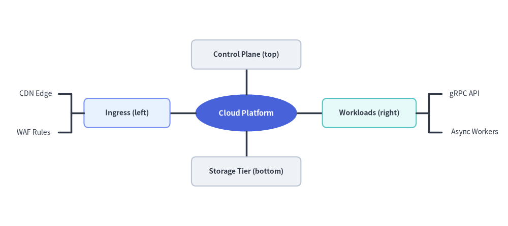
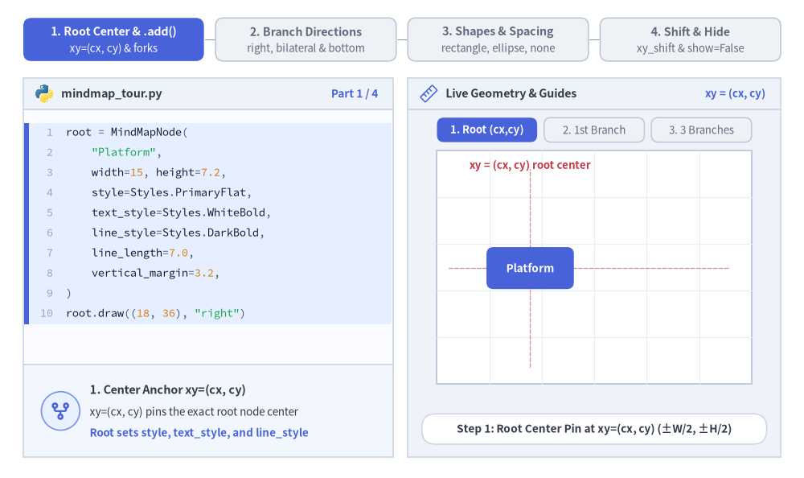
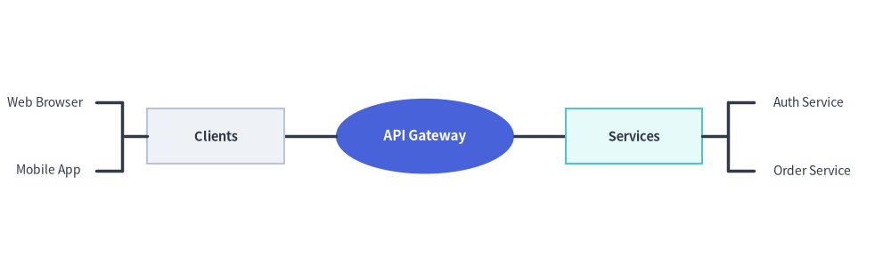
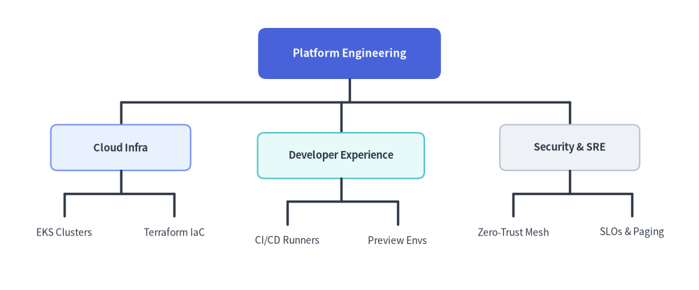

# MindMap（マインドマップ）

`MindMapNode` コンポーネントは、中心のルートトピックから放射状・多方向に広がるマインドマップや階層型機能マップを描画します。
ブランチは左・右・上・下の各方向へ展開でき、直角のエルボー接続線が自動的にルーティングされます。


<figure class="drawlib-image" style="text-align: center;">
  
  <figcaption class="drawlib-caption">MindMapNode の概要: 多方向の放射状ブランチ展開（left, right, top, bottom）</figcaption>
</figure>

<details class="drawlib-code-details">
<summary>Source Code</summary>

```python
from drawlib.canvas import save, setup
from drawlib.smartarts import MindMapNode
from drawlib.styles import Styles

setup(width=130, height=58)

root = MindMapNode(
    "Cloud Platform",
    shape="ellipse",
    width=26,
    height=9.5,
    style=Styles.PrimaryFlat,
    text_style=Styles.WhiteBold.patch(text_size=10.5),
    line_style=Styles.DarkBold,
    line_length=6.5,
    horizontal_margin=3.5,
    vertical_margin=3.8,
    children=[
        # Left Branch (shape="rectangle" + leaf shape="none")
        MindMapNode(
            "Ingress (left)",
            branch="left",
            shape="rectangle",
            width=22,
            height=7.5,
            style=Styles.PrimaryNeutral.patch(shape_r=1.2),
            text_style=Styles.DarkBold.patch(text_size=10.0),
            children=[
                MindMapNode("CDN Edge", shape="none", text_style=Styles.Dark.patch(text_size=10.0)),
                MindMapNode("WAF Rules", shape="none", text_style=Styles.Dark.patch(text_size=10.0)),
            ],
        ),
        # Right Branch (shape="rectangle" + leaf shape="none")
        MindMapNode(
            "Workloads (right)",
            branch="right",
            shape="rectangle",
            width=24,
            height=7.5,
            style=Styles.SecondaryNeutral.patch(shape_r=1.2),
            text_style=Styles.DarkBold.patch(text_size=10.0),
            children=[
                MindMapNode("gRPC API", shape="none", text_style=Styles.Dark.patch(text_size=10.0)),
                MindMapNode("Async Workers", shape="none", text_style=Styles.Dark.patch(text_size=10.0)),
            ],
        ),
        # Top Branch (branch="top")
        MindMapNode(
            "Control Plane (top)",
            branch="top",
            shape="rectangle",
            width=28,
            height=7.5,
            style=Styles.Neutral.patch(shape_r=1.2),
            text_style=Styles.DarkBold.patch(text_size=10.0),
        ),
        # Bottom Branch (branch="bottom")
        MindMapNode(
            "Storage Tier (bottom)",
            branch="bottom",
            shape="rectangle",
            width=28,
            height=7.5,
            style=Styles.Neutral.patch(shape_r=1.2),
            text_style=Styles.DarkBold.patch(text_size=10.0),
        ),
    ],
)

root.draw(xy=(63, 29))
save()
```

</details>


---

## 1. 基本概念と基本的な使い方

`MindMapNode` は**ルート中央 `xy=(cx, cy)`** をアンカーとして放射状マインドマップや多方向階層図を描画し、2 パスのレイアウト計算でサブツリーの外接サイズを自動計測したうえで、`line_length / 2` の位置で直交フォーク接続線をルーティングします。ブランチは `"right"`・`"left"`・`"bottom"`・`"top"` を自由に組み合わせて展開でき、`"rectangle"`・`"ellipse"`・枠線なし自動サイズ調整の `"none"` 形状の混在や、`xy_shift`・`show`・`scale` による位置微調整とアニメーション制御が可能です。


<figure class="drawlib-image" style="text-align: center;">
  
  <figcaption class="drawlib-caption">基本的な使い方とパラメータツアー: ルート中央アンカー、多方向ブランチ展開、ノード形状と余白、位置シフト・表示制御・スケーリング（APNG アニメーション）</figcaption>
</figure>


<div class="drawlib-source-link">
  <a href="https://github.com/yuichi110/drawlib/blob/main/docs/docs_src/ja/04_smartarts/mindmap.md" target="_blank" rel="noopener noreferrer">GitHub でアニメーションのソースコードを見る &rarr;</a>
</div>

- **ルート中央アンカーと `.add()` (`xy`, `add`)**: ルートノードの中心を `xy=(cx, cy)` に固定し、サブツリーの高さ・幅を自動計測して `line_length / 2` の位置で直交フォーク接続線をルーティングします。
- **多方向ブランチ展開 (`branch`)**: ツリー全体を右（`"right"`）・左（`"left"`）・下（`"bottom"`）・上（`"top"`）へ展開できるほか、同じルートの子ノードごとに方向を変えて左右対称のマインドマップも構築できます。
- **ノード形状と余白設定 (`shape`, `line_length`, `vertical_margin`)**: `"rectangle"`・`"ellipse"`・枠線なし自動サイズ計測の `"none"` テキストラベルを自在に組み合わせながら、接続線距離や兄弟ノード間の余白を制御できます。
- **レイアウト後の位置シフト・表示制御・スケーリング (`xy_shift`, `show`, `scale`)**: `xy_shift=(dx, dy)` で個別ブランチの位置を微調整し、`node.show = False` で兄弟ブランチをずらさずに非表示化し、`scale` で `xy` 基準の比例スケーリングを行えます。

---

## 2. クイックサンプル: アーキテクチャトポロジマップ


```python
from drawlib.canvas import setup
from drawlib.smartarts import MindMapNode
from drawlib.styles import Styles

setup(width=130, height=40)

root = MindMapNode(
    "API Gateway",
    shape="ellipse",
    width=26,
    height=11,
    style=Styles.PrimaryFlat,
    text_style=Styles.WhiteBold.patch(text_size=11.0),
    line_style=Styles.DarkBold,
    line_length=7.5,
    horizontal_margin=4.0,
    vertical_margin=4.0,
    children=[
        MindMapNode(
            "Clients", branch="left", shape="rectangle", width=20, height=8, style=Styles.Neutral,
            text_style=Styles.DarkBold.patch(text_size=10.5),
            children=[
                MindMapNode("Web Browser", shape="none", text_style=Styles.Dark.patch(text_size=10.0)),
                MindMapNode("Mobile App", shape="none", text_style=Styles.Dark.patch(text_size=10.0)),
            ],
        ),
        MindMapNode(
            "Services", branch="right", shape="rectangle", width=20, height=8, style=Styles.SecondaryNeutral,
            text_style=Styles.DarkBold.patch(text_size=10.5),
            children=[
                MindMapNode("Auth Service", shape="none", text_style=Styles.Dark.patch(text_size=10.0)),
                MindMapNode("Order Service", shape="none", text_style=Styles.Dark.patch(text_size=10.0)),
            ],
        ),
    ],
)

root.draw(xy=(62, 20))
```

<figure class="drawlib-image" style="text-align: center;">
  
  <figcaption class="drawlib-caption">MindMap によるシステムアーキテクチャ構成マップ</figcaption>
</figure>


---

## 3. 命令的な構築 (`.add()`) とトップダウン階層 (`branch="bottom"`, `xy_shift`)

コンストラクタにネストした `children=[...]` リストを渡す代わりに、`parent.add(text, ...) -> MindMapNode` を使ってマインドマップや組織ツリーを命令的に構築できます。`root.draw(xy, branch="bottom")` を呼び出すと、すべてのブランチはデフォルトで上から下（`-y` 方向）へと展開します。さらに `xy_shift=(dx, dy)` を使えば、自動計算された配置から任意のノードの位置を微調整できます。


```python
from drawlib.canvas import save, setup
from drawlib.smartarts import MindMapNode
from drawlib.styles import Styles

setup(width=130, height=54)

root = MindMapNode(
    "Platform Engineering",
    shape="rectangle",
    width=34,
    height=9.5,
    style=Styles.PrimaryFlat.patch(shape_r=1.5),
    text_style=Styles.WhiteBold.patch(text_size=11.0),
    line_style=Styles.DarkBold,
    line_length=8.5,
    horizontal_margin=4.0,
    vertical_margin=3.5,
)

# 1. Left Subtree: Cloud Infrastructure
infra = root.add(
    "Cloud Infra",
    width=26,
    height=8.5,
    style=Styles.PrimaryNeutral.patch(shape_r=1.2),
    text_style=Styles.DarkBold.patch(text_size=10.5),
)
infra.add("EKS Clusters", shape="none", text_style=Styles.Dark.patch(text_size=10.0))
infra.add("Terraform IaC", shape="none", text_style=Styles.Dark.patch(text_size=10.0))

# 2. Center Subtree: Developer Experience (nudged slightly downward with xy_shift)
devex = root.add(
    "Developer Experience",
    width=31,
    height=8.5,
    style=Styles.SecondaryNeutral.patch(shape_r=1.2),
    text_style=Styles.DarkBold.patch(text_size=10.5),
    xy_shift=(0.0, -1.5),
)
devex.add("CI/CD Runners", shape="none", text_style=Styles.Dark.patch(text_size=10.0))
devex.add("Preview Envs", shape="none", text_style=Styles.Dark.patch(text_size=10.0))

# 3. Right Subtree: Security & SRE
sec = root.add(
    "Security & SRE",
    width=26,
    height=8.5,
    style=Styles.Neutral.patch(shape_r=1.2),
    text_style=Styles.DarkBold.patch(text_size=10.5),
)
sec.add("Zero-Trust Mesh", shape="none", text_style=Styles.Dark.patch(text_size=10.0))
sec.add("SLOs & Paging", shape="none", text_style=Styles.Dark.patch(text_size=10.0))

# Default branch direction in draw() is "bottom" (top-down org chart layout)
root.draw(xy=(65, 44), branch="bottom")
save()
```

<figure class="drawlib-image" style="text-align: center;">
  
  <figcaption class="drawlib-caption">トップダウン展開（branch='bottom'）と xy_shift を用いた命令的な MindMapNode 構築</figcaption>
</figure>


---

## 4. 幾何構造・カスケード継承・レイアウトメカニクス

- **中央アンカー `(cx, cy)`**: `root.draw(xy=...)` に渡す座標は、ルートノードの**正確な中心**をアンカーとします。
- **ルートノードの必須パラメータ**: ルートの `MindMapNode` には **`style`、`text_style`、`line_style` の指定が必須**です（未指定のまま `root.draw()` を呼ぶと `ValueError` が送出されます）。ルートで省略した場合のデフォルト値は、`shape="rectangle"`、`width=20.0`、`height=8.0`、`horizontal_margin=4.0`、`vertical_margin=4.0`、`line_length=10.0` です。すべての子孫ノードは、未指定のスタイル・形状・幅／高さ・余白パラメータを親ノードから自動的に継承します。
- **方向別ブランチ展開 (`branch`)**:
  - `"bottom"` *（`root.draw()` のデフォルト）*: サブブランチが下方向（`-y`）へ伸びます。トップダウンの組織図や WBS ツリーに最適です。
  - `"top"`: サブブランチが上方向（`+y`）へ伸びます。
  - `"right"`: サブブランチが右方向（`+x`）へ伸びます。
  - `"left"`: サブブランチが左方向（`-x`）へ伸びます。
  - 個別の子ノードに `branch="left"`・`"right"`・`"top"`・`"bottom"` を指定することで、1 つのルート上に複数方向を混在させることもできます。
- **ノード形状とテキスト幅・高さの自動計測 (`shape`, `width`, `height`)**:
  - `"rectangle"`: 角丸指定（`style.shape_r`）にも対応した長方形ボックス。
  - `"ellipse"`: ピル型／楕円形コンテナ。
  - `"none"`: 枠線なしのすっきりしたテキストラベル。`shape="none"` かつ `width=None`／`height=None` の場合、`MindMapNode` は `text_style.text_size`（日本語などの CJK 全角文字幅補正を含む）から**テキストの幅と高さを自動計測**するため、兄弟ラベル同士が重なりません。
- **レイアウト・余白パラメータ**:
  - `horizontal_margin`: `"bottom"` または `"top"` 展開時における隣接サブツリー間の水平ギャップ。
  - `vertical_margin`: `"left"` または `"right"` 展開時における隣接サブツリー間の垂直ギャップ。
  - `line_length`: 親階層と子階層の間の直交接続線距離（直角のフォーク分岐点は `line_length / 2` に配置されます）。
  - `xy_shift`: 自動レイアウト計算後に適用される任意の `(dx, dy)` 座標オフセット。ノード位置の微調整に使用します。

---

## 5. API リファレンス

### コンストラクタ (`MindMapNode`)
```python
MindMapNode(
    text: str,
    *,
    branch: Literal["bottom", "top", "left", "right"] | None = None,
    shape: Literal["rectangle", "ellipse", "none"] | None = None,
    width: float | None = None,
    height: float | None = None,
    style: Style | None = None,
    text_style: Style | None = None,
    line_style: Style | None = None,
    horizontal_margin: float | None = None,
    vertical_margin: float | None = None,
    line_length: float | None = None,
    xy_shift: tuple[float, float] | None = None,
    children: list[MindMapNode] | None = None,
    show: bool = True,
)
```

| パラメータ | 型 | デフォルト | 説明 |
| :--- | :--- | :--- | :--- |
| **`text`** | `str` | *（必須）* | このノード内に表示するテキスト内容。 |
| **`branch`** | `Literal["bottom", "top", "left", "right"] \| None` | `None` | このノード／サブツリーの展開方向（`None` の場合は親ノードまたは `draw(branch=...)` の方向を継承）。 |
| **`shape`** | `Literal["rectangle", "ellipse", "none"] \| None` | `None` | ノードの形状（ルートが `None` の場合は `"rectangle"`、子ノードは親の `shape` を継承）。 |
| **`width`** | `float \| None` | `None` | ノードの幅（ルートのデフォルトは `20.0`、`shape="none"` かつ `width=None` の場合はテキストから自動算出）。 |
| **`height`** | `float \| None` | `None` | ノードの高さ（ルートのデフォルトは `8.0`、`shape="none"` かつ `height=None` の場合はテキストから自動算出）。 |
| **`style`** | `Style \| None` | `None` | ノード図形のスタイル（**ルートでは必須**、`None` の場合は親の設定を継承）。 |
| **`text_style`** | `Style \| None` | `None` | ノードテキストのスタイル（**ルートでは必須**、`None` の場合は親の設定を継承）。 |
| **`line_style`** | `Style \| None` | `None` | 接続線のスタイル（**ルートでは必須**、`None` の場合は親の設定を継承）。 |
| **`horizontal_margin`** | `float \| None` | `None` | 兄弟サブツリー間の水平ギャップ（ルートのデフォルトは `4.0`）。 |
| **`vertical_margin`** | `float \| None` | `None` | 兄弟サブツリー間の垂直ギャップ（ルートのデフォルトは `4.0`）。 |
| **`line_length`** | `float \| None` | `None` | 親階層と子階層の間の接続線スパン（ルートのデフォルトは `10.0`）。 |
| **`xy_shift`** | `tuple[float, float] \| None` | `None` | 2 パスのレイアウト計算後にこのノードへ加算する任意の `(dx, dy)` オフセット。 |
| **`children`** | `list[MindMapNode] \| None` | `None` | 初期の子 `MindMapNode` インスタンスのリスト。 |
| **`show`** | `bool` | `True` | このノードと接続線を描画するかどうか（`False` の場合もサブツリーのレイアウト領域を維持）。 |

### 子ノードの追加 (`.add()`)
```python
node.add(
    text: str,
    *,
    branch: Literal["bottom", "top", "left", "right"] | None = None,
    shape: Literal["rectangle", "ellipse", "none"] | None = None,
    width: float | None = None,
    height: float | None = None,
    style: Style | None = None,
    text_style: Style | None = None,
    line_style: Style | None = None,
    horizontal_margin: float | None = None,
    vertical_margin: float | None = None,
    line_length: float | None = None,
    xy_shift: tuple[float, float] | None = None,
    show: bool = True,
) -> MindMapNode
```
文字列 `text: str` から新しい子 `MindMapNode` を生成し（注: `.add()` が受け取るのは `MindMapNode` インスタンスではなく文字列 `text` です）、`node.children` に追加したうえで、その子 `MindMapNode` を返します。

### 描画とミュータブルプロパティ
```python
root.draw(
    xy: tuple[float, float],
    branch: Literal["bottom", "top", "left", "right"] = "bottom",
    scale: float = 1.0,
) -> None
```
- **`xy`**: ルートノードの中心座標 `(cx, cy)`。
- **`branch`**: `root.branch` が `None` の場合に使われるデフォルトの展開方向（`"bottom"`, `"top"`, `"left"`, `"right"`、デフォルト `"bottom"`）。
- **`scale`**: `xy` を基準とした比例スケール倍率（`> 0`、デフォルト `1.0`）。
- **ミュータブルなノードプロパティ**:
  - `node.text: str`
  - `node.branch: Literal["bottom", "top", "left", "right"] | None`
  - `node.shape: Literal["rectangle", "ellipse", "none"] | None`
  - `node.width: float | None`
  - `node.height: float | None`
  - `node.style: Style | None`
  - `node.text_style: Style | None`
  - `node.line_style: Style | None`
  - `node.children -> list[MindMapNode]`
  - `node.show: bool`

