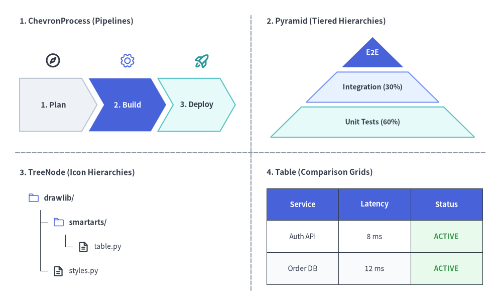
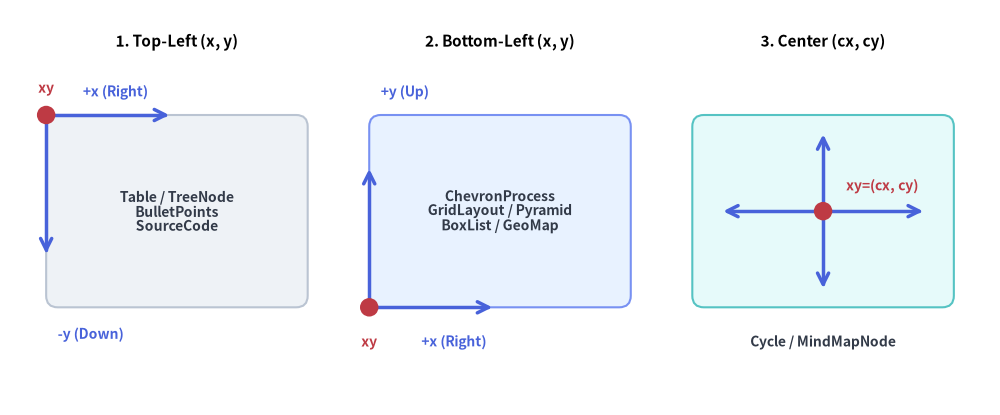
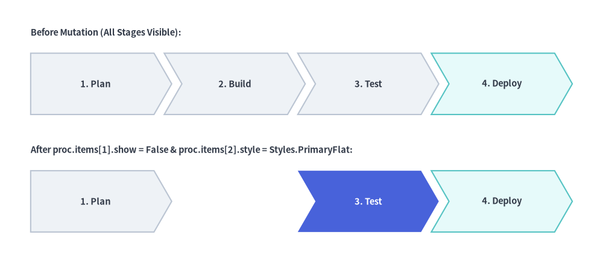

# SmartArts 概要

プロセスフロー、比較テーブル、ディレクトリツリー、マインドマップなどの構造化された図を、基本図形と線だけで描画しようとすると、何百もの座標を手作業で計算する必要が生じます。
`drawlib.smartarts` モジュールは、**宣言的な高水準レイアウトコンポーネント**を提供することで、こうした煩雑なボイラープレートを解消します。

---

## 1. SmartArts でできること


<figure class="drawlib-image" style="text-align: center;">
  
  <figcaption class="drawlib-caption">SmartArts 高水準コンポーネントのショーケース</figcaption>
</figure>

<details class="drawlib-code-details">
<summary>Source Code</summary>

```python
from drawlib.canvas import save, setup
from drawlib.icons import phosphor
from drawlib.lines import line
from drawlib.smartarts import ChevronProcess, Pyramid, Table, TreeNode
from drawlib.styles import Colors, Styles
from drawlib.text import text

setup(width=128, height=78)

# Subtle 2x2 quadrant dividers
line((64, 4), (64, 74), style=Styles.MutedDashed)
line((4, 39), (124, 39), style=Styles.MutedDashed)

# 1. Top-Left: ChevronProcess (Sequential Pipelines + Stage Icons)
text((5, 72.5), "1. ChevronProcess (Pipelines)", style=Styles.DarkBold.patch(text_size=11.0, halign="left"))
proc = ChevronProcess(
    style=Styles.Neutral,
    text_style=Styles.DarkBold.patch(text_size=10.5),
    description_style=Styles.Dark.patch(text_size=10.0),
    flat_left_end=True,
    spacing=1.8,
)
proc.add("1. Plan")
proc.add("2. Build", style=Styles.PrimaryFlat, text_style=Styles.WhiteBold.patch(text_size=10.5))
proc.add("3. Deploy", style=Styles.SecondaryNeutral)
proc.draw(xy=(5, 44.5), width=55, height=13.5)

phosphor.compass(xy=(13.5, 62.5), width=4.2, style=Styles.DarkBold)
phosphor.gear(xy=(32.5, 62.5), width=4.2, style=Styles.PrimaryFlat)
phosphor.rocket_launch(xy=(51.5, 62.5), width=4.2, style=Styles.SecondaryBold)

# 2. Top-Right: Pyramid (Tiered Hierarchies)
text((68, 72.5), "2. Pyramid (Tiered Hierarchies)", style=Styles.DarkBold.patch(text_size=11.0, halign="left"))
pyr = Pyramid(
    style=Styles.Neutral,
    text_style=Styles.DarkBold.patch(text_size=10.0),
)
pyr.add("E2E", style=Styles.PrimaryFlat, text_style=Styles.WhiteBold.patch(text_size=10.0))
pyr.add("Integration (30%)", style=Styles.PrimaryNeutral)
pyr.add("Unit Tests (60%)", style=Styles.SecondaryNeutral)
pyr.draw(xy=(69, 43.0), width=52, height=25.5, margin=1.2)

# 3. Bottom-Left: TreeNode (Hierarchies with Phosphor Icons)
text((5, 34.0), "3. TreeNode (Icon Hierarchies)", style=Styles.DarkBold.patch(text_size=11.0, halign="left"))
TreeNode.register_drawing_item(
    name="sc_dir",
    location="before",
    padding_width=4.2,
    function=phosphor.folder,
    style=Styles.PrimaryFlat,
    args={"width": 3.0},
)
TreeNode.register_drawing_item(
    name="sc_file",
    location="before",
    padding_width=4.2,
    function=phosphor.file_text,
    style=Styles.DarkBold,
    args={"width": 3.0},
)
tree = TreeNode(
    "drawlib/",
    text_style=Styles.DarkBold.patch(text_size=10.5),
    line_style=Styles.DarkThin,
    line_horizontal_margin=3.2,
    line_horizontal_length=3.0,
    line_vertical_margin=6.2,
    children=[
        TreeNode(
            "smartarts/",
            children=[
                TreeNode("table.py", text_style=Styles.Dark.patch(text_size=10.0)).set_drawing_item("sc_file"),
            ],
        ).set_drawing_item("sc_dir"),
        TreeNode("styles.py", text_style=Styles.Dark.patch(text_size=10.0)).set_drawing_item("sc_file"),
    ],
).set_drawing_item("sc_dir")
tree.draw(xy=(7, 27.5))

# 4. Bottom-Right: Table (Comparison & Status Grids)
text((68, 34.0), "4. Table (Comparison Grids)", style=Styles.DarkBold.patch(text_size=11.0, halign="left"))
tbl = Table(
    cell_style=Styles.White,
    text_style=Styles.Dark.patch(text_size=10.0),
    header_cell_style=Styles.PrimaryFlat,
    header_text_style=Styles.WhiteBold.patch(text_size=10.5),
    border_style=Styles.DarkThin,
)
tbl.set_style_cell_evenodd(
    even_color=Colors.Muted1,
    even_text_style=Styles.Dark.patch(text_size=10.0),
    odd_color=Colors.White,
    odd_text_style=Styles.Dark.patch(text_size=10.0),
)
tbl.set_style_cell_header(
    background_color=Colors.Primary,
    text_style=Styles.WhiteBold.patch(text_size=10.5),
)
tbl.set_style_cell(
    background_color=Colors.Success1,
    text_style=Styles.SuccessBold.patch(text_size=10.0),
    rows=[1, 2],
    columns=[2],
)
data = [
    ["Service", "Latency", "Status"],
    ["Auth API", "8 ms", "ACTIVE"],
    ["Order DB", "12 ms", "ACTIVE"],
]
tbl.draw(xy=(68, 30.0), width=55, height=24.5, data=data)
save()
```

</details>


---

## 2. 公開エクスポート (`drawlib.smartarts`)

すべての SmartArts コンポーネント、ミュータブルなアイテム／設定モデル、およびヘルパー関数エイリアスは、`drawlib.smartarts` から直接エクスポートされています。

```python
from drawlib.smartarts import (
    # Primary SmartArt Components
    BoxList,
    BulletPoints,
    CardList,
    ChevronProcess,
    Cycle,
    DayCalendar,
    GeoMap,
    GridLayout,
    KpiCard,
    KpiCards,
    MindMapNode,
    MonthCalendar,
    Panel,
    Pyramid,
    Roadmap,
    SourceCode,
    Table,
    TreeNode,
    WeekCalendar,
    # Mutable Item & Style Models
    BoxListItem,
    BulletPointItem,
    CalendarItem,
    CardListItem,
    ChevronItem,
    CycleCenter,
    CycleItem,
    GridItem,
    KpiCardItem,
    PyramidItem,
    RoadmapItem,
    SourceCodeStyles,
    # Function Aliases
    get_source_code_styles,
    sourcecode,
)
```

---

## 3. コンポーネント一覧マトリクス

| コンポーネント | 主な用途 | アンカー基準 | 主要メソッド・アイテムモデル |
| :--- | :--- | :--- | :--- |
| **[`ChevronProcess`](./chevron_process.md)** | フェーズ分割パイプライン、CI/CD ステージ、移行ロードマップ | 左下 / 中央 | `add(...) -> ChevronItem`, `items`, `draw(..., align="bottom_left", scale=1.0)` |
| **[`Cycle`](./cycle.md)** | PDCA DevOps ループ、循環型ライフサイクル、状態ループ | 中央 / 左下 | `add(...) -> CycleItem`, `set_center() -> CycleCenter`, `items`, `center`, `draw(..., align="center")` |
| **[`Table`](./table.md)** | サービス SLA、仕様比較マトリクス、DB スキーマ | 左上 / 左下 / 中央 | `set_style_cell_*()`, `set_style_border()`, `reset_styles()`, `draw(..., align="top_left")`, `draw_flexible(...)` |
| **[`TreeNode`](./tree.md)** | ディレクトリ階層、組織図、分類ツリー | 左上 `(x, y)` | `add(...) -> TreeNode`, `register_drawing_item()`, `set_drawing_item()`, `draw(...)` |
| **[`MindMapNode`](./mindmap.md)** | ブレインストーミング、放射状機能マップ、組織ツリー | 中央 `(cx, cy)` | `add(...) -> MindMapNode`, `draw(xy, branch="bottom", scale=1.0)` |
| **[`GridLayout`](./grid_layout.md)** | レイヤードアーキテクチャ、ダッシュボードカードグリッド | 左下 / 中央 | `add(...) -> GridItem`, `items`, `draw(..., align="bottom_left")`, `draw_flexible(...)` |
| **[`Pyramid`](./pyramid.md)** | テストピラミッド、階層型メモリ／キャッシュ構造 | 左下 / 中央 | `add(...) -> PyramidItem`, `items`, `draw(..., direction="bottom", align="bottom_left")`, `draw_flexible(...)` |
| **[`BoxList`](./box_list.md)** | 水平または垂直方向の線形カードシーケンス | 左下 / 中央 | `add(...) -> BoxListItem`, `items`, `draw(..., direction="left", align="bottom_left", scale=1.0)` |
| **[`KpiCards`](./kpi_cards.md)** | メトリクス強調カード、SLO／ベンチマークサマリー | 左下 / 中央 | `add(...) -> KpiCardItem`, `items`, `draw(xy, width, height, columns=1, align="bottom_left", scale=1.0)` |
| **[`CardList`](./card_list.md)** | アイコン／バッジ付き機能スタック、矢印付きステップカード | 左下 / 中央 | `add(...) -> CardListItem`, `items`, `draw(xy, width, height, align="bottom_left", scale=1.0)` |
| **[`Roadmap`](./roadmap.md)** | 直線／曲線タイムラインおよびマイルストーンロードマップ | 左下 / 中央 | `add(...) -> RoadmapItem`, `items`, `draw(xy, width, height, align="bottom_left", scale=1.0)` |
| **[`Panel`](./panel.md)** | ヘッダー帯と内部コンテンツ領域計算を備えたタイトル付き枠 | 左下 / 中央 | `draw(xy, width, height, align="bottom_left", scale=1.0)`, `get_content_box(xy, width, height, padding=..., align="bottom_left", content_align=None)` |
| **[`Calendar`](./calendar.md)** | 月間・週間・日間（`"vertical"` / `"horizontal"`）カレンダー | 左下 / 中央 / 左上 | `MonthCalendar`, `WeekCalendar`, `DayCalendar`, `add(...) -> CalendarItem`, `draw(xy, width, height)` |
| **[`BulletPoints`](./bullet_points.md)** | アーキテクチャの要点整理、RFC キーポイント、チェックリスト | 左上 `(x, y)` | `set_indent()`, `set_bullet_style()`, `add(...) -> BulletPointItem`, `items`, `draw(...)` |
| **[`SourceCode`](./source_code.md)** | 図内に埋め込むシンタックスハイライト付きコードブロック | 左上 / 左下 / 中央 | `SourceCode.draw(..., align="top_left")` / `sourcecode(...)`, `SourceCode.get_text()`, `SourceCodeStyles.get()` |
| **[`GeoMap`](./geomap.md)** | 地理マップ（`GeoMap.World.*`, `GeoMap.Countries.*`, `GeoMap.Cities.*`） | 左下 / 中央 | `get_areas()`, `set_area_styles()`, `draw(..., align="bottom_left")`, `get_area_xy()`, `lonlat_to_xy()`, `data` |

> **吹き出しやコールアウトをお探しですか？** `bubblespeech()` プリミティブは `drawlib.shapes` に含まれており、**[吹き出し・バッジ・ステータス](../02_drawing_primitives/shapes_badge.md)** で解説しています。

---

## 4. 座標アンカーと正規化チートシート

複数の SmartArts を 1 つのキャンバス上で組み合わせる際は、各コンポーネントの座標アンカー規約を理解しておくことが重要です。
- **デフォルトで左上アンカー (`Table`, `TreeNode`, `BulletPoints`, `SourceCode`)**:  
  左上座標 `(x, y)` を指定します（`Table` と `SourceCode` は `align="bottom_left"` や `align="center"` も指定可能）。コンテンツは水平方向は右（`+x`）、垂直方向は下（`-y`）に向かって展開します。
- **デフォルトで左下アンカー (`ChevronProcess`, `GridLayout`, `Pyramid`, `BoxList`, `KpiCards`, `CardList`, `Roadmap`, `Panel`, `MonthCalendar`, `WeekCalendar`, `DayCalendar`, `GeoMap`)**:  
  左下座標 `(x, y)` を指定します（バウンディングボックスの中央 `(cx, cy)` を基準にする場合は `align="center"` を渡します）。外接コンテナは右方向（`+x`）および上方向（`+y`）へ広がります。
- **デフォルトで中央アンカー (`Cycle`, `MindMapNode`)**:  
  中心座標 `(cx, cy)` を指定します（`Cycle.draw()` では `align="bottom_left"` も指定可能）。図は中心から対称または放射状に広がります。


<figure class="drawlib-image" style="text-align: center;">
  
  <figcaption class="drawlib-caption">SmartArts における 3 種類の座標アンカー方式</figcaption>
</figure>

<details class="drawlib-code-details">
<summary>Source Code</summary>

```python
from drawlib.canvas import save, setup
from drawlib.lines import line
from drawlib.shapes import circle, rectangle
from drawlib.styles import Styles
from drawlib.text import text

setup(width=130, height=54)

# 1. Left Panel: Top-Left Anchored (x, y)
text((23.0, 48.5), "1. Top-Left (x, y)", style=Styles.BlackBold.patch(text_size=11.0))
rectangle(
    (23.0, 26.5),
    width=34.0,
    height=25.0,
    style=Styles.Neutral.patch(shape_r=1.5),
    text="Table / TreeNode\nBulletPoints\nSourceCode",
    text_style=Styles.DarkBold.patch(text_size=10.0),
)
# Growth arrows from top-left (6.0, 39.0)
line((6.0, 39.0), (22.0, 39.0), arrow_head="->", style=Styles.PrimaryBold)
text((15.0, 42.0), "+x (Right)", style=Styles.PrimaryBold.patch(text_size=10.0))
line((6.0, 39.0), (6.0, 21.0), arrow_head="->", style=Styles.PrimaryBold)
text((7.5, 10.5), "-y (Down)", style=Styles.PrimaryBold.patch(text_size=10.0, halign="left"))
circle((6.0, 39.0), radius=1.2, style=Styles.DangerFlat)
text((6.0, 42.5), "xy", style=Styles.DangerBold.patch(text_size=10.0))

# 2. Middle Panel: Bottom-Left Anchored (x, y)
text((65.0, 48.5), "2. Bottom-Left (x, y)", style=Styles.BlackBold.patch(text_size=11.0))
rectangle(
    (65.0, 26.5),
    width=34.0,
    height=25.0,
    style=Styles.PrimaryNeutral.patch(shape_r=1.5),
    text="ChevronProcess\nGridLayout / Pyramid\nBoxList / GeoMap",
    text_style=Styles.DarkBold.patch(text_size=10.0),
)
# Growth arrows from bottom-left (48.0, 14.0)
line((48.0, 14.0), (64.0, 14.0), arrow_head="->", style=Styles.PrimaryBold)
text((59.0, 9.5), "+x (Right)", style=Styles.PrimaryBold.patch(text_size=10.0))
line((48.0, 14.0), (48.0, 32.0), arrow_head="->", style=Styles.PrimaryBold)
text((49.5, 42.0), "+y (Up)", style=Styles.PrimaryBold.patch(text_size=10.0, halign="left"))
circle((48.0, 14.0), radius=1.2, style=Styles.DangerFlat)
text((48.0, 9.5), "xy", style=Styles.DangerBold.patch(text_size=10.0))

# 3. Right Panel: Center Anchored (cx, cy)
text((107.0, 48.5), "3. Center (cx, cy)", style=Styles.BlackBold.patch(text_size=11.0))
rectangle(
    (107.0, 26.5),
    width=34.0,
    height=25.0,
    style=Styles.SecondaryNeutral.patch(shape_r=1.5),
)
# Radial expansion arrows from center (107.0, 26.5)
line((107.0, 26.5), (120.0, 26.5), arrow_head="->", style=Styles.PrimaryBold)
line((107.0, 26.5), (94.0, 26.5), arrow_head="->", style=Styles.PrimaryBold)
line((107.0, 26.5), (107.0, 36.5), arrow_head="->", style=Styles.PrimaryBold)
line((107.0, 26.5), (107.0, 16.5), arrow_head="->", style=Styles.PrimaryBold)
circle((107.0, 26.5), radius=1.2, style=Styles.DangerFlat)
text((110.0, 29.8), "xy=(cx, cy)", style=Styles.DangerBold.patch(text_size=10.0, halign="left"))
text((107.0, 9.5), "Cycle / MindMapNode", style=Styles.DarkBold.patch(text_size=10.0))

save()
```

</details>


同じキャンバスグリッド上でサイズ `(W, H)` のコンポーネントの位置を揃えるには、`draw()` に `align="bottom_left"` や `align="center"` を直接渡すか、左上 `(left_x, top_left_y)`・左下 `(left_x, bottom_y)`・中央 `(center_x, center_y)` の各アンカー間を次の式で変換します。

```python
center_x = left_x + W / 2.0
center_y = bottom_y + H / 2.0
top_left_y = bottom_y + H
```

| コンポーネント | デフォルトの `xy` の意味 | サポートされる `align` オプション | 左下 `(X, Y)` に揃える方法 |
| :--- | :--- | :--- | :--- |
| **`Table`**, **`SourceCode`** | 左上 `(x, y)` | `"top_left"`, `"bottom_left"`, `"center"` | `align="bottom_left"` または `(X, Y + H)` を渡す |
| **`TreeNode`**, **`BulletPoints`** | 左上 `(x, y)` | *（左上固定）* | `(X, Y + H)` を渡す |
| **`ChevronProcess`**, **`GridLayout`**, **`Pyramid`**, **`BoxList`**, **`KpiCards`**, **`CardList`**, **`Roadmap`**, **`Panel`**, **`GeoMap`** | 左下 `(x, y)` | `"bottom_left"`, `"center"` | `(X, Y)` をそのまま渡す |
| **`MindMapNode`** | ルート中央 `(cx, cy)` | *（ルート中央固定）* | `(X + W/2, Y + H/2)` を渡す |
| **`Cycle`** | 軌道中心 `(cx, cy)` | `"center"`, `"bottom_left"` | `align="bottom_left"` または `(X + R, Y + R)` を渡す |

---

## 5. 統一された遅延変更ライフサイクル (`add()`, `items`, `show`, `scale`)

ステートフルな SmartArts コンポーネントは、共通の **4 フェーズ遅延変更（Deferred Mutation）ライフサイクル**に従います。

1. **インスタンス化 (`__init__`)**: デフォルトのスタイル、余白、レイアウトパラメータを指定してコンポーネントを初期化します。
2. **コンテンツ登録 (`add(..., show: bool = True)`)**: ステージ、セル、階層、カード、または子ノードを追加します。各 `.add(...)` 呼び出しは**ミュータブルなアイテムインスタンス**（`ChevronItem`, `CycleItem`, `GridItem`, `PyramidItem`, `BoxListItem`, `BulletPointItem`, `TreeNode`, `MindMapNode`）を返し、登録済みのすべてのアイテムには `.items`（ツリー／マインドマップでは `.children`、`CycleCenter` では `.center`）からアクセスできます。
3. **`draw()` の前または呼び出し間での変更**: アイテムの各属性（`.style`, `.text_style`, `.text`, `.description`, `.show`）は `draw()` 内部で遅延評価されるため、`draw()` を呼ぶ前だけでなく、複数の `draw()` フレーム間（ステップごとのアニメーションや複数状態の比較図など）でもコンポーネントを再構築せずにスタイル・ラベル・表示状態を直接変更できます。


```python
from drawlib.canvas import save, setup
from drawlib.smartarts import ChevronProcess
from drawlib.styles import Styles
from drawlib.text import text

setup(width=118, height=50)

proc = ChevronProcess(
    style=Styles.Neutral,
    text_style=Styles.DarkBold.patch(text_size=10.5),
    description_style=Styles.Dark.patch(text_size=10.0),
    flat_left_end=True,
    spacing=2.0,
)
proc.add("1. Plan")
proc.add("2. Build")
proc.add("3. Test")
proc.add("4. Deploy", style=Styles.SecondaryNeutral)

# Top Row: Initial Render (All 4 stages visible)
text((6, 43.5), "Before Mutation (All Stages Visible):", style=Styles.DarkBold.patch(text_size=10.5, halign="left"))
proc.draw(xy=(6, 27.5), width=106, height=12)

# Mutate items in-place between draw() calls—sibling coordinates never shift!
proc.items[1].show = False
proc.items[2].style = Styles.PrimaryFlat
proc.items[2].text_style = Styles.WhiteBold.patch(text_size=10.5)

# Bottom Row: Re-render after mutating items[1] and items[2]
text((6, 20.5), "After proc.items[1].show = False & proc.items[2].style = Styles.PrimaryFlat:", style=Styles.DarkBold.patch(text_size=10.5, halign="left"))
proc.draw(xy=(6, 4.5), width=106, height=12)
save()
```

<figure class="drawlib-image" style="text-align: center;">
  
  <figcaption class="drawlib-caption">遅延アイテム変更: 兄弟ステージの座標をずらさずに特定ステージを非表示化</figcaption>
</figure>


4. **描画 (`draw(xy=..., ..., scale: float = 1.0)`)**: アンカー `xy` を基準としてコンポーネントをキャンバスに描画します（`SourceCode.draw(xy, width, ...)` のようなステートレス描画もあります）。`scale`（例: `scale=0.8` や `scale=1.2`）を渡すと、`xy` を基点としてすべての寸法、マージン、角丸半径、線幅、フォントサイズが比例スケーリングされます。

