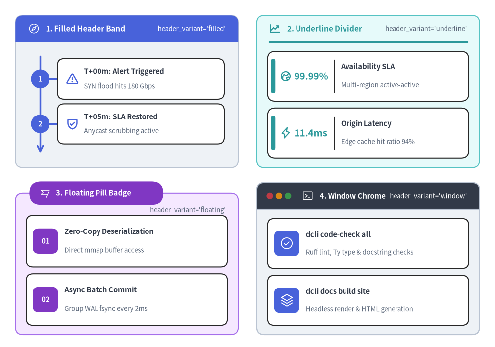
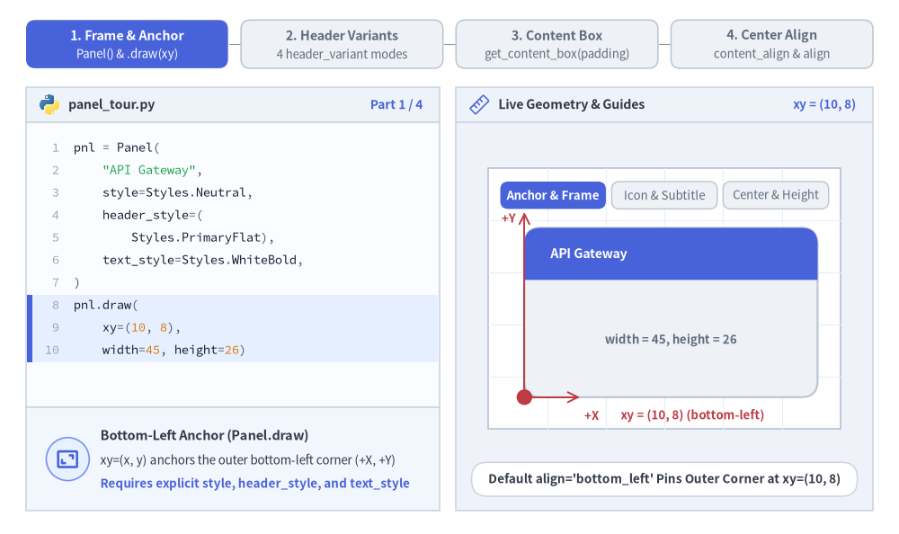
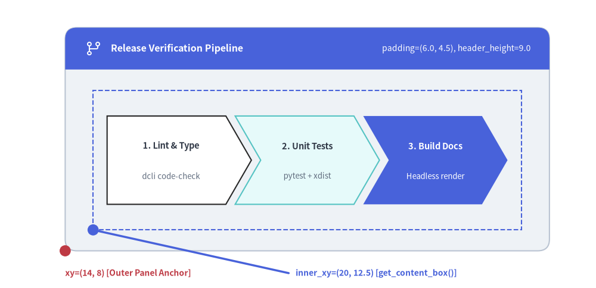
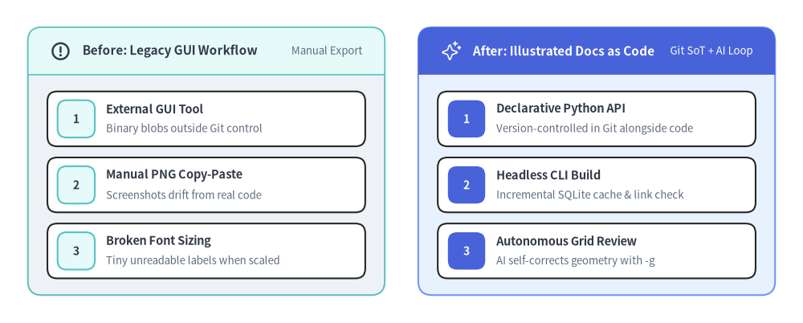

# Panel（パネル）

`Panel` コンポーネントは、ヘッダー帯（`header_variant="filled" | "underline" | "floating" | "window"`）を備えたタイトル付きコンテナフレームを描画します。また、`get_content_box(xy, width, height, padding=...)` メソッドを使うことで、他の SmartArts・Charts・Diagrams をコンテナ内にネスト配置するための内部描画領域 `(inner_xy, inner_width, inner_height)` を自動計算できます。
表示されるすべての要素には明示的な `Style` の指定が必要です（`style`、`header_style`、`text_style` は常に必須。`description` が空でない場合は `description_style`、`icon` を指定する場合は `icon_style`、`header_variant="window"` の場合は `dot_styles` が必須となります）。


<figure class="drawlib-image" style="text-align: center;">
  
  <figcaption class="drawlib-caption">Panel の 4 種類のヘッダーバリアント: filled・underline・floating・window</figcaption>
</figure>

<details class="drawlib-code-details">
<summary>Source Code</summary>

```python
from drawlib.canvas import save, setup
from drawlib.icons import phosphor
from drawlib.smartarts import CardList, KpiCards, Panel, Roadmap
from drawlib.styles import Styles

setup(width=160, height=112)

# 1. Top-Left: header_variant="filled"
p1 = Panel(
    "1. Filled Header Band",
    "header_variant='filled'",
    style=Styles.Neutral,
    header_style=Styles.PrimaryFlat,
    text_style=Styles.WhiteBold.patch(text_size=11.0),
    description_style=Styles.White.patch(text_size=9.5),
    icon=phosphor.compass,
    icon_style=Styles.White,
    header_variant="filled",
    header_height=8.5,
)
p1.draw((5.0, 58.0), width=72.0, height=49.0)
c1_xy, c1_w, c1_h = p1.get_content_box((5.0, 58.0), width=72.0, height=49.0, padding=(3.5, 3.0))

rm = Roadmap(
    style=Styles.White,
    text_style=Styles.DarkBold.patch(text_size=10.5),
    description_style=Styles.Muted.patch(text_size=9.5),
    spine_style=Styles.PrimaryBold,
    badge_style=Styles.PrimaryFlat,
    badge_text_style=Styles.WhiteBold.patch(text_size=10.0),
    icon_style=Styles.PrimaryBold,
    spacing=2.0,
)
rm.add("T+00m: Alert Triggered", "SYN flood hits 180 Gbps", badge_text="1", icon=phosphor.warning)
rm.add("T+05m: SLA Restored", "Anycast scrubbing active", badge_text="2", icon=phosphor.shield_check)
rm.draw(c1_xy, width=c1_w, height=c1_h)

# 2. Top-Right: header_variant="underline"
p2 = Panel(
    "2. Underline Divider",
    "header_variant='underline'",
    style=Styles.SecondaryNeutral,
    header_style=Styles.SecondaryBold,
    text_style=Styles.SecondaryBold.patch(text_size=11.0),
    description_style=Styles.Muted.patch(text_size=9.5),
    icon=phosphor.chart_line_up,
    icon_style=Styles.SecondaryBold,
    header_variant="underline",
    header_height=8.5,
)
p2.draw((83.0, 58.0), width=72.0, height=49.0)
c2_xy, c2_w, c2_h = p2.get_content_box((83.0, 58.0), width=72.0, height=49.0, padding=(3.5, 3.0))

kpi = KpiCards(
    style=Styles.White,
    metric_style=Styles.SecondaryBold.patch(text_size=13.5),
    text_style=Styles.DarkBold.patch(text_size=10.5),
    description_style=Styles.Muted.patch(text_size=9.5),
    accent_style=Styles.SecondaryFlat,
    icon_style=Styles.SecondaryBold,
    metric_width_ratio=0.32,
    spacing=2.2,
)
kpi.add("99.99%", "Availability SLA", "Multi-region active-active", icon=phosphor.globe_hemisphere_east)
kpi.add("11.4ms", "Origin Latency", "Edge cache hit ratio 94%", icon=phosphor.lightning)
kpi.draw(c2_xy, width=c2_w, height=c2_h)

# 3. Bottom-Left: header_variant="floating"
p3 = Panel(
    "3. Floating Pill Badge",
    "header_variant='floating'",
    style=Styles.AccentNeutral,
    header_style=Styles.AccentFlat,
    text_style=Styles.WhiteBold.patch(text_size=10.5),
    description_style=Styles.Muted.patch(text_size=9.5),
    icon=phosphor.flag_banner,
    icon_style=Styles.White,
    header_variant="floating",
    header_height=7.5,
)
p3.draw((5.0, 4.0), width=72.0, height=49.0)
c3_xy, c3_w, c3_h = p3.get_content_box((5.0, 4.0), width=72.0, height=49.0, padding=(3.5, 3.0))

cl3 = CardList(
    style=Styles.White,
    text_style=Styles.DarkBold.patch(text_size=10.5),
    description_style=Styles.Muted.patch(text_size=9.5),
    badge_style=Styles.AccentFlat,
    badge_text_style=Styles.WhiteBold.patch(text_size=10.0),
    icon_style=Styles.White,
    spacing=2.2,
)
cl3.add("Zero-Copy Deserialization", "Direct mmap buffer access", badge_text="01")
cl3.add("Async Batch Commit", "Group WAL fsync every 2ms", badge_text="02")
cl3.draw(c3_xy, width=c3_w, height=c3_h)

# 4. Bottom-Right: header_variant="window"
p4 = Panel(
    "4. Window Chrome",
    "header_variant='window'",
    style=Styles.Neutral,
    header_style=Styles.DarkFlat,
    text_style=Styles.WhiteBold.patch(text_size=10.5),
    description_style=Styles.White.patch(text_size=9.5),
    icon=phosphor.terminal_window,
    icon_style=Styles.White,
    dot_styles=(
        Styles.DangerFlat.patch(shape_line_width=0),
        Styles.WarningFlat.patch(shape_line_width=0),
        Styles.SuccessFlat.patch(shape_line_width=0),
    ),
    header_variant="window",
    header_height=8.5,
    header_align="left",
)
p4.draw((83.0, 4.0), width=72.0, height=49.0)
c4_xy, c4_w, c4_h = p4.get_content_box((83.0, 4.0), width=72.0, height=49.0, padding=(3.5, 3.0))

cl4 = CardList(
    style=Styles.White,
    text_style=Styles.DarkBold.patch(text_size=10.5),
    description_style=Styles.Muted.patch(text_size=9.5),
    badge_style=Styles.PrimaryFlat,
    icon_style=Styles.White,
    spacing=2.2,
)
cl4.add("dcli code-check all", "Ruff lint, Ty type & docstring checks", icon=phosphor.check_circle)
cl4.add("dcli docs build site", "Headless render & HTML generation", icon=phosphor.stack)
cl4.draw(c4_xy, width=c4_w, height=c4_h)

save()
```

</details>


---

## 1. 基本概念と基本的な使い方

`Panel` は、デフォルトで**左下 `(x, y)`** をアンカーとする（`align="bottom_left"`）、または `align="center"` で中央揃えにしたタイトル付きコンテナカードを描画し、4 種類のヘッダースタイル（`"filled"`、`"underline"`、`"floating"`、`"window"`）をサポートします。`panel.get_content_box(xy, width, height, padding=..., content_align=...)` を呼び出すと、`header_height` の差し引きと `padding` の内側余白が自動適用され、ネストするコンポーネントや中央アンカー図形にそのまま渡せる安全な内部領域 `(inner_xy, inner_width, inner_height)` を取得できます。


<figure class="drawlib-image" style="text-align: center;">
  
  <figcaption class="drawlib-caption">基本的な使い方とパラメータツアー: コンテナアンカー・ヘッダーバリアント・内部コンテンツボックス・中央揃え（APNG アニメーション）</figcaption>
</figure>


<div class="drawlib-source-link">
  <a href="https://github.com/yuichi110/drawlib/blob/main/docs/docs_src/ja/04_smartarts/panel.md" target="_blank" rel="noopener noreferrer">GitHub でアニメーションのソースコードを見る &rarr;</a>
</div>

- **外側アンカーと明示的なヘッダースタイル（`xy`, `header_align`, `header_height`）**: デフォルトでコンテナを**左下 `xy`** にアンカーし（`align="bottom_left"`）、`header_height` や `header_align="center"` を調整します。有効なすべての要素に対して明示的な `Style` トークン（`style`、`header_style`、`text_style` に加え、必要に応じて `description_style`、`icon_style`、`dot_styles`）を指定します。
- **4 種類のヘッダーバリアント（`header_variant`）**: `"filled"`（塗りつぶし上部帯）、`"underline"`（落ち着いた内側区切り線）、`"floating"`（上辺にまたがるカプセル型バッジ）、`"window"`（ウィンドウクローム風の 3 点コントロール）をシームレスに切り替えられます。
- **安全な内部描画ボックス（`get_content_box`）**: `panel.get_content_box(xy, width, height, padding=(pad_x, pad_y))` を呼び出すことで、`header_height` の差し引きと四方の余白（インセット）が自動計算され、子コンポーネントをきれいにネスト配置できます。
- **内部・外部の中央揃え（`content_align`, `align`）**: `get_content_box(...)` に `content_align="center"` を指定すると、中央アンカーの図形やアイコン向けの内部中心座標 `(cx, cy)` を取得できます。また、`.draw(...)` に `align="center"` を渡すと外側のパネル自体を中央基準で配置できます。

---

## 2. 内部コンテンツボックスの計算（`get_content_box`）

`Panel` の内部に別のコンポーネント（`Roadmap`、`CardList`、`KpiCards`、`ChevronProcess`、`BarChart` など）を配置する際は、`panel.get_content_box(xy, width, height, padding=(pad_x, pad_y), align=..., content_align=...)` を呼び出して `(inner_xy, inner_width, inner_height)` を取得します。上部の `header_height` が差し引かれ、上下左右すべてに `padding` の内側余白が自動適用されます。
- **`align: "bottom_left" | "center" = "bottom_left"`**: `panel.draw(xy, width, height, align=...)` に渡した `align` と一致させます。
- **`content_align: "bottom_left" | "center" | None = None`**: 返される `inner_xy` を内部ボックスの `"bottom_left"`（左下）と `"center"`（中心）のどちらにするかを制御します。`None`（デフォルト）の場合は `align` を引き継ぐため、`get_content_box(..., align="center")` は `rectangle(inner_xy, ...)` や `inner_component.draw(inner_xy, ..., align="center")` にそのまま渡せる中心座標を返します。


```python
from drawlib.canvas import save, setup
from drawlib.icons import phosphor
from drawlib.lines import line
from drawlib.shapes import circle, rectangle
from drawlib.smartarts import ChevronProcess, Panel
from drawlib.styles import Styles
from drawlib.text import text

setup(width=128, height=62)

panel_xy = (14.0, 8.0)
panel_w, panel_h = 104.0, 48.0

panel = Panel(
    "Release Verification Pipeline",
    "padding=(6.0, 4.5), header_height=9.0",
    style=Styles.Neutral,
    header_style=Styles.PrimaryFlat,
    text_style=Styles.WhiteBold.patch(text_size=11.5),
    description_style=Styles.White.patch(text_size=10.0),
    icon=phosphor.git_branch,
    icon_style=Styles.White,
    header_variant="filled",
    header_height=9.0,
)
panel.draw(panel_xy, width=panel_w, height=panel_h)

# Compute inner drawable box
inner_xy, inner_w, inner_h = panel.get_content_box(
    panel_xy,
    width=panel_w,
    height=panel_h,
    padding=(6.0, 4.5),
)

# Visualize the computed inner bounding box with a dashed outline
rectangle(
    (inner_xy[0] + inner_w / 2.0, inner_xy[1] + inner_h / 2.0),
    width=inner_w,
    height=inner_h,
    style=Styles.PrimaryDashed,
)

# Render a ChevronProcess inside the computed box
proc = ChevronProcess(
    style=Styles.White,
    text_style=Styles.DarkBold.patch(text_size=10.5),
    description_style=Styles.Muted.patch(text_size=9.5),
    flat_left_end=True,
    spacing=2.0,
)
proc.add("1. Lint & Type", description="dcli code-check")
proc.add("2. Unit Tests", description="pytest + xdist", style=Styles.SecondaryNeutral)
proc.add(
    "3. Build Docs",
    description="Headless render",
    style=Styles.PrimaryFlat,
    text_style=Styles.WhiteBold.patch(text_size=10.5),
    description_style=Styles.White.patch(text_size=9.5),
)
proc.draw((inner_xy[0] + 3.0, inner_xy[1] + 5.5), width=inner_w - 6.0, height=inner_h - 11.0)

# Coordinate anchor markers
circle(panel_xy, radius=1.2, style=Styles.DangerFlat)
text((panel_xy[0], 3.2), "xy=(14, 8) [Outer Panel Anchor]", style=Styles.DangerBold.patch(text_size=10.0, halign="left"))

circle(inner_xy, radius=1.2, style=Styles.PrimaryFlat)
line((inner_xy[0], inner_xy[1]), (62.0, 3.2), style=Styles.PrimaryBold)
text((63.5, 3.2), "inner_xy=(20, 12.5) [get_content_box()]", style=Styles.PrimaryBold.patch(text_size=10.0, halign="left"))

save()
```

<figure class="drawlib-image" style="text-align: center;">
  
  <figcaption class="drawlib-caption">Panel.get_content_box(xy, width, height, padding=(6.0, 4.5)) の構造図解</figcaption>
</figure>


---

## 3. `Panel` を用いたマルチカラム・アーキテクチャ比較

複数の `Panel` コンテナを横に並べることで、ヘッダー帯の座標計算を手動で行うことなく、マルチカラムの比較図・移行前後の Before/After 図・リージョン別クラスタ構成図を簡潔に構築できます。


```python
from drawlib.canvas import save, setup
from drawlib.icons import phosphor
from drawlib.smartarts import CardList, Panel
from drawlib.styles import Styles

setup(width=144, height=58)

# Left Panel: Legacy Manual Workflow (Neutral header)
left_panel = Panel(
    "Before: Legacy GUI Workflow",
    "Manual Export",
    style=Styles.Neutral,
    header_style=Styles.SecondaryNeutral.patch(shape_line_width=1.2),
    text_style=Styles.DarkBold.patch(text_size=11.0),
    description_style=Styles.Muted.patch(text_size=9.5),
    icon=phosphor.warning_circle,
    icon_style=Styles.DarkBold,
    header_variant="filled",
    header_height=8.5,
)
left_panel.draw((5.0, 5.0), width=64.0, height=48.0)
l_xy, l_w, l_h = left_panel.get_content_box((5.0, 5.0), width=64.0, height=48.0, padding=(3.5, 3.0))

legacy_list = CardList(
    style=Styles.White,
    text_style=Styles.DarkBold.patch(text_size=10.5),
    description_style=Styles.Muted.patch(text_size=9.5),
    badge_style=Styles.SecondaryNeutral,
    badge_text_style=Styles.DarkBold.patch(text_size=10.0),
    spacing=2.0,
)
legacy_list.add("External GUI Tool", "Binary blobs outside Git control", badge_text="1")
legacy_list.add("Manual PNG Copy-Paste", "Screenshots drift from real code", badge_text="2")
legacy_list.add("Broken Font Sizing", "Tiny unreadable labels when scaled", badge_text="3")
legacy_list.draw(l_xy, width=l_w, height=l_h)

# Right Panel: Drawlib Workflow (Primary Hero header)
right_panel = Panel(
    "After: Illustrated Docs as Code",
    "Git SoT + AI Loop",
    style=Styles.PrimaryNeutral,
    header_style=Styles.PrimaryFlat,
    text_style=Styles.WhiteBold.patch(text_size=11.0),
    description_style=Styles.White.patch(text_size=9.5),
    icon=phosphor.sparkle,
    icon_style=Styles.White,
    header_variant="filled",
    header_height=8.5,
)
right_panel.draw((75.0, 5.0), width=64.0, height=48.0)
r_xy, r_w, r_h = right_panel.get_content_box((75.0, 5.0), width=64.0, height=48.0, padding=(3.5, 3.0))

modern_list = CardList(
    style=Styles.White,
    text_style=Styles.DarkBold.patch(text_size=10.5),
    description_style=Styles.Muted.patch(text_size=9.5),
    badge_style=Styles.PrimaryFlat,
    badge_text_style=Styles.WhiteBold.patch(text_size=10.0),
    spacing=2.0,
)
modern_list.add("Declarative Python API", "Version-controlled in Git alongside code", badge_text="1")
modern_list.add("Headless CLI Build", "Incremental SQLite cache & link check", badge_text="2")
modern_list.add("Autonomous Grid Review", "AI self-corrects geometry with -g", badge_text="3")
modern_list.draw(r_xy, width=r_w, height=r_h)

save()
```

<figure class="drawlib-image" style="text-align: center;">
  
  <figcaption class="drawlib-caption">Panel コンテナを並べて構成したアーキテクチャ比較図</figcaption>
</figure>


---

## 4. API リファレンス

### コンストラクタ（`Panel`）

| パラメータ | 型 | デフォルト | 説明 |
| :--- | :--- | :--- | :--- |
| **`text`** | `str` | *（必須）* | パネルヘッダーのメインタイトル文字列。 |
| **`description`** | `str` | `""` | ヘッダー右側に表示される任意のサブタイトルまたはタグ。 |
| **`style`** | `Style` | *（必須）* | 外側パネル本体の背景および枠線スタイル。 |
| **`header_style`** | `Style` | *（必須）* | ヘッダー帯（`"filled"`, `"window"`）、区切り線（`"underline"`）、またはピル型バッジ（`"floating"`）のスタイル。 |
| **`text_style`** | `Style` | *（必須）* | メインヘッダータイトル（`text`）のテキストスタイル。 |
| **`description_style`** | `Style \| None` | `None` | `description` のテキストスタイル（`description` が空でない場合は**必須**）。 |
| **`icon`** | `Callable \| None` | `None` | `text` の手前に表示する任意のアイコン描画関数。 |
| **`icon_style`** | `Style \| None` | `None` | `icon` に渡すスタイル（`icon` を指定する場合は**必須**）。 |
| **`dot_styles`** | `tuple[Style, Style, Style] \| Style \| None` | `None` | ウィンドウの 3 つのドットに適用する単一の `Style` または 3 要素タプルの `Style`（`header_variant="window"` の場合は**必須**）。 |
| **`header_variant`** | `"filled" \| "underline" \| "floating" \| "window"` | `"filled"` | パネルヘッダーの視覚レイアウトモード。 |
| **`header_height`** | `PosFloat` | `8.0` | ヘッダー帯またはフローティングピルの高さ（キャンバス単位）。 |
| **`header_align`** | `"left" \| "center"` | `"left"` | メインヘッダータイトルの水平位置揃え（`"left"` または `"center"`）。 |
| **`show`** | `bool` | `True` | `draw()` 呼び出し時にこのパネルを描画するかどうか。 |

### メソッド

| メソッド | シグネチャ | 説明 |
| :--- | :--- | :--- |
| **`draw`** | `(xy, width=100.0, height=60.0, *, align="bottom_left", scale=1.0) -> Self` | パネルコンテナを `xy`（`"bottom_left"` または `"center"`）に描画します。 |
| **`get_content_box`** | `(xy, width=100.0, height=60.0, *, padding=(4.0, 3.0), align="bottom_left", content_align=None, scale=1.0) -> tuple[tuple[float, float], float, float]` | ヘッダー帯下部の内部コンテンツ領域を表す `(inner_xy, inner_width, inner_height)` を返します（`content_align` が `None` の場合は `align` を引き継ぎます）。 |
