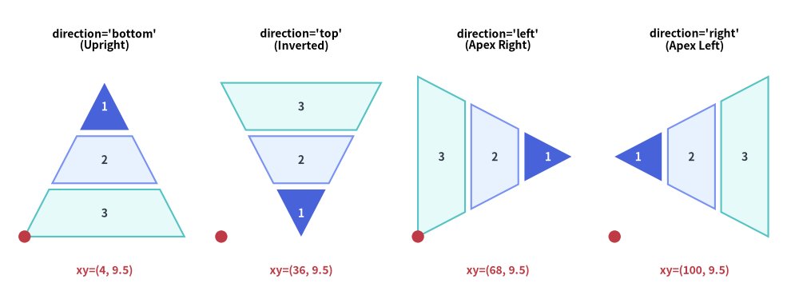
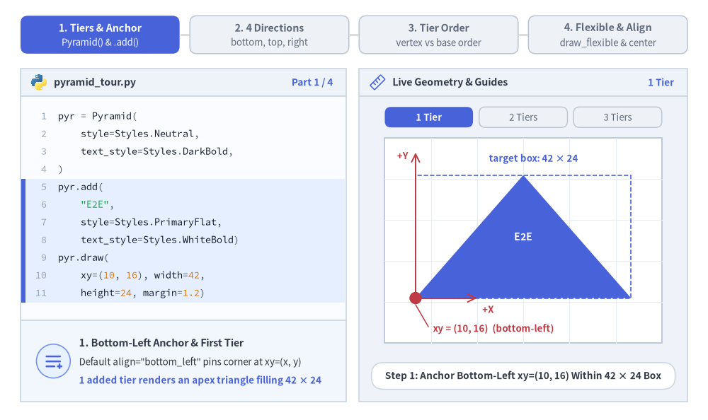
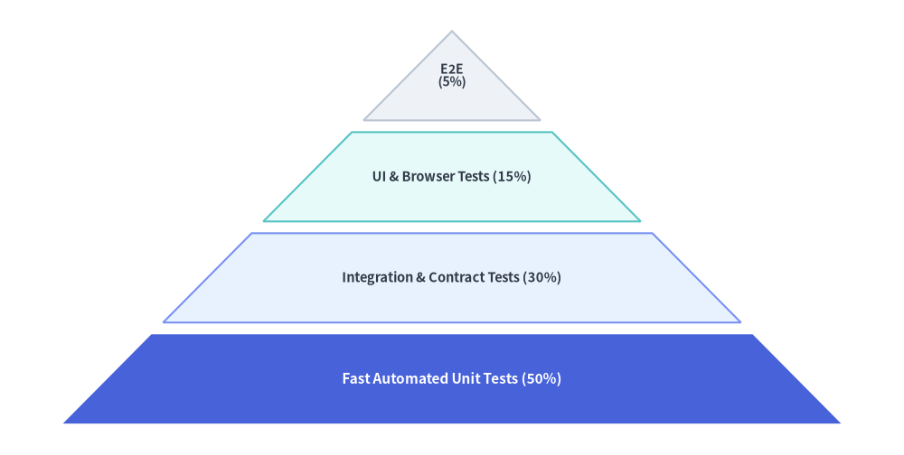
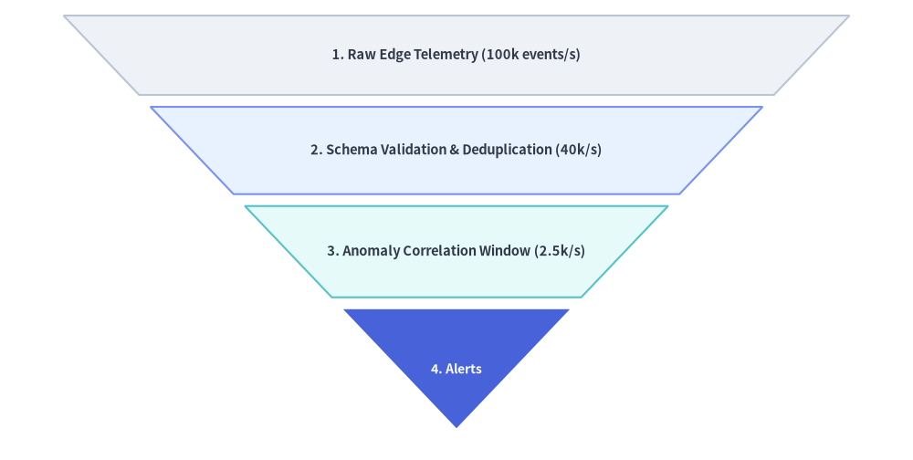

# Pyramid（ピラミッド図）

`Pyramid` コンポーネントは、三角形の頂点を冠した台形の階層構造を描画します。
標準的な上向きピラミッド、逆ピラミッド型ファネル、横向き配置、および段ごとのカスタム高さ指定に対応しており、ソフトウェアテストピラミッド、DIKW 知識階層モデル、多層防御ティア、コンバージョンファネルの図解に最適です。


<figure class="drawlib-image" style="text-align: center;">
  
  <figcaption class="drawlib-caption">Pyramid の全 4 方向: bottom・top・left・right</figcaption>
</figure>

<details class="drawlib-code-details">
<summary>Source Code</summary>

```python
from drawlib.canvas import save, setup
from drawlib.shapes import circle
from drawlib.smartarts import Pyramid
from drawlib.styles import Styles
from drawlib.text import text

setup(width=130, height=48)

p = Pyramid(
    style=Styles.Neutral,
    text_style=Styles.DarkBold.patch(text_size=10.0),
)
p.add("1", style=Styles.PrimaryFlat, text_style=Styles.WhiteBold.patch(text_size=10.0))
p.add("2", style=Styles.PrimaryNeutral)
p.add("3", style=Styles.SecondaryNeutral)

panels = [
    ("bottom", (4.0, 9.5), "direction='bottom'\n(Upright)"),
    ("top", (36.0, 9.5), "direction='top'\n(Inverted)"),
    ("left", (68.0, 9.5), "direction='left'\n(Apex Right)"),
    ("right", (100.0, 9.5), "direction='right'\n(Apex Left)"),
]

for dir_val, (px, py), label in panels:
    text((px + 13.0, 41.5), label, style=Styles.BlackBold.patch(text_size=10.0))
    p.draw(xy=(px, py), width=26.0, height=25.0, margin=1.0, direction=dir_val, order="vertex_to_base")
    circle((px, py), radius=1.0, style=Styles.DangerFlat)
    text((px + 13.0, 4.0), f"xy=({int(px)}, 9.5)", style=Styles.DangerBold.patch(text_size=10.0))

save()
```

</details>


---

## 1. 基本概念と基本的な使い方

`Pyramid` は `.add(...)` によって段階的な階層構造やコンバージョンファネルを構築し、デフォルトでバウンディングボックスの**左下角 `xy=(x, y)`**（`align="center"` の場合は中央）を基準に配置します。広い底辺の向きを 4 方向（`"bottom"`, `"top"`, `"left"`, `"right"`）から選択できるほか、`"vertex_to_base"` と `"base_to_vertex"` の並び順切り替え、`draw_flexible(...)` による段ごとの高さ指定、他の段の形状を保ったまま `.items[i]` を非表示にする操作に対応しています。


<figure class="drawlib-image" style="text-align: center;">
  
  <figcaption class="drawlib-caption">基本的な使い方とパラメータツアー: 段階的なティア構築、4 つの底辺方向、頂点・底辺の並び順、可変サイズ指定（APNG アニメーション）</figcaption>
</figure>


<div class="drawlib-source-link">
  <a href="https://github.com/yuichi110/drawlib/blob/main/docs/docs_src/ja/04_smartarts/pyramid.md" target="_blank" rel="noopener noreferrer">GitHub でアニメーションのソースコードを見る &rarr;</a>
</div>

- **段階的なティア構築とアンカー（`xy`, `align`）**: `.add(text, style=...)` で階層スライスを順に追加し、`margin` で区切られた `width × height` 領域内に描画します（デフォルトの `align="bottom_left"` では**左下角**基準、`align="center"` では中央基準）。
- **4 つの底辺方向（`direction`）**: `direction` は広い底辺を配置する辺を指定します。`"bottom"`（上向き階層）、`"top"`（逆ピラミッド／ファネル）、`"left"`（底辺が左・頂点が右）、`"right"`（底辺が右・頂点が左。このとき `width` が縦方向の底辺幅、`height` が横方向の高さになります）を選択できます。
- **頂点基準と底辺基準の並び順（`order`）**: デフォルトの `order="vertex_to_base"` は最初の `.add()` 要素を三角形の頂点に配置します。`order="base_to_vertex"` を渡すと最初の `.add()` 要素が広い底辺から始まるため、`direction="top"` と組み合わせたトップダウンのファネル表現に最適です。
- **可変ティア高さとスロット維持の `.show`（`draw_flexible`, `.items[i]`）**: `draw_flexible(..., item_heights=[...], margins=[...])`（底辺から頂点への順）で段ごとの高さを個別に指定でき、`pyr.items[i].show = False` を設定すれば他の段の形状をずらさずに特定の段を非表示にできます。

---

## 2. 上向きの階層ピラミッド（`direction="bottom"`）

デフォルト設定（`direction="bottom", order="vertex_to_base"`）では、最初に追加した要素が上端の三角形の頂点に配置され、続く要素が底辺に向かって段階的に幅の広い台形ティアを形成します。


```python
from drawlib.canvas import save, setup
from drawlib.smartarts import Pyramid
from drawlib.styles import Styles

setup(width=115, height=58)

pyramid = Pyramid(
    style=Styles.Neutral,
    text_style=Styles.DarkBold.patch(text_size=10.5),
)

# Added from apex (top) to base (bottom) when order="vertex_to_base"
pyramid.add(
    "E2E\n(5%)",
    style=Styles.Neutral,
    text_style=Styles.DarkBold.patch(text_size=10.0),
)
pyramid.add(
    "UI & Browser Tests (15%)",
    style=Styles.SecondaryNeutral,
)
pyramid.add(
    "Integration & Contract Tests (30%)",
    style=Styles.PrimaryNeutral,
)
pyramid.add(
    "Fast Automated Unit Tests (50%)",
    style=Styles.PrimaryFlat,
    text_style=Styles.WhiteBold.patch(text_size=11.0),
)

pyramid.draw(
    xy=(8, 4),
    width=99,
    height=50,
    margin=1.5,
    direction="bottom",
    order="vertex_to_base",
)
save()
```

<figure class="drawlib-image" style="text-align: center;">
  
  <figcaption class="drawlib-caption">ソフトウェアテストピラミッド（上向き階層構造）</figcaption>
</figure>


---

## 3. 段ごとの高さをカスタマイズした逆コンバージョンファネル（`draw_flexible`）

`direction="top"` と `order="base_to_vertex"` を設定すると、最初の要素が上部の広い入り口となり、最後の要素が下部の頂点となるトップダウン型のファネル（逆ピラミッド）になります。さらに `draw_flexible(...)` を使用することで、各ステージに個別の `item_heights` と `margins` を割り当てることができます。


```python
from drawlib.canvas import save, setup
from drawlib.smartarts import Pyramid
from drawlib.styles import Styles

setup(width=115, height=58)

funnel = Pyramid(
    style=Styles.Neutral,
    text_style=Styles.DarkBold.patch(text_size=10.5),
)

# Added from wide top base to bottom apex when direction="top", order="base_to_vertex"
funnel.add("1. Raw Edge Telemetry (100k events/s)", style=Styles.Neutral)
funnel.add("2. Schema Validation & Deduplication (40k/s)", style=Styles.PrimaryNeutral)
funnel.add("3. Anomaly Correlation Window (2.5k/s)", style=Styles.SecondaryNeutral)
funnel.add(
    "4. Alerts",
    style=Styles.PrimaryFlat,
    text_style=Styles.WhiteBold.patch(text_size=10.0),
)

funnel.draw_flexible(
    xy=(8, 4),
    width=99,
    item_heights=[10.0, 11.0, 11.5, 15.0],
    margins=[1.5, 1.5, 1.5],
    direction="top",
    order="base_to_vertex",
)
save()
```

<figure class="drawlib-image" style="text-align: center;">
  
  <figcaption class="drawlib-caption">テレメトリ取り込み・フィルタリングファネル（direction='top' と draw_flexible の組み合わせ）</figcaption>
</figure>


---

## 4. ジオメトリ・向き・並び順の規則

ページ冒頭の図解に示されているとおり、ジオメトリと並び順は以下の規則に従います。

- **アンカー基準位置（`align`）**: `draw()` または `draw_flexible()` に渡す `xy` 座標は、ピラミッド全体のバウンディングボックスの**左下角**（`align="bottom_left"`、デフォルト）または**中央**（`align="center"`）を指定します。
- **配置方向（`direction`）**:
  - `"bottom"` *（デフォルト）*: 上向きピラミッド（広い底辺が下、頂点が上向き）。
  - `"top"`: 逆ピラミッド／ファネル（広い底辺が上、頂点が下向き）。
  - `"left"`: 横向きピラミッド（広い底辺が左、頂点が右向き）。
  - `"right"`: 横向きピラミッド（広い底辺が右、頂点が左向き）。
- **要素の並び順（`order`）**:
  - `"vertex_to_base"` *（デフォルト）*: 最初に追加した要素が三角形の頂点に配置され、最後に追加した要素が広い底辺に配置されます。
  - `"base_to_vertex"`: 最初に追加した要素が広い底辺に配置され、最後に追加した要素が三角形の頂点に配置されます。

---

## 5. API リファレンス

### コンストラクタ
```python
Pyramid(
    *,
    style: Style,
    text_style: Style,
)
```

### メソッドとプロパティ
- **`add(text: str, *, style: Style | None = None, text_style: Style | None = None, show: bool = True) -> PyramidItem`**:
  ピラミッドに段（ティア）を追加し、変更可能な `PyramidItem`（`style`, `text`, `text_style`, `show`）を返します。`show=False` を設定すると、その段のスライス形状を保持したまま非表示にするため、他の段の位置がずれることはありません。
- **`pyramid.items -> list[PyramidItem]`**:
  登録済みのすべての `PyramidItem` インスタンスのリスト（`style: Style`, `text: str`, `text_style: Style`, `show: bool`）を返します。`draw()` の呼び出し前や複数回の呼び出し間でプロパティを事後変更できます。
- **`draw(xy: tuple[float, float], width: float, height: float, margin: float, direction: Literal["bottom", "top", "left", "right"] = "bottom", order: Literal["vertex_to_base", "base_to_vertex"] = "vertex_to_base", align: Literal["bottom_left", "center"] = "bottom_left", scale: float = 1.0) -> None`**:
  `margin` の間隔で均等な高さに分割したピラミッドを、`align` に従って `xy` を基準に描画します。必要に応じて `xy` を基点とした比例スケーリング（`scale`）も適用できます。
- **`draw_flexible(xy: tuple[float, float], width: float, item_heights: list[float], margins: list[float], direction: Literal["bottom", "top", "left", "right"] = "bottom", order: Literal["vertex_to_base", "base_to_vertex"] = "vertex_to_base", align: Literal["bottom_left", "center"] = "bottom_left", scale: float = 1.0) -> None`**:
  段ごとの明示的な高さ（`len(item_heights) == len(items)`）と段間マージン（`len(margins) == len(items) - 1`）を指定してピラミッドを描画します。`item_heights` は底辺（ベース）から頂点（バーテックス）へ向かう順序で指定する点に注意してください。

