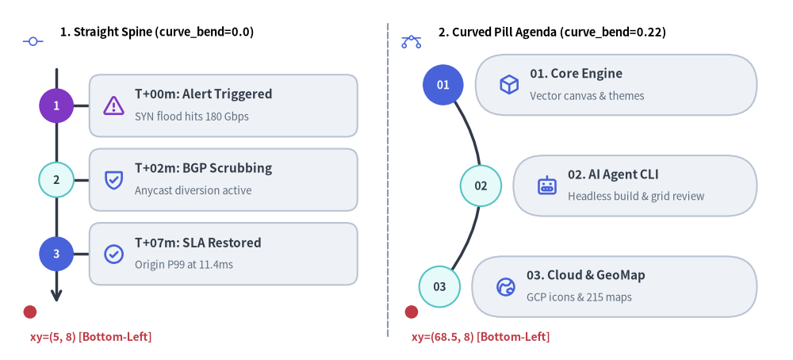
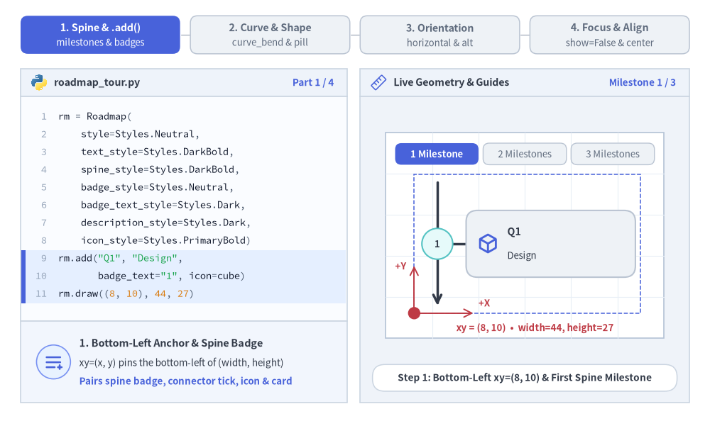
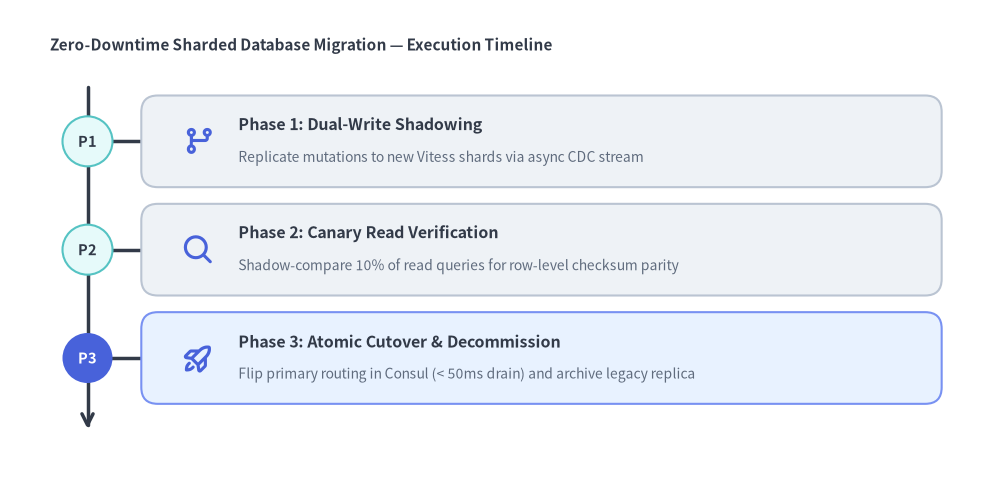
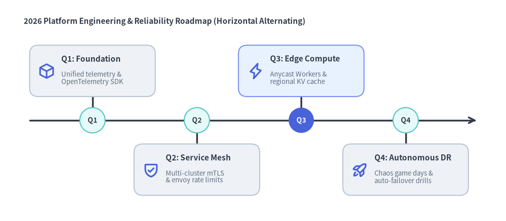

# Roadmap（ロードマップ）

`Roadmap` コンポーネントは、垂直または水平のスパイン（主軸）に沿って、時系列タイムライン、アジェンダシーケンス、段階的なエンジニアリングロードマップを描画します。
各マイルストーンは、スパイン上のバッジ（`badge_text`）およびコネクタ線と、マイルストーンタイトル（`text`）・補足説明（`description`）・オプションのベクター `icon` を収めた角丸矩形またはピル型カード（`card_shape="rounded_rect" | "pill"`）を組み合わせて表現します。


<figure class="drawlib-image" style="text-align: center;">
  
  <figcaption class="drawlib-caption">Roadmap のスパインモード: 直線垂直タイムライン（curve_bend=0.0）と曲線ピル型アジェンダ（curve_bend=0.22）</figcaption>
</figure>

<details class="drawlib-code-details">
<summary>Source Code</summary>

```python
from drawlib.canvas import save, setup
from drawlib.icons import phosphor
from drawlib.lines import line
from drawlib.shapes import circle
from drawlib.smartarts import Roadmap
from drawlib.styles import Styles
from drawlib.text import text

setup(width=132, height=60)

# Subtle center divider
line((64.5, 4.0), (64.5, 56.0), style=Styles.MutedDashed)

# 1. Left Panel: Vertical Straight Spine (curve_bend=0.0, card_shape="rounded_rect")
phosphor.git_commit(xy=(5.5, 53.0), width=3.4, style=Styles.PrimaryFlat)
text((10.0, 54.5), "1. Straight Spine (curve_bend=0.0)", style=Styles.BlackBold.patch(text_size=10.5, halign="left"))

rm_straight = Roadmap(
    style=Styles.Neutral,
    text_style=Styles.DarkBold.patch(text_size=11.0),
    description_style=Styles.Muted.patch(text_size=9.5),
    spine_style=Styles.DarkBold,
    badge_style=Styles.SecondaryNeutral,
    badge_text_style=Styles.DarkBold.patch(text_size=10.0),
    icon_style=Styles.PrimaryBold,
    direction="vertical",
    curve_bend=0.0,
    card_shape="rounded_rect",
)
rm_straight.add(
    "T+00m: Alert Triggered",
    "SYN flood hits 180 Gbps",
    badge_text="1",
    icon=phosphor.warning,
    badge_style=Styles.AccentFlat,
    badge_text_style=Styles.WhiteBold.patch(text_size=10.0),
    icon_style=Styles.AccentBold,
)
rm_straight.add("T+02m: BGP Scrubbing", "Anycast diversion active", badge_text="2", icon=phosphor.shield_check)
rm_straight.add(
    "T+07m: SLA Restored",
    "Origin P99 at 11.4ms",
    badge_text="3",
    icon=phosphor.check_circle,
    badge_style=Styles.PrimaryFlat,
    badge_text_style=Styles.WhiteBold.patch(text_size=10.0),
)
rm_straight.draw(xy=(5.0, 8.0), width=55.5, height=42.0)

circle((5.0, 8.0), radius=1.1, style=Styles.DangerFlat)
text((5.0, 3.8), "xy=(5, 8) [Bottom-Left]", style=Styles.DangerBold.patch(text_size=10.0, halign="left"))

# 2. Right Panel: Vertical Curved Spine (curve_bend=0.22, card_shape="pill")
phosphor.bezier_curve(xy=(68.5, 53.0), width=3.4, style=Styles.PrimaryFlat)
text((73.0, 54.5), "2. Curved Pill Agenda (curve_bend=0.22)", style=Styles.BlackBold.patch(text_size=10.5, halign="left"))

rm_curved = Roadmap(
    style=Styles.Neutral,
    text_style=Styles.DarkBold.patch(text_size=11.0),
    description_style=Styles.Muted.patch(text_size=9.5),
    spine_style=Styles.DarkBold,
    badge_style=Styles.SecondaryNeutral,
    badge_text_style=Styles.DarkBold.patch(text_size=10.0),
    icon_style=Styles.PrimaryBold,
    direction="vertical",
    curve_bend=0.22,
    card_shape="pill",
)
rm_curved.add(
    "01. Core Engine",
    "Vector canvas & themes",
    badge_text="01",
    icon=phosphor.cube,
    badge_style=Styles.PrimaryFlat,
    badge_text_style=Styles.WhiteBold.patch(text_size=10.0),
)
rm_curved.add("02. AI Agent CLI", "Headless build & grid review", badge_text="02", icon=phosphor.robot)
rm_curved.add("03. Cloud & GeoMap", "GCP icons & 215 maps", badge_text="03", icon=phosphor.globe_hemisphere_east)
rm_curved.draw(xy=(68.5, 8.0), width=58.5, height=42.0)

circle((68.5, 8.0), radius=1.1, style=Styles.DangerFlat)
text((68.5, 3.8), "xy=(68.5, 8) [Bottom-Left]", style=Styles.DangerBold.patch(text_size=10.0, halign="left"))

save()
```

</details>


---

## 1. 基本概念と基本的な使い方

`Roadmap` は `.add(text, description, badge_text=..., icon=...)` によって時系列タイムラインやマイルストーンアジェンダを段階的に構築し、デフォルトで `(width, height)` バウンディングボックス全体の**左下角 `(x, y)`**（`align="center"` の場合は中央）を基準に配置します。垂直スパインを滑らかなベジェ曲線へ湾曲させる表現（`curve_bend`, `card_shape="pill"`）や、`alternating=True` を伴う `direction="horizontal"` への切り替え、残りの要素の位置をずらさない `.items[i]` の強調・非表示化に対応しています。


<figure class="drawlib-image" style="text-align: center;">
  
  <figcaption class="drawlib-caption">基本的な使い方とパラメータツアー: スパインとマイルストーン、ベジェ曲線とピル型カード、水平交互レイアウト、強調と中央配置（APNG アニメーション）</figcaption>
</figure>

<details class="drawlib-code-details">
<summary>Source Code</summary>

```python
from __future__ import annotations

from drawlib.anim import Animation
from drawlib.canvas import save, setup
from drawlib.icons import code as code_icons
from drawlib.icons import phosphor
from drawlib.lines import line
from drawlib.shapes import circle, rectangle
from drawlib.smartarts import Roadmap, SourceCode, SourceCodeStyles
from drawlib.styles import Styles
from drawlib.text import text

W, H = 138.0, 82.0
setup(width=W, height=H)
anim = Animation(fps=10.0, loop=0)

CODE_TEXT_SIZE = 10.0
PT_TO_CANVAS = W / 720.0
FONT_CANVAS = CODE_TEXT_SIZE * PT_TO_CANVAS
LINE_H = FONT_CANVAS * 1.8
PAD_Y = FONT_CANVAS * 1.2

CODE_STYLES = SourceCodeStyles.get("default", font_lang="en", text_size=CODE_TEXT_SIZE).patch(
    box_style=Styles.Neutral.patch(shape_fill_color=(0, 0, 0, 0), shape_line_width=0),
)

PANE_HEADER = Styles.Neutral.patch(
    shape_fill_color=(238, 243, 250),
    shape_line_color=(203, 213, 225),
    shape_line_width=1.2,
    shape_r=0.0,
)
EDITOR_BODY = Styles.Neutral.patch(
    shape_fill_color=(250, 252, 255),
    shape_line_color=(203, 213, 225),
    shape_line_width=1.2,
    shape_r=0.0,
)
TAKEAWAY_BODY = Styles.Neutral.patch(
    shape_fill_color=(242, 246, 253),
    shape_line_color=(203, 213, 225),
    shape_line_width=1.2,
    shape_r=0.0,
)
STUDIO_BODY = Styles.Neutral.patch(
    shape_fill_color=(239, 243, 249),
    shape_line_color=(203, 213, 225),
    shape_line_width=1.2,
    shape_r=0.0,
)

PART_ITEMS = [
    ("1. Spine & .add()", "milestones & badges"),
    ("2. Curve & Shape", "curve_bend & pill"),
    ("3. Orientation", "horizontal & alt"),
    ("4. Focus & Align", "show=False & center"),
]


def draw_step_bar(active_part: int) -> None:
    """Draw top 4-part progress bar (active_part is 1..4)."""
    pill_w = 31.0
    pill_h = 7.4
    gap = 2.0
    start_x = 4.0 + pill_w / 2.0
    cy = 75.2

    for idx, (label, sublabel) in enumerate(PART_ITEMS, start=1):
        cx = start_x + (idx - 1) * (pill_w + gap)
        if idx > 1:
            prev_cx = cx - (pill_w + gap)
            line(
                (prev_cx + pill_w / 2.0 + 0.2, cy),
                (cx - pill_w / 2.0 - 0.2, cy),
                style=Styles.PrimaryBold if idx <= active_part else Styles.MutedThin,
            )

        if idx == active_part:
            st = Styles.PrimaryFlat.patch(shape_r=1.4)
            tst = Styles.WhiteBold.patch(text_size=10.3)
            sub_tst = Styles.White.patch(text_size=9.5)
        elif idx < active_part:
            st = Styles.PrimaryNeutral.patch(shape_r=1.4, shape_line_width=1.1)
            tst = Styles.PrimaryBold.patch(text_size=10.3)
            sub_tst = Styles.Primary.patch(text_size=9.5)
        else:
            st = Styles.Neutral.patch(shape_r=1.4, shape_line_width=1.1)
            tst = Styles.MutedBold.patch(text_size=10.3)
            sub_tst = Styles.Muted.patch(text_size=9.5)

        rectangle((cx, cy), width=pill_w, height=pill_h, style=st)
        text((cx, cy + 1.35), label, style=tst)
        text((cx, cy - 1.55), sublabel, style=sub_tst)


def draw_left_pane(
    active_part: int,
    code_lines: list[str],
    hl_range: tuple[int, int],
    icon_fn: object,
    summary_title: str,
    summary_line1: str,
    summary_line2: str,
) -> None:
    """Draw left Python code editor + bottom concept takeaway card."""
    x0, w = 4.0, 63.5
    cx = x0 + w / 2.0
    top_y = 63.2
    header_h = 5.4
    editor_h = 43.8
    takeaway_h = 15.8

    rectangle((cx, top_y + header_h / 2.0), width=w, height=header_h, style=PANE_HEADER)
    code_icons.python((x0 + 3.6, top_y + header_h / 2.0), width=3.4, style=Styles.Neutral)
    text(
        (x0 + 6.5, top_y + header_h / 2.0),
        "roadmap_tour.py",
        style=Styles.DarkBold.patch(text_size=10.2, halign="left"),
    )
    text(
        (x0 + w - 2.6, top_y + header_h / 2.0),
        f"Part {active_part} / 4",
        style=Styles.PrimaryBold.patch(text_size=9.8, halign="right"),
    )

    rectangle((cx, top_y - editor_h / 2.0), width=w, height=editor_h, style=EDITOR_BODY)

    hl_start, hl_end = hl_range
    hl_top = top_y - PAD_Y - hl_start * LINE_H
    hl_bot = top_y - PAD_Y - (hl_end + 1) * LINE_H
    hl_cy = (hl_top + hl_bot) / 2.0
    hl_h = hl_top - hl_bot
    rectangle(
        (cx, hl_cy),
        width=w - 0.6,
        height=hl_h,
        style=Styles.Neutral.patch(shape_fill_color=(229, 239, 255), shape_line_width=0),
    )
    rectangle(
        (x0 + 0.55, hl_cy),
        width=0.9,
        height=hl_h,
        style=Styles.PrimaryFlat.patch(shape_line_width=0),
    )

    SourceCode.draw(
        xy=(x0, top_y),
        width=w,
        code="\n".join(code_lines),
        styles=CODE_STYLES,
        code_lang="python",
        show_linenum=True,
        align="top_left",
    )

    take_cy = 3.6 + takeaway_h / 2.0
    rectangle((cx, take_cy), width=w, height=takeaway_h, style=TAKEAWAY_BODY)
    circle(
        (x0 + 6.4, take_cy),
        radius=3.3,
        style=Styles.PrimaryNeutral.patch(shape_line_width=1.2),
    )
    icon_fn((x0 + 6.4, take_cy), width=3.8, style=Styles.PrimaryBold)  # type: ignore[operator]
    text(
        (x0 + 11.4, take_cy + 3.6),
        summary_title,
        style=Styles.DarkBold.patch(text_size=10.4, halign="left"),
    )
    text(
        (x0 + 11.4, take_cy - 0.2),
        summary_line1,
        style=Styles.Dark.patch(text_size=9.7, halign="left"),
    )
    text(
        (x0 + 11.4, take_cy - 3.8),
        summary_line2,
        style=Styles.PrimaryBold.patch(text_size=9.6, halign="left"),
    )


def draw_geometry_studio(param_badge: str, footer_caption: str) -> tuple[float, float]:
    """Draw right geometry lab shell, inner coordinate sheet with subtle grid, and footer."""
    x0, w = 70.0, 64.0
    cx = x0 + w / 2.0
    top_y = 63.2
    header_h = 5.4
    body_h = 59.6

    rectangle((cx, top_y + header_h / 2.0), width=w, height=header_h, style=PANE_HEADER)
    phosphor.ruler((x0 + 3.6, top_y + header_h / 2.0), width=3.4, style=Styles.Primary)
    text(
        (x0 + 6.5, top_y + header_h / 2.0),
        "Live Geometry & Guides",
        style=Styles.DarkBold.patch(text_size=10.2, halign="left"),
    )
    text(
        (x0 + w - 2.6, top_y + header_h / 2.0),
        param_badge,
        style=Styles.PrimaryBold.patch(text_size=9.6, halign="right"),
    )

    rectangle((cx, 3.6 + body_h / 2.0), width=w, height=body_h, style=STUDIO_BODY)

    sheet_cx, sheet_cy = cx, 36.2
    sheet_w, sheet_h = 54.0, 40.0
    sx0, sy0 = sheet_cx - sheet_w / 2.0, sheet_cy - sheet_h / 2.0
    rectangle(
        (sheet_cx, sheet_cy),
        width=sheet_w,
        height=sheet_h,
        style=Styles.Neutral.patch(
            shape_fill_color=(255, 255, 255),
            shape_line_color=(180, 194, 214),
            shape_line_width=1.2,
        ),
    )
    g_st = Styles.MutedThin.patch(line_color=(232, 238, 246), line_width=0.8)
    for gx in range(1, 6):
        vx = sx0 + gx * (sheet_w / 6.0)
        line((vx, sy0), (vx, sy0 + sheet_h), style=g_st)
    for gy in range(1, 5):
        vy = sy0 + gy * (sheet_h / 5.0)
        line((sx0, vy), (sx0 + sheet_w, vy), style=g_st)

    rectangle(
        (cx, 8.4),
        width=59.2,
        height=5.2,
        style=Styles.Neutral.patch(
            shape_fill_color=(255, 255, 255),
            shape_line_color=(203, 213, 225),
            shape_line_width=1.1,
            shape_r=2.4,
        ),
        text=footer_caption,
        text_style=Styles.DarkBold.patch(text_size=9.8),
    )
    return sheet_cx, sheet_cy


def draw_sub_pills(scx: float, labels: list[str], active_idx: int) -> None:
    """Draw 3-step tracker pills near the top of the studio sheet."""
    pw, ph, pgap = 16.2, 4.2, 0.9
    p_start = scx - (3 * pw + 2 * pgap) / 2.0 + pw / 2.0
    for idx, lbl in enumerate(labels):
        px = p_start + idx * (pw + pgap)
        if idx == active_idx:
            pst = Styles.PrimaryFlat.patch(shape_r=1.2)
            ptst = Styles.WhiteBold.patch(text_size=9.5)
        elif idx < active_idx:
            pst = Styles.PrimaryNeutral.patch(shape_r=1.2, shape_line_width=1.0)
            ptst = Styles.PrimaryBold.patch(text_size=9.5)
        else:
            pst = Styles.Neutral.patch(shape_r=1.2, shape_line_width=1.0)
            ptst = Styles.Muted.patch(text_size=9.5)
        rectangle((px, 52.0), width=pw, height=ph, style=pst, text=lbl, text_style=ptst)


TITLE_DARK = Styles.DarkBold.patch(text_size=10.2)
DESC_DARK = Styles.Dark.patch(text_size=9.5)
BADGE_DARK = Styles.DarkBold.patch(text_size=9.5)
TITLE_WHITE = Styles.WhiteBold.patch(text_size=10.2)
DESC_WHITE = Styles.White.patch(text_size=9.5)
BADGE_WHITE = Styles.WhiteBold.patch(text_size=9.5)

# =========================================================================
# Part 1: Spine & .add() — Milestones, Badges & Bottom-Left Anchor
# =========================================================================
BUILD_STATES = [
    (
        1,
        3.2,
        [
            "rm = Roadmap(",
            "    style=Styles.Neutral,",
            "    text_style=Styles.DarkBold,",
            "    spine_style=Styles.DarkBold,",
            "    badge_style=Styles.Neutral,",
            "    badge_text_style=Styles.Dark,",
            "    description_style=Styles.Dark,",
            "    icon_style=Styles.PrimaryBold)",
            'rm.add("Q1", "Design",',
            '       badge_text="1", icon=cube)',
            "rm.draw((8, 10), 44, 27)",
        ],
        (8, 10),
        "Milestone 1 / 3",
        "Step 1: Bottom-Left xy=(8, 10) & First Spine Milestone",
        "1. Bottom-Left Anchor & Spine Badge",
        "xy=(x, y) pins the bottom-left of (width, height)",
        "Pairs spine badge, connector tick, icon & card",
    ),
    (
        2,
        3.3,
        [
            "rm = Roadmap(",
            "    style=Styles.Neutral, ...)",
            'rm.add("Q1", "Design",',
            '       badge_text="1", icon=cube)',
            "rm.add(",
            '    "Q2", "Canary",',
            '    badge_text="2", icon=shield,',
            "    style=Styles.PrimaryNeutral,",
            "    icon_style=Styles.PrimaryBold)",
            "rm.draw(xy=(8, 10),",
            "        width=44, height=27)",
        ],
        (4, 8),
        "Milestone 2 / 3",
        "Step 2: Second Milestone Subdivides Vertical Spine",
        "2. Progressive Spine Subdivision",
        "Each .add() distributes badges top-to-bottom",
        "Supports per-item card, badge & icon styles",
    ),
    (
        3,
        3.5,
        [
            "rm = Roadmap(",
            "    style=Styles.Neutral, ...)",
            'rm.add("Q1", "Design",',
            '       badge_text="1", icon=cube)',
            'rm.add("Q2", "Canary",',
            '       badge_text="2", ...)',
            "rm.add(",
            '    "Q3", "GA", icon=rocket,',
            '    badge_text="3",',
            "    badge_style=Styles.PrimaryFlat",
            ")  # rm.draw((8, 10), 44, 27)",
        ],
        (6, 10),
        "Milestone 3 / 3",
        "Step 3: Complete 3-Milestone Vertical Roadmap",
        "3. Balanced 3-Phase Roadmap",
        "Neutral cards keep >50% calm visual balance",
        "Focal PrimaryFlat badge highlights GA launch",
    ),
]

for b_idx, (n_ms, dur, code_b, hl_rng, badge_txt, foot_txt, s_t, s_1, s_2) in enumerate(BUILD_STATES):
    with anim.frame(duration=dur):
        draw_step_bar(1)
        draw_left_pane(1, code_b, hl_rng, phosphor.list_plus, s_t, s_1, s_2)
        scx, scy = draw_geometry_studio(badge_txt, foot_txt)
        draw_sub_pills(scx, ["1 Milestone", "2 Milestones", "3 Milestones"], b_idx)

        rx0, ry0, rw, rh = 80.5, 21.0, 44.0, 27.0

        rm = Roadmap(
            style=Styles.Neutral,
            text_style=TITLE_DARK,
            description_style=DESC_DARK,
            spine_style=Styles.DarkBold,
            badge_style=Styles.SecondaryNeutral,
            badge_text_style=BADGE_DARK,
            icon_style=Styles.PrimaryBold,
            direction="vertical",
            spacing=1.5,
        )
        rm.add("Q1", "Design", badge_text="1", icon=phosphor.cube)
        if n_ms >= 2:
            rm.add(
                "Q2",
                "Canary",
                badge_text="2",
                icon=phosphor.shield_check,
                style=Styles.PrimaryNeutral,
            )
        if n_ms >= 3:
            rm.add(
                "Q3",
                "GA",
                badge_text="3",
                icon=phosphor.rocket_launch,
                style=Styles.SecondaryNeutral,
                badge_style=Styles.PrimaryFlat,
                badge_text_style=BADGE_WHITE,
            )
        rm.draw(xy=(rx0, ry0), width=rw, height=rh)

        # Dashed (width=44, height=27) bounding box
        rectangle(
            (rx0 + rw / 2.0, ry0 + rh / 2.0),
            width=rw,
            height=rh,
            style=Styles.PrimaryDashed.patch(shape_fill_color=(0, 0, 0, 0), shape_line_width=1.1),
        )

        # Bottom-Left xy anchor + +X / +Y Cartesian axes
        line(
            (rx0, ry0),
            (rx0, ry0 + 9.2),
            arrow_head="->",
            style=Styles.DangerBold.patch(line_width=1.4),
        )
        text(
            (rx0 - 2.6, ry0 + 9.2),
            "+Y",
            style=Styles.DangerBold.patch(text_size=9.5),
        )
        line(
            (rx0, ry0),
            (rx0 + 11.5, ry0),
            arrow_head="->",
            style=Styles.DangerBold.patch(line_width=1.4),
        )
        text(
            (rx0 + 13.6, ry0 + 2.0),
            "+X",
            style=Styles.DangerBold.patch(text_size=9.5),
        )
        circle((rx0, ry0), radius=1.2, style=Styles.DangerFlat)
        text(
            (scx + 2.0, 18.1),
            "xy = (8, 10)  •  width=44, height=27",
            style=Styles.DangerBold.patch(text_size=9.5),
        )

# =========================================================================
# Part 2: Curve & Shape — curve_bend & card_shape="pill"
# =========================================================================
CURVE_STATES = [
    (
        0.0,
        "rounded_rect",
        3.3,
        "curve_bend = 0.0",
        'curve_bend=0.0, card_shape="rounded_rect": Straight Spine',
        "Straight Spine + Rounded Cards",
        "curve_bend=0.0 draws a vertical arrow spine",
        'card_shape="rounded_rect" uses subtle corners',
    ),
    (
        0.22,
        "pill",
        3.3,
        "curve_bend = +0.22",
        'curve_bend=0.22, card_shape="pill": Rightward Bezier Agenda',
        "Rightward Bezier Arc + Pill Cards",
        "Positive curve_bend (0..0.5) bows spine +X",
        'card_shape="pill" rounds caps to card_h / 2',
    ),
    (
        -0.20,
        "pill",
        3.4,
        "curve_bend = -0.20",
        'curve_bend=-0.20, card_shape="pill": Leftward Bezier Arc',
        "Leftward Bezier Arc (-0.5..0.5)",
        "Negative curve_bend bows quadratic arc -X",
        "Badges track exact Bezier point B(t) along arc",
    ),
]

for c_idx, (bend, c_shape, dur, badge_txt, foot_txt, s_t, s_1, s_2) in enumerate(CURVE_STATES):
    bend_str = "0.0" if bend == 0.0 else f"{bend:.2f}"
    code_c = [
        "rm = Roadmap(",
        "    style=Styles.Neutral, ..., ",
        '    direction="vertical",',
        f"    curve_bend={bend_str},",
        f'    card_shape="{c_shape}",',
        ")",
        'rm.add("Q1", "Design", icon=cube)',
        'rm.add("Q2", "Canary", ...)',
        'rm.add("Q3", "GA", ...)',
        "rm.draw((8, 10), 44, 27)",
    ]
    with anim.frame(duration=dur):
        draw_step_bar(2)
        draw_left_pane(2, code_c, (3, 4), phosphor.bezier_curve, s_t, s_1, s_2)
        scx, scy = draw_geometry_studio(badge_txt, foot_txt)
        draw_sub_pills(scx, ["Straight 0.0", "Curved +0.22", "Curved -0.20"], c_idx)

        rx0, ry0, rw, rh = 81.8, 21.0, 44.0, 27.0

        if c_idx != 0:
            # Straight vertical reference line + horizontal bow arrow at midpoint
            ref_x = rx0 + rw * 0.085
            line(
                (ref_x, ry0 + rh * 0.90),
                (ref_x, ry0 + rh * 0.10),
                style=Styles.DangerBold.patch(line_style="dashed", line_width=1.1),
            )

        rm = Roadmap(
            style=Styles.Neutral,
            text_style=TITLE_DARK,
            description_style=DESC_DARK,
            spine_style=Styles.DarkBold,
            badge_style=Styles.SecondaryNeutral,
            badge_text_style=BADGE_DARK,
            icon_style=Styles.PrimaryBold,
            direction="vertical",
            curve_bend=bend,
            card_shape=c_shape,
            spacing=1.5,
        )
        rm.add("Q1", "Design", badge_text="1", icon=phosphor.cube)
        rm.add(
            "Q2",
            "Canary",
            badge_text="2",
            icon=phosphor.shield_check,
            style=Styles.PrimaryNeutral,
            badge_style=Styles.PrimaryFlat,
            badge_text_style=BADGE_WHITE,
        )
        rm.add("Q3", "GA", badge_text="3", icon=phosphor.rocket_launch, style=Styles.SecondaryNeutral)
        rm.draw(xy=(rx0, ry0), width=rw, height=rh)

        if c_idx == 0:
            text(
                (scx, 18.1),
                'Straight spine (0.0)  •  card_shape="rounded_rect"',
                style=Styles.PrimaryBold.patch(text_size=9.5),
            )
        else:
            ref_x = rx0 + rw * 0.085
            mid_y = ry0 + rh * 0.50
            mid_x = rx0 + rw * (0.0875 + 0.5 * bend)
            edge_x = mid_x - 2.3 if bend > 0 else mid_x + 2.3
            line(
                (ref_x, mid_y),
                (edge_x, mid_y),
                arrow_head="->",
                style=Styles.DangerBold.patch(line_width=1.5),
            )
            text(
                (scx, 18.1),
                f'curve_bend = {bend:+.2f}  •  card_shape="pill"',
                style=Styles.DangerBold.patch(text_size=9.5),
            )

# =========================================================================
# Part 3: Orientation — direction="horizontal" & alternating
# =========================================================================
ORIENT_STATES = [
    (
        "vertical",
        False,
        3.3,
        'direction="vertical"',
        'direction="vertical" (Default): Top-to-Bottom Spine',
        'Vertical Spine (direction="vertical")',
        "Milestones stack top-to-bottom along left spine",
        "Ideal for incident logs & migration chronicles",
    ),
    (
        "horizontal",
        False,
        3.3,
        "alternating = False",
        'direction="horizontal", alternating=False: Single Top Row',
        "Horizontal Single-Row Roadmap",
        "Spine runs left-to-right near bottom of box",
        "All milestone cards align in one row above spine",
    ),
    (
        "horizontal",
        True,
        3.4,
        "alternating = True",
        'direction="horizontal", alternating=True: Above & Below Spine',
        "Horizontal Alternating Layout",
        "Places horizontal spine along midline (y0 + H/2)",
        "Even cards (0, 2) above, odd cards (1) below",
    ),
]

for o_idx, (dir_val, alt_val, dur, badge_txt, foot_txt, s_t, s_1, s_2) in enumerate(ORIENT_STATES):
    w_lbl = 44 if dir_val == "vertical" else 48
    code_o = [
        "rm = Roadmap(",
        "    style=Styles.Neutral, ..., ",
        f'    direction="{dir_val}",',
        f"    alternating={alt_val},",
        "    spacing=1.5,",
        ")",
        'rm.add("Q1", "Design")',
        'rm.add("Q2", "Canary")',
        'rm.add("Q3", "GA")',
        f"rm.draw((8, 10), {w_lbl}, 27)",
    ]
    with anim.frame(duration=dur):
        draw_step_bar(3)
        draw_left_pane(3, code_o, (2, 3), phosphor.arrows_out_line_horizontal, s_t, s_1, s_2)
        scx, scy = draw_geometry_studio(badge_txt, foot_txt)
        draw_sub_pills(scx, ["Vertical", "Horiz (Row)", "Horiz (Alt)"], o_idx)

        rm = Roadmap(
            style=Styles.Neutral,
            text_style=TITLE_DARK,
            description_style=DESC_DARK,
            spine_style=Styles.DarkBold,
            badge_style=Styles.SecondaryNeutral,
            badge_text_style=BADGE_DARK,
            direction=dir_val,
            alternating=alt_val,
            spacing=1.5,
        )
        rm.add("Q1", "Design", badge_text="1")
        rm.add(
            "Q2",
            "Canary",
            badge_text="2",
            style=Styles.PrimaryNeutral,
            badge_style=Styles.PrimaryFlat,
            badge_text_style=BADGE_WHITE,
        )
        rm.add("Q3", "GA", badge_text="3", style=Styles.SecondaryNeutral)

        if dir_val == "vertical":
            rm.draw(xy=(80.5, 21.0), width=44.0, height=27.0)
            text(
                (scx, 18.1),
                "Top-to-bottom spine along left edge",
                style=Styles.PrimaryBold.patch(text_size=9.5),
            )
        elif not alt_val:
            rm.draw(xy=(78.0, 21.8), width=48.0, height=24.8)
            text(
                (scx, 18.1),
                "Spine near bottom  •  cards aligned in 1 top row",
                style=Styles.PrimaryBold.patch(text_size=9.5),
            )
        else:
            rm.draw(xy=(78.0, 20.8), width=48.0, height=27.2)
            text(
                (scx, 18.1),
                "Midline spine  •  Q1 & Q3 above, Q2 below",
                style=Styles.PrimaryBold.patch(text_size=9.5),
            )

# =========================================================================
# Part 4: Focus & Align — items[1] Override, show=False & align="center"
# =========================================================================
FOCUS_STATES = [
    (
        "focal_override",
        3.3,
        [
            "rm = Roadmap(",
            "    style=Styles.Neutral, ...)",
            'rm.add("Q1", "Design", icon=cube)',
            'rm.add("Q2", "Canary", ...)',
            'rm.add("Q3", "GA", ...)',
            "mid = rm.items[1]",
            "mid.style = Styles.PrimaryFlat",
            "mid.text_style = Styles.WhiteBold",
            "mid.badge_style = (",
            "    Styles.PrimaryFlat)",
            "rm.draw((8, 10), 44, 27)",
        ],
        (5, 9),
        "items[1].style",
        "Deferred Override: Spotlight rm.items[1] Before .draw()",
        "Focal Milestone Override (.items[1])",
        "Mutate style, badge_style & text_style in place",
        "Highlights active phase while others stay Neutral",
    ),
    (
        "hide_mid",
        3.4,
        [
            "rm = Roadmap(",
            "    style=Styles.Neutral, ...)",
            'rm.add("Q1", "Design", icon=cube)',
            'rm.add("Q2", "Canary", ...)',
            'rm.add("Q3", "GA", ...)',
            "",
            "# Hide Q2; spine & slots stay!",
            "rm.items[1].show = False",
            "",
            "rm.draw((8, 10), 44, 27)",
        ],
        (6, 7),
        "items[1].show=False",
        "rm.items[1].show = False: Preserves Milestone Slot on Spine",
        "Slot-Preserving Visibility (.show = False)",
        "Hides Q2 badge, connector & card without reflow",
        "Q1 and Q3 keep their exact Y positions on spine",
    ),
    (
        "center_align",
        3.5,
        [
            "rm = Roadmap(",
            "    style=Styles.Neutral, ...)",
            'rm.add("Q1", "Design", icon=cube)',
            'rm.add("Q2", "Canary", ...)',
            'rm.add("Q3", "GA", ...)',
            "",
            "# Center bounding box on xy",
            "rm.draw(",
            "    xy=(34, 26),",
            "    width=46, height=26,",
            '    align="center")',
        ],
        (6, 10),
        'align = "center"',
        'align="center": Centers Bounding Box on xy=(cx, cy)',
        'Centered Anchor (align="center")',
        "Centers (width, height) box on xy=(cx, cy)",
        "Convenient for slide & grid cell midlines",
    ),
]

for f_idx, (f_mode, dur, code_f, hl_rng, badge_txt, foot_txt, s_t, s_1, s_2) in enumerate(FOCUS_STATES):
    with anim.frame(duration=dur):
        draw_step_bar(4)
        draw_left_pane(4, code_f, hl_rng, phosphor.sliders_horizontal, s_t, s_1, s_2)
        scx, scy = draw_geometry_studio(badge_txt, foot_txt)
        draw_sub_pills(scx, ["Focal .style", ".show = False", 'align="center"'], f_idx)

        rx0, ry0, rw, rh = 80.5, 21.0, 44.0, 27.0

        rm = Roadmap(
            style=Styles.Neutral,
            text_style=TITLE_DARK,
            description_style=DESC_DARK,
            spine_style=Styles.DarkBold,
            badge_style=Styles.SecondaryNeutral,
            badge_text_style=BADGE_DARK,
            icon_style=Styles.PrimaryBold,
            direction="vertical",
            spacing=1.5,
        )
        rm.add("Q1", "Design", badge_text="1", icon=phosphor.cube)
        rm.add(
            "Q2",
            "Canary",
            badge_text="2",
            icon=phosphor.shield_check,
            style=Styles.PrimaryNeutral,
        )
        rm.add("Q3", "GA", badge_text="3", icon=phosphor.rocket_launch, style=Styles.SecondaryNeutral)

        if f_mode == "focal_override":
            mid = rm.items[1]
            mid.style = Styles.PrimaryFlat
            mid.text_style = TITLE_WHITE
            mid.description_style = DESC_WHITE
            mid.badge_style = Styles.PrimaryFlat
            mid.badge_text_style = BADGE_WHITE
            mid.icon_style = Styles.WhiteBold
            rm.draw(xy=(rx0, ry0), width=rw, height=rh)
            text(
                (scx, 18.1),
                "items[1].style = Styles.PrimaryFlat  (in-place)",
                style=Styles.PrimaryBold.patch(text_size=9.5),
            )
        elif f_mode == "hide_mid":
            rm.items[1].show = False
            rm.draw(xy=(rx0, ry0), width=rw, height=rh)

            # Ghost slot matching _draw_vertical_straight geometry
            spine_x = rx0 + 3.18
            yi_mid = ry0 + 14.5
            card_left = spine_x + 1.68 + 2.6
            card_w = (rx0 + rw - 1.0) - card_left
            cx_card = card_left + card_w / 2.0
            ghost_st = Styles.MutedDashed.patch(
                shape_fill_color=(248, 250, 252),
                shape_line_color=(148, 163, 184),
                shape_line_width=1.2,
                shape_r=1.1,
            )
            circle((spine_x, yi_mid), radius=1.68, style=ghost_st)
            rectangle(
                (cx_card, yi_mid),
                width=card_w,
                height=6.0,
                style=ghost_st,
                text="slot preserved (show=False)",
                text_style=Styles.MutedBold.patch(text_size=9.5),
            )
            text(
                (scx, 18.1),
                "Q1 & Q3 hold exact spine Y coordinates",
                style=Styles.PrimaryBold.patch(text_size=9.5),
            )
        else:
            cx_a, cy_a = scx, 34.3
            cw_a, ch_a = 46.5, 25.6
            rm.draw(xy=(cx_a, cy_a), width=cw_a, height=ch_a, align="center")
            rectangle(
                (cx_a, cy_a),
                width=cw_a,
                height=ch_a,
                style=Styles.PrimaryDashed.patch(shape_fill_color=(0, 0, 0, 0), shape_line_width=1.2),
            )
            line(
                (cx_a - cw_a / 2.0 - 2.3, cy_a),
                (cx_a - cw_a / 2.0, cy_a),
                style=Styles.DangerBold.patch(line_width=1.5),
            )
            line(
                (cx_a + cw_a / 2.0, cy_a),
                (cx_a + cw_a / 2.0 + 2.3, cy_a),
                style=Styles.DangerBold.patch(line_width=1.5),
            )
            line(
                (cx_a, cy_a + ch_a / 2.0),
                (cx_a, cy_a + ch_a / 2.0 + 1.8),
                style=Styles.DangerBold.patch(line_width=1.5),
            )
            line(
                (cx_a, cy_a - ch_a / 2.0 - 1.8),
                (cx_a, cy_a - ch_a / 2.0),
                style=Styles.DangerBold.patch(line_width=1.5),
            )
            circle(
                (cx_a, cy_a),
                radius=1.5,
                style=Styles.Neutral.patch(shape_fill_color=(255, 255, 255), shape_line_width=0),
            )
            circle((cx_a, cy_a), radius=1.08, style=Styles.DangerFlat)
            text(
                (cx_a, 18.0),
                'xy = (34, 26)  •  align="center"',
                style=Styles.DangerBold.patch(text_size=9.5),
            )

save()
```

</details>


- **スパインとマイルストーンの構築（`.add()`, `xy`）**: `text`・`description`・`badge_text`・オプションの `icon` を持つマイルストーンを順に追加し、デフォルトで**左下 `xy`** を基準とする `(width, height)` 領域内に描画します。
- **ベジェ曲線とカード形状（`curve_bend`, `card_shape`）**: 直線矢印スパインと `"rounded_rect"` カードの組み合わせには `curve_bend=0.0` を維持し、滑らかな 2 次ベジェ曲線のアジェンダには `[-0.5, 0.5]` の範囲の `curve_bend` と `card_shape="pill"` を指定します。
- **垂直方向と水平方向の切り替え（`direction`, `alternating`）**: 左から右へ進むロードマップには `direction="horizontal"` を指定し、さらに `alternating=True` を有効にすると中央スパインの上下に偶数・奇数のマイルストーンカードを交互に配置できます。
- **動的な要素変更と中央配置（`.items[i]`, `align="center"`）**: `rm.items[i].style` を上書きして特定の注目マイルストーンを強調したり、`rm.items[i].show = False` で他の要素の位置をずらさずに非表示にしたり、`align="center"` でバウンディングボックスを `(cx, cy)` の中央に配置したりできます。

---

## 2. 垂直タイムラインと曲線アジェンダ（`direction="vertical"`）

`direction="vertical"`（デフォルト）では、マイルストーンが**上から下へ**流れます。`curve_bend=0.0` を設定すると下向き矢印付きの直線垂直スパインと円形マイルストーンバッジが描画され、`0` 以外の `curve_bend`（`-0.5` 〜 `0.5`）を設定するとスパインが 2 次ベジェ曲線に沿って湾曲し、各マイルストーンカードも曲線に追従して水平方向へシフトします。


```python
from drawlib.canvas import save, setup
from drawlib.icons import phosphor
from drawlib.smartarts import Roadmap
from drawlib.styles import Styles
from drawlib.text import text

setup(width=120, height=58)

text((6.0, 52.5), "Zero-Downtime Sharded Database Migration — Execution Timeline", style=Styles.DarkBold.patch(text_size=11.0, halign="left"))

migration = Roadmap(
    style=Styles.Neutral,
    text_style=Styles.DarkBold.patch(text_size=11.5),
    description_style=Styles.Muted.patch(text_size=10.0),
    spine_style=Styles.DarkBold,
    badge_style=Styles.SecondaryNeutral,
    badge_text_style=Styles.DarkBold.patch(text_size=10.5),
    icon_style=Styles.PrimaryBold,
    direction="vertical",
    curve_bend=0.0,
    card_shape="rounded_rect",
)
migration.add(
    "Phase 1: Dual-Write Shadowing",
    "Replicate mutations to new Vitess shards via async CDC stream",
    badge_text="P1",
    icon=phosphor.git_branch,
)
migration.add(
    "Phase 2: Canary Read Verification",
    "Shadow-compare 10% of read queries for row-level checksum parity",
    badge_text="P2",
    icon=phosphor.magnifying_glass,
)
migration.add(
    "Phase 3: Atomic Cutover & Decommission",
    "Flip primary routing in Consul (< 50ms drain) and archive legacy replica",
    badge_text="P3",
    icon=phosphor.rocket_launch,
    style=Styles.PrimaryNeutral,
    badge_style=Styles.PrimaryFlat,
    badge_text_style=Styles.WhiteBold.patch(text_size=10.5),
)
migration.draw(xy=(6.0, 5.0), width=108.0, height=44.0)

save()
```

<figure class="drawlib-image" style="text-align: center;">
  
  <figcaption class="drawlib-caption">垂直方向の Roadmap によるデータベース無停止マイグレーション実行タイムライン</figcaption>
</figure>


---

## 3. 上下交互配置の水平マイルストーンロードマップ（`direction="horizontal"`）

`direction="horizontal"` を指定すると、右向き矢印付きのスパインが**左から右へ**伸びます。`alternating=True` を設定すると、偶数インデックス（`0, 2, 4...`）のマイルストーンカードが水平スパインの**上側**に、奇数インデックス（`1, 3, 5...`）のカードが**下側**に交互に配置されるため、横方向の窮屈さを避けつつ長めのマイルストーンタイトル（`text`）や説明文（`description`）を収めることができます。


```python
from drawlib.canvas import save, setup
from drawlib.icons import phosphor
from drawlib.smartarts import Roadmap
from drawlib.styles import Styles
from drawlib.text import text

setup(width=128, height=56)

text((6.0, 50.5), "2026 Platform Engineering & Reliability Roadmap (Horizontal Alternating)", style=Styles.DarkBold.patch(text_size=11.0, halign="left"))

quarters = Roadmap(
    style=Styles.Neutral,
    text_style=Styles.DarkBold.patch(text_size=11.0),
    description_style=Styles.Muted.patch(text_size=9.5),
    spine_style=Styles.DarkBold,
    badge_style=Styles.SecondaryNeutral,
    badge_text_style=Styles.DarkBold.patch(text_size=10.0),
    icon_style=Styles.PrimaryBold,
    direction="horizontal",
    alternating=True,
    card_shape="rounded_rect",
)
quarters.add(
    "Q1: Foundation",
    "Unified telemetry &\nOpenTelemetry SDK",
    badge_text="Q1",
    icon=phosphor.cube,
)
quarters.add(
    "Q2: Service Mesh",
    "Multi-cluster mTLS\n& envoy rate limits",
    badge_text="Q2",
    icon=phosphor.shield_check,
)
quarters.add(
    "Q3: Edge Compute",
    "Anycast Workers &\nregional KV cache",
    badge_text="Q3",
    icon=phosphor.lightning,
    style=Styles.PrimaryNeutral,
    badge_style=Styles.PrimaryFlat,
    badge_text_style=Styles.WhiteBold.patch(text_size=10.0),
)
quarters.add(
    "Q4: Autonomous DR",
    "Chaos game days &\nauto-failover drills",
    badge_text="Q4",
    icon=phosphor.rocket_launch,
)
quarters.draw(xy=(6.0, 4.0), width=116.0, height=43.0)

save()
```

<figure class="drawlib-image" style="text-align: center;">
  
  <figcaption class="drawlib-caption">水平・上下交互レイアウトによる年間プラットフォームエンジニアリングロードマップ</figcaption>
</figure>


---

## 4. スパインモードと座標ジオメトリ

- **アンカー基準位置（`xy`, `align`）**: `Roadmap.draw(xy=(x, y), width=W, height=H, align="bottom_left")` は全体のバウンディングボックスの左下角を `(x, y)` に固定し、右方向（`+x`）に `W` 単位、上方向（`+y`）に `H` 単位の領域へ展開します。`align="center"` の場合は `(W, H)` のバウンディングボックスを `(x, y)` の中央に配置します。
- **垂直スパインモード（`direction="vertical"`）**:
  - `curve_bend = 0.0` *（デフォルト）*: 左側に下向き矢印（`->`）付きの直線垂直スパインを描画し、スパイン上の円形マイルストーンバッジから各カードへ水平コネクタ線を伸ばします。
  - `curve_bend != 0.0`（範囲 `-0.5` 〜 `0.5`）: 2 次ベジェ曲線スパイン（`line_bezier1`）を描画します。各マイルストーンバッジとカードは、`[0, 1]` 区間のパラメータ `t` に対する正確なベジェ曲線上の点 `B(t)` に沿って水平方向にオフセット配置されます。
- **水平スパインモード（`direction="horizontal"`）**:
  - `alternating = False` *（デフォルト）*: バウンディングボックスの下部付近に水平スパインを配置し、すべてのマイルストーンカードをスパイン上部の 1 行に揃えて並べます。
  - `alternating = True`: 垂直方向の中央線（`y0 + H/2`）に沿って水平スパインを配置し、カードをスパインの上下に交互に振り分けます。
- **カード形状（`card_shape`）**:
  - `"rounded_rect"` *（デフォルト）*: マイルストーンの `badge_style` と連動した左端アクセントストライプ付きの標準的な角丸矩形カード（`shape_r=2.0`）。
  - `"pill"`: 曲線型アジェンダレイアウトに最適なカプセル／スタジアム型カード（`shape_r = card_height / 2`）。

---

## 5. API リファレンス

### コンストラクタ
```python
Roadmap(
    *,
    style: Style,
    text_style: Style,
    spine_style: Style,
    badge_style: Style,
    badge_text_style: Style,
    description_style: Style | None = None,
    icon_style: Style | None = None,
    direction: Literal["vertical", "horizontal"] = "vertical",
    curve_bend: float = 0.0,
    card_shape: Literal["pill", "rounded_rect"] = "rounded_rect",
    alternating: bool = False,
    spacing: float = 2.5,
)
```

### メソッドとプロパティ
- **`add(text: str, description: str = "", *, badge_text: str | None = None, icon: Callable | None = None, style: Style | None = None, text_style: Style | None = None, description_style: Style | None = None, badge_style: Style | None = None, badge_text_style: Style | None = None, icon_style: Style | None = None, show: bool = True) -> RoadmapItem`**:
  マイルストーン項目（`text` がマイルストーンの主タイトル、`description` が補足説明・サブタイトル）を末尾に追加し、変更可能な `RoadmapItem` を返します。`item.show = False` を設定すると、スパイン（主軸）と残りの全マイルストーンの正確な位置を維持したまま、該当マイルストーンのバッジ・コネクタ・カードを非表示にします。
- **`roadmap.items -> list[RoadmapItem]`**:
  事後変更用の登録済み `RoadmapItem` インスタンスのリストを返します。
- **`draw(xy: tuple[float, float], width: float = 100.0, height: float = 60.0, *, align: Literal["bottom_left", "center"] = "bottom_left", scale: float = 1.0) -> Self`**:
  `xy`（デフォルトは左下角、`align="center"` の場合は中央）を基準とする `(width, height)` のバウンディングボックス内に、スパイン、マイルストーンバッジ、コネクタ、およびカードを描画します。

