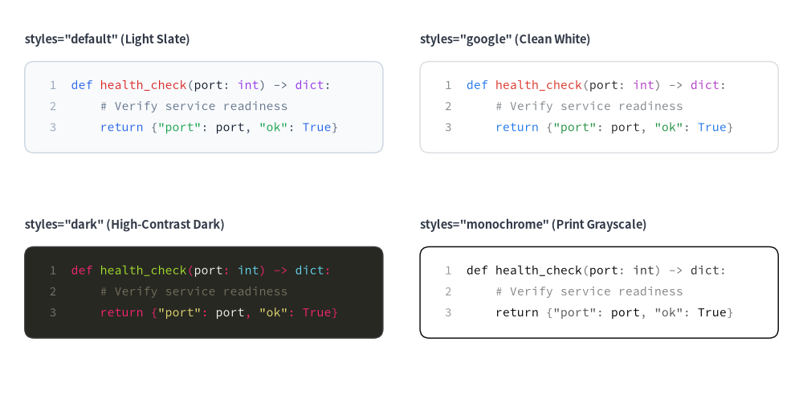
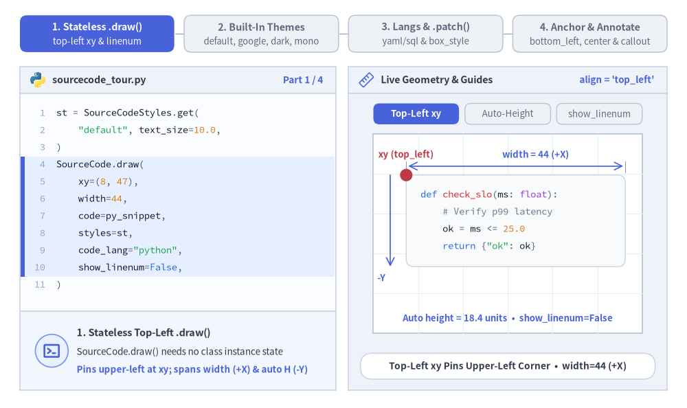
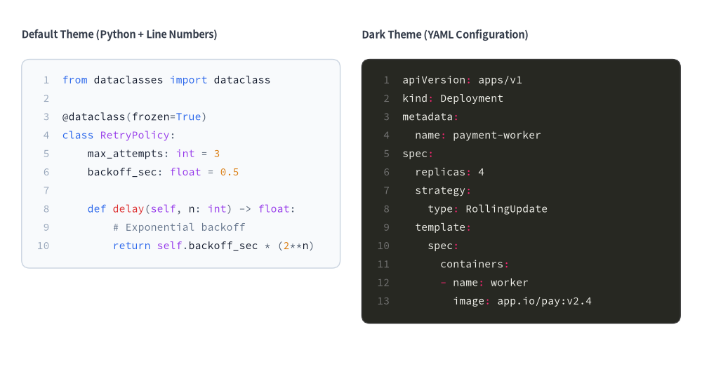
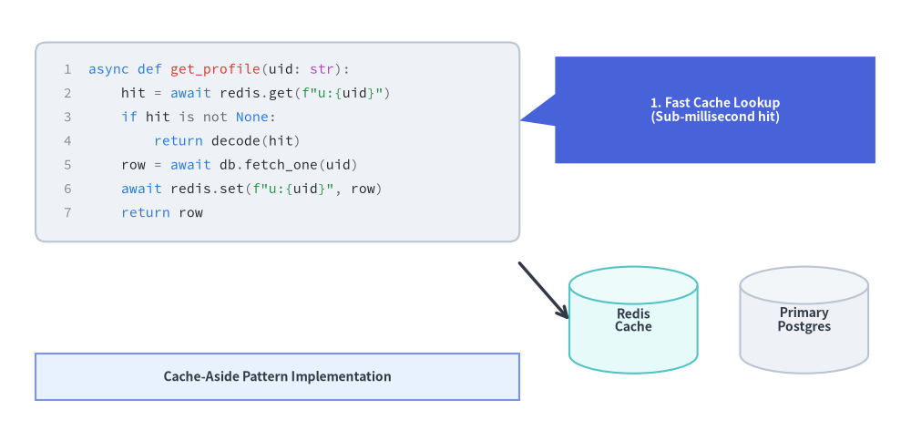

# SourceCode（ソースコードカード）

`SourceCode` コンポーネントは、Pygments を用いてシンタックスハイライトされたソースコード断片を、鮮明なベクター図形およびタイポグラフィとして Drawlib キャンバス上に直接描画します。
組み込みのシンタックステーマ、任意の行番号ガター、CJK 対応の等幅フォント、およびトークンごとの色カスタマイズに対応しています。


<figure class="drawlib-image" style="text-align: center;">
  
  <figcaption class="drawlib-caption">SourceCode の概要: 組み込みシンタックステーマ（default・google・dark・monochrome）</figcaption>
</figure>

<details class="drawlib-code-details">
<summary>Source Code</summary>

```python
from drawlib.canvas import save, setup
from drawlib.smartarts import SourceCode, SourceCodeStyles
from drawlib.styles import Styles
from drawlib.text import text

setup(width=130, height=64)

snippet = """def health_check(port: int) -> dict:
    # Verify service readiness
    return {"port": port, "ok": True}"""

themes = [
    ("default", (4, 54), 'styles="default" (Light Slate)'),
    ("google", (68, 54), 'styles="google" (Clean White)'),
    ("dark", (4, 24), 'styles="dark" (High-Contrast Dark)'),
    ("monochrome", (68, 24), 'styles="monochrome" (Print Grayscale)'),
]

for theme_name, (x, y), label in themes:
    text((x, y + 3.5), label, style=Styles.DarkBold.patch(text_size=10.5, halign="left"))
    sc_styles = SourceCodeStyles.get(theme_name, font_lang="en", text_size=10.5)
    SourceCode.draw(
        xy=(x, y),
        width=58,
        code=snippet,
        styles=sc_styles,
        code_lang="python",
        show_linenum=True,
    )

save()
```

</details>


> **吹き出しやコールアウトをお探しですか？** `bubblespeech()` プリミティブについては **[吹き出し・バッジ・ステータス](../02_drawing_primitives/shapes_badge.md)** を参照してください。

---

## 1. 基本概念と基本的な使い方

`SourceCode.draw(...)`（または `sourcecode(...)`）は、Pygments でトークン化されたコードブロックをステートレスに描画します。デフォルトでは**左上 `xy=(x, y)`** をアンカーとし（`align="top_left"`）、右方向 `+X` へ `width` 分広がり、下方向 `-Y` のコンテナ高さをコード行数と `text_size` から自動計算します。`SourceCodeStyles.get(...)` と `.patch(...)` を組み合わせることで、組み込みテーマ（`"default"`、`"google"`、`"dark"`、`"monochrome"`）の切り替え、20 以上の言語のハイライト、行番号ガター（`show_linenum`）の表示切り替え、アンカー位置揃え（`"bottom_left"`、`"center"`）の変更を行えます。


<figure class="drawlib-image" style="text-align: center;">
  
  <figcaption class="drawlib-caption">基本的な使い方とパラメータツアー: ステートレスな左上描画・組み込みテーマ・言語レキサーと .patch()・アンカー位置揃えと行注釈（APNG アニメーション）</figcaption>
</figure>


<div class="drawlib-source-link">
  <a href="https://github.com/yuichi110/drawlib/blob/main/docs/docs_src/ja/04_smartarts/source_code.md" target="_blank" rel="noopener noreferrer">GitHub でアニメーションのソースコードを見る &rarr;</a>
</div>

- **ステートレスな左上描画（`SourceCode.draw` / `sourcecode`）**: インスタンス状態を持たずに `code` または `file` から直接描画します。デフォルトで `xy` を左上に固定して下方向 `-Y` へ高さを自動算出し、`show_linenum=True` の場合は行番号ガター領域を確保します。
- **組み込みテーマと CJK フォント（`SourceCodeStyles.get`）**: 任意の `text_size` で `"default"`、`"google"`、`"dark"`、`"monochrome"` のプリセットを選択でき、`font_lang` に `"ja"`、`"zh-cn"`、`"zh-tw"`、`"ko"` を指定すると CJK 対応の等幅フォントへ自動的に切り替わります。
- **多言語レキサーと `.patch()`（`code_lang`, `box_style`）**: Pygments を通じて 20 以上の言語（`"python"`、`"yaml"`、`"sql"`、`"go"` など）をハイライトし、`styles.patch(...)` によってコンテナ枠線・角丸半径（`shape_r`）・個別トークンスタイルを自在にカスタマイズできます。
- **柔軟なアンカーと行単位の注釈（`align`）**: `align="top_left"` *（デフォルト）*、`"bottom_left"`、`"center"` をサポートします。共有ベクターキャンバス上に描画されるため、特定の行へ直接矢印や吹き出しを向けることができます。

---

## 2. 行番号付きシンタックスハイライトコード（`SourceCode.draw`）

`SourceCode.draw(...)`（または関数エイリアスの `sourcecode(...)`）は、デフォルトで**左上角 `xy=(x, y)`** をアンカーとする（`align="top_left"`）シンタックスハイライト付きのコードブロックを描画します。トークン色・コンテナスタイル・フォントサイズ・CJK 言語フォントは `SourceCodeStyles.get(...)` で設定します。


```python
from drawlib.canvas import save, setup
from drawlib.smartarts import SourceCode, SourceCodeStyles
from drawlib.styles import Styles
from drawlib.text import text

setup(width=130, height=68)

# 1. Left: Default Light Theme with Python Code
text((4, 61.5), "Default Theme (Python + Line Numbers)", style=Styles.DarkBold.patch(text_size=10.5, halign="left"))

py_code = """from dataclasses import dataclass

@dataclass(frozen=True)
class RetryPolicy:
    max_attempts: int = 3
    backoff_sec: float = 0.5

    def delay(self, n: int) -> float:
        # Exponential backoff
        return self.backoff_sec * (2**n)"""

light_styles = SourceCodeStyles.get("default", font_lang="en", text_size=10.5)
SourceCode.draw(
    xy=(4, 57),
    width=59,
    code=py_code,
    styles=light_styles,
    code_lang="python",
    show_linenum=True,
)

# 2. Right: Dark Theme with Kubernetes YAML Config
text((67, 61.5), "Dark Theme (YAML Configuration)", style=Styles.DarkBold.patch(text_size=10.5, halign="left"))

yaml_code = """apiVersion: apps/v1
kind: Deployment
metadata:
  name: payment-worker
spec:
  replicas: 4
  strategy:
    type: RollingUpdate
  template:
    spec:
      containers:
      - name: worker
        image: app.io/pay:v2.4"""

dark_styles = SourceCodeStyles.get("dark", font_lang="en", text_size=10.5)
SourceCode.draw(
    xy=(67, 57),
    width=59,
    code=yaml_code,
    styles=dark_styles,
    code_lang="yaml",
    show_linenum=True,
)
save()
```

<figure class="drawlib-image" style="text-align: center;">
  
  <figcaption class="drawlib-caption">行番号付きの Python および YAML シンタックスハイライトブロック</figcaption>
</figure>


---

## 3. アーキテクチャ図・チュートリアル図でのコード注釈

`SourceCode.draw()` は共有ベクターキャンバス上に直接描画されるため、吹き出し（`bubblespeech`）・アーキテクチャノード・矢印とコードコンテナを組み合わせて、注釈付きのコード解説図を作成できます。


```python
from drawlib.canvas import save, setup
from drawlib.lines import line
from drawlib.shapes import bubblespeech, cylinder, rectangle
from drawlib.smartarts import SourceCode, SourceCodeStyles
from drawlib.styles import Styles

setup(width=128, height=62)

# 1. Left: Syntax-Highlighted Code Block
snippet = """async def get_profile(uid: str):
    hit = await redis.get(f"u:{uid}")
    if hit is not None:
        return decode(hit)
    row = await db.fetch_one(uid)
    await redis.set(f"u:{uid}", row)
    return row"""

code_styles = SourceCodeStyles.get("google", font_lang="en", text_size=10.5).patch(
    box_style=Styles.Neutral.patch(shape_r=1.5),
)
SourceCode.draw(
    xy=(5, 56),
    width=68,
    code=snippet,
    styles=code_styles,
    code_lang="python",
    show_linenum=True,
)

# 2. Callout Bubble pointing to the cache-aside lookup line
bubblespeech(
    xy=(78, 39),
    width=45,
    height=15,
    tail_edge="left",
    tail_start_ratio=0.35,
    tail_end_ratio=0.65,
    tail_vertex_xy=(73, 45),
    style=Styles.PrimaryFlat.patch(shape_r=1.2),
    text="1. Fast Cache Lookup\n(Sub-millisecond hit)",
    text_style=Styles.WhiteBold.patch(text_size=10.0),
)

# 3. Downstream Persistence Nodes referenced by the code
cylinder(
    xy=(89, 17),
    width=18,
    height=15,
    style=Styles.SecondaryNeutral,
    text="Redis\nCache",
    text_style=Styles.DarkBold.patch(text_size=10.0),
)
cylinder(
    xy=(113, 17),
    width=18,
    height=15,
    style=Styles.Neutral,
    text="Primary\nPostgres",
    text_style=Styles.DarkBold.patch(text_size=10.0),
)

line((73, 25), (80, 17), arrow_head="->", style=Styles.DarkBold)
rectangle(
    (39, 9),
    width=68,
    height=6.5,
    style=Styles.PrimaryNeutral,
    text="Cache-Aside Pattern Implementation",
    text_style=Styles.DarkBold.patch(text_size=10.0),
)
save()
```

<figure class="drawlib-image" style="text-align: center;">
  
  <figcaption class="drawlib-caption">吹き出しとアーキテクチャ構成要素を組み合わせた注釈付き SourceCode 解説図</figcaption>
</figure>


---

## 4. テーマ・対応言語・トークンのカスタマイズ（`SourceCodeStyles`）

### 組み込みテーマと CJK フォント選択
`SourceCodeStyles.get(styles, font_lang, *, font=None, text_size=12.0)`（または `get_source_code_styles(...)`）を使用します。
- **`styles`（テーマ名）**:
  - `"default"`: 落ち着いたライトスレートの背景に、青・緑・赤のシンタックスカラーを配したテーマ。
  - `"google"`: クリーンな白地カードに Google スタイルのシンタックスパレットを組み合わせたテーマ。
  - `"dark"`（または `"monokai"`、`"github-dark"`）: ハイコントラストなダークテーマ。
  - `"monochrome"`: 印刷に適したグレースケールテーマ。
- **`font_lang`**:
  - `"en"` *（デフォルト）*: `FontSourceCode.SOURCECODEPRO` を使用します。
  - `"ja"`, `"zh-cn"`, `"zh-tw"`, `"ko"`: `FontSourceCode.SOURCEHANCODEJP` を自動選択し、日本語や CJK のコメント・文字列が豆腐（文字化け）になるのを防ぎます。
- **`code_lang`**:
  - `"python"`, `"yaml"`, `"json"`, `"sql"`, `"bash"`, `"go"`, `"rust"`, `"typescript"`, `"javascript"`, `"html"`, `"css"`, `"dockerfile"`, `"toml"`, `"protobuf"`, `"c"`, `"cpp"`, `"java"`, `"kotlin"`, `"swift"`, `"markdown"`、または `None`（`file` の拡張子やコード内容から自動判定）をサポートします。

### トークンスタイルのカスタマイズ（`SourceCodeStyles` と `.patch()`）
`SourceCodeStyles` は、外側コンテナ・行番号ガター・8 種類のシンタックストークン区分を定義するイミュータブルな Pydantic モデルです。`styles.patch(...)` を呼び出すと、指定したフィールドを更新した新しい `SourceCodeStyles` インスタンスが返されます。

```python
from drawlib.smartarts import SourceCodeStyles
from drawlib.styles import Styles

custom_styles = SourceCodeStyles.get("default", font_lang="en", text_size=10.5).patch(
    box_style=Styles.Neutral.patch(shape_r=2.0),
    keyword=Styles.PrimaryBold,
    comment=Styles.Muted,
    text_size=10.5,  # Updates font size across all token types and line numbers
)
```

| フィールド / `.patch()` 引数 | 型 | 説明 |
| :--- | :--- | :--- |
| **`box_style`** | `Style` | 外側のコードコンテナ矩形の図形スタイル（角丸半径は `shape_r` で制御、デフォルト `1.5`）。 |
| **`linenum_style`** | `Style` | 左側ガターの右揃え行番号（`show_linenum=True`）のテキストスタイル。 |
| **`default`** | `Style` | 標準コードテキストおよび未分類の識別子のテキストスタイル。 |
| **`keyword`** | `Style` | 言語キーワード（`def`、`class`、`return`、`if`、`import` など）のテキストスタイル。 |
| **`string`** | `Style` | 文字列リテラルのテキストスタイル。 |
| **`comment`** | `Style` | 単一行および複数行コメントのテキストスタイル。 |
| **`number`** | `Style` | 整数および浮動小数点数値リテラルのテキストスタイル。 |
| **`function`** | `Style` | 関数名およびメソッド名のテキストスタイル。 |
| **`type_`** *（`.patch()` では `type` も可）* | `Style` | クラス名、型アノテーション、組み込み識別子のテキストスタイル。 |
| **`operator`** | `Style` | 演算子および句読点記号のテキストスタイル。 |
| **`text_size`** *（`.patch()` 内）* | `float \| None` | `.patch(text_size=...)` の簡易パラメータ。`linenum_style` と全 8 種類のトークンスタイルの `text_size` を一括更新します。 |

---

## 5. API リファレンス

### コードの描画（`SourceCode.draw` / `sourcecode`）
```python
SourceCode.draw(
    xy: tuple[float, float],           # Anchor coordinate (x, y) of the code container (interpreted via `align`)
    width: float,                      # Total container width in canvas units
    code: str | None = None,           # Source code string (mutually exclusive with `file`)
    *,
    styles: SourceCodeStyles,          # Required style configuration
    file: str | Path | None = None,    # Path to external source file (mutually exclusive with `code`)
    code_lang: str | None = None,      # Lexer language name (e.g. "python", "yaml", "sql")
    show_linenum: bool = False,        # Render line numbers in a left gutter
    align: Literal["top_left", "bottom_left", "center"] = "top_left",
    scale: float = 1.0,                # Proportional scale factor anchored at `xy`
) -> type[SourceCode]
```
- **関数エイリアス**: `sourcecode(...)` は `SourceCode.draw(...)` のトップレベル関数エイリアスであり、`get_source_code_styles(...)` は `SourceCodeStyles.get(...)` のトップレベル関数エイリアスです。
- **アンカー位置揃え（`align`）**: デフォルトは `"top_left"`（`xy` が左上角を固定し、下方向 `-Y` へ展開）です。`"bottom_left"` を渡すと左下角を固定（上方向 `+Y` へ展開）し、`"center"` を渡すと `width` と自動計算された高さの両方を `xy` 中心に配置します。
- **高さの自動計算**: コンテナの高さは、`code`（または `file`）の行数と `styles.default.text_size` から自動的に算出されます。
- **外部ファイルの読み込み**: `SourceCode.draw(...)` に直接 `file="path/to/example.py"` を渡すか、`SourceCode.get_text(file, strip=True)` でファイル文字列を読み込めます。

