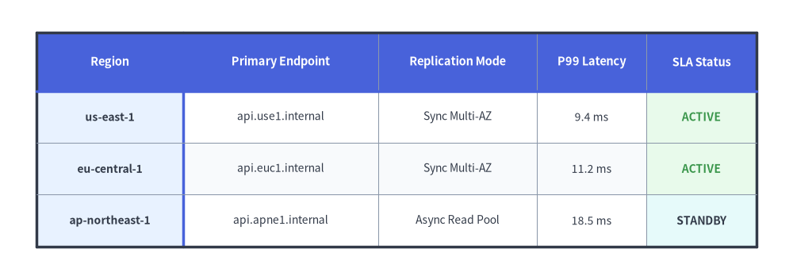
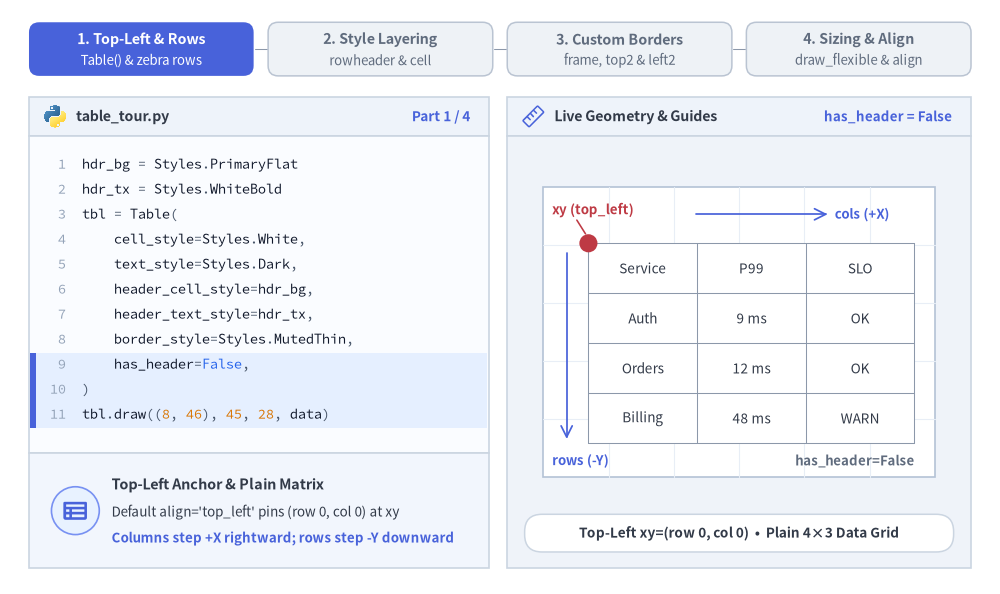
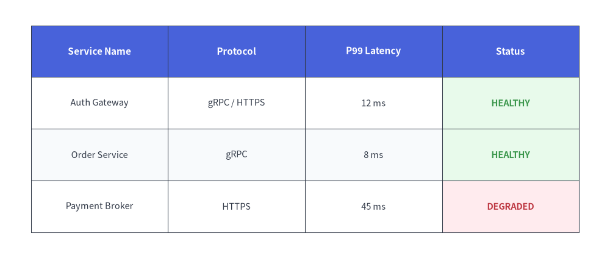
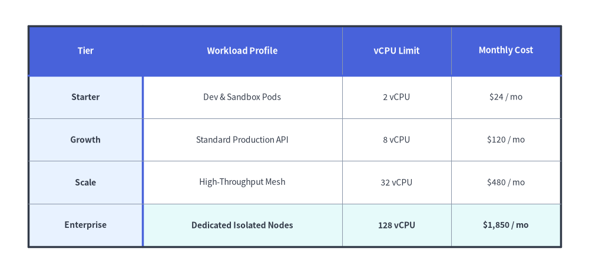

# Table（テーブル）

`Table` コンポーネントは、2 次元の表形式データ、比較マトリクス、データベーススキーマを描画します。
罫線（ボーダー）、ヘッダー、偶数・奇数行の交互背景色、特定セルのハイライトなどをきめ細かく制御できます。


<figure class="drawlib-image" style="text-align: center;">
  
  <figcaption class="drawlib-caption">Table の概要: スタイル付きデータグリッド、ヘッダー帯、カスタム罫線</figcaption>
</figure>

<details class="drawlib-code-details">
<summary>Source Code</summary>

```python
from drawlib.canvas import save, setup
from drawlib.smartarts import Table
from drawlib.styles import Colors, Styles

setup(width=130, height=46)

t = Table(
    cell_style=Styles.White,
    text_style=Styles.Dark.patch(text_size=10.0),
    header_cell_style=Styles.PrimaryFlat,
    header_text_style=Styles.WhiteBold.patch(text_size=10.5),
    border_style=Styles.MutedThin,
    has_header=True,
)

t.set_style_cell_evenodd(
    even_color=Colors.Muted1,
    even_text_style=Styles.Dark.patch(text_size=10.0),
    odd_color=Colors.White,
    odd_text_style=Styles.Dark.patch(text_size=10.0),
)
t.set_style_cell_rowheader(
    background_color=Colors.Primary1,
    text_style=Styles.DarkBold.patch(text_size=10.0, halign="left"),
)
t.set_style_cell_header(
    background_color=Colors.Primary,
    text_style=Styles.WhiteBold.patch(text_size=10.5),
)
t.set_style_cell(
    background_color=Colors.Success1,
    text_style=Styles.SuccessBold.patch(text_size=10.0),
    rows=[1, 2],
    columns=[4],
)
t.set_style_cell(
    background_color=Colors.Secondary1,
    text_style=Styles.DarkBold.patch(text_size=10.0),
    rows=[3],
    columns=[4],
)
t.set_style_border(
    top=Styles.DarkBold,
    top2=Styles.PrimaryBold,
    bottom=Styles.DarkBold,
    left=Styles.DarkBold,
    left2=Styles.PrimaryBold,
    right=Styles.DarkBold,
    between_columns=Styles.MutedThin,
    between_rows=Styles.MutedThin,
)

data = [
    ["Region", "Primary Endpoint", "Replication Mode", "P99 Latency", "SLA Status"],
    ["us-east-1", "api.use1.internal", "Sync Multi-AZ", "9.4 ms", "ACTIVE"],
    ["eu-central-1", "api.euc1.internal", "Sync Multi-AZ", "11.2 ms", "ACTIVE"],
    ["ap-northeast-1", "api.apne1.internal", "Async Read Pool", "18.5 ms", "STANDBY"],
]

t.draw_flexible(
    xy=(6, 40.5),
    column_widths=[24.0, 32.0, 26.0, 18.0, 18.0],
    row_heights=[9.5, 8.5, 8.5, 8.5],
    data=data,
)
save()
```

</details>


---

## 1. 基本概念と基本的な使い方

`Table` は 2 次元の `list[list[Any]]` マトリクスを描画し、デフォルトでは**左上 `(x, y)`**（`align="top_left"`、右方向 `+X` および下方向 `-Y` に展開）をアンカーとしながら、セルおよびヘッダーのスタイリングルールを呼び出し順に順次適用します。外周フレームに加えてヘッダー行・行ヘッダー列の区切り線（`top2`, `left2`）を個別に指定でき、均等グリッド配置（`draw`）と列幅・行高の個別指定（`draw_flexible`）を自在に切り替えられます。


<figure class="drawlib-image" style="text-align: center;">
  
  <figcaption class="drawlib-caption">基本的な使い方とパラメータツアー: 左上アンカー、順次セルスタイリング、カスタム罫線、可変サイズ指定（APNG アニメーション）</figcaption>
</figure>


<div class="drawlib-source-link">
  <a href="https://github.com/yuichi110/drawlib/blob/main/docs/docs_src/ja/04_smartarts/table.md" target="_blank" rel="noopener noreferrer">GitHub でアニメーションのソースコードを見る &rarr;</a>
</div>

- **左上アンカーとヘッダー帯 (`align`, `has_header`)**: デフォルト（`align="top_left"`、他に `"bottom_left"`／`"center"` も可）では `xy` を `(row=0, col=0)` の左上角に固定し、`has_header=True` の場合は行 `0` に自動でヘッダースタイルを適用します。
- **順次適用のスタイルレイヤリング (`evenodd` -> `rowheader` -> `cell`)**: セル背景色とテキストスタイルのルールは呼び出し順に上書き適用されます。まず広範な `set_style_cell_evenodd` を登録し、その後に `set_style_cell_rowheader`／`set_style_cell_header` や個別セルの `[rows, columns]` 指定を重ねます。
- **外周フレームとヘッダー区切り線 (`set_style_border`)**: 外枠の `top`／`bottom`／`left`／`right`、内部グリッドの `between_columns`／`between_rows`、および行 `0` 直下の `top2` や列 `0` 右側の `left2` アクセント区切り線を個別に設定できます。
- **均等サイズと可変サイズ (`draw` vs. `draw_flexible`)**: `draw(...)` で `width` と `height` を全列・全行に均等配分するか、`draw_flexible(...)` で `column_widths` と `row_heights` のリストを渡して列幅・行高を明示指定できます。

---

## 2. クイックサンプル: サービス SLA・ステータスマトリクス


```python
from drawlib.canvas import setup
from drawlib.smartarts import Table
from drawlib.styles import Colors, Styles

setup(width=118, height=50)

table = Table(
    cell_style=Styles.White,
    text_style=Styles.Dark.patch(text_size=10.5),
    header_cell_style=Styles.PrimaryFlat,
    header_text_style=Styles.WhiteBold.patch(text_size=11.0),
    border_style=Styles.DarkThin,
)

# Custom even/odd row styling using semantic tokens
table.set_style_cell_evenodd(
    even_color=Colors.Muted1,
    even_text_style=Styles.Dark.patch(text_size=10.5),
    odd_color=Colors.White,
    odd_text_style=Styles.Dark.patch(text_size=10.5),
)
table.set_style_cell_header(
    background_color=Colors.Primary,
    text_style=Styles.WhiteBold.patch(text_size=11.0),
)

# SLA highlight on HEALTHY rows using Success tint
table.set_style_cell(
    background_color=Colors.Success1,
    text_style=Styles.SuccessBold.patch(text_size=10.5),
    rows=[1, 2],
    columns=[3],
)

# SLA highlight on DEGRADED row using Danger tint
table.set_style_cell(
    background_color=Colors.Danger1,
    text_style=Styles.DangerBold.patch(text_size=10.5),
    rows=[3],
    columns=[3],
)

data = [
    ["Service Name", "Protocol", "P99 Latency", "Status"],
    ["Auth Gateway", "gRPC / HTTPS", "12 ms", "HEALTHY"],
    ["Order Service", "gRPC", "8 ms", "HEALTHY"],
    ["Payment Broker", "HTTPS", "45 ms", "DEGRADED"],
]

table.draw(xy=(6, 45), width=106, height=40, data=data)
```

<figure class="drawlib-image" style="text-align: center;">
  
  <figcaption class="drawlib-caption">Table によるサービスステータスマトリクス</figcaption>
</figure>


---

## 3. 列幅・行高の可変指定、行ヘッダー、カスタム罫線 (`draw_flexible`)

長い説明文の列とコンパクトな数値メトリクス列が並ぶなど、列ごとに最適な幅が異なる場合は `table.draw_flexible(xy, column_widths=[...], row_heights=[...], data=...)` を使用します。`set_style_cell_headers(...)` で上部の列ヘッダー行と左端の行ヘッダー列を一括設定（または `set_style_cell_rowheader(...)` で個別設定）できるほか、`set_style_cell(..., columns=[...], text_style=Styles.Dark.patch(halign="left"|"right"))` による列単位の文字揃えや、`set_style_border(...)` による行 0 直下（`top2`）・列 0 右側（`left2`）のアクセント区切り線も柔軟に指定できます。


```python
from drawlib.canvas import save, setup
from drawlib.smartarts import Table
from drawlib.styles import Colors, Styles

setup(width=124, height=58)

table = Table(
    cell_style=Styles.White,
    text_style=Styles.Dark.patch(text_size=10.0),
    header_cell_style=Styles.PrimaryFlat,
    header_text_style=Styles.WhiteBold.patch(text_size=10.5),
    border_style=Styles.MutedThin,
    has_header=True,
)

# Zebra-stripe data rows first
table.set_style_cell_evenodd(
    even_color=Colors.Muted1,
    even_text_style=Styles.Dark.patch(text_size=10.0),
    odd_color=Colors.White,
    odd_text_style=Styles.Dark.patch(text_size=10.0),
)

# Left-aligned workload profile column and right-aligned numeric columns
table.set_style_cell(
    background_color=Colors.White,
    text_style=Styles.Dark.patch(text_size=10.0, halign="left"),
    rows=[1, 2, 3],
    columns=[1],
)
table.set_style_cell(
    background_color=Colors.White,
    text_style=Styles.Dark.patch(text_size=10.0, halign="right"),
    rows=[1, 2, 3],
    columns=[2, 3],
)
# Highlight the Enterprise row with right-aligned numeric metrics
table.set_style_cell(
    background_color=Colors.Secondary1,
    text_style=Styles.DarkBold.patch(text_size=10.0, halign="left"),
    rows=[4],
    columns=[1],
)
table.set_style_cell(
    background_color=Colors.Secondary1,
    text_style=Styles.DarkBold.patch(text_size=10.0, halign="right"),
    rows=[4],
    columns=[2, 3],
)

# Style both row 0 and column 0 headers, then refine row-header column 0 and top header row 0
table.set_style_cell_headers(
    background_color=Colors.Primary1,
    text_style=Styles.DarkBold.patch(text_size=10.0),
)
table.set_style_cell_rowheader(
    background_color=Colors.Primary1,
    text_style=Styles.DarkBold.patch(text_size=10.0, halign="left"),
)
table.set_style_cell_header(
    background_color=Colors.Primary,
    text_style=Styles.WhiteBold.patch(text_size=10.5),
)

# Emphasize outer perimeter plus header dividers (top2 beneath row 0, left2 right of column 0)
table.set_style_border(
    top=Styles.DarkBold,
    top2=Styles.PrimaryBold,
    bottom=Styles.DarkBold,
    left=Styles.DarkBold,
    left2=Styles.PrimaryBold,
    right=Styles.DarkBold,
    between_columns=Styles.MutedThin,
    between_rows=Styles.MutedThin,
)

quota_data = [
    ["Tier", "Workload Profile", "vCPU Limit", "Monthly Cost"],
    ["Starter", "Dev & Sandbox Pods", "2 vCPU", "$24 / mo"],
    ["Growth", "Standard Production API", "8 vCPU", "$120 / mo"],
    ["Scale", "High-Throughput Mesh", "32 vCPU", "$480 / mo"],
    ["Enterprise", "Dedicated Isolated Nodes", "128 vCPU", "$1,850 / mo"],
]

table.draw_flexible(
    xy=(6, 52.5),
    column_widths=[24.0, 42.0, 23.0, 23.0],
    row_heights=[10.5, 9.0, 9.0, 9.0, 9.0],
    data=quota_data,
)
save()
```

<figure class="drawlib-image" style="text-align: center;">
  
  <figcaption class="drawlib-caption">列幅・行高の可変指定、行ヘッダー、カスタム罫線（top2, left2）</figcaption>
</figure>


---

## 4. 幾何構造・データマトリクス・座標メカニクス

- **左上アンカー `(x, y)` (`align="top_left"`)**: デフォルト（`align="top_left"`）では、`draw(xy=...)` や `draw_flexible(xy=...)` に渡す座標は先頭セル（`row=0, col=0`）の**左上角**を指定します。左下角や幾何学的中心をアンカーにする場合は `align="bottom_left"` または `align="center"` を渡します。
- **下方向・右方向への展開**: 行は下方向（`y - row_height`）へ、列は右方向（`x + col_width`）へと順番に並びます。
- **2 次元データマトリクス (`data`)**: `list[list[Any]]` として渡します（すべてのセル値は `str(...)` で文字列変換されます）。`has_header=True` *（デフォルト）* のとき、行 `0` には自動的に `header_cell_style` と `header_text_style` が適用されます。
- **呼び出し順に依存するスタイルレイヤリング**: セルのスタイル設定呼び出し（`set_style_cell_evenodd`, `set_style_cell_headers`, `set_style_cell_rowheader`, `set_style_cell_header`, `set_style_cell`）は呼び出し順に記録され、`draw()` 実行時に先頭から順次適用されます。まず広範なルール（`set_style_cell_evenodd` など）を呼び出し、その後に特定の行・列の上書きルールを指定してください。

---

## 5. API リファレンス

### コンストラクタ (`Table`)
```python
Table(
    *,
    cell_style: Style,
    text_style: Style,
    header_cell_style: Style,
    header_text_style: Style,
    border_style: Style,
    has_header: bool = True,
)
```

| パラメータ | 型 | デフォルト | 説明 |
| :--- | :--- | :--- | :--- |
| **`cell_style`** | `Style` | *（必須）* | デフォルトのセルスタイル（セル背景色として `shape_fill_color` を使用）。 |
| **`text_style`** | `Style` | *（必須）* | データセル内容のデフォルトテキストスタイル。 |
| **`header_cell_style`** | `Style` | *（必須）* | ヘッダー行（`row 0`）のデフォルトセルスタイル。 |
| **`header_text_style`** | `Style` | *（必須）* | ヘッダー行（`row 0`）のデフォルトテキストスタイル。 |
| **`border_style`** | `Style` | *（必須）* | テーブル外枠および内部グリッド線に適用されるデフォルト線スタイル。 |
| **`has_header`** | `bool` | `True` | 初期化時に行 `0` を自動的にヘッダー行としてスタイル設定するかどうか。 |

### セルおよびテキストのスタイル設定メソッド
- **`set_style_cell_headers(background_color: ColorType, text_style: Style) -> None`**:
  列ヘッダー行（`row 0`）と行ヘッダー列（`column 0`）の**両方**に `background_color` と `text_style` を適用します。
- **`set_style_cell_header(background_color: ColorType, text_style: Style) -> None`**:
  上部の列ヘッダー行（`row 0`）のみに `background_color` と `text_style` を適用します。
- **`set_style_cell_rowheader(background_color: ColorType, text_style: Style) -> None`**:
  左端の行ヘッダー列（`column 0`）のみに `background_color` と `text_style` を適用します。
- **`set_style_cell_evenodd(even_color: ColorType, even_text_style: Style, odd_color: ColorType, odd_text_style: Style) -> None`**:
  偶数行インデックス（`0, 2, 4, ...`）と奇数行インデックス（`1, 3, 5, ...`）に対して、ゼブラストライプの背景色とテキストスタイルを交互に適用します。
- **`set_style_cell(background_color: ColorType, text_style: Style, rows: list[int] | None = None, columns: list[int] | None = None) -> None`**:
  0 始まりの `rows` と `columns` の交差セル（`None` 指定時は全行または全列が対象）に `background_color` と `text_style` を適用します。列単位・セル単位のフォントや文字揃え（`text_style=Styles.Dark.patch(halign="left"|"right")`）のカスタマイズに利用します。
- **`reset_styles() -> None`**:
  すべてのカスタムセルスタイルおよび罫線の上書きを消去し、コンストラクタ初期状態のスタイルに戻します。

### 罫線スタイル設定メソッド
```python
table.set_style_border(
    top: Style | None = None,
    top2: Style | None = None,
    bottom: Style | None = None,
    left: Style | None = None,
    left2: Style | None = None,
    right: Style | None = None,
    between_columns: Style | None = None,
    between_rows: Style | None = None,
) -> None
```

| パラメータ | 型 | デフォルト | 説明 |
| :--- | :--- | :--- | :--- |
| **`top`**, **`bottom`**, **`left`**, **`right`** | `Style \| None` | `None` | 外周フレーム（上下左右）の罫線スタイル。 |
| **`top2`** | `Style \| None` | `None` | ヘッダー行の直下（行 `0` と行 `1` の間）に引く水平区切り線。 |
| **`left2`** | `Style \| None` | `None` | 行ヘッダー列のすぐ右（列 `0` と列 `1` の間）に引く垂直区切り線。 |
| **`between_columns`** | `Style \| None` | `None` | 内部の列間に引く垂直グリッド線。 |
| **`between_rows`** | `Style \| None` | `None` | 内部の行間に引く水平グリッド線。 |

### 描画メソッド (`draw` / `draw_flexible`)
- **`draw(xy: tuple[float, float], width: float, height: float, data: list[list[Any]], align: Literal["top_left", "bottom_left", "center"] = "top_left", scale: float = 1.0) -> Self`**:
  `xy` をアンカー（デフォルト `align="top_left"`、または `"bottom_left"`／`"center"`）として、均等な列幅（`width / num_cols`）と均等な行高（`height / num_rows`）でテーブルを描画します。`scale` 指定時は `xy` を基準に比例スケーリングされます。
- **`draw_flexible(xy: tuple[float, float], column_widths: list[float], row_heights: list[float], data: list[list[Any]], align: Literal["top_left", "bottom_left", "center"] = "top_left", scale: float = 1.0) -> Self`**:
  `xy` をアンカー（デフォルト `align="top_left"`、または `"bottom_left"`／`"center"`）として、明示指定された各列の幅（`len(column_widths) == len(data[0])`）と各行の高さ（`len(row_heights) == len(data)`）でテーブルを描画します。`scale` 指定時は `xy` を基準に比例スケーリングされます。


