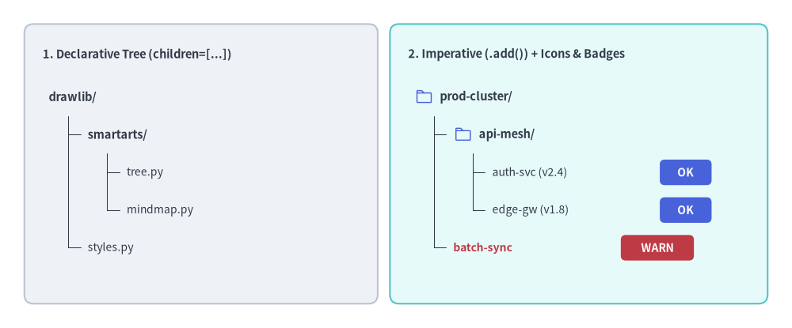
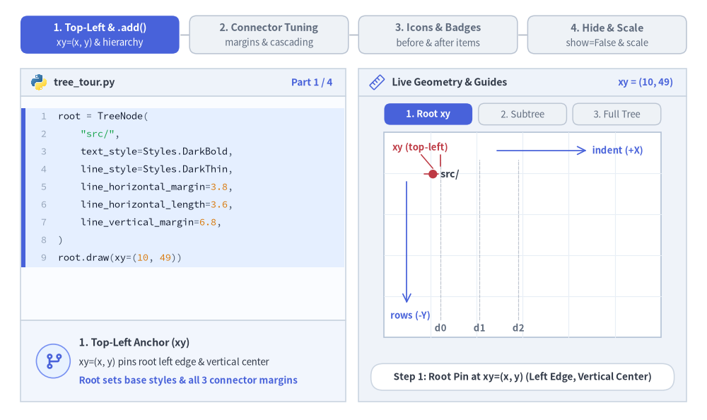
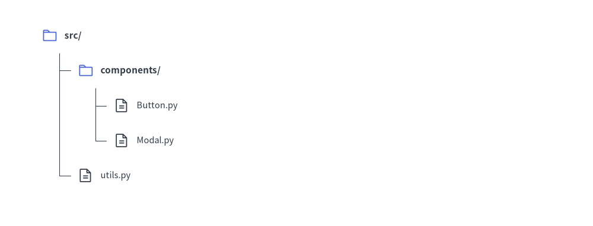
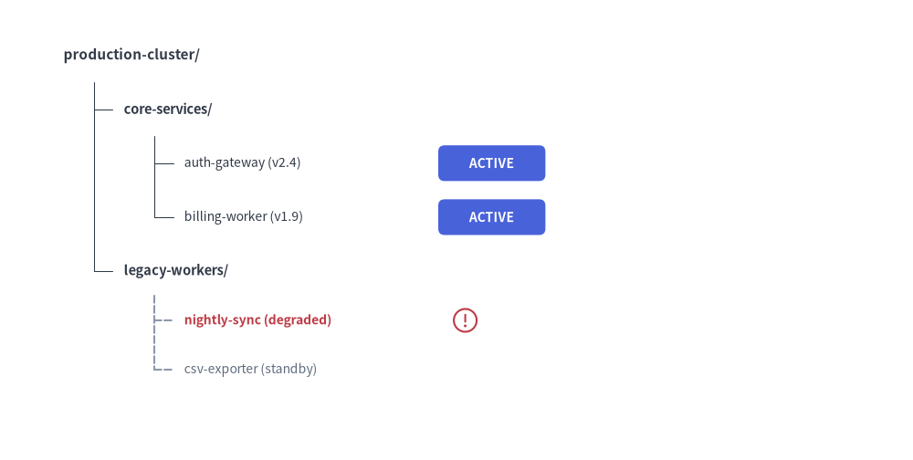

# Tree（ツリー図）

`TreeNode` コンポーネントは、コードベースのディレクトリツリー、組織階層図、タクソノミー分類などの階層型ツリー構造を描画します。
垂直方向のブランチ整列、インデント階層、ツリーの接続線を自動的にレイアウトします。


<figure class="drawlib-image" style="text-align: center;">
  
  <figcaption class="drawlib-caption">TreeNode の概要: 宣言的な階層構築とアイコン・バッジアノテーション</figcaption>
</figure>

<details class="drawlib-code-details">
<summary>Source Code</summary>

```python
from drawlib.canvas import save, setup
from drawlib.icons import phosphor
from drawlib.shapes import rectangle
from drawlib.smartarts import TreeNode
from drawlib.styles import Styles
from drawlib.text import text

setup(width=130, height=54)

# 1. Left Card: Declarative Nested Hierarchy (children=[...])
rectangle((33, 27), width=58, height=46, style=Styles.Neutral.patch(shape_r=1.5))
text((7, 45.0), "1. Declarative Tree (children=[...])", style=Styles.DarkBold.patch(text_size=10.5, halign="left"))

decl_root = TreeNode(
    "drawlib/",
    text_style=Styles.DarkBold.patch(text_size=10.5),
    line_style=Styles.DarkThin,
    line_horizontal_margin=3.2,
    line_horizontal_length=3.0,
    line_vertical_margin=6.2,
    children=[
        TreeNode(
            "smartarts/",
            children=[
                TreeNode("tree.py", text_style=Styles.Dark.patch(text_size=10.0)),
                TreeNode("mindmap.py", text_style=Styles.Dark.patch(text_size=10.0)),
            ],
        ),
        TreeNode("styles.py", text_style=Styles.Dark.patch(text_size=10.0)),
    ],
)
decl_root.draw(xy=(8, 38.0))

# 2. Right Card: Imperative (.add()) with Vector Icons & Trailing Badges
rectangle((95, 27), width=62, height=46, style=Styles.SecondaryNeutral.patch(shape_r=1.5))
text((67, 45.0), "2. Imperative (.add()) + Icons & Badges", style=Styles.DarkBold.patch(text_size=10.5, halign="left"))

TreeNode.register_drawing_item(
    name="hero_dir",
    location="before",
    padding_width=4.2,
    function=phosphor.folder,
    style=Styles.PrimaryFlat,
    args={"width": 3.0},
)
TreeNode.register_drawing_item(
    name="hero_ok",
    location="after",
    padding_width=27.5,
    function=rectangle,
    style=Styles.PrimaryFlat.patch(shape_r=0.8),
    args={"width": 8.5, "height": 4.2, "text": "OK", "text_style": Styles.WhiteBold.patch(text_size=10.0)},
)
TreeNode.register_drawing_item(
    name="hero_warn",
    location="after",
    padding_width=27.5,
    function=rectangle,
    style=Styles.DangerFlat.patch(shape_r=0.8),
    args={"width": 12.0, "height": 4.2, "text": "WARN", "text_style": Styles.WhiteBold.patch(text_size=10.0)},
)

imp_root = TreeNode(
    "prod-cluster/",
    text_style=Styles.DarkBold.patch(text_size=10.5),
    line_style=Styles.DarkThin,
    line_horizontal_margin=3.2,
    line_horizontal_length=3.0,
    line_vertical_margin=6.2,
).set_drawing_item("hero_dir")

api_group = imp_root.add("api-mesh/").set_drawing_item("hero_dir")
api_group.add("auth-svc (v2.4)", text_style=Styles.Dark.patch(text_size=10.0)).set_drawing_item("hero_ok")
api_group.add("edge-gw (v1.8)", text_style=Styles.Dark.patch(text_size=10.0)).set_drawing_item("hero_ok")
imp_root.add("batch-sync", text_style=Styles.DangerBold.patch(text_size=10.0), line_style=Styles.MutedDashed).set_drawing_item("hero_warn")

imp_root.draw(xy=(68, 38.0))
save()
```

</details>


---

## 1. 基本概念と基本的な使い方

`TreeNode` は**左上 `xy=(x, y)`**（ルートラベルの左端かつ垂直中央）をアンカーとしてディレクトリやタクソノミーの階層ツリーを構築し、直交ブランチ接続線とともに子階層を右方向に `+2 * line_horizontal_margin`、下方向に `-line_vertical_margin` ずつ自動配置します。中間ノードに指定したスタイルや余白のオーバーライドはサブツリー全体へカスケード継承され、`register_drawing_item` による `"before"` アイコンや `"after"` ステータスバッジの付与、および `show`／`scale` による表示制御と比例スケーリングもサポートしています。


<figure class="drawlib-image" style="text-align: center;">
  
  <figcaption class="drawlib-caption">基本的な使い方とパラメータツアー: 左上アンカー、接続線マージンとカスケード継承、アイコンとバッジ、表示制御とスケーリング（APNG アニメーション）</figcaption>
</figure>


<div class="drawlib-source-link">
  <a href="https://github.com/yuichi110/drawlib/blob/main/docs/docs_src/ja/04_smartarts/tree.md" target="_blank" rel="noopener noreferrer">GitHub でアニメーションのソースコードを見る &rarr;</a>
</div>

- **左上アンカーと命令的な `.add()` (`xy`, `add`)**: ルートラベルの左端かつ垂直中央を `xy=(x, y)` に固定し、子階層を右方向に `+2 * line_horizontal_margin`、下方向に `-line_vertical_margin` ずつ配置します。
- **接続線マージンとカスケード継承**: 縦幹のオフセット（`line_horizontal_margin`）、横枝の長さ（`line_horizontal_length`）、行間隔（`line_vertical_margin`）を調整でき、中間ノードでの上書き設定はその子孫ノードへ自動的に引き継がれます。
- **再利用可能なアイコンと末尾バッジ (`register_drawing_item`)**: `.set_drawing_item(name)` を使って、テキストを `padding_width` 分右へシフトする `"before"` ベクターアイコンや、`x + padding_width` の位置に描画する `"after"` ステータスバッジを付与できます。
- **レイアウト保持型の表示制御とスケーリング (`show`, `scale`)**: `node.show = False` で兄弟ノードの Y 座標をずらさずにノードと接続枝を非表示にしたり、`root.draw(xy, scale=...)` に `scale` を渡して `xy` 基準で比例スケーリングしたりできます。

---

## 2. クイックサンプル: プロジェクトのディレクトリ階層


```python
from drawlib.canvas import setup
from drawlib.smartarts import TreeNode
from drawlib.icons import phosphor
from drawlib.styles import Styles

setup(width=115, height=44)

# Register custom icons for folders and files
TreeNode.register_drawing_item(
    name="folder", location="before", padding_width=4.5, function=phosphor.folder,
    style=Styles.PrimaryFlat, args={"width": 3.2}
)
TreeNode.register_drawing_item(
    name="file", location="before", padding_width=4.5, function=phosphor.file_text,
    style=Styles.Dark, args={"width": 3.2}
)

root = TreeNode(
    "src/",
    text_style=Styles.DarkBold.patch(text_size=11.0),
    line_style=Styles.DarkThin,
    line_horizontal_margin=3.5,
    line_horizontal_length=3.2,
    line_vertical_margin=6.8,
    children=[
        TreeNode("components/", children=[
            TreeNode("Button.py", text_style=Styles.Dark.patch(text_size=10.5)).set_drawing_item("file"),
            TreeNode("Modal.py", text_style=Styles.Dark.patch(text_size=10.5)).set_drawing_item("file"),
        ]).set_drawing_item("folder"),
        TreeNode("utils.py", text_style=Styles.Dark.patch(text_size=10.5)).set_drawing_item("file"),
    ]
).set_drawing_item("folder")

root.draw(xy=(8, 37))
```

<figure class="drawlib-image" style="text-align: center;">
  
  <figcaption class="drawlib-caption">TreeNode によるプロジェクトファイル構成</figcaption>
</figure>


---

## 3. 命令的な構築 (`.add()`)、カスケード継承、`"after"` ステータスバッジ

コンストラクタ内で `children=[...]` をネストする代わりに、`parent.add(text, ...) -> TreeNode` を使って命令的にツリーを組み立てることもできます。中間ノードで指定したスタイルやマージンのパラメータは、下位ノードで再度上書きされない限り**そのサブツリー全体へ自動的にカスケード継承**されます。また、`location="after"` を指定してステータスバッジやアイコンを登録することも可能です（この場合、`padding_width` はノード左端の `x` 座標からバッジまでの水平オフセットを表します）。


```python
from drawlib.canvas import save, setup
from drawlib.icons import phosphor
from drawlib.shapes import rectangle
from drawlib.smartarts import TreeNode
from drawlib.styles import Styles

setup(width=115, height=58)

# Register trailing status badges (location="after" places the item at x + padding_width)
TreeNode.register_drawing_item(
    name="badge_live",
    location="after",
    padding_width=32.0,
    function=rectangle,
    style=Styles.PrimaryFlat.patch(shape_r=0.8),
    args={"width": 13.5, "height": 4.5, "text": "ACTIVE", "text_style": Styles.WhiteBold.patch(text_size=10.0)},
)
TreeNode.register_drawing_item(
    name="badge_warn",
    location="after",
    padding_width=33.5,
    function=phosphor.warning_circle,
    style=Styles.DangerFlat,
    args={"width": 3.8},
)

root = TreeNode(
    "production-cluster/",
    text_style=Styles.DarkBold.patch(text_size=11.0),
    line_style=Styles.DarkThin,
    line_horizontal_margin=3.8,
    line_horizontal_length=3.6,
    line_vertical_margin=6.8,
)

# 1. Core Services Subtree (inherits root margins, overrides text_style)
core = root.add("core-services/", text_style=Styles.DarkBold.patch(text_size=10.5))
core.add("auth-gateway (v2.4)", text_style=Styles.Dark.patch(text_size=10.0)).set_drawing_item("badge_live")
core.add("billing-worker (v1.9)", text_style=Styles.Dark.patch(text_size=10.0)).set_drawing_item("badge_live")

# 2. Legacy Subtree (overrides line_style and tighter vertical spacing for all its children)
legacy = root.add(
    "legacy-workers/",
    text_style=Styles.DarkBold.patch(text_size=10.5),
    line_style=Styles.MutedDashed,
    line_vertical_margin=6.2,
)
batch = legacy.add("nightly-sync (degraded)", text_style=Styles.DangerBold.patch(text_size=10.0))
batch.set_drawing_item("badge_warn")
legacy.add("csv-exporter (standby)", text_style=Styles.Muted.patch(text_size=10.0))

root.draw(xy=(8, 51))
save()
```

<figure class="drawlib-image" style="text-align: center;">
  
  <figcaption class="drawlib-caption">カスケード継承と 'after' ステータスバッジを用いた命令的な TreeNode 構築</figcaption>
</figure>


---

## 4. 幾何構造・ライフサイクル・座標メカニクス

- **左上アンカー `(x, y)`**: `root.draw(xy=..., scale=1.0)` に渡す座標は、ルートノードラベルの**左端かつ垂直中央**を表します。`scale` を渡すと、`xy` を基準としてインデント幅・行間隔・アイコン・テキストサイズが比例スケーリングされます。
- **下方向・右方向への展開**: 子ノードは下方向（`child_y = current_y - line_vertical_margin`）へ進み、右方向（`child_x = parent_x + 2 * line_horizontal_margin`）へインデントされます。
- **レイアウト保持型の表示制御 (`show: bool = True`)**:
  - `TreeNode(text, ..., show=True)` と `node.add(text, ..., show=True)` の両方でノードの表示・非表示を制御できます。
  - `node.show = False` に設定すると、そのノード・接続枝・子孫ノードが非表示になりつつ、**後続のすべての兄弟ノードの垂直 Y 座標はそのまま維持**されます。
- **ルートノードのスタイル・マージン必須要件**:  
  ルートの `TreeNode` には、基準となる 5 つの属性（`text_style`, `line_style`, `line_horizontal_margin`, `line_horizontal_length`, `line_vertical_margin`）をすべて指定する必要があります。子孫ノードは、個別に上書きしない限りこれらの設定をカスケード継承します。

---

## 5. API リファレンス

### コンストラクタ (`TreeNode`)
```python
TreeNode(
    text: str,
    *,
    text_style: Style | None = None,
    line_style: Style | None = None,
    line_horizontal_margin: float | None = None,
    line_horizontal_length: float | None = None,
    line_vertical_margin: float | None = None,
    children: list[TreeNode] | None = None,
    show: bool = True,
)
```

| パラメータ | 型 | デフォルト | 説明 |
| :--- | :--- | :--- | :--- |
| **`text`** | `str` | *（必須）* | このツリーノードに表示するラベル文字列。 |
| **`text_style`** | `Style \| None` | `None` | ノードラベルのテキストスタイル（**ルートでは必須**、`None` の場合は親の設定を継承）。 |
| **`line_style`** | `Style \| None` | `None` | ブランチ接続線の線スタイル（**ルートでは必須**、`None` の場合は親の設定を継承）。 |
| **`line_horizontal_margin`** | `float \| None` | `None` | 親の `x` から垂直幹ラインまでの水平オフセット（`> 0`、**ルートでは必須**）。 |
| **`line_horizontal_length`** | `float \| None` | `None` | 水平接続枝の基準長パラメータ（`> 0`、**ルートでは必須**）。 |
| **`line_vertical_margin`** | `float \| None` | `None` | 連続する行間の垂直ステップ距離（`> 0`、**ルートでは必須**）。 |
| **`children`** | `list[TreeNode] \| None` | `None` | 初期の子 `TreeNode` インスタンスのリスト。 |
| **`show`** | `bool` | `True` | このノードと接続線を描画するかどうか（`False` の場合も垂直方向の行スロットを維持）。 |

### 子ノードの追加 (`.add()`)
```python
node.add(
    text: str,
    *,
    text_style: Style | None = None,
    line_style: Style | None = None,
    line_horizontal_margin: float | None = None,
    line_horizontal_length: float | None = None,
    line_vertical_margin: float | None = None,
    show: bool = True,
) -> TreeNode
```
ラベル `text: str` を持つ新しい子 `TreeNode` を生成して `node.children` に追加し、その生成された子 `TreeNode` インスタンスを返します。

### カスタムアイコンとバッジ (`register_drawing_item` / `set_drawing_item`)
```python
TreeNode.register_drawing_item(
    name: str,
    location: Literal["before", "after"],
    padding_width: float,
    function: Callable,
    style: Style,
    args: dict,
) -> None
```

| パラメータ | 型 | 説明 |
| :--- | :--- | :--- |
| **`name`** | `str` | `node.set_drawing_item(name)` を呼び出す際に使用する一意の識別名。 |
| **`location`** | `Literal["before", "after"]` | `"before"` は `xy` にアイコンを描画してテキストを `padding_width` 分右へシフトします。`"after"` は `xy` にテキストを描画し、`x + padding_width` の位置にアイコン／バッジを配置します。 |
| **`padding_width`** | `float` | 水平方向の配置オフセット幅（`> 0`）。 |
| **`function`** | `Callable` | `xy` と `style` を受け取る任意の Drawlib 図形またはアイコン関数（例: `phosphor.folder`, `rectangle`）。 |
| **`style`** | `Style` | `function` に渡されるスタイル（内部で `halign="left", valign="center"` がパッチ適用されます）。 |
| **`args`** | `dict` | `function` に渡す追加キーワード引数（例: `{"width": 3.0}`）。 |

- **`node.set_drawing_item(name: str) -> TreeNode`**: 登録済みの描画アイテムを `node` に紐付け、メソッドチェーン用に `self` を返します。

### 描画とミュータブルプロパティ
- **`node.draw(xy: tuple[float, float], scale: float = 1.0) -> None`**: 左上 `xy` を起点としてツリーを描画します（必要に応じて `scale` で比例スケーリング可能）。
- **ミュータブルなノードプロパティ**:
  - `node.text: str` — ノードラベル文字列の取得・変更。
  - `node.text_style: Style | None` — ノードテキストスタイルの取得・変更。
  - `node.line_style: Style | None` — ノード接続線スタイルの取得・変更。
  - `node.children -> list[TreeNode]` — 子 `TreeNode` インスタンスのリストへのアクセス。
  - `node.show: bool` — `draw()` の前または呼び出し間での、レイアウト保持型表示状態の切り替え。

