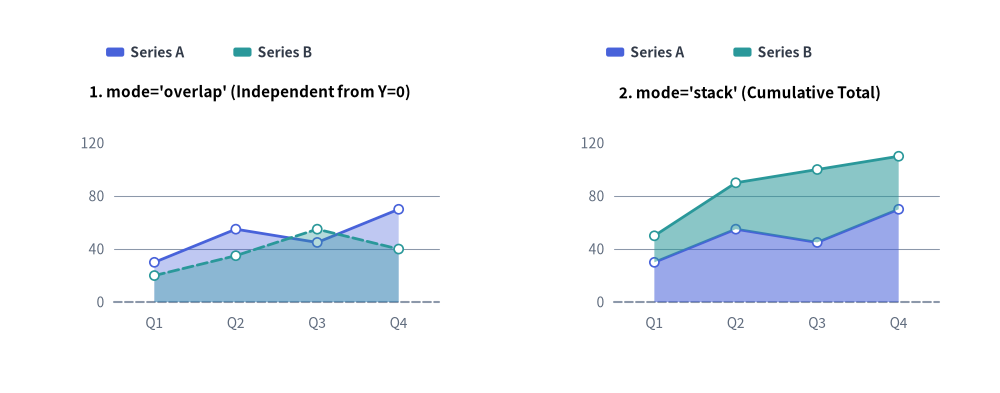
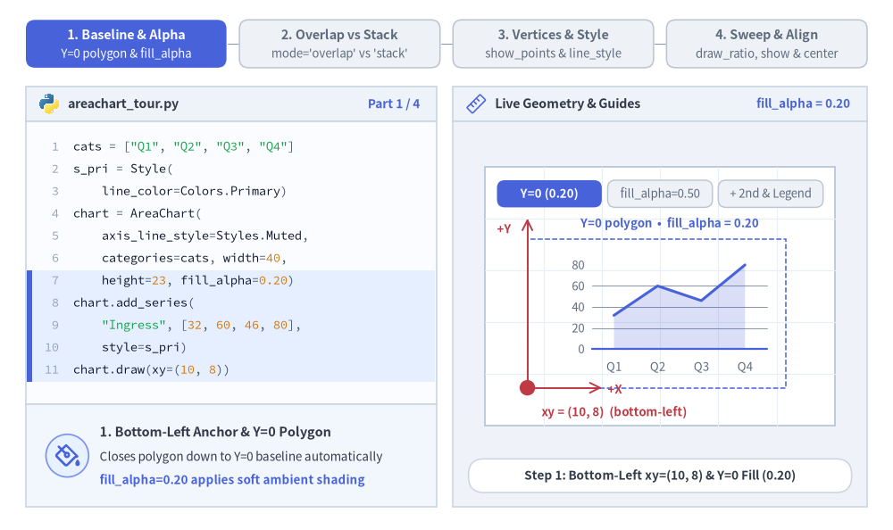
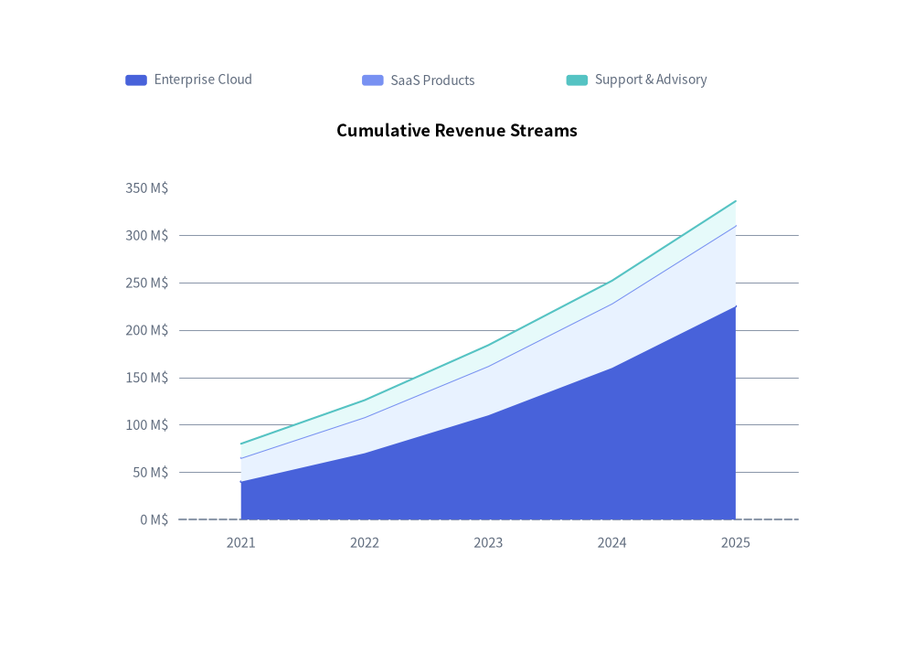
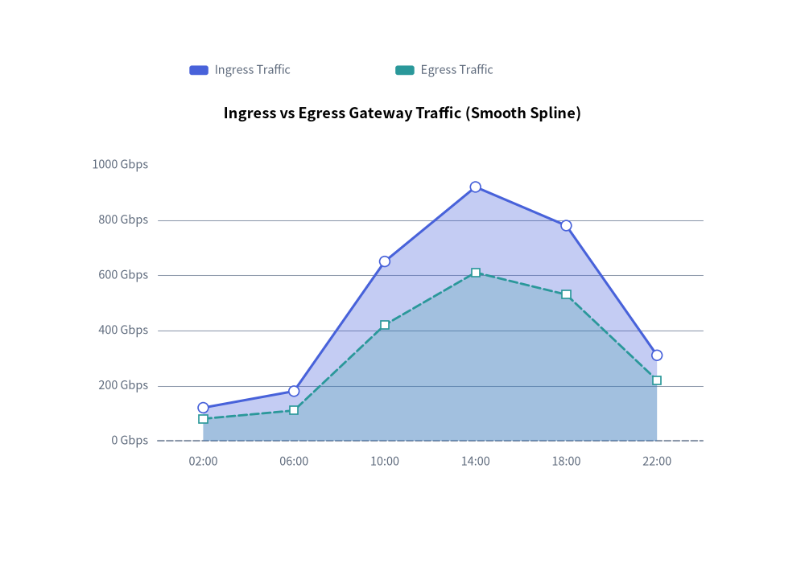

# Area Chart（面グラフ）：重なり表示と積み上げボリューム

`AreaChart`（`drawlib.charts.area`）は、カテゴリ区間や時系列にわたる累積ボリューム、キャパシティ配分、連続トレンドを可視化します。データ系列の輪郭線とベースライン（`Y=0`）の間の幾何領域を塗りつぶすことで、全体ボリュームと各系列の寄与度の両方を際立たせます。


<figure class="drawlib-image" style="text-align: center;">
  
  <figcaption class="drawlib-caption">AreaChart のモード比較：重なり表示 (overlap) と累積積み上げ表示 (stack)</figcaption>
</figure>

<details class="drawlib-code-details">
<summary>Source Code</summary>

```python
from drawlib.canvas import save, setup
from drawlib.charts.area import AreaChart
from drawlib.styles import Colors, Style, Styles

setup(width=132, height=52)

categories = ["Q1", "Q2", "Q3", "Q4"]
series_a = [30.0, 55.0, 45.0, 70.0]
series_b = [20.0, 35.0, 55.0, 40.0]
s_pri = Style(line_color=Colors.Primary)
s_sec = Style(line_color=Colors.Secondary)

# Left: mode="overlap" (Independent from Y=0)
overlap_chart = AreaChart(
    axis_line_style=Styles.MutedDashed,
    categories=categories,
    axis_text_style=Styles.Muted.patch(text_size=10.0),
    grid_style=Styles.MutedThin,
    width=56.0,
    height=36.0,
    title="1. mode='overlap' (Independent from Y=0)",
    title_style=Styles.BlackBold.patch(text_size=11.0),
    mode="overlap",
    fill_alpha=0.35,
    show_points=True,
    point_shape="circle",
    point_size=0.6,
)
overlap_chart.add_series("Series A", series_a, style=s_pri)
overlap_chart.add_series("Series B", series_b, style=s_sec, line_style="dashed")
overlap_chart.configure_y_axis(min_value=0, max_value=120, tick_step=40)
overlap_chart.draw(xy=(5.0, 6.0))
overlap_chart.draw_legend(xy=(14.0, 45.0), text_style=Styles.DarkBold.patch(text_size=10.0), orientation="horizontal")

# Right: mode="stack" (Cumulative Total)
stack_chart = AreaChart(
    axis_line_style=Styles.MutedDashed,
    categories=categories,
    axis_text_style=Styles.Muted.patch(text_size=10.0),
    grid_style=Styles.MutedThin,
    width=56.0,
    height=36.0,
    title="2. mode='stack' (Cumulative Total)",
    title_style=Styles.BlackBold.patch(text_size=11.0),
    mode="stack",
    fill_alpha=0.55,
    show_points=True,
    point_shape="circle",
    point_size=0.6,
)
stack_chart.add_series("Series A", series_a, style=s_pri)
stack_chart.add_series("Series B", series_b, style=s_sec)
stack_chart.configure_y_axis(min_value=0, max_value=120, tick_step=40)
stack_chart.draw(xy=(71.0, 6.0))
stack_chart.draw_legend(xy=(80.0, 45.0), text_style=Styles.DarkBold.patch(text_size=10.0), orientation="horizontal")

save()
```

</details>


---

## 1. 基本概念と基本的な使い方

`AreaChart` は `.add_series(...)` で登録されたカテゴリ輪郭線の下部に幾何ポリゴンの面塗りを施し、デフォルトで `(width, height)` コンテナの**左下 `(x, y)`** を基準にアンカーします（`align="center"` で中央揃えも可）。ベースライン基準の独立した半透明重なり表示（`mode="overlap"`、`fill_alpha`）と累積ストリーム積み上げ表示（`mode="stack"`）の切り替え、頂点マーカーや破線の閾値バンドの追加、さらに Y 軸範囲を維持したままでのスイープ描画や表示／非表示の切り替えが可能です。


<figure class="drawlib-image" style="text-align: center;">
  
  <figcaption class="drawlib-caption">基本的な使い方とパラメータツアー：ベースラインと不透明度、重なり／積み上げモード、頂点とバンドスタイル、スイープと配置制御（APNG アニメーション）</figcaption>
</figure>


<div class="drawlib-source-link">
  <a href="https://github.com/yuichi110/drawlib/blob/main/docs/docs_src/ja/05_charts/area.md" target="_blank" rel="noopener noreferrer">GitHub でアニメーションのソースコードを見る &rarr;</a>
</div>

- **左下アンカー・`Y=0` ベースライン・不透明度（`xy`, `fill_alpha`, `draw_legend`）**: デフォルトで `(width, height)` コンテナを左下 `xy` にアンカーし、`Y=0` まで塗りつぶした面ポリゴンを設定可能な `fill_alpha`（`0.0`〜`1.0`）で描画し、`draw_legend(...)` と組み合わせます。
- **重複モードと累積積み上げモード（`mode="overlap"` vs. `"stack"`, `smooth`）**: 各系列を `Y=0` から独立して半透明合成（`fill_alpha=0.25`〜`0.45`）する `mode="overlap"` *（デフォルト）* と、系列を累積的に積み上げる `mode="stack"`（オプションで `smooth=True` の滑らかな輪郭にも対応）を使い分けられます。
- **頂点マーカー・数値ラベル・系列単位の上書き（`show_points`, `fill_alpha`, `line_style`）**: `show_points=True`（`"circle"` / `"square"`）と `value_text_style` で上端輪郭の数値ラベルを有効化でき、系列ごとの `fill_alpha` や `line_style="dashed"` の上書きで控えめな閾値バンドも表現できます。
- **カーテンスイープ・軸スケール固定の `.show`・中央配置（`draw_ratio`, `align`）**: `draw_ratio` で塗りつぶし領域を左から右へスイープ描画したり、Y 軸の最大スケールを維持したまま `series.show = False` を切り替えたり、`align="center"` で `(cx, cy)` を中心にチャートボックスを配置したりできます。

---

## 2. 累積積み上げ面グラフ

積み上げ面グラフ（`mode="stack"`）は、全体の合計値の推移と、時間の経過に伴う各ストリームの構成比率を同時に示すのに最適です。


```python
from drawlib.canvas import save, setup
from drawlib.charts.area import AreaChart
from drawlib.styles import Styles

setup(width=102, height=74)

chart = AreaChart(
    axis_line_style=Styles.MutedDashed,
    categories=["2021", "2022", "2023", "2024", "2025"],
    axis_text_style=Styles.Muted.patch(text_size=10.5),
    grid_style=Styles.MutedThin,
    width=82.0,
    height=52.0,
    title="Cumulative Revenue Streams",
    title_style=Styles.BlackBold.patch(text_size=13.0),
    mode="stack",
    fill_alpha=0.65,
)
chart.add_series("Enterprise Cloud", [40.0, 70.0, 110.0, 160.0, 225.0], style=Styles.PrimaryFlat)
chart.add_series("SaaS Products", [25.0, 38.0, 52.0, 68.0, 85.0], style=Styles.PrimaryNeutral)
chart.add_series("Support & Advisory", [15.0, 18.0, 22.0, 24.0, 26.0], style=Styles.SecondaryNeutral)

chart.configure_y_axis(unit="M$", label="Gross Revenue (USD Millions)")
chart.draw(xy=(10.0, 10.0))
chart.draw_legend(xy=(14.0, 65.0), text_style=Styles.Muted.patch(text_size=10.0), orientation="horizontal")
save()
```

<figure class="drawlib-image" style="text-align: center;">
  
  <figcaption class="drawlib-caption">累積積み上げによる収益ストリーム推移</figcaption>
</figure>


---

## 3. 系列ごとの不透明度・線種を組み合わせた滑らかな重複面グラフ

ネットワークの Ingress / Egress トラフィックのように同じスケールを共有する独立した指標を比較する場合は、`mode="overlap"` と `smooth=True` に、系列ごとの `fill_alpha`、`line_style`、および頂点マーカー（`show_points=True`）を組み合わせます。


```python
from drawlib.canvas import save, setup
from drawlib.charts.area import AreaChart
from drawlib.styles import Colors, Style, Styles

setup(width=102, height=72)

chart = AreaChart(
    axis_line_style=Styles.MutedDashed,
    categories=["02:00", "06:00", "10:00", "14:00", "18:00", "22:00"],
    axis_text_style=Styles.Muted.patch(text_size=10.5),
    grid_style=Styles.MutedThin,
    width=82.0,
    height=50.0,
    title="Ingress vs Egress Gateway Traffic (Smooth Spline)",
    title_style=Styles.BlackBold.patch(text_size=13.0),
    mode="overlap",
    fill_alpha=0.35,
    smooth=True,
    show_points=True,
    point_shape="circle",
    point_size=0.65,
)
chart.add_series(
    "Ingress Traffic",
    [120.0, 180.0, 650.0, 920.0, 780.0, 310.0],
    style=Style(line_color=Colors.Primary),
    fill_alpha=0.32,
    line_width=2.2,
)
chart.add_series(
    "Egress Traffic",
    [80.0, 110.0, 420.0, 610.0, 530.0, 220.0],
    style=Style(line_color=Colors.Secondary),
    fill_alpha=0.22,
    line_width=2.0,
    line_style="dashed",
    point_shape="square",
)

chart.configure_y_axis(unit="Gbps", label="Throughput (Gbps)")
chart.draw(xy=(10.0, 10.0))
chart.draw_legend(xy=(24.0, 63.0), text_style=Styles.Muted.patch(text_size=10.5), orientation="horizontal")
save()
```

<figure class="drawlib-image" style="text-align: center;">
  
  <figcaption class="drawlib-caption">系列ごとの fill_alpha と line_style を組み合わせた滑らかな重複ゲートウェイトラフィック</figcaption>
</figure>


---

## 4. API リファレンス

### コンストラクタ（`AreaChart`）

すべてのコンストラクタ引数は**キーワード専用引数**（`*`）です。

```python
from drawlib.charts.area import AreaChart, Axis, DrawDirection, FormatterType, Mode, Series

chart = AreaChart(
    *,
    axis_line_style: Style,
    categories: list[str],
    width: float = 80.0,
    height: float = 50.0,
    mode: Mode = "overlap",
    fill_alpha: float = 0.35,
    show_points: bool = False,
    point_shape: PointShape = "none",
    point_size: float = 1.0,
    smooth: bool = False,
    axis_text_style: Style | None = None,
    grid_style: Style | None = None,
    value_text_style: Style | None = None,
    background_style: Style | None = None,
    title: str = "",
    title_style: Style | None = None,
)
```

| パラメータ | 型 | デフォルト | 説明 |
| :--- | :--- | :--- | :--- |
| **`axis_line_style`** | `Style` | **必須** | 座標ベースラインのストロークに用いる必須アンカースタイル。 |
| **`categories`** | `list[str]` | **必須** | 水平 X 軸に沿った順序付きカテゴリラベル。 |
| `width` / `height` | `float` | `80.0` / `50.0` | キャンバス単位でのチャート全体のバウンディングボックス寸法。 |
| `mode` | `"overlap"` \| `"stack"` | `"overlap"` | 面ポリゴンの合成モード（`Mode`）。 |
| `fill_alpha` | `float` | `0.35` | 面ポリゴンの塗りつぶし不透明度のデフォルト値（`0.0`〜`1.0`）。 |
| `show_points` | `bool` | `False` | 上端の境界輪郭線に沿ってマーカーを描画するかどうか。 |
| `point_shape` | `"circle"` \| `"square"` \| `"none"` | `"none"` | `show_points=True` 時のデータ頂点におけるデフォルトマーカー形状。 |
| `point_size` | `float` | `1.0` | キャンバス単位でのデフォルトのマーカー半径（四角形の場合は半幅）。 |
| `smooth` | `bool` | `False` | `True` の場合、上端の境界曲線および塗りつぶしポリゴンを滑らかに補間します。 |
| `axis_text_style` | `Style \| None` | `None` | Y 軸目盛りラベルおよび X 軸カテゴリ名のスタイル。`None` の場合は省略されます。 |
| `grid_style` | `Style \| None` | `None` | 水平方向の Y 軸グリッド線のスタイル。`None` の場合は省略されます。 |
| `value_text_style` | `Style \| None` | `None` | 頂点マーカーの上部に描画される数値ラベルのスタイル（`show_points=True` かつ `point_shape != "none"` の場合）。 |
| `background_style` | `Style \| None` | `None` | チャート外枠の背景カードのスタイル。`None` の場合は省略されます。 |
| `title` | `str` | `""` | コンテナ上部に描画されるチャートタイトル文字列。 |
| `title_style` | `Style \| None` | `None` | `title` のタイポグラフィスタイル。タイトルを描画するには必須です。 |

### メソッドとプロパティ

- **`add_series(name: str, values: list[float], style: Style, fill_alpha: float | None = None, line_width: float = 2.0, line_style: LineStyle = "solid", point_shape: PointShape | None = None, point_size: float | None = None, legend_text_style: Style | None = None, *, show: bool = True, draw_ratio: float = 1.0, draw_direction: DrawDirection = "left_to_right") -> Series`**:
  面系列を登録し、変更可能な `Series` インスタンスを返します。
  - `fill_alpha`: 系列ごとのポリゴン塗りつぶし不透明度の上書き（`None` の場合は `chart.fill_alpha` を継承）。
  - `line_width` / `line_style`: 上端の境界ストロークを制御します（`"solid"`、`"dashed"`、`"dotted"`、`"dashdot"`）。
  - `point_shape` / `point_size`: 系列ごとの頂点マーカー上書き（`"circle"`、`"square"`、`"none"`）。
  - `legend_text_style`: `draw_legend()` 内におけるこの系列ラベルのカスタム `Style`（任意）。
  - `show`、`draw_ratio`、`draw_direction`: 表示状態の切り替えおよび部分空間レンダリング制御（`"left_to_right"` は水平方向にスイープ、`"bottom_to_top"` はベースラインまたは下段の積み上げ境界から垂直方向にせり上がります）。
- **`configure_y_axis(...) -> Axis`** / **`configure_x_axis(...) -> Axis`**:
  垂直の数値軸または水平のカテゴリ軸を設定します。詳細は **[軸・スケール・凡例](./axes_and_legends.md)** を参照してください。
- **`get_size() -> tuple[float, float]`**:
  チャートコンテナの `(width, height)` を返します。
- **`draw(xy: tuple[float, float] = (0.0, 0.0), *, width: float | None = None, height: float | None = None, align: Literal["bottom_left", "center"] = "bottom_left", scale: float = 1.0) -> None`**:
  `xy` を基準（デフォルトは `"bottom_left"`、または `"center"`）としてチャートを描画します。一時的な寸法上書きや比例 `scale` にも対応しています。
- **`draw_legend(xy: tuple[float, float], text_style: Style, orientation: Literal["vertical", "horizontal"] = "vertical", swatch_width: float = 2.4, swatch_height: float = 1.2, item_gap: float = 4.0, *, scale: float = 1.0) -> None`**:
  分離配置された系列凡例を `xy` に描画します。
- **プロパティ**:
  - **`chart.series -> list[Series]`**: 登録済み `Series` オブジェクトのコピーを返します。
  - **`chart.x_axis -> Axis`** / **`chart.y_axis -> Axis`**: 水平軸・垂直軸の `Axis` インスタンスへの直接アクセスを提供します。

