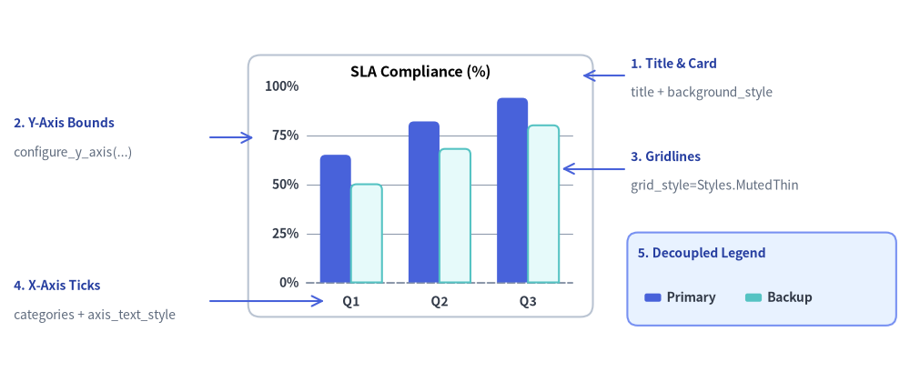
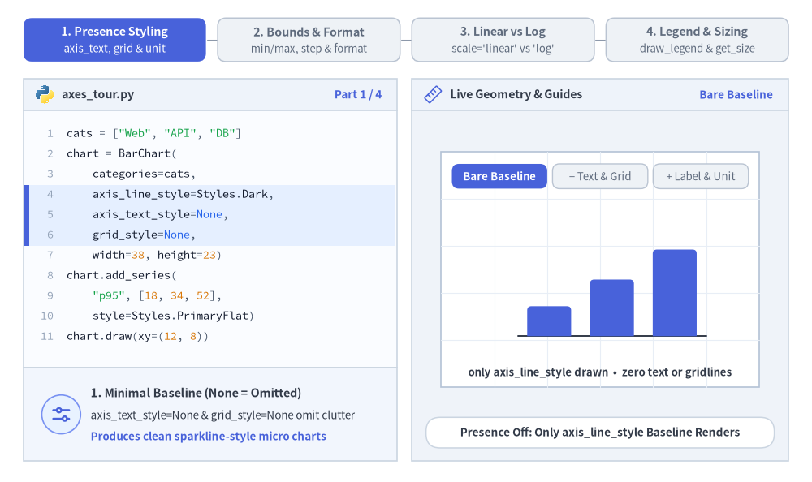
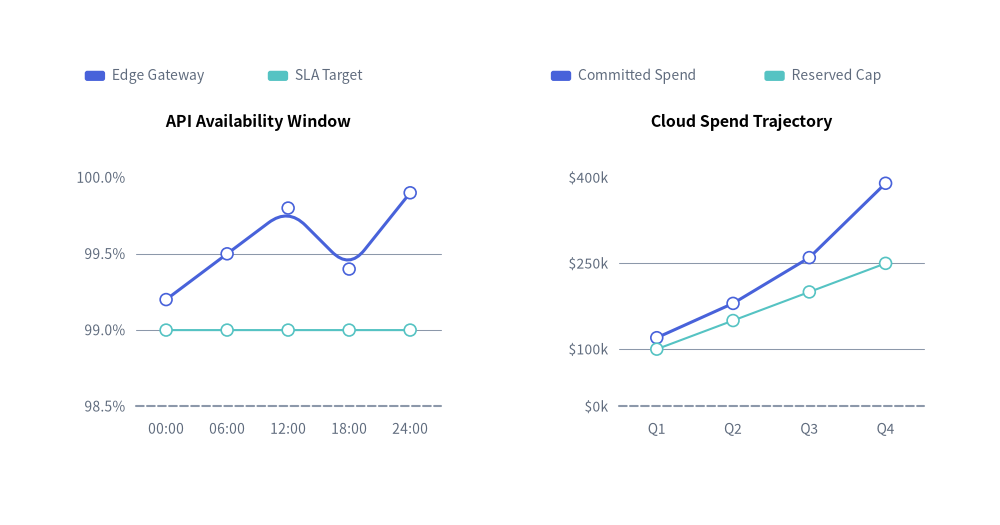
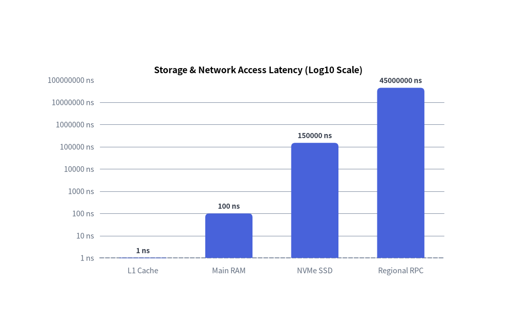
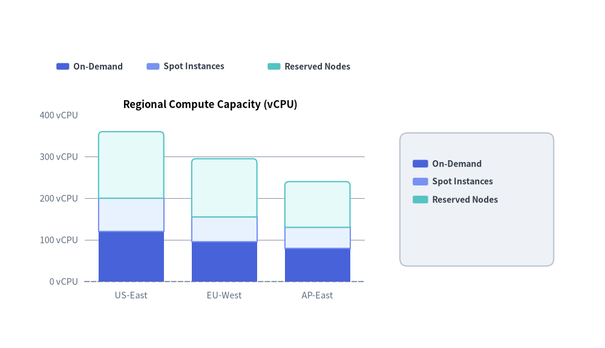

# 軸・スケール・凡例

すべての直交座標系チャート（`BarChart`、`LineChart`、`AreaChart`、`ScatterChart`）および複数系列・複数スライス型チャート（`PieChart`、`RadarChart`）は、**座標軸のスケーリング**、**目盛り・単位フォーマット**、**分離配置型の凡例（デカップルされた凡例）**、および**バウンディングボックス計測**のための共通基盤を備えています。

すべての視覚的な軸要素は Drawlib の存在ベース（Style-as-Presence）のスタイリングモデルに従っており、定義域の上下限、グリッド線、目盛りフォーマッタ、凡例座標をそれぞれ独立して制御できます。


<figure class="drawlib-image" style="text-align: center;">
  
  <figcaption class="drawlib-caption">Drawlib チャートの軸・グリッド線・目盛りフォーマッタ・分離配置された凡例の構造</figcaption>
</figure>

<details class="drawlib-code-details">
<summary>Source Code</summary>

```python
from drawlib.canvas import save, setup
from drawlib.charts.bar import BarChart
from drawlib.lines import line
from drawlib.shapes import rectangle
from drawlib.styles import Colors, Styles
from drawlib.text import text

setup(width=132, height=54)

chart = BarChart(
    categories=["Q1", "Q2", "Q3"],
    axis_line_style=Styles.MutedDashed,
    axis_text_style=Styles.DarkBold.patch(text_size=10.0),
    grid_style=Styles.MutedThin,
    background_style=Styles.Neutral.patch(shape_r=1.8, shape_fill_color=Colors.White, shape_line_color=Colors.Gray4),
    width=50.0,
    height=38.0,
    title="SLA Compliance (%)",
    title_style=Styles.BlackBold.patch(text_size=11.5),
    bar_mode="group",
    bar_r=0.8,
)
chart.add_series("Primary", [65.0, 82.0, 94.0], style=Styles.PrimaryFlat)
chart.add_series("Backup", [50.0, 68.0, 80.0], style=Styles.SecondaryNeutral)
chart.configure_y_axis(min_value=0, max_value=100, tick_step=25, format="{:.0f}%")
chart.draw(xy=(36.0, 8.0))

callout_title = Styles.DarkBold.patch(text_size=10.0, halign="left", text_color=Colors.Primary5)
callout_sub = Styles.Muted.patch(text_size=10.0, halign="left")
arrow_style = Styles.Primary.patch(shape_line_width=1.2)

# 1. Title & Background Card (Top-Right Callout)
line((90.5, 43.0), (84.5, 43.0), arrow_head="->", style=arrow_style)
text((91.5, 44.8), "1. Title & Card", style=callout_title)
text((91.5, 40.5), "title + background_style", style=callout_sub)

# 2. Y-Axis Bounds & Format (Top-Left Callout)
line((30.5, 34.0), (36.8, 34.0), arrow_head="->", style=arrow_style)
text((2.0, 36.2), "2. Y-Axis Bounds", style=callout_title)
text((2.0, 31.8), "configure_y_axis(...)", style=callout_sub)

# 3. Horizontal Gridlines (Middle-Right Callout)
line((90.5, 29.5), (81.5, 29.5), arrow_head="->", style=arrow_style)
text((91.5, 31.3), "3. Gridlines", style=callout_title)
text((91.5, 27.0), "grid_style=Styles.MutedThin", style=callout_sub)

# 4. X-Axis Category Ticks (Bottom-Left Callout)
line((30.5, 10.3), (47.0, 10.3), arrow_head="->", style=arrow_style)
text((2.0, 12.6), "4. X-Axis Ticks", style=callout_title)
text((2.0, 8.2), "categories + axis_text_style", style=callout_sub)

# 5. Decoupled Legend (Bottom-Right Box & Callout)
rectangle((110.5, 13.5), width=39.0, height=13.5, style=Styles.PrimaryNeutral.patch(shape_r=1.5))
text((92.5, 17.2), "5. Decoupled Legend", style=callout_title)
chart.draw_legend(
    xy=(93.5, 10.8),
    text_style=Styles.DarkBold.patch(text_size=10.0),
    orientation="horizontal",
    swatch_width=2.4,
    swatch_height=1.2,
    item_gap=3.0,
)

save()
```

</details>


---

## 1. 基本概念と基本的な使い方

直交座標系チャートや複数系列チャートは Drawlib の存在ベース（Style-as-Presence）のスタイリングモデルに従います。`axis_line_style` が座標ベースラインの基準となり、目盛りラベル（`axis_text_style`）やグリッド線（`grid_style`）は明示したときだけクリーンに有効化されます。また、定義域の範囲やフォーマッタ、`"linear"` と `"log"` のスケール切り替え（`configure_y_axis` / `configure_x_axis`）、分離配置された凡例（`draw_legend` + `get_size`）は、プロット領域のジオメトリを崩すことなく直交的に組み合わせられます。


<figure class="drawlib-image" style="text-align: center;">
  
  <figcaption class="drawlib-caption">基本的な使い方とパラメータツアー：存在ベースのスタイル、軸範囲とフォーマット、線形／対数スケール、分離配置された凡例（APNG アニメーション）</figcaption>
</figure>


<div class="drawlib-source-link">
  <a href="https://github.com/yuichi110/drawlib/blob/main/docs/docs_src/ja/05_charts/axes_and_legends.md" target="_blank" rel="noopener noreferrer">GitHub でアニメーションのソースコードを見る &rarr;</a>
</div>

- **存在ベースの軸スタイリング（`axis_text_style`, `grid_style`, `unit`）**: 任意のスタイル引数を省略すればスパークラインのようなミニマルなベースラインだけを描画でき、`axis_text_style` や `grid_style` を指定して目盛りやグリッド線を有効化できます。また `configure_y_axis(label=..., unit=...)` で軸ラベルや単位サフィックスを付加できます。
- **定義域の範囲・目盛り間隔・フォーマット（`min_value`, `max_value`, `tick_step`, `format`）**: 自動の Nice Numbers 目盛りを明示的な上下限、固定 `tick_step` や `ticks=[...]` リスト、Python フォーマット文字列（`"{:.0f}%"`）や呼び出し可能オブジェクト（callable）で上書きできます。
- **線形スケールと対数スケール（`scale="linear"` vs. `"log"`）**: `scale="log"` に切り替えることで、複数桁にまたがるデータを 10 の累乗ごとに明瞭に分離して描画でき、軸単位での `show_grid` や `line_style` の上書きも行えます。
- **分離配置された凡例と寸法取得（`draw_legend`, `get_size`, `.show`）**: `w, h = chart.get_size()` を活用して横並び・縦並びの凡例を任意の場所に配置でき、`series.show = False` を切り替えても軸の上下限を固定したまま維持できます。

---

## 2. カスタム軸範囲・目盛り間隔・数値フォーマット

直交座標系チャートは `chart.configure_x_axis(...)` と `chart.configure_y_axis(...)`（内部の `Axis` モデルを操作）を公開しており、定義域の範囲（`min_value`、`max_value`）、明示的な目盛り（`ticks` または `tick_step`）、フォーマット文字列や関数（`format`）、単位サフィックス（`unit`）、および軸タイトル（`label`）を柔軟にカスタマイズできます。


```python
from drawlib.canvas import save, setup
from drawlib.charts.line import LineChart
from drawlib.styles import Styles

setup(width=118, height=62)

# Left Chart: Explicit tick_step, format string, and unit suffix
sla_chart = LineChart(
    axis_line_style=Styles.MutedDashed,
    categories=["00:00", "06:00", "12:00", "18:00", "24:00"],
    axis_text_style=Styles.Muted.patch(text_size=10.0),
    grid_style=Styles.MutedThin,
    width=49.0,
    height=42.0,
    title="API Availability Window",
    title_style=Styles.BlackBold.patch(text_size=11.5),
    smooth=True,
    show_points=True,
)
sla_chart.add_series("Edge Gateway", [99.2, 99.5, 99.8, 99.4, 99.9], style=Styles.PrimaryFlat, line_width=2.2)
sla_chart.add_series("SLA Target", [99.0, 99.0, 99.0, 99.0, 99.0], style=Styles.SecondaryNeutral, line_style="dashed")

sla_chart.configure_y_axis(
    min_value=98.5,
    max_value=100.0,
    tick_step=0.5,
    format="{:.1f}%",
    label="Uptime (%)",
)
sla_chart.draw(xy=(6.0, 8.0))
sla_chart.draw_legend(xy=(10.0, 53.0), text_style=Styles.Muted.patch(text_size=10.0), orientation="horizontal")

# Right Chart: Custom callable formatter and explicit ticks list
cost_chart = LineChart(
    axis_line_style=Styles.MutedDashed,
    categories=["Q1", "Q2", "Q3", "Q4"],
    axis_text_style=Styles.Muted.patch(text_size=10.0),
    grid_style=Styles.MutedThin,
    width=49.0,
    height=42.0,
    title="Cloud Spend Trajectory",
    title_style=Styles.BlackBold.patch(text_size=11.5),
    show_points=True,
)
cost_chart.add_series("Committed Spend", [120, 180, 260, 390], style=Styles.PrimaryFlat, line_width=2.2)
cost_chart.add_series("Reserved Cap", [100, 150, 200, 250], style=Styles.SecondaryNeutral, line_style="dotted")

cost_chart.configure_y_axis(
    ticks=[0, 100, 250, 400],
    format=lambda v: f"${v:,.0f}k",
    label="Quarterly Cost (USD)",
)
cost_chart.draw(xy=(63.0, 8.0))
cost_chart.draw_legend(xy=(65.0, 53.0), text_style=Styles.Muted.patch(text_size=10.0), orientation="horizontal")
save()
```

<figure class="drawlib-image" style="text-align: center;">
  
  <figcaption class="drawlib-caption">カスタム軸範囲、目盛り間隔、フォーマット指定子、および単位サフィックス</figcaption>
</figure>


---

## 3. 線形スケール（Nice Numbers）と対数スケール（`scale="log"`）

各 `Axis` は `scale` パラメータによって 2 種類のスケーリングエンジンをサポートしています。
- **`scale="linear"` *（デフォルト）***: `tick_step` と `ticks` が省略された場合、**Nice Numbers アルゴリズム**を用いてデータ範囲に応じた読みやすい目盛り間隔（`1, 2, 5 * 10^k`）を自動選択します。
- **`scale="log"`**: 正の数値を常用対数軸（`log10`）にマッピングします。境界値は自動的に 10 の累乗（`10^0, 10^1, 10^2, ...`）へスナップし、範囲が 2 桁以下（`<= 2` オーダー）の場合は中間目盛り（`1, 2, 5 * 10^k`）も自動生成されます。


```python
from drawlib.canvas import save, setup
from drawlib.charts.bar import BarChart
from drawlib.styles import Styles

setup(width=105, height=68)

chart = BarChart(
    axis_line_style=Styles.MutedDashed,
    categories=["L1 Cache", "Main RAM", "NVMe SSD", "Regional RPC"],
    axis_text_style=Styles.Muted.patch(text_size=10.5),
    grid_style=Styles.MutedThin,
    value_text_style=Styles.DarkBold.patch(text_size=10.0),
    value_format="{:g} ns",
    width=82.0,
    height=46.0,
    title="Storage & Network Access Latency (Log10 Scale)",
    title_style=Styles.BlackBold.patch(text_size=12.5),
    bar_width_ratio=0.55,
    bar_r=0.8,
)
chart.add_series("Median Read Latency", [1.0, 100.0, 150000.0, 45000000.0], style=Styles.PrimaryFlat)

chart.configure_y_axis(
    scale="log",
    unit="ns",
    label="Access Time in Nanoseconds (log10)",
)
chart.draw(xy=(12.0, 10.0))
save()
```

<figure class="drawlib-image" style="text-align: center;">
  
  <figcaption class="drawlib-caption">ストレージ階層のレイテンシ比較における対数 Y 軸スケール (scale='log')</figcaption>
</figure>


---

## 4. 分離配置された凡例（`draw_legend`）とバウンディング寸法の取得（`get_size`）

Drawlib では固定的なチャート枠内に凡例を押し込めるのではなく、`chart.draw_legend(...)` によって凡例描画を本体から分離しています。キャンバス上の任意の場所に横並び（horizontal）または縦並び（vertical）の凡例を配置し、`swatch_width`、`swatch_height`、`item_gap` を調整できるほか、`chart.get_size() -> (width, height)` を呼び出してチャートの外形寸法に合わせたサイドバーやカードへの整列が可能です。


```python
from drawlib.canvas import save, setup
from drawlib.charts.bar import BarChart
from drawlib.shapes import rectangle
from drawlib.styles import Styles

setup(width=118, height=68)

chart = BarChart(
    categories=["US-East", "EU-West", "AP-East"],
    axis_line_style=Styles.MutedDashed,
    axis_text_style=Styles.Muted.patch(text_size=10.5),
    grid_style=Styles.MutedThin,
    width=66.0,
    height=42.0,
    title="Regional Compute Capacity (vCPU)",
    title_style=Styles.BlackBold.patch(text_size=12.0),
    bar_mode="stack",
    bar_r=0.8,
)
chart.add_series("On-Demand", [120, 95, 80], style=Styles.PrimaryFlat)
chart.add_series("Spot Instances", [80, 60, 50], style=Styles.PrimaryNeutral)
chart.add_series("Reserved Nodes", [160, 140, 110], style=Styles.SecondaryNeutral)
chart.configure_y_axis(unit="vCPU")

chart_x, chart_y = 8.0, 8.0
chart.draw(xy=(chart_x, chart_y))

# 1. Horizontal Legend placed above the chart plot area
chart.draw_legend(
    xy=(11.0, 55.0),
    orientation="horizontal",
    item_gap=3.5,
    swatch_width=2.5,
    swatch_height=1.3,
    text_style=Styles.DarkBold.patch(text_size=10.0),
)

# 2. Vertical Legend inside a Sidebar Card aligned via chart.get_size()
chart_w, chart_h = chart.get_size()
legend_card_cx = chart_x + chart_w + 19.0
rectangle(
    xy=(legend_card_cx, chart_y + chart_h / 2.0),
    width=30.0,
    height=26.0,
    style=Styles.Neutral.patch(shape_r=1.5),
)

chart.draw_legend(
    xy=(legend_card_cx - 12.5, chart_y + chart_h / 2.0 + 7.0),
    text_style=Styles.DarkBold.patch(text_size=10.0),
    orientation="vertical",
    swatch_width=3.0,
    swatch_height=1.5,
)
save()
```

<figure class="drawlib-image" style="text-align: center;">
  
  <figcaption class="drawlib-caption">カスタムスウォッチと get_size() による整列を用いた横並び・縦並びの分離配置凡例</figcaption>
</figure>


---

## 5. API リファレンス

### 軸の設定（`configure_x_axis` / `configure_y_axis` と `Axis`）

`BarChart`、`LineChart`、`AreaChart`、`ScatterChart` で利用可能です（内部の `Axis` インスタンスを返します）。

```python
chart.configure_x_axis(
    scale: Literal["linear", "log"] | None = None,
    min_value: float | None = None,
    max_value: float | None = None,
    ticks: list[float] | None = None,
    tick_step: float | None = None,
    format: str | Callable[[float], str] | None = None,
    unit: str | None = None,
    label: str | None = None,
    show_grid: bool | None = None,
    grid_style: Style | None = None,
    show_axis_line: bool | None = None,
    line_style: Style | None = None,
    show_ticks: bool | None = None,
    tick_label_style: Style | None = None,
) -> Axis
```
*（`chart.configure_y_axis(...)` もまったく同じ引数を受け取ります。また、内部の `Axis(...)` コンストラクタおよび `axis.configure(...)` メソッドは `label_style: Style | None = None` も受け取ります。）*

| パラメータ | 型 | デフォルト | 説明 |
| :--- | :--- | :--- | :--- |
| `scale` | `"linear"` \| `"log"` | `"linear"` | 座標軸のスケーリングモード（線形 Nice Numbers または底 10 の常用対数）。 |
| `min_value` / `max_value` | `float \| None` | `None` | 明示的な軸の最小値・最大値。`None` の場合は系列データから自動導出されます。 |
| `ticks` | `list[float] \| None` | `None` | 明示的な目盛り値のリスト（自動目盛り生成を上書きします）。 |
| `tick_step` | `float \| None` | `None` | 線形目盛り間の明示的なステップ幅。 |
| `format` | `str \| Callable[[float], str] \| None` | `None` | Python フォーマット文字列（例：`"{:.1f}%"`、`"${:,.0f}"`）または `fn(val) -> str` の関数。 |
| `unit` | `str` | `""` | フォーマット済み目盛りラベルの末尾に付加される単位サフィックス（既に含まれている場合は重複付加されません。例：`"ms"`、`"Gbps"`）。 |
| `label` | `str` | `""` | 軸に沿って描画される軸タイトルラベル。 |
| `show_grid` | `bool` | `True` | `grid_style` 指定時にこの軸のグリッド線を描画するかどうか。 |
| `grid_style` | `Style \| None` | `None` | この軸専用のグリッド線スタイル上書き。 |
| `show_axis_line` | `bool` | `True` | この軸のベースラインストロークを描画するかどうか。 |
| `line_style` | `Style \| None` | `None` | この軸専用のベースラインストロークスタイル上書き。 |
| `show_ticks` | `bool` | `True` | この軸に沿って目盛りラベルを描画するかどうか。 |
| `tick_label_style` | `Style \| None` | `None` | この軸専用の目盛りラベルテキストスタイル上書き。 |
| `label_style` | `Style \| None` | `None` | 軸タイトル（`label`）のタイポグラフィを上書きする `Axis` 上の任意 `Style`（`axis.configure(label_style=...)` または `chart.y_axis.label_style = ...` で指定）。 |

### 軸プロパティへの直接アクセスと `Axis.format_value(val)`

`configure_x_axis()` や `configure_y_axis()` に加えて、プロパティ経由で内部の `Axis` オブジェクトを直接参照・変更することもできます。

- **`chart.x_axis -> Axis`** および **`chart.y_axis -> Axis`**: `BarChart`、`LineChart`、`AreaChart`、`ScatterChart` の水平軸・垂直軸 `Axis` インスタンスへの直接アクセス。
- **`bar_chart.value_axis -> Axis`**: `BarChart` の向きに応じたプロパティで、`orientation == "vertical"` のときは `y_axis`、`orientation == "horizontal"` のときは `x_axis` を返します。
- **`bar_chart.category_axis -> Axis`**: `BarChart` の向きに応じたプロパティで、`orientation == "vertical"` のときは `x_axis`、`orientation == "horizontal"` のときは `y_axis` を返します。
- **`axis.format_value(value: float) -> str`**: 軸に設定された `format`（文字列／関数）と `unit` サフィックスを使って任意の数値を表示用文字列にフォーマットします（`format=None` の場合は整数に近い値を自動丸めします）。

```python
# Orientation-independent configuration on BarChart + custom label_style and format_value()
chart.value_axis.configure(min_value=0, max_value=100, unit="%", label="Utilization", label_style=Styles.DarkBold)
formatted = chart.value_axis.format_value(85.0)  # -> "85 %"
```

> **放射軸の設定（`RadarChart`）**: `RadarChart` には同心リングを設定するための `chart.configure_axis(*, min_value=None, max_value=None, levels=None, scale_format=None) -> RadarChart` が用意されています。

### 分離配置型の凡例描画（`draw_legend`）

`BarChart`、`LineChart`、`AreaChart`、`PieChart`、`RadarChart`、`ScatterChart` で利用可能です。

```python
chart.draw_legend(
    xy: tuple[float, float],
    text_style: Style,
    orientation: Literal["vertical", "horizontal"] = "vertical",
    swatch_width: float = 2.4,
    swatch_height: float = 1.2,
    item_gap: float = 4.0,
    *,
    scale: float = 1.0,
) -> None
```
- **座標アンカー `xy`**: `orientation="vertical"` の場合、`xy` は**左上（top-left）**の開始点となり、項目が下方向へ並びます。`orientation="horizontal"` の場合、`xy` は**左中央（middle-left）**の開始点となり、項目が `item_gap` の間隔で右方向へ並びます。
- **項目ごとのスタイルと表示制御**: 各 `add_series(...)` や `add_slice(...)` は `legend_text_style: Style | None = None` と `show: bool = True` を受け取ります。要素に `show=False` が設定されている場合、横方向のレイアウト間隔を崩すことなく該当の凡例項目も自動的に非表示になります。

### レイアウト寸法の取得（`get_size`）

全 7 種類のチャートクラス（`BarChart`、`LineChart`、`AreaChart`、`PieChart`、`RadarChart`、`ScatterChart`、`GanttChart`）で利用可能です。

```python
width, height = chart.get_size()
```
スケーリング適用前のチャートのバウンディングボックス寸法 `(width, height)` をキャンバス単位で返します。

