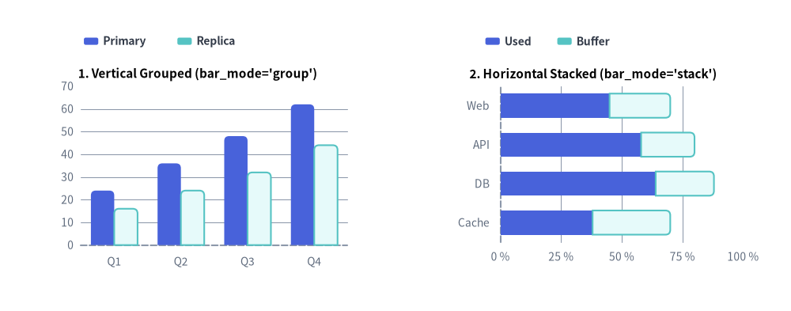
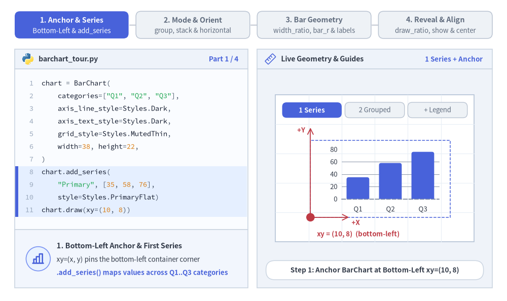
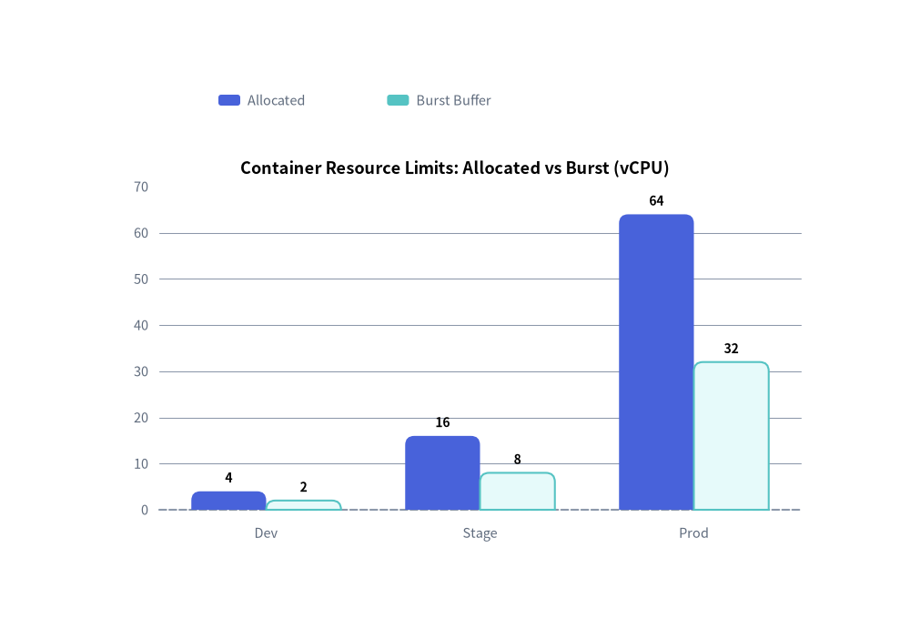
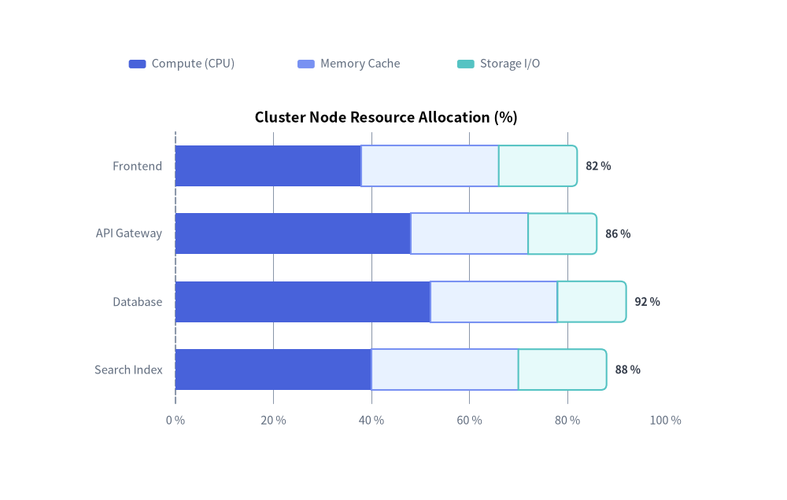

# Bar Chart（棒グラフ）：縦棒・横棒・集合・積み上げ

`BarChart` コンポーネント（`drawlib.charts.bar`）は、1 つ以上の系列にわたる離散カテゴリ指標を比較するための縦棒（カラム）または横棒を描画します。並列の集合棒グラフ、累積の積み上げ棒グラフ、外端角丸め（`bar_r`）、インライン数値ラベル、向きに応じた軸プロパティ、および分離配置型の凡例描画をサポートしています。


<figure class="drawlib-image" style="text-align: center;">
  
  <figcaption class="drawlib-caption">BarChart のトポロジ：縦向きの集合棒グラフ (bar_mode='group') と横向きの積み上げ棒グラフ (bar_mode='stack')</figcaption>
</figure>

<details class="drawlib-code-details">
<summary>Source Code</summary>

```python
from drawlib.canvas import save, setup
from drawlib.charts.bar import BarChart
from drawlib.styles import Styles

setup(width=132, height=52)

# Left: Vertical Grouped (orientation="vertical", bar_mode="group")
vert_chart = BarChart(
    categories=["Q1", "Q2", "Q3", "Q4"],
    axis_line_style=Styles.MutedDashed,
    axis_text_style=Styles.Muted.patch(text_size=10.0),
    grid_style=Styles.MutedThin,
    width=56.0,
    height=36.0,
    orientation="vertical",
    bar_mode="group",
    bar_r=0.8,
    title="1. Vertical Grouped (bar_mode='group')",
    title_style=Styles.BlackBold.patch(text_size=11.0),
)
vert_chart.add_series("Primary", [24.0, 36.0, 48.0, 62.0], style=Styles.PrimaryFlat)
vert_chart.add_series("Replica", [16.0, 24.0, 32.0, 44.0], style=Styles.SecondaryNeutral)
vert_chart.draw(xy=(5.0, 6.0))
vert_chart.draw_legend(xy=(14.0, 45.0), text_style=Styles.DarkBold.patch(text_size=10.0), orientation="horizontal")

# Right: Horizontal Stacked (orientation="horizontal", bar_mode="stack")
horiz_chart = BarChart(
    categories=["Web", "API", "DB", "Cache"],
    axis_line_style=Styles.MutedDashed,
    axis_text_style=Styles.Muted.patch(text_size=10.0),
    grid_style=Styles.MutedThin,
    width=56.0,
    height=36.0,
    orientation="horizontal",
    bar_mode="stack",
    bar_width_ratio=0.62,
    bar_r=0.8,
    title="2. Horizontal Stacked (bar_mode='stack')",
    title_style=Styles.BlackBold.patch(text_size=11.0),
)
horiz_chart.add_series("Used", [45.0, 58.0, 64.0, 38.0], style=Styles.PrimaryFlat)
horiz_chart.add_series("Buffer", [25.0, 22.0, 24.0, 32.0], style=Styles.SecondaryNeutral)
horiz_chart.configure_x_axis(min_value=0, max_value=100, tick_step=25, unit="%")
horiz_chart.draw(xy=(71.0, 6.0))
horiz_chart.draw_legend(xy=(81.0, 45.0), text_style=Styles.DarkBold.patch(text_size=10.0), orientation="horizontal")

save()
```

</details>


---

## 1. 基本概念と基本的な使い方

`BarChart` はデフォルトでコンテナの**左下 `(x, y)`** を基準にアンカーされ（`align="center"` で中央基準も可）、`.add_series(...)` でカテゴリデータ系列を段階的に登録します。並列クラスタ表示（`bar_mode="group"`）、累積積み上げ表示（`bar_mode="stack"`）、横向きトポロジ（`"horizontal"`）をシームレスに切り替えられるほか、スロット占有幅（`bar_width_ratio`）、外端角丸め（`bar_r`）、インライン数値ラベルの調整や、部分描画（`draw_ratio`）・系列の表示切り替え（`.show`）によるアニメーションにも対応しています。


<figure class="drawlib-image" style="text-align: center;">
  
  <figcaption class="drawlib-caption">基本的な使い方とパラメータツアー：アンカーと系列、集合／積み上げ／横向きトポロジ、棒のジオメトリ、部分描画と配置（APNG アニメーション）</figcaption>
</figure>


<div class="drawlib-source-link">
  <a href="https://github.com/yuichi110/drawlib/blob/main/docs/docs_src/ja/05_charts/bar.md" target="_blank" rel="noopener noreferrer">GitHub でアニメーションのソースコードを見る &rarr;</a>
</div>

- **左下アンカーと複数系列の構築（`xy`, `add_series`, `draw_legend`）**: `BarChart.draw(xy)` はデフォルトでコンテナの**左下**角にピン留めされ（`align="bottom_left"`）、登録された各 `Series` をカテゴリごとに配置しつつ、独立した `draw_legend(...)` と組み合わせられます。
- **トポロジと向き（`bar_mode`, `orientation`）**: `bar_mode` で並列クラスタの `"group"` と累積合計の `"stack"` を切り替えたり、`orientation="horizontal"` を指定して左 Y 軸から右方向へ棒を伸ばしたりできます（`value_axis` も自動的に `y_axis` から `x_axis` へ切り替わります）。
- **スロット幅・先端角丸め・数値ラベル（`bar_width_ratio`, `bar_r`, `value_text_style`）**: カテゴリスロットの占有比率（`0.1`〜`1.0`）を調整し、棒の**外端 2 角のみ**に `bar_r` の角丸めを適用（積み上げ棒の内側境界はフラットに維持）し、フォーマット済みの先端ラベルを表示できます。
- **空間スイープ・表示制御・中央配置（`draw_ratio`, `.show`, `align="center"`）**: `draw_ratio` による伸長アニメーション（縦向き時はデフォルトで `"bottom_to_top"`、横向き時は `"left_to_right"`。直交方向を指定すればカテゴリ順の順次表示）、軸スケールを変えない `s.show = False` での非表示化、`align="center"` による `xy` 中心配置に対応しています。

---

## 2. クイック例：縦向き集合棒グラフによるリソース割り当て


```python
from drawlib.canvas import save, setup
from drawlib.charts.bar import BarChart
from drawlib.styles import Styles

setup(width=100, height=68)

chart = BarChart(
    categories=["Dev", "Stage", "Prod"],
    axis_line_style=Styles.MutedDashed,
    axis_text_style=Styles.Muted.patch(text_size=10.5),
    grid_style=Styles.MutedThin,
    value_text_style=Styles.BlackBold.patch(text_size=10.0),
    width=82,
    height=45,
    title="Container Resource Limits: Allocated vs Burst (vCPU)",
    title_style=Styles.BlackBold.patch(text_size=13.0),
    bar_mode="group",
    bar_r=1.0,
)
chart.add_series("Allocated", [4.0, 16.0, 64.0], style=Styles.PrimaryFlat)
chart.add_series("Burst Buffer", [2.0, 8.0, 32.0], style=Styles.SecondaryNeutral)

chart.draw(xy=(9, 7))
chart.draw_legend(xy=(24, 57), text_style=Styles.Muted.patch(text_size=10.5), orientation="horizontal")
save()
```

<figure class="drawlib-image" style="text-align: center;">
  
  <figcaption class="drawlib-caption">BarChart による縦向き集合棒グラフのリソース割り当て比較 (bar_mode='group')</figcaption>
</figure>


---

## 3. 横向き棒グラフとパーセンテージ軸フォーマット

`orientation="horizontal"` を設定すると、カテゴリ軸が左側の Y 軸に、数値軸が下側の X 軸に回転します。`value_format` と `configure_x_axis(min_value=0, max_value=100, tick_step=20, unit="%")` を組み合わせることで、すっきりとしたリソース使用率やベンチマーク内訳チャートを構築できます。


```python
from drawlib.canvas import save, setup
from drawlib.charts.bar import BarChart
from drawlib.styles import Styles

setup(width=110, height=70)

chart = BarChart(
    axis_line_style=Styles.MutedDashed,
    categories=["Frontend", "API Gateway", "Database", "Search Index"],
    width=84.0,
    height=48.0,
    orientation="horizontal",
    bar_mode="stack",
    bar_width_ratio=0.6,
    bar_r=0.8,
    title="Cluster Node Resource Allocation (%)",
    title_style=Styles.BlackBold.patch(text_size=13.0),
    axis_text_style=Styles.Muted.patch(text_size=10.5),
    grid_style=Styles.MutedThin,
    value_text_style=Styles.DarkBold.patch(text_size=10.0),
    value_format="{:.0f}%",
)
chart.add_series("Compute (CPU)", [38.0, 48.0, 52.0, 40.0], style=Styles.PrimaryFlat)
chart.add_series("Memory Cache", [28.0, 24.0, 26.0, 30.0], style=Styles.PrimaryNeutral)
chart.add_series("Storage I/O", [16.0, 14.0, 14.0, 18.0], style=Styles.SecondaryNeutral)

chart.configure_x_axis(min_value=0, max_value=100, tick_step=20, unit="%")
chart.draw(xy=(12.0, 8.0))
chart.draw_legend(xy=(18.0, 61.0), text_style=Styles.Muted.patch(text_size=10.5), orientation="horizontal")
save()
```

<figure class="drawlib-image" style="text-align: center;">
  
  <figcaption class="drawlib-caption">カスタム X 軸目盛りを備えた横向き積み上げリソース使用率チャート</figcaption>
</figure>


---

## 4. API リファレンス

### コンストラクタ（`BarChart`）

すべてのコンストラクタ引数は**キーワード専用引数**（`*`）です。

```python
from drawlib.charts.bar import Axis, BarChart, DrawDirection, FormatterType, Mode, Orientation, Series

chart = BarChart(
    *,
    axis_line_style: Style,
    width: float = 60.0,
    height: float = 40.0,
    categories: list[str] | None = None,
    orientation: Orientation = "vertical",
    bar_mode: Mode = "group",
    bar_width_ratio: float = 0.7,
    bar_r: float = 0.0,
    axis_text_style: Style | None = None,
    grid_style: Style | None = None,
    value_text_style: Style | None = None,
    value_format: FormatterType = None,
    background_style: Style | None = None,
    title: str = "",
    title_style: Style | None = None,
)
```

| パラメータ | 型 | デフォルト | 説明 |
| :--- | :--- | :--- | :--- |
| **`axis_line_style`** | `Style` | **必須** | 座標ベースラインのストロークに用いる必須アンカースタイル。 |
| `width` / `height` | `float` | `60.0` / `40.0` | キャンバス単位でのチャート全体のバウンディングボックス寸法。 |
| `categories` | `list[str] \| None` | `None` | カテゴリ軸に沿った順序付きカテゴリ名リスト（例：`["Q1", "Q2", "Q3"]`）。 |
| `orientation` | `"vertical"` \| `"horizontal"` | `"vertical"` | 棒の伸長方向（縦向き／横向き）。 |
| `bar_mode` | `"group"` \| `"stack"` | `"group"` | 複数系列の配置モード（`Mode`）。 |
| `bar_width_ratio` | `float` | `0.7` | 各カテゴリスロットのうち棒が占める幅の割合（`0.1`〜`1.0`）。 |
| `bar_r` | `float` | `0.0` | 棒の外端 2 角に適用される角丸半径。 |
| `axis_text_style` | `Style \| None` | `None` | 目盛りラベルおよびカテゴリ名のスタイル。`None` の場合は省略されます。 |
| `grid_style` | `Style \| None` | `None` | 背景の数値グリッド線のスタイル。`None` の場合は省略されます。 |
| `value_text_style` | `Style \| None` | `None` | 棒の先端外側に描画される数値ラベルのスタイル。`None` の場合は省略されます。 |
| `value_format` | `FormatterType` | `None` | 数値ラベル用のフォーマット文字列（例：`"{:.1f}%"`）または関数 `Callable[[float], str]`。 |
| `background_style` | `Style \| None` | `None` | チャート外枠の背景カードのスタイル。`None` の場合は省略されます。 |
| `title` | `str` | `""` | コンテナ上部に描画されるチャートタイトル文字列。 |
| `title_style` | `Style \| None` | `None` | `title` のタイポグラフィスタイル。タイトルを描画するには必須です。 |

### メソッドとプロパティ

- **`add_series(name: str, values: list[float], style: Style, legend_text_style: Style | None = None, *, show: bool = True, draw_ratio: float = 1.0, draw_direction: DrawDirection | None = None) -> Series`**:
  データ系列を登録し、変更可能な `Series` インスタンスを返します。`draw_direction` が `None` の場合、縦向きチャートでは `"bottom_to_top"`、横向きチャートでは `"left_to_right"` がデフォルトになります。
- **`configure_y_axis(...) -> Axis`** / **`configure_x_axis(...) -> Axis`**:
  軸スケール（`"linear"` または `"log"`）、上下限（`min_value`、`max_value`）、目盛り（`ticks`、`tick_step`）、フォーマット（`format`、`unit`）、およびタイトル（`label`）を設定します。詳細は **[軸・スケール・凡例](./axes_and_legends.md)** を参照してください。
- **`get_size() -> tuple[float, float]`**:
  チャートコンテナの `(width, height)` を返します。
- **`draw(xy: tuple[float, float] = (0.0, 0.0), *, width: float | None = None, height: float | None = None, scale: float = 1.0) -> None`**:
  左下角 `xy` を基準としてチャートを描画します。呼び出し単位での一時的な寸法上書きや一様な比例スケーリング `scale` にも対応しています。
- **`draw_legend(xy: tuple[float, float], text_style: Style, orientation: Orientation = "vertical", swatch_width: float = 2.4, swatch_height: float = 1.2, item_gap: float = 4.0, *, scale: float = 1.0) -> None`**:
  分離配置された系列凡例を `xy` に描画します。
- **プロパティ**:
  - **`chart.series -> list[Series]`**: 登録済み `Series` オブジェクトのコピーを返します。
  - **`chart.value_axis -> Axis`**: アクティブな数値軸（縦向き時は `y_axis`、横向き時は `x_axis`）を返します。
  - **`chart.category_axis -> Axis`**: アクティブなカテゴリ軸（縦向き時は `x_axis`、横向き時は `y_axis`）を返します。
  - **`chart.x_axis -> Axis`** / **`chart.y_axis -> Axis`**: 水平軸・垂直軸の `Axis` インスタンスへの直接アクセスを提供します。

