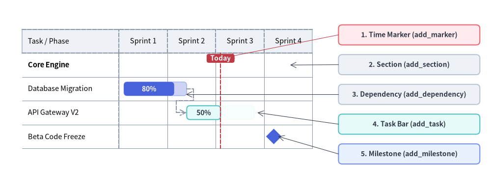
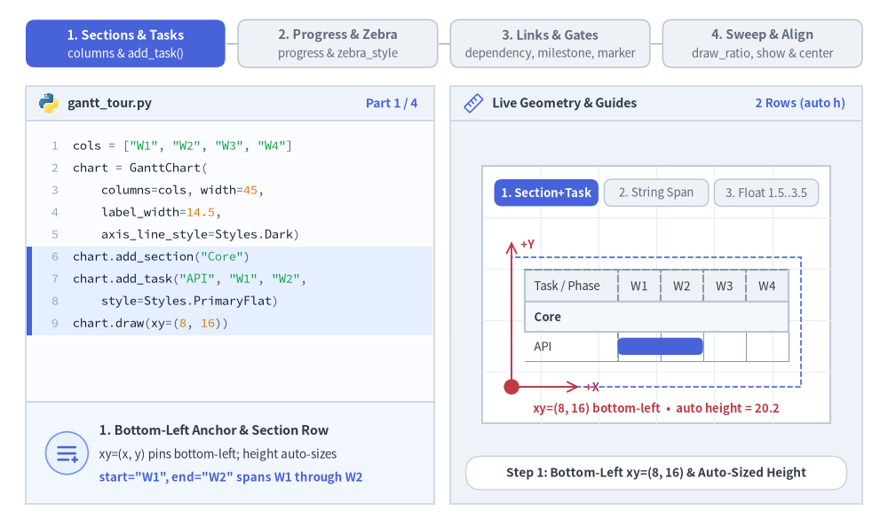
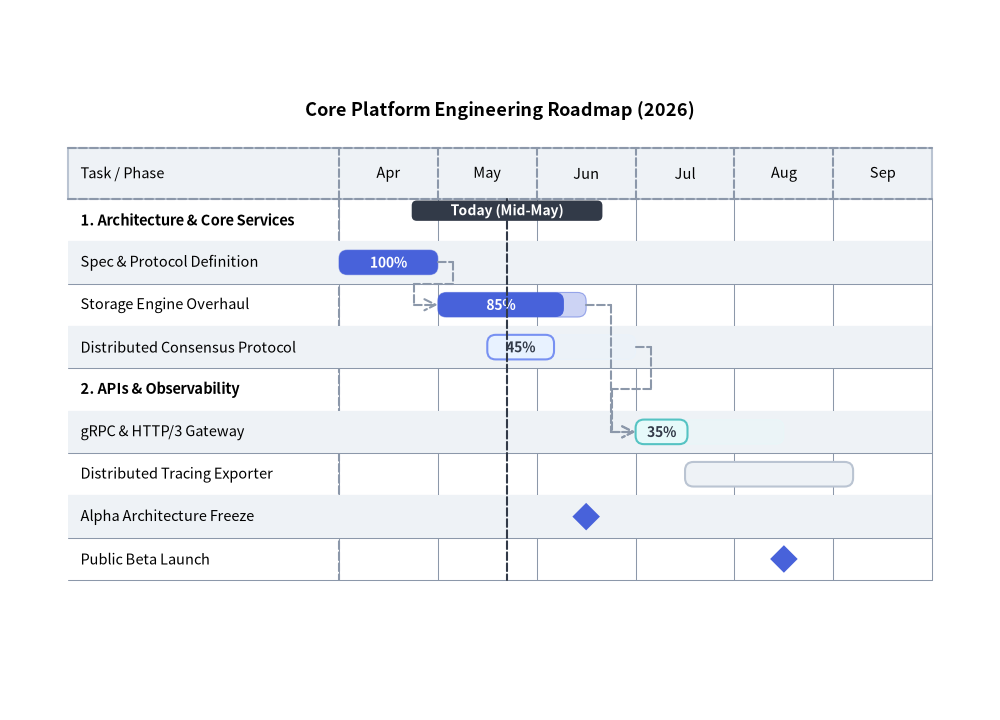
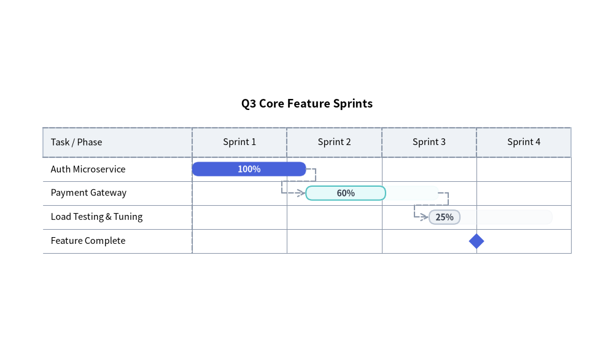

# Gantt Chart（ガントチャート）：プロジェクトロードマップ・マイルストーン・依存関係

`GanttChart`（`drawlib.charts.gantt`）は、宣言的で高品質なベクター形式のプロジェクトロードマップ、スプリントスケジュール、マイルストーンタイムラインを提供します。横方向（X 軸）にタイムライン区間が並び、縦方向（Y 軸）にセクション区切りバナー、タスク行、マイルストーンが上から下へと順番に積み重なります。


<figure class="drawlib-image" style="text-align: center;">
  
  <figcaption class="drawlib-caption">Drawlib GanttChart の構造と各要素の名称</figcaption>
</figure>

<details class="drawlib-code-details">
<summary>Source Code</summary>

```python
from drawlib.canvas import save, setup
from drawlib.charts.gantt import GanttChart
from drawlib.lines import line
from drawlib.shapes import rectangle
from drawlib.styles import Styles

setup(width=132, height=52)

chart = GanttChart(
    columns=["Sprint 1", "Sprint 2", "Sprint 3", "Sprint 4"],
    axis_line_style=Styles.MutedDashed,
    axis_text_style=Styles.Black.patch(text_size=10.5),
    grid_style=Styles.MutedThin,
    header_style=Styles.Neutral,
    progress_text_style=Styles.WhiteBold.patch(text_size=10.0),
    width=82.0,
    label_width=26.0,
    header_height=6.4,
    row_height=6.4,
    bar_radius=0.9,
)

chart.add_section("Core Engine", text_style=Styles.BlackBold.patch(text_size=10.5))
t1 = chart.add_task("Database Migration", start=0.1, end=1.4, style=Styles.PrimaryFlat, progress=0.8)
t2 = chart.add_task(
    "API Gateway V2",
    start=1.4,
    end=2.8,
    style=Styles.SecondaryNeutral,
    progress=0.5,
    progress_text_style=Styles.DarkBold.patch(text_size=10.0),
)
chart.add_milestone("Beta Code Freeze", at=3.2, style=Styles.PrimaryFlat)
chart.add_dependency(t1, t2)
chart.add_marker(at=2.1, style=Styles.DangerDashed, label="Today", label_style=Styles.WhiteBold.patch(text_size=10.0))

chart.draw(xy=(4.0, 8.0))

# Compute exact row Y coordinates from chart.get_size()
_, chart_h = chart.get_size()
rows_top = 8.0 + chart_h - 2.0 - chart.header_height
row_cy = [rows_top - (i + 0.5) * chart.row_height for i in range(4)]

# Structural Callout Annotations on the Right
callouts = [
    (42.5, "1. Time Marker (add_marker)", Styles.DangerNeutral),
    (34.5, "2. Section (add_section)", Styles.Neutral),
    (26.5, "3. Dependency (add_dependency)", Styles.Neutral),
    (18.5, "4. Task Bar (add_task)", Styles.SecondaryNeutral),
    (10.5, "5. Milestone (add_milestone)", Styles.PrimaryNeutral),
]
for cy, label_txt, box_style in callouts:
    rectangle(
        (110.0, cy),
        width=38.0,
        height=5.4,
        style=box_style.patch(shape_r=1.0),
        text=label_txt,
        text_style=Styles.DarkBold.patch(text_size=10.0),
    )

line((91.0, 42.5), (61.4, rows_top - 1.0), arrow_head="->", style=Styles.DangerThin)
line((91.0, 34.5), (78.0, row_cy[0]), arrow_head="->", style=Styles.DarkThin)
line((91.0, 26.5), (50.0, row_cy[1] - 1.5), arrow_head="->", style=Styles.DarkThin)
line((91.0, 18.5), (69.2, row_cy[2]), arrow_head="->", style=Styles.DarkThin)
line((91.0, 10.5), (74.8, row_cy[3]), arrow_head="->", style=Styles.DarkThin)

save()
```

</details>


---

## 1. 基本概念と基本的な使い方

`GanttChart` は順序付きの `columns` に沿って横向きのタイムラインロードマップを構築します。デフォルトで**左下 `(x, y)`** を基準にアンカーし（`align="center"` で中央揃えも可）、`height=None` の場合は登録された行数からコンテナの `height` を自動算出します。列名または浮動小数点オフセットを使って `.add_section(...)` バナー配下に `.add_task(...)` バーをグループ化できるほか、2 トーンの進捗率塗り分け（`progress`）や交互の行ストライプ（`zebra_style`）、`.add_dependency(...)` 矢印、`.add_milestone(...)` ひし形マーカー、`.add_marker(...)` 基準線、さらに `draw_ratio` と `show` による部分描画アニメーションをサポートしています。


<figure class="drawlib-image" style="text-align: center;">
  
  <figcaption class="drawlib-caption">基本的な使い方とパラメータツアー：セクションとタスク、進捗率とゼブラストライプ、依存関係とマイルストーン、部分スイープ（APNG アニメーション）</figcaption>
</figure>


<div class="drawlib-source-link">
  <a href="https://github.com/yuichi110/drawlib/blob/main/docs/docs_src/ja/05_charts/gantt.md" target="_blank" rel="noopener noreferrer">GitHub でアニメーションのソースコードを見る &rarr;</a>
</div>

- **セクション・タスク・時間インデックス指定（`columns`, `add_task`, `xy`）**: スケジュールを**左下** `xy` にアンカーし（`height=None` の場合は行数から高さを自動算出）、列名文字列（`"W1"`）または浮動小数点オフセット（`1.5`..`3.5`）で `start`/`end` を指定します。
- **2 トーンの進捗表示とゼブラストライプ（`progress`, `zebra_style`）**: `progress`（`0.0`〜`1.0`）と `progress_text_style` ラベルで濃淡 2 トーンの完了バーを描画し、`header_style` と交互の行背景 `zebra_style` でスケジュール表を整えます。
- **依存関係・マイルストーン・マーカー（`add_dependency`, `add_milestone`, `add_marker`）**: タスク間の直交 End-to-Start 矢印、専用行のひし形リリースゲート、および全高を貫く基準線（`"Now"` など）を重ねて描画できます。
- **部分スイープと連動表示切替（`draw_ratio`, `show`, `align`）**: `draw_ratio` でバーの伸長をアニメーション化したり、行スロットを維持しつつ関連する依存矢印も自動的に隠す `task.show = False` を切り替えたり、`draw(xy, align="center")` で中央配置したりできます。

---

## 2. 依存関係付きのエンジニアリング・リリースロードマップ

次の例では、セクション分割、進捗インジケータ付きタスク、マイルストーン、直交ルーティングによる依存関係矢印、および垂直の `"Today"` マーカーを組み合わせています。


```python
from drawlib.canvas import save, setup
from drawlib.charts.gantt import GanttChart
from drawlib.styles import Styles

setup(width=118, height=85)

chart = GanttChart(
    columns=["Apr", "May", "Jun", "Jul", "Aug", "Sep"],
    axis_line_style=Styles.MutedDashed,
    axis_text_style=Styles.Black.patch(text_size=10.5),
    grid_style=Styles.MutedThin,
    header_style=Styles.Neutral,
    zebra_style=Styles.NeutralFlat,
    progress_text_style=Styles.WhiteBold.patch(text_size=10.0),
    width=106.0,
    label_width=32.0,
    title="Core Platform Engineering Roadmap (2026)",
    title_style=Styles.BlackBold.patch(text_size=13.0),
    header_height=6.0,
    row_height=5.0,
    bar_radius=1.0,
)

# 1. Core Services Section
chart.add_section("1. Architecture & Core Services", text_style=Styles.BlackBold.patch(text_size=10.5))
t1 = chart.add_task("Spec & Protocol Definition", start="Apr", end=1.0, style=Styles.PrimaryFlat, progress=1.0)
t2 = chart.add_task("Storage Engine Overhaul", start=1.0, end=2.5, style=Styles.PrimaryFlat, progress=0.85)
t3 = chart.add_task(
    "Distributed Consensus Protocol",
    start=1.5,
    end=3.0,
    style=Styles.PrimaryNeutral,
    progress=0.45,
    progress_text_style=Styles.DarkBold.patch(text_size=10.0),
)

# 2. APIs & Observability Section
chart.add_section("2. APIs & Observability", text_style=Styles.BlackBold.patch(text_size=10.5))
t4 = chart.add_task(
    "gRPC & HTTP/3 Gateway",
    start=3.0,
    end=4.5,
    style=Styles.SecondaryNeutral,
    progress=0.35,
    progress_text_style=Styles.DarkBold.patch(text_size=10.0),
)
t5 = chart.add_task("Distributed Tracing Exporter", start=3.5, end=5.2, style=Styles.Neutral, progress=0.0)

# 3. Milestones, Dependencies & Today Marker
chart.add_milestone("Alpha Architecture Freeze", at="Jun", style=Styles.PrimaryFlat)
chart.add_milestone("Public Beta Launch", at=4.5, style=Styles.PrimaryFlat)

chart.add_dependency(t1, t2)
chart.add_dependency(t2, t4)
chart.add_dependency(t3, t4)
chart.add_marker(at=1.7, style=Styles.DarkDashed, label="Today (Mid-May)", label_style=Styles.WhiteBold.patch(text_size=10.0))

chart.draw(xy=(6.0, 10.0))
save()
```

<figure class="drawlib-image" style="text-align: center;">
  
  <figcaption class="drawlib-caption">依存関係を含むエンジニアリング・リリースロードマップ</figcaption>
</figure>


---

## 3. 時間座標の指定方法とアジャイル・スプリントスケジュール

`GanttChart` では、時間座標（`start`、`end`、`at`）を次のいずれかの方法で指定できます。
1. **列名文字列**: `columns` 内の文字列と完全一致させます（`start="Apr"` は `"Apr"` 列の左端、`end="Apr"` は `"Apr"` 列の右端、`at="Jun"` は `"Jun"` 列の中央に解決されます）。
2. **浮動小数点オフセット**: `0.0` が列 `0` の左端、`1.0` が列 `0` と列 `1` の境界、`1.5` が列 `1` の中央を表します。


```python
from drawlib.canvas import save, setup
from drawlib.charts.gantt import GanttChart
from drawlib.styles import Styles

setup(width=115, height=66)

chart = GanttChart(
    columns=["Sprint 1", "Sprint 2", "Sprint 3", "Sprint 4"],
    axis_line_style=Styles.MutedDashed,
    axis_text_style=Styles.Black.patch(text_size=10.5),
    grid_style=Styles.MutedThin,
    header_style=Styles.Neutral,
    progress_text_style=Styles.WhiteBold.patch(text_size=10.0),
    width=103.0,
    label_width=28.0,
    title="Q3 Core Feature Sprints",
    title_style=Styles.BlackBold.patch(text_size=13.0),
    bar_radius=1.2,
)

s1 = chart.add_task("Auth Microservice", start=0.0, end=1.2, style=Styles.PrimaryFlat, progress=1.0)
s2 = chart.add_task(
    "Payment Gateway",
    start=1.2,
    end=2.6,
    style=Styles.SecondaryNeutral,
    progress=0.6,
    progress_text_style=Styles.DarkBold.patch(text_size=10.0),
)
s3 = chart.add_task(
    "Load Testing & Tuning",
    start=2.5,
    end=3.8,
    style=Styles.Neutral,
    progress=0.25,
    progress_text_style=Styles.DarkBold.patch(text_size=10.0),
)

chart.add_dependency(s1, s2)
chart.add_dependency(s2, s3)
chart.add_milestone("Feature Complete", at=3.0, style=Styles.PrimaryFlat)

chart.draw(xy=(6.0, 12.0))
save()
```

<figure class="drawlib-image" style="text-align: center;">
  
  <figcaption class="drawlib-caption">タスクごとの進捗スタイルを設定したアジャイル・スプリントスケジュール</figcaption>
</figure>


---

## 4. API リファレンス

### コンストラクタ（`GanttChart`）

すべてのコンストラクタ引数は**キーワード専用引数**（`*`）です。

```python
from drawlib.charts.gantt import Dependency, DrawDirection, GanttChart, Marker, Milestone, Section, Task

chart = GanttChart(
    *,
    columns: list[str],
    axis_line_style: Style,
    axis_text_style: Style | None = None,
    header_style: Style | None = None,
    grid_style: Style | None = None,
    zebra_style: Style | None = None,
    progress_text_style: Style | None = None,
    background_style: Style | None = None,
    title: str = "",
    title_style: Style | None = None,
    width: float = 90.0,
    height: float | None = None,
    row_height: float = 4.5,
    header_height: float = 5.5,
    label_width: float = 24.0,
    bar_radius: float = 0.8,
)
```

| パラメータ | 型 | デフォルト | 説明 |
| :--- | :--- | :--- | :--- |
| **`columns`** | `list[str]` | **必須** | 上部ヘッダー帯に沿った順序付きのタイムライン区間名リスト（**最低 1 要素が必須**）。 |
| **`axis_line_style`** | `Style` | **必須** | ヘッダー枠線および列区切り目盛りに用いる必須アンカースタイル。 |
| `axis_text_style` | `Style \| None` | `None` | 列ヘッダー名および左列の行ラベルのスタイル。`None` の場合は省略されます。 |
| `header_style` | `Style \| None` | `None` | 上部タイムラインヘッダー帯の背景カードスタイル。`None` の場合は背景塗りが省略されます。 |
| `grid_style` | `Style \| None` | `None` | 各行を縦断する垂直タイムライン列区切り線のスタイル。`None` の場合は省略されます。 |
| `zebra_style` | `Style \| None` | `None` | 1 行おきに描画される水平ゼブラストライプ背景のスタイル。`None` の場合は省略されます。 |
| `progress_text_style` | `Style \| None` | `None` | `progress > 0` のタスクに描画される完了率ラベル（`"85%"` など）のデフォルトスタイル。 |
| `background_style` | `Style \| None` | `None` | チャート外枠の背景カードのスタイル。`None` の場合は省略されます。 |
| `title` | `str` | `""` | コンテナ上部に描画されるチャートタイトル文字列。 |
| `title_style` | `Style \| None` | `None` | `title` のタイポグラフィスタイル。タイトルを描画するには必須です。 |
| `width` | `float` | `90.0` | キャンバス単位でのチャート全体のバウンディングボックス幅。 |
| `height` | `float \| None` | `None` | チャート全体のバウンディングボックス高さ。`None` *（デフォルト）* の場合、`header_height + len(items) * row_height` から動的に自動算出されます（最小 `20.0`）。 |
| `row_height` | `float` | `4.5` | タスク、セクション、またはマイルストーン 1 行あたりに割り当てられる垂直高さ。 |
| `header_height` | `float` | `5.5` | 上部列ヘッダー帯の高さ。 |
| `label_width` | `float` | `24.0` | 左側のタスク／マイルストーン名カラムに確保される水平幅。 |
| `bar_radius` | `float` | `0.8` | タスクバーの角丸半径（`task.style.shape_r` が `None` の場合に適用）。 |

### メソッドとプロパティ

- **`add_section(name: str, style: Style | None = None, text_style: Style | None = None, *, show: bool = True) -> Section`**:
  カテゴリ区切りのセクション行を末尾に追加し、変更可能な `Section` インスタンスを返します（`style` はバナー矩形の塗り・枠線を上書きし、`text_style` はセクションタイトルに対して `chart.axis_text_style` を上書きします）。
- **`add_task(name: str, start: str | float, end: str | float, style: Style, progress: float = 0.0, progress_text_style: Style | None = None, *, show: bool = True, draw_ratio: float = 1.0, draw_direction: DrawDirection = "left_to_right") -> Task`**:
  スケジュールされたタスクバー行を末尾に追加し、変更可能な `Task` インスタンスを返します。
  - `progress`: `[0.0, 1.0]` にクランプされる完了率。`progress > 0` の場合、予定期間全体が `style` の塗り色の半透明ティント（`alpha=0.28`）で描画され、完了部分（`progress * width`）が不透明な `style` で描画されます。
  - `progress_text_style`: タスク単位での完了率ラベルのタイポグラフィ上書き（未指定時は `chart.progress_text_style` にフォールバックします）。
  - `draw_ratio` & `draw_direction`: 部分空間レンダリング制御（`"left_to_right"` は `start` から `end` に向かって水平にバーを伸ばし、`"bottom_to_top"` はバーの下端から垂直方向に成長させます）。
- **`add_milestone(name: str, at: str | float, style: Style, *, show: bool = True) -> Milestone`**:
  時刻 `at` にひし形マーカーを配置したマイルストーン行を末尾に追加し、変更可能な `Milestone` インスタンスを返します。
- **`add_marker(at: str | float, style: Style, label: str = "", label_style: Style | None = None, *, show: bool = True) -> Marker`**:
  時刻 `at` に全高の垂直基準線（および任意のピル型上部バッジ `label` + `label_style`）を追加し、変更可能な `Marker` インスタンスを返します。
- **`add_dependency(from_task: Task, to_task: Task, style: Style | None = None, *, show: bool = True) -> Dependency`**:
  `from_task` から `to_task` への直交依存矢印を追加し（`style=None` の場合は `chart.axis_line_style` にフォールバック）、変更可能な `Dependency` インスタンスを返します。`from_task.show`、`to_task.show`、または `dep.show` が `False` の場合（あるいはいずれかのタスクの `draw_ratio <= 0.0` の場合）は自動的に非表示になります。
- **`get_size() -> tuple[float, float]`**:
  `(width, height)` を返します。`chart.height is None` の場合は登録済み行数から `height` を動的に算出します。
- **`draw(xy: tuple[float, float] = (0.0, 0.0), *, width: float | None = None, height: float | None = None, align: Literal["bottom_left", "center"] = "bottom_left", scale: float = 1.0) -> None`**:
  左下 `xy` を基準（`align="center"` の場合は `xy` を中心）としてガントチャートを描画します。一時的な寸法上書きや均一な `scale` にも対応しています。
- **プロパティ**:
  - **`chart.columns -> list[str]`**: タイムライン列ラベルのコピーを返します。
  - **`chart.items -> list[Task | Section | Milestone]`**: 登録済みのスケジュール行を上から下の順序で格納したコピーを返します。
  - **`chart.markers -> list[Marker]`**: 登録済みの垂直マーカーのコピーを返します。
  - **`chart.dependencies -> list[Dependency]`**: 登録済みの依存関係コネクタのコピーを返します。

