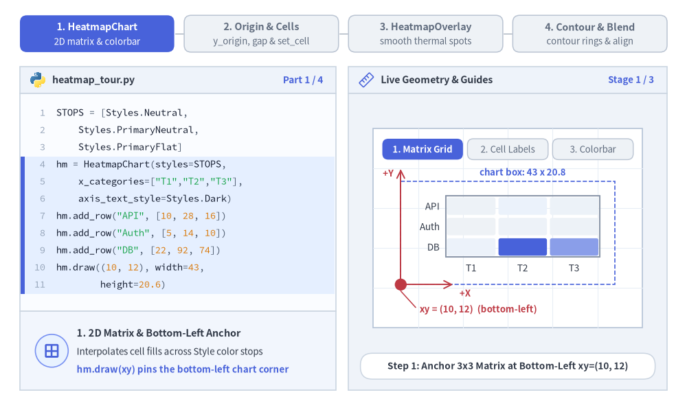
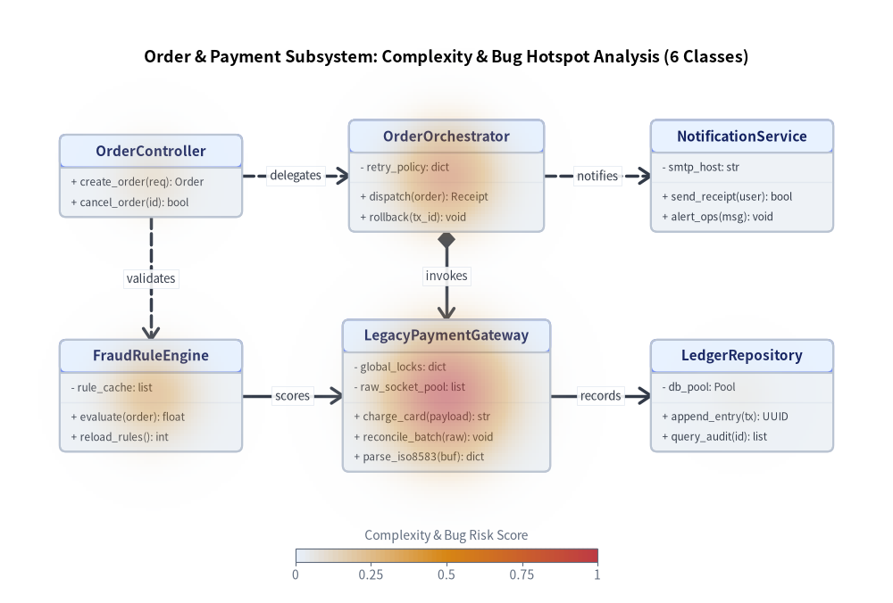
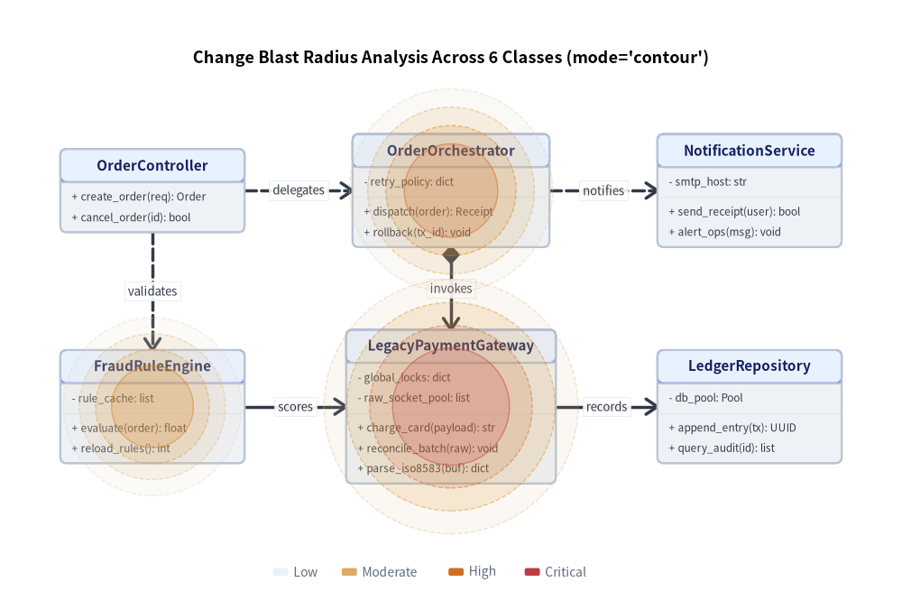

# Heatmap & Thermal Overlay（ヒートマップ）：2D マトリクスとダイアグラム熱分布オーバーレイ

`drawlib.charts.heatmap` は、`Style` のカラーストップ補間（`styles=[Style, ...]` または `min_style=...`、`max_style=...`）で彩られる 2 つの相補的なヒートマップ可視化クラスを提供します。
1. **`HeatmapChart`**: カテゴリ軸 `x_categories` × `y_categories` 上の標準的な 2D マトリクス／グリッド型ヒートマップです。背景明度に応じて文字色を自動反転するセル内数値ラベル、セル間隔・角丸めの調整（`cell_gap`、`cell_r`）、および連続カラーバー（`draw_colorbar`）や段階別凡例（`draw_legend`）を備えています。
2. **`HeatmapOverlay`**: `ClassDiagram`、`ArchitectureDiagram`、`ErDiagram`、`GeoMap` などの既存ダイアグラムの上に直接重ねて描画できる空間サーマル／ホットスポットオーバーレイです。高リスクなクラス、循環的複雑度、バグ密度、リージョンやサービスのボトルネックを `"smooth"`（2D ガウス熱分布グラデーション）または `"contour"`（同心ベクター等高線リング）モードで強調表示できます。


<figure class="drawlib-image" style="text-align: center;">
  
  <figcaption class="drawlib-caption">ヒートマップの 2 形態：2D マトリクス HeatmapChart と ClassDiagram 上の HeatmapOverlay</figcaption>
</figure>

<details class="drawlib-code-details">
<summary>Source Code</summary>

```python
from drawlib.canvas import save, setup
from drawlib.charts.heatmap import HeatmapChart, HeatmapOverlay
from drawlib.diagrams.class_diagram import ClassDiagram, ClassNode
from drawlib.styles import Styles

setup(width=136, height=62)

# Left: 2D Matrix HeatmapChart
matrix = HeatmapChart(
    styles=[Styles.Neutral, Styles.PrimaryNeutral, Styles.PrimaryFlat, Styles.AccentFlat],
    x_categories=["00h", "06h", "12h", "18h"],
    axis_line_style=Styles.Muted,
    axis_text_style=Styles.Muted.patch(text_size=10.0),
    value_text_style=Styles.BlackBold.patch(text_size=10.0),
    width=58.0,
    height=40.0,
    title="1. 2D Matrix HeatmapChart",
    title_style=Styles.BlackBold.patch(text_size=11.5),
    value_format="{:.1f}%",
)
matrix.add_row("API", [0.4, 1.2, 4.8, 2.1])
matrix.add_row("Auth", [0.2, 0.8, 2.5, 1.4])
matrix.add_row("Billing", [0.5, 1.9, 7.6, 3.8])
matrix.draw(xy=(4.0, 16.0))
matrix.draw_colorbar(
    xy=(14.0, 6.5),
    text_style=Styles.Muted.patch(text_size=9.5),
    length=38.0,
    thickness=2.0,
)

# Right: Spatial Thermal HeatmapOverlay on ClassDiagram
diag = ClassDiagram(
    node_style=Styles.Neutral,
    header_style=Styles.PrimaryNeutral,
    edge_style=Styles.DarkBold,
    edge_text_style=Styles.Dark.patch(text_size=9.5),
    title="2. ClassDiagram + HeatmapOverlay",
    title_style=Styles.BlackBold.patch(text_size=11.5),
)
c_api = diag.add(ClassNode("OrderService", width=26.0).add_method("submit", "req", "bool"), xy=(82.0, 36.0))
c_god = diag.add(
    ClassNode("LegacyBillingGodClass", width=32.0)
    .add_attribute("flags", "dict")
    .add_method("process_all", "tx", "void"),
    xy=(116.0, 36.0),
)
diag.connect(c_api, c_god, "dependency", directed=True)
diag.draw(xy=(0.0, 0.0))

overlay = HeatmapOverlay(
    styles=[Styles.PrimaryNeutral, Styles.WarningFlat, Styles.DangerFlat],
    mode="smooth",
    max_alpha=0.55,
)
overlay.add_spot(c_god, value=0.95, radius=19.0)
overlay.add_spot(c_api, value=0.35, radius=14.0)
overlay.draw(xy=(0.0, 0.0))
overlay.draw_colorbar(
    xy=(82.0, 6.5),
    text_style=Styles.Muted.patch(text_size=9.5),
    length=38.0,
    thickness=2.0,
)

save()
```

</details>


---

## 1. 基本概念と基本的な使い方

`HeatmapChart` は `.add_row(...)` や `.set_cell(...)` でカテゴリ型の 2D グリッドマトリクスを構築し、デフォルトで**左下 `(x, y)`** を基準にアンカーします。補間された `Style` カラーストップの明度に応じてセルラベルの文字色を濃色・白色へ自動切り替え（`auto_contrast_text=True`）できるのが特徴です。一方、マトリクスグリッドを補完する `HeatmapOverlay` は、既存のダイアグラムやキャンバス座標（`add_spot(...)`）の上に `"smooth"`（2D ガウス熱分布フィールド）または `"contour"`（同心ベクター等高線リング）を直接投影し、分離配置型の `.draw_colorbar(...)` スケールや `"bottom_left"`／`"center"` 配置と柔軟に組み合わせられます。


<figure class="drawlib-image" style="text-align: center;">
  
  <figcaption class="drawlib-caption">基本的な使い方とパラメータツアー：HeatmapChart の 2D マトリクス、セル個別設定、HeatmapOverlay の熱分布と等高線ホットスポット（APNG アニメーション）</figcaption>
</figure>

<details class="drawlib-code-details">
<summary>Source Code</summary>

```python
from __future__ import annotations

from drawlib.anim import Animation
from drawlib.canvas import save, setup
from drawlib.charts.heatmap import HeatmapChart, HeatmapOverlay
from drawlib.icons import code as code_icons
from drawlib.icons import phosphor
from drawlib.lines import line
from drawlib.shapes import circle, rectangle
from drawlib.smartarts import SourceCode, SourceCodeStyles
from drawlib.styles import Styles
from drawlib.text import text

W, H = 138.0, 82.0
setup(width=W, height=H)
anim = Animation(fps=10.0, loop=0)

CODE_TEXT_SIZE = 10.0
PT_TO_CANVAS = W / 720.0
FONT_CANVAS = CODE_TEXT_SIZE * PT_TO_CANVAS
LINE_H = FONT_CANVAS * 1.8
PAD_Y = FONT_CANVAS * 1.2

CODE_STYLES = SourceCodeStyles.get("default", font_lang="en", text_size=CODE_TEXT_SIZE).patch(
    box_style=Styles.Neutral.patch(shape_fill_color=(0, 0, 0, 0), shape_line_width=0),
)

PANE_HEADER = Styles.Neutral.patch(
    shape_fill_color=(238, 243, 250),
    shape_line_color=(203, 213, 225),
    shape_line_width=1.2,
    shape_r=0.0,
)
EDITOR_BODY = Styles.Neutral.patch(
    shape_fill_color=(250, 252, 255),
    shape_line_color=(203, 213, 225),
    shape_line_width=1.2,
    shape_r=0.0,
)
TAKEAWAY_BODY = Styles.Neutral.patch(
    shape_fill_color=(242, 246, 253),
    shape_line_color=(203, 213, 225),
    shape_line_width=1.2,
    shape_r=0.0,
)
STUDIO_BODY = Styles.Neutral.patch(
    shape_fill_color=(239, 243, 249),
    shape_line_color=(203, 213, 225),
    shape_line_width=1.2,
    shape_r=0.0,
)

PART_ITEMS = [
    ("1. HeatmapChart", "2D matrix & colorbar"),
    ("2. Origin & Cells", "y_origin, gap & set_cell"),
    ("3. HeatmapOverlay", "smooth thermal spots"),
    ("4. Contour & Blend", "contour rings & align"),
]


def draw_step_bar(active_part: int) -> None:
    """Draw top 4-part progress bar (active_part is 1..4)."""
    pill_w = 31.0
    pill_h = 7.4
    gap = 2.0
    start_x = 4.0 + pill_w / 2.0
    cy = 75.2

    for idx, (label, sublabel) in enumerate(PART_ITEMS, start=1):
        cx = start_x + (idx - 1) * (pill_w + gap)
        if idx > 1:
            prev_cx = cx - (pill_w + gap)
            line(
                (prev_cx + pill_w / 2.0 + 0.2, cy),
                (cx - pill_w / 2.0 - 0.2, cy),
                style=Styles.PrimaryBold if idx <= active_part else Styles.MutedThin,
            )

        if idx == active_part:
            st = Styles.PrimaryFlat.patch(shape_r=1.4)
            tst = Styles.WhiteBold.patch(text_size=10.3)
            sub_tst = Styles.White.patch(text_size=9.5)
        elif idx < active_part:
            st = Styles.PrimaryNeutral.patch(shape_r=1.4, shape_line_width=1.1)
            tst = Styles.PrimaryBold.patch(text_size=10.3)
            sub_tst = Styles.Primary.patch(text_size=9.5)
        else:
            st = Styles.Neutral.patch(shape_r=1.4, shape_line_width=1.1)
            tst = Styles.MutedBold.patch(text_size=10.3)
            sub_tst = Styles.Muted.patch(text_size=9.5)

        rectangle((cx, cy), width=pill_w, height=pill_h, style=st)
        text((cx, cy + 1.35), label, style=tst)
        text((cx, cy - 1.55), sublabel, style=sub_tst)


def draw_left_pane(
    active_part: int,
    code_lines: list[str],
    hl_range: tuple[int, int],
    icon_fn: object,
    summary_title: str,
    summary_line1: str,
    summary_line2: str,
) -> None:
    """Draw left Python code editor + bottom concept takeaway card."""
    x0, w = 4.0, 63.5
    cx = x0 + w / 2.0
    top_y = 63.2
    header_h = 5.4
    editor_h = 43.8
    takeaway_h = 15.8

    rectangle((cx, top_y + header_h / 2.0), width=w, height=header_h, style=PANE_HEADER)
    code_icons.python((x0 + 3.6, top_y + header_h / 2.0), width=3.4, style=Styles.Neutral)
    text(
        (x0 + 6.5, top_y + header_h / 2.0),
        "heatmap_tour.py",
        style=Styles.DarkBold.patch(text_size=10.2, halign="left"),
    )
    text(
        (x0 + w - 2.6, top_y + header_h / 2.0),
        f"Part {active_part} / 4",
        style=Styles.PrimaryBold.patch(text_size=9.8, halign="right"),
    )

    rectangle((cx, top_y - editor_h / 2.0), width=w, height=editor_h, style=EDITOR_BODY)

    hl_start, hl_end = hl_range
    hl_top = top_y - PAD_Y - hl_start * LINE_H
    hl_bot = top_y - PAD_Y - (hl_end + 1) * LINE_H
    hl_cy = (hl_top + hl_bot) / 2.0
    hl_h = hl_top - hl_bot
    rectangle(
        (cx, hl_cy),
        width=w - 0.6,
        height=hl_h,
        style=Styles.Neutral.patch(shape_fill_color=(229, 239, 255), shape_line_width=0),
    )
    rectangle(
        (x0 + 0.55, hl_cy),
        width=0.9,
        height=hl_h,
        style=Styles.PrimaryFlat.patch(shape_line_width=0),
    )

    SourceCode.draw(
        xy=(x0, top_y),
        width=w,
        code="\n".join(code_lines),
        styles=CODE_STYLES,
        code_lang="python",
        show_linenum=True,
        align="top_left",
    )

    take_cy = 3.6 + takeaway_h / 2.0
    rectangle((cx, take_cy), width=w, height=takeaway_h, style=TAKEAWAY_BODY)
    circle(
        (x0 + 6.4, take_cy),
        radius=3.3,
        style=Styles.PrimaryNeutral.patch(shape_line_width=1.2),
    )
    icon_fn((x0 + 6.4, take_cy), width=3.8, style=Styles.PrimaryBold)  # type: ignore[operator]
    text(
        (x0 + 11.4, take_cy + 3.6),
        summary_title,
        style=Styles.DarkBold.patch(text_size=10.4, halign="left"),
    )
    text(
        (x0 + 11.4, take_cy - 0.2),
        summary_line1,
        style=Styles.Dark.patch(text_size=9.7, halign="left"),
    )
    text(
        (x0 + 11.4, take_cy - 3.8),
        summary_line2,
        style=Styles.PrimaryBold.patch(text_size=9.6, halign="left"),
    )


def draw_geometry_studio(param_badge: str, footer_caption: str) -> tuple[float, float]:
    """Draw right geometry lab shell, inner coordinate sheet with subtle grid, and footer."""
    x0, w = 70.0, 64.0
    cx = x0 + w / 2.0
    top_y = 63.2
    header_h = 5.4
    body_h = 59.6

    rectangle((cx, top_y + header_h / 2.0), width=w, height=header_h, style=PANE_HEADER)
    phosphor.ruler((x0 + 3.6, top_y + header_h / 2.0), width=3.4, style=Styles.Primary)
    text(
        (x0 + 6.5, top_y + header_h / 2.0),
        "Live Geometry & Guides",
        style=Styles.DarkBold.patch(text_size=10.2, halign="left"),
    )
    text(
        (x0 + w - 2.6, top_y + header_h / 2.0),
        param_badge,
        style=Styles.PrimaryBold.patch(text_size=9.6, halign="right"),
    )

    rectangle((cx, 3.6 + body_h / 2.0), width=w, height=body_h, style=STUDIO_BODY)

    sheet_cx, sheet_cy = cx, 36.2
    sheet_w, sheet_h = 54.0, 40.0
    sx0, sy0 = sheet_cx - sheet_w / 2.0, sheet_cy - sheet_h / 2.0
    rectangle(
        (sheet_cx, sheet_cy),
        width=sheet_w,
        height=sheet_h,
        style=Styles.Neutral.patch(
            shape_fill_color=(255, 255, 255),
            shape_line_color=(180, 194, 214),
            shape_line_width=1.2,
        ),
    )
    g_st = Styles.MutedThin.patch(line_color=(232, 238, 246), line_width=0.8)
    for gx in range(1, 6):
        vx = sx0 + gx * (sheet_w / 6.0)
        line((vx, sy0), (vx, sy0 + sheet_h), style=g_st)
    for gy in range(1, 5):
        vy = sy0 + gy * (sheet_h / 5.0)
        line((sx0, vy), (sx0 + sheet_w, vy), style=g_st)

    rectangle(
        (cx, 8.4),
        width=59.2,
        height=5.2,
        style=Styles.Neutral.patch(
            shape_fill_color=(255, 255, 255),
            shape_line_color=(203, 213, 225),
            shape_line_width=1.1,
            shape_r=2.4,
        ),
        text=footer_caption,
        text_style=Styles.DarkBold.patch(text_size=9.8),
    )
    return sheet_cx, sheet_cy


def draw_sub_pills(scx: float, labels: list[str], active_idx: int) -> None:
    """Draw 3-step tracker pills near the top of the studio sheet."""
    pw, ph, pgap = 16.2, 4.2, 0.9
    p_start = scx - (3 * pw + 2 * pgap) / 2.0 + pw / 2.0
    for idx, lbl in enumerate(labels):
        px = p_start + idx * (pw + pgap)
        if idx == active_idx:
            pst = Styles.PrimaryFlat.patch(shape_r=1.2)
            ptst = Styles.WhiteBold.patch(text_size=9.5)
        elif idx < active_idx:
            pst = Styles.PrimaryNeutral.patch(shape_r=1.2, shape_line_width=1.0)
            ptst = Styles.PrimaryBold.patch(text_size=9.5)
        else:
            pst = Styles.Neutral.patch(shape_r=1.2, shape_line_width=1.0)
            ptst = Styles.Muted.patch(text_size=9.5)
        rectangle((px, 52.0), width=pw, height=ph, style=pst, text=lbl, text_style=ptst)


STOPS = [Styles.Neutral, Styles.PrimaryNeutral, Styles.PrimaryFlat]
THERM = [Styles.PrimaryNeutral, Styles.WarningFlat, Styles.DangerFlat]
AXIS_DARK = Styles.Dark.patch(text_size=9.8)
VAL_BOLD = Styles.DarkBold.patch(text_size=10.0)


def draw_service_cards(card_y: float = 37.2) -> tuple[tuple[float, float], tuple[float, float], tuple[float, float]]:
    """Draw 3 calm neutral service cards (Gateway -> Auth -> DB) on the studio sheet."""
    gw_xy = (86.8, card_y)
    auth_xy = (102.0, card_y)
    db_xy = (117.2, card_y)
    cw, ch = 11.4, 8.2

    rectangle(gw_xy, width=cw, height=ch, style=Styles.Neutral.patch(shape_r=1.2, shape_line_width=1.2))
    phosphor.globe((gw_xy[0], card_y + 1.5), width=3.1, style=Styles.DarkBold)
    text((gw_xy[0], card_y - 2.0), "Gateway", style=Styles.DarkBold.patch(text_size=9.5))

    rectangle(auth_xy, width=cw, height=ch, style=Styles.PrimaryNeutral.patch(shape_r=1.2, shape_line_width=1.2))
    phosphor.shield_check((auth_xy[0], card_y + 1.5), width=3.1, style=Styles.PrimaryBold)
    text((auth_xy[0], card_y - 2.0), "Auth", style=Styles.DarkBold.patch(text_size=9.6))

    rectangle(db_xy, width=cw, height=ch, style=Styles.Neutral.patch(shape_r=1.2, shape_line_width=1.2))
    phosphor.database((db_xy[0], card_y + 1.5), width=3.1, style=Styles.DarkBold)
    text((db_xy[0], card_y - 2.0), "DB", style=Styles.DarkBold.patch(text_size=9.6))

    line((gw_xy[0] + cw / 2.0 + 0.3, card_y), (auth_xy[0] - cw / 2.0 - 0.3, card_y), arrow_head="->", style=Styles.DarkBold)
    line((auth_xy[0] + cw / 2.0 + 0.3, card_y), (db_xy[0] - cw / 2.0 - 0.3, card_y), arrow_head="->", style=Styles.DarkBold)
    return gw_xy, auth_xy, db_xy


# =========================================================================
# Part 1: HeatmapChart — 2D Matrix Grid, Auto-Contrast Text & Colorbar
# =========================================================================
CHART_STATES = [
    (
        "grid_only",
        3.3,
        [
            "STOPS = [Styles.Neutral,",
            "    Styles.PrimaryNeutral,",
            "    Styles.PrimaryFlat]",
            "hm = HeatmapChart(styles=STOPS,",
            '    x_categories=["T1","T2","T3"],',
            "    axis_text_style=Styles.Dark)",
            'hm.add_row("API", [10, 28, 16])',
            'hm.add_row("Auth", [5, 14, 10])',
            'hm.add_row("DB", [22, 92, 74])',
            "hm.draw((10, 12), width=43,",
            "        height=20.6)",
        ],
        (3, 10),
        "Stage 1 / 3",
        "Step 1: Anchor 3x3 Matrix at Bottom-Left xy=(10, 12)",
        "1. 2D Matrix & Bottom-Left Anchor",
        "Interpolates cell fills across Style color stops",
        "hm.draw(xy) pins the bottom-left chart corner",
    ),
    (
        "cell_labels",
        3.3,
        [
            "hm = HeatmapChart(",
            "    styles=STOPS,",
            '    x_categories=["T1","T2","T3"],',
            "    axis_text_style=Styles.Dark,",
            "    value_text_style=",
            "        Styles.DarkBold,",
            "    auto_contrast_text=True,",
            '    value_format="{:.0f}%",',
            ")",
            '# add_row("API" / "Auth" / "DB")',
            "hm.draw((10, 12), 43, 21.0)",
        ],
        (4, 7),
        "Stage 2 / 3",
        "Step 2: value_text_style + Auto Dark/Light Contrast",
        "2. Auto-Contrasting Cell Labels",
        "Formats values via value_format inside each cell",
        "auto_contrast_text=True flips dark/white text",
    ),
    (
        "colorbar",
        3.4,
        [
            "hm = HeatmapChart(styles=STOPS,",
            '    x_categories=["T1","T2","T3"],',
            "    axis_text_style=Styles.Dark,",
            "    value_text_style=",
            "        Styles.DarkBold,",
            '    value_format="{:.0f}%")',
            '# add_row("API" / "Auth" / "DB")',
            "hm.draw((10, 14), 43, 20.5)",
            "hm.draw_colorbar(xy=(15, 8),",
            "    text_style=Styles.Dark,",
            "    length=34)",
        ],
        (8, 10),
        "Stage 3 / 3",
        "Step 3: Decoupled Continuous Scale via .draw_colorbar()",
        "3. Decoupled Colorbar (.draw_colorbar)",
        "Place horizontal or vertical scale bar anywhere",
        "Inherits data min/max range & value_format",
    ),
]

for c_idx, (c_mode, dur, code_c, hl_rng, badge_txt, foot_txt, s_t, s_1, s_2) in enumerate(CHART_STATES):
    with anim.frame(duration=dur):
        draw_step_bar(1)
        draw_left_pane(1, code_c, hl_rng, phosphor.grid_four, s_t, s_1, s_2)
        scx, scy = draw_geometry_studio(badge_txt, foot_txt)
        draw_sub_pills(scx, ["1. Matrix Grid", "2. Cell Labels", "3. Colorbar"], c_idx)

        hx = 80.5
        hy = 26.8 if c_mode == "colorbar" else 24.8
        hw = 43.0
        hh = 20.5 if c_mode == "colorbar" else 20.8

        hm = HeatmapChart(
            styles=STOPS,
            x_categories=["T1", "T2", "T3"],
            axis_line_style=Styles.Muted,
            axis_text_style=AXIS_DARK,
            value_text_style=None if c_mode == "grid_only" else VAL_BOLD,
            auto_contrast_text=True,
            value_format="{:.0f}%",
            width=hw,
            height=hh,
        )
        hm.add_row("API", [10, 28, 16])
        hm.add_row("Auth", [5, 14, 10])
        hm.add_row("DB", [22, 92, 74])
        hm.draw(xy=(hx, hy))

        if c_mode == "grid_only":
            rectangle(
                (hx + hw / 2.0, hy + hh / 2.0),
                width=hw,
                height=hh,
                style=Styles.PrimaryDashed.patch(shape_fill_color=(0, 0, 0, 0), shape_line_width=1.2),
            )
            text(
                (hx + hw / 2.0 + 3.0, hy + hh + 1.8),
                "chart box: 43 x 20.8",
                style=Styles.PrimaryBold.patch(text_size=9.5),
            )
            line((hx, hy), (hx, hy + hh + 2.4), arrow_head="->", style=Styles.DangerBold.patch(line_width=1.4))
            text((hx - 1.4, hy + hh + 1.6), "+Y", style=Styles.DangerBold.patch(text_size=9.5, halign="right"))
            line((hx, hy), (hx + 10.5, hy), arrow_head="->", style=Styles.DangerBold.patch(line_width=1.4))
            text((hx + 11.8, hy - 1.7), "+X", style=Styles.DangerBold.patch(text_size=9.5, halign="left"))
            circle((hx, hy), radius=1.2, style=Styles.DangerFlat)
            line((hx, hy - 1.3), (hx + 3.0, 20.2), style=Styles.DangerBold.patch(line_width=1.1))
            text((hx + 3.8, 19.8), "xy = (10, 12)  (bottom-left)", style=Styles.DangerBold.patch(text_size=9.5, halign="left"))
        elif c_mode == "cell_labels":
            line((105.0, 43.2), (105.0, 45.8), style=Styles.DarkBold.patch(line_width=1.1))
            text((105.0, 47.2), "light cell -> dark text", style=Styles.DarkBold.patch(text_size=9.5))
            line((108.8, 30.2), (110.2, 21.8), style=Styles.PrimaryBold.patch(line_width=1.1))
            text((scx, 19.8), "dark peak cells (92%, 74%) -> auto white text", style=Styles.PrimaryBold.patch(text_size=9.5))
        else:
            cb_x, cb_y = 86.5, 22.0
            hm.draw_colorbar(
                xy=(cb_x, cb_y),
                text_style=Styles.Dark.patch(text_size=9.5),
                length=34.0,
                thickness=2.0,
                num_ticks=5,
            )
            circle((cb_x, cb_y), radius=1.05, style=Styles.DangerFlat)
            text((cb_x - 1.6, cb_y + 0.8), "xy", style=Styles.DangerBold.patch(text_size=9.5, halign="right"))

# =========================================================================
# Part 2: Origin & Cells — y_origin, cell_gap / cell_r & .set_cell() / None
# =========================================================================
CELL_STATES = [
    (
        "origin_flip",
        3.3,
        [
            "hm = HeatmapChart(",
            "    styles=STOPS,",
            '    x_categories=["T1","T2","T3"],',
            '    y_origin="bottom",',
            '    x_label_position="top",',
            "    axis_text_style=Styles.Dark,",
            "    value_text_style=",
            "        Styles.DarkBold,",
            ")",
            '# Row 0 "API" now starts at bottom',
            "hm.draw((10, 12), 42.5, 22.8)",
        ],
        (3, 4),
        'y_origin="bottom"',
        'y_origin="bottom" + x_label_position="top" Axis Flip',
        "Row Origin & Top Column Labels",
        'Default y_origin="top" puts row 0 at top',
        'y_origin="bottom" flips to Cartesian +Y order',
    ),
    (
        "gap_round",
        3.3,
        [
            "hm = HeatmapChart(",
            "    styles=STOPS,",
            '    x_categories=["T1","T2","T3"],',
            "    cell_gap=1.2,",
            "    cell_r=0.8,",
            "    axis_text_style=Styles.Dark,",
            "    value_text_style=",
            "        Styles.DarkBold,",
            ")",
            "# Rounded tile matrix with 1.2 gap",
            "hm.draw((10, 12), 43, 21.2)",
        ],
        (3, 4),
        "gap=1.2, r=0.8",
        "cell_gap=1.2, cell_r=0.8: Spaced Rounded Matrix Tiles",
        "Tile Spacing & Corner Rounding",
        "cell_gap separates adjacent cells cleanly",
        "cell_r rounds cell corners (clamped safely)",
    ),
    (
        "set_cell_override",
        3.4,
        [
            "hm = HeatmapChart(styles=STOPS,",
            '    x_categories=["T1","T2","T3"],',
            "    cell_gap=1.2, cell_r=0.8,",
            "    value_text_style=",
            "        Styles.DarkBold)",
            'hm.add_row("API", [10, 28, None])',
            'hm.add_row("Auth", [5, 14, 10])',
            'hm.add_row("DB", [22, 92, 74])',
            'hm.set_cell("T2", "DB", 98,',
            '    label="MAX",',
            "    style=Styles.AccentFlat)",
        ],
        (5, 10),
        ".set_cell & None",
        '.set_cell("T2", "DB", ..., label="MAX") & None Slot',
        "Targeted .set_cell() & Empty Slots",
        "Pass None in add_row() to leave a slot blank",
        ".set_cell(x, y) overrides label, value, or style",
    ),
]

for o_idx, (o_mode, dur, code_o, hl_rng, badge_txt, foot_txt, s_t, s_1, s_2) in enumerate(CELL_STATES):
    with anim.frame(duration=dur):
        draw_step_bar(2)
        draw_left_pane(2, code_o, hl_rng, phosphor.sliders_horizontal, s_t, s_1, s_2)
        scx, scy = draw_geometry_studio(badge_txt, foot_txt)
        draw_sub_pills(scx, ["1. y_origin", "2. gap & r", "3. .set_cell"], o_idx)

        if o_mode == "origin_flip":
            hx, hy, hw, hh = 79.2, 23.4, 42.0, 22.6
            hm = HeatmapChart(
                styles=STOPS,
                x_categories=["T1", "T2", "T3"],
                y_origin="bottom",
                x_label_position="top",
                axis_line_style=Styles.Muted,
                axis_text_style=AXIS_DARK,
                value_text_style=VAL_BOLD,
                value_format="{:.0f}%",
                width=hw,
                height=hh,
            )
            hm.add_row("API", [10, 28, 16])
            hm.add_row("Auth", [5, 14, 10])
            hm.add_row("DB", [22, 92, 74])
            hm.draw(xy=(hx, hy))

            text((103.2, 46.8), 'x_label_position = "top"', style=Styles.PrimaryBold.patch(text_size=9.5))
            line((120.5, 27.6), (120.5, 40.2), arrow_head="->", style=Styles.DangerBold.patch(line_width=1.4))
            text((121.6, 28.6), "r0", style=Styles.DangerBold.patch(text_size=9.5, halign="left"))
            text((121.6, 39.2), "r2", style=Styles.DangerBold.patch(text_size=9.5, halign="left"))
            text((scx, 19.8), 'y_origin="bottom": row 0 ("API") at bottom', style=Styles.DangerBold.patch(text_size=9.5))
        elif o_mode == "gap_round":
            hx, hy, hw, hh = 80.5, 24.8, 43.0, 21.2
            hm = HeatmapChart(
                styles=STOPS,
                x_categories=["T1", "T2", "T3"],
                cell_gap=1.2,
                cell_r=0.8,
                axis_text_style=AXIS_DARK,
                value_text_style=VAL_BOLD,
                value_format="{:.0f}%",
                width=hw,
                height=hh,
            )
            hm.add_row("API", [10, 28, 16])
            hm.add_row("Auth", [5, 14, 10])
            hm.add_row("DB", [22, 92, 74])
            hm.draw(xy=(hx, hy))

            # Caliper ticks over column gap at x ~ 99.83 (99.23..100.43)
            line((99.23, 43.2), (99.23, 45.6), style=Styles.PrimaryBold.patch(line_width=1.2))
            line((100.43, 43.2), (100.43, 45.6), style=Styles.PrimaryBold.patch(line_width=1.2))
            text((99.83, 47.1), "cell_gap = 1.2", style=Styles.PrimaryBold.patch(text_size=9.5))

            line((119.5, 30.8), (116.5, 21.6), style=Styles.DangerBold.patch(line_width=1.1))
            text((scx, 19.8), "cell_r = 0.8  (rounded tile corners)", style=Styles.DangerBold.patch(text_size=9.5))
        else:
            hx, hy, hw, hh = 80.5, 24.8, 43.0, 21.2
            hm = HeatmapChart(
                styles=STOPS,
                x_categories=["T1", "T2", "T3"],
                cell_gap=1.2,
                cell_r=0.8,
                axis_text_style=AXIS_DARK,
                value_text_style=VAL_BOLD,
                value_format="{:.0f}%",
                width=hw,
                height=hh,
            )
            hm.add_row("API", [10, 28, None])
            hm.add_row("Auth", [5, 14, 10])
            hm.add_row("DB", [22, 92, 74])
            hm.set_cell("T2", "DB", 98, label="MAX", style=Styles.AccentFlat)
            hm.draw(xy=(hx, hy))

            # Ghost slot outline in empty ("T3", "API") cell at (115.33, 40.88)
            rectangle(
                (115.33, 40.88),
                width=9.13,
                height=3.03,
                style=Styles.MutedDashed.patch(
                    shape_fill_color=(248, 250, 252),
                    shape_line_color=(148, 163, 184),
                    shape_line_width=1.1,
                    shape_r=0.8,
                ),
                text="None",
                text_style=Styles.MutedBold.patch(text_size=9.5),
            )
            line((115.33, 42.6), (115.33, 45.6), style=Styles.DarkBold.patch(line_width=1.1))
            text((111.5, 47.1), "None -> empty slot", style=Styles.DarkBold.patch(text_size=9.5))

            line((108.6, 30.7), (110.2, 21.8), style=Styles.DangerBold.patch(line_width=1.2))
            text((scx, 19.8), '.set_cell("T2", "DB", 98, label="MAX")', style=Styles.DangerBold.patch(text_size=9.5))

# =========================================================================
# Part 3: HeatmapOverlay — Smooth Gaussian Thermal Spots Over Topology
# =========================================================================
OVERLAY_STATES = [
    (
        "base_cards",
        3.3,
        [
            "# 1. Calm neutral service topology",
            "rectangle(gw_xy, 11.4, 8.2,",
            "    style=Styles.Neutral,",
            '    text="Gateway")',
            "rectangle(auth_xy, 11.4, 8.2,",
            "    style=Styles.PrimaryNeutral,",
            '    text="Auth")',
            "rectangle(db_xy, 11.4, 8.2,",
            "    style=Styles.Neutral,",
            '    text="DB")',
            "# Connect Gateway -> Auth -> DB",
        ],
        (1, 9),
        "Stage 1 / 3",
        "Step 1: Calm Neutral Topology (Gateway -> Auth -> DB)",
        "1. Base Architecture or Diagram",
        "Draw neutral cards, UML, VPC, or GeoMap first",
        "Keep base fills calm so thermal spots pop",
    ),
    (
        "single_spot",
        3.3,
        [
            "THERM = [Styles.PrimaryNeutral,",
            "    Styles.WarningFlat,",
            "    Styles.DangerFlat]",
            "ov = HeatmapOverlay(",
            "    styles=THERM,",
            '    mode="smooth",',
            "    max_alpha=0.55,",
            ")",
            "ov.add_spot(",
            "    db_xy, value=0.95, radius=9.5)",
            "ov.draw()",
        ],
        (3, 10),
        "Stage 2 / 3",
        "Step 2: Smooth Gaussian Hotspot Over DB (value=0.95)",
        "2. Smooth Thermal Spot (.add_spot)",
        "2D Gaussian glow centered at (x, y) or Node",
        "max_alpha=0.55 keeps underlying text legible",
    ),
    (
        "multi_spot",
        3.4,
        [
            "ov = HeatmapOverlay(",
            '    styles=THERM, mode="smooth",',
            "    max_alpha=0.55)",
            "ov.add_spot(db_xy, 0.95, 9.5)",
            "ov.add_spot(auth_xy, 0.62, 9.0)",
            "ov.add_spot(gw_xy, 0.28, 8.0)",
            "ov.draw()",
            "ov.draw_colorbar(",
            "    xy=(15, 6),",
            "    text_style=Styles.Dark,",
            "    length=34)",
        ],
        (3, 10),
        "Stage 3 / 3",
        "Step 3: Multi-Spot Thermal Field + .draw_colorbar()",
        "3. Multi-Spot Field & Colorbar",
        "Combine cool, warm, and hot service spots",
        "Pair with .draw_colorbar() for 0..1 intensity",
    ),
]

for v_idx, (v_mode, dur, code_v, hl_rng, badge_txt, foot_txt, s_t, s_1, s_2) in enumerate(OVERLAY_STATES):
    with anim.frame(duration=dur):
        draw_step_bar(3)
        draw_left_pane(3, code_v, hl_rng, phosphor.fire, s_t, s_1, s_2)
        scx, scy = draw_geometry_studio(badge_txt, foot_txt)
        draw_sub_pills(scx, ["1. Service Cards", "2. Single Spot", "3. Multi-Spot"], v_idx)

        gw_xy, auth_xy, db_xy = draw_service_cards(card_y=37.2)

        if v_mode == "base_cards":
            for lbl_xy, pos in (("gw_xy", gw_xy), ("auth_xy", auth_xy), ("db_xy", db_xy)):
                line((pos[0], pos[1] - 4.5), (pos[0], 27.6), arrow_head="<-", style=Styles.PrimaryBold.patch(line_width=1.1))
                text((pos[0], 25.6), lbl_xy, style=Styles.PrimaryBold.patch(text_size=9.5))
            text((scx, 20.0), "Calm neutral cards ready for thermal overlay", style=Styles.DarkBold.patch(text_size=9.5))
        elif v_mode == "single_spot":
            ov = HeatmapOverlay(styles=THERM, mode="smooth", max_alpha=0.55)
            ov.add_spot(db_xy, value=0.95, radius=9.5)
            ov.draw()

            circle(
                db_xy,
                radius=9.5,
                style=Styles.DangerDashed.patch(shape_fill_color=(0, 0, 0, 0), shape_line_width=1.1),
            )
            line((db_xy[0], db_xy[1] - 9.7), (db_xy[0] - 4.0, 22.2), style=Styles.DangerBold.patch(line_width=1.1))
            text((scx, 20.0), "add_spot(db_xy, value=0.95, radius=9.5)", style=Styles.DangerBold.patch(text_size=9.5))
        else:
            ov = HeatmapOverlay(styles=THERM, mode="smooth", max_alpha=0.55, min_value=0.0, max_value=1.0)
            ov.add_spot(db_xy, value=0.95, radius=9.5)
            ov.add_spot(auth_xy, value=0.62, radius=9.0)
            ov.add_spot(gw_xy, value=0.28, radius=8.0)
            ov.draw()
            ov.draw_colorbar(
                xy=(85.0, 21.8),
                text_style=Styles.Dark.patch(text_size=9.5),
                length=34.0,
                thickness=2.0,
                num_ticks=5,
            )

# =========================================================================
# Part 4: Contour & Blend — mode="contour", blend_mode & align="center"
# =========================================================================
CONTOUR_STATES = [
    (
        "contour_rings",
        3.3,
        [
            "ov = HeatmapOverlay(",
            "    styles=THERM,",
            '    mode="contour",',
            "    levels=4,",
            "    max_alpha=0.48,",
            ")",
            "ov.add_spot(db_xy, 0.95, 9.5)",
            "ov.add_spot(auth_xy, 0.60, 8.2)",
            "ov.draw()",
        ],
        (2, 3),
        'mode="contour"',
        'mode="contour", levels=4: Concentric Vector Isolines',
        'Vector Isolines (mode="contour")',
        "Draws discrete dashed & solid concentric rings",
        "Crisp resolution-independent print geometry",
    ),
    (
        "blend_modes",
        3.4,
        [
            "# Overlapping smooth hotspots:",
            "ov = HeatmapOverlay(",
            '    styles=THERM, mode="smooth",',
            '    blend_mode="add",  # or "max"',
            "    max_alpha=0.72,",
            ")",
            "ov.add_spot(spot_a, 0.55, 8.4)",
            "ov.add_spot(spot_b, 0.55, 8.4)",
            "ov.draw()",
        ],
        (3, 3),
        "blend_mode",
        'blend_mode="max" (Capped) vs. "add" (Cumulative Peak)',
        'Overlap Blending ("max" vs "add")',
        '"max" caps overlap at highest single spot (0.55)',
        '"add" sums overlapping heat into a critical peak',
    ),
    (
        "center_align",
        3.5,
        [
            "ov = HeatmapOverlay(",
            '    styles=THERM, mode="contour",',
            "    levels=4,",
            "    width=42, height=20,",
            "    border_style=",
            "        Styles.PrimaryDashed)",
            "ov.add_spot((11.5, 10), 0.60, 7.5)",
            "ov.add_spot((30.5, 10), 0.95, 8.5)",
            "ov.draw(",
            '    xy=(34, 24), align="center")',
        ],
        (8, 9),
        'align="center"',
        'align="center": Centers Overlay Box on xy=(cx, cy)',
        'Centered Anchor (align="center")',
        "Centers fixed or auto-bounded overlay on (cx, cy)",
        "Supported on both HeatmapChart & HeatmapOverlay",
    ),
]

for k_idx, (k_mode, dur, code_k, hl_rng, badge_txt, foot_txt, s_t, s_1, s_2) in enumerate(CONTOUR_STATES):
    with anim.frame(duration=dur):
        draw_step_bar(4)
        draw_left_pane(4, code_k, hl_rng, phosphor.target, s_t, s_1, s_2)
        scx, scy = draw_geometry_studio(badge_txt, foot_txt)
        draw_sub_pills(scx, ["1. Contour", '2. "max" / "add"', "3. Center Align"], k_idx)

        if k_mode == "contour_rings":
            gw_xy, auth_xy, db_xy = draw_service_cards(card_y=36.5)
            ov = HeatmapOverlay(styles=THERM, mode="contour", levels=4, max_alpha=0.48)
            ov.add_spot(db_xy, value=0.95, radius=9.5)
            ov.add_spot(auth_xy, value=0.60, radius=8.2)
            ov.draw()

            line((db_xy[0], db_xy[1] - 9.7), (db_xy[0] - 4.5, 21.8), style=Styles.DangerBold.patch(line_width=1.1))
            text((scx, 19.8), 'mode="contour", levels=4  (3 dashed + 1 solid ring)', style=Styles.DangerBold.patch(text_size=9.5))
        elif k_mode == "blend_modes":
            line((scx, 18.6), (scx, 47.8), style=Styles.MutedDashed.patch(line_width=1.1))

            # Left: blend_mode="max"
            l_a, l_b = (86.4, 33.8), (90.6, 33.8)
            for pos, lbl in ((l_a, "A"), (l_b, "B")):
                rectangle(pos, width=3.4, height=3.4, style=Styles.Neutral.patch(shape_r=0.9), text=lbl, text_style=Styles.DarkBold.patch(text_size=9.5))
            ov_max = HeatmapOverlay(styles=THERM, mode="smooth", blend_mode="max", max_alpha=0.72)
            ov_max.add_spot(l_a, value=0.55, radius=8.4)
            ov_max.add_spot(l_b, value=0.55, radius=8.4)
            ov_max.draw()
            text((88.5, 45.8), 'blend_mode="max"', style=Styles.DarkBold.patch(text_size=9.6))
            text((88.5, 20.2), "capped <= 0.55", style=Styles.DarkBold.patch(text_size=9.5))

            # Right: blend_mode="add"
            r_a, r_b = (113.4, 33.8), (117.6, 33.8)
            for pos, lbl in ((r_a, "A"), (r_b, "B")):
                rectangle(pos, width=3.4, height=3.4, style=Styles.Neutral.patch(shape_r=0.9), text=lbl, text_style=Styles.DarkBold.patch(text_size=9.5))
            ov_add = HeatmapOverlay(styles=THERM, mode="smooth", blend_mode="add", max_alpha=0.72)
            ov_add.add_spot(r_a, value=0.55, radius=8.4)
            ov_add.add_spot(r_b, value=0.55, radius=8.4)
            ov_add.draw()
            text((115.5, 45.8), 'blend_mode="add"', style=Styles.DangerBold.patch(text_size=9.6))
            text((115.5, 20.2), "sums to ~0.95!", style=Styles.DangerBold.patch(text_size=9.5))
        else:
            cx_a, cy_a = scx, 34.4
            ow, oh = 42.0, 20.0
            c_left = (cx_a - 9.5, cy_a)
            c_right = (cx_a + 9.5, cy_a)
            rectangle(c_left, width=10.6, height=7.4, style=Styles.PrimaryNeutral.patch(shape_r=1.2), text="Auth", text_style=Styles.DarkBold.patch(text_size=9.6))
            rectangle(c_right, width=10.6, height=7.4, style=Styles.Neutral.patch(shape_r=1.2), text="DB", text_style=Styles.DarkBold.patch(text_size=9.6))

            ov_c = HeatmapOverlay(
                styles=THERM,
                mode="contour",
                levels=4,
                max_alpha=0.48,
                width=ow,
                height=oh,
                border_style=Styles.PrimaryDashed.patch(shape_line_width=1.3),
            )
            ov_c.add_spot((11.5, 10.0), value=0.60, radius=7.5)
            ov_c.add_spot((30.5, 10.0), value=0.95, radius=8.5)
            ov_c.draw(xy=(cx_a, cy_a), align="center")

            # Red center crosshair ticks outside 42x20 box
            line((cx_a - 23.4, cy_a), (cx_a - 21.0, cy_a), style=Styles.DangerBold.patch(line_width=1.5))
            line((cx_a + 21.0, cy_a), (cx_a + 23.4, cy_a), style=Styles.DangerBold.patch(line_width=1.5))
            line((cx_a, cy_a + 10.0), (cx_a, cy_a + 12.4), style=Styles.DangerBold.patch(line_width=1.5))
            line((cx_a, cy_a - 12.2), (cx_a, cy_a - 10.0), style=Styles.DangerBold.patch(line_width=1.5))
            circle(
                (cx_a, cy_a),
                radius=1.55,
                style=Styles.Neutral.patch(shape_fill_color=(255, 255, 255), shape_line_width=0),
            )
            circle((cx_a, cy_a), radius=1.1, style=Styles.DangerFlat)
            text((cx_a, 19.6), 'xy = (34, 24)  •  align="center"', style=Styles.DangerBold.patch(text_size=9.6))

save()
```

</details>


- **`HeatmapChart` と `HeatmapOverlay` の役割分担**: 表形式の 2D カテゴリマトリクス（`x_categories` × `y_categories`）には `HeatmapChart` を使用し、既存の図（`ClassDiagram`、`ArchitectureDiagram`、`GeoMap`、またはカスタムカード）の上に空間的なサーマルホットスポット（`add_spot(xy_or_node, value, radius)`）を投影する場合には `HeatmapOverlay` を使用します。
- **スタイルのカラーストップ補間とカラーバー（`styles`, `draw_colorbar`）**: 両クラスとも `styles=[Style, ...]`（または `min_style` / `max_style`）に沿って色を補間し、分離配置可能な `.draw_colorbar(xy, text_style, length=...)` と `.draw_legend(...)` ヘルパーを備えています。さらに `HeatmapChart` では、`auto_contrast_text=True` の際にセル背景の明暗に応じて暗色／明色ラベルを自動反転します。
- **マトリクスの行方向とセル個別上書き（`y_origin`, `cell_gap`, `set_cell`）**: `HeatmapChart` の行順序を `y_origin="top"`（表順）と `y_origin="bottom"`（デカルト座標順）で切り替えたり、`x_label_position="bottom" | "top"`、`cell_gap`、`cell_r` を調整したり、`None` で欠損セルを空欄にしたり、`.set_cell(x, y, value, label=..., style=...)` で特定のセルを強調したりできます。
- **オーバーレイモード・重なり合成・配置基準（`mode`, `blend_mode`, `align`）**: `HeatmapOverlay` を `mode="smooth"`（重なり領域を累積加算 `blend_mode="add"` または包絡最大値 `"max"` で合成）と `mode="contour"`（`levels=N` 段のベクター等値線リング）で切り替えられ、いずれのクラスも `"bottom_left"`（デフォルト）または `align="center"` で配置できます。

---

## 2. 標準的な 2D マトリクスヒートマップ（`HeatmapChart`）

`HeatmapChart` は、`x_categories` と `y_categories` にわたる 2D グリッドの数値を補間された `Style` カラーにマッピングし、セルラベルのコントラストを自動調整（`auto_contrast_text=True`）することで、明るいセルと暗いセルのどちらでも数値の高い視認性を保ちます。


```python
from drawlib.canvas import save, setup
from drawlib.charts.heatmap import HeatmapChart
from drawlib.styles import Styles

setup(width=115, height=80)

chart = HeatmapChart(
    styles=[Styles.Neutral, Styles.PrimaryNeutral, Styles.PrimaryFlat, Styles.AccentFlat],
    x_categories=["00:00", "04:00", "08:00", "12:00", "16:00", "20:00"],
    axis_line_style=Styles.Muted,
    axis_text_style=Styles.Muted.patch(text_size=10.0),
    value_text_style=Styles.BlackBold.patch(text_size=10.0),
    width=92.0,
    height=50.0,
    cell_gap=0.7,
    cell_r=0.5,
    title="Production Gateway Error Rate (%) by Day & Hour",
    title_style=Styles.BlackBold.patch(text_size=13.0),
    value_format="{:.1f}%",
)
chart.add_row("Monday", [0.2, 0.1, 1.4, 3.8, 2.9, 0.8])
chart.add_row("Tuesday", [0.3, 0.2, 1.8, 4.5, 3.1, 0.9])
chart.add_row("Wednesday", [0.1, 0.2, 2.2, 6.4, 4.8, 1.2])
chart.add_row("Thursday", [0.4, 0.3, 1.5, 3.2, 2.4, 0.7])
chart.add_row("Friday", [0.5, 0.2, 2.9, 8.5, 5.2, 1.9])

chart.draw(xy=(12.0, 22.0))
chart.draw_colorbar(
    xy=(36.0, 8.0),
    text_style=Styles.Muted.patch(text_size=10.0),
    length=48.0,
    thickness=2.4,
    label="Error Rate (%)",
)

save()
```

<figure class="drawlib-image" style="text-align: center;">
  
  <figcaption class="drawlib-caption">連続カラーバーを備えたサービスレイテンシ・エラー相関マトリクス</figcaption>
</figure>


---

## 3. 6 クラスの `ClassDiagram` ホットスポット重ね合わせ（`HeatmapOverlay`：Smooth モード）

コードベース、アーキテクチャトポロジー、または UML クラスモデルを分析する際、`HeatmapOverlay` を使うと脆弱なコンポーネントや複雑度の高いコンポーネントの上で視覚的な温度を引き上げることができます（`add_spot(class_node, value=..., radius=...)`）。`ClassNode` を直接渡すと、キャンバス上の中心座標 `.xy` が自動的に解決されます。

次の例では、**注文・決済サブシステムの 6 クラス UML `ClassDiagram`** の上に滑らかな 2D ガウス分布サーマルフィールド（`mode="smooth"`）を重ね合わせ、高リスクな God クラス `LegacyPaymentGateway`（`0.96`）と、それに密結合している `OrderOrchestrator`（`0.72`）および `FraudRuleEngine`（`0.55`）を視覚的に特定しています。


```python
from drawlib.canvas import save, setup
from drawlib.charts.heatmap import HeatmapOverlay
from drawlib.diagrams.class_diagram import ClassDiagram, ClassNode
from drawlib.styles import Styles

setup(width=142, height=96)

# 1. Build 6-Class UML ClassDiagram (2 rows x 3 columns)
diagram = ClassDiagram(
    node_style=Styles.Neutral,
    header_style=Styles.PrimaryNeutral,
    edge_style=Styles.DarkBold,
    edge_text_style=Styles.Dark.patch(text_size=9.5),
    title="Order & Payment Subsystem: Complexity & Bug Hotspot Analysis (6 Classes)",
    title_style=Styles.BlackBold.patch(text_size=13.0),
    margin=8.0,
)

# Top Tier (Row 1: y = 68.0)
ctrl = diagram.add(
    ClassNode("OrderController", width=29.0)
    .add_method("create_order", "req", "Order")
    .add_method("cancel_order", "id", "bool"),
    xy=(24.0, 68.0),
)
orch = diagram.add(
    ClassNode("OrderOrchestrator", width=31.0)
    .add_attribute("retry_policy", "dict", is_public=False)
    .add_method("dispatch", "order", "Receipt")
    .add_method("rollback", "tx_id", "void"),
    xy=(71.0, 68.0),
)
notif = diagram.add(
    ClassNode("NotificationService", width=29.0)
    .add_attribute("smtp_host", "str", is_public=False)
    .add_method("send_receipt", "user", "bool")
    .add_method("alert_ops", "msg", "void"),
    xy=(118.0, 68.0),
)

# Bottom Tier (Row 2: y = 33.0)
fraud = diagram.add(
    ClassNode("FraudRuleEngine", width=29.0)
    .add_attribute("rule_cache", "list", is_public=False)
    .add_method("evaluate", "order", "float")
    .add_method("reload_rules", "", "int"),
    xy=(24.0, 33.0),
)
gateway = diagram.add(
    ClassNode("LegacyPaymentGateway", width=33.0)
    .add_attribute("global_locks", "dict", is_public=False)
    .add_attribute("raw_socket_pool", "list", is_public=False)
    .add_method("charge_card", "payload", "str")
    .add_method("reconcile_batch", "raw", "void")
    .add_method("parse_iso8583", "buf", "dict"),
    xy=(71.0, 33.0),
)
ledger = diagram.add(
    ClassNode("LedgerRepository", width=29.0)
    .add_attribute("db_pool", "Pool", is_public=False)
    .add_method("append_entry", "tx", "UUID")
    .add_method("query_audit", "id", "list"),
    xy=(118.0, 33.0),
)

# Connect the 6 classes orthogonally
diagram.connect(ctrl, orch, "dependency", start_side="right", end_side="left", label="delegates", directed=True)
diagram.connect(orch, notif, "dependency", start_side="right", end_side="left", label="notifies", directed=True)
diagram.connect(ctrl, fraud, "dependency", start_side="bottom", end_side="top", label="validates", directed=True)
diagram.connect(orch, gateway, "composition", start_side="bottom", end_side="top", label="invokes", directed=True)
diagram.connect(fraud, gateway, "association", start_side="right", end_side="left", label="scores", directed=True)
diagram.connect(gateway, ledger, "association", start_side="right", end_side="left", label="records", directed=True)

diagram.draw(xy=(0.0, 0.0))

# 2. Overlay Thermal Hotspots directly onto ClassNode coordinates
overlay = HeatmapOverlay(
    styles=[Styles.PrimaryNeutral, Styles.WarningFlat, Styles.DangerFlat],
    mode="smooth",
    max_alpha=0.55,
    blend_mode="max",
)
overlay.add_spot(gateway, value=0.96, radius=22.0)
overlay.add_spot(orch, value=0.72, radius=18.0)
overlay.add_spot(fraud, value=0.55, radius=16.0)
overlay.add_spot(ctrl, value=0.30, radius=14.0)
overlay.add_spot(ledger, value=0.15, radius=12.0)
overlay.draw(xy=(0.0, 0.0))

overlay.draw_colorbar(
    xy=(47.0, 6.5),
    text_style=Styles.Muted.patch(text_size=10.0),
    length=48.0,
    thickness=2.2,
    label="Complexity & Bug Risk Score",
)

save()
```

<figure class="drawlib-image" style="text-align: center;">
  
  <figcaption class="drawlib-caption">滑らかなサーマルホットスポットを重ね合わせた 6 クラス UML クラス図 (mode='smooth')</figcaption>
</figure>


---

## 4. 同心等値線リングの重ね合わせ（`mode="contour"`）

連続的なグラデーションよりも離散的な等値線リングが適しているシャープなベクター図や印刷向けドキュメントでは、6 クラス図に対して `mode="contour"` と `levels=4` を設定します。


```python
from drawlib.canvas import save, setup
from drawlib.charts.heatmap import HeatmapOverlay
from drawlib.diagrams.class_diagram import ClassDiagram, ClassNode
from drawlib.styles import Styles

setup(width=142, height=96)

diagram = ClassDiagram(
    node_style=Styles.Neutral,
    header_style=Styles.PrimaryNeutral,
    edge_style=Styles.DarkBold,
    edge_text_style=Styles.Dark.patch(text_size=9.5),
    title="Change Blast Radius Analysis Across 6 Classes (mode='contour')",
    title_style=Styles.BlackBold.patch(text_size=13.0),
    margin=10.0,
)

# Top Tier (Row 1: y = 66.0)
ctrl = diagram.add(
    ClassNode("OrderController", width=29.0)
    .add_method("create_order", "req", "Order")
    .add_method("cancel_order", "id", "bool"),
    xy=(24.0, 66.0),
)
orch = diagram.add(
    ClassNode("OrderOrchestrator", width=31.0)
    .add_attribute("retry_policy", "dict", is_public=False)
    .add_method("dispatch", "order", "Receipt")
    .add_method("rollback", "tx_id", "void"),
    xy=(71.0, 66.0),
)
notif = diagram.add(
    ClassNode("NotificationService", width=29.0)
    .add_attribute("smtp_host", "str", is_public=False)
    .add_method("send_receipt", "user", "bool")
    .add_method("alert_ops", "msg", "void"),
    xy=(118.0, 66.0),
)

# Bottom Tier (Row 2: y = 32.0)
fraud = diagram.add(
    ClassNode("FraudRuleEngine", width=29.0)
    .add_attribute("rule_cache", "list", is_public=False)
    .add_method("evaluate", "order", "float")
    .add_method("reload_rules", "", "int"),
    xy=(24.0, 32.0),
)
gateway = diagram.add(
    ClassNode("LegacyPaymentGateway", width=33.0)
    .add_attribute("global_locks", "dict", is_public=False)
    .add_attribute("raw_socket_pool", "list", is_public=False)
    .add_method("charge_card", "payload", "str")
    .add_method("reconcile_batch", "raw", "void")
    .add_method("parse_iso8583", "buf", "dict"),
    xy=(71.0, 32.0),
)
ledger = diagram.add(
    ClassNode("LedgerRepository", width=29.0)
    .add_attribute("db_pool", "Pool", is_public=False)
    .add_method("append_entry", "tx", "UUID")
    .add_method("query_audit", "id", "list"),
    xy=(118.0, 32.0),
)

diagram.connect(ctrl, orch, "dependency", start_side="right", end_side="left", label="delegates", directed=True)
diagram.connect(orch, notif, "dependency", start_side="right", end_side="left", label="notifies", directed=True)
diagram.connect(ctrl, fraud, "dependency", start_side="bottom", end_side="top", label="validates", directed=True)
diagram.connect(orch, gateway, "composition", start_side="bottom", end_side="top", label="invokes", directed=True)
diagram.connect(fraud, gateway, "association", start_side="right", end_side="left", label="scores", directed=True)
diagram.connect(gateway, ledger, "association", start_side="right", end_side="left", label="records", directed=True)

diagram.draw(xy=(0.0, 0.0))

overlay = HeatmapOverlay(
    styles=[Styles.PrimaryNeutral, Styles.WarningFlat, Styles.DangerFlat],
    mode="contour",
    levels=4,
    max_alpha=0.45,
)
overlay.add_spot(gateway, value=0.96, radius=20.0)
overlay.add_spot(orch, value=0.72, radius=16.0)
overlay.add_spot(fraud, value=0.55, radius=14.0)
overlay.draw(xy=(0.0, 0.0))

overlay.draw_legend(
    xy=(43.0, 6.0),
    text_style=Styles.Muted.patch(text_size=10.0),
    orientation="horizontal",
    labels=["Low", "Moderate", "High", "Critical"],
)

save()
```

<figure class="drawlib-image" style="text-align: center;">
  
  <figcaption class="drawlib-caption">同心ベクター等値線リングを重ね合わせた 6 クラス UML クラス図 (mode='contour')</figcaption>
</figure>


---

## 5. クラウドアーキテクチャのレイテンシ・障害オーバーレイ（`ArchitectureDiagram` + `HeatmapOverlay`）

`HeatmapOverlay.add_spot()` は `ArchitectureDiagram` の `Node` および `NodeGroup` インスタンスも直接受け取ることができます。ネストされた `NodeGroup` 階層の座標オフセットが自動解決されるため、クラウドアーキテクチャ図の上でインフラのボトルネック、CPU 飽和、または P99 レイテンシスパイクを直感的に強調できます。


```python
from drawlib.canvas import save, setup
from drawlib.charts.heatmap import HeatmapOverlay
from drawlib.diagrams.architecture import ArchitectureDiagram, GcpIcon, Node, NodeGroup
from drawlib.styles import Colors, Styles

setup(width=140, height=88)

arch = ArchitectureDiagram(
    node_style=Styles.Primary,
    node_text_style=Styles.DarkBold.patch(text_size=9.5),
    edge_style=Styles.DarkBold,
    edge_text_style=Styles.Dark.patch(text_size=9.5),
    node_card_style=Styles.Neutral.patch(shape_fill_color=Colors.White, shape_r=1.2),
)

vpc = arch.add(
    NodeGroup(
        title="Production Cloud VPC",
        padding=5.5,
        style=Styles.Neutral,
        text_style=Styles.DarkBold.patch(text_size=10.5, halign="left", valign="top"),
    ),
    xy=(8.0, 15.0),
)

# Edge Ingress
lb = vpc.add(
    Node("Cloud Load\nBalancing", width=22.0, height=16.0, icon=GcpIcon.CLOUD_LOAD_BALANCING, icon_size=6.8),
    xy=(15.0, 25.0),
)

# Compute Subnet
compute_grp = vpc.add(
    NodeGroup(
        title="GKE Compute Tier",
        padding=4.5,
        style=Styles.PrimaryNeutral,
        text_style=Styles.DarkBold.patch(text_size=10.0, halign="left", valign="top"),
    ),
    xy=(36.0, 4.0),
)
api_svc = compute_grp.add(
    Node("Catalog API", width=22.0, height=15.0, icon=GcpIcon.GOOGLE_KUBERNETES_ENGINE, icon_size=6.5),
    xy=(14.0, 33.0),
)
checkout_svc = compute_grp.add(
    Node("Checkout Worker", width=22.0, height=15.0, icon=GcpIcon.GOOGLE_KUBERNETES_ENGINE, icon_size=6.5),
    xy=(14.0, 12.0),
)

# Data Subnet
data_grp = vpc.add(
    NodeGroup(
        title="Stateful Data Tier",
        padding=4.5,
        style=Styles.SecondaryNeutral,
        text_style=Styles.DarkBold.patch(text_size=10.0, halign="left", valign="top"),
    ),
    xy=(82.0, 4.0),
)
cache_node = data_grp.add(
    Node("Memorystore\nRedis", width=22.0, height=15.0, icon=GcpIcon.MEMORYSTORE, icon_size=6.5),
    xy=(14.0, 33.0),
)
sql_primary = data_grp.add(
    Node("Cloud SQL\nPrimary (Lock!)", width=22.0, height=15.0, icon=GcpIcon.CLOUD_SQL, icon_size=6.5),
    xy=(14.0, 12.0),
)

lb.fork([api_svc, checkout_svc], at_x=34.0, padding=1.0)
api_svc.connect(cache_node, label="read", padding=1.0)
checkout_svc.connect(sql_primary, label="tx write", padding=1.0)

arch.draw(xy=(0.0, 0.0))

# Overlay thermal hotspots directly on nested ArchitectureDiagram Nodes
overlay = HeatmapOverlay(
    styles=[Styles.PrimaryNeutral, Styles.WarningFlat, Styles.DangerFlat],
    mode="smooth",
    max_alpha=0.58,
    width=140.0,
    height=77.0,
    title="Production VPC: P99 Latency & Saturation Hotspot Analysis",
    title_style=Styles.BlackBold.patch(text_size=13.0),
)
overlay.add_spot(sql_primary, value=0.96, radius=19.0)
overlay.add_spot(checkout_svc, value=0.72, radius=17.0)
overlay.add_spot(lb, value=0.35, radius=14.0)
overlay.draw(xy=(0.0, 0.0))

overlay.draw_colorbar(
    xy=(46.0, 5.5),
    text_style=Styles.Muted.patch(text_size=10.0),
    length=48.0,
    thickness=2.2,
    label="P99 Latency / Saturation Score",
)

save()
```

<figure class="drawlib-image" style="text-align: center;">
  
  <figcaption class="drawlib-caption">サーマルボトルネックを重ね合わせたクラウド VPC アーキテクチャ図</figcaption>
</figure>


---

## 6. 地理的トラフィック・地域別ヒートマップ（`GeoMap` + `HeatmapOverlay`）

`GeoMap`（`drawlib.smartarts.GeoMap`）と組み合わせる場合は、`gmap.get_area_xy(area)`（国名・都道府県名・市区町村名による指定）または `gmap.lonlat_to_xy(lon, lat)`（経緯度による指定）を `overlay.add_spot()` に直接渡すことで、世界地図・国別地図・都市地図の上に地理的ヒートマップを構築できます。


```python
from drawlib.canvas import save, setup
from drawlib.charts.heatmap import HeatmapOverlay
from drawlib.shapes import rectangle
from drawlib.smartarts import GeoMap
from drawlib.styles import Colors, Styles
from drawlib.text import text

setup(width=140, height=78)

card_style = Styles.Neutral.patch(shape_r=2.0, shape_line_color=Colors.Gray4, shape_fill_color=Colors.White)
rectangle((36.5, 43.0), width=65.0, height=58.0, style=card_style)
rectangle((103.5, 43.0), width=65.0, height=58.0, style=card_style)

text((36.5, 68.5), "1. Global Edge Traffic (GeoMap.World.All)", style=Styles.BlackBold.patch(text_size=11.0))
text((103.5, 68.5), "2. Domestic Load by Prefecture (GeoMap.Countries.Japan)", style=Styles.BlackBold.patch(text_size=11.0))

# Left: World Map + HeatmapOverlay
world = GeoMap(GeoMap.World.All, area_style=Styles.Neutral)
world.draw(xy=(6.5, 16.0), width=60.0, height=48.0)

world_overlay = HeatmapOverlay(
    styles=[Styles.PrimaryNeutral, Styles.WarningFlat, Styles.DangerFlat],
    mode="smooth",
    max_alpha=0.62,
    min_value=0.0,
    max_value=1.0,
)
world_overlay.add_spot(world.get_area_xy("Japan"), value=0.95, radius=9.5, label="Tokyo")
world_overlay.add_spot(world.get_area_xy("United States"), value=0.85, radius=11.0, label="US-East")
world_overlay.add_spot(world.get_area_xy("Germany"), value=0.72, radius=9.5, label="EU-Central")
world_overlay.add_spot(world.get_area_xy("Singapore"), value=0.60, radius=8.5, label="Singapore")
world_overlay.add_spot(world.get_area_xy("Brazil"), value=0.40, radius=8.0)
world_overlay.draw(xy=(0.0, 0.0))

# Right: Japan Map + HeatmapOverlay
jp = GeoMap(GeoMap.Countries.Japan, area_style=Styles.Neutral)
jp.draw(xy=(73.5, 16.0), width=60.0, height=48.0, lon_range=(129, 146), lat_range=(30, 46))

jp_overlay = HeatmapOverlay(
    styles=[Styles.PrimaryNeutral, Styles.WarningFlat, Styles.DangerFlat],
    mode="smooth",
    max_alpha=0.65,
    min_value=0.0,
    max_value=1.0,
)
jp_overlay.add_spot(jp.get_area_xy("Tokyo"), value=0.98, radius=10.5, label="Tokyo")
jp_overlay.add_spot(jp.get_area_xy("Osaka"), value=0.80, radius=8.5, label="Osaka")
jp_overlay.add_spot(jp.get_area_xy("Aichi"), value=0.62, radius=7.0)
jp_overlay.add_spot(jp.get_area_xy("Fukuoka"), value=0.55, radius=7.5, label="Fukuoka")
jp_overlay.add_spot(jp.lonlat_to_xy(141.35, 43.06), value=0.45, radius=7.5, label="Sapporo")
jp_overlay.draw(xy=(0.0, 0.0))

jp_overlay.draw_colorbar(
    xy=(46.0, 5.0),
    text_style=Styles.Muted.patch(text_size=10.0),
    length=48.0,
    thickness=2.2,
    label="Normalized Traffic Intensity",
)

save()
```

<figure class="drawlib-image" style="text-align: center;">
  
  <figcaption class="drawlib-caption">GeoMap 上の地理的トラフィック・エッジリクエストのヒートマップ（世界・日本）</figcaption>
</figure>


