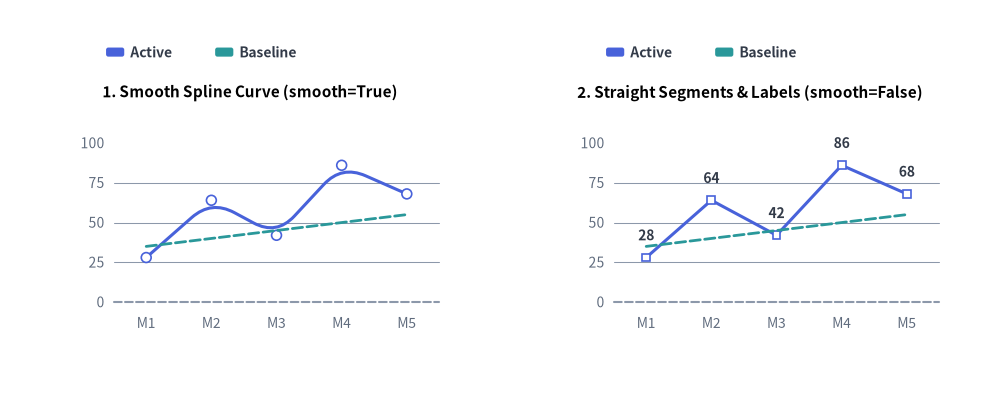
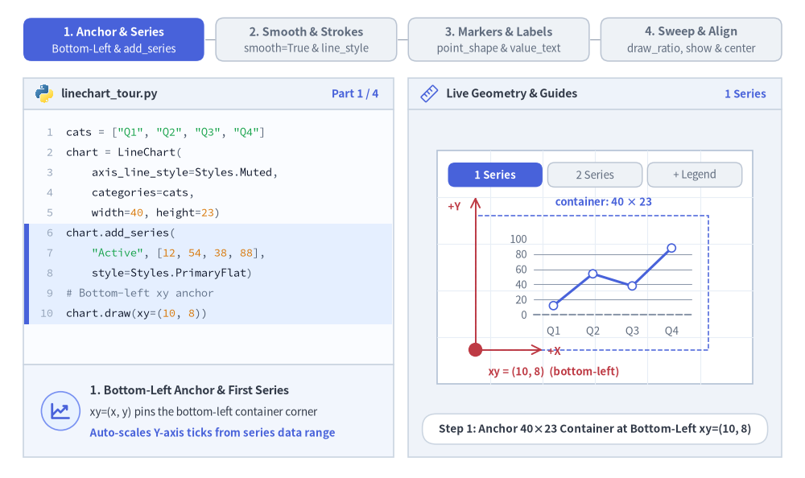
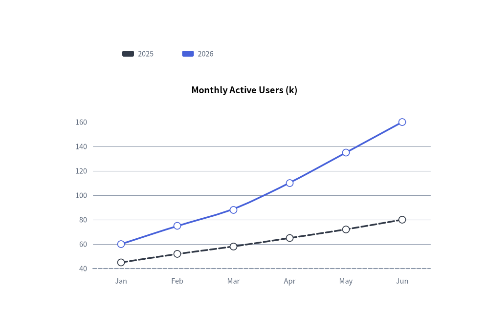
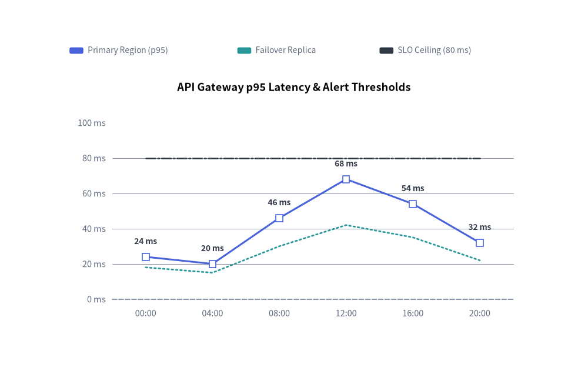

# Line Chart（折れ線グラフ）：連続トレンド・マーカー・スプライン

`LineChart` コンポーネント（`drawlib.charts.line`）は、順序付きカテゴリや時間軸に沿った数値トレンドを可視化します。直線セグメント（`smooth=False`）、滑らかなスプライン曲線（`smooth=True`）、系列ごとの頂点マーカー形状（`"circle"`、`"square"`、`"none"`）、線種パターン（`"solid"`、`"dashed"`、`"dotted"`、`"dashdot"`）、頂点上のインライン数値ラベル、および分離配置型の凡例描画をサポートしています。


<figure class="drawlib-image" style="text-align: center;">
  
  <figcaption class="drawlib-caption">LineChart の描画モード：滑らかな 3 次スプライン補間 (smooth=True) と直線ポリゴンセグメント (smooth=False)</figcaption>
</figure>

<details class="drawlib-code-details">
<summary>Source Code</summary>

```python
from drawlib.canvas import save, setup
from drawlib.charts.line import LineChart
from drawlib.styles import Styles

setup(width=132, height=52)

categories = ["M1", "M2", "M3", "M4", "M5"]
active_vals = [28.0, 64.0, 42.0, 86.0, 68.0]
baseline_vals = [35.0, 40.0, 45.0, 50.0, 55.0]

# Left: Smooth Spline Curve (smooth=True)
smooth_chart = LineChart(
    axis_line_style=Styles.MutedDashed,
    categories=categories,
    axis_text_style=Styles.Muted.patch(text_size=10.0),
    grid_style=Styles.MutedThin,
    width=56.0,
    height=36.0,
    smooth=True,
    show_points=True,
    point_size=0.65,
    title="1. Smooth Spline Curve (smooth=True)",
    title_style=Styles.BlackBold.patch(text_size=11.0),
)
smooth_chart.add_series("Active", active_vals, style=Styles.PrimaryFlat, line_width=2.2)
smooth_chart.add_series("Baseline", baseline_vals, style=Styles.SecondaryFlat, line_style="dashed", point_shape="none")
smooth_chart.configure_y_axis(min_value=0.0, max_value=100.0, tick_step=25.0)
smooth_chart.draw(xy=(5.0, 6.0))
smooth_chart.draw_legend(xy=(14.0, 45.0), text_style=Styles.DarkBold.patch(text_size=10.0), orientation="horizontal")

# Right: Straight Segments & Value Labels (smooth=False)
straight_chart = LineChart(
    axis_line_style=Styles.MutedDashed,
    categories=categories,
    axis_text_style=Styles.Muted.patch(text_size=10.0),
    grid_style=Styles.MutedThin,
    value_text_style=Styles.DarkBold.patch(text_size=10.0),
    width=56.0,
    height=36.0,
    smooth=False,
    show_points=True,
    point_shape="square",
    point_size=0.65,
    title="2. Straight Segments & Labels (smooth=False)",
    title_style=Styles.BlackBold.patch(text_size=11.0),
)
straight_chart.add_series("Active", active_vals, style=Styles.PrimaryFlat, line_width=2.2)
straight_chart.add_series("Baseline", baseline_vals, style=Styles.SecondaryFlat, line_style="dashed", point_shape="none")
straight_chart.configure_y_axis(min_value=0.0, max_value=100.0, tick_step=25.0)
straight_chart.draw(xy=(71.0, 6.0))
straight_chart.draw_legend(xy=(80.0, 45.0), text_style=Styles.DarkBold.patch(text_size=10.0), orientation="horizontal")

save()
```

</details>


---

## 1. 基本概念と基本的な使い方

`LineChart` は `.add_series(...)` によって複数系列のカテゴリトレンドを段階的に構築し、デフォルトで `(width, height)` コンテナの**左下 `(x, y)`** を基準にアンカーします（`align="center"` で中央揃えも可）。直線セグメント（`smooth=False`）と 3 次スプライン曲線（`smooth=True`）の切り替え、線種パターン・頂点マーカー・インライン数値ラベルのカスタマイズに加え、Y 軸の自動スケール範囲を固定したまま系列をスイープ描画したり非表示にしたりできます。


<figure class="drawlib-image" style="text-align: center;">
  
  <figcaption class="drawlib-caption">基本的な使い方とパラメータツアー：アンカーと系列、スプライン曲線と線種、頂点マーカーとラベル、スイープと配置制御（APNG アニメーション）</figcaption>
</figure>


<div class="drawlib-source-link">
  <a href="https://github.com/yuichi110/drawlib/blob/main/docs/docs_src/ja/05_charts/line.md" target="_blank" rel="noopener noreferrer">GitHub でアニメーションのソースコードを見る &rarr;</a>
</div>

- **左下アンカー・系列・凡例（`xy`, `add_series`, `draw_legend`）**: デフォルトで `(width, height)` チャートコンテナを左下 `xy` にアンカーし（`align="bottom_left"`）、`.add_series(...)` のトレンド線と自由配置可能な `draw_legend(...)` を組み合わせます。
- **直線セグメントと滑らかなスプライン・線種（`smooth`, `line_style`, `line_width`）**: シャープな直線折れ線（`smooth=False`）と滑らかな 3 次スプライン曲線（`smooth=True`、3 点以上）を切り替えられるほか、系列ごとに `"solid"`、`"dashed"`、`"dotted"`、`"dashdot"` の線種を指定できます。
- **頂点マーカーとインライン数値ラベル（`show_points`, `point_shape`, `value_text_style`）**: 系列単位で `"circle"`、`"square"`、`"none"` マーカー（`point_size`）を設定できます（水平な目標線などに `point_shape="none"` を指定すると、頂点マーカーと `value_text_style` の数値ラベルの両方が抑止されます）。
- **水平スイープ・軸スケール固定の `.show`・中央配置（`draw_ratio`, `align`）**: `draw_ratio` で左から右への段階的スイープを描画したり、Y 軸の自動スケール範囲を変えずに `series.show = False` で非表示化したり、`align="center"` で `(cx, cy)` を中心に配置したりできます。

---

## 2. クイック例：滑らかなスプラインによるユーザー成長トレンド


```python
from drawlib.canvas import save, setup
from drawlib.charts.line import LineChart
from drawlib.styles import Styles

setup(width=100, height=68)

chart = LineChart(
    axis_line_style=Styles.MutedDashed,
    categories=["Jan", "Feb", "Mar", "Apr", "May", "Jun"],
    axis_text_style=Styles.Muted.patch(text_size=10.5),
    grid_style=Styles.MutedThin,
    width=82,
    height=45,
    title="Monthly Active Users (k)",
    title_style=Styles.BlackBold.patch(text_size=13.0),
    smooth=True,
    show_points=True,
)
chart.add_series("2025", [45, 52, 58, 65, 72, 80], style=Styles.DarkFlat, line_width=2.5, line_style="dashed")
chart.add_series("2026", [60, 75, 88, 110, 135, 160], style=Styles.PrimaryFlat, line_width=2.5)

chart.draw(xy=(9, 7))
chart.draw_legend(xy=(25, 57), text_style=Styles.Muted.patch(text_size=10.5), orientation="horizontal")
save()
```

<figure class="drawlib-image" style="text-align: center;">
  
  <figcaption class="drawlib-caption">LineChart による月間アクティブユーザーの成長トレンド</figcaption>
</figure>


---

## 3. 直線セグメント・カスタムマーカー・線種・頂点ラベル

`smooth=False`（直線セグメント）に `value_text_style`、系列ごとの `point_shape`（`"square"`、`"circle"`、`"none"`）、および異なる `line_style` パターン（`"solid"`、`"dotted"`、`"dashdot"`）を組み合わせることで、テレメトリ指標と SLA 閾値ラインを一目で比較できるチャートを作成できます。


```python
from drawlib.canvas import save, setup
from drawlib.charts.line import LineChart
from drawlib.styles import Styles

setup(width=110, height=70)

chart = LineChart(
    axis_line_style=Styles.MutedDashed,
    categories=["00:00", "04:00", "08:00", "12:00", "16:00", "20:00"],
    width=88.0,
    height=48.0,
    title="API Gateway p95 Latency & Alert Thresholds",
    title_style=Styles.BlackBold.patch(text_size=13.0),
    smooth=False,
    show_points=True,
    axis_text_style=Styles.Muted.patch(text_size=10.5),
    grid_style=Styles.MutedThin,
    value_text_style=Styles.DarkBold.patch(text_size=10.0),
)
chart.add_series(
    "Primary Region (p95)",
    [24.0, 20.0, 46.0, 68.0, 54.0, 32.0],
    style=Styles.PrimaryFlat,
    line_width=2.2,
    point_shape="square",
    point_size=0.8,
)
chart.add_series(
    "Failover Replica",
    [18.0, 15.0, 30.0, 42.0, 35.0, 22.0],
    style=Styles.SecondaryFlat,
    line_width=2.0,
    line_style="dotted",
    point_shape="none",
)
chart.add_series(
    "SLO Ceiling (80 ms)",
    [80.0, 80.0, 80.0, 80.0, 80.0, 80.0],
    style=Styles.DarkFlat,
    line_width=1.8,
    line_style="dashdot",
    point_shape="none",
)

chart.configure_y_axis(min_value=0.0, max_value=100.0, tick_step=20.0, format="{:.0f}", unit="ms")
chart.draw(xy=(11.0, 8.0))
chart.draw_legend(
    xy=(13.0, 60.5),
    text_style=Styles.Muted.patch(text_size=10.0),
    orientation="horizontal",
    swatch_width=2.6,
    swatch_height=1.2,
    item_gap=4.0,
)
save()
```

<figure class="drawlib-image" style="text-align: center;">
  
  <figcaption class="drawlib-caption">四角形マーカー、頂点数値ラベル、一点鎖線・点線の閾値ラインを組み合わせた直線折れ線グラフ</figcaption>
</figure>


---

## 4. API リファレンス

### コンストラクタ（`LineChart`）

すべてのコンストラクタ引数は**キーワード専用引数**（`*`）です。

```python
from drawlib.charts.line import Axis, DrawDirection, FormatterType, LineChart, LineStyle, PointShape, Series

chart = LineChart(
    *,
    axis_line_style: Style,
    categories: list[str],
    width: float = 80.0,
    height: float = 50.0,
    show_points: bool = True,
    point_shape: PointShape = "circle",
    point_size: float = 0.7,
    smooth: bool = False,
    axis_text_style: Style | None = None,
    grid_style: Style | None = None,
    value_text_style: Style | None = None,
    background_style: Style | None = None,
    title: str = "",
    title_style: Style | None = None,
)
```

| パラメータ | 型 | デフォルト | 説明 |
| :--- | :--- | :--- | :--- |
| **`axis_line_style`** | `Style` | **必須** | 座標ベースラインのストロークに用いる必須アンカースタイル。 |
| **`categories`** | `list[str]` | **必須** | 水平 X 軸に沿った順序付きカテゴリラベル。 |
| `width` / `height` | `float` | `80.0` / `50.0` | キャンバス単位でのチャート全体のバウンディングボックス寸法。 |
| `show_points` | `bool` | `True` | 各頂点座標にマーカーを描画するかどうか。 |
| `point_shape` | `"circle"` \| `"square"` \| `"none"` | `"circle"` | デフォルトの頂点マーカー形状（`PointShape`）。 |
| `point_size` | `float` | `0.7` | キャンバス単位でのデフォルトのマーカー半径（四角形の場合は半幅）。 |
| `smooth` | `bool` | `False` | `True` の場合、各頂点を通る滑らかな曲線セグメントを補間します。 |
| `axis_text_style` | `Style \| None` | `None` | Y 軸目盛りラベルおよび X 軸カテゴリ名のスタイル。`None` の場合は省略されます。 |
| `grid_style` | `Style \| None` | `None` | 水平方向の Y 軸グリッド線のスタイル。`None` の場合は省略されます。 |
| `value_text_style` | `Style \| None` | `None` | 頂点マーカーの上部に描画される数値ラベルのスタイル。`None` の場合は省略されます。 |
| `background_style` | `Style \| None` | `None` | チャート外枠の背景カードのスタイル。`None` の場合は省略されます。 |
| `title` | `str` | `""` | コンテナ上部に描画されるチャートタイトル文字列。 |
| `title_style` | `Style \| None` | `None` | `title` のタイポグラフィスタイル。タイトルを描画するには必須です。 |

### メソッドとプロパティ

- **`add_series(name: str, values: list[float], style: Style, line_width: float = 2.0, line_style: LineStyle = "solid", point_shape: PointShape | None = None, point_size: float | None = None, legend_text_style: Style | None = None, *, show: bool = True, draw_ratio: float = 1.0, draw_direction: DrawDirection = "left_to_right") -> Series`**:
  折れ線系列を登録し、変更可能な `Series` インスタンスを返します。`line_style` には `"solid"`、`"dashed"`、`"dotted"`、`"dashdot"` を指定できます。`point_shape` と `point_size` はその系列に対してチャート全体のデフォルト値を上書きします。
- **`configure_y_axis(...) -> Axis`** / **`configure_x_axis(...) -> Axis`**:
  垂直の数値軸（`scale`、`min_value`、`max_value`、`ticks`、`tick_step`、`format`、`unit`、`label`）または水平のカテゴリ軸（`show_axis_line`、`line_style`、`tick_label_style`）を設定します。詳細は **[軸・スケール・凡例](./axes_and_legends.md)** を参照してください。
- **`get_size() -> tuple[float, float]`**:
  チャートコンテナの `(width, height)` を返します。
- **`draw(xy: tuple[float, float] = (0.0, 0.0), *, width: float | None = None, height: float | None = None, align: Literal["bottom_left", "center"] = "bottom_left", scale: float = 1.0) -> None`**:
  `xy` を基準（デフォルトは `"bottom_left"`、または `"center"`）としてチャートを描画します。一時的な寸法上書きや比例 `scale` にも対応しています。
- **`draw_legend(xy: tuple[float, float], text_style: Style, orientation: Literal["vertical", "horizontal"] = "vertical", swatch_width: float = 2.4, swatch_height: float = 1.2, item_gap: float = 4.0, *, scale: float = 1.0) -> None`**:
  分離配置された系列凡例を `xy` に描画します。
- **プロパティ**:
  - **`chart.series -> list[Series]`**: 登録済み `Series` オブジェクトのコピーを返します。
  - **`chart.x_axis -> Axis`** / **`chart.y_axis -> Axis`**: 水平軸・垂直軸の `Axis` インスタンスへの直接アクセスを提供します。

