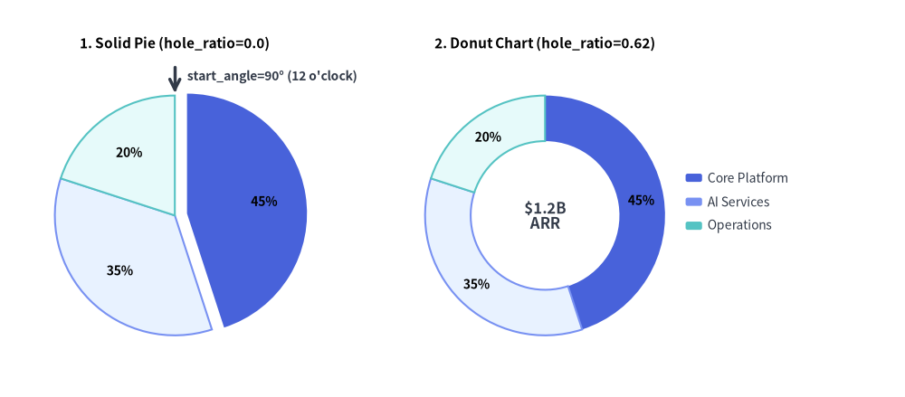
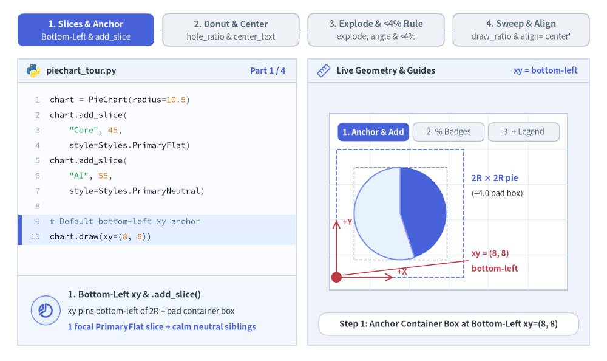
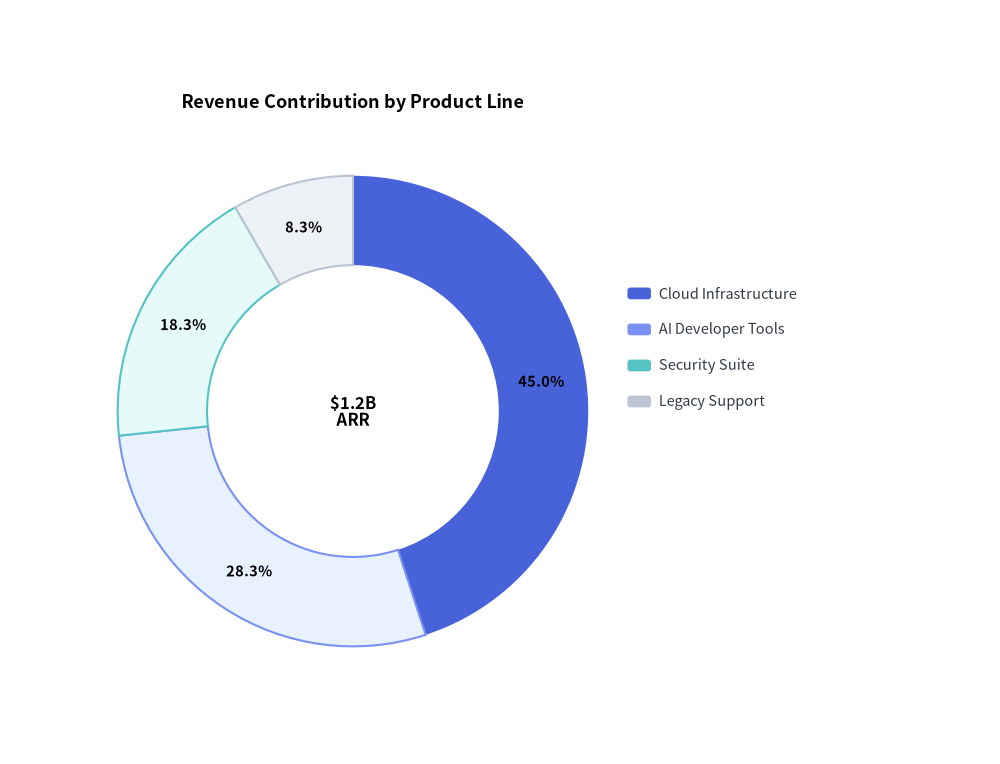
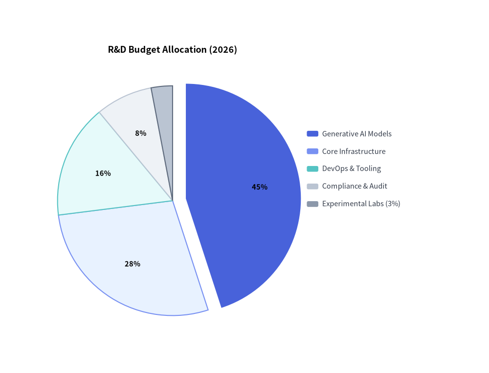

# Pie & Donut Chart（円・ドーナツグラフ）：構成比と中央 KPI バッジ

`PieChart`（`drawlib.charts.pie`）は、全体（100%）に対する各要素の構成比をスライス（扇形）として可視化します。標準的な塗りつぶし円グラフ、中央に KPI バッジを備えたモダンなドーナツリング、特定スライスの外側切り出し（explode）、開始角度や回転方向のカスタマイズ、および分離配置型の凡例描画をサポートしています。


<figure class="drawlib-image" style="text-align: center;">
  
  <figcaption class="drawlib-caption">標準の円グラフ (Solid Pie) と中央 KPI 付きドーナツグラフの比較</figcaption>
</figure>

<details class="drawlib-code-details">
<summary>Source Code</summary>

```python
from drawlib.canvas import save, setup
from drawlib.charts.pie import PieChart
from drawlib.lines import line
from drawlib.styles import Styles
from drawlib.text import text

setup(width=132, height=58)

# Left: Solid Pie Chart (hole_ratio=0.0) with Exploded Slice
solid_pie = PieChart(
    radius=17.5,
    hole_ratio=0.0,
    start_angle=90.0,
    title="1. Solid Pie (hole_ratio=0.0)",
    title_style=Styles.BlackBold.patch(text_size=11.0),
    value_text_style=Styles.BlackBold.patch(text_size=10.0),
    value_format="{:.0f}%",
)
solid_pie.add_slice("Core Platform", 45.0, style=Styles.PrimaryFlat, explode=1.8)
solid_pie.add_slice("AI Services", 35.0, style=Styles.PrimaryNeutral)
solid_pie.add_slice("Operations", 20.0, style=Styles.SecondaryNeutral)
solid_pie.draw(xy=(4.0, 5.0))

# Callout for start_angle=90° (12 o'clock)
pie_w, pie_h = solid_pie.get_size()
pie_cx = 4.0 + pie_w / 2.0
pie_top_y = 5.0 + (pie_h - 6.0) / 2.0 + 17.5
line((pie_cx, pie_top_y + 4.2), (pie_cx, pie_top_y + 0.4), arrow_head="->", style=Styles.DarkBold)
text(
    (pie_cx + 1.8, pie_top_y + 2.8),
    "start_angle=90° (12 o'clock)",
    style=Styles.DarkBold.patch(text_size=10.0, halign="left"),
)

# Right: Donut Chart (hole_ratio=0.62) with Center KPI
donut_pie = PieChart(
    radius=17.5,
    hole_ratio=0.62,
    center_text="$1.2B\nARR",
    center_text_style=Styles.DarkBold.patch(text_size=12.0),
    title="2. Donut Chart (hole_ratio=0.62)",
    title_style=Styles.BlackBold.patch(text_size=11.0),
    value_text_style=Styles.BlackBold.patch(text_size=10.0),
    value_format="{:.0f}%",
)
donut_pie.add_slice("Core Platform", 45.0, style=Styles.PrimaryFlat)
donut_pie.add_slice("AI Services", 35.0, style=Styles.PrimaryNeutral)
donut_pie.add_slice("Operations", 20.0, style=Styles.SecondaryNeutral)
donut_pie.draw(xy=(58.0, 5.0))
donut_pie.draw_legend(xy=(100.0, 32.0), text_style=Styles.Dark.patch(text_size=10.0))

save()
```

</details>


---

## 1. 基本概念と基本的な使い方

`PieChart` は `.add_slice(...)` で構成比に応じた扇形（スライス）を登録し、デフォルトでコンテナボックスの**左下 `(x, y)`** を基準にアンカーします（`align="center"` を指定すると円の中心に直接ピン留めされます）。通常の円グラフから中空のドーナツリング（`hole_ratio`、`center_text`）への変更、注目スライスの放射状切り出し（`explode`）、狭小な `4%` 未満のスライスにおけるインラインラベルの自動抑止、さらに角度スイープ（`draw_ratio`）や全体比率を保った表示切り替え（`show=False`）に対応しています。


<figure class="drawlib-image" style="text-align: center;">
  
  <figcaption class="drawlib-caption">基本的な使い方とパラメータツアー：スライスとアンカー、ドーナツ中央 KPI、切り出しと 4% 未満ルール、スイープと中央配置（APNG アニメーション）</figcaption>
</figure>


<div class="drawlib-source-link">
  <a href="https://github.com/yuichi110/drawlib/blob/main/docs/docs_src/ja/05_charts/pie.md" target="_blank" rel="noopener noreferrer">GitHub でアニメーションのソースコードを見る &rarr;</a>
</div>

- **スライス登録・アンカー・凡例（`xy`, `add_slice`, `draw_legend`）**: `.add_slice(name, value, style=...)` で比例扇形を登録し、インラインのパーセンテージバッジ（`value_text_style`、`value_format`）を描画し、`chart.draw(xy=...)`（デフォルトは `align="bottom_left"`）と `chart.draw_legend(...)` を組み合わせます。
- **塗りつぶし円グラフとドーナツ中央 KPI（`hole_ratio`, `center_text`）**: 扇形全体を描画する場合は `hole_ratio=0.0` のままにし、複数行の `center_text` + `center_text_style` による KPI バッジを配置するドーナツリングを開くには `hole_ratio` を `(0.0, 0.9]`（通常は `0.5`〜`0.7`）に設定します。
- **放射状の切り出し・回転方向・`< 4%` ルール（`explode`, `start_angle`, `clockwise`）**: `explode > 0.0` で注目スライスを放射状にオフセットし、開始角度と回転方向（`start_angle`、`clockwise`）をカスタマイズできます。また、構成比 **4% 未満のインラインラベルは自動抑止**されます（`draw_legend()` 内では小規模スライスも引き続き表示されます）。
- **部分スイープ・表示切替・中心ピン留め（`draw_ratio`, `show`, `align="center"`）**: `draw_ratio`（`draw_direction`）で角度方向または半径方向のアニメーションを描画したり、他のスライスの角度を再スケールせずに `slice.show = False` で非表示化したり、`align="center"` を渡して `xy=(cx, cy)` を円の中心に直接ピン留めしたりできます。

---

## 2. 中央 KPI バッジ付きドーナツグラフ

ドーナツグラフはエグゼクティブ向けダッシュボードに最適です。補助的なスライスを落ち着いたニュートラルトークン（`Styles.PrimaryNeutral`、`Styles.SecondaryNeutral`、`Styles.Neutral`）でまとめ、最も注目させたいスライスにのみ `Styles.PrimaryFlat` を割り当てます。


```python
from drawlib.canvas import save, setup
from drawlib.charts.pie import PieChart
from drawlib.styles import Styles

setup(width=102, height=78)

chart = PieChart(
    radius=24.0,
    hole_ratio=0.62,
    center_text="$1.2B\nARR",
    center_text_style=Styles.BlackBold.patch(text_size=12.0),
    title="Revenue Contribution by Product Line",
    title_style=Styles.BlackBold.patch(text_size=13.0),
    value_text_style=Styles.BlackBold.patch(text_size=10.5),
)
chart.add_slice("Cloud Infrastructure", 540.0, style=Styles.PrimaryFlat)
chart.add_slice("AI Developer Tools", 340.0, style=Styles.PrimaryNeutral)
chart.add_slice("Security Suite", 220.0, style=Styles.SecondaryNeutral)
chart.add_slice("Legacy Support", 100.0, style=Styles.Neutral)

chart.draw(xy=(8.0, 8.0))
chart.draw_legend(xy=(64.0, 48.0), text_style=Styles.Dark.patch(text_size=10.5))
save()
```

<figure class="drawlib-image" style="text-align: center;">
  
  <figcaption class="drawlib-caption">製品ライン別の収益構成ドーナツグラフ</figcaption>
</figure>


---

## 3. 切り出しスライスと関数フォーマッタによる予算配分

`explode > 0.0` を設定すると、スライスが中心原点から放射状に外側へオフセットされます。次の例では、呼び出し可能な関数フォーマッタ `value_format` を渡すとともに、`< 4%` 閾値ルールによってインラインラベルが自動的に抑止されつつ凡例には表示される 3% の小規模スライスも含めています。


```python
from drawlib.canvas import save, setup
from drawlib.charts.pie import PieChart
from drawlib.styles import Styles

setup(width=102, height=78)

chart = PieChart(
    radius=24.0,
    title="R&D Budget Allocation (2026)",
    title_style=Styles.BlackBold.patch(text_size=13.0),
    value_text_style=Styles.BlackBold.patch(text_size=10.5),
    value_format=lambda pct: f"{pct:.0f}%",
)
chart.add_slice("Generative AI Models", 45.0, style=Styles.PrimaryFlat, explode=2.8)
chart.add_slice("Core Infrastructure", 28.0, style=Styles.PrimaryNeutral)
chart.add_slice("DevOps & Tooling", 16.0, style=Styles.SecondaryNeutral)
chart.add_slice("Compliance & Audit", 8.0, style=Styles.Neutral)
chart.add_slice("Experimental Labs (3%)", 3.0, style=Styles.Muted)

chart.draw(xy=(8.0, 8.0))
chart.draw_legend(xy=(64.0, 50.0), text_style=Styles.Dark.patch(text_size=10.5))
save()
```

<figure class="drawlib-image" style="text-align: center;">
  
  <figcaption class="drawlib-caption">注目スライスの切り出しと関数フォーマッタを用いた予算配分グラフ</figcaption>
</figure>


---

## 4. API リファレンス

### コンストラクタ（`PieChart`）

すべてのコンストラクタ引数は**キーワード専用引数**（`*`）です。

```python
from drawlib.charts.pie import DrawDirection, FormatterType, PieChart, Slice

chart = PieChart(
    *,
    radius: float = 20.0,
    hole_ratio: float = 0.0,
    start_angle: float = 90.0,
    clockwise: bool = True,
    value_text_style: Style | None = None,
    value_format: FormatterType = "{:.1f}%",
    center_text: str = "",
    center_text_style: Style | None = None,
    background_style: Style | None = None,
    title: str = "",
    title_style: Style | None = None,
    width: float | None = None,
    height: float | None = None,
)
```

| パラメータ | 型 | デフォルト | 説明 |
| :--- | :--- | :--- | :--- |
| `radius` | `float` | `20.0` | キャンバス単位での円グラフの外周半径。 |
| `hole_ratio` | `float` | `0.0` | 内側の穴の半径比率（`0.0` で通常の円グラフ、ドーナツリングでは `[0.0, 0.9]` にクランプされます）。 |
| `start_angle` | `float` | `90.0` | 度数法による開始角度（`90.0` が 12 時方向、`0.0` が 3 時方向）。 |
| `clockwise` | `bool` | `True` | `True` の場合は `start_angle` から時計回り、`False` の場合は反時計回りにスライスを展開します。 |
| `value_text_style` | `Style \| None` | `None` | 扇形内部（構成比 4% 以上）に描画されるパーセンテージバッジのスタイル。`None` の場合は省略されます。 |
| `value_format` | `FormatterType` | `"{:.1f}%"` | スライスの構成比（`0.0`〜`100.0`）を受け取るフォーマット文字列または `Callable[[float], str]`。 |
| `center_text` | `str` | `""` | ドーナツ中央の穴に描画されるテキスト（`\n` による複数行に対応、`hole_ratio > 0` が必要）。 |
| `center_text_style` | `Style \| None` | `None` | `center_text` のタイポグラフィスタイル。中央バッジを描画するには必須です。 |
| `background_style` | `Style \| None` | `None` | チャート外枠の背景カードのスタイル。`None` の場合は省略されます。 |
| `title` | `str` | `""` | コンテナ上部に描画されるチャートタイトル文字列。 |
| `title_style` | `Style \| None` | `None` | `title` のタイポグラフィスタイル。タイトルを描画するには必須です。 |
| `width` / `height` | `float \| None` | `None` | 明示的なコンテナ寸法。`None` の場合は `radius` と `title` から自動算出されます。 |

### メソッドとプロパティ

- **`add_slice(name: str, value: float, style: Style, explode: float = 0.0, legend_text_style: Style | None = None, *, show: bool = True, draw_ratio: float = 1.0, draw_direction: DrawDirection = "left_to_right") -> Slice`**:
  比例扇形を登録し、変更可能な `Slice` インスタンスを返します。
  - `explode`: スライスの中間角度に沿って外側へ張り出すオフセット距離（`0.0` = 中心に密着）。
  - `legend_text_style`: `draw_legend()` 内におけるこのスライスラベルのカスタム `Style`（任意）。
  - `show`: 全スライスの合計値を維持したまま表示・非表示を切り替えるため、残りの扇形が再スケールされません。
  - `draw_ratio` & `draw_direction`: 部分空間レンダリング制御（`"left_to_right"` は角度方向に `span * draw_ratio` 分スイープし、`"bottom_to_top"` は内縁から外周 `radius` に向かって放射状に伸びます）。
- **`get_size() -> tuple[float, float]`**:
  算出されたチャートコンテナの `(width, height)` バウンディングボックスを返します。
- **`draw(xy: tuple[float, float] = (0.0, 0.0), *, radius: float | None = None, width: float | None = None, height: float | None = None, align: Literal["bottom_left", "center"] = "bottom_left", scale: float = 1.0) -> None`**:
  `xy` を基準（デフォルトは `"bottom_left"`、または `"center"`）としてチャートを描画します。一時的な `radius`/`width`/`height` の上書きや均一な `scale` にも対応しています。
- **`draw_legend(xy: tuple[float, float], text_style: Style, orientation: Literal["vertical", "horizontal"] = "vertical", swatch_width: float = 2.4, swatch_height: float = 1.2, item_gap: float = 4.0, *, scale: float = 1.0) -> None`**:
  分離配置されたスライス凡例を `xy` に描画します。
- **プロパティ**:
  - **`chart.slices -> list[Slice]`**: 登録済み `Slice` オブジェクトのコピーを返します。
